# Kuesioner SAK.AGS25-AK.pdf

Sumber Asli: `/home/alfzki/Documents/OSL/materials/notes/Kuesioner SAK.AGS25-AK.pdf`

---

## Halaman 1

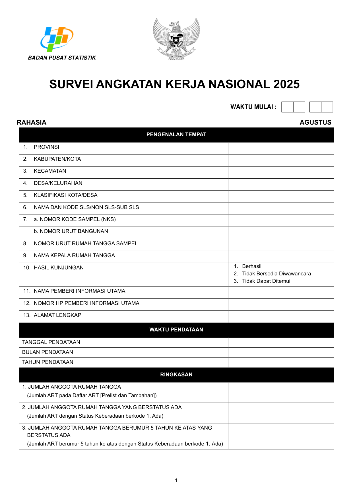

1 
 
 
 
 
 
 
 
RAHASIA                                                                                                                                            AGUSTUS 
PENGENALAN TEMPAT 
1. 
PROVINSI 
 
2. 
KABUPATEN/KOTA 
 
3. 
KECAMATAN 
 
4. 
DESA/KELURAHAN 
 
5. 
KLASIFIKASI KOTA/DESA 
 
6. 
NAMA DAN KODE SLS/NON SLS-SUB SLS 
 
7. 
a. NOMOR KODE SAMPEL (NKS) 
 
b. NOMOR URUT BANGUNAN 
 
8. 
NOMOR URUT RUMAH TANGGA SAMPEL 
 
9. 
NAMA KEPALA RUMAH TANGGA  
 
10. HASIL KUNJUNGAN 
1. Berhasil 
2. Tidak Bersedia Diwawancara 
3. Tidak Dapat Ditemui 
11. NAMA PEMBERI INFORMASI UTAMA 
 
12. NOMOR HP PEMBERI INFORMASI UTAMA 
 
13. ALAMAT LENGKAP 
 
WAKTU PENDATAAN 
TANGGAL PENDATAAN 
 
BULAN PENDATAAN 
 
TAHUN PENDATAAN 
 
RINGKASAN 
1. JUMLAH ANGGOTA RUMAH TANGGA 
(Jumlah ART pada Daftar ART [Prelist dan Tambahan]) 
 
2. JUMLAH ANGGOTA RUMAH TANGGA YANG BERSTATUS ADA   
(Jumlah ART dengan Status Keberadaan berkode 1. Ada) 
 
3. JUMLAH ANGGOTA RUMAH TANGGA BERUMUR 5 TAHUN KE ATAS YANG 
BERSTATUS ADA 
(Jumlah ART berumur 5 tahun ke atas dengan Status Keberadaan berkode 1. Ada) 
 
 
BADAN PUSAT STATISTIK
 
SURVEI ANGKATAN KERJA NASIONAL 2025 
WAKTU MULAI :

---

## Halaman 2

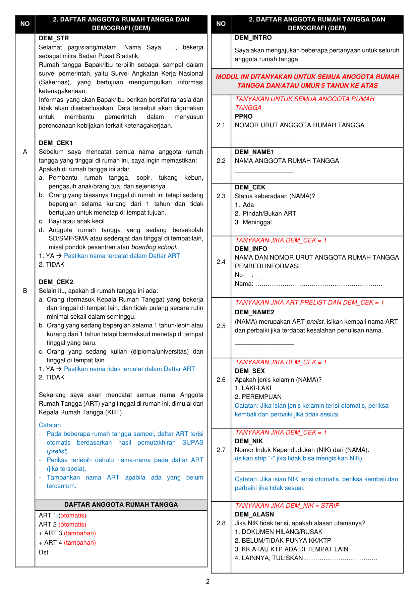

2 
NO 
2. DAFTAR ANGGOTA RUMAH TANGGA DAN 
DEMOGRAFI (DEM) 
  
DEM_STR 
  
Selamat pagi/siang/malam. Nama Saya ....., bekerja 
sebagai mitra Badan Pusat Statistik.  
  
Rumah tangga Bapak/Ibu terpilih sebagai sampel dalam 
survei pemerintah, yaitu Survei Angkatan Kerja Nasional 
(Sakernas), yang bertujuan mengumpulkan informasi 
ketenagakerjaan. 
  
Informasi yang akan Bapak/Ibu berikan bersifat rahasia dan 
tidak akan disebarluaskan. Data tersebut akan digunakan 
untuk 
membantu 
pemerintah 
dalam 
menyusun 
perencanaan kebijakan terkait ketenagakerjaan. 
  
  
  
DEM_CEK1 
A 
Sebelum saya mencatat semua nama anggota rumah 
tangga yang tinggal di rumah ini, saya ingin memastikan: 
  
Apakah di rumah tangga ini ada: 
  
a. Pembantu 
rumah 
tangga, 
sopir, 
tukang 
kebun, 
pengasuh anak/orang tua, dan sejenisnya. 
  
b. Orang yang biasanya tinggal di rumah ini tetapi sedang 
bepergian selama kurang dari 1 tahun dan tidak 
bertujuan untuk menetap di tempat tujuan. 
  
c. Bayi atau anak kecil. 
  
d. Anggota rumah tangga yang sedang bersekolah 
SD/SMP/SMA atau sederajat dan tinggal di tempat lain, 
misal pondok pesantren atau boarding school. 
  
1. YA → Pastikan nama tercatat dalam Daftar ART 
  
2. TIDAK 
  
  
  
DEM_CEK2 
B 
Selain itu, apakah di rumah tangga ini ada: 
  
a. Orang (termasuk Kepala Rumah Tangga) yang bekerja 
dan tinggal di tempat lain, dan tidak pulang secara rutin 
minimal sekali dalam seminggu. 
  
b. Orang yang sedang bepergian selama 1 tahun/lebih atau 
kurang dari 1 tahun tetapi bermaksud menetap di tempat 
tinggal yang baru. 
  
c. Orang yang sedang kuliah (diploma/universitas) dan 
tinggal di tempat lain. 
  
1. YA → Pastikan nama tidak tercatat dalam Daftar ART 
  
2. TIDAK 
  
 
  
Sekarang saya akan mencatat semua nama Anggota 
Rumah Tangga (ART) yang tinggal di rumah ini, dimulai dari 
Kepala Rumah Tangga (KRT). 
 
Catatan:  
- Pada beberapa rumah tangga sampel, daftar ART terisi 
otomatis berdasarkan hasil pemutakhiran SUPAS 
(prelist). 
- Periksa terlebih dahulu nama-nama pada daftar ART 
(jika tersedia). 
- Tambahkan nama ART apabila ada yang belum 
tercantum. 
 
 
DAFTAR ANGGOTA RUMAH TANGGA 
 
ART 1 (otomatis) 
 
ART 2 (otomatis)  
+ ART 3 (tambahan) 
 
+ ART 4 (tambahan) 
 
Dst 
 
 
NO 
2. DAFTAR ANGGOTA RUMAH TANGGA DAN 
DEMOGRAFI (DEM) 
 
DEM_INTRO 
Saya akan mengajukan beberapa pertanyaan untuk seluruh 
anggota rumah tangga. 
MODUL INI DITANYAKAN UNTUK SEMUA ANGGOTA RUMAH 
TANGGA DAN/ATAU UMUR 5 TAHUN KE ATAS 
 
TANYAKAN UNTUK SEMUA ANGGOTA RUMAH 
TANGGA 
  
PPNO 
2.1 
NOMOR URUT ANGGOTA RUMAH TANGGA 
  
_________________ 
  
  
  
DEM_NAME1 
2.2 
NAMA ANGGOTA RUMAH TANGGA 
  
_________________ 
  
 
 
DEM_CEK 
2.3 
Status keberadaan (NAMA)? 
 
1. Ada 
 
2. Pindah/Bukan ART 
 
3. Meninggal 
 
 
 
TANYAKAN JIKA DEM_CEK = 1 
  
DEM_INFO 
2.4 
NAMA DAN NOMOR URUT ANGGOTA RUMAH TANGGA 
PEMBERI INFORMASI 
  
No     : __ 
  
Nama: ……………………………………………………. 
 
 
TANYAKAN JIKA ART PRELIST DAN DEM_CEK = 1 
 
DEM_NAME2 
2.5 
(NAMA) merupakan ART prelist, isikan kembali nama ART 
dan perbaiki jika terdapat kesalahan penulisan nama. 
 
_________________ 
 
 
  
TANYAKAN JIKA DEM_CEK = 1 
DEM_SEX 
2.6 
Apakah jenis kelamin (NAMA)? 
  
1. LAKI-LAKI 
  
2. PEREMPUAN 
  
Catatan: Jika isian jenis kelamin terisi otomatis, periksa 
kembali dan perbaiki jika tidak sesuai. 
 
  
TANYAKAN JIKA DEM_CEK = 1 
DEM_NIK 
2.7 
Nomor Induk Kependudukan (NIK) dari (NAMA): 
  
(isikan strip "-" jika tidak bisa mengisikan NIK) 
  
___________________ 
 
Catatan: Jika isian NIK terisi otomatis, periksa kembali dan 
perbaiki jika tidak sesuai. 
  
  
  
TANYAKAN JIKA DEM_NIK = STRIP 
  
DEM_ALASN 
2.8 
Jika NIK tidak terisi, apakah alasan utamanya? 
  
1. DOKUMEN HILANG/RUSAK 
  
2. BELUM/TIDAK PUNYA KK/KTP 
  
3. KK ATAU KTP ADA DI TEMPAT LAIN 
  
4. LAINNYA, TULISKAN ……………………………..

---

## Halaman 3

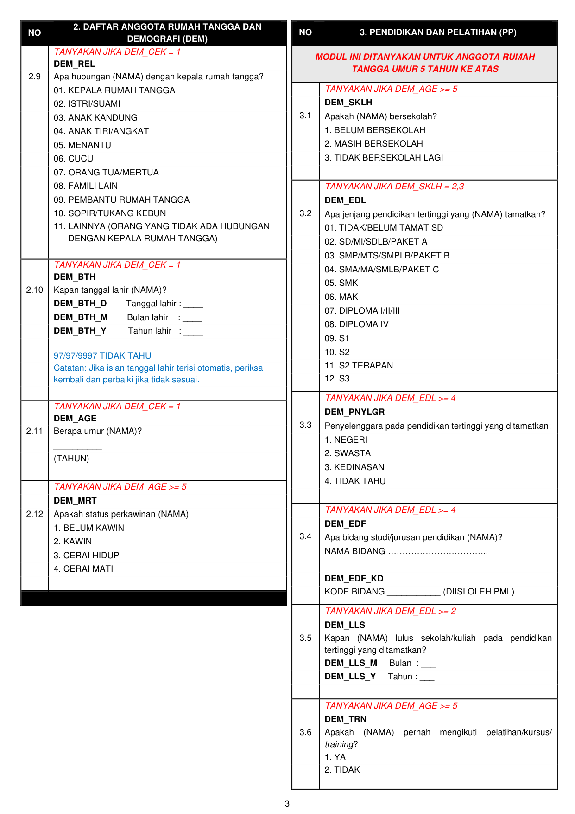

3 
NO 
2. DAFTAR ANGGOTA RUMAH TANGGA DAN 
DEMOGRAFI (DEM) 
  
TANYAKAN JIKA DEM_CEK = 1 
DEM_REL 
2.9 
Apa hubungan (NAMA) dengan kepala rumah tangga? 
  
01. KEPALA RUMAH TANGGA 
  
02. ISTRI/SUAMI 
  
03. ANAK KANDUNG 
  
04. ANAK TIRI/ANGKAT 
  
05. MENANTU 
  
06. CUCU 
  
07. ORANG TUA/MERTUA 
  
08. FAMILI LAIN 
  
09. PEMBANTU RUMAH TANGGA 
  
10. SOPIR/TUKANG KEBUN 
  
11. LAINNYA (ORANG YANG TIDAK ADA HUBUNGAN 
      DENGAN KEPALA RUMAH TANGGA) 
  
 
  
TANYAKAN JIKA DEM_CEK = 1 
DEM_BTH 
2.10 
Kapan tanggal lahir (NAMA)? 
  
DEM_BTH_D        Tanggal lahir : ____ 
  
DEM_BTH_M        Bulan lahir    : ____ 
  
DEM_BTH_Y         Tahun lahir   : ____ 
  
 
97/97/9997 TIDAK TAHU 
 
Catatan: Jika isian tanggal lahir terisi otomatis, periksa 
kembali dan perbaiki jika tidak sesuai. 
 
  
 
TANYAKAN JIKA DEM_CEK = 1 
DEM_AGE 
2.11 
Berapa umur (NAMA)? 
  
__________ 
  
(TAHUN) 
  
  
  
TANYAKAN JIKA DEM_AGE >= 5 
  
DEM_MRT 
2.12 
Apakah status perkawinan (NAMA) 
  
1. BELUM KAWIN 
  
2. KAWIN  
  
3. CERAI HIDUP 
  
4. CERAI MATI 
  
  
  
  
 
 
 
 
 
 
 
 
NO 
3. PENDIDIKAN DAN PELATIHAN (PP) 
MODUL INI DITANYAKAN UNTUK ANGGOTA RUMAH 
TANGGA UMUR 5 TAHUN KE ATAS 
TANYAKAN JIKA DEM_AGE >= 5 
 
DEM_SKLH 
3.1 
Apakah (NAMA) bersekolah? 
 
1. BELUM BERSEKOLAH 
2. MASIH BERSEKOLAH 
 
3. TIDAK BERSEKOLAH LAGI 
 
 
TANYAKAN JIKA DEM_SKLH = 2,3 
DEM_EDL 
3.2 
Apa jenjang pendidikan tertinggi yang (NAMA) tamatkan? 
01. TIDAK/BELUM TAMAT SD 
02. SD/MI/SDLB/PAKET A 
 
03. SMP/MTS/SMPLB/PAKET B 
04. SMA/MA/SMLB/PAKET C 
05. SMK 
06. MAK 
 
07. DIPLOMA I/II/III 
08. DIPLOMA IV 
09. S1 
10. S2 
11. S2 TERAPAN 
 
12. S3 
TANYAKAN JIKA DEM_EDL >= 4 
DEM_PNYLGR 
3.3 
Penyelenggara pada pendidikan tertinggi yang ditamatkan: 
1. NEGERI 
2. SWASTA 
3. KEDINASAN 
4. TIDAK TAHU 
 
  
TANYAKAN JIKA DEM_EDL >= 4 
DEM_EDF 
3.4 
Apa bidang studi/jurusan pendidikan (NAMA)? 
NAMA BIDANG ……………………………..  
 
DEM_EDF_KD  
KODE BIDANG ___________ (DIISI OLEH PML) 
TANYAKAN JIKA DEM_EDL >= 2 
DEM_LLS 
3.5 
Kapan (NAMA) lulus sekolah/kuliah pada pendidikan 
tertinggi yang ditamatkan? 
DEM_LLS_M     Bulan  : ___ 
DEM_LLS_Y     Tahun : ___ 
 
 
TANYAKAN JIKA DEM_AGE >= 5 
DEM_TRN 
3.6 
Apakah 
(NAMA) 
pernah mengikuti pelatihan/kursus/ 
training? 
1. YA 
2. TIDAK

---

## Halaman 4

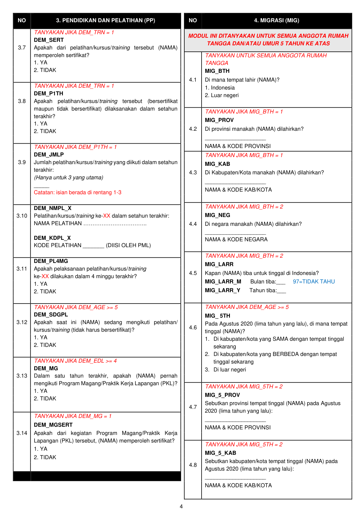

4 
NO 
3. PENDIDIKAN DAN PELATIHAN (PP) 
TANYAKAN JIKA DEM_TRN = 1 
DEM_SERT 
3.7 
Apakah dari pelatihan/kursus/training tersebut (NAMA) 
memperoleh sertifikat? 
1. YA 
2. TIDAK 
  
TANYAKAN JIKA DEM_TRN = 1 
DEM_P1TH 
3.8 
Apakah pelatihan/kursus/training tersebut (bersertifikat 
maupun tidak bersertifikat) dilaksanakan dalam setahun 
terakhir? 
1. YA 
2. TIDAK 
  
TANYAKAN JIKA DEM_P1TH = 1 
DEM_JMLP 
3.9 
Jumlah pelatihan/kursus/training yang diikuti dalam setahun 
terakhir: 
(Hanya untuk 3 yang utama) 
_____ 
Catatan: isian berada di rentang 1-3 
  
DEM_NMPL_X 
3.10 
Pelatihan/kursus/training ke-XX dalam setahun terakhir: 
NAMA PELATIHAN …………………………….. 
 
DEM_KDPL_X 
 
KODE PELATIHAN _______ (DIISI OLEH PML) 
  
DEM_PL4MG  
3.11 
Apakah pelaksanaan pelatihan/kursus/training  
ke-XX dilakukan dalam 4 minggu terakhir? 
1. YA 
 
2. TIDAK 
  
TANYAKAN JIKA DEM_AGE >= 5 
 
DEM_SDGPL  
3.12 
Apakah saat ini (NAMA) sedang mengikuti pelatihan/ 
kursus/training (tidak harus bersertifikat)? 
1. YA 
2. TIDAK 
 
TANYAKAN JIKA DEM_EDL >= 4 
DEM_MG 
3.13 
Dalam satu tahun terakhir, apakah (NAMA) pernah 
mengikuti Program Magang/Praktik Kerja Lapangan (PKL)? 
1. YA 
2. TIDAK 
  
TANYAKAN JIKA DEM_MG = 1 
DEM_MGSERT 
3.14 
Apakah dari kegiatan Program Magang/Praktik Kerja 
Lapangan (PKL) tersebut, (NAMA) memperoleh sertifikat? 
1. YA 
2. TIDAK 
  
  
 
NO 
4. MIGRASI (MIG) 
MODUL INI DITANYAKAN UNTUK SEMUA ANGGOTA RUMAH 
TANGGA DAN/ATAU UMUR 5 TAHUN KE ATAS 
 
TANYAKAN UNTUK SEMUA ANGGOTA RUMAH 
TANGGA 
 
MIG_BTH 
4.1 
Di mana tempat lahir (NAMA)? 
  
1. Indonesia 
  
2. Luar negeri 
  
  
  
TANYAKAN JIKA MIG_BTH = 1 
  
MIG_PROV  
4.2 
Di provinsi manakah (NAMA) dilahirkan? 
  
____________________     
  
NAMA & KODE PROVINSI               
  
TANYAKAN JIKA MIG_BTH = 1 
  
MIG_KAB 
4.3 
Di Kabupaten/Kota manakah (NAMA) dilahirkan? 
  
____________________     
  
NAMA & KODE KAB/KOTA      
  
  
  
TANYAKAN JIKA MIG_BTH = 2 
  
MIG_NEG 
4.4 
Di negara manakah (NAMA) dilahirkan? 
  
____________________     
  
NAMA & KODE NEGARA 
  
  
  
TANYAKAN JIKA MIG_BTH = 2 
  
MIG_LARR 
4.5 
Kapan (NAMA) tiba untuk tinggal di Indonesia? 
  
MIG_LARR_M      Bulan tiba:___     97=TIDAK TAHU 
  
MIG_LARR_Y      Tahun tiba:___ 
  
  
  
TANYAKAN JIKA DEM_AGE >= 5 
  
MIG_ 5TH 
4.6 
Pada Agustus 2020 (lima tahun yang lalu), di mana tempat 
tinggal (NAMA)? 
  
1. Di kabupaten/kota yang SAMA dengan tempat tinggal 
sekarang    
  
2. Di kabupaten/kota yang BERBEDA dengan tempat 
tinggal sekarang 
  
3. Di luar negeri 
  
 
  
TANYAKAN JIKA MIG_5TH = 2 
  
MIG_5_PROV 
4.7 
Sebutkan provinsi tempat tinggal (NAMA) pada Agustus 
2020 (lima tahun yang lalu): 
  
____________________     
  
NAMA & KODE PROVINSI               
  
  
  
TANYAKAN JIKA MIG_5TH = 2 
  
MIG_5_KAB 
4.8 
Sebutkan kabupaten/kota tempat tinggal (NAMA) pada 
Agustus 2020 (lima tahun yang lalu): 
  
____________________     
  
NAMA & KODE KAB/KOTA

---

## Halaman 5

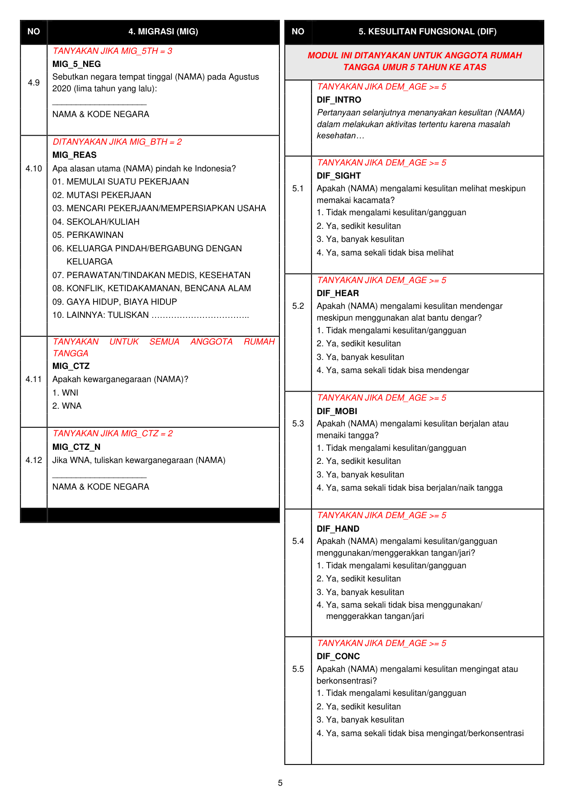

5 
NO 
4. MIGRASI (MIG) 
  
TANYAKAN JIKA MIG_5TH = 3 
  
MIG_5_NEG 
4.9 
Sebutkan negara tempat tinggal (NAMA) pada Agustus 
2020 (lima tahun yang lalu): 
  
____________________     
  
NAMA & KODE NEGARA 
  
  
  
DITANYAKAN JIKA MIG_BTH = 2 
  
MIG_REAS  
4.10 
Apa alasan utama (NAMA) pindah ke Indonesia? 
  
01. MEMULAI SUATU PEKERJAAN 
  
02. MUTASI PEKERJAAN 
  
03. MENCARI PEKERJAAN/MEMPERSIAPKAN USAHA 
  
04. SEKOLAH/KULIAH 
  
05. PERKAWINAN 
  
06. KELUARGA PINDAH/BERGABUNG DENGAN  
  
      KELUARGA 
  
07. PERAWATAN/TINDAKAN MEDIS, KESEHATAN 
  
08. KONFLIK, KETIDAKAMANAN, BENCANA ALAM 
  
09. GAYA HIDUP, BIAYA HIDUP 
  
10. LAINNYA: TULISKAN …………………………….. 
  
  
  
TANYAKAN 
UNTUK 
SEMUA 
ANGGOTA 
RUMAH 
TANGGA 
  
MIG_CTZ  
4.11 
Apakah kewarganegaraan (NAMA)? 
  
1. WNI 
  
2. WNA 
  
  
  
TANYAKAN JIKA MIG_CTZ = 2 
  
MIG_CTZ_N 
4.12 
Jika WNA, tuliskan kewarganegaraan (NAMA) 
  
____________________     
  
NAMA & KODE NEGARA 
  
  
  
  
 
 
 
 
 
 
 
 
 
 
NO 
5. KESULITAN FUNGSIONAL (DIF)  
MODUL INI DITANYAKAN UNTUK ANGGOTA RUMAH 
TANGGA UMUR 5 TAHUN KE ATAS 
  
TANYAKAN JIKA DEM_AGE >= 5 
DIF_INTRO 
Pertanyaan selanjutnya menanyakan kesulitan (NAMA) 
dalam melakukan aktivitas tertentu karena masalah 
kesehatan… 
  
TANYAKAN JIKA DEM_AGE >= 5 
DIF_SIGHT 
5.1 
Apakah (NAMA) mengalami kesulitan melihat meskipun 
memakai kacamata?  
1. Tidak mengalami kesulitan/gangguan 
2. Ya, sedikit kesulitan 
3. Ya, banyak kesulitan 
4. Ya, sama sekali tidak bisa melihat 
  
TANYAKAN JIKA DEM_AGE >= 5 
DIF_HEAR 
5.2 
Apakah (NAMA) mengalami kesulitan mendengar 
meskipun menggunakan alat bantu dengar? 
1. Tidak mengalami kesulitan/gangguan 
 
2. Ya, sedikit kesulitan 
3. Ya, banyak kesulitan 
4. Ya, sama sekali tidak bisa mendengar 
 
  
TANYAKAN JIKA DEM_AGE >= 5 
DIF_MOBI 
5.3 
Apakah (NAMA) mengalami kesulitan berjalan atau 
menaiki tangga? 
1. Tidak mengalami kesulitan/gangguan 
 
2. Ya, sedikit kesulitan 
3. Ya, banyak kesulitan 
4. Ya, sama sekali tidak bisa berjalan/naik tangga 
  
TANYAKAN JIKA DEM_AGE >= 5 
DIF_HAND 
5.4 
Apakah (NAMA) mengalami kesulitan/gangguan 
menggunakan/menggerakkan tangan/jari? 
1. Tidak mengalami kesulitan/gangguan 
2. Ya, sedikit kesulitan 
3. Ya, banyak kesulitan 
4. Ya, sama sekali tidak bisa menggunakan/   
    menggerakkan tangan/jari 
  
TANYAKAN JIKA DEM_AGE >= 5 
DIF_CONC 
5.5 
Apakah (NAMA) mengalami kesulitan mengingat atau 
berkonsentrasi? 
1. Tidak mengalami kesulitan/gangguan 
2. Ya, sedikit kesulitan 
3. Ya, banyak kesulitan 
4. Ya, sama sekali tidak bisa mengingat/berkonsentrasi

---

## Halaman 6

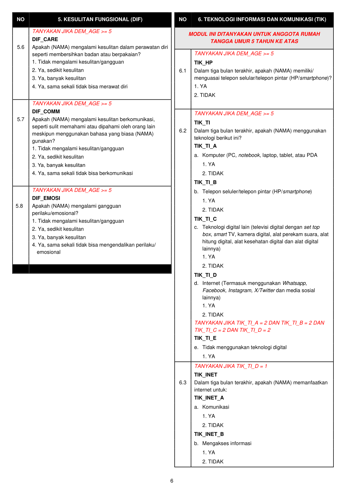

6 
NO 
5. KESULITAN FUNGSIONAL (DIF)  
TANYAKAN JIKA DEM_AGE >= 5 
DIF_CARE 
5.6 
Apakah (NAMA) mengalami kesulitan dalam perawatan diri 
seperti membersihkan badan atau berpakaian? 
1. Tidak mengalami kesulitan/gangguan 
2. Ya, sedikit kesulitan 
3. Ya, banyak kesulitan 
4. Ya, sama sekali tidak bisa merawat diri 
  
TANYAKAN JIKA DEM_AGE >= 5 
DIF_COMM 
5.7 
Apakah (NAMA) mengalami kesulitan berkomunikasi, 
seperti sulit memahami atau dipahami oleh orang lain 
meskipun menggunakan bahasa yang biasa (NAMA) 
gunakan? 
1. Tidak mengalami kesulitan/gangguan 
2. Ya, sedikit kesulitan 
  
3. Ya, banyak kesulitan 
  
4. Ya, sama sekali tidak bisa berkomunikasi 
 
 
 
TANYAKAN JIKA DEM_AGE >= 5 
 
DIF_EMOSI 
5.8 
Apakah (NAMA) mengalami gangguan 
perilaku/emosional? 
 
1. Tidak mengalami kesulitan/gangguan 
 
2. Ya, sedikit kesulitan 
 
3. Ya, banyak kesulitan 
 
4. Ya, sama sekali tidak bisa mengendalikan perilaku/  
emosional 
  
  
  
  
 
 
 
 
 
 
 
 
 
 
 
 
 
NO 
6. TEKNOLOGI INFORMASI DAN KOMUNIKASI (TIK) 
MODUL INI DITANYAKAN UNTUK ANGGOTA RUMAH 
TANGGA UMUR 5 TAHUN KE ATAS 
TANYAKAN JIKA DEM_AGE >= 5 
TIK_HP 
6.1 
Dalam tiga bulan terakhir, apakah (NAMA) memiliki/ 
menguasai telepon selular/telepon pintar (HP/smartphone)? 
1. YA 
2. TIDAK 
  
TANYAKAN JIKA DEM_AGE >= 5 
TIK_TI 
6.2 
Dalam tiga bulan terakhir, apakah (NAMA) menggunakan 
teknologi berikut ini? 
TIK_TI_A 
a. Komputer (PC, notebook, laptop, tablet, atau PDA 
1. YA 
2. TIDAK 
TIK_TI_B 
b. Telepon seluler/telepon pintar (HP/smartphone) 
1. YA 
2. TIDAK 
TIK_TI_C 
 
c. Teknologi digital lain (televisi digital dengan set top 
box, smart TV, kamera digital, alat perekam suara, alat 
hitung digital, alat kesehatan digital dan alat digital 
lainnya) 
1. YA 
2. TIDAK 
 
TIK_TI_D 
d. Internet (Termasuk menggunakan Whatsapp, 
Facebook, Instagram, X/Twitter dan media sosial 
lainnya) 
1. YA 
2. TIDAK 
TANYAKAN JIKA TIK_TI_A = 2 DAN TIK_TI_B = 2 DAN 
TIK_TI_C = 2 DAN TIK_TI_D = 2 
TIK_TI_E 
e. Tidak menggunakan teknologi digital 
1. YA 
TANYAKAN JIKA TIK_TI_D = 1 
TIK_INET 
6.3 
Dalam tiga bulan terakhir, apakah (NAMA) memanfaatkan 
internet untuk: 
TIK_INET_A 
a. Komunikasi 
 
1. YA 
2. TIDAK 
TIK_INET_B 
b. Mengakses informasi 
1. YA 
2. TIDAK

---

## Halaman 7

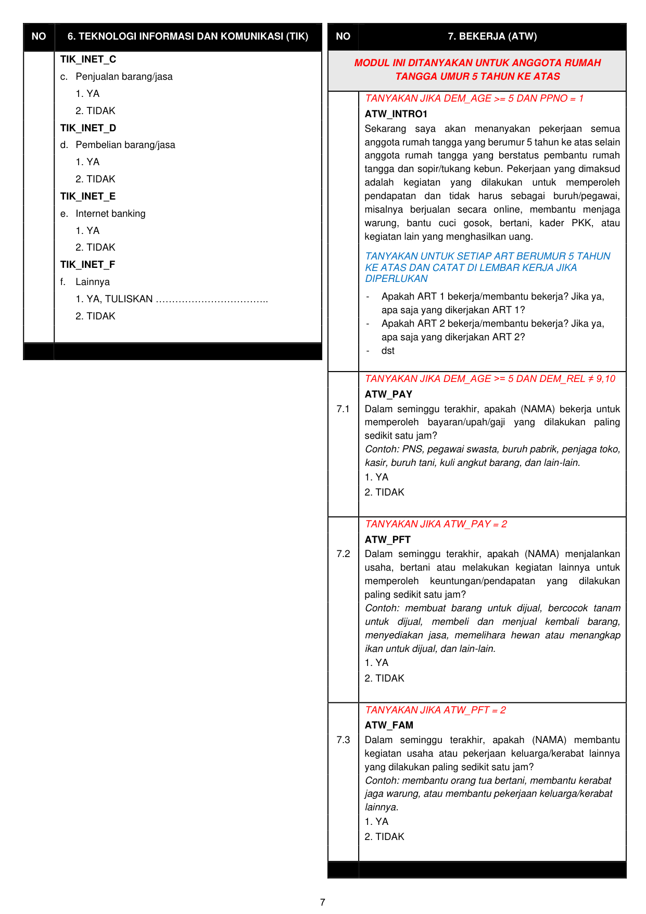

7 
NO 
6. TEKNOLOGI INFORMASI DAN KOMUNIKASI (TIK) 
TIK_INET_C 
 
c. Penjualan barang/jasa 
1. YA 
2. TIDAK 
TIK_INET_D 
 
d. Pembelian barang/jasa 
1. YA 
2. TIDAK 
TIK_INET_E 
 
e. Internet banking 
1. YA 
2. TIDAK 
TIK_INET_F 
f. Lainnya 
1. YA, TULISKAN …………………………….. 
2. TIDAK 
  
  
 
 
 
 
 
 
 
 
 
 
 
 
 
 
 
 
 
 
 
 
 
 
 
 
NO 
7. BEKERJA (ATW) 
MODUL INI DITANYAKAN UNTUK ANGGOTA RUMAH 
TANGGA UMUR 5 TAHUN KE ATAS 
 
TANYAKAN JIKA DEM_AGE >= 5 DAN PPNO = 1 
  
ATW_INTRO1 
  
Sekarang saya akan menanyakan pekerjaan semua 
anggota rumah tangga yang berumur 5 tahun ke atas selain 
anggota rumah tangga yang berstatus pembantu rumah 
tangga dan sopir/tukang kebun. Pekerjaan yang dimaksud 
adalah kegiatan yang dilakukan untuk memperoleh 
pendapatan dan tidak harus sebagai buruh/pegawai, 
misalnya berjualan secara online, membantu menjaga 
warung, bantu cuci gosok, bertani, kader PKK, atau 
kegiatan lain yang menghasilkan uang. 
TANYAKAN UNTUK SETIAP ART BERUMUR 5 TAHUN 
KE ATAS DAN CATAT DI LEMBAR KERJA JIKA 
DIPERLUKAN 
  
- 
Apakah ART 1 bekerja/membantu bekerja? Jika ya, 
apa saja yang dikerjakan ART 1?  
  
- 
Apakah ART 2 bekerja/membantu bekerja? Jika ya, 
apa saja yang dikerjakan ART 2?  
  
- 
dst 
  
TANYAKAN JIKA DEM_AGE >= 5 DAN DEM_REL ≠ 9,10 
  
ATW_PAY 
7.1 
Dalam seminggu terakhir, apakah (NAMA) bekerja untuk 
memperoleh bayaran/upah/gaji yang dilakukan paling 
sedikit satu jam? 
Contoh: PNS, pegawai swasta, buruh pabrik, penjaga toko, 
kasir, buruh tani, kuli angkut barang, dan lain-lain. 
1. YA 
 
2. TIDAK 
  
 
TANYAKAN JIKA ATW_PAY = 2 
ATW_PFT 
7.2 
Dalam seminggu terakhir, apakah (NAMA) menjalankan 
usaha, bertani atau melakukan kegiatan lainnya untuk 
memperoleh 
keuntungan/pendapatan 
yang 
dilakukan 
paling sedikit satu jam? 
Contoh: membuat barang untuk dijual, bercocok tanam 
untuk dijual, membeli dan menjual kembali barang, 
menyediakan jasa, memelihara hewan atau menangkap 
ikan untuk dijual, dan lain-lain. 
1. YA 
2. TIDAK 
  
TANYAKAN JIKA ATW_PFT = 2 
ATW_FAM 
7.3 
Dalam seminggu terakhir, apakah (NAMA) membantu 
kegiatan usaha atau pekerjaan keluarga/kerabat lainnya 
yang dilakukan paling sedikit satu jam? 
  
Contoh: membantu orang tua bertani, membantu kerabat 
jaga warung, atau membantu pekerjaan keluarga/kerabat 
lainnya. 
  
1. YA 
  
2. TIDAK

---

## Halaman 8

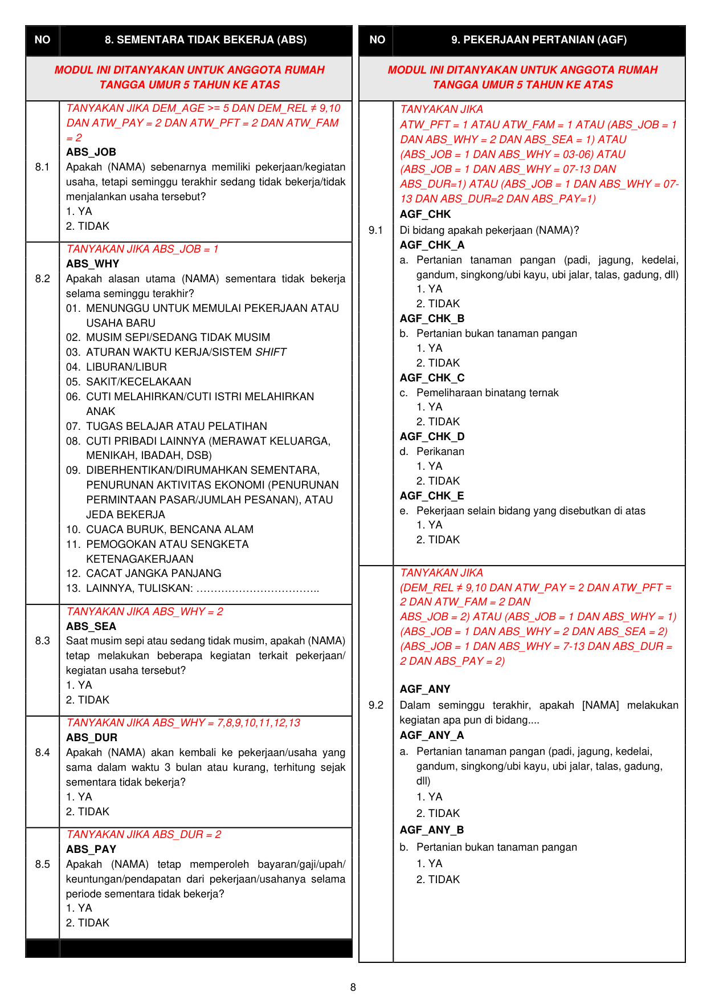

8 
NO 
8. SEMENTARA TIDAK BEKERJA (ABS) 
MODUL INI DITANYAKAN UNTUK ANGGOTA RUMAH 
TANGGA UMUR 5 TAHUN KE ATAS 
  
TANYAKAN JIKA DEM_AGE >= 5 DAN DEM_REL ≠ 9,10 
DAN ATW_PAY = 2 DAN ATW_PFT = 2 DAN ATW_FAM 
= 2 
  
ABS_JOB 
8.1 
Apakah (NAMA) sebenarnya memiliki pekerjaan/kegiatan 
usaha, tetapi seminggu terakhir sedang tidak bekerja/tidak 
menjalankan usaha tersebut? 
1. YA 
2. TIDAK 
TANYAKAN JIKA ABS_JOB = 1 
ABS_WHY 
8.2 
Apakah alasan utama (NAMA) sementara tidak bekerja 
selama seminggu terakhir? 
01. MENUNGGU UNTUK MEMULAI PEKERJAAN ATAU 
USAHA BARU  
02. MUSIM SEPI/SEDANG TIDAK MUSIM 
03. ATURAN WAKTU KERJA/SISTEM SHIFT 
04. LIBURAN/LIBUR 
05. SAKIT/KECELAKAAN 
06. CUTI MELAHIRKAN/CUTI ISTRI MELAHIRKAN 
ANAK  
07. TUGAS BELAJAR ATAU PELATIHAN 
 
08. CUTI PRIBADI LAINNYA (MERAWAT KELUARGA, 
MENIKAH, IBADAH, DSB) 
 
09. DIBERHENTIKAN/DIRUMAHKAN SEMENTARA, 
PENURUNAN AKTIVITAS EKONOMI (PENURUNAN 
PERMINTAAN PASAR/JUMLAH PESANAN), ATAU 
JEDA BEKERJA 
10. CUACA BURUK, BENCANA ALAM  
 
11. PEMOGOKAN ATAU SENGKETA 
KETENAGAKERJAAN 
 
12. CACAT JANGKA PANJANG 
13. LAINNYA, TULISKAN: …………………………….. 
TANYAKAN JIKA ABS_WHY = 2 
ABS_SEA 
8.3 
Saat musim sepi atau sedang tidak musim, apakah (NAMA) 
tetap melakukan beberapa kegiatan terkait pekerjaan/ 
kegiatan usaha tersebut? 
1. YA 
2. TIDAK 
TANYAKAN JIKA ABS_WHY = 7,8,9,10,11,12,13 
ABS_DUR 
8.4 
Apakah (NAMA) akan kembali ke pekerjaan/usaha yang 
sama dalam waktu 3 bulan atau kurang, terhitung sejak 
sementara tidak bekerja? 
1. YA 
2. TIDAK 
TANYAKAN JIKA ABS_DUR = 2 
ABS_PAY 
8.5 
Apakah (NAMA) tetap memperoleh bayaran/gaji/upah/ 
keuntungan/pendapatan dari pekerjaan/usahanya selama 
periode sementara tidak bekerja? 
  
1. YA 
  
2. TIDAK 
  
  
 
 NO 
9. PEKERJAAN PERTANIAN (AGF) 
MODUL INI DITANYAKAN UNTUK ANGGOTA RUMAH 
TANGGA UMUR 5 TAHUN KE ATAS 
  
TANYAKAN JIKA 
 
 
 
 
 
 
ATW_PFT = 1 ATAU ATW_FAM = 1 ATAU (ABS_JOB = 1 
DAN ABS_WHY = 2 DAN ABS_SEA = 1) ATAU 
(ABS_JOB = 1 DAN ABS_WHY = 03-06) ATAU 
(ABS_JOB = 1 DAN ABS_WHY = 07-13 DAN 
ABS_DUR=1) ATAU (ABS_JOB = 1 DAN ABS_WHY = 07-
13 DAN ABS_DUR=2 DAN ABS_PAY=1) 
  
AGF_CHK 
9.1 
Di bidang apakah pekerjaan (NAMA)? 
  
AGF_CHK_A 
  
a. Pertanian tanaman pangan (padi, jagung, kedelai, 
gandum, singkong/ubi kayu, ubi jalar, talas, gadung, dll) 
  
1. YA 
  
2. TIDAK 
  
AGF_CHK_B 
  
b. Pertanian bukan tanaman pangan 
  
1. YA 
  
2. TIDAK 
  
AGF_CHK_C 
  
c. Pemeliharaan binatang ternak 
  
1. YA 
  
2. TIDAK 
  
AGF_CHK_D 
  
d. Perikanan 
  
1. YA 
  
2. TIDAK 
  
AGF_CHK_E 
  
e. Pekerjaan selain bidang yang disebutkan di atas 
  
1. YA 
  
2. TIDAK 
  
  
  
 
 
 
 
 
  
TANYAKAN JIKA  
(DEM_REL ≠ 9,10 DAN ATW_PAY = 2 DAN ATW_PFT = 
2 DAN ATW_FAM = 2 DAN  
ABS_JOB = 2) ATAU (ABS_JOB = 1 DAN ABS_WHY = 1) 
(ABS_JOB = 1 DAN ABS_WHY = 2 DAN ABS_SEA = 2) 
(ABS_JOB = 1 DAN ABS_WHY = 7-13 DAN ABS_DUR = 
2 DAN ABS_PAY = 2) 
 
  
AGF_ANY 
9.2 
Dalam seminggu terakhir, apakah [NAMA] melakukan 
kegiatan apa pun di bidang.... 
  
AGF_ANY_A 
  
a. Pertanian tanaman pangan (padi, jagung, kedelai, 
gandum, singkong/ubi kayu, ubi jalar, talas, gadung, 
dll) 
  
1. YA 
  
2. TIDAK 
  
AGF_ANY_B 
  
b. Pertanian bukan tanaman pangan 
  
1. YA 
  
2. TIDAK

---

## Halaman 9

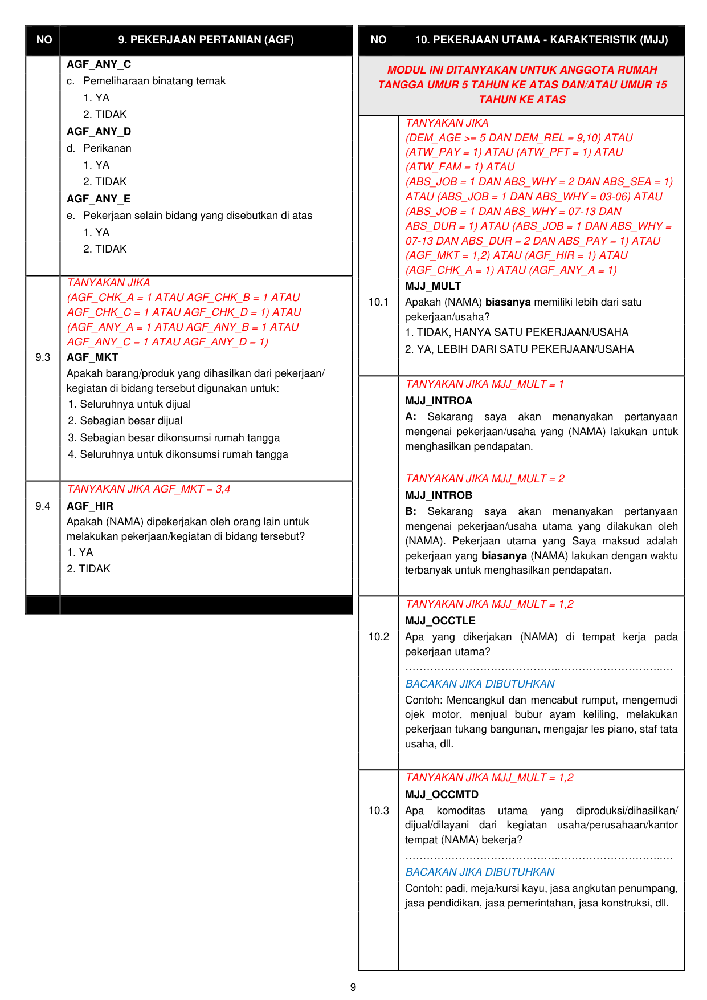

9 
 NO 
9. PEKERJAAN PERTANIAN (AGF) 
  
AGF_ANY_C 
  
c. Pemeliharaan binatang ternak 
  
1. YA 
  
2. TIDAK 
 
  
AGF_ANY_D 
  
d. Perikanan 
  
1. YA 
  
2. TIDAK 
  
AGF_ANY_E 
  
e. Pekerjaan selain bidang yang disebutkan di atas 
  
1. YA 
  
2. TIDAK 
  
  
  
TANYAKAN JIKA  
(AGF_CHK_A = 1 ATAU AGF_CHK_B = 1 ATAU 
AGF_CHK_C = 1 ATAU AGF_CHK_D = 1) ATAU 
(AGF_ANY_A = 1 ATAU AGF_ANY_B = 1 ATAU 
AGF_ANY_C = 1 ATAU AGF_ANY_D = 1) 
9.3 
AGF_MKT 
  
Apakah barang/produk yang dihasilkan dari pekerjaan/ 
kegiatan di bidang tersebut digunakan untuk: 
  
1. Seluruhnya untuk dijual 
  
2. Sebagian besar dijual 
  
3. Sebagian besar dikonsumsi rumah tangga  
  
4. Seluruhnya untuk dikonsumsi rumah tangga 
  
  
  
TANYAKAN JIKA AGF_MKT = 3,4 
9.4 
AGF_HIR 
  
Apakah (NAMA) dipekerjakan oleh orang lain untuk 
melakukan pekerjaan/kegiatan di bidang tersebut? 
  
1. YA 
  
2. TIDAK 
  
  
  
  
 
 
 
 
 
 
 
 
 
 
 
 
 
 
NO 
10. PEKERJAAN UTAMA - KARAKTERISTIK (MJJ) 
MODUL INI DITANYAKAN UNTUK ANGGOTA RUMAH 
TANGGA UMUR 5 TAHUN KE ATAS DAN/ATAU UMUR 15 
TAHUN KE ATAS 
 
 
 
 
 
 
 
 
 
 
TANYAKAN JIKA 
(DEM_AGE >= 5 DAN DEM_REL = 9,10) ATAU 
(ATW_PAY = 1) ATAU (ATW_PFT = 1) ATAU 
(ATW_FAM = 1) ATAU  
(ABS_JOB = 1 DAN ABS_WHY = 2 DAN ABS_SEA = 1) 
ATAU (ABS_JOB = 1 DAN ABS_WHY = 03-06) ATAU 
(ABS_JOB = 1 DAN ABS_WHY = 07-13 DAN  
ABS_DUR = 1) ATAU (ABS_JOB = 1 DAN ABS_WHY = 
07-13 DAN ABS_DUR = 2 DAN ABS_PAY = 1) ATAU 
(AGF_MKT = 1,2) ATAU (AGF_HIR = 1) ATAU 
(AGF_CHK_A = 1) ATAU (AGF_ANY_A = 1) 
MJJ_MULT 
10.1 
Apakah (NAMA) biasanya memiliki lebih dari satu 
pekerjaan/usaha? 
1. TIDAK, HANYA SATU PEKERJAAN/USAHA 
2. YA, LEBIH DARI SATU PEKERJAAN/USAHA 
  
TANYAKAN JIKA MJJ_MULT = 1 
MJJ_INTROA 
A: Sekarang saya akan menanyakan pertanyaan 
mengenai pekerjaan/usaha yang (NAMA) lakukan untuk 
menghasilkan pendapatan. 
  
 
TANYAKAN JIKA MJJ_MULT = 2 
MJJ_INTROB 
B: Sekarang saya akan menanyakan pertanyaan 
mengenai pekerjaan/usaha utama yang dilakukan oleh 
(NAMA). Pekerjaan utama yang Saya maksud adalah 
pekerjaan yang biasanya (NAMA) lakukan dengan waktu 
terbanyak untuk menghasilkan pendapatan. 
  
TANYAKAN JIKA MJJ_MULT = 1,2 
 
MJJ_OCCTLE      
10.2 
Apa yang dikerjakan (NAMA) di tempat kerja pada 
pekerjaan utama? 
……………………………………..………………………..…  
BACAKAN JIKA DIBUTUHKAN 
Contoh: Mencangkul dan mencabut rumput, mengemudi 
ojek motor, menjual bubur ayam keliling, melakukan 
pekerjaan tukang bangunan, mengajar les piano, staf tata 
usaha, dll. 
  
TANYAKAN JIKA MJJ_MULT = 1,2 
 
MJJ_OCCMTD     
10.3 
Apa 
komoditas 
utama 
yang 
diproduksi/dihasilkan/ 
dijual/dilayani dari kegiatan usaha/perusahaan/kantor 
tempat (NAMA) bekerja? 
 
……………………………………..………………………..… 
BACAKAN JIKA DIBUTUHKAN 
Contoh: padi, meja/kursi kayu, jasa angkutan penumpang, 
jasa pendidikan, jasa pemerintahan, jasa konstruksi, dll.

---

## Halaman 10

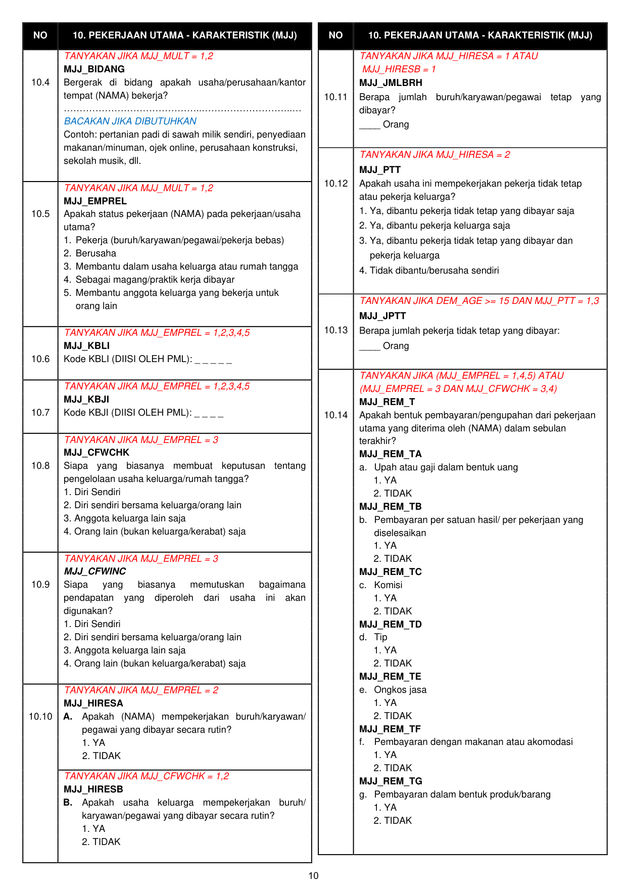

10 
NO 
10. PEKERJAAN UTAMA - KARAKTERISTIK (MJJ) 
TANYAKAN JIKA MJJ_MULT = 1,2 
 
MJJ_BIDANG     
10.4 
Bergerak di bidang apakah usaha/perusahaan/kantor 
tempat (NAMA) bekerja? 
……………………………………..………………………..… 
BACAKAN JIKA DIBUTUHKAN 
Contoh: pertanian padi di sawah milik sendiri, penyediaan 
makanan/minuman, ojek online, perusahaan konstruksi, 
sekolah musik, dll. 
  
TANYAKAN JIKA MJJ_MULT = 1,2 
MJJ_EMPREL 
10.5 
Apakah status pekerjaan (NAMA) pada pekerjaan/usaha 
utama? 
1. Pekerja (buruh/karyawan/pegawai/pekerja bebas) 
2. Berusaha 
3. Membantu dalam usaha keluarga atau rumah tangga 
4. Sebagai magang/praktik kerja dibayar 
5. Membantu anggota keluarga yang bekerja untuk     
orang lain 
  
TANYAKAN JIKA MJJ_EMPREL = 1,2,3,4,5 
MJJ_KBLI 
10.6 
Kode KBLI (DIISI OLEH PML): _ _ _ _ _ 
 
 
TANYAKAN JIKA MJJ_EMPREL = 1,2,3,4,5 
MJJ_KBJI 
10.7 
Kode KBJI (DIISI OLEH PML): _ _ _ _ 
 
 
TANYAKAN JIKA MJJ_EMPREL = 3 
 
MJJ_CFWCHK 
10.8 
Siapa yang biasanya membuat keputusan tentang 
pengelolaan usaha keluarga/rumah tangga? 
1. Diri Sendiri 
2. Diri sendiri bersama keluarga/orang lain 
3. Anggota keluarga lain saja 
4. Orang lain (bukan keluarga/kerabat) saja 
  
TANYAKAN JIKA MJJ_EMPREL = 3 
MJJ_CFWINC  
10.9 
Siapa 
yang 
biasanya 
memutuskan 
bagaimana 
pendapatan yang 
diperoleh 
dari 
usaha 
ini 
akan 
digunakan? 
1. Diri Sendiri 
2. Diri sendiri bersama keluarga/orang lain 
3. Anggota keluarga lain saja 
4. Orang lain (bukan keluarga/kerabat) saja 
 
TANYAKAN JIKA MJJ_EMPREL = 2 
MJJ_HIRESA 
10.10 
A. Apakah (NAMA) mempekerjakan buruh/karyawan/ 
pegawai yang dibayar secara rutin? 
1. YA 
 
2. TIDAK 
TANYAKAN JIKA MJJ_CFWCHK = 1,2 
MJJ_HIRESB 
B. Apakah usaha keluarga mempekerjakan buruh/ 
karyawan/pegawai yang dibayar secara rutin? 
1. YA 
2. TIDAK 
 
NO 
10. PEKERJAAN UTAMA - KARAKTERISTIK (MJJ) 
TANYAKAN JIKA MJJ_HIRESA = 1 ATAU 
 MJJ_HIRESB = 1 
 
MJJ_JMLBRH 
10.11 
Berapa jumlah buruh/karyawan/pegawai tetap yang 
dibayar? 
____ Orang 
  
TANYAKAN JIKA MJJ_HIRESA = 2 
MJJ_PTT 
10.12 
Apakah usaha ini mempekerjakan pekerja tidak tetap 
atau pekerja keluarga? 
1. Ya, dibantu pekerja tidak tetap yang dibayar saja 
2. Ya, dibantu pekerja keluarga saja 
3. Ya, dibantu pekerja tidak tetap yang dibayar dan  
    pekerja keluarga 
4. Tidak dibantu/berusaha sendiri 
  
TANYAKAN JIKA DEM_AGE >= 15 DAN MJJ_PTT = 1,3 
MJJ_JPTT 
10.13 
Berapa jumlah pekerja tidak tetap yang dibayar: 
____ Orang 
  
TANYAKAN JIKA (MJJ_EMPREL = 1,4,5) ATAU 
(MJJ_EMPREL = 3 DAN MJJ_CFWCHK = 3,4) 
MJJ_REM_T 
10.14 
Apakah bentuk pembayaran/pengupahan dari pekerjaan 
utama yang diterima oleh (NAMA) dalam sebulan 
terakhir? 
MJJ_REM_TA 
a. Upah atau gaji dalam bentuk uang 
    1. YA 
    2. TIDAK 
MJJ_REM_TB 
b. Pembayaran per satuan hasil/ per pekerjaan yang 
diselesaikan 
    1. YA 
    2. TIDAK 
 
MJJ_REM_TC 
c. Komisi  
    1. YA 
    2. TIDAK 
MJJ_REM_TD 
d. Tip 
    1. YA 
    2. TIDAK 
MJJ_REM_TE 
e. Ongkos jasa 
    1. YA 
    2. TIDAK 
MJJ_REM_TF 
f. Pembayaran dengan makanan atau akomodasi 
    1. YA 
 
    2. TIDAK 
MJJ_REM_TG 
g. Pembayaran dalam bentuk produk/barang 
    1. YA 
    2. TIDAK

---

## Halaman 11

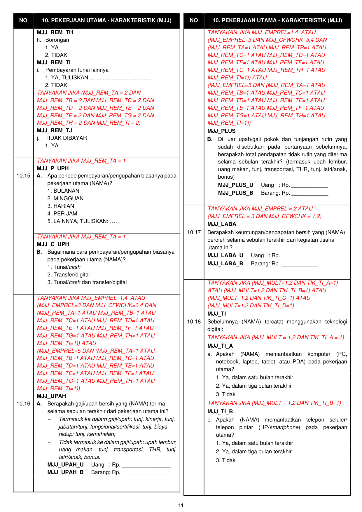

11 
NO 
10. PEKERJAAN UTAMA - KARAKTERISTIK (MJJ) 
MJJ_REM_TH 
h. Borongan 
 
    1. YA 
    2. TIDAK 
MJJ_REM_TI 
i. Pembayaran tunai lainnya 
    1. YA, TULISKAN …..................................... 
    2. TIDAK 
TANYAKAN JIKA (MJJ_REM_TA = 2 DAN 
MJJ_REM_TB = 2 DAN MJJ_REM_TC = 2 DAN 
MJJ_REM_TD = 2 DAN MJJ_REM_TE = 2 DAN 
MJJ_REM_TF = 2 DAN MJJ_REM_TG = 2 DAN 
MJJ_REM_TH = 2 DAN MJJ_REM_TI = 2)  
MJJ_REM_TJ 
j. TIDAK DIBAYAR 
    1. YA 
 
TANYAKAN JIKA MJJ_REM_TA = 1 
MJJ_P_UPH 
10.15 
A. Apa periode pembayaran/pengupahan biasanya pada 
pekerjaan utama (NAMA)? 
1. BULANAN 
2. MINGGUAN 
3. HARIAN 
 
4. PER JAM 
5. LAINNYA, TULISKAN: …… 
 
 
 
TANYAKAN JIKA MJJ_REM_TA = 1 
MJJ_C_UPH 
B. Bagaimana cara pembayaran/pengupahan biasanya 
pada pekerjaan utama (NAMA)? 
1. Tunai/cash 
2. Transfer/digital 
3. Tunai/cash dan transfer/digital 
 
TANYAKAN JIKA MJJ_EMPREL=1,4  ATAU  
(MJJ_EMPREL=3 DAN MJJ_CFWCHK=3,4 DAN 
(MJJ_REM_TA=1 ATAU MJJ_REM_TB=1 ATAU 
MJJ_REM_TC=1 ATAU MJJ_REM_TD=1 ATAU 
MJJ_REM_TE=1 ATAU MJJ_REM_TF=1 ATAU 
MJJ_REM_TG=1 ATAU MJJ_REM_TH=1 ATAU 
MJJ_REM_TI=1)) ATAU  
(MJJ_EMPREL=5 DAN (MJJ_REM_TA=1 ATAU 
MJJ_REM_TB=1 ATAU MJJ_REM_TC=1 ATAU 
MJJ_REM_TD=1 ATAU MJJ_REM_TE=1 ATAU 
MJJ_REM_TE=1 ATAU MJJ_REM_TF=1 ATAU 
MJJ_REM_TG=1 ATAU MJJ_REM_TH=1 ATAU 
MJJ_REM_TI=1)) 
MJJ_UPAH 
10.16 
A. Berapakah gaji/upah bersih yang (NAMA) terima 
selama sebulan terakhir dari pekerjaan utama ini? 
− 
Termasuk ke dalam gaji/upah: tunj. kinerja, tunj. 
jabatan/tunj. fungsional/sertifikasi, tunj. biaya 
hidup/ tunj. kemahalan; 
 
− 
Tidak termasuk ke dalam gaji/upah: upah lembur, 
uang makan, tunj. transportasi, THR, tunj. 
Istri/anak, bonus. 
MJJ_UPAH_U     Uang   : Rp. ________________ 
MJJ_UPAH_B     Barang: Rp. ________________ 
 
 
NO 
10. PEKERJAAN UTAMA - KARAKTERISTIK (MJJ) 
TANYAKAN JIKA MJJ_EMPREL=1,4  ATAU  
(MJJ_EMPREL=3 DAN MJJ_CFWCHK=3,4 DAN 
(MJJ_REM_TA=1 ATAU MJJ_REM_TB=1 ATAU 
MJJ_REM_TC=1 ATAU MJJ_REM_TD=1 ATAU 
MJJ_REM_TE=1 ATAU MJJ_REM_TF=1 ATAU 
MJJ_REM_TG=1 ATAU MJJ_REM_TH=1 ATAU 
MJJ_REM_TI=1)) ATAU  
(MJJ_EMPREL=5 DAN (MJJ_REM_TA=1 ATAU 
MJJ_REM_TB=1 ATAU MJJ_REM_TC=1 ATAU 
MJJ_REM_TD=1 ATAU MJJ_REM_TE=1 ATAU 
MJJ_REM_TE=1 ATAU MJJ_REM_TF=1 ATAU 
MJJ_REM_TG=1 ATAU MJJ_REM_TH=1 ATAU 
MJJ_REM_TI=1)) 
MJJ_PLUS 
B. Di luar upah/gaji pokok dan tunjangan rutin yang 
sudah disebutkan pada pertanyaan sebelumnya, 
berapakah total pendapatan tidak rutin yang diterima 
selama sebulan terakhir? (termasuk upah lembur, 
uang makan, tunj. transportasi, THR, tunj. Istri/anak, 
bonus) 
MJJ_PLUS_U     Uang   : Rp. ____________ 
MJJ_PLUS_B     Barang: Rp. ____________ 
 
 
TANYAKAN JIKA MJJ_EMPREL = 2 ATAU 
(MJJ_EMPREL = 3 DAN MJJ_CFWCHK = 1,2) 
 
MJJ_LABA 
10.17 
Berapakah keuntungan/pendapatan bersih yang (NAMA) 
peroleh selama sebulan terakhir dari kegiatan usaha 
utama ini? 
 
MJJ_LABA_U     Uang   : Rp. ____________ 
 
MJJ_LABA_B     Barang: Rp. ____________ 
 
TANYAKAN JIKA (MJJ_MULT=1,2 DAN TIK_TI_A=1) 
ATAU (MJJ_MULT=1,2 DAN TIK_TI_B=1) ATAU 
(MJJ_MULT=1,2 DAN TIK_TI_C=1) ATAU 
(MJJ_MULT=1,2 DAN TIK_TI_D=1) 
MJJ_TI 
10.18 
Sebelumnya (NAMA) tercatat menggunakan teknologi 
digital:  
TANYAKAN JIKA (MJJ_MULT = 1,2 DAN TIK_TI_A = 1)  
MJJ_TI_A 
a. Apakah (NAMA) memanfaatkan komputer (PC, 
notebook, laptop, tablet, atau PDA) pada pekerjaan 
utama? 
 
1. Ya, dalam satu bulan terakhir 
 
2. Ya, dalam tiga bulan terakhir 
3. Tidak 
TANYAKAN JIKA (MJJ_MULT = 1,2 DAN TIK_TI_B=1)  
MJJ_TI_B 
b. Apakah (NAMA) memanfaatkan telepon seluler/ 
telepon pintar (HP/smartphone) pada pekerjaan 
utama? 
 
1. Ya, dalam satu bulan terakhir 
2. Ya, dalam tiga bulan terakhir 
 
3. Tidak

---

## Halaman 12

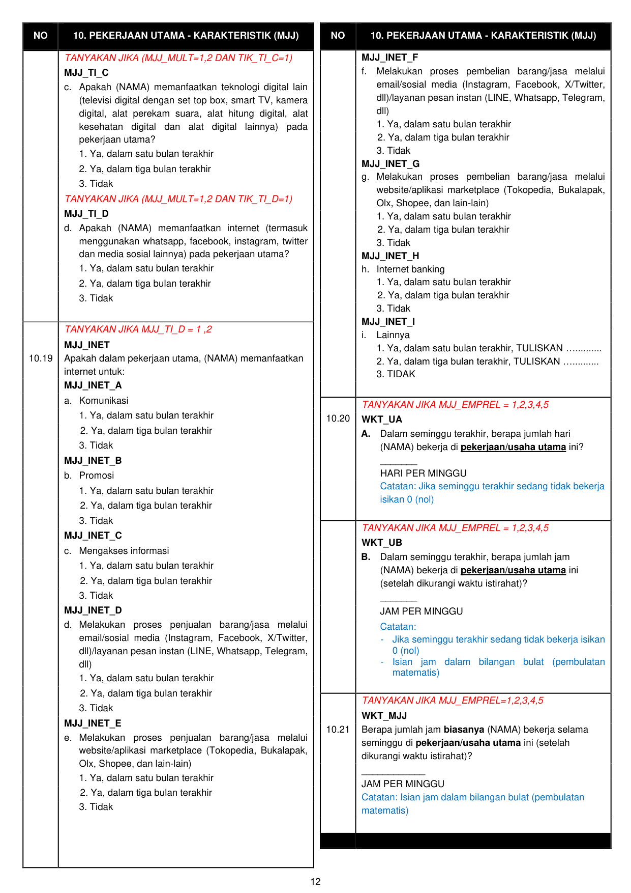

12 
NO 
10. PEKERJAAN UTAMA - KARAKTERISTIK (MJJ) 
TANYAKAN JIKA (MJJ_MULT=1,2 DAN TIK_TI_C=1)  
 
MJJ_TI_C 
c. Apakah (NAMA) memanfaatkan teknologi digital lain 
(televisi digital dengan set top box, smart TV, kamera 
digital, alat perekam suara, alat hitung digital, alat 
kesehatan digital dan alat digital lainnya) pada 
pekerjaan utama? 
1. Ya, dalam satu bulan terakhir 
2. Ya, dalam tiga bulan terakhir 
 
3. Tidak 
TANYAKAN JIKA (MJJ_MULT=1,2 DAN TIK_TI_D=1)  
MJJ_TI_D 
d. Apakah (NAMA) memanfaatkan internet (termasuk 
menggunakan whatsapp, facebook, instagram, twitter 
dan media sosial lainnya) pada pekerjaan utama? 
1. Ya, dalam satu bulan terakhir 
2. Ya, dalam tiga bulan terakhir 
 
3. Tidak 
  
TANYAKAN JIKA MJJ_TI_D = 1 ,2 
MJJ_INET 
10.19 
Apakah dalam pekerjaan utama, (NAMA) memanfaatkan 
internet untuk: 
MJJ_INET_A 
a. Komunikasi 
 
1. Ya, dalam satu bulan terakhir 
 
  2. Ya, dalam tiga bulan terakhir 
 
3. Tidak 
 
MJJ_INET_B 
b. Promosi 
1. Ya, dalam satu bulan terakhir 
      2. Ya, dalam tiga bulan terakhir 
 
3. Tidak 
MJJ_INET_C 
c. Mengakses informasi 
1. Ya, dalam satu bulan terakhir 
      2. Ya, dalam tiga bulan terakhir 
 
3. Tidak 
MJJ_INET_D 
d. Melakukan proses penjualan barang/jasa melalui 
email/sosial media (Instagram, Facebook, X/Twitter, 
dll)/layanan pesan instan (LINE, Whatsapp, Telegram, 
dll) 
1. Ya, dalam satu bulan terakhir 
      2. Ya, dalam tiga bulan terakhir 
 
3. Tidak 
MJJ_INET_E 
e. Melakukan proses penjualan barang/jasa melalui 
website/aplikasi marketplace (Tokopedia, Bukalapak, 
Olx, Shopee, dan lain-lain) 
 
1. Ya, dalam satu bulan terakhir 
      2. Ya, dalam tiga bulan terakhir 
 
3. Tidak 
 
 
 
 
NO 
10. PEKERJAAN UTAMA - KARAKTERISTIK (MJJ) 
MJJ_INET_F 
 
f. Melakukan proses pembelian barang/jasa melalui 
email/sosial media (Instagram, Facebook, X/Twitter, 
dll)/layanan pesan instan (LINE, Whatsapp, Telegram, 
dll) 
1. Ya, dalam satu bulan terakhir 
      2. Ya, dalam tiga bulan terakhir 
 
3. Tidak 
MJJ_INET_G 
g. Melakukan proses pembelian barang/jasa melalui 
website/aplikasi marketplace (Tokopedia, Bukalapak, 
Olx, Shopee, dan lain-lain) 
1. Ya, dalam satu bulan terakhir 
      2. Ya, dalam tiga bulan terakhir 
 
3. Tidak 
MJJ_INET_H 
h. Internet banking 
1. Ya, dalam satu bulan terakhir 
      2. Ya, dalam tiga bulan terakhir 
 
3. Tidak 
MJJ_INET_I 
i. Lainnya 
1. Ya, dalam satu bulan terakhir, TULISKAN ….......... 
 
2. Ya, dalam tiga bulan terakhir, TULISKAN ….......... 
3. TIDAK 
 
 
TANYAKAN JIKA MJJ_EMPREL = 1,2,3,4,5  
10.20 
WKT_UA 
 
A. Dalam seminggu terakhir, berapa jumlah hari 
(NAMA) bekerja di pekerjaan/usaha utama ini? 
_______ 
       HARI PER MINGGU 
 
Catatan: Jika seminggu terakhir sedang tidak bekerja 
isikan 0 (nol) 
 
 
TANYAKAN JIKA MJJ_EMPREL = 1,2,3,4,5  
 
WKT_UB 
 
B. Dalam seminggu terakhir, berapa jumlah jam 
(NAMA) bekerja di pekerjaan/usaha utama ini 
(setelah dikurangi waktu istirahat)? 
 
       _______ 
 
       JAM PER MINGGU 
 
Catatan:  
- Jika seminggu terakhir sedang tidak bekerja isikan 
0 (nol) 
- Isian jam dalam bilangan bulat (pembulatan 
matematis) 
 
TANYAKAN JIKA MJJ_EMPREL=1,2,3,4,5  
WKT_MJJ 
10.21 
Berapa jumlah jam biasanya (NAMA) bekerja selama 
seminggu di pekerjaan/usaha utama ini (setelah 
dikurangi waktu istirahat)? 
 
____________ 
  
JAM PER MINGGU 
Catatan: Isian jam dalam bilangan bulat (pembulatan 
matematis)

---

## Halaman 13

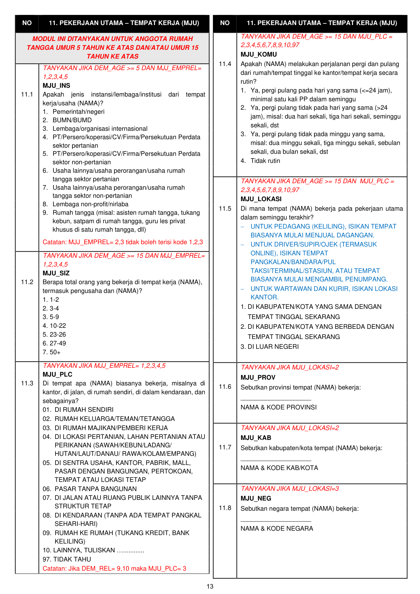

13 
NO 
11. PEKERJAAN UTAMA – TEMPAT KERJA (MJU) 
MODUL INI DITANYAKAN UNTUK ANGGOTA RUMAH 
TANGGA UMUR 5 TAHUN KE ATAS DAN/ATAU UMUR 15 
TAHUN KE ATAS 
  
TANYAKAN JIKA DEM_AGE >= 5 DAN MJJ_EMPREL= 
1,2,3,4,5 
  
MJU_INS 
11.1 
Apakah 
jenis 
instansi/lembaga/institusi 
dari 
tempat 
kerja/usaha (NAMA)? 
1. Pemerintah/negeri  
2. BUMN/BUMD  
3. Lembaga/organisasi internasional  
4. PT/Persero/koperasi/CV/Firma/Persekutuan Perdata 
sektor pertanian 
5. PT/Persero/koperasi/CV/Firma/Persekutuan Perdata 
sektor non-pertanian 
6. Usaha lainnya/usaha perorangan/usaha rumah 
tangga sektor pertanian  
7. Usaha lainnya/usaha perorangan/usaha rumah 
tangga sektor non-pertanian 
8. Lembaga non-profit/nirlaba 
9. Rumah tangga (misal: asisten rumah tangga, tukang 
kebun, satpam di rumah tangga, guru les privat 
khusus di satu rumah tangga, dll) 
Catatan: MJJ_EMPREL= 2,3 tidak boleh terisi kode 1,2,3 
 
TANYAKAN JIKA DEM_AGE >= 15 DAN MJJ_EMPREL= 
1,2,3,4,5 
 
MJU_SIZ 
11.2 
Berapa total orang yang bekerja di tempat kerja (NAMA), 
termasuk pengusaha dan (NAMA)? 
 
1. 1-2 
 
2. 3-4 
 
3. 5-9 
 
4. 10-22 
 
5. 23-26 
 
6. 27-49 
 
7. 50+ 
TANYAKAN JIKA MJJ_EMPREL= 1,2,3,4,5 
 
MJU_PLC 
11.3 
Di tempat apa (NAMA) biasanya bekerja, misalnya di 
kantor, di jalan, di rumah sendiri, di dalam kendaraan, dan 
sebagainya? 
01. DI RUMAH SENDIRI  
02. RUMAH KELUARGA/TEMAN/TETANGGA 
 
03. DI RUMAH MAJIKAN/PEMBERI KERJA 
04. DI LOKASI PERTANIAN, LAHAN PERTANIAN ATAU 
PERIKANAN (SAWAH/KEBUN/LADANG/ 
HUTAN/LAUT/DANAU/ RAWA/KOLAM/EMPANG) 
05. DI SENTRA USAHA, KANTOR, PABRIK, MALL, 
PASAR DENGAN BANGUNGAN, PERTOKOAN, 
TEMPAT ATAU LOKASI TETAP 
06. PASAR TANPA BANGUNAN 
07. DI JALAN ATAU RUANG PUBLIK LAINNYA TANPA 
STRUKTUR TETAP  
 
08. DI KENDARAAN (TANPA ADA TEMPAT PANGKAL 
SEHARI-HARI)  
09. RUMAH KE RUMAH (TUKANG KREDIT, BANK 
KELILING)  
10. LAINNYA, TULISKAN …............ 
97. TIDAK TAHU 
Catatan: Jika DEM_REL= 9,10 maka MJU_PLC= 3 
NO 
11. PEKERJAAN UTAMA – TEMPAT KERJA (MJU) 
 
TANYAKAN JIKA DEM_AGE >= 15 DAN MJU_PLC = 
2,3,4,5,6,7,8,9,10,97  
 
MJU_KOMU 
11.4 
Apakah (NAMA) melakukan perjalanan pergi dan pulang 
dari rumah/tempat tinggal ke kantor/tempat kerja secara 
rutin? 
1. Ya, pergi pulang pada hari yang sama (<=24 jam), 
minimal satu kali PP dalam seminggu 
 
2. Ya, pergi pulang tidak pada hari yang sama (>24 
jam), misal: dua hari sekali, tiga hari sekali, seminggu 
sekali, dst 
3. Ya, pergi pulang tidak pada minggu yang sama, 
misal: dua minggu sekali, tiga minggu sekali, sebulan 
sekali, dua bulan sekali, dst 
4. Tidak rutin 
  
TANYAKAN JIKA DEM_AGE >= 15 DAN  MJU_PLC = 
2,3,4,5,6,7,8,9,10,97 
MJU_LOKASI 
11.5 
Di mana tempat (NAMA) bekerja pada pekerjaan utama 
dalam seminggu terakhir? 
− UNTUK PEDAGANG (KELILING), ISIKAN TEMPAT 
BIASANYA MULAI MENJUAL DAGANGAN. 
 
− UNTUK DRIVER/SUPIR/OJEK (TERMASUK 
ONLINE), ISIKAN TEMPAT 
PANGKALAN/BANDARA/PUL 
TAKSI/TERMINAL/STASIUN, ATAU TEMPAT 
BIASANYA MULAI MENGAMBIL PENUMPANG. 
− UNTUK WARTAWAN DAN KURIR, ISIKAN LOKASI 
KANTOR. 
 
1. DI KABUPATEN/KOTA YANG SAMA DENGAN 
    TEMPAT TINGGAL SEKARANG 
2. DI KABUPATEN/KOTA YANG BERBEDA DENGAN    
    TEMPAT TINGGAL SEKARANG 
3. DI LUAR NEGERI 
  
TANYAKAN JIKA MJU_LOKASI=2 
MJU_PROV 
11.6 
Sebutkan provinsi tempat (NAMA) bekerja: 
____________________     
 
NAMA & KODE PROVINSI               
  
TANYAKAN JIKA MJU_LOKASI=2 
MJU_KAB 
11.7 
Sebutkan kabupaten/kota tempat (NAMA) bekerja: 
____________________     
NAMA & KODE KAB/KOTA 
  
TANYAKAN JIKA MJU_LOKASI=3 
MJU_NEG 
11.8 
Sebutkan negara tempat (NAMA) bekerja: 
____________________     
NAMA & KODE NEGARA

---

## Halaman 14

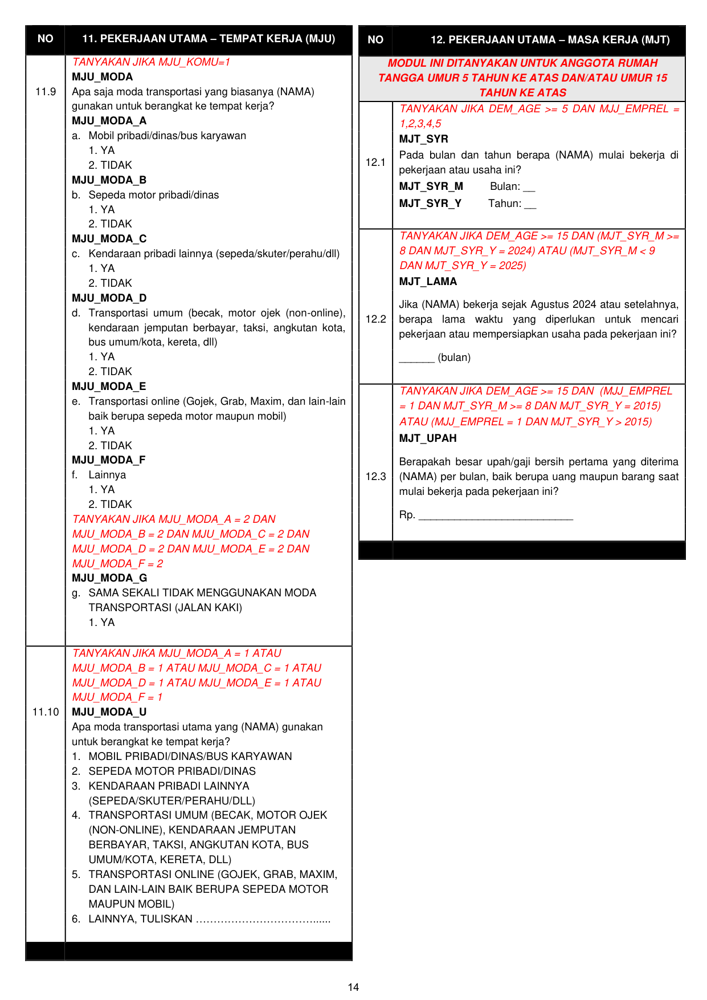

14 
NO 
11. PEKERJAAN UTAMA – TEMPAT KERJA (MJU) 
TANYAKAN JIKA MJU_KOMU=1 
MJU_MODA 
11.9 
Apa saja moda transportasi yang biasanya (NAMA) 
gunakan untuk berangkat ke tempat kerja? 
MJU_MODA_A 
a. Mobil pribadi/dinas/bus karyawan 
1. YA 
2. TIDAK 
MJU_MODA_B 
b. Sepeda motor pribadi/dinas 
1. YA 
2. TIDAK 
MJU_MODA_C 
c. Kendaraan pribadi lainnya (sepeda/skuter/perahu/dll) 
1. YA 
2. TIDAK 
MJU_MODA_D 
d. Transportasi umum (becak, motor ojek (non-online), 
kendaraan jemputan berbayar, taksi, angkutan kota, 
bus umum/kota, kereta, dll) 
1. YA 
2. TIDAK 
MJU_MODA_E 
e. Transportasi online (Gojek, Grab, Maxim, dan lain-lain 
baik berupa sepeda motor maupun mobil) 
1. YA 
2. TIDAK 
MJU_MODA_F 
 
f. Lainnya 
 
1. YA 
2. TIDAK 
TANYAKAN JIKA MJU_MODA_A = 2 DAN 
MJU_MODA_B = 2 DAN MJU_MODA_C = 2 DAN 
MJU_MODA_D = 2 DAN MJU_MODA_E = 2 DAN 
MJU_MODA_F = 2 
MJU_MODA_G 
g. SAMA SEKALI TIDAK MENGGUNAKAN MODA 
TRANSPORTASI (JALAN KAKI) 
1. YA 
 
 
 
TANYAKAN JIKA MJU_MODA_A = 1 ATAU 
MJU_MODA_B = 1 ATAU MJU_MODA_C = 1 ATAU 
MJU_MODA_D = 1 ATAU MJU_MODA_E = 1 ATAU 
MJU_MODA_F = 1 
11.10 
MJU_MODA_U 
Apa moda transportasi utama yang (NAMA) gunakan 
untuk berangkat ke tempat kerja? 
  
1. MOBIL PRIBADI/DINAS/BUS KARYAWAN 
  
2. SEPEDA MOTOR PRIBADI/DINAS 
  
3. KENDARAAN PRIBADI LAINNYA 
(SEPEDA/SKUTER/PERAHU/DLL) 
  
4. TRANSPORTASI UMUM (BECAK, MOTOR OJEK 
(NON-ONLINE), KENDARAAN JEMPUTAN 
BERBAYAR, TAKSI, ANGKUTAN KOTA, BUS 
UMUM/KOTA, KERETA, DLL) 
  
5. TRANSPORTASI ONLINE (GOJEK, GRAB, MAXIM, 
DAN LAIN-LAIN BAIK BERUPA SEPEDA MOTOR 
MAUPUN MOBIL) 
  
6. LAINNYA, TULISKAN ……………………………...... 
 
 
  
  
 
NO 
12. PEKERJAAN UTAMA – MASA KERJA (MJT) 
MODUL INI DITANYAKAN UNTUK ANGGOTA RUMAH 
TANGGA UMUR 5 TAHUN KE ATAS DAN/ATAU UMUR 15 
TAHUN KE ATAS 
  
TANYAKAN JIKA DEM_AGE >= 5 DAN MJJ_EMPREL = 
1,2,3,4,5 
  
MJT_SYR 
12.1 
Pada bulan dan tahun berapa (NAMA) mulai bekerja di 
pekerjaan atau usaha ini? 
  
MJT_SYR_M         Bulan: __ 
  
MJT_SYR_Y         Tahun: __ 
  
  
  
TANYAKAN JIKA DEM_AGE >= 15 DAN (MJT_SYR_M >= 
8 DAN MJT_SYR_Y = 2024) ATAU (MJT_SYR_M < 9 
DAN MJT_SYR_Y = 2025) 
  
MJT_LAMA 
12.2 
Jika (NAMA) bekerja sejak Agustus 2024 atau setelahnya, 
berapa lama waktu yang diperlukan untuk mencari 
pekerjaan atau mempersiapkan usaha pada pekerjaan ini? 
  
______ (bulan) 
  
  
  
TANYAKAN JIKA DEM_AGE >= 15 DAN  (MJJ_EMPREL 
= 1 DAN MJT_SYR_M >= 8 DAN MJT_SYR_Y = 2015) 
ATAU (MJJ_EMPREL = 1 DAN MJT_SYR_Y > 2015) 
  
MJT_UPAH 
12.3 
Berapakah besar upah/gaji bersih pertama yang diterima 
(NAMA) per bulan, baik berupa uang maupun barang saat 
mulai bekerja pada pekerjaan ini? 
  
Rp. __________________________

---

## Halaman 15

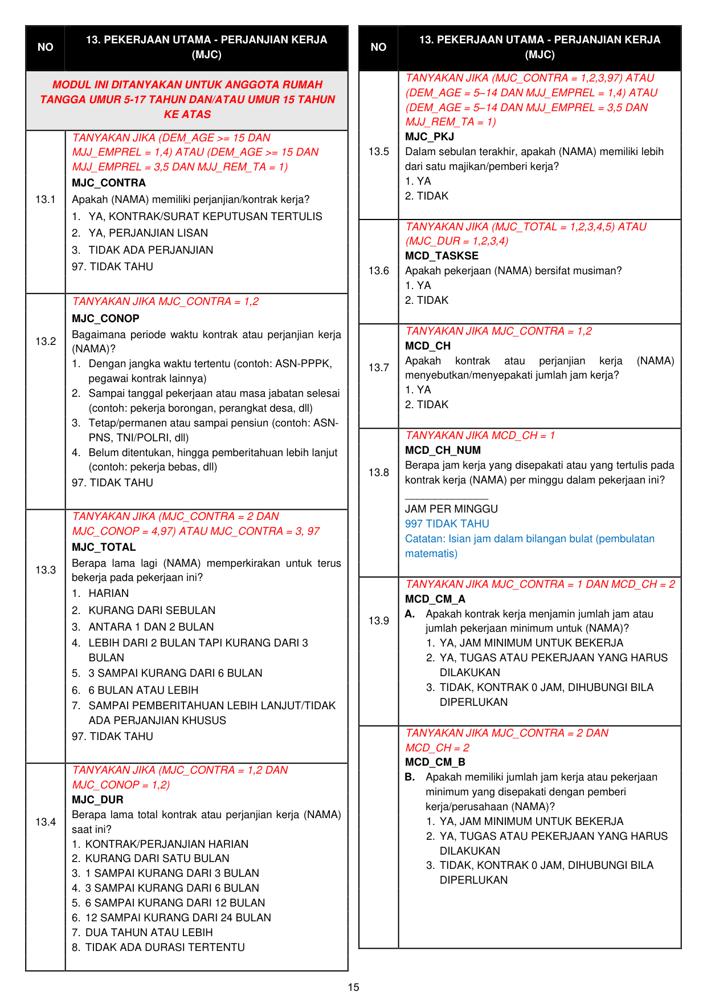

15 
NO 
13. PEKERJAAN UTAMA - PERJANJIAN KERJA 
(MJC) 
MODUL INI DITANYAKAN UNTUK ANGGOTA RUMAH 
TANGGA UMUR 5-17 TAHUN DAN/ATAU UMUR 15 TAHUN 
KE ATAS 
  
TANYAKAN JIKA (DEM_AGE >= 15 DAN 
MJJ_EMPREL = 1,4) ATAU (DEM_AGE >= 15 DAN 
MJJ_EMPREL = 3,5 DAN MJJ_REM_TA = 1) 
  
MJC_CONTRA 
13.1 
Apakah (NAMA) memiliki perjanjian/kontrak kerja? 
  
1. YA, KONTRAK/SURAT KEPUTUSAN TERTULIS 
  
2. YA, PERJANJIAN LISAN 
  
3. TIDAK ADA PERJANJIAN 
  
97. TIDAK TAHU 
  
  
  
TANYAKAN JIKA MJC_CONTRA = 1,2 
  
MJC_CONOP 
13.2 
Bagaimana periode waktu kontrak atau perjanjian kerja 
(NAMA)? 
  
1. Dengan jangka waktu tertentu (contoh: ASN-PPPK, 
pegawai kontrak lainnya) 
  
2. Sampai tanggal pekerjaan atau masa jabatan selesai 
(contoh: pekerja borongan, perangkat desa, dll) 
  
3. Tetap/permanen atau sampai pensiun (contoh: ASN-
PNS, TNI/POLRI, dll) 
  
4. Belum ditentukan, hingga pemberitahuan lebih lanjut 
(contoh: pekerja bebas, dll) 
 
97. TIDAK TAHU 
  
  
  
TANYAKAN JIKA (MJC_CONTRA = 2 DAN 
MJC_CONOP = 4,97) ATAU MJC_CONTRA = 3, 97 
  
MJC_TOTAL 
13.3 
Berapa lama lagi (NAMA) memperkirakan untuk terus 
bekerja pada pekerjaan ini? 
  
1. HARIAN 
  
2. KURANG DARI SEBULAN 
  
3. ANTARA 1 DAN 2 BULAN 
  
4. LEBIH DARI 2 BULAN TAPI KURANG DARI 3 
BULAN 
  
5. 3 SAMPAI KURANG DARI 6 BULAN 
  
6. 6 BULAN ATAU LEBIH 
  
7. SAMPAI PEMBERITAHUAN LEBIH LANJUT/TIDAK 
ADA PERJANJIAN KHUSUS 
  
97. TIDAK TAHU 
  
 
  
TANYAKAN JIKA (MJC_CONTRA = 1,2 DAN 
MJC_CONOP = 1,2) 
  
MJC_DUR 
13.4 
Berapa lama total kontrak atau perjanjian kerja (NAMA) 
saat ini? 
  
1. KONTRAK/PERJANJIAN HARIAN 
  
2. KURANG DARI SATU BULAN 
  
3. 1 SAMPAI KURANG DARI 3 BULAN 
  
4. 3 SAMPAI KURANG DARI 6 BULAN 
  
5. 6 SAMPAI KURANG DARI 12 BULAN 
  
6. 12 SAMPAI KURANG DARI 24 BULAN 
  
7. DUA TAHUN ATAU LEBIH 
  
8. TIDAK ADA DURASI TERTENTU 
  
 
NO 
13. PEKERJAAN UTAMA - PERJANJIAN KERJA 
(MJC) 
 
TANYAKAN JIKA (MJC_CONTRA = 1,2,3,97) ATAU 
(DEM_AGE = 5–14 DAN MJJ_EMPREL = 1,4) ATAU 
(DEM_AGE = 5–14 DAN MJJ_EMPREL = 3,5 DAN 
MJJ_REM_TA = 1) 
 
MJC_PKJ 
13.5 
Dalam sebulan terakhir, apakah (NAMA) memiliki lebih 
dari satu majikan/pemberi kerja? 
 
1. YA 
 
2. TIDAK 
 
 
  
TANYAKAN JIKA (MJC_TOTAL = 1,2,3,4,5) ATAU 
(MJC_DUR = 1,2,3,4) 
  
MCD_TASKSE 
13.6 
Apakah pekerjaan (NAMA) bersifat musiman? 
  
1. YA 
  
2. TIDAK 
  
  
  
TANYAKAN JIKA MJC_CONTRA = 1,2 
  
MCD_CH 
13.7 
Apakah 
kontrak 
atau 
perjanjian 
kerja 
(NAMA) 
menyebutkan/menyepakati jumlah jam kerja? 
  
1. YA 
  
2. TIDAK 
  
  
  
TANYAKAN JIKA MCD_CH = 1 
  
MCD_CH_NUM 
13.8 
Berapa jam kerja yang disepakati atau yang tertulis pada 
kontrak kerja (NAMA) per minggu dalam pekerjaan ini? 
  
______________ 
  
JAM PER MINGGU 
  
997 TIDAK TAHU 
 
Catatan: Isian jam dalam bilangan bulat (pembulatan 
matematis) 
  
  
TANYAKAN JIKA MJC_CONTRA = 1 DAN MCD_CH = 2 
  
MCD_CM_A 
13.9 
A. Apakah kontrak kerja menjamin jumlah jam atau 
jumlah pekerjaan minimum untuk (NAMA)? 
 
1. YA, JAM MINIMUM UNTUK BEKERJA 
 
2. YA, TUGAS ATAU PEKERJAAN YANG HARUS 
DILAKUKAN 
 
3. TIDAK, KONTRAK 0 JAM, DIHUBUNGI BILA 
DIPERLUKAN  
 
 
TANYAKAN JIKA MJC_CONTRA = 2 DAN  
MCD_CH = 2 
  
MCD_CM_B 
  
B. Apakah memiliki jumlah jam kerja atau pekerjaan 
minimum yang disepakati dengan pemberi 
kerja/perusahaan (NAMA)? 
  
1. YA, JAM MINIMUM UNTUK BEKERJA 
  
2. YA, TUGAS ATAU PEKERJAAN YANG HARUS 
DILAKUKAN 
  
3. TIDAK, KONTRAK 0 JAM, DIHUBUNGI BILA 
DIPERLUKAN

---

## Halaman 16

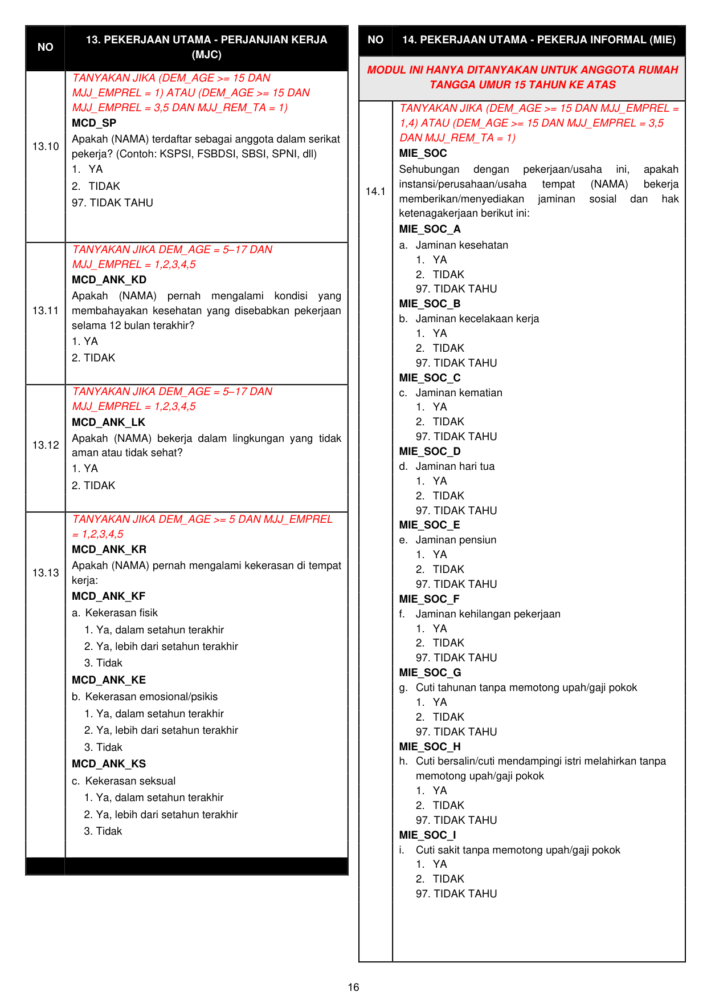

16 
NO 
13. PEKERJAAN UTAMA - PERJANJIAN KERJA 
(MJC) 
  
TANYAKAN JIKA (DEM_AGE >= 15 DAN 
MJJ_EMPREL = 1) ATAU (DEM_AGE >= 15 DAN 
MJJ_EMPREL = 3,5 DAN MJJ_REM_TA = 1) 
  
MCD_SP 
13.10 
Apakah (NAMA) terdaftar sebagai anggota dalam serikat 
pekerja? (Contoh: KSPSI, FSBDSI, SBSI, SPNI, dll) 
  
1. YA 
  
2. TIDAK 
  
97. TIDAK TAHU 
 
 
 
  
TANYAKAN JIKA DEM_AGE = 5–17 DAN 
MJJ_EMPREL = 1,2,3,4,5 
  
MCD_ANK_KD 
13.11 
Apakah (NAMA) pernah mengalami kondisi yang 
membahayakan kesehatan yang disebabkan pekerjaan 
selama 12 bulan terakhir? 
  
1. YA 
  
2. TIDAK 
  
  
  
TANYAKAN JIKA DEM_AGE = 5–17 DAN 
MJJ_EMPREL = 1,2,3,4,5 
  
MCD_ANK_LK 
13.12 
Apakah (NAMA) bekerja dalam lingkungan yang tidak 
aman atau tidak sehat? 
  
1. YA 
  
2. TIDAK 
  
  
TANYAKAN JIKA DEM_AGE >= 5 DAN MJJ_EMPREL 
= 1,2,3,4,5 
  
MCD_ANK_KR 
13.13 
Apakah (NAMA) pernah mengalami kekerasan di tempat 
kerja: 
 
MCD_ANK_KF 
  
a. Kekerasan fisik 
 
 
1. Ya, dalam setahun terakhir 
 
2. Ya, lebih dari setahun terakhir 
 
3. Tidak 
 
MCD_ANK_KE 
 
b. Kekerasan emosional/psikis 
 
1. Ya, dalam setahun terakhir 
 
2. Ya, lebih dari setahun terakhir 
 
3. Tidak 
 
MCD_ANK_KS 
 
c. Kekerasan seksual 
 
1. Ya, dalam setahun terakhir 
  
2. Ya, lebih dari setahun terakhir 
  
3. Tidak 
 
 
  
  
 
 
 
 
NO 
14. PEKERJAAN UTAMA - PEKERJA INFORMAL (MIE) 
MODUL INI HANYA DITANYAKAN UNTUK ANGGOTA RUMAH 
TANGGA UMUR 15 TAHUN KE ATAS 
  
TANYAKAN JIKA (DEM_AGE >= 15 DAN MJJ_EMPREL = 
1,4) ATAU (DEM_AGE >= 15 DAN MJJ_EMPREL = 3,5 
DAN MJJ_REM_TA = 1) 
  
MIE_SOC 
14.1 
Sehubungan 
dengan 
pekerjaan/usaha 
ini, 
apakah 
instansi/perusahaan/usaha 
tempat 
(NAMA) 
bekerja 
memberikan/menyediakan 
jaminan 
sosial 
dan 
hak 
ketenagakerjaan berikut ini: 
  
MIE_SOC_A 
  
a. Jaminan kesehatan 
  
1. YA 
  
2. TIDAK 
  
97. TIDAK TAHU 
  
MIE_SOC_B 
  
b. Jaminan kecelakaan kerja 
  
1. YA 
  
2. TIDAK 
  
97. TIDAK TAHU 
  
MIE_SOC_C 
  
c. Jaminan kematian 
  
1. YA 
  
2. TIDAK 
  
97. TIDAK TAHU 
  
MIE_SOC_D 
  
d. Jaminan hari tua 
  
1. YA 
  
2. TIDAK 
  
97. TIDAK TAHU 
  
MIE_SOC_E 
  
e. Jaminan pensiun 
  
1. YA 
  
2. TIDAK 
  
97. TIDAK TAHU 
  
MIE_SOC_F 
  
f. Jaminan kehilangan pekerjaan 
  
1. YA 
  
2. TIDAK 
  
97. TIDAK TAHU 
  
MIE_SOC_G 
  
g. Cuti tahunan tanpa memotong upah/gaji pokok 
  
1. YA 
  
2. TIDAK 
  
97. TIDAK TAHU 
  
MIE_SOC_H 
  
h. Cuti bersalin/cuti mendampingi istri melahirkan tanpa 
memotong upah/gaji pokok 
  
1. YA 
  
2. TIDAK 
  
97. TIDAK TAHU 
  
MIE_SOC_I 
  
i. Cuti sakit tanpa memotong upah/gaji pokok 
  
1. YA 
  
2. TIDAK 
  
97. TIDAK TAHU

---

## Halaman 17

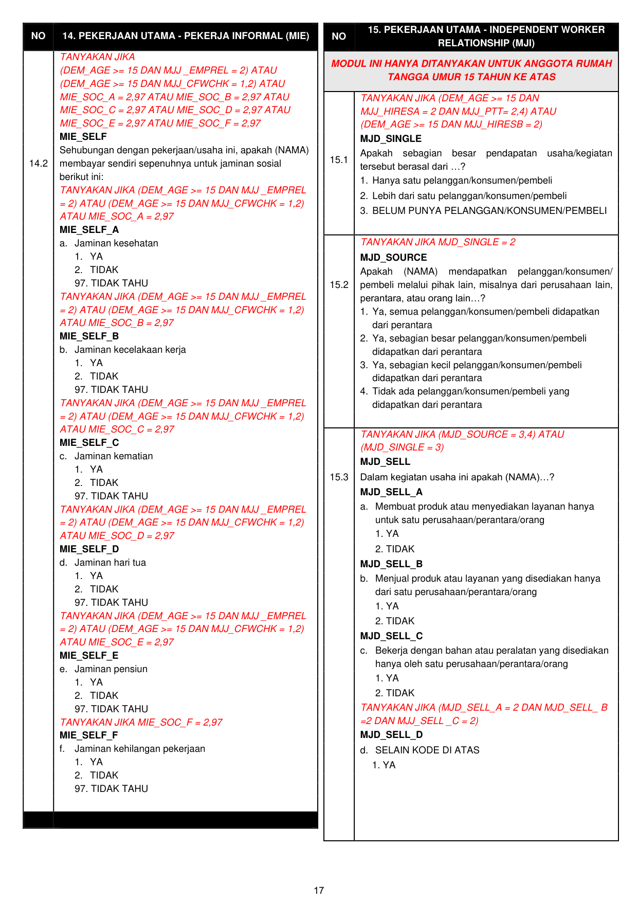

17 
NO 
14. PEKERJAAN UTAMA - PEKERJA INFORMAL (MIE) 
  
TANYAKAN JIKA 
  
(DEM_AGE >= 15 DAN MJJ _EMPREL = 2) ATAU 
(DEM_AGE >= 15 DAN MJJ_CFWCHK = 1,2) ATAU 
MIE_SOC_A = 2,97 ATAU MIE_SOC_B = 2,97 ATAU  
  
MIE_SOC_C = 2,97 ATAU MIE_SOC_D = 2,97 ATAU 
MIE_SOC_E = 2,97 ATAU MIE_SOC_F = 2,97 
  
MIE_SELF 
14.2 
Sehubungan dengan pekerjaan/usaha ini, apakah (NAMA) 
membayar sendiri sepenuhnya untuk jaminan sosial 
berikut ini: 
  
TANYAKAN JIKA (DEM_AGE >= 15 DAN MJJ _EMPREL 
= 2) ATAU (DEM_AGE >= 15 DAN MJJ_CFWCHK = 1,2) 
ATAU MIE_SOC_A = 2,97 
  
MIE_SELF_A 
  
a. Jaminan kesehatan 
  
1. YA 
  
2. TIDAK 
  
97. TIDAK TAHU 
  
TANYAKAN JIKA (DEM_AGE >= 15 DAN MJJ _EMPREL 
= 2) ATAU (DEM_AGE >= 15 DAN MJJ_CFWCHK = 1,2) 
ATAU MIE_SOC_B = 2,97 
  
MIE_SELF_B 
  
b. Jaminan kecelakaan kerja 
  
1. YA 
  
2. TIDAK 
  
97. TIDAK TAHU 
  
TANYAKAN JIKA (DEM_AGE >= 15 DAN MJJ _EMPREL 
= 2) ATAU (DEM_AGE >= 15 DAN MJJ_CFWCHK = 1,2) 
ATAU MIE_SOC_C = 2,97 
  
MIE_SELF_C 
  
c. Jaminan kematian 
  
1. YA 
  
2. TIDAK 
  
97. TIDAK TAHU 
  
TANYAKAN JIKA (DEM_AGE >= 15 DAN MJJ _EMPREL 
= 2) ATAU (DEM_AGE >= 15 DAN MJJ_CFWCHK = 1,2) 
ATAU MIE_SOC_D = 2,97 
  
MIE_SELF_D 
  
d. Jaminan hari tua 
  
1. YA 
  
2. TIDAK 
  
97. TIDAK TAHU 
  
TANYAKAN JIKA (DEM_AGE >= 15 DAN MJJ _EMPREL 
= 2) ATAU (DEM_AGE >= 15 DAN MJJ_CFWCHK = 1,2) 
ATAU MIE_SOC_E = 2,97 
  
MIE_SELF_E 
  
e. Jaminan pensiun 
  
1. YA 
  
2. TIDAK 
  
97. TIDAK TAHU 
  
TANYAKAN JIKA MIE_SOC_F = 2,97 
  
MIE_SELF_F 
  
f. Jaminan kehilangan pekerjaan 
  
1. YA 
  
2. TIDAK 
  
97. TIDAK TAHU 
  
  
  
  
 
 
NO 
15. PEKERJAAN UTAMA - INDEPENDENT WORKER 
RELATIONSHIP (MJI) 
MODUL INI HANYA DITANYAKAN UNTUK ANGGOTA RUMAH 
TANGGA UMUR 15 TAHUN KE ATAS 
  
TANYAKAN JIKA (DEM_AGE >= 15 DAN  
MJJ_HIRESA = 2 DAN MJJ_PTT= 2,4) ATAU  
(DEM_AGE >= 15 DAN MJJ_HIRESB = 2) 
  
MJD_SINGLE 
15.1 
Apakah sebagian besar pendapatan usaha/kegiatan 
tersebut berasal dari …? 
  
1. Hanya satu pelanggan/konsumen/pembeli  
  
2. Lebih dari satu pelanggan/konsumen/pembeli 
  
3. BELUM PUNYA PELANGGAN/KONSUMEN/PEMBELI 
  
  
  
TANYAKAN JIKA MJD_SINGLE = 2  
  
MJD_SOURCE 
15.2 
Apakah 
(NAMA) 
mendapatkan 
pelanggan/konsumen/ 
pembeli melalui pihak lain, misalnya dari perusahaan lain, 
perantara, atau orang lain…? 
  
1. Ya, semua pelanggan/konsumen/pembeli didapatkan 
dari perantara 
  
2. Ya, sebagian besar pelanggan/konsumen/pembeli 
didapatkan dari perantara 
  
3. Ya, sebagian kecil pelanggan/konsumen/pembeli 
didapatkan dari perantara 
  
4. Tidak ada pelanggan/konsumen/pembeli yang 
didapatkan dari perantara 
  
  
  
TANYAKAN JIKA (MJD_SOURCE = 3,4) ATAU 
(MJD_SINGLE = 3) 
  
MJD_SELL 
15.3 
Dalam kegiatan usaha ini apakah (NAMA)…? 
  
MJD_SELL_A 
  
a. Membuat produk atau menyediakan layanan hanya 
untuk satu perusahaan/perantara/orang 
  
1. YA 
  
2. TIDAK 
  
MJD_SELL_B 
  
b. Menjual produk atau layanan yang disediakan hanya 
dari satu perusahaan/perantara/orang 
  
1. YA 
  
2. TIDAK 
  
MJD_SELL_C 
  
c. Bekerja dengan bahan atau peralatan yang disediakan 
hanya oleh satu perusahaan/perantara/orang 
  
1. YA 
  
2. TIDAK 
  
TANYAKAN JIKA (MJD_SELL_A = 2 DAN MJD_SELL_ B 
=2 DAN MJJ_SELL _C = 2) 
MJD_SELL_D 
 
d. SELAIN KODE DI ATAS 
    1. YA

---

## Halaman 18

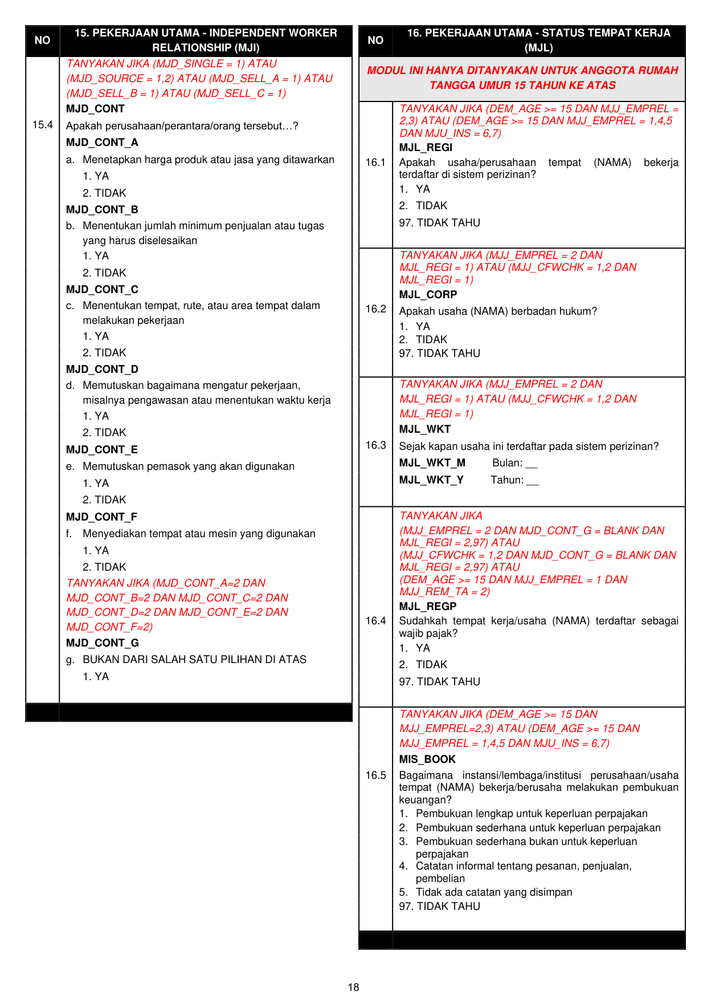

18 
NO 
15. PEKERJAAN UTAMA - INDEPENDENT WORKER 
RELATIONSHIP (MJI) 
  
TANYAKAN JIKA (MJD_SINGLE = 1) ATAU 
(MJD_SOURCE = 1,2) ATAU (MJD_SELL_A = 1) ATAU 
(MJD_SELL_B = 1) ATAU (MJD_SELL_C = 1)  
  
MJD_CONT 
15.4 
Apakah perusahaan/perantara/orang tersebut…? 
  
MJD_CONT_A 
  
a. Menetapkan harga produk atau jasa yang ditawarkan 
  
1. YA 
  
2. TIDAK 
  
MJD_CONT_B 
  
b. Menentukan jumlah minimum penjualan atau tugas 
yang harus diselesaikan 
  
1. YA 
  
2. TIDAK 
  
MJD_CONT_C 
  
c. Menentukan tempat, rute, atau area tempat dalam 
melakukan pekerjaan 
  
1. YA 
  
2. TIDAK 
  
MJD_CONT_D 
  
d. Memutuskan bagaimana mengatur pekerjaan, 
misalnya pengawasan atau menentukan waktu kerja 
  
1. YA 
  
2. TIDAK 
  
MJD_CONT_E 
  
e. Memutuskan pemasok yang akan digunakan 
  
1. YA 
  
2. TIDAK 
  
MJD_CONT_F 
  
f. Menyediakan tempat atau mesin yang digunakan 
  
1. YA 
  
2. TIDAK 
  
TANYAKAN JIKA (MJD_CONT_A=2 DAN 
MJD_CONT_B=2 DAN MJD_CONT_C=2 DAN 
MJD_CONT_D=2 DAN MJD_CONT_E=2 DAN 
MJD_CONT_F=2) 
MJD_CONT_G 
g. BUKAN DARI SALAH SATU PILIHAN DI ATAS 
1. YA 
  
 
  
  
 
 
 
 
 
 
 
 
 
 
NO 
16. PEKERJAAN UTAMA - STATUS TEMPAT KERJA 
(MJL) 
MODUL INI HANYA DITANYAKAN UNTUK ANGGOTA RUMAH 
TANGGA UMUR 15 TAHUN KE ATAS 
  
TANYAKAN JIKA (DEM_AGE >= 15 DAN MJJ_EMPREL = 
2,3) ATAU (DEM_AGE >= 15 DAN MJJ_EMPREL = 1,4,5 
DAN MJU_INS = 6,7) 
  
MJL_REGI 
16.1 
Apakah 
usaha/perusahaan 
tempat 
(NAMA) 
bekerja 
terdaftar di sistem perizinan? 
1. YA 
2. TIDAK 
97. TIDAK TAHU 
  
TANYAKAN JIKA (MJJ_EMPREL = 2 DAN  
MJL_REGI = 1) ATAU (MJJ_CFWCHK = 1,2 DAN 
MJL_REGI = 1) 
MJL_CORP 
16.2 
Apakah usaha (NAMA) berbadan hukum? 
1. YA 
 
2. TIDAK 
97. TIDAK TAHU 
  
TANYAKAN JIKA (MJJ_EMPREL = 2 DAN  
MJL_REGI = 1) ATAU (MJJ_CFWCHK = 1,2 DAN 
MJL_REGI = 1)  
MJL_WKT 
16.3 
Sejak kapan usaha ini terdaftar pada sistem perizinan? 
MJL_WKT_M         Bulan: __ 
 
MJL_WKT_Y         Tahun: __ 
  
TANYAKAN JIKA  
(MJJ_EMPREL = 2 DAN MJD_CONT_G = BLANK DAN 
MJL_REGI = 2,97) ATAU 
(MJJ_CFWCHK = 1,2 DAN MJD_CONT_G = BLANK DAN 
MJL_REGI = 2,97) ATAU 
 
(DEM_AGE >= 15 DAN MJJ_EMPREL = 1 DAN 
MJJ_REM_TA = 2) 
MJL_REGP 
16.4 
Sudahkah tempat kerja/usaha (NAMA) terdaftar sebagai 
wajib pajak? 
1. YA 
2. TIDAK 
97. TIDAK TAHU 
  
TANYAKAN JIKA (DEM_AGE >= 15 DAN 
MJJ_EMPREL=2,3) ATAU (DEM_AGE >= 15 DAN 
MJJ_EMPREL = 1,4,5 DAN MJU_INS = 6,7) 
MIS_BOOK 
16.5 
Bagaimana instansi/lembaga/institusi perusahaan/usaha 
tempat (NAMA) bekerja/berusaha melakukan pembukuan 
keuangan? 
  
1. Pembukuan lengkap untuk keperluan perpajakan 
  
2. Pembukuan sederhana untuk keperluan perpajakan 
  
3. Pembukuan sederhana bukan untuk keperluan   
perpajakan 
  
4. Catatan informal tentang pesanan, penjualan, 
pembelian 
  
5. Tidak ada catatan yang disimpan 
  
97. TIDAK TAHU

---

## Halaman 19

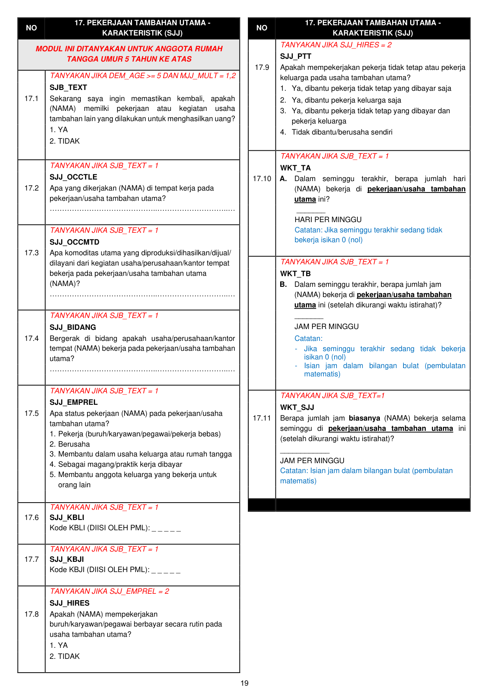

19 
NO 
17. PEKERJAAN TAMBAHAN UTAMA - 
KARAKTERISTIK (SJJ) 
MODUL INI DITANYAKAN UNTUK ANGGOTA RUMAH 
TANGGA UMUR 5 TAHUN KE ATAS 
  
TANYAKAN JIKA DEM_AGE >= 5 DAN MJJ_MULT = 1,2 
  
SJB_TEXT 
17.1 
Sekarang saya ingin memastikan kembali, apakah 
(NAMA) memilki pekerjaan atau kegiatan usaha 
tambahan lain yang dilakukan untuk menghasilkan uang? 
1. YA 
2. TIDAK 
  
TANYAKAN JIKA SJB_TEXT = 1 
SJJ_OCCTLE 
17.2 
Apa yang dikerjakan (NAMA) di tempat kerja pada 
pekerjaan/usaha tambahan utama? 
……………………………………..………………………..… 
  
TANYAKAN JIKA SJB_TEXT = 1 
SJJ_OCCMTD 
17.3 
Apa komoditas utama yang diproduksi/dihasilkan/dijual/ 
dilayani dari kegiatan usaha/perusahaan/kantor tempat 
bekerja pada pekerjaan/usaha tambahan utama 
(NAMA)? 
……………………………………..………………………..… 
  
 
TANYAKAN JIKA SJB_TEXT = 1 
 
SJJ_BIDANG 
17.4 
Bergerak di bidang apakah usaha/perusahaan/kantor 
tempat (NAMA) bekerja pada pekerjaan/usaha tambahan 
utama? 
……………………………………..………………………..… 
 
  
TANYAKAN JIKA SJB_TEXT = 1 
 
SJJ_EMPREL 
17.5 
Apa status pekerjaan (NAMA) pada pekerjaan/usaha 
tambahan utama? 
 
1. Pekerja (buruh/karyawan/pegawai/pekerja bebas) 
2. Berusaha 
 
3. Membantu dalam usaha keluarga atau rumah tangga 
4. Sebagai magang/praktik kerja dibayar 
5. Membantu anggota keluarga yang bekerja untuk 
orang lain 
  
TANYAKAN JIKA SJB_TEXT = 1 
17.6 
SJJ_KBLI 
Kode KBLI (DIISI OLEH PML): _ _ _ _ _ 
  
TANYAKAN JIKA SJB_TEXT = 1 
17.7 
SJJ_KBJI 
Kode KBJI (DIISI OLEH PML): _ _ _ _ _ 
  
TANYAKAN JIKA SJJ_EMPREL = 2 
 
SJJ_HIRES 
17.8 
Apakah (NAMA) mempekerjakan 
buruh/karyawan/pegawai berbayar secara rutin pada 
usaha tambahan utama? 
1. YA 
2. TIDAK 
 
NO 
17. PEKERJAAN TAMBAHAN UTAMA - 
KARAKTERISTIK (SJJ) 
TANYAKAN JIKA SJJ_HIRES = 2 
 
SJJ_PTT 
17.9 
Apakah mempekerjakan pekerja tidak tetap atau pekerja 
keluarga pada usaha tambahan utama? 
1. Ya, dibantu pekerja tidak tetap yang dibayar saja 
2. Ya, dibantu pekerja keluarga saja 
 
3. Ya, dibantu pekerja tidak tetap yang dibayar dan 
pekerja keluarga 
4. Tidak dibantu/berusaha sendiri 
  
TANYAKAN JIKA SJB_TEXT = 1 
WKT_TA 
17.10 
A. Dalam seminggu terakhir, berapa jumlah hari 
(NAMA) bekerja di pekerjaan/usaha tambahan 
utama ini? 
 _______ 
       HARI PER MINGGU 
 
Catatan: Jika seminggu terakhir sedang tidak 
bekerja isikan 0 (nol) 
 
TANYAKAN JIKA SJB_TEXT = 1 
WKT_TB 
B. Dalam seminggu terakhir, berapa jumlah jam 
(NAMA) bekerja di pekerjaan/usaha tambahan 
utama ini (setelah dikurangi waktu istirahat)? 
       _______ 
 
       JAM PER MINGGU 
 
Catatan:  
- Jika seminggu terakhir sedang tidak bekerja 
isikan 0 (nol) 
- Isian jam dalam bilangan bulat (pembulatan 
matematis) 
 
TANYAKAN JIKA SJB_TEXT=1 
 
WKT_SJJ 
17.11 
Berapa jumlah jam biasanya (NAMA) bekerja selama 
seminggu di pekerjaan/usaha tambahan utama ini 
(setelah dikurangi waktu istirahat)? 
  
____________ 
  
JAM PER MINGGU 
Catatan: Isian jam dalam bilangan bulat (pembulatan 
matematis)

---

## Halaman 20

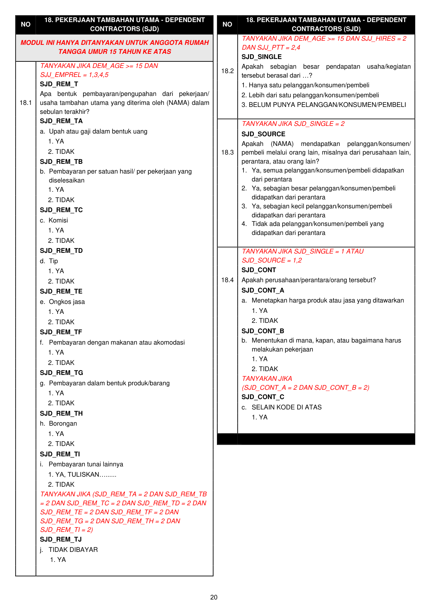

20 
NO 
18. PEKERJAAN TAMBAHAN UTAMA - DEPENDENT 
CONTRACTORS (SJD) 
MODUL INI HANYA DITANYAKAN UNTUK ANGGOTA RUMAH 
TANGGA UMUR 15 TAHUN KE ATAS 
  
TANYAKAN JIKA DEM_AGE >= 15 DAN  
SJJ_EMPREL = 1,3,4,5  
  
SJD_REM_T 
18.1 
Apa bentuk pembayaran/pengupahan dari pekerjaan/ 
usaha tambahan utama yang diterima oleh (NAMA) dalam 
sebulan terakhir? 
  
SJD_REM_TA 
  
a.  Upah atau gaji dalam bentuk uang 
  
1. YA 
  
2. TIDAK 
  
SJD_REM_TB 
  
b.  Pembayaran per satuan hasil/ per pekerjaan yang  
     diselesaikan 
  
1. YA 
  
2. TIDAK 
  
SJD_REM_TC 
  
c.  Komisi  
  
1. YA 
  
2. TIDAK 
  
SJD_REM_TD 
  
d.  Tip 
  
1. YA 
  
2. TIDAK 
  
SJD_REM_TE 
  
e.  Ongkos jasa 
  
1. YA 
  
2. TIDAK 
  
SJD_REM_TF 
  
f.   Pembayaran dengan makanan atau akomodasi 
  
1. YA 
  
2. TIDAK 
  
SJD_REM_TG 
  
g.  Pembayaran dalam bentuk produk/barang 
  
1. YA 
  
2. TIDAK 
  
SJD_REM_TH 
  
h.  Borongan 
  
1. YA 
  
2. TIDAK 
  
SJD_REM_TI 
  
i.   Pembayaran tunai lainnya 
  
1. YA, TULISKAN…...... 
  
2. TIDAK 
  
TANYAKAN JIKA (SJD_REM_TA = 2 DAN SJD_REM_TB 
= 2 DAN SJD_REM_TC = 2 DAN SJD_REM_TD = 2 DAN 
SJD_REM_TE = 2 DAN SJD_REM_TF = 2 DAN 
SJD_REM_TG = 2 DAN SJD_REM_TH = 2 DAN 
SJD_REM_TI = 2) 
  
SJD_REM_TJ 
  
j.   TIDAK DIBAYAR 
  
  1. YA 
  
  
NO 
18. PEKERJAAN TAMBAHAN UTAMA - DEPENDENT 
CONTRACTORS (SJD) 
  
TANYAKAN JIKA DEM_AGE >= 15 DAN SJJ_HIRES = 2 
DAN SJJ_PTT = 2,4 
  
SJD_SINGLE 
18.2 
Apakah sebagian besar pendapatan usaha/kegiatan 
tersebut berasal dari …? 
  
1. Hanya satu pelanggan/konsumen/pembeli  
  
2. Lebih dari satu pelanggan/konsumen/pembeli 
  
3. BELUM PUNYA PELANGGAN/KONSUMEN/PEMBELI 
 
  
TANYAKAN JIKA SJD_SINGLE = 2 
  
SJD_SOURCE 
18.3 
Apakah 
(NAMA) 
mendapatkan 
pelanggan/konsumen/ 
pembeli melalui orang lain, misalnya dari perusahaan lain, 
perantara, atau orang lain? 
  
1. Ya, semua pelanggan/konsumen/pembeli didapatkan 
dari perantara 
  
2. Ya, sebagian besar pelanggan/konsumen/pembeli 
didapatkan dari perantara 
  
3. Ya, sebagian kecil pelanggan/konsumen/pembeli 
didapatkan dari perantara 
  
4. Tidak ada pelanggan/konsumen/pembeli yang 
didapatkan dari perantara 
 
  
TANYAKAN JIKA SJD_SINGLE = 1 ATAU  
SJD_SOURCE = 1,2 
  
SJD_CONT  
18.4 
Apakah perusahaan/perantara/orang tersebut? 
 
SJD_CONT_A 
 
a. Menetapkan harga produk atau jasa yang ditawarkan 
 
1. YA 
 
2. TIDAK 
 
SJD_CONT_B 
 
b. Menentukan di mana, kapan, atau bagaimana harus 
melakukan pekerjaan 
  
1. YA 
  
2. TIDAK 
 
TANYAKAN JIKA  
(SJD_CONT_A = 2 DAN SJD_CONT_B = 2) 
 
SJD_CONT_C 
 
c. SELAIN KODE DI ATAS 
  
1. YA

---

## Halaman 21

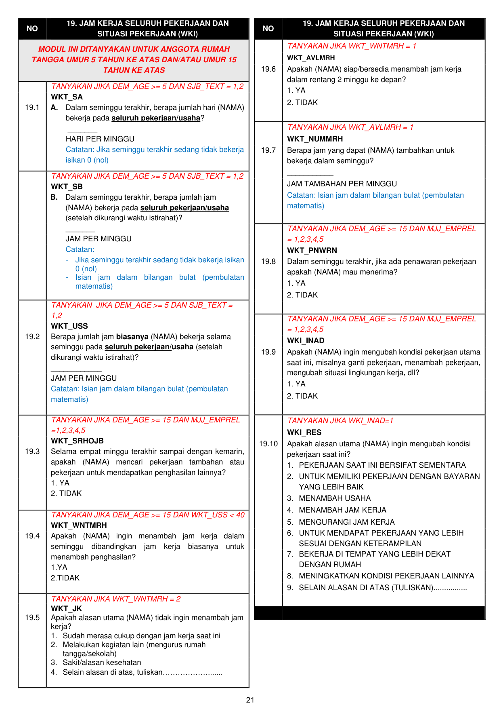

21 
NO 
19. JAM KERJA SELURUH PEKERJAAN DAN 
SITUASI PEKERJAAN (WKI) 
MODUL INI DITANYAKAN UNTUK ANGGOTA RUMAH 
TANGGA UMUR 5 TAHUN KE ATAS DAN/ATAU UMUR 15 
TAHUN KE ATAS 
  
TANYAKAN JIKA DEM_AGE >= 5 DAN SJB_TEXT = 1,2 
  
WKT_SA 
19.1 
A. Dalam seminggu terakhir, berapa jumlah hari (NAMA) 
bekerja pada seluruh pekerjaan/usaha? 
 _______ 
       HARI PER MINGGU 
 
Catatan: Jika seminggu terakhir sedang tidak bekerja 
isikan 0 (nol) 
 
TANYAKAN JIKA DEM_AGE >= 5 DAN SJB_TEXT = 1,2 
 
WKT_SB 
 
B. Dalam seminggu terakhir, berapa jumlah jam 
(NAMA) bekerja pada seluruh pekerjaan/usaha 
(setelah dikurangi waktu istirahat)? 
 
       _______ 
 
       JAM PER MINGGU 
 
Catatan:  
- Jika seminggu terakhir sedang tidak bekerja isikan 
0 (nol) 
- Isian jam dalam bilangan bulat (pembulatan 
matematis) 
 
TANYAKAN  JIKA DEM_AGE >= 5 DAN SJB_TEXT = 
1,2 
 
WKT_USS 
19.2 
Berapa jumlah jam biasanya (NAMA) bekerja selama 
seminggu pada seluruh pekerjaan/usaha (setelah 
dikurangi waktu istirahat)? 
____________ 
JAM PER MINGGU 
 
Catatan: Isian jam dalam bilangan bulat (pembulatan 
matematis) 
 
TANYAKAN JIKA DEM_AGE >= 15 DAN MJJ_EMPREL 
=1,2,3,4,5  
WKT_SRHOJB 
19.3 
Selama empat minggu terakhir sampai dengan kemarin, 
apakah (NAMA) mencari pekerjaan tambahan atau 
pekerjaan untuk mendapatkan penghasilan lainnya? 
1. YA 
2. TIDAK 
  
TANYAKAN JIKA DEM_AGE >= 15 DAN WKT_USS < 40 
WKT_WNTMRH 
19.4 
Apakah (NAMA) ingin menambah jam kerja dalam 
seminggu dibandingkan jam kerja biasanya untuk 
menambah penghasilan? 
1.YA 
2.TIDAK 
 
TANYAKAN JIKA WKT_WNTMRH = 2 
 
WKT_JK 
19.5 
Apakah alasan utama (NAMA) tidak ingin menambah jam 
kerja? 
1. Sudah merasa cukup dengan jam kerja saat ini 
2. Melakukan kegiatan lain (mengurus rumah 
tangga/sekolah) 
3. Sakit/alasan kesehatan 
4. Selain alasan di atas, tuliskan………………....... 
 
NO 
19. JAM KERJA SELURUH PEKERJAAN DAN 
SITUASI PEKERJAAN (WKI) 
TANYAKAN JIKA WKT_WNTMRH = 1 
 
WKT_AVLMRH 
19.6 
Apakah (NAMA) siap/bersedia menambah jam kerja 
dalam rentang 2 minggu ke depan? 
1. YA 
2. TIDAK 
  
TANYAKAN JIKA WKT_AVLMRH = 1 
WKT_NUMMRH 
19.7 
Berapa jam yang dapat (NAMA) tambahkan untuk 
bekerja dalam seminggu? 
___________ 
JAM TAMBAHAN PER MINGGU 
 
Catatan: Isian jam dalam bilangan bulat (pembulatan 
matematis) 
  
TANYAKAN JIKA DEM_AGE >= 15 DAN MJJ_EMPREL 
= 1,2,3,4,5 
WKT_PNWRN 
19.8 
Dalam seminggu terakhir, jika ada penawaran pekerjaan 
apakah (NAMA) mau menerima? 
1. YA 
 
2. TIDAK 
  
TANYAKAN JIKA DEM_AGE >= 15 DAN MJJ_EMPREL 
= 1,2,3,4,5 
 
WKI_INAD 
19.9 
Apakah (NAMA) ingin mengubah kondisi pekerjaan utama 
saat ini, misalnya ganti pekerjaan, menambah pekerjaan, 
mengubah situasi lingkungan kerja, dll? 
1. YA 
 
2. TIDAK 
  
TANYAKAN JIKA WKI_INAD=1 
 
WKI_RES 
19.10 
Apakah alasan utama (NAMA) ingin mengubah kondisi 
pekerjaan saat ini? 
 
1. PEKERJAAN SAAT INI BERSIFAT SEMENTARA 
2. UNTUK MEMILIKI PEKERJAAN DENGAN BAYARAN 
YANG LEBIH BAIK 
3. MENAMBAH USAHA 
  
4. MENAMBAH JAM KERJA 
  
5. MENGURANGI JAM KERJA 
  
6. UNTUK MENDAPAT PEKERJAAN YANG LEBIH 
SESUAI DENGAN KETERAMPILAN 
  
7. BEKERJA DI TEMPAT YANG LEBIH DEKAT 
DENGAN RUMAH 
  
8. MENINGKATKAN KONDISI PEKERJAAN LAINNYA 
  
9. SELAIN ALASAN DI ATAS (TULISKAN)................

---

## Halaman 22

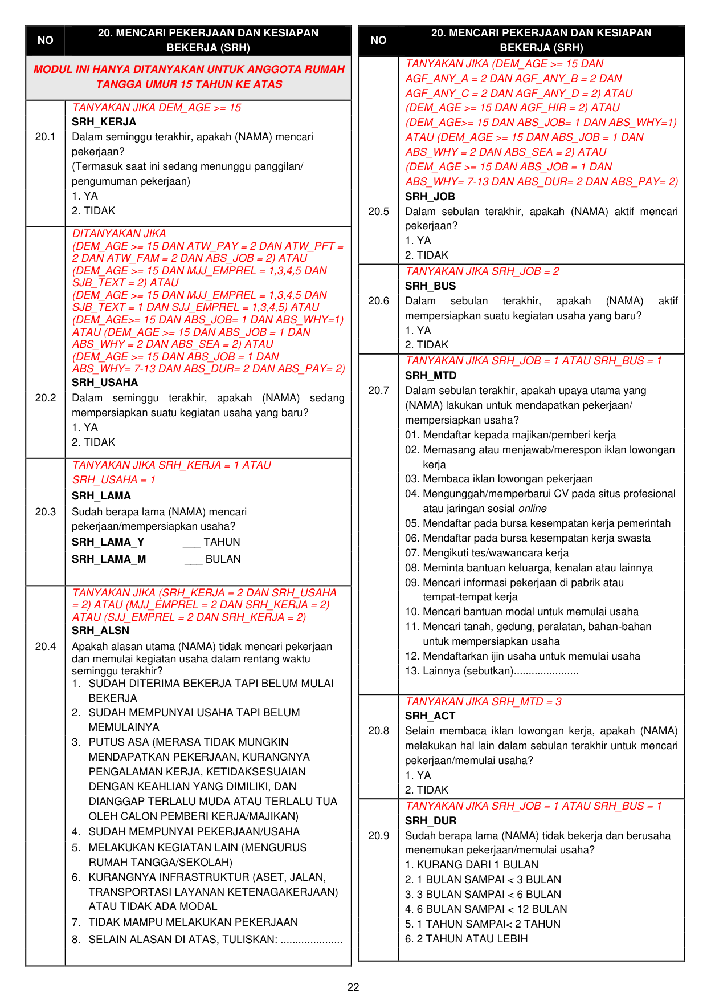

22 
NO 
20. MENCARI PEKERJAAN DAN KESIAPAN 
BEKERJA (SRH) 
MODUL INI HANYA DITANYAKAN UNTUK ANGGOTA RUMAH 
TANGGA UMUR 15 TAHUN KE ATAS 
  
TANYAKAN JIKA DEM_AGE >= 15 
  
SRH_KERJA 
20.1 
Dalam seminggu terakhir, apakah (NAMA) mencari 
pekerjaan? 
(Termasuk saat ini sedang menunggu panggilan/ 
pengumuman pekerjaan) 
1. YA 
2. TIDAK 
DITANYAKAN JIKA 
(DEM_AGE >= 15 DAN ATW_PAY = 2 DAN ATW_PFT = 
2 DAN ATW_FAM = 2 DAN ABS_JOB = 2) ATAU 
(DEM_AGE >= 15 DAN MJJ_EMPREL = 1,3,4,5 DAN 
SJB_TEXT = 2) ATAU 
(DEM_AGE >= 15 DAN MJJ_EMPREL = 1,3,4,5 DAN 
SJB_TEXT = 1 DAN SJJ_EMPREL = 1,3,4,5) ATAU 
(DEM_AGE>= 15 DAN ABS_JOB= 1 DAN ABS_WHY=1) 
ATAU (DEM_AGE >= 15 DAN ABS_JOB = 1 DAN 
ABS_WHY = 2 DAN ABS_SEA = 2) ATAU 
(DEM_AGE >= 15 DAN ABS_JOB = 1 DAN  
ABS_WHY= 7-13 DAN ABS_DUR= 2 DAN ABS_PAY= 2) 
SRH_USAHA 
20.2 
Dalam seminggu terakhir, apakah (NAMA) sedang 
mempersiapkan suatu kegiatan usaha yang baru? 
1. YA 
2. TIDAK 
 
TANYAKAN JIKA SRH_KERJA = 1 ATAU  
SRH_USAHA = 1  
SRH_LAMA 
20.3 
Sudah berapa lama (NAMA) mencari 
pekerjaan/mempersiapkan usaha? 
SRH_LAMA_Y             ___ TAHUN 
SRH_LAMA_M             ___ BULAN 
  
TANYAKAN JIKA (SRH_KERJA = 2 DAN SRH_USAHA 
= 2) ATAU (MJJ_EMPREL = 2 DAN SRH_KERJA = 2) 
ATAU (SJJ_EMPREL = 2 DAN SRH_KERJA = 2) 
SRH_ALSN 
20.4 
Apakah alasan utama (NAMA) tidak mencari pekerjaan 
dan memulai kegiatan usaha dalam rentang waktu 
seminggu terakhir? 
1. SUDAH DITERIMA BEKERJA TAPI BELUM MULAI 
BEKERJA 
2. SUDAH MEMPUNYAI USAHA TAPI BELUM 
MEMULAINYA   
3. PUTUS ASA (MERASA TIDAK MUNGKIN 
MENDAPATKAN PEKERJAAN, KURANGNYA 
PENGALAMAN KERJA, KETIDAKSESUAIAN 
DENGAN KEAHLIAN YANG DIMILIKI, DAN 
DIANGGAP TERLALU MUDA ATAU TERLALU TUA 
OLEH CALON PEMBERI KERJA/MAJIKAN) 
4. SUDAH MEMPUNYAI PEKERJAAN/USAHA 
 
5. MELAKUKAN KEGIATAN LAIN (MENGURUS 
RUMAH TANGGA/SEKOLAH)  
6. KURANGNYA INFRASTRUKTUR (ASET, JALAN, 
TRANSPORTASI LAYANAN KETENAGAKERJAAN) 
ATAU TIDAK ADA MODAL 
7. TIDAK MAMPU MELAKUKAN PEKERJAAN 
8. SELAIN ALASAN DI ATAS, TULISKAN: ..................... 
  
NO 
20. MENCARI PEKERJAAN DAN KESIAPAN 
BEKERJA (SRH) 
TANYAKAN JIKA (DEM_AGE >= 15 DAN  
AGF_ANY_A = 2 DAN AGF_ANY_B = 2 DAN 
AGF_ANY_C = 2 DAN AGF_ANY_D = 2) ATAU  
(DEM_AGE >= 15 DAN AGF_HIR = 2) ATAU  
(DEM_AGE>= 15 DAN ABS_JOB= 1 DAN ABS_WHY=1) 
ATAU (DEM_AGE >= 15 DAN ABS_JOB = 1 DAN 
ABS_WHY = 2 DAN ABS_SEA = 2) ATAU 
(DEM_AGE >= 15 DAN ABS_JOB = 1 DAN  
ABS_WHY= 7-13 DAN ABS_DUR= 2 DAN ABS_PAY= 2) 
SRH_JOB 
20.5 
Dalam sebulan terakhir, apakah (NAMA) aktif mencari 
pekerjaan? 
1. YA 
2. TIDAK 
TANYAKAN JIKA SRH_JOB = 2 
SRH_BUS 
20.6 
Dalam 
sebulan 
terakhir, 
apakah 
(NAMA) 
aktif 
mempersiapkan suatu kegiatan usaha yang baru? 
1. YA 
2. TIDAK 
TANYAKAN JIKA SRH_JOB = 1 ATAU SRH_BUS = 1 
SRH_MTD 
20.7 
Dalam sebulan terakhir, apakah upaya utama yang 
(NAMA) lakukan untuk mendapatkan pekerjaan/ 
mempersiapkan usaha? 
01. Mendaftar kepada majikan/pemberi kerja 
02. Memasang atau menjawab/merespon iklan lowongan 
      kerja 
 
03. Membaca iklan lowongan pekerjaan 
04. Mengunggah/memperbarui CV pada situs profesional 
 
      atau jaringan sosial online 
05. Mendaftar pada bursa kesempatan kerja pemerintah 
 
06. Mendaftar pada bursa kesempatan kerja swasta 
07. Mengikuti tes/wawancara kerja 
08. Meminta bantuan keluarga, kenalan atau lainnya 
09. Mencari informasi pekerjaan di pabrik atau 
      tempat-tempat kerja 
10. Mencari bantuan modal untuk memulai usaha 
11. Mencari tanah, gedung, peralatan, bahan-bahan 
      untuk mempersiapkan usaha 
12. Mendaftarkan ijin usaha untuk memulai usaha 
13. Lainnya (sebutkan)...................... 
 
TANYAKAN JIKA SRH_MTD = 3 
SRH_ACT 
20.8 
Selain membaca iklan lowongan kerja, apakah (NAMA) 
melakukan hal lain dalam sebulan terakhir untuk mencari 
pekerjaan/memulai usaha? 
1. YA 
2. TIDAK 
TANYAKAN JIKA SRH_JOB = 1 ATAU SRH_BUS = 1 
SRH_DUR 
20.9 
Sudah berapa lama (NAMA) tidak bekerja dan berusaha 
menemukan pekerjaan/memulai usaha? 
 
1. KURANG DARI 1 BULAN 
2. 1 BULAN SAMPAI < 3 BULAN 
3. 3 BULAN SAMPAI < 6 BULAN 
4. 6 BULAN SAMPAI < 12 BULAN 
5. 1 TAHUN SAMPAI< 2 TAHUN 
6. 2 TAHUN ATAU LEBIH

---

## Halaman 23

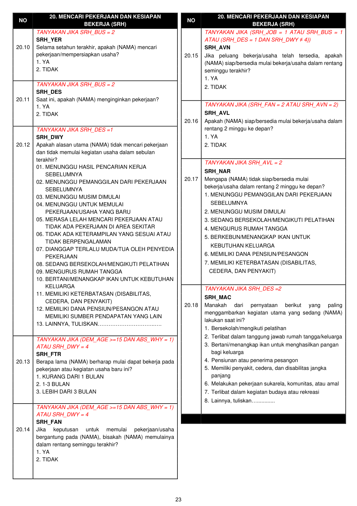

23 
NO 
20. MENCARI PEKERJAAN DAN KESIAPAN 
BEKERJA (SRH) 
TANYAKAN JIKA SRH_BUS = 2  
SRH_YER 
20.10 
Selama setahun terakhir, apakah (NAMA) mencari 
pekerjaan/mempersiapkan usaha? 
1. YA 
2. TIDAK 
 
TANYAKAN JIKA SRH_BUS = 2  
SRH_DES 
20.11 
Saat ini, apakah (NAMA) menginginkan pekerjaan? 
1. YA 
2. TIDAK 
  
TANYAKAN JIKA SRH_DES =1  
SRH_DWY 
20.12 
Apakah alasan utama (NAMA) tidak mencari pekerjaan 
dan tidak memulai kegiatan usaha dalam sebulan 
terakhir? 
01. MENUNGGU HASIL PENCARIAN KERJA  
      SEBELUMNYA 
02. MENUNGGU PEMANGGILAN DARI PEKERJAAN 
      SEBELUMNYA 
03. MENUNGGU MUSIM DIMULAI 
04. MENUNGGU UNTUK MEMULAI  
 
      PEKERJAAN/USAHA YANG BARU 
05. MERASA LELAH MENCARI PEKERJAAN ATAU  
 
      TIDAK ADA PEKERJAAN DI AREA SEKITAR 
06. TIDAK ADA KETERAMPILAN YANG SESUAI ATAU 
 
      TIDAK BERPENGALAMAN 
07. DIANGGAP TERLALU MUDA/TUA OLEH PENYEDIA 
      PEKERJAAN 
08. SEDANG BERSEKOLAH/MENGIKUTI PELATIHAN 
09. MENGURUS RUMAH TANGGA 
10. BERTANI/MENANGKAP IKAN UNTUK KEBUTUHAN 
 
      KELUARGA 
11. MEMILIKI KETERBATASAN (DISABILITAS,  
 
      CEDERA, DAN PENYAKIT) 
12. MEMILIKI DANA PENSIUN/PESANGON ATAU  
      MEMILIKI SUMBER PENDAPATAN YANG LAIN 
13. LAINNYA, TULISKAN…………………………..…. 
  
TANYAKAN JIKA (DEM_AGE >=15 DAN ABS_WHY = 1) 
ATAU SRH_DWY = 4 
SRH_FTR 
20.13 
Berapa lama (NAMA) berharap mulai dapat bekerja pada 
pekerjaan atau kegiatan usaha baru ini? 
1. KURANG DARI 1 BULAN 
2. 1-3 BULAN 
3. LEBIH DARI 3 BULAN 
 
TANYAKAN JIKA (DEM_AGE >=15 DAN ABS_WHY = 1) 
ATAU SRH_DWY = 4 
SRH_FAN 
20.14 
Jika 
keputusan 
untuk 
memulai 
pekerjaan/usaha 
bergantung pada (NAMA), bisakah (NAMA) memulainya 
dalam rentang seminggu terakhir? 
1. YA 
2. TIDAK 
  
 
NO 
20. MENCARI PEKERJAAN DAN KESIAPAN 
BEKERJA (SRH) 
 
TANYAKAN JIKA (SRH_JOB = 1 ATAU SRH_BUS = 1 
ATAU (SRH_DES = 1 DAN SRH_DWY ≠ 4)) 
 
SRH_AVN 
20.15 
Jika peluang bekerja/usaha telah tersedia, apakah 
(NAMA) siap/bersedia mulai bekerja/usaha dalam rentang 
seminggu terakhir? 
1. YA 
2. TIDAK 
  
TANYAKAN JIKA (SRH_FAN = 2 ATAU SRH_AVN = 2) 
SRH_AVL 
20.16 
Apakah (NAMA) siap/bersedia mulai bekerja/usaha dalam 
rentang 2 minggu ke depan? 
1. YA 
2. TIDAK 
   
TANYAKAN JIKA SRH_AVL = 2 
SRH_NAR 
20.17 
Mengapa (NAMA) tidak siap/bersedia mulai 
bekerja/usaha dalam rentang 2 minggu ke depan? 
1. MENUNGGU PEMANGGILAN DARI PEKERJAAN 
    SEBELUMNYA 
2. MENUNGGU MUSIM DIMULAI 
3. SEDANG BERSEKOLAH/MENGIKUTI PELATIHAN 
 
4. MENGURUS RUMAH TANGGA 
 
5. BERKEBUN/MENANGKAP IKAN UNTUK  
    KEBUTUHAN KELUARGA 
 
6. MEMILIKI DANA PENSIUN/PESANGON 
7. MEMILIKI KETERBATASAN (DISABILITAS,  
   CEDERA, DAN PENYAKIT) 
 
  
TANYAKAN JIKA SRH_DES =2 
SRH_MAC 
20.18 
Manakah 
dari 
pernyataan 
berikut 
yang 
paling 
menggambarkan kegiatan utama yang sedang (NAMA) 
lakukan saat ini? 
  
1. Bersekolah/mengikuti pelatihan 
  
2. Terlibat dalam tanggung jawab rumah tangga/keluarga 
  
3. Bertani/menangkap ikan untuk menghasilkan pangan 
bagi keluarga 
  
4. Pensiunan atau penerima pesangon 
  
5. Memiliki penyakit, cedera, dan disabilitas jangka 
panjang 
  
6. Melakukan pekerjaan sukarela, komunitas, atau amal 
  
7. Terlibat dalam kegiatan budaya atau rekreasi 
  
8. Lainnya, tuliskan…............

---

## Halaman 24

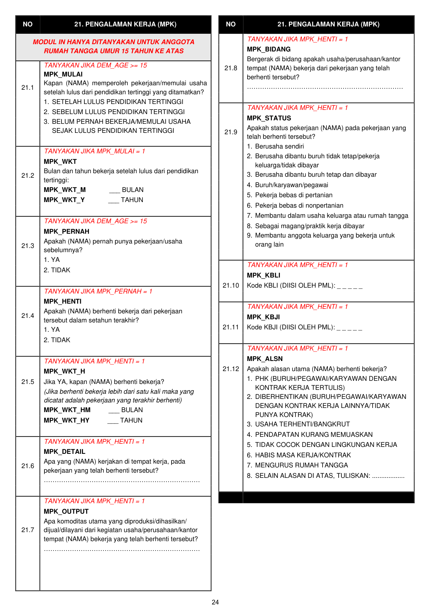

24 
NO 
21. PENGALAMAN KERJA (MPK) 
MODUL IN HANYA DITANYAKAN UNTUK ANGGOTA 
RUMAH TANGGA UMUR 15 TAHUN KE ATAS  
  
TANYAKAN JIKA DEM_AGE >= 15 
MPK_MULAI 
21.1 
Kapan (NAMA) memperoleh pekerjaan/memulai usaha 
setelah lulus dari pendidikan tertinggi yang ditamatkan? 
  
1. SETELAH LULUS PENDIDIKAN TERTINGGI  
  
2. SEBELUM LULUS PENDIDIKAN TERTINGGI 
  
3. BELUM PERNAH BEKERJA/MEMULAI USAHA 
SEJAK LULUS PENDIDIKAN TERTINGGI  
  
  
  
TANYAKAN JIKA MPK_MULAI = 1 
  
MPK_WKT 
21.2 
Bulan dan tahun bekerja setelah lulus dari pendidikan 
tertinggi: 
  
MPK_WKT_M             ___ BULAN 
  
MPK_WKT_Y             ___ TAHUN 
  
  
  
TANYAKAN JIKA DEM_AGE >= 15 
  
MPK_PERNAH 
21.3 
Apakah (NAMA) pernah punya pekerjaan/usaha 
sebelumnya? 
  
1. YA 
  
2. TIDAK 
  
  
  
TANYAKAN JIKA MPK_PERNAH = 1 
  
MPK_HENTI 
21.4 
Apakah (NAMA) berhenti bekerja dari pekerjaan 
tersebut dalam setahun terakhir? 
  
1. YA 
  
2. TIDAK 
  
  
  
TANYAKAN JIKA MPK_HENTI = 1 
  
MPK_WKT_H 
21.5 
Jika YA, kapan (NAMA) berhenti bekerja? 
  
(Jika berhenti bekerja lebih dari satu kali maka yang 
dicatat adalah pekerjaan yang terakhir berhenti) 
  
MPK_WKT_HM          ___ BULAN 
  
MPK_WKT_HY          ___ TAHUN 
  
  
  
TANYAKAN JIKA MPK_HENTI = 1 
  
MPK_DETAIL 
21.6 
Apa yang (NAMA) kerjakan di tempat kerja, pada 
pekerjaan yang telah berhenti tersebut? 
  
……………………………………………………………… 
  
  
  
TANYAKAN JIKA MPK_HENTI = 1 
  
MPK_OUTPUT 
21.7 
Apa komoditas utama yang diproduksi/dihasilkan/ 
dijual/dilayani dari kegiatan usaha/perusahaan/kantor 
tempat (NAMA) bekerja yang telah berhenti tersebut? 
  
……………………………………………………………… 
  
 
 
 
 
NO 
21. PENGALAMAN KERJA (MPK) 
  
TANYAKAN JIKA MPK_HENTI = 1 
  
MPK_BIDANG 
21.8 
Bergerak di bidang apakah usaha/perusahaan/kantor 
tempat (NAMA) bekerja dari pekerjaan yang telah 
berhenti tersebut? 
 
……………………………………………………………… 
  
 
  
TANYAKAN JIKA MPK_HENTI = 1 
  
MPK_STATUS 
21.9 
Apakah status pekerjaan (NAMA) pada pekerjaan yang 
telah berhenti tersebut? 
  
1. Berusaha sendiri 
  
2. Berusaha dibantu buruh tidak tetap/pekerja 
keluarga/tidak dibayar 
  
3. Berusaha dibantu buruh tetap dan dibayar 
  
4. Buruh/karyawan/pegawai 
  
5. Pekerja bebas di pertanian 
  
6. Pekerja bebas di nonpertanian 
  
7. Membantu dalam usaha keluarga atau rumah tangga 
  
8. Sebagai magang/praktik kerja dibayar 
  
9. Membantu anggota keluarga yang bekerja untuk 
orang lain 
  
  
  
TANYAKAN JIKA MPK_HENTI = 1 
  
MPK_KBLI 
21.10 
Kode KBLI (DIISI OLEH PML): _ _ _ _ _ 
  
  
  
TANYAKAN JIKA MPK_HENTI = 1 
  
MPK_KBJI 
21.11 
Kode KBJI (DIISI OLEH PML): _ _ _ _ _ 
  
  
  
TANYAKAN JIKA MPK_HENTI = 1 
  
MPK_ALSN 
21.12 
Apakah alasan utama (NAMA) berhenti bekerja? 
  
1. PHK (BURUH/PEGAWAI/KARYAWAN DENGAN 
KONTRAK KERJA TERTULIS) 
2. DIBERHENTIKAN (BURUH/PEGAWAI/KARYAWAN 
DENGAN KONTRAK KERJA LAINNYA/TIDAK 
PUNYA KONTRAK) 
  
3. USAHA TERHENTI/BANGKRUT 
  
4. PENDAPATAN KURANG MEMUASKAN 
  
5. TIDAK COCOK DENGAN LINGKUNGAN KERJA 
  
6. HABIS MASA KERJA/KONTRAK 
  
7. MENGURUS RUMAH TANGGA 
  
8. SELAIN ALASAN DI ATAS, TULISKAN: ..................

---

## Halaman 25

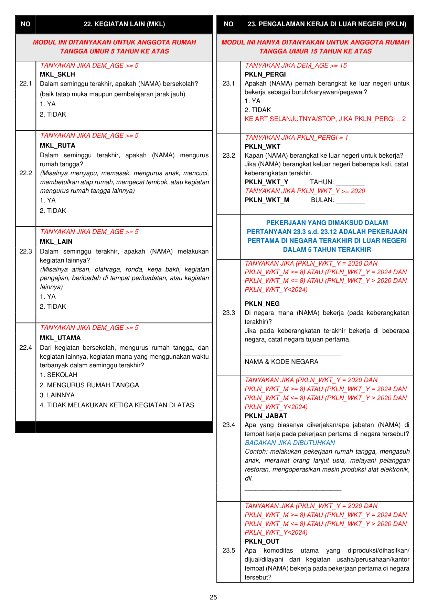

25 
NO 
22. KEGIATAN LAIN (MKL) 
MODUL INI DITANYAKAN UNTUK ANGGOTA RUMAH 
TANGGA UMUR 5 TAHUN KE ATAS 
  
TANYAKAN JIKA DEM_AGE >= 5 
MKL_SKLH 
22.1 
Dalam seminggu terakhir, apakah (NAMA) bersekolah? 
(baik tatap muka maupun pembelajaran jarak jauh) 
1. YA 
2. TIDAK 
  
TANYAKAN JIKA DEM_AGE >= 5 
MKL_RUTA 
 
Dalam seminggu terakhir, apakah (NAMA) mengurus 
rumah tangga? 
22.2 
(Misalnya menyapu, memasak, mengurus anak, mencuci, 
membetulkan atap rumah, mengecat tembok, atau kegiatan 
mengurus rumah tangga lainnya) 
1. YA 
2. TIDAK 
  
TANYAKAN JIKA DEM_AGE >= 5 
MKL_LAIN 
22.3 
Dalam seminggu terakhir, apakah (NAMA) melakukan 
kegiatan lainnya? 
 
(Misalnya arisan, olahraga, ronda, kerja bakti, kegiatan 
pengajian, beribadah di tempat peribadatan, atau kegiatan 
lainnya) 
1. YA 
2. TIDAK 
  
TANYAKAN JIKA DEM_AGE >= 5 
MKL_UTAMA 
22.4 
Dari kegiatan bersekolah, mengurus rumah tangga, dan 
kegiatan lainnya, kegiatan mana yang menggunakan waktu 
terbanyak dalam seminggu terakhir? 
  
1. SEKOLAH 
  
2. MENGURUS RUMAH TANGGA 
  
3. LAINNYA 
  
4. TIDAK MELAKUKAN KETIGA KEGIATAN DI ATAS 
  
  
  
  
 
 
 
 
 
 
 
 
 
 
NO 
23. PENGALAMAN KERJA DI LUAR NEGERI (PKLN) 
MODUL INI HANYA DITANYAKAN UNTUK ANGGOTA RUMAH 
TANGGA UMUR 15 TAHUN KE ATAS 
  
TANYAKAN JIKA DEM_AGE >= 15 
PKLN_PERGI 
23.1 
Apakah (NAMA) pernah berangkat ke luar negeri untuk 
bekerja sebagai buruh/karyawan/pegawai? 
1. YA 
2. TIDAK 
KE ART SELANJUTNYA/STOP, JIKA PKLN_PERGI = 2 
  
 
TANYAKAN JIKA PKLN_PERGI = 1 
 
PKLN_WKT 
23.2 
Kapan (NAMA) berangkat ke luar negeri untuk bekerja? 
Jika (NAMA) berangkat keluar negeri beberapa kali, catat 
keberangkatan terakhir. 
 
PKLN_WKT_Y            TAHUN: ________  
 
TANYAKAN JIKA PKLN_WKT_Y >= 2020 
 
PKLN_WKT_M            BULAN: ________  
 
 
PEKERJAAN YANG DIMAKSUD DALAM 
PERTANYAAN 23.3 s.d. 23.12 ADALAH PEKERJAAN 
PERTAMA DI NEGARA TERAKHIR DI LUAR NEGERI 
DALAM 5 TAHUN TERAKHIR 
 
TANYAKAN JIKA (PKLN_WKT_Y = 2020 DAN 
PKLN_WKT_M >= 8) ATAU (PKLN_WKT_Y = 2024 DAN 
PKLN_WKT_M <= 8) ATAU (PKLN_WKT_Y > 2020 DAN 
PKLN_WKT_Y<2024) 
 
PKLN_NEG 
23.3 
Di negara mana (NAMA) bekerja (pada keberangkatan 
terakhir)? 
Jika pada keberangkatan terakhir bekerja di beberapa 
negara, catat negara tujuan pertama. 
 
___________________________ 
NAMA & KODE NEGARA 
 
 
TANYAKAN JIKA (PKLN_WKT_Y = 2020 DAN 
PKLN_WKT_M >= 8) ATAU (PKLN_WKT_Y = 2024 DAN 
PKLN_WKT_M <= 8) ATAU (PKLN_WKT_Y > 2020 DAN 
PKLN_WKT_Y<2024) 
PKLN_JABAT 
23.4 
Apa yang biasanya dikerjakan/apa jabatan (NAMA) di 
tempat kerja pada pekerjaan pertama di negara tersebut? 
BACAKAN JIKA DIBUTUHKAN 
Contoh: melakukan pekerjaan rumah tangga, mengasuh 
anak, merawat orang lanjut usia, melayani pelanggan 
restoran, mengoperasikan mesin produksi alat elektronik, 
dll. 
___________________________ 
 
 
TANYAKAN JIKA (PKLN_WKT_Y = 2020 DAN 
PKLN_WKT_M >= 8) ATAU (PKLN_WKT_Y = 2024 DAN 
PKLN_WKT_M <= 8) ATAU (PKLN_WKT_Y > 2020 DAN 
PKLN_WKT_Y<2024) 
PKLN_OUT 
23.5 
Apa 
komoditas 
utama 
yang 
diproduksi/dihasilkan/ 
dijual/dilayani dari kegiatan usaha/perusahaan/kantor 
tempat (NAMA) bekerja pada pekerjaan pertama di negara 
tersebut?

---

## Halaman 26

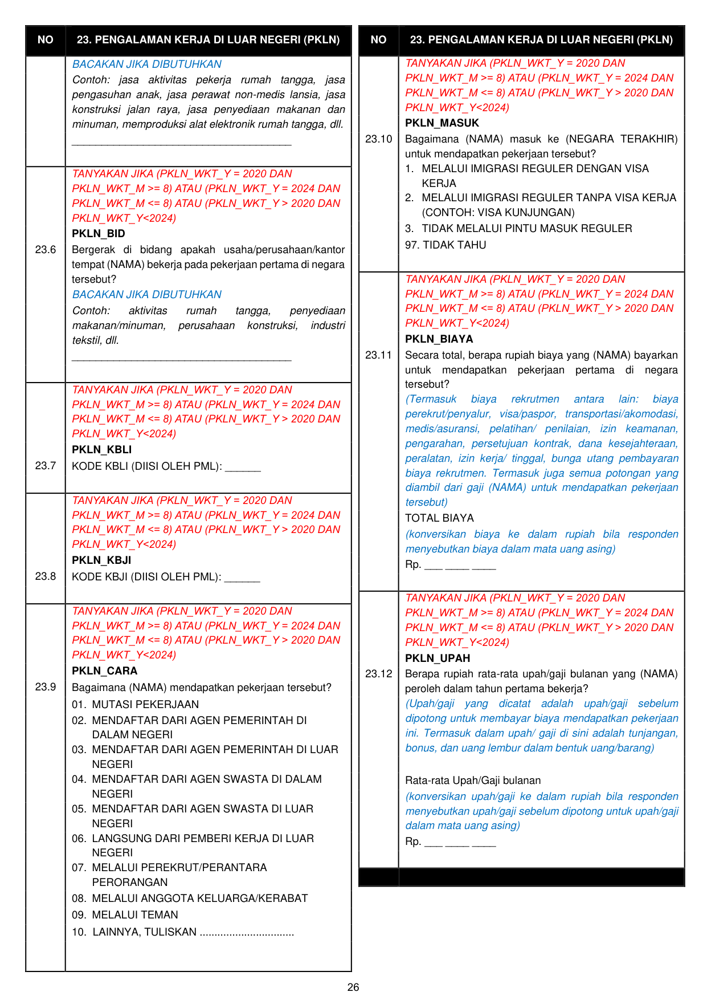

26 
NO 
23. PENGALAMAN KERJA DI LUAR NEGERI (PKLN) 
BACAKAN JIKA DIBUTUHKAN 
 
Contoh: jasa aktivitas pekerja rumah tangga, jasa 
pengasuhan anak, jasa perawat non-medis lansia, jasa 
konstruksi jalan raya, jasa penyediaan makanan dan 
minuman, memproduksi alat elektronik rumah tangga, dll. 
_____________________________________ 
  
TANYAKAN JIKA (PKLN_WKT_Y = 2020 DAN 
PKLN_WKT_M >= 8) ATAU (PKLN_WKT_Y = 2024 DAN 
PKLN_WKT_M <= 8) ATAU (PKLN_WKT_Y > 2020 DAN 
PKLN_WKT_Y<2024) 
PKLN_BID 
23.6 
Bergerak di bidang apakah usaha/perusahaan/kantor 
tempat (NAMA) bekerja pada pekerjaan pertama di negara 
tersebut? 
BACAKAN JIKA DIBUTUHKAN 
 
Contoh: 
aktivitas 
rumah 
tangga, 
penyediaan 
makanan/minuman, 
perusahaan 
konstruksi, 
industri 
tekstil, dll. 
_____________________________________ 
  
TANYAKAN JIKA (PKLN_WKT_Y = 2020 DAN 
PKLN_WKT_M >= 8) ATAU (PKLN_WKT_Y = 2024 DAN 
PKLN_WKT_M <= 8) ATAU (PKLN_WKT_Y > 2020 DAN 
PKLN_WKT_Y<2024) 
PKLN_KBLI 
23.7 
KODE KBLI (DIISI OLEH PML): ______ 
 
  
TANYAKAN JIKA (PKLN_WKT_Y = 2020 DAN 
PKLN_WKT_M >= 8) ATAU (PKLN_WKT_Y = 2024 DAN 
PKLN_WKT_M <= 8) ATAU (PKLN_WKT_Y > 2020 DAN 
PKLN_WKT_Y<2024) 
PKLN_KBJI 
23.8 
KODE KBJI (DIISI OLEH PML): ______ 
  
TANYAKAN JIKA (PKLN_WKT_Y = 2020 DAN 
PKLN_WKT_M >= 8) ATAU (PKLN_WKT_Y = 2024 DAN 
PKLN_WKT_M <= 8) ATAU (PKLN_WKT_Y > 2020 DAN 
PKLN_WKT_Y<2024) 
PKLN_CARA 
23.9 
Bagaimana (NAMA) mendapatkan pekerjaan tersebut? 
01. MUTASI PEKERJAAN 
02. MENDAFTAR DARI AGEN PEMERINTAH DI 
DALAM NEGERI 
03. MENDAFTAR DARI AGEN PEMERINTAH DI LUAR 
NEGERI 
04. MENDAFTAR DARI AGEN SWASTA DI DALAM 
NEGERI 
05. MENDAFTAR DARI AGEN SWASTA DI LUAR 
NEGERI 
06. LANGSUNG DARI PEMBERI KERJA DI LUAR 
NEGERI 
 
07. MELALUI PEREKRUT/PERANTARA 
PERORANGAN 
08. MELALUI ANGGOTA KELUARGA/KERABAT 
09. MELALUI TEMAN 
10.  LAINNYA, TULISKAN ................................ 
 
 
NO 
23. PENGALAMAN KERJA DI LUAR NEGERI (PKLN) 
 
TANYAKAN JIKA (PKLN_WKT_Y = 2020 DAN 
PKLN_WKT_M >= 8) ATAU (PKLN_WKT_Y = 2024 DAN 
PKLN_WKT_M <= 8) ATAU (PKLN_WKT_Y > 2020 DAN 
PKLN_WKT_Y<2024) 
PKLN_MASUK 
23.10 
Bagaimana (NAMA) masuk ke (NEGARA TERAKHIR) 
untuk mendapatkan pekerjaan tersebut? 
1. MELALUI IMIGRASI REGULER DENGAN VISA 
KERJA 
 
2. MELALUI IMIGRASI REGULER TANPA VISA KERJA 
(CONTOH: VISA KUNJUNGAN) 
3. TIDAK MELALUI PINTU MASUK REGULER 
97. TIDAK TAHU 
  
TANYAKAN JIKA (PKLN_WKT_Y = 2020 DAN 
PKLN_WKT_M >= 8) ATAU (PKLN_WKT_Y = 2024 DAN 
PKLN_WKT_M <= 8) ATAU (PKLN_WKT_Y > 2020 DAN 
PKLN_WKT_Y<2024) 
PKLN_BIAYA 
23.11 
Secara total, berapa rupiah biaya yang (NAMA) bayarkan 
untuk mendapatkan pekerjaan pertama di negara 
tersebut? 
 
(Termasuk 
biaya 
rekrutmen 
antara 
lain: 
biaya 
perekrut/penyalur, visa/paspor, transportasi/akomodasi, 
medis/asuransi, pelatihan/ penilaian, izin keamanan, 
pengarahan, persetujuan kontrak, dana kesejahteraan, 
peralatan, izin kerja/ tinggal, bunga utang pembayaran 
biaya rekrutmen. Termasuk juga semua potongan yang 
diambil dari gaji (NAMA) untuk mendapatkan pekerjaan 
tersebut) 
TOTAL BIAYA 
(konversikan biaya ke dalam rupiah bila responden 
menyebutkan biaya dalam mata uang asing) 
Rp. ___ ____ ____ 
  
TANYAKAN JIKA (PKLN_WKT_Y = 2020 DAN 
PKLN_WKT_M >= 8) ATAU (PKLN_WKT_Y = 2024 DAN 
PKLN_WKT_M <= 8) ATAU (PKLN_WKT_Y > 2020 DAN 
PKLN_WKT_Y<2024) 
PKLN_UPAH 
23.12 
Berapa rupiah rata-rata upah/gaji bulanan yang (NAMA) 
peroleh dalam tahun pertama bekerja? 
(Upah/gaji yang dicatat adalah upah/gaji sebelum 
dipotong untuk membayar biaya mendapatkan pekerjaan 
ini. Termasuk dalam upah/ gaji di sini adalah tunjangan, 
bonus, dan uang lembur dalam bentuk uang/barang) 
  
  
Rata-rata Upah/Gaji bulanan 
  
(konversikan upah/gaji ke dalam rupiah bila responden 
menyebutkan upah/gaji sebelum dipotong untuk upah/gaji 
dalam mata uang asing) 
  
Rp. ___ ____ ____

---

## Halaman 27

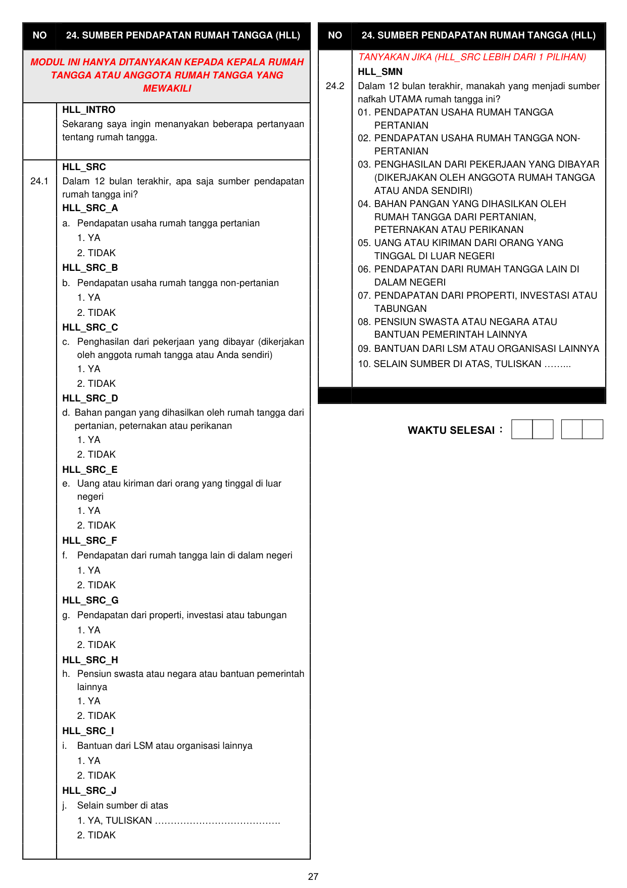

27 
NO 
24. SUMBER PENDAPATAN RUMAH TANGGA (HLL) 
MODUL INI HANYA DITANYAKAN KEPADA KEPALA RUMAH 
TANGGA ATAU ANGGOTA RUMAH TANGGA YANG 
MEWAKILI 
HLL_INTRO 
Sekarang saya ingin menanyakan beberapa pertanyaan 
tentang rumah tangga. 
  
HLL_SRC 
24.1 
Dalam 12 bulan terakhir, apa saja sumber pendapatan 
rumah tangga ini? 
HLL_SRC_A 
a. Pendapatan usaha rumah tangga pertanian  
1. YA 
2. TIDAK 
HLL_SRC_B 
b. Pendapatan usaha rumah tangga non-pertanian 
1. YA 
2. TIDAK 
HLL_SRC_C 
c. Penghasilan dari pekerjaan yang dibayar (dikerjakan 
oleh anggota rumah tangga atau Anda sendiri) 
1. YA 
2. TIDAK 
HLL_SRC_D 
 
d. Bahan pangan yang dihasilkan oleh rumah tangga dari 
pertanian, peternakan atau perikanan 
 
1. YA 
2. TIDAK 
HLL_SRC_E 
e. Uang atau kiriman dari orang yang tinggal di luar 
negeri 
1. YA 
2. TIDAK 
HLL_SRC_F 
f. Pendapatan dari rumah tangga lain di dalam negeri 
1. YA 
2. TIDAK 
HLL_SRC_G 
g. Pendapatan dari properti, investasi atau tabungan 
1. YA 
2. TIDAK 
HLL_SRC_H 
h. Pensiun swasta atau negara atau bantuan pemerintah 
lainnya 
1. YA 
2. TIDAK 
HLL_SRC_I 
i. Bantuan dari LSM atau organisasi lainnya 
 
1. YA 
2. TIDAK 
HLL_SRC_J 
j. Selain sumber di atas 
1. YA, TULISKAN …………………………………. 
2. TIDAK 
 
NO 
24. SUMBER PENDAPATAN RUMAH TANGGA (HLL) 
TANYAKAN JIKA (HLL_SRC LEBIH DARI 1 PILIHAN) 
HLL_SMN 
24.2 
Dalam 12 bulan terakhir, manakah yang menjadi sumber 
nafkah UTAMA rumah tangga ini? 
 
01. PENDAPATAN USAHA RUMAH TANGGA 
PERTANIAN 
  
02. PENDAPATAN USAHA RUMAH TANGGA NON-
PERTANIAN 
  
03. PENGHASILAN DARI PEKERJAAN YANG DIBAYAR 
(DIKERJAKAN OLEH ANGGOTA RUMAH TANGGA 
ATAU ANDA SENDIRI) 
  
04. BAHAN PANGAN YANG DIHASILKAN OLEH 
RUMAH TANGGA DARI PERTANIAN, 
PETERNAKAN ATAU PERIKANAN 
  
05. UANG ATAU KIRIMAN DARI ORANG YANG 
TINGGAL DI LUAR NEGERI 
  
06. PENDAPATAN DARI RUMAH TANGGA LAIN DI 
DALAM NEGERI 
  
07. PENDAPATAN DARI PROPERTI, INVESTASI ATAU 
TABUNGAN 
  
08. PENSIUN SWASTA ATAU NEGARA ATAU 
BANTUAN PEMERINTAH LAINNYA 
  
09. BANTUAN DARI LSM ATAU ORGANISASI LAINNYA 
  
10. SELAIN SUMBER DI ATAS, TULISKAN ……... 
  
  
  
  
 
:
WAKTU SELESAI

---