# Pertemuan 10 Indikator Kesehatan.pptx

Sumber Asli: `/home/alfzki/Documents/OSL/materials/slides/Pertemuan 10 Indikator Kesehatan.pptx`

---

## Slide 1

1

Pertemuan 10
Official Statistics Lanjutan

Indikator Kesehatan

---

## Slide 2

2

SUB TOPIK:
Pendahuluan
Isu Global
Kesehatan masyarakat
Kesehatan Reproduksi dan Keluarga Berencana
Gizi
Perumahan

---

## Slide 3

> *[Hasil OCR]:*
S3 WEBINAR SERIE

S
STATISTIKA '., Ni... & =
a IN

B3 &, we Politekni IS 3 STIS
Te aa, ew Hiu eee

ae POLITEKNIK Sekolah Tinggi I
ae STATISTIKA STIS oe Statistik Ge i” iv) @stis jkt © @ polstatstis © www.stis.ac.id

---

## Slide 4

4

Konsep & Definisi Kesehatan

World Health Organization (WHO),

kesehatan adalah keadaan sejahtera badan, jiwa dan sosial yang memungkinkan setiap orang hidup produktif secara sosial dan ekonomi.

Undang-Undang Kesehatan No. 36 Tahun 2009

kesehatan adalah keadaan sehat, baik secara fisik, mental, spiritual maupun sosial yang memungkinkan setiap orang untuk hidup produktif secara sosial dan ekonomi. (Notoatmodjo,2012).

---

## Slide 5

5

Indikator Kesehatan

With the goal of good health in mind, think of an indicator as “…a measure that helps quantify the achievement of a goal.”
Mark Friedman*

Indikator baik jika fokus pada persoalan pokok kesehatan dan dapat membandingkan: antar waktu, antar wilayah, dan antar kelompok masyarakat

* Mark Friedman adalah ahli ekonomi dari USA yang banyak menulis tentang indikator. Salah satu tulisannya “Trying hard is not good enough: How to produce  measurable improvement for customers and communities”

---

## Slide 6

6

Kegunaan Indikator Kesehatan

Perencanaan pembangunan kesehatan masyarakat dan permasalahan kesehatan spesifik
Mengukur derajat dan status kesehatan masyarakat
Memantau dan mengevaluasi perkembangan kesehatan masyarakat dan pelaksanaan program di bidang kesehatan
Mengetahui dan perbaikan permasalahan terkait kesehatan masyarakat dan permasalahan kesehatan spesifik

---

## Slide 7

7

Pemanfaatan Indikator Kesehatan
Disparities Analysis (analisa ketimpangan)
Social indicators (masalah sosial)
Ranked comparisons, benchmarks, composite measures (perbandingan untuk percontohan)
Children and families empowerment (pemberdayaan keluarga)
Local health planning (perencanaan kesehatan)
Comprehensive indicator systems analysis (analisa lintas sektor)
Health system performance evaluation (evaluasi kinerja sistem kesehatan)

---

## Slide 8

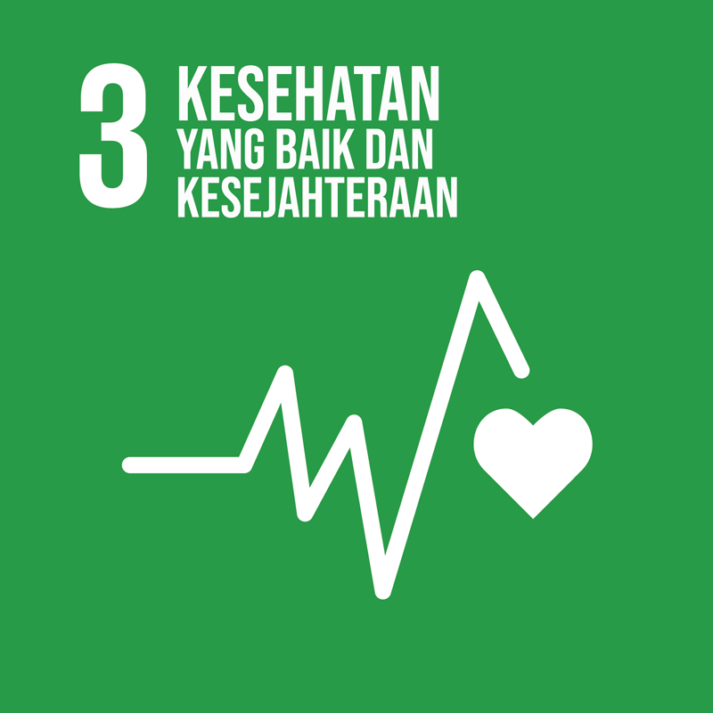

8

Isu Global dan Nasional

---

## Slide 9

9

Sustainable Development Goals

Tujuan 3 SDGs (TPB): Menjamin kehidupan yang sehat dan meningkatkan kesejahteraan seluruh penduduk semua usia.

Terdapat 13 target (diukur melalui 50 indikator) yaitu,

3.1. Mengurangi kematian ibu
	Pada tahun 2030, mengurangi rasio angka kematian ibu hingga kurang dari 70 per 100.000 kelahiran hidup
3.2. Mengakhiri semua kematian yang dapat dicegah di bawah usia 5 tahun
Pada tahun 2030, mengakhiri kematian bayi baru lahir dan balita yang dapat dicegah, dengan seluruh negara berusaha menurunkan Angka Kematian Neonatal setidaknya hingga 12 per 1.000 KH (Kelahiran Hidup) dan Angka Kematian Balita 25 per 1.000
3.3.  Memerangi penyakit menular
Pada tahun 2030, mengakhiri epidemi AIDS, tuberkulosis, malaria, dan penyakit tropis yang terabaikan, dan memerangi hepatitis, penyakit bersumber air, serta penyakit menular lainnya

---

## Slide 10

10

3.4. Pada tahun 2030, mengurangi hingga sepertiga angka kematian dini akibat penyakit tidak menular, melalui pencegahan dan pengobatan, serta meningkatkan kesehatan mental dan kesejahteraan
3.5. Mencegah dan mengobati penyalahgunaan zat, termasuk penyalahgunaan narkotika dan penggunaan alkohol yang membahayakan
3.6. mengurangi kecelakaan lalu lintas dan kematian
Pada tahun 2030, mengurangi separuh jumlah kematian dan cedera akibat kecelakaan lalu lintas
3.7. Akses universal terhadap perawatan seksual dan reproduksi, keluarga berencana dan pendidikan
Pada tahun 2030, menjamin akses universal terhadap layanan kesehatan seksual dan reproduksi, termasuk keluarga berencana, informasi dan pendidikan, dan integrasi kesehatan reproduksi ke dalam strategi dan program nasional
3.8. Mencapai cakupan kesehatan universal
Mencapai cakupan kesehatan universal, termasuk perlindungan risiko keuangan, akses terhadap pelayanan kesehatan dasar yang baik, dan akses terhadap obat-obatan dan vaksin dasar yang aman, efektif, berkualitas, dan terjangkau bagi semua orang
3.9. Mengurangi penyakit dan kematian akibat bahan kimia berbahaya dan polusi
Pada tahun 2030, secara substansial mengurangi jumlah kematian dan kesakitan akibat bahan kimia berbahaya serta polusi dan kontaminasi udara, air dan tanah

---

## Slide 11

11

3.A. Melaksanakan konvensi kerangka kerja WHO tentang pengendalian tembakau
Memperkuat pelaksanaan the Framework Convention on Tobacco Control WHO di seluruh negara sebagai langkah yang tepat
3.B. Mendukung penelitian, pengembangan, dan akses universal terhadap vaksin dan obat-obatan yang terjangkau
Mendukung penelitian dan pengembangan vaksin dan obat penyakit menular dan tidak menular yang terutama berpengaruh terhadap negara berkembang
3.C. Meningkatkan pembiayaan kesehatan dan mendukung tenaga kesehatan di negara berkembang
Meningkatkan secara signifikan pembiayaan kesehatan dan rekrutmen, pengembangan, pelatihan, dan retensi tenaga kesehatan di negara berkembang, khususnya negara kurang berkembang, dan negara berkembang pulau kecil.
3.D. Meningkatkan sistem peringatan dini untuk risiko kesehatan global
Memperkuat kapasitas semua negara, khususnya negara-negara berkembang, untuk peringatan dini, pengurangan risiko dan manajemen risiko kesehatan nasional dan global

---

## Slide 12

12

Angka Kematian Ibu (Maternal Mortality)

Untuk mencapai target  3.1  yaitu Mengurangi kematian ibu dan target 3.2  yaitu Mengakhiri semua kematian yang dapat dicegah di bawah usia 5 tahun, angka kematian bayi dan angka kematian neonatal: 
diperlukan usaha yang sungguh-sungguh dari berbagai instansi terkait, mulai dari pemerintah, baik pusat maupun daerah, LSM dan masyarakat pada umumnya.
indikator-indikator apa yang perlu diperhatikan untuk menurunkan Angka Kematian  Balita dan Angka Kematian Ibu?

Definisi Mortalitas Organisasi Kesehatan Dunia (WHO):  menghilangnya semua tanda-tanda kehidupan secara permanen, yang bisa terjadi setiap saat setelah kelahiran hidup.

---

## Slide 13

Rumus:

| AKI = | ∑ Kematian Ibu | x | K |
| --- | --- | --- | --- |
|  | ∑ Kelahiran Hidup |  |  |

| Dimana: |
| --- |
| Jumlah Kematian Ibu yang dimaksud adalah banyaknya kematian ibu yang disebabkan karena kehamilan, persalinan sampai 42 hari setelah melahirkan, pada tahun tertentu, di daerah tertentu. |
| Jumlah kelahiran hidup adalah banyaknya bayi yang lahir hidup pada tahun tertentu, di daerah tertentu. |
| Konstanta = 100.000 |

Angka Kematian Ibu (Maternal Mortality)

---

## Slide 14

14

Angka Kematian Ibu/Maternal Mortality  LF2020

| No. | PROVINSI | MMR |
| --- | --- | --- |
| 1 | ACEH | 201 |
| 2 | SUMATERA UTARA | 195 |
| 3 | SUMATERA BARAT | 178 |
| 4 | RIAU | 158 |
| 5 | JAMBI | 177 |
| 6 | SUMATERA SELATAN | 175 |
| 7 | BENGKULU | 179 |
| 8 | LAMPUNG | 192 |
| 9 | KEPULAUAN BANGKA BELITUNG | 198 |
| 10 | KEPULAUAN RIAU | 142 |
| 11 | DKI JAKARTA | 48 |
| 12 | JAWA BARAT | 187 |
| 13 | JAWA TENGAH | 183 |
| 14 | DI YOGYAKARTA | 58 |
| 15 | JAWA TIMUR | 184 |
| 16 | BANTEN | 127 |
| 17 | BALI | 85 |

| No. | PROVINSI | MMR |
| --- | --- | --- |
| 18 | NUSA TENGGARA BARAT | 257 |
| 19 | NUSA TENGGARA TIMUR | 316 |
| 20 | KALIMANTAN BARAT | 246 |
| 21 | KALIMANTAN TENGAH | 200 |
| 22 | KALIMANTAN SELATAN | 224 |
| 23 | KALIMANTAN TIMUR | 177 |
| 24 | KALIMANTAN UTARA | 194 |
| 25 | SULAWESI UTARA | 230 |
| 26 | SULAWESI TENGAH | 264 |
| 27 | SULAWESI SELATAN | 192 |
| 28 | SULAWESI TENGGARA | 226 |
| 29 | GORONTALO | 266 |
| 30 | SULAWESI BARAT | 274 |
| 31 | MALUKU | 261 |
| 32 | MALUKU UTARA | 255 |
| 33 | PAPUA BARAT | 343 |
| 34 | PAPUA | 565 |
| 35 | INDONESIA | 189 |

---

## Slide 15

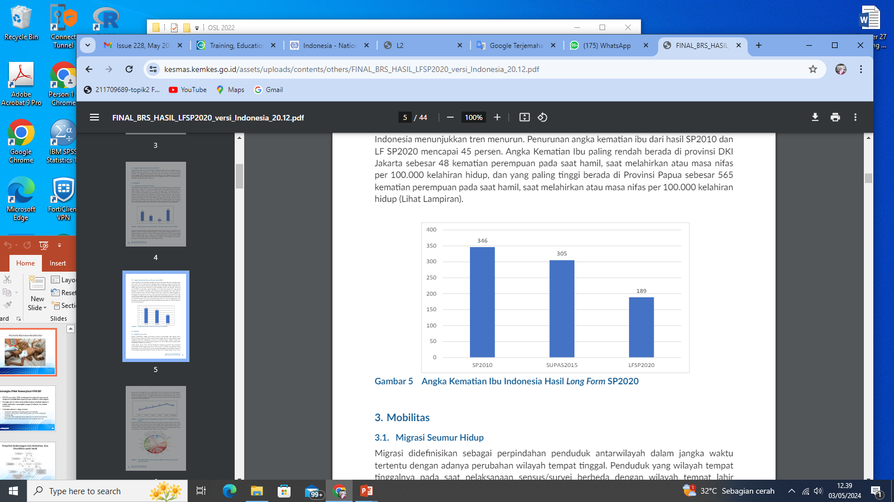

15

Meskipun AKI di Indonesia mengalami penurunan, masih lebih tinggi dibandingkan negara tetangga di ASEAN

---

## Slide 16

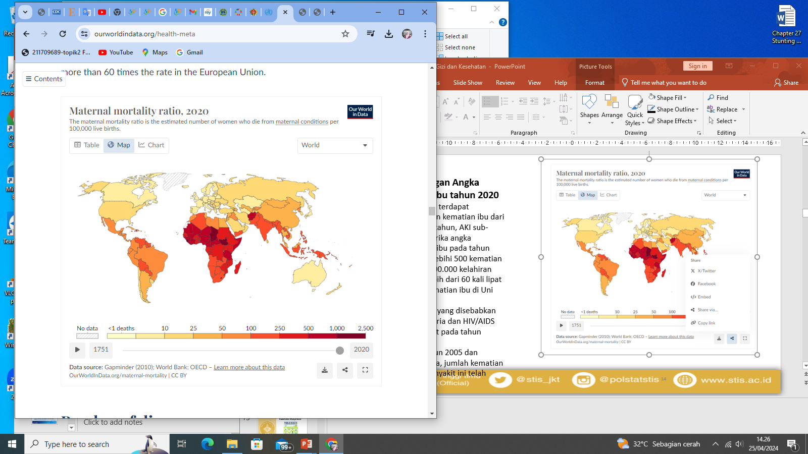

16

Perbandingan Angka Kematian Ibu tahun 2020
Sebagai perbandingan AKI Indonesia tahun 2017 adalah 177, Malaysia 29, Thailand 37, Vietnam 43, dan Philipina 121.
Meskipun terdapat penurunan kematian ibu, (AKI) Sub-Sahara Afrika pada tahun 2017 melebihi 500 kematian ibu per 100.000 kelahiran hidup, lebih dari 60 kali lipat angka kematian ibu di Uni Eropa.

---

## Slide 17

Pola Kematian menurut Umur

Angka Kematian Balita, Anak, Bayi dan Neonatal

---

## Slide 18

Konsep 
Balita atau bawah lima tahun adalah semua anak termasuk bayi yang baru lahir, yang berusia 0 sampai menjelang tepat 5 tahun (4 tahun, 11 bulan, 29 hari). Pada umumnya ditulis dengan notasi 0-4 tahun. 
Definisi 
Angka Kematian Balita adalah jumlah kematian anak berusia 0-4 tahun selama satu tahun tertentu per 1.000 anak umur yang sama pada pertengahan tahun itu (termasuk kematian bayi).

Angka Kematian Balita

---

## Slide 19

Cara Menghitung

| AK Balita = | D0-4 thn | x | K |
| --- | --- | --- | --- |
|  | ∑ P0-4 thn |  |  |

| Dimana: |  |  |
| --- | --- | --- |
| AK Balita | = | Angka kematian anak berumur 0 tahun  sampai dengan kurang dari 5 tahun |
| D0-4 thn | = | Banyaknya kematian anak berusia 0-4 th pada satu tahun ttt. di daerah ttt. |
| ∑ P0-4 thn | = | Jumlah penduduk berusia 0-4 th pada pertengahan tahun ttt. didaerah ttt. |
| K | = | Bilangan konstan 1.000 |

Angka Kematian Balita

---

## Slide 20

Konsep  
penduduk yang berusia satu sampai menjelang 5 tahun atau tepatnya 1 sampai dengan 4 tahun 11 bulan 29 hari. 
Mencerminkan kondisi kesehatan lingkungan yang langsung mempengaruhi tingkat kesehatan anak. 
Angka Kematian Anak akan tinggi bila terjadi:
	- salah gizi atau gizi buruk, 
	- kebersihan diri dan kebersihan yang buruk, 
	- tingginya prevalensi penyakit menular pada anak, 
	- kecelakaan yang terjadi di dalam atau sekitar rumah (Budi Utomo, 1985).

Angka Kematian Anak

---

## Slide 21

| AK Anak = | D1-4 thn | x | K |
| --- | --- | --- | --- |
|  | ∑ P1-4 thn |  |  |

| Dimana: |  |  |
| --- | --- | --- |
| AK Anak | = | Angka Kematian Anak berumur 1 tahun sampai dengan kurang dari 5 tahun |
| D1-4 thn | = | Banyaknya kematian anak berusia 1-4 th (yang belum tepat berusia 5 tahun) pada satu tahun tertentu di daerah tertentu |
| ∑ P1-4 thn | = | Jumlah penduduk berusia 1-4 pada pertengahan tahun ttt. didaerah ttt |
| K | = | Bilangan konstan 1.000 |

Angka Kematian Anak

---

## Slide 22

| Tabel. Angka Kematian Anak dan Balita untuk Periode 10 Tahun sebelum Survai menurut Karakteristik  Ekonomi dan Sosial |  |  |  |  |
| --- | --- | --- | --- | --- |
| Latar Belakang | Angka Kematian Anak |  | Angka Kematian  Balita |  |
| Tahun | 2003 | 2007 | 2003 | 2007 |
| Tempat Tinggal      Perkotaan       Perdesaan | 11  13 | 7 6 | 42  65 | 38 60 |
| Pendidikan Ibu      Tidak Sekolah       Tidak Tamat SD       Tamat SD       Tdk Tamat SMP       Tamat SMP+ | 25  16  11  11  5 | 22 19 12 10 8 | 90  80  54  47  28 | 94 69 56 45 32 |
| Indeks Kekayaan     Terbawah      Menengah Bawah      Menengah      Menengah Atas      Teratas | 17  15  12  9  5 | 23 12 12 8 6 | 77  64  56  45  22 | 77 59 44 36 32 |
| Sumber Data: SDKI 2002-2003, 2007, untuk  periode 10 tahun sebelum survai. |  |  |  |  |

---

## Slide 23

| AK Anak = | D1-4 thn | x | K |
| --- | --- | --- | --- |
|  | ∑ P1-4 thn |  |  |

| Dimana: |  |  |
| --- | --- | --- |
| AK Anak | = | Angka Kematian Anak berumur 1 tahun sampai dengan kurang dari 5 tahun |
| D1-4 thn | = | Banyaknya kematian anak berusia 1-4 th (yang belum tepat berusia 5 tahun) pada satu tahun tertentu di daerah tertentu |
| ∑ P1-4 thn | = | Jumlah penduduk berusia 1-4 pada pertengahan tahun ttt. didaerah ttt |
| K | = | Bilangan konstan 1.000 |

Angka Kematian Anak

---

## Slide 24

Definisi Angka Kematian Neo-Natal adalah kematian yang terjadi sebelum bayi berumur satu bulan atau 28 hari per 1.000 kelahiran hidup pada satu tahun tertentu. 
Rumus:

| AK Neo-Natal = | D0-<1 blln | x | K |
| --- | --- | --- | --- |
|  | ∑ Lahir Hidup |  |  |

| Dimana: |  |  |
| --- | --- | --- |
| AK Neo-Natal | = | Angka Kematian Bayi umur 0-<1bulan |
| D0-<1 bln | = | Jumlah Kematian Bayi umur 0 - kurang 1 bulan pada satu tahun tertentu di daerah tertentu |
| ∑ Lahir Hidup | = | Jumlah Kelahiran Hidup pada satu tahun tertentu di daerah tertentu |
| K | = | Bilangan konstan 1.000 |

Angka Kematian Neonatal

---

## Slide 25

Definisi Angka Kematian Post Neo-natal atau Post Neo-natal Death Rate adalah kematian yang terjadi pada bayi yang berumur antara 1 bulan sampai dengan kurang 1 tahun per 1.000 kelahiran hidup pada satu tahun tertentu. 
Rumus:

| AK Post Neo-Natal = | D1 bln-<1 thn | x | K |
| --- | --- | --- | --- |
|  | ∑ Lahir Hidup |  |  |

| Dimana: |  |  |
| --- | --- | --- |
| AK Post Neo-Natal | = | Angka Kematian Bayi berumur 1 bulan sampai dengan kurang dari 1 tahun |
| D1 bln-<1 thn | = | Jumlah Kematian Bayi berumur 1 bulan - kurang dari 1 tahun pada satu tahun tertentu di daerah tertentu |
| ∑ Lahir Hidup | = | Jumlah Kelahiran Hidup pada satu tahun tertentu di daerah tertentu |
| K | = | Bilangan konstan 1.000 |

Angka Kematian Post Neonatal

---

## Slide 26

Cara Menghitung:

| AKB = | D0-<1 th | x | K |
| --- | --- | --- | --- |
|  | ∑ Lahir Hidup |  |  |

| Dimana: |  |  |
| --- | --- | --- |
| AKB | = | Angka Kematian Bayi / Infant Mortality Rate (IMR) |
| D0-<1 th | = | Jumlah Kematian Bayi (berumur kurang 1 tahun) pada satu tahun ttt di daerah ttt. |
| ∑ Lahir Hidup | = | Jumlah Kelahiran Hidup 1 tahun tertentu di daerah tertentu |
| K | = | Bilangan konstan 1.000 |

Kematian bayi: kematian yang terjadi antara saat setelah bayi lahir sampai bayi belum berusia tepat satu tahun.

Angka Kematian Bayi

---

## Slide 27

Kegunaan Angka Kematian Bayi, Neonatal, Post Neo Natal, anak dan Balita

Program untuk mengurangi angka kematian neo-natal adalah bersangkutan dengan program pelayanan kesehatan ibu hamil, misalnya program pemberian pil besi dan suntikan anti tetanus. 
Angka Kematian Post-NeoNatal dan Angka Kematian Anak serta Kematian Balita berguna untuk:
	- mengembangkan program imunisasi, 
	- Program pencegahan penyakit menular terutama anak,
	- Program penerangan tentang gizi, dan 
	- Pemberian makanan sehat untuk anak dibawah usia 5 th

Angka Kematian Bayi

---

## Slide 28

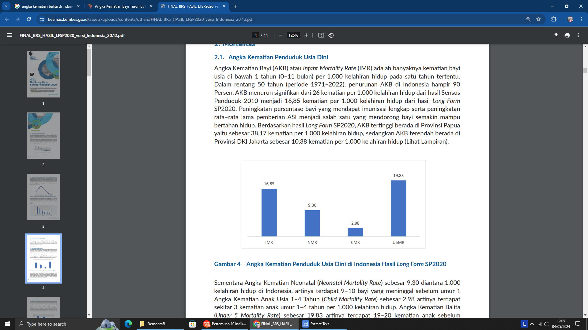

Angka Kematian Balita, Anak, Bayi dan Neonatal

Berikut ini angka kematian Penduduk Usia Dini berdasarkan SP 2020:
Anak Usia 0-28 hari(Neonatal): 9,3 anak per 1.000 kelahiran
Anak Usia 1-4 Tahun: 2,98 anak per 1.000 kelahiran
Balita (kurang dari 5 tahun): 19,83 anak per 1.000 kelahiran

Angka Kematian Penduduk Usia Dini berdasarkan Hasil SP 2020:

---

## Slide 29

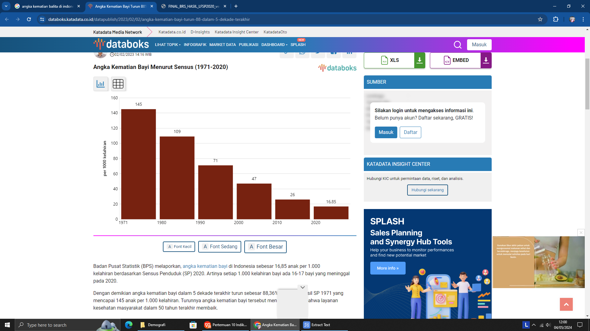

Angka Kematian Balita, Anak, Bayi dan Neonatal

Tren Angka Kematian Bayi menurut Sensus 1971 - 2020

---

## Slide 30

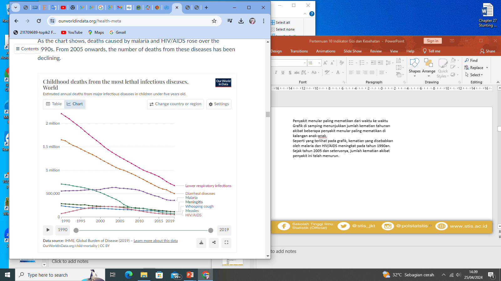

30

Penyakit menular paling mematikan dari waktu ke waktu
Grafik menunjukkan jumlah kematian tahunan akibat beberapa penyakit menular paling mematikan di kalangan anak-anak.
Kematian yang disebabkan oleh malaria dan HIV/AIDS meningkat tahun 1990an. 
Sejak tahun 2005 dan seterusnya, jumlah kematian akibat penyakit ini telah menurun.

---

## Slide 31

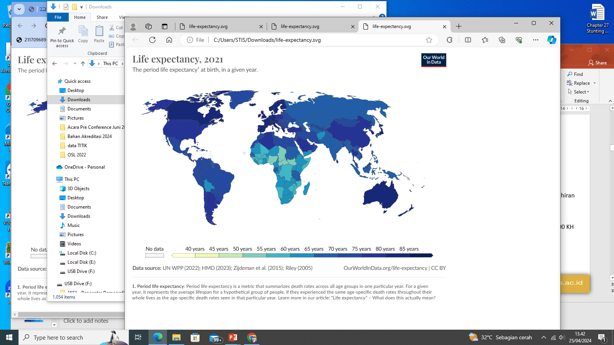

31

Angka Harapan Hidup (AHH)
Untuk memahami kesehatan suatu populasi, dapat dilakukan dengan melihat angka harapan hidup (saat lahir).
 
Peta menunjukkan tahun 2021 AHH di beberapa negara Sub-Saharan adalah 60 tahun, dibandingkan beberapa negara yang mencapai di atas 80 th seperti Jepang.

---

## Slide 32

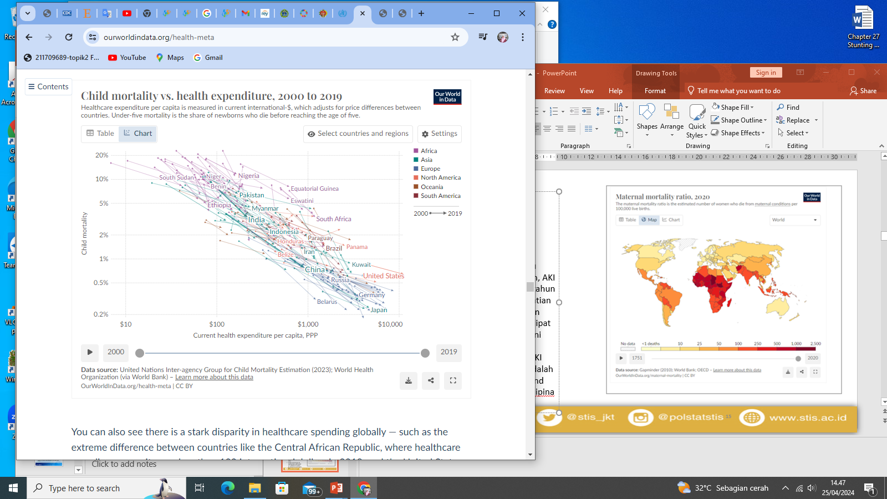

32

Salah satu upaya meningkatkan derajat kesehatan Masyarakat adalah dengan Investasi kesehatan.

Gambar berikut menunjukkan adanya hubungan negatif antara pengeluaran kesehatan perkapita dengan kematian anak

---

## Slide 33

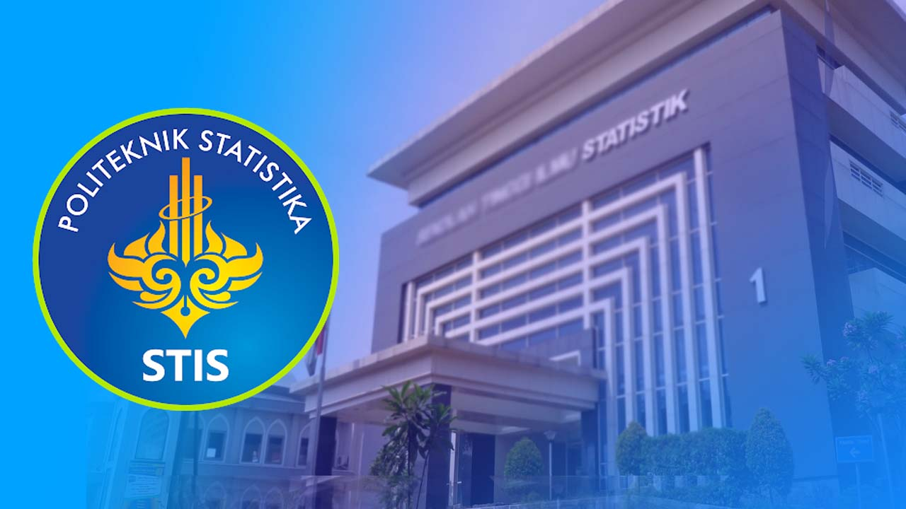

33

Kesehatan Reproduksi dan Keluarga Berencana

---

## Slide 34

34

Kesehatan ReproduksiKesehatan Reproduksi adalah keadaan sejahtera fisik, mental dan sosial yang utuh dalam segala hal yang berkaitan dengan fungsi, peran & sistem reproduksi.

Perempuan di negara-negara berpendapatan rendah memiliki risiko kematian ibu yang tinggi. Resiko kematian perempuan berusia 15 tahun disebabkan karena kematian maternal. Di negara-negara berpendapatan tinggi, angka kematian ibu (maternal)  adalah 1 dari 5.300, sementara di negara-negara berpendapatan rendah 1 diantara 49 perempuan.

---

## Slide 35

35

Perempuan meninggal akibat komplikasi selama dan setelah kehamilan dan persalinan dan sebagian besar dapat dicegah atau diobati. Komplikasi lain mungkin sudah ada sebelum kehamilan namun memburuk selama kehamilan. 
Komplikasi utama yang menyebabkan hampir 75% kematian ibu adalah:
severe bleeding (pendarahan, kebanyakan setelah melahirkan);
Infections (infeksi, biasanya setelah melahirkan);
high blood pressure (tekanan darah tinggi selama kehamilan/ preeklampsia dan eklamsia);
complications from delivery (komplikasi persalinan); 
unsafe abortion (aborsi yang tidak aman).

---

## Slide 36

36

Faktor-faktor yang menghalangi perempuan untuk menerima atau mencari pelayanan selama hamil dan melahirkan:
kegagalan sistem kesehatan 	
buruknya kualitas layanan (termasuk sikap tidak hormat, penganiayaan dan pelecehan); 
jumlah tenaga kesehatan yang tidak memadai dan kurang terlatih,
kekurangan pasokan medis penting; dan 
buruknya akuntabilitas sistem kesehatan;.
faktor-faktor penentu sosial (pendapatan, akses terhadap pendidikan, ras dan etnis) sehingga beberapa sub-populasi berisiko lebih besar;
norma dan/atau ketidaksetaraan gender, mengakibatkan rendahnya prioritas terhadap hak-hak perempuan dan anak perempuan, layanan kesehatan seksual dan reproduksi yang aman, berkualitas dan terjangkau; 
faktor eksternal yang berkontribusi terhadap ketidakstabilan sistem kesehatan, seperti krisis iklim dan kemanusiaan.

---

## Slide 37

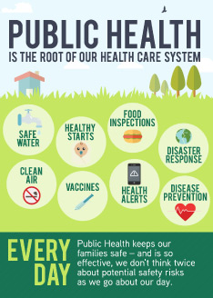

37

Kesehatan Masyarakat

---

## Slide 38

38

Kesehatan masyarakat
Meningkatkan derajat kesehatan (hidup lebih lama) dan status kesehatan masyarakat (sehat)
4 program utama: promotif, preventif, kuratif, rehabilitatif

Pembangunan Bidang Kesehatan

---

## Slide 39

39

Pembangunan Bidang Kesehatan

Promotif/kampanye
perilaku hidup sehat
ciptakan lingkungan sehat
hindari (asap) rokok, olahraga memadai, bergerak 10.000 langkah/hari
makanan seimbang: karbohidrat, protein, lemak, serat
Preventif
pencegahan
imunisasi: pemberian kekebalan buatan, sejak lahir
pembersihan/treatment lingkungan
Kuratif
pengobatan
pemeliharaan
perawatan
Rehabilitatif  
pemulihan

---

## Slide 40

40

prioritas promotif dan preventif dibandingkan kuratif dan rehabilitatif

Paradigma Sehat

menumbuhkan perilaku dan keinginan hidup sehat pada individu

Pembangunan Bidang Kesehatan

Imunisasi adalah paradigma sehat dalam upaya pencegahan yang paling efektif (Mardianti & Farida, 2020). 
Imunisasi merupakan investasi kesehatan untuk masa depan karena dapat memberikan perlindungan terhadap penyakit infeksi, mencegah seseorang jatuh sakit yang membutuhkan biaya yang lebih mahal.

---

## Slide 41

41

Imunisasi

Imunisasi berasal dari kata imun, kebal atau resisten
Imunisasi adalah proses membuat seseorang imun atau kebal terhadap suatu penyakit melalui pemberian vaksin yang merangsang sistem kekebalan tubuh membentuk antibodi supaya kebal terhadap penyakit tertentu. 
Vaksin adalah suatu produk biologis yang terbuat dari kuman, komponen kuman (bakteri, virus atau riketsia), atau racun kuman (toxoid) yang telah dilemahkan atau dimatikan dan akan menimbulkan kekebalan spesifik secara aktif terhadap penyakit tertentu.

---

## Slide 42

42

Jenis-jenis vaksin

1) 	Vaksin BCG (Bacillus Calmette Guerine), untuk kekebalan aktif terhadap tuberkulosa.
2) 	Vaksin DPT (Difteri Pertusis Tetanus), untuk kekebalan secara simultan terhadap difteri, pertusis dan tetanus.
3) 	Vaksin TT (Tetanus Toksoid), untuk kekebalan aktif terhadap tetanus.
Vaksin DT (Difteri dan Tetanus), untuk kekebalan simultan terhadap difteri dan tetanus.
5)	Vaksin Polio (Oral Polio Vaccine), untuk kekebalan aktif terhadap poliomyelitis.
Vaksin Campak, untuk kekebalan aktif terhadap penyakit campak.
Vaksin Hepatitis B, untuk kekebalan aktif terhadap infeksi yang disebabkan oleh virus hepatitis B.
8) 	Vaksin DPT/HB, untuk kekebalan aktif terhadap penyakit difteri, tetanus, pertusis dan hepatitis B.

---

## Slide 43

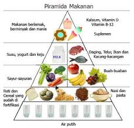

43

Indikator Gizi

---

## Slide 44

Pendahuluan

44

Keberhasilan pembangunan nasional suatu bangsa ditentukan oleh ketersediaan SDM berkualitas, yaitu SDM yang memiliki fisik yang tangguh, mental yang kuat dan kesehatan yang prima di samping penguasaan terhadap ilmu pengetahuan dan teknologi. 
Kekurangan gizi dapat merusak kualitas SDM.
Masa kehamilan merupakan periode yang sangat menentukan kualitas SDM di masa depan, karena tumbuh kembang anak sangat ditentukan oleh kondisinya saat masa janin dalam kandungan. 
Akan tetapi perlu diingat bahwa keadaan kesehatan dan status gizi ibu hamil ditentukan juga jauh sebelumnya, yaitu pada saat remaja atau usia sekolah. 
Demikian seterusnya status gizi remaja atau usia sekolah ditentukan juga pada kondisi kesehatan dan gizi pada saat lahir dan balita.

---

## Slide 45

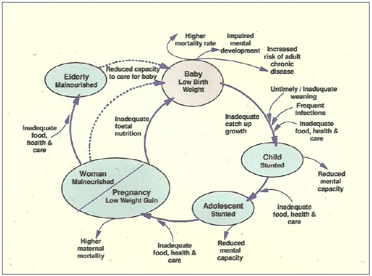

Nutrisi Sepanjang Siklus Hidup

45

---

## Slide 46

> *[Hasil OCR]:*
S3 WEBINAR SERIE

S
STATISTIKA '., Ni... & =
a IN

B3 &, we Politekni IS 3 STIS
Te aa, ew Hiu eee

ae POLITEKNIK Sekolah Tinggi I
ae STATISTIKA STIS oe Statistik Ge i” iv) @stis jkt © @ polstatstis © www.stis.ac.id

---

## Slide 47

> *[Hasil OCR]:*
S3 WEBINAR SERIE

S
STATISTIKA '., Ni... & =
a IN

B3 &, we Politekni IS 3 STIS
Te aa, ew Hiu eee

ae POLITEKNIK Sekolah Tinggi I
ae STATISTIKA STIS oe Statistik Ge i” iv) @stis jkt © @ polstatstis © www.stis.ac.id

---

## Slide 48

Penilaian Status Gizi(1)

48

Salah satu cara melakukan penilaian status gizi pada kelompok masyarakat adalah dengan pengukuran tubuh manusia yang dikenal dengan Antropometri. 
Dalam pemakaian untuk penilaian status gizi, antropometri disajikan dalam bentuk indeks yang dikaitkan dengan variabel lain. 
Variabel tsb adalah sebagai berikut:
Umur  umur dalam bulan penuh, sisa umur dalam hari tidak diperhitungkan
Berat badan  peka terhadap perubahan yang mendadak karena penyakit infeksi atau konsumsi makanan yang menurun
Tinggi badan  sangat baik untuk melihat keadaan gizi masa lalu terutama yang berkaitan dengan BBLR dan kurang gizi pada masa balita

---

## Slide 49

Penilaian Status Gizi(2)

49

Berat badan ini  dinyatakan dalam bentuk indeks BB/U (berat badan menurut umur) atau melakukan penilaian dengan melihat perubahan  berat badan pada saat pengukuran dilakukan, yang dalam penggunaannya memberikan gambaran keadaan kini. 
Berat badan paling banyak digunakan karena hanya memerlukan satu pengukuran, hanya saja tergantung pada ketetapan umur, tetapi kurang dapat menggambarkan kecenderungan perubahan situasi gizi dari waktu ke waktu (Djumadias Abunain, 1990).

---

## Slide 50

Penilaian Status Gizi(3)

50

Tinggi badan dinyatakan dalam bentuk Indeks TB/U (tinggi badan menurut umur), atau juga  indeks BB/TB (berat badan menurut tinggi  badan)  jarang dilakukan karena perubahan tinggi  badan yang lambat dan biasanya  hanya dilakukan setahun sekali. 
Keadaan indeks ini pada umumnya memberikan gambaran keadaan lingkungan yang tidak baik, kemiskinan dan akibat tidak sehat yang menahun (Depkes RI, 2004).

---

## Slide 51

Penilaian Status Gizi(4)

51

Penggunaan indeks BB/U, TB/U, dan BB/TB merupakan indikator status gizi untuk melihat adanya gangguan fungsi pertumbuhan dan komposisi tubuh (M. Khumaidi, 1994).
Penggunaan berat badan dan tinggi badan akan lebih jelas dan peka dalam menunjukkan  keadaan gizi kurang bila  dibandingkan dengan penggunaan BB/U. 
Dinyatakan dalam BB/TB, menurut standar WHO bila prevalensi  kurus/wasting < -2SD diatas 10% menunjukkan suatu daerah tsb mempunyai masalah gizi yang sangat serius  dan berhubungan langsung dengan  angka kesakitan.

---

## Slide 52

Konsep dan Definisi(1)

52

Gizi kurang dan Gizi Buruk adalah status gizi yang didasarkan pada indeks Berat Badan menurut Umur (BB/U) yang merupakan padanan istilah underweight (gizi kurang) dan severely underweight (gizi buruk).
Pendek dan Sangat Pendek adalah status gizi yang didasarkan pada indeks Panjang Badan menurut Umur (PB/U) atau Tinggi Badan menurut Umur (TB/U) yang merupakan padanan istilah stunted (pendek) dan severely stunted (sangat pendek).
Kurus dan Sangat Kurus adalah status gizi yang didasarkan pada indeks Berat Badan menurut Panjang Badan (BB/PB) atau Berat Badan menurut Tinggi Badan (BB/TB) yang merupakan padanan istilah wasted (kurus) dan severely wasted (sangat kurus).

---

## Slide 53

Konsep dan Definisi(2)

53

Status Gizi Anak adalah  keadaan kesehatan anak yang ditentukan oleh derajat kebutuhan fisik energi dan zat-zat gizi lain yang diperoleh dari pangan dan makanan yang dampak fisiknya diukur secara antropometri ( Suharjo, 1996), dan dikategorikan berdasarkan standar baku WHO-NCHS dengan indeks BB/U, TB/U dan BB/TB.
Pengukuran Skor Simpangan Baku (Z-score) diperoleh dari:

---

## Slide 54

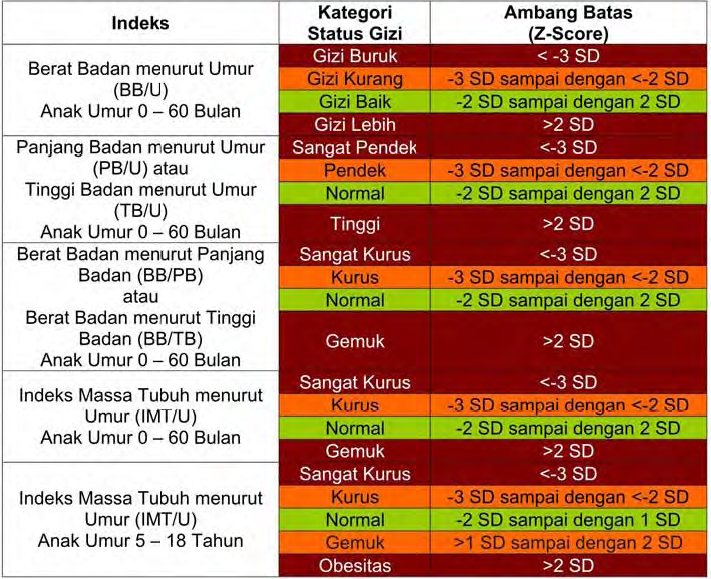

Kategori dan Ambang Batas Status Gizi Anak Berdasarkan Indeks(1)

54

---

## Slide 55

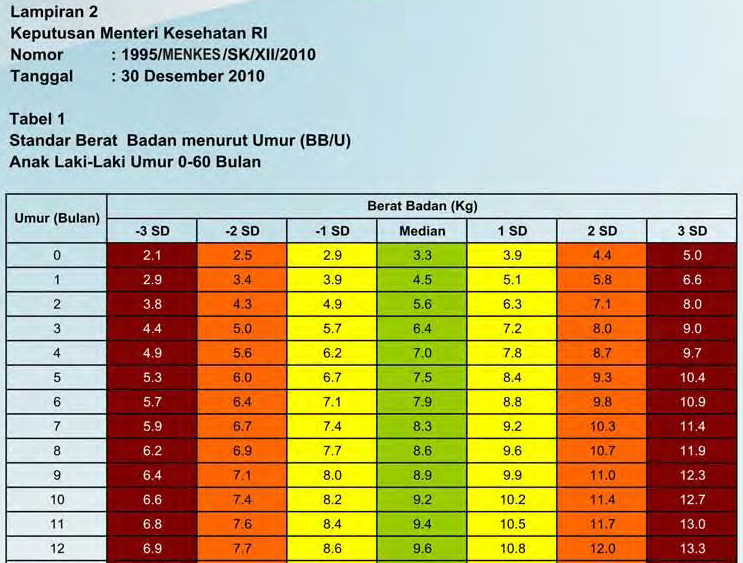

Kategori dan Ambang Batas Status Gizi Anak Berdasarkan Indeks(2)

55

---

## Slide 56

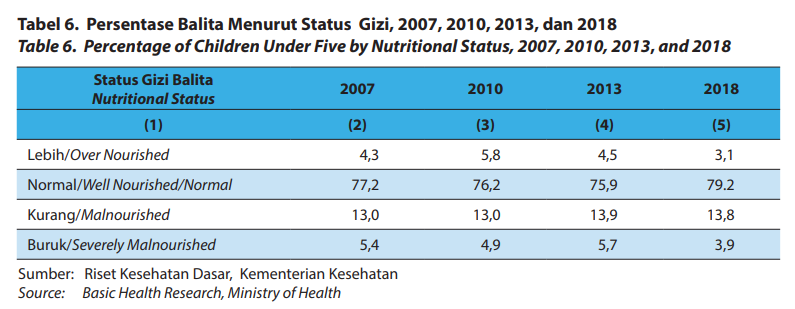

> *[Hasil OCR]:*
Tabel 6. Persentase Balita Menurut Status Gizi, 2007, 2010, 2013, dan 2018
Table 6. Percentage of Children Under Five by Nutritional Status, 2007, 2010, 2013, and 2018

Maa Sala 2007 2010 2013 2018

a) (2) (3) (4) (5)

Lebih/Over Nourished 43 58 45 3,
Normal/Well Nourished/Normal 772 762 759 792
Kurang/Malnourished 130 130 139 138
Buruk/Severely Malnourished 54 49 57 3,9

Sumber: Riset Kesehatan Dasar, Kementerian Kesehatan
Source: Basic Health Research, Ministry of Health

S3 WEBINAR SERIE

S
STATISTIKA '., Ni... & =
a IN

B3 &, we Politekni IS 3 STIS
Te aa, ew Hiu eee

ae POLITEKNIK Sekolah Tinggi I
ae STATISTIKA STIS oe Statistik Ge i” iv) @stis jkt © @ polstatstis © www.stis.ac.id

---

## Slide 57

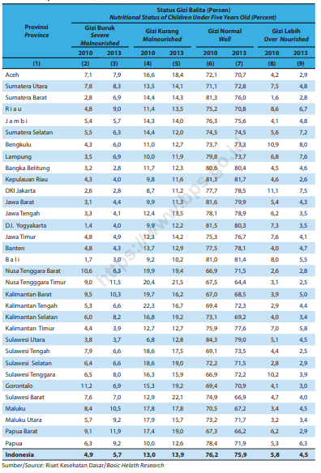

> *[Hasil OCR]:*
3

9 ma

“90 782

58 ms

as m8

a © ms ca a7 2

aw wl ms wo

Bow ms moms as

“we m2 m3 os

se ns mw
NusaTengpwatont 10663 sa ns 2628
Kemamanfost 85103 1a aso
kamtntengah 52 oc ee ee
IetmantanSbsan 60 82 2m nwt
Sea Vacs aga memes
Sede Tengah 736 mse) ms as
Samed Setan 6k wo m2 oss
SdmeTegga 6880 us ws m2 ana
coonsa 2 2 A mse
at as ma ms aa as
pintar ons oe)
mna aos as 762759 sas

S3 WEBINAR SERIE

S
STATISTIKA '., Ni... & =
a IN

B3 &, we Politekni IS 3 STIS
Te aa, ew Hiu eee

ae POLITEKNIK Sekolah Tinggi I
ae STATISTIKA STIS oe Statistik Ge i” iv) @stis jkt © @ polstatstis © www.stis.ac.id

---

## Slide 58

Prevalensi Stunting (Pendek dan Sangat Pendek) pada Anak di Bawah 5 Tahun/Balita

58

dimana:
PAB(5)SPstunting 	: Prevalensi anak balita yang menderita sangat pendek (stunting)
JAB(5)SPstunting 	: Jumlah anak balita sangat pendek (stunting)
JAB(5) 			: Jumlah anak balita

---

## Slide 59

Prevalensi Stunting (Pendek dan Sangat Pendek) pada Anak di Bawah 5 Tahun (Balita)

59

| Kondef | : | Stunting (pendek/sangat pendek) adalah kondisi kurang gizi kronis yang diukur berdasarkan indeks tinggi badan menurut umur (TB/U) dibandingkan dengan menggunakan standar WHO tahun 2005.  Data tinggi badan pada Riset Kesehatan Dasar (Riskesdas) menjadi analisis untuk status gizi dan tinggi badan setiap anak balita dikonversikan ke dalam nilai terstandar (Z-score) menggunakan baku antropometri anak balita WHO 2005. Klasifikasi berdasarkan indikator TB/U adalah sebagai berikut standar dari WHO dan Keputusan Menteri Kesehatan RI Nomor: 1995/MENKES/SK/XII/2010: 1. Sangat pendek : Zscore <-3,0 2. Pendek : Zscore ≥- 3,0 s/d Zscore < -2,0 |
| --- | --- | --- |

---

## Slide 60

Prevalensi Stunting (Pendek dan Sangat Pendek) pada Anak di Bawah 5 Tahun (Balita)

60

| Kegunaan | : | Indikator ini mengukur persentase anak balita yang tingginya dibawah ketinggian rata-rata penduduk acuan. Stunting pada anak-anak mencerminkan efek yang luas dari kekurangan gizi yang kronis dan menderita penyakit berulang yang disebabkan oleh latar belakang sosial dan ekonomi yang buruk. Stunting pada anak-anak dapat memiliki dampak serius pada perkembangan fisik, mental, dan emosional anak-anak, dan bukti menunjukkan bahwa efek dari stunting pada usia muda, khususnya pada perkembangan otak, sulit untuk memperbaikinya pada usia lanjut walaupun jika anak menerima gizi yang tepat. Selain itu anak yang mengalami stunting beresiko lebih besar menderita penyakit menular dan tidak menular pada usia dewasa seperti jantung, diabetes, dan penyakit pembuluh darah. Oleh karena itu, indikator ini menunjukan bahwa betapa pentingnya memberikan gizi yang cukup untuk anak-anak. |
| --- | --- | --- |
| Sumber data | : | RISKESDAS |

---

## Slide 61

61

| Provinsi | Persentase Balita Pendek Dan Sangat Pendek (Persen) |  |  |  |  |  |
| --- | --- | --- | --- | --- | --- | --- |
|  | Pendek |  |  | Sangat Pendek |  |  |
|  | 2016 | 2017 | 2018 | 2016 | 2017 | 2018 |
| ACEH | 18.84 | 23.50 | 21.10 | 7.56 | 12.20 | 16.00 |
| SUMATERA UTARA | 15.10 | 16.00 | 19.20 | 9.34 | 12.50 | 13.20 |
| SUMATERA BARAT | 18.88 | 21.30 | 20.30 | 6.66 | 9.30 | 9.60 |
| RIAU | 17.75 | 18.50 | 17.10 | 7.32 | 11.20 | 10.30 |
| JAMBI | 18.50 | 16.40 | 16.80 | 8.50 | 8.80 | 13.40 |
| SUMATERA SELATAN | 14.58 | 14.90 | 17.20 | 4.66 | 7.90 | 14.40 |
| BENGKULU | 16.35 | 20.80 | 18.20 | 6.61 | 8.60 | 9.80 |
| LAMPUNG | 18.19 | 21.50 | 17.70 | 6.59 | 10.10 | 9.60 |
| KEP. BANGKA BELITUNG | 15.70 | 18.00 | 16.10 | 6.22 | 9.30 | 7.30 |
| KEP. RIAU | 15.64 | 16.30 | 15.10 | 7.21 | 4.70 | 8.50 |
| DKI JAKARTA | 13.78 | 15.50 | 11.50 | 6.28 | 7.20 | 6.10 |
| JAWA BARAT | 19.00 | 20.80 | 19.40 | 6.13 | 8.40 | 11.70 |
| JAWA TENGAH | 17.78 | 20.60 | 20.10 | 6.09 | 7.90 | 11.20 |
| DI YOGYAKARTA | 17.10 | 14.70 | 15.10 | 4.74 | 5.10 | 6.30 |
| JAWA TIMUR | 18.62 | 18.80 | 19.90 | 7.51 | 7.90 | 12.90 |
| BANTEN | 18.90 | 19.00 | 17.00 | 8.09 | 10.60 | 9.60 |
| BALI | 14.48 | 14.20 | 16.30 | 5.22 | 4.90 | 5.60 |
| NUSA TENGGARA BARAT | 21.66 | 26.00 | 24.30 | 8.31 | 11.20 | 9.20 |
| NUSA TENGGARA TIMUR | 23.72 | 22.30 | 26.70 | 15.03 | 18.00 | 16.00 |
| KALIMANTAN BARAT | 22.99 | 23.50 | 21.90 | 11.94 | 13.00 | 11.40 |
| KALIMANTAN TENGAH | 22.91 | 23.60 | 21.30 | 11.20 | 15.40 | 12.70 |
| KALIMANTAN SELATAN | 21.31 | 21.20 | 21.10 | 9.82 | 13.00 | 12.00 |
| KALIMANTAN TIMUR | 19.92 | 22.00 | 19.00 | 7.22 | 8.60 | 10.20 |
| KALIMANTAN UTARA | 21.31 | 22.10 | 20.10 | 10.29 | 11.30 | 6.80 |
| SULAWESI UTARA | 14.42 | 17.30 | 15.70 | 6.79 | 14.10 | 9.80 |
| SULAWESI TENGAH | 21.85 | 22.10 | 20.40 | 10.19 | 14.00 | 11.90 |
| SULAWESI SELATAN | 25.87 | 24.60 | 23.20 | 9.73 | 10.20 | 12.50 |
| SULAWESI TENGGARA | 20.64 | 21.20 | 18.60 | 8.93 | 15.20 | 10.10 |
| GORONTALO | 21.50 | 20.50 | 19.80 | 11.54 | 11.20 | 12.70 |
| SULAWESI BARAT | 25.02 | 25.10 | 25.40 | 14.69 | 14.90 | 16.20 |
| MALUKU | 16.65 | 19.70 | 21.50 | 12.33 | 10.30 | 12.50 |
| MALUKU UTARA | 19.72 | 16.80 | 20.40 | 4.87 | 8.20 | 11.00 |
| PAPUA BARAT | 18.83 | 19.90 | 16.10 | 11.45 | 13.40 | 11.70 |
| PAPUA | 16.35 | 16.90 | 17.80 | 11.64 | 15.90 | 15.30 |
| INDONESIA | 18.97 | 19.80 | 19.30 | 8.57 | 9.80 | 11.50 |
|  |  |  |  |  |  |  |
| Sumber : Pemantauan Status Gizi, Profil Kesehatan Indonesia, KEMENKES |  |  |  |  |  |  |

---

## Slide 62

62

Indikator Perumahan

---

## Slide 63

63

Pendahuluan [1]

Rumah sebagai kebutuhan utama yang paling mendasar bagi manusia [sandang, pangan, papan] => tempat tinggal untuk berlindung (shelter)
Istilah yang lebih tepat adalah tempat tinggal sebagai pengganti dari rumah
Kesulitan penyediaan tanah di kota besar tempat tinggal berupa rumah susun, apartment, flat, condominium,
Kompleks perumahan dibangun di wilayah penyangga kota besar
Menjamur ‘ruko’, ‘rukan’, di perkotaan sebagai solusi? 
Informasi penting dan utama yang perlu diketahui adalah
Berapa % keluarga/rumahtangga yang memiliki tempat tinggal
Berapa banyak tempat tinggal yang mesti disediakan [backlog]

---

## Slide 64

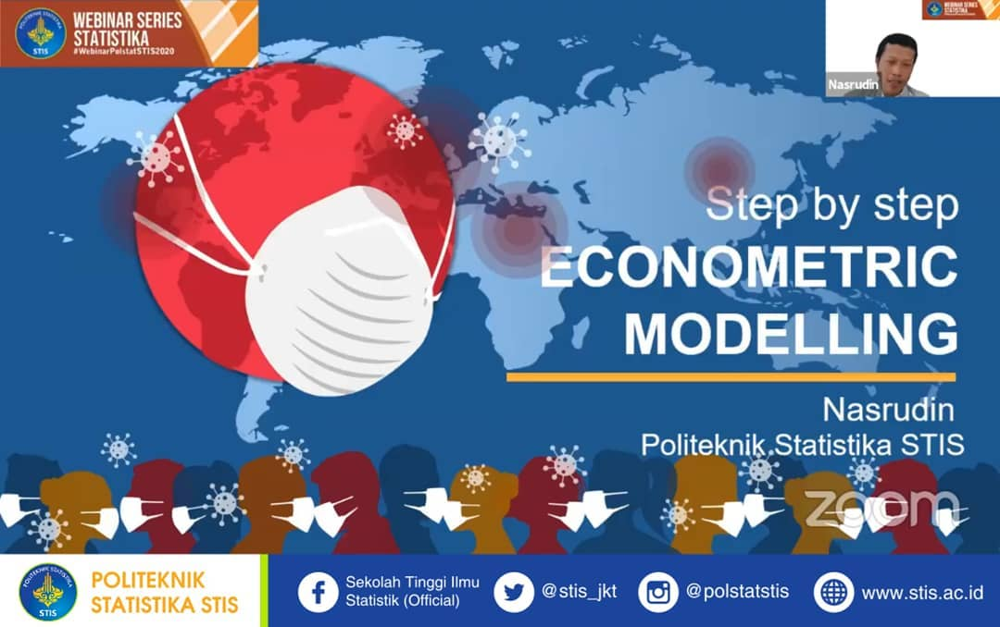

64

Pendahuluan [2]

Rumah yang ideal “1 keluarga menghuni 1 rumah” sehingga “pembinaan keluarga” dapat diwujudkan dengan baik sebagaimana Undang-Undang Nomor 1 Tahun 2011 tentang Perumahan dan Kawasan Permukiman
Konsep menghuni: setiap keluarga tidak wajib memiliki rumah, pemerintah mendorong agar setiap keluarga, terutama yang tergolong Masyarakat Berpenghasilan Rendah (MBR) bisa menghuni rumah yang layak: sewa/kontrak, beli, atau tinggal di rumah milik kerabat => terjamin kepastian bermukim (secure tenure)
Penanganan Backlog
pemerintah 1980an ditangani Perumnas banyak membangun rumah
pemerintah pada 2010-2014 membangun sejumlah rumah susun sewa (rusunawa) => penanganan backlog rumah di Indonesia.
pengembang swasta: kompleks perumahan, rumah susun, apartemen
masyarakat di Indonesia: membangun rumah tapak, rumah kost
Memenuhi standar rumah sehat layak huni

---

## Slide 65

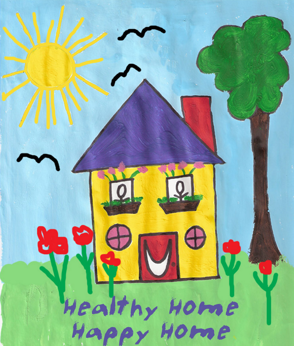

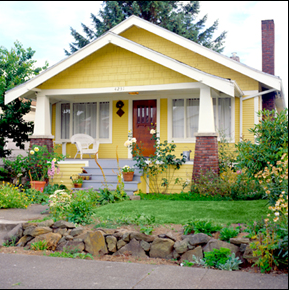

65

Prinsip Rumah Sehat

---

## Slide 66

> *[Hasil OCR]:*
S3 WEBINAR SERIE

S
STATISTIKA '., Ni... & =
a IN

B3 &, we Politekni IS 3 STIS
Te aa, ew Hiu eee

ae POLITEKNIK Sekolah Tinggi I
ae STATISTIKA STIS oe Statistik Ge i” iv) @stis jkt © @ polstatstis © www.stis.ac.id

---

## Slide 67

67

Prinsip Dasar Rumah Sehat

WHO (1989) menyebutkan perumahan yang layak harus dapat memberikan perlindungan terhadap paparan agen dan vektor penyakit menular, melalui:
pasokan air yang aman,
sanitasi pembuangan tinja,
pembuangan limbah padat rumah tangga,
drainase air permukaan,
kebersihan pribadi dan rumah tangga,
penyiapan makanan yang aman, dan
perlindungan struktural terhadap penularan penyakit.

---

## Slide 68

68

Pasokan Air Bersih dan Aman

Pasokan air yang aman dan dapat diminum membantu dalam mencegah penyebaran penyakit pencernaan, mendukung kebersihan pribadi dan domestik, dan memberikan peningkatan standar hidup.
Sepertiga kematian anak di bawah umur 5 tahun di negara-negara berkembang disebabkan karena penyakit diare yang disebabkan oleh infeksi mikroorganisme yang terbawa air. Tingkat keparahan penyakit ini meningkat tajam saat paparan dikombinasikan dengan efek dari gizi buruk.
Karena air sangat penting bagi kehidupan, maka manusia harus dilindungi dari air yang terkontaminasi secara biologis, yang dapat membawa mikroorganisme berbahaya.

---

## Slide 69

69

Sanitasi Pembuangan Tinja

Sanitasi pembuangan tinja dapat mengurangi transmisi penyakit melalui feses-oral dan pengembangbiakan serangga vector pembawa penyakit.
Salah satu sumber utama pencemaran biologis terhadap air, makanan, dan tanah adalah kotoran manusia.
Kontaminasi dapat terjadi di dekat rumah, seperti ketika orang buang air besar di tanah atau di daerah-daerah di mana sumber makanan tumbuh, atau ketika jamban terletak didekat sumber air untuk minum.
Paparan dari kotoran manusia ini juga mungkin dapat masuk ke sumber-sumber air yang mengalir dan kemudian masuk ke dalam rantai makanan, transmisi organisme patogen kepada orang-orang pada jarak tertentu dari situs asli kontaminasi.

---

## Slide 70

70

Pembuangan Limbah Padat Rumah Tangga

Pembuangan yang memadai dan aman dari limbah padat domestik dapat mengurangi risiko kesehatan dan membantu untuk menyediakan lingkungan hidup yang lebih menyenangkan.
Metode penyimpanan dan pembuangan sampah yang tepat dapat mencegah serangga dan hewan pengerat vektor penyakit.
Metode yang tepat juga dapat melindungi orang terhadap zat beracun dan benda-benda yang mungkin dapat menyebabkan luka karena kecelakaan.

---

## Slide 71

71

Pembuangan Limbah Padat Rumah Tangga

Pembuangan yang memadai dan aman dari limbah padat domestik dapat mengurangi risiko kesehatan dan membantu untuk menyediakan lingkungan hidup yang lebih menyenangkan.
Metode penyimpanan dan pembuangan sampah yang tepat dapat mencegah serangga dan hewan pengerat vektor penyakit.
Metode yang tepat juga dapat melindungi orang terhadap zat beracun dan benda-benda yang mungkin dapat menyebabkan luka karena kecelakaan.

---

## Slide 72

72

Drainase Air Permukaan

Drainase yang efisien dari air permukaan membantu untuk mengontrol penyakit menular, bahaya keamanan, dan kerusakan rumah dan properti.
Drainase yang tidak memadai dari air permukaan - termasuk air limbah domestik - yang menggenang atau daerah berlumpur dan berawa dapat menjadi tempat berkembang biak bagi nyamuk, lalat dan serangga vektor penyakit lainnya.
Air yang menggenang di dekat sumur, jamban, dan dapur menjadi perhatian khusus, karena tempat tersebut menjadi lokasi penting kontaminasi biologis.

---

## Slide 73

73

Kebersihan Pribadi dan Rumah Tangga

Perumahan yang layak termasuk fasilitas untuk kebersihan pribadi dan rumah tangga, dan orang-orang yang hidup di dalam rumah harus dididik dalam praktek-praktek hidup yang higienis.
Pasokan air bersih dan sanitasi pembuangan tinja akan sepenuhnya efektif mengendalikan penyakit menular, jika disertai dengan kebiasaan kebersihan yang baik.
Kebersihan tubuh, terutama mencuci tangan setelah buang air besar, merupakan faktor penting dalam memutus mata rantai berbagai infeksi dan mengurangi insiden keluhan penyakit kulit (iritasi, sepsis, dermatitis, eksim), dan penyakit mata (trachoma, konjungtivitis).

---

## Slide 74

74

Penyiapan Makanan yang Aman

Tempat tinggal yang sehat menyediakan fasilitas untuk penyiapan dan penyimpanan makanan yang aman, sehingga rumah tangga yang hidup di dalamnya dapat mempraktekkan pengolahan makanan yang bersih dan sehat.
Makanan yang terkontaminasi sejumlah bakteri, virus, protozoa, dan cacing adalah media yang dapat menularkan penyakit.
Meskipun beberapa sumber kontaminasi terletak di luar rumah (racun alami, residu kimia, pemalsuan makanan, penyimpanan tidak sehat dan pemasaran), bahaya domestik yang signifikan dapat dikaitkan dengan penggunaan air untuk memasak, cara memasak dan memanaskan kembali makanan yang telah dimasak, penyimpanan makanan, penanganan dan penyiapan makanan, kebersihan peralatan yang digunakan untuk menyiapkan makanan.
Untuk dapat memilih, menyiapkan, menyimpan dan menangani makanan dengan baik dan benar maka membutuhkan baik fasilitas (terutama air yang aman, peralatan memasak yang bersih, dan ruang penyimpanan yang baik) dan praktek penyiapan makan yang higienis (terutama mencuci tangan setelah buang air)

---

## Slide 75

75

Perlindungan Struktural terhadap Penularan Penyakit

Perumahan yang layak memberikan perlindungan struktural terhadap penularan penyakit, termasuk cukup ruang untuk menghindari kepadatan yang berlebihan (overcrowding).
Desain, karakteristik struktural, pemeliharaan dan jumlah ruangan sebuah hunian mempengaruhi sejauh mana orang-orang yang tinggal di dalamnya dilindungi terhadap penyakit menular.
Rumah yang berlantaikan tanah mungkin dapat menjadi “pelabuhan” cacing.
Fitur struktural tertentu (kurangnya pencahayaan matahari, kurangnya ventilasi udara, dll) juga dapat mendukung perkembangbiakan dan bersarangnya vektor penyakit.
Kepadatan hunian telah terbukti meningkatkan tingkat penularan penyakit menular seperti tuberkulosis, pneumonia, bronkitis dan infeksi gastrointestinal.
Orang yang tidur di kamar yang berventilasi buruk cenderung lebih mudah terkena penyebaran infeksi udara, termasuk meningitis meningokokus, demam rematik, flu, pilek, campak, rubella dan pertusis.

---

## Slide 76

76

Indikator Perumahan

Informasi perumahan dapat digolongkan dalam:
Status Kepemilikan Rumah => backlog
Kondisi Rumah => kondisi perumahan
Kualitas Fisik Bangunan (KFP)
Luas lantai/kapita (m2)
Jenis atap
Jenis lantai
Jenis dinding
Kelengkapan Fasilitas Rumah (KFR)
Ketersediaan air bersih layak
Ketersediaan sanitasi/jamban layak
Ketersediaan kamar mandi
Ketersediaan listrik
 Dapat dibuat indeks kondisi rumah

---

## Slide 77

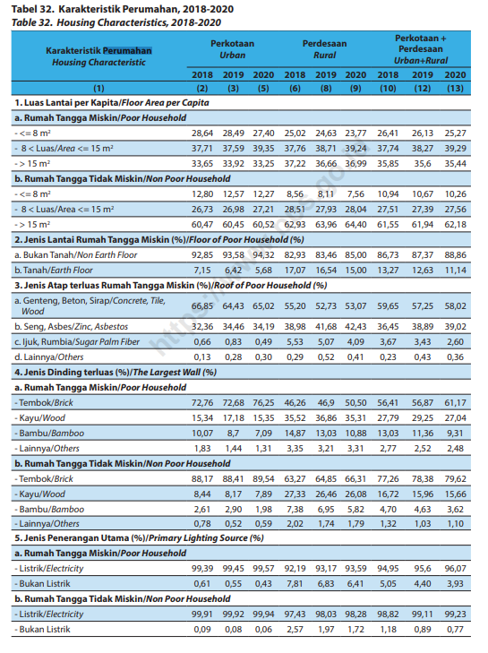

> *[Hasil OCR]:*
Tabel 32. Karakteristik Perumahan, 2018-2020
Table 32. Housing Characteristics, 2018-2020

Ez
STAN 3759 3935 3776 3871 392 37,74 3827 3929
3365 3392 3525 3722 3666 3699 3585 356 3544
'b. Rumah Tangga Tidak Miskin/Non Poor Household

= 1280 1257 1227 656 BIN 756 1098 1067 1026
Tea Luas/ivea <= 15m 2673 2698 27,21 BABI 2733 2804 2751 2739 2756
sm 6047 GOAS 6052 6293 6396 6440 6155 61948 6218
‘2 Jenis Lantai Rumah Tangga Miskin (We)/Floorof Poor Household (95)

“Bukan Tanab/Non Earth Floor 9285 9358 9432 8293 6346 8500 8673 8737 2886
‘bTanah/Earth Floor 7AS__GA2” 568 1707 1654 1500 1327 1263 11,14

3- Jenis Atap terluas Rumah Tangga Miskin %e)/Roof of Poor Household (e)
“Genteng, Beton Stap/Concrete, Tile,
Wood

6685 6443 6502 5520 5273 5307 5965 5725 5802

b. Seng, Asbes/Zine, Asbestos 3236 3446 319 3898 4168 4243 3645 3889 3902
“uk, Rumbia/Sugar Palm Fiber 066 083 049 553 507 409 367 343 260
@.Lainnya/Others 013 028 030 029 052 041 0.23 043 036

'.Jenis Dinding terluas ()/TheLargest Wal (2)
'. Rumah Tangga Miskin/Poor Household

-TembokBrck 7276 7268 7625 4626 469 5050 S641 5637 6117
~KayulWood 1534 17.18 1535 3552 3686 3531 2779 2925 2704
-Bambu/Bamboo 1007 37 709 1487 1303 1088 1303 1136 931
“Lainnya/Oters 183 NAM 131 385 321 331 277 252 248
'b.Rumah Tangga Tidak Miskin/Non Poor Household

~Tembok/Brick 8517 8541 6954 63.27 6485 6631 7726 7838 7962
TkayuWood 844817 789 2733 2646 2608 1672 1596 1566
~Bambu/Bamboo 261 290 198 738 695 582470 463 362
Hainnya/Others 078 052 059 202 178 179 132 193 110

5. Jenis Penerangan Utama (6)/Primary Lighting Source (%)
‘a: Rumah Tangga Miskin/Poor Household

“Listrik Elecericity 9939 9945 9957 92,19 9317 9359 9495 956 9607
Sukan Listrik OST 055 043 781 685 641 505 AA 393
'b.Rumah Tangga Tidak Miskin/Non Poor Household

Listrik/Eectrcity 9991 9992 9994 9743 9503 9828 9882 99,11 9923

~Bukan Listrik 009 008 006 257 197 172118 089 077

S3 WEBINAR SERIE

S
STATISTIKA '., Ni... & =
a IN

B3 &, we Politekni IS 3 STIS
Te aa, ew Hiu eee

ae POLITEKNIK Sekolah Tinggi I
ae STATISTIKA STIS oe Statistik Ge i” iv) @stis jkt © @ polstatstis © www.stis.ac.id

---

## Slide 78

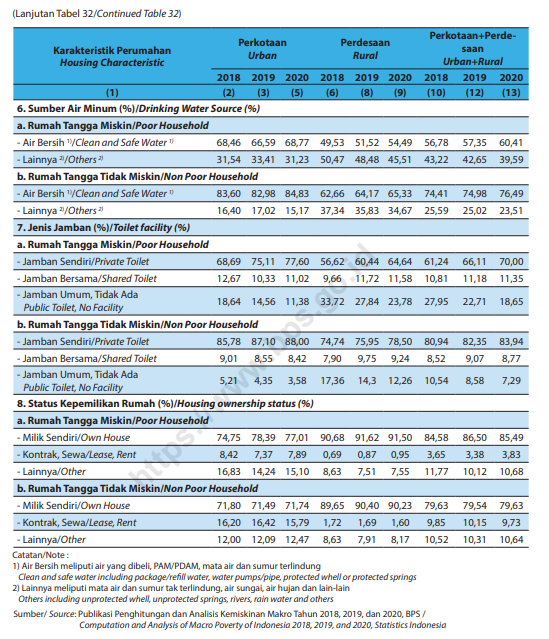

> *[Hasil OCR]:*
(Lanjutan Tabel 32/Continued Table 32)

‘6. Sumber Air Minum (%)/Drinking Water Source (6)

“Rumah Tangga Miskin/Poor Household

Air Bersih Clean and Safe Water” 6886 6659
TLainnya "Others? 3154 3341 3123 S0A7 4848 4551 4322 4265 3959
'. Rumah Tangga Tidak Miskin/Non Poor Household

Air Bersih "/Clean and Safe Water 8560 8298 BABI G266 6417 6533 TAAT 7498 7649
“Lainnya "/Others™ 1640 1702 15,17 3734 3583 3467 2559 2502 2351

7. Jenis Jamban (9) Toilet facility (6)
'. Rumah Tangga Miskin/Poor Household

“Jamban Sendin/Private Toilet 6869751 77,60 S662 60A4 6464 6124 6611 7000
“Jamban Bersama/Shared Toilet 1267 1033 1102 986 1172 1158 10811118 TS
“Jamban Umum, Tidak Ada

aa 1864 1456 1138 3372 2784 2378 2795 2271 1865
'. Rumah Tangga Tidak Miskin/Non Poor Household
- Jamban Sendir/Phvote Toilet 3578 8710 6800 7474 7595 7850 Boga 6235 6394
“Jamban Bersama/Shared Toilet 901 855 642 790 975 924 852 307 377
“lamban Umur, Tidak Ada

FE 521 435 358 1736 143 1226 1054 858 729

3. Status Kepemilikan Rumah (%)/Housing ownership status (26)
'. Rumah Tangga Miskin/Poor Household

= Milk Sendr/Own House 7475 7839 7701 9068 9162 9150 8458 8650 6549
“Kontrak, Sewa/lease Rent 842737 789 069 087 095 365 338 383
< Lainnya/Other 1683 1424 15,10 863 751 755 1177 1012 1068
'. Rumah Tangga Tidak Miskin/Non Poor Household

= Milk Sendir/Own House 7180 7149 7174 8965 9040 9023 7963 7954 7963
= Kontrak, Sewallease Rent 1620 1642 1579 172 169 160 985 1015 973
-Lainnya/Other. 1200 1209 1247 8683 791 17 1052 1031 1064
Gonore

1) Ar Bersih metputiairyang dil PAMPDAM, mata dan sumurterindung
‘Clean andsoe water inducing package rei watr water pumpsppe. protected el orprtetad sings
Lainnya meliputi mata ai dan sumur akterindung ai sungatahujan dan ian
‘Othersincudng unprotected whelunprotcted springs rivers ain water and others
‘Sumber! Sore Publikasi Penghitungan dan Analis Kemiskinan Mako Tahun 2016, 2019, dan 2020 895 /
“Computatn and Anas of Mar Poverty ofindonesa 2014. 201. nd 2020 Statstesindonesia

S3 WEBINAR SERIE

S
STATISTIKA '., Ni... & =
a IN

B3 &, we Politekni IS 3 STIS
Te aa, ew Hiu eee

ae POLITEKNIK Sekolah Tinggi I
ae STATISTIKA STIS oe Statistik Ge i” iv) @stis jkt © @ polstatstis © www.stis.ac.id

---

## Slide 79

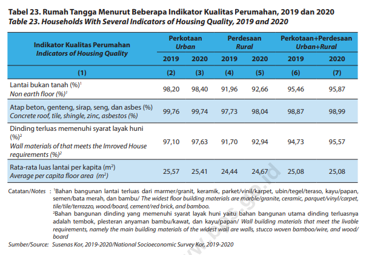

> *[Hasil OCR]:*
Tabel 23. Rumah Tangga Menurut Beberapa Indikator Kualitas Perumahan, 2019 dan 2020
Table 23. Households With Several Indicators of Housing Quality, 2019 and 2020

1 Perkotaan Perdesaan — Perkotaan Perdesaan
Indikator Kualitas Perumahan Urban Rural Urban Rural
at

2 iy 2019 2020 2019 2020 2019 2020
cu} (2) 8 4 (5) Kal ™

Lantai bukan tanah 8)"

Lantai bukan tanah 9820 9840 9196 9266 9546 567

(Atap beton, genteng, siap, seng, dan asbes(%)

‘Concrete roof tile, shingle, zinc, asbestos (96) Ck GN Eke Er) fy coro)

Dinding terluas memenuhi syarat layak huni

cor

Wall materials of that meets the Imroved House TNO 9763 91,70 92,94 2473 9557

requirements (6

esa Pin lantai panapaa kar) 25,57 2541 2444 2467 25,08 25,08

‘Average per capita floor area (nm)

Catatan/Notes : "Bahan bangunan lantai terluas dari marmer/granit, keramik, parket/Vini/karpet,ubin/tegel/teraso, kayu/papan,
semenybata merah, dan bambul The widest Noor building materials are marble/granite, ceramic, pargue/vinylcarpet
tie/ie/terazzo wood/board, cemen/red brick, and bamboo,

Bahan bangunan dinding yang memenuhi syarat ayak huni yaitu bahan bangunan utama dinding terluasnya
‘adalah tembok, pesteran anyaman bambu/kawat, dan kayu/papan/ Wall building materials that meet the livable

‘requirements, namely the main building materials ofthe widest wall are walk, stucco woven bamboo/wire, and wood/
board

‘Sumber/Source: Susenas or, 2019-2020/National Socioeconomic Survey Kot, 2019-2020

S3 WEBINAR SERIE

S
STATISTIKA '., Ni... & =
a IN

B3 &, we Politekni IS 3 STIS
Te aa, ew Hiu eee

ae POLITEKNIK Sekolah Tinggi I
ae STATISTIKA STIS oe Statistik Ge i” iv) @stis jkt © @ polstatstis © www.stis.ac.id

---

## Slide 80

80

Indeks Komposit Kondisi Rumah

Kondisi Rumah => memenuhi syarat?  Ya = 1, Tidak = 0
Kualitas Fisik Bangunan [KFB]
Luas lantai/kapita (m2), ≥ 7,2 m2/kapita
Jenis atap
Jenis lantai
Jenis dinding
Kelengkapan Fasilitas Rumah [KFR]
Ketersediaan air bersih layak
Ketersediaan sanitasi/jamban layak
Ketersediaan kamar mandi
Ketersediaan listrik
Indeks Kondisi Rumah =

Berkualitas baik (tahan lama)

Ada = 1
Tidak ada = 0

---

## Slide 81

81

Indeks Komposit Rumah Tidak Layak Huni

Rumah Tidak layak huni: rumah yang tidak memenuhi persyaratan keselamatan, bangunan dan kecukupan minimum luas bangunan serta kesehatan penghuninya

Terdapat 7 Indikator penyusun rumah tidak Layak:
Tidak terpenuhi Sufficient Living Area (Luas lantai/kapita (m2), ≥ 7,2 m2/kapita)
Jenis bahan bangunan utama atap rumah terluas adalah jerami/ijuk/daun-daunan/rumbia atau lainnya
Jenis bahan bangunan utama dinding rumah terluas adalah bambu atau lainnya
Jenis bahan bangunan utama lantai rumah terluas adalah tanah atau lainnya
Tidak memiliki akses terhadap layanan sanitasi/jamban layak
Tidak memiliki akses terhadap sumber air minum layak
 Sumber utama penerangan rumah tangga adalah non listrik.

---

## Slide 82

82

Indeks Komposit Rumah Tidak Layak Huni

Untuk menentukan derajat rumah tidak layak huni:

Jika terpenuhi sedikitnya 3 dari 7 kriteria, termasuk Kategori rumah tidak layak huni
Jika hanya terdapat 2 kriteriayang terpenuhi maka termasuk kategori rumah hampir tidak layak huni
Jika hanya satu atau tidak ada termasuk kategori Rumah Layak Huni

https://sirusa.bps.go.id/sirusa/index.php/indikator/798

---

## Slide 83

> *[Hasil OCR]:*
S3 WEBINAR SERIE

S
STATISTIKA '., Ni... & =
a IN

B3 &, we Politekni IS 3 STIS
Te aa, ew Hiu eee

ae POLITEKNIK Sekolah Tinggi I
ae STATISTIKA STIS oe Statistik Ge i” iv) @stis jkt © @ polstatstis © www.stis.ac.id

---

## Slide 84

84

Sumber Air Minum

Air minum layak (berkualitas) adalah air minum yang terlindung, meliputi air, keran umum, hydrant umum, dan terminal air. 
Selain itu, penampungan air hujan atau mata air dan sumur terlindung, sumur bor atau sumur pompa, yang jaraknya minimal 10 meter dari pembuangan kotoran, penampungan limbah dan pembuangan sampah.
Tidak termasuk air kemasan, air dari penjual keliling, air yang dijual melalui tanki, air sumur dan mata air tidak terlindung
Selain mempertimbangkan sumber air minum, penghitungan akses terhadap air minum layak yang digunakan oleh BPS juga mempertimbangkan sumber air yang digunakan untuk memasak/mandi /cuci/dll.

https://sirusa.bps.go.id/sirusa/index.php/indikator/index

---

## Slide 85

85

Kelayakan Tempat Buang Air Besar

Perilaku hidup sehat ditunjukkan tersedianya fasilitas sanitasi seperti tempat BAB [buang air besar]
disalurkan ke tempat penampungan kotoran/tinja yang layak
tempat penampungan memenuhi syarat kesehatan adalah tangki septik atau Saluran Pembuangan Air Limbah (SPAL).
tempat penampungan yang tidak memenuhi syarat sanitasi:  lobang tanah atau tanah terbuka => menyebabkan pencemaran terutama mencemarkan sumber air di dekatnya, menimbulkan bau
Jenis kloset yang digunakan menunjukkan kelayakan fasilitas sanitasi yang berpengaruh terhadap risiko penularan penyakit 
leher angsa, plengsengan, cemplung/cubluk, atau lainnya
plengsengan dan cemplung/cubluk merupakan jenis kloset yang tidak memenuhi syarat kesehatan
Kepemilikan
Sendiri
Bersama
umum

---

## Slide 86

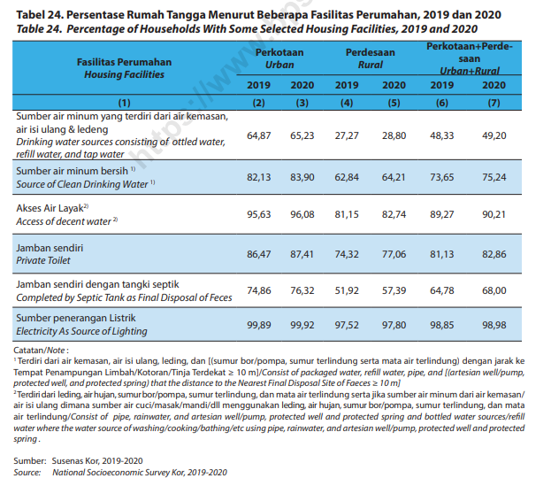

> *[Hasil OCR]:*
Tabel 24. Persentase Rumah Tangga Menurut Beberapa Fasilitas Perumahan, 2019 dan 2020
Table 24. Percentage of Households With Some Selected Housing Facilities, 2019 and 2020

‘Sumber air minum yang terdiri dari airkemasan,
airisiulang & ledeng,

Drinking water sources consisting of ottled water,
refill water, and tap water

a e213 8390 6284 6421 7365 7524
AA 9563 9608 81,15 8274 8927 9021
Pena BsA7 TAL 7432 7106 Bt13  apa6
peta Apa eka alofreces A6 7632 5192 57,39 6478 6800
ee 9989 99.92 97,52 97,80 9885 98.98.
‘Gtataninote

"Terdiri dari air kemasan aris ulang, leding, dan (sumur bor/pompa, sumur erindung serta mata air terlindung) dengan.
Tempat Penampungan LimbahVKotoran Tinja Terdekat 2 10 ml/Consist of packaged wate ref water pipe and artesian wel/pump,
protected well and protected spring) that the distance to the Nearest Final Disposal Site of Foeces = 10m

“Teri dari leding arhujan,sumurbor/pompa, sumurterindung, dan mata ai terlindung serta ika sumber air minum dariarkemasan/
airs lang dimana sumber air cuci/masak/mandu'll menggunakan leding ar hujan sumur boripompa, sumur terindung, dan mata
ir terlindung/Conss of pipe, rainwater and artesian welpump, protected well and protected spring and bottled water sources/rfil
water where the water source of washing/cooking/bathing/et using pipe, rainwater and artesian wel/pump, protected welland protected
ping.

‘Sumber: Susenas Kor, 2019-2020
Source: National Socioeconomic Survey Kor 2019-2020

S3 WEBINAR SERIE

S
STATISTIKA '., Ni... & =
a IN

B3 &, we Politekni IS 3 STIS
Te aa, ew Hiu eee

ae POLITEKNIK Sekolah Tinggi I
ae STATISTIKA STIS oe Statistik Ge i” iv) @stis jkt © @ polstatstis © www.stis.ac.id

---

## Slide 87

> *[Hasil OCR]:*
S3 WEBINAR SERIE

S
STATISTIKA '., Ni... & =
a IN

B3 &, we Politekni IS 3 STIS
Te aa, ew Hiu eee

ae POLITEKNIK Sekolah Tinggi I
ae STATISTIKA STIS oe Statistik Ge i” iv) @stis jkt © @ polstatstis © www.stis.ac.id

---

## Slide 88

88

Rumah Tangga Kumuh

---

## Slide 89

89

Rumah Tangga Kumuh

Rumah tangga dikategorikan sebagai rumah tangga kumuh bila:
Tidak memiliki akses terhadap air minum layak (15%)
Tidak memiliki akses terhadap sanitasi layak (15%)
Luas hunian per kapita <= 7,2 m2 (35%)
Minimal 2 kriteria durability of housing/ketahanan bangunan rendah terpenuhi (35%):
jenis atap terluas ijuk/rumbia dan lainnya
jenis dinding terluas bambu dan lainnya
jenis lantai terluas tanah.
Jika seluruh kriteria 1-4 di atas digabung, nilai kategori >35%, maka rumah tangga tersebut dikategorikan sebagai rumah tangga kumuh

---

## Slide 90

90

Sensus/survei yang mengumpulkan keterangan perumahan
Sensus Penduduk
Survei Penduduk Antar-Sensus
Survei Demografi dan Kesehatan Indonesia
Survei Sosial Ekonomi Nasional

Sumber Data Indikator Perumahan

---

## Slide 91

> *[Hasil OCR]:*
S3 WEBINAR SERIE

S
STATISTIKA '., Ni... & =
a IN

B3 &, we Politekni IS 3 STIS
Te aa, ew Hiu eee

ae POLITEKNIK Sekolah Tinggi I
ae STATISTIKA STIS oe Statistik Ge i” iv) @stis jkt © @ polstatstis © www.stis.ac.id

---