# Pertemuan 9 Indikator Ketenagakerjaan dan Pendidikan.pptx

Sumber Asli: `/home/alfzki/Documents/OSL/materials/slides/Pertemuan 9 Indikator Ketenagakerjaan dan Pendidikan.pptx`

---

## Slide 1

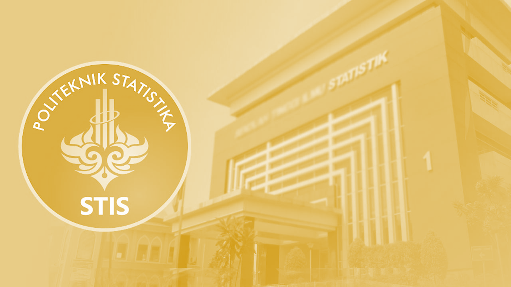

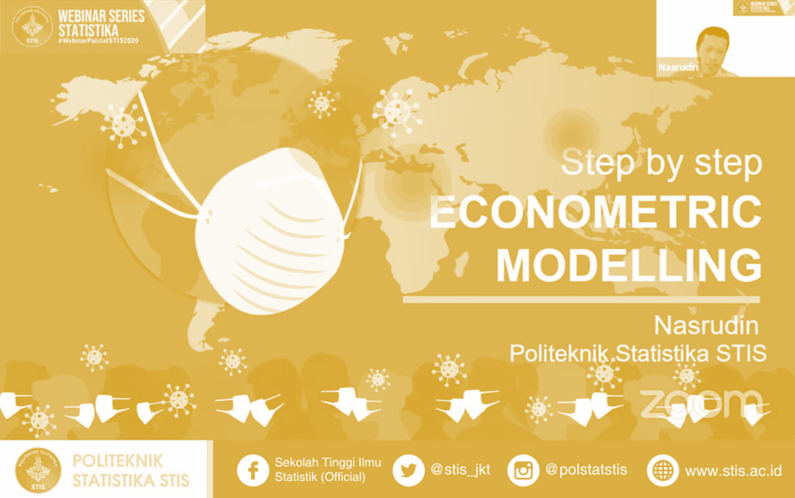

1

Pertemuan 9: Official Statistics Lanjutan

Indikator Ketenagakerjaan
dan
Indikator Pendidikan

---

## Slide 2

2

Indikator Ketenagakerjaan

---

## Slide 3

Kenapa perlu informasi ketenagakerjaan? [1]

3

faktor produksi: modal, tenaga kerja, tanah, kewirausahaan 
proses produksi: tenaga kerja pemegang peranan utama
peranan dalam produksi barang dan jasa
memperoleh pendapatan untuk menghidupi keluarga => konsumsi
produktivitas sebagai tenaga kerja => PDB/ekonomi nasional
sisi psikologi: bekerja adalah rasa kebanggaan [self esteem]
kebutuhan hidup sebagai manusia mendapat respect, honor,  pengakuan dalam keluarga maupun dalam komunitas 
pengakuan (karena posisi/jabatan) dari tempat kerja, atasan, teman sejawat, teman kerja
sisi politis: serikat buruh merupakan pressure group => menentukan/mempengaruhi perumusan kebijakan

---

## Slide 4

Kenapa perlu informasi ketenagakerjaan? [2]

4

informasi apa saja? 
penduduk dan angkatan kerja
informasi pokok: berapa orang (%) bekerja (employed) dan berapa orang (%) tidak bekerja (unemployed)
informasi tambahan: karakteristik pekerja dan pekerjaan dan karakteristik tentang pencari kerja 
karakteristik pekerja dan pekerjaan
penuh/tidak penuh => full/underemployment
sektor formal dan informal, 
lapangan usaha/sektor, jenis pekerjaan, status pekerjaan, dll
produktivitas: jam kerja, upah/gaji, pendapatan, dll
pendidikan pekerja 
informasi terkait lainnya

---

## Slide 5

5

When workers are unemployed, they, their families, and the country as a whole lose. Workers and their families lose wages, and the country loses goods and services, which could have been produced. In addition, the purchasing power of these workers is lost, which can lead to unemployment for yet other workers.

Why do we collect statistics on the unemployed?

To know about the extent and nature of unemployment requires information. How many people are unemployed? Who is counted as unemployed? How did they become unemployed? How long have they been unemployed? Are the unemployment numbers growing or declining? These statistics are collected and interpreted along with other economic data and are used by policymakers in making decisions that influence the course of the economy.

Employed persons consist of:
•	All persons who did any work for pay or profit during the survey week 
•	All persons who did at least 15 hours of unpaid work in a family-operated business.
• 	All persons who were temporarily absent from their regular jobs because of illness, vacation, bad weather, industrial dispute, or various personal reasons.

Unemployed persons consist of:
•	All persons who did not have a job at all during the survey week, made specific active efforts to find a job during the prior 4-week period, and were available for work (unless temporarily ill).
• 	All persons who were not working and were waiting to be called back to a job from which they had been temporarily laid off.

---

## Slide 6

6

Klasifikasi: 2 kelompok penduduk dalam statistik tenaga kerja: 
Penduduk mencapai usia minimum bekerja (berumur ≥ 15 tahun) =>  PUK juga disebut angkatan kerja potensi;
Selebihnya (berumur < 14 tahun) => bukan usia kerja (BUK)
Definisi: 
PUK yang aktif secara ekonomi (economically active population) terdiri dari: (1) bekerja,  dan  (2) mencari pekerjaan => unemployed
PUK ‘tidak siap bekerja’ karena sekolah, atau mengurus rumahtangga (economically inactive population) => bukan angkatan kerja

Angkatan Kerja/Labor Force: Pengertian

People who are neither Employed nor Unemployed are out of the labor force.
• 	Persons under 15 years of age are automatically excluded from the official labor force measurements.
• 	Residents of institutions and persons on active duty in the Armed Forces are excluded.
• 	Persons who have no job AND are not looking for one are excluded. Many who do not participate in the labor force are going to school, retired or have family responsibilities.

---

## Slide 7

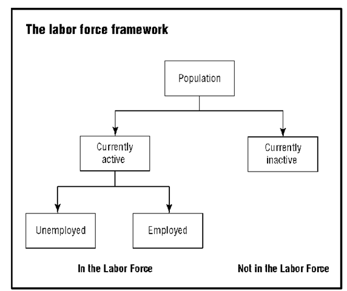

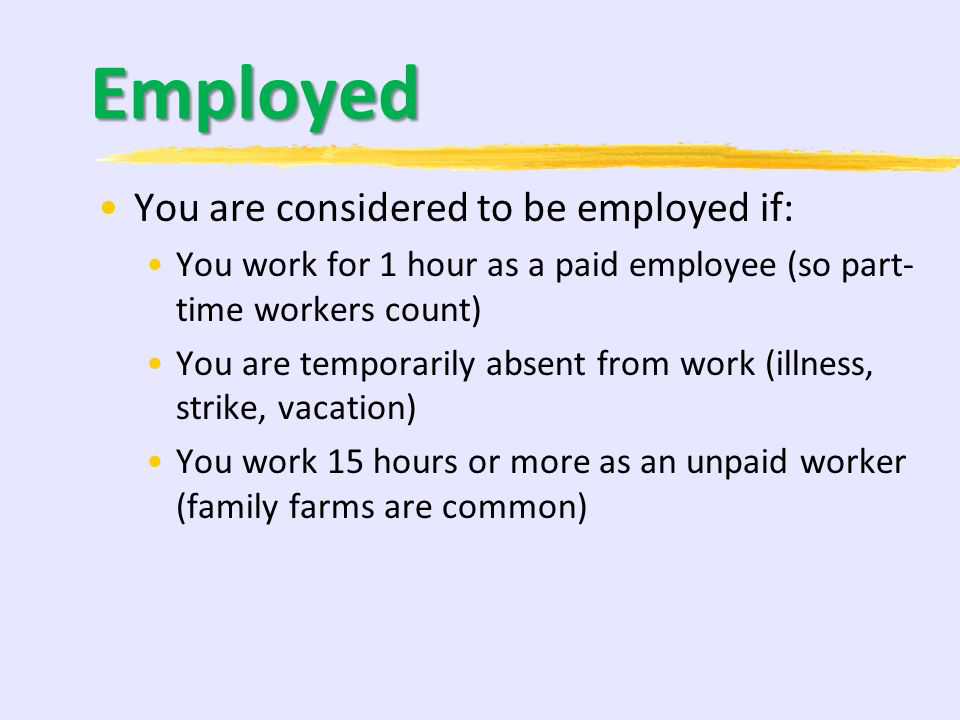

> *[Hasil OCR]:*
The labor force framework

Population

Currently Currently

active inactive

4

Unemployed Employed

In the Labor Force Not in the Labor Force

Employed
SE w w  —cci
» You are considered to be employed if:

s You work for 1 hour as a paid employee (so part-
time workers count)

» You are temporarily absent from work (illness,
strike, vacation)

s You work 15 hours or more as an unpaid worker
(family farms are common)

---

## Slide 8

8

Statistik ketenagakerjaan: catatan

Batasan usia kerja di Indonesia ≥ 15 tahun (standar internasional) sesuai konvensi International Labour Organization (ILO)
Kelemahan: tak menggambarkan situasi ketenagakerjaan yang sebenarnya banyak anak < 15 tahun bekerja (child labour) tidak dicakup dalam statistik resmi
Jumlah penduduk naik => AK (labour supply) naik, perlunya perluasan kesempatan kerja (labour demand)
AK  > Kesempatan Kerja => surplus tenaga kerja, akan terjadi pengangguran, setengah pengangguran, dan ketidaksesuaian antara pendidikan dan pekerjaan

---

## Slide 9

9

Labor force [berbeda antar negara, tergantung umur minimum bekerja]

Labor force is the total number of persons available to supply the labor for the production of economic goods and services. In other words, it is the total number of people of working age in a country who are able and willing by law to work. It is the active or working population and it comprises all persons who have jobs and those who are seeking for jobs in the labor market. They are normally found between the age bracket of 18 to 65 years. Working population varies from one country to another. To be a member of the labor force, one must be of working age (18-65 years), be able-bodied, i.e., not handicapped either. Mentally or physically, and must be willing to work. Persons that are not members of the labor force include:
• 	Children of school age (0-17 years)
• 	Elderly (above 65 years)
• 	The handicapped (either physically or mental)
• 	Persons even though they are able-bodied but are unwilling to work.

---

## Slide 10

10

Konsep Statistik Ketenagakerjaan di Indonesia

---

## Slide 11

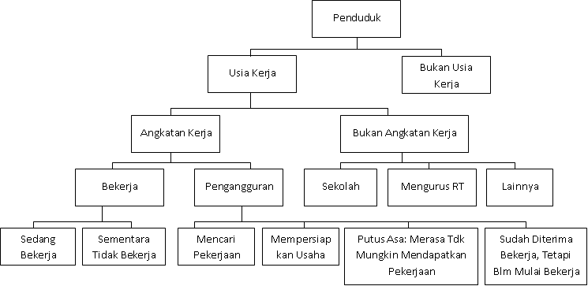

11

Kerangka Ketenagakerjaan
(ICLS 13)

---

## Slide 12

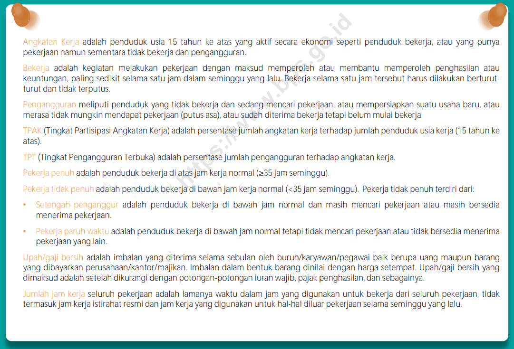

12

Konsep dan Definisi

---

## Slide 13

Tingkat Partisipasi Angkatan Kerja (TPAK)

13

dimana:
a = Jumlah Angkatan Kerja
b = Jumlah penduduk 15thn keatas

---

## Slide 14

Tingkat Partisipasi Angkatan Kerja (TPAK)

14

| Kondef | : | Persentase penduduk usia 15 tahun keatas yang merupakan angkatan kerja. |
| --- | --- | --- |
| Kegunaan | : | Mengindikasikan besarnya persentase penduduk usia kerja yang aktif secara ekonomi disuatu negara/wilayah. |
| Interpretasi | : | Semakin tinggi TPAK menunjukkan bahwa semakin tinggi pula pasokan tenaga kerja (labour supply) yang tersedia untuk memproduksi barang dan jasa dalam suatu perekonomian. |
| Sumber data | : | SAKERNAS |

---

## Slide 15

Tingkat Pengangguran Terbuka (TPT)

15

dimana:
TPT : Tingkat pengangguran terbuka (%)
PP : Jumlah pengangguran (orang)
PAK : Jumlah angkatan kerja (orang)

---

## Slide 16

Tingkat Pengangguran Terbuka (TPT)

16

| Kondef | : | Tingkat pengangguran terbuka adalah persentasejumlah pengangguran terhadap jumlah angkatankerja. Angkatan Kerja adalah penduduk usia kerja (15 tahun ke atas) yang bekerja atau punya pekerjaan namun sementara tidak bekerja, dan penggangguran.Pengangguran yaitu: (1) penduduk yang aktif mencari pekerjaan, (2) penduduk yang sedang mempersiapkan usaha/pekerjaan baru, (3) penduduk yang tidak mencari pekerjaan karena merasa tidak mungkin mendapat pekerjaan, (4) kelompok penduduk yang tidak aktif mencari pekerjaan dengan alasan sudah mempunyai pekerjaan tetapi belum mulai bekerja. |
| --- | --- | --- |
| Kegunaan | : | Mengindikasikan besarnya persentase angkatan kerja yang termasuk dalam pengangguran. |
| Interpretasi | : | Menunjukkan kemampuan ekonomi untuk menciptakan lapangan kerja yang mampu menyerap persediaan (supply) tenaga kerja yang ada. Semakin tinggi nilai indikator ini, semakin banyak persediaan tenaga kerja yang tidak termanfaatkan. Indikator ini dapat memberikan sinyal tentang kinerja pasar kerja dan berlangsungnya kondisi ekonomi tertentu, seperti resesi, perubahan siklus bisnis dan teknologi, dan lain-lain. Pembedaan menurut jenis kelamin, kelompok umur, dan tingkat pendidikan dapat menggambarkan kesenjangan keterserapan di lapangan kerja antar kelompok tersebut. |
| Sumber data | : | SAKERNAS |

---

## Slide 17

Persentase Setengah Pengangguran

17

dimana:
TSP		: Tingkat setengah pengangguran (%)
PBJK<35	: Jumlah pekerja yang tergolong setengah penganggur (orang)
PB		: Jumlah penduduk yang bekerja (orang)

---

## Slide 18

Persentase Setengah Pengangguran

18

| Kondef | : | Pekerja setengah pengangguran adalah mereka yang bekerja di bawah jam kerja normal (kurang dari 35 jam seminggu) dan masih mencari pekerjaan atau masih bersedia menerima pekerjaan (dahulu disebut setengah pengangguran terpaksa). |
| --- | --- | --- |
| Kegunaan | : | Proporsi jumlah penduduk setengah pengangguran bermanfaat untuk dijadikan acuan pemerintah dalam rangka meningkatkan tingkat utilisasi, kegunaan, dan produktivitas pekerja. |
| Interpretasi | : | Menggambarkan kemampuan ekonomi untuk menyediakan lapangan kerja yang mampu memanfaatkan keahlian, pengalaman  dan kesediaan bekerja yang dimiliki tenaga  kerjanya. Tingkat setengah pengangguran dapat memberikan gambaran tentang kualitas, produktivitas, dan tingkat utilisasi lapangan kerja yang tersedia, terutama di negara-negara dengan tingkat pengangguran terbuka rendah. |
| Sumber data | : | SAKERNAS |

---

## Slide 19

Persentase Pekerja Paruh Waktu

19

dimana:
TPPW		: Tingkat pekerja paruh waktu (%)
PBPW		: Jumlah pekerja yang tergolong paruh waktu (orang)
PB		: Jumlah penduduk yang bekerja (orang)

---

## Slide 20

Persentase Pekerja Paruh Waktu

20

| Kondef | : | Pekerja paruh waktu adalah mereka yang bekerja di bawah jam kerja normal (kurang dari 35 jam seminggu), tetapi tidak mencari pekerjaan atau tidak bersedia menerima pekerjaan lain (dahulu disebut setengah pengangguran sukarela. |
| --- | --- | --- |
| Kegunaan | : | Proporsi pekerja paruh waktu bermanfaat untuk dijadikan acuan pemerintah dalam rangka meningkatkan tingkat utilisasi, kegunaan, dan produktivitas pekerja. |
| Interpretasi | : | Menggambarkan kemampuan ekonomi untuk menyediakan lapangan kerja yang mampu memanfaatkan keahlian, pengalaman  dan kesediaan bekerja yang dimiliki tenaga  kerjanya. Tingkat pekerja paruh waktu dapat memberikan gambaran tentang kualitas, produktivitas, dan tingkat utilisasi lapangan kerja yang tersedia, terutama di negara-negara dengan tingkat pengangguran terbuka rendah. |
| Sumber data | : | SAKERNAS |

---

## Slide 21

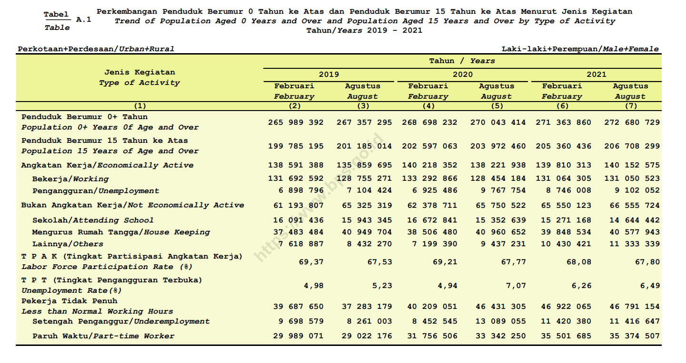

> *[Hasil OCR]:*
Tabel

A1
Table

Perkotaan+Perdesaan/Urban+Rural

Perkembangan Penduduk Berumur 0 Tahun ke Atas dan Penduduk Berumur 15 Tahun ke Atas Menurut Jenis Kegiatan
Trend of Population Aged 0 Years and Over and Population Aged 15 Years and Over by Type of Activity

Tahun/Years 2019 - 2021

Laki-lakitPerempuan/MaletFemale
Tahun / Years

CORES Ea 2019 2020 2021
EO G5 Dahakay Februari Agustus Februari Agustus Februari Agustus
February August February August February August
@ 2 @) @) 5) Kal a)
bee gO 265 989 392 267 357 295 268 698 232 270 043 414 271 363 860 272 680 729
Population 0+ Years Of Age and Over
bea 9 8D Ee LOE 199 785 195 201 185 014 202 597 063 203 972 460 205 360 436 206 708 299
Population 15 Years of Age and Over
Angkatan Kerja/Economically Active 138 591 388 135 859 695 140 218 352 138 221 938 139 810 313 140 152 575
Bekerja/Working 131 692 592 128 755 271 133 292 866 128 454 184 131 064 305 131 050 523
Pengangguran/ Unemployment 6 898 796 7 104 424 6 925 486 9 767 754 8 746 008 9 102 052
Bukan Angkatan Kerja/Not Economically Active 61 193 807 65 325 319 62 378 711 65 750 522 65 550 123 66 555 724
Sekolah/Attending School 16 091 436 15 943 345 16 672 841 15 352 639 15 271 168 14 644 442
Mengurus Rumah Tangga/House Keeping 37 483 484 40 949 704 38 506 480 40 960 652 39 848 534 40 577 943
Lainnya/Others 7 618 887 8 432 270 7 199 390 9 437 231 10 430 421 11 333 339
T PAK (Tingkat Partisipasi Angkatan Kerja)
ae BERD ARC LD ED 69,37 67,53 69,21 67,77 68,08 67,80
T P T (Tingkat Pengangguran Terbuka)
Cr 3 REED 4,98 5,23 4,94 7,07 6,26 6,49
bo Sep bo 39 687 650 37 283 179 40 209 051 46 431 305 46 922 065 46 791 154
Less than Normal Working Hours
Setengah Penganggur/Underemployment 9 698 579 8 261 003 8 452 545 13 089 055 11 420 380 11 416 647
Paruh Waktu/Part-time Worker 29 989 071 29 022 176 31 756 506 33 342 250 35 501 685 35 374 507

---

## Slide 22

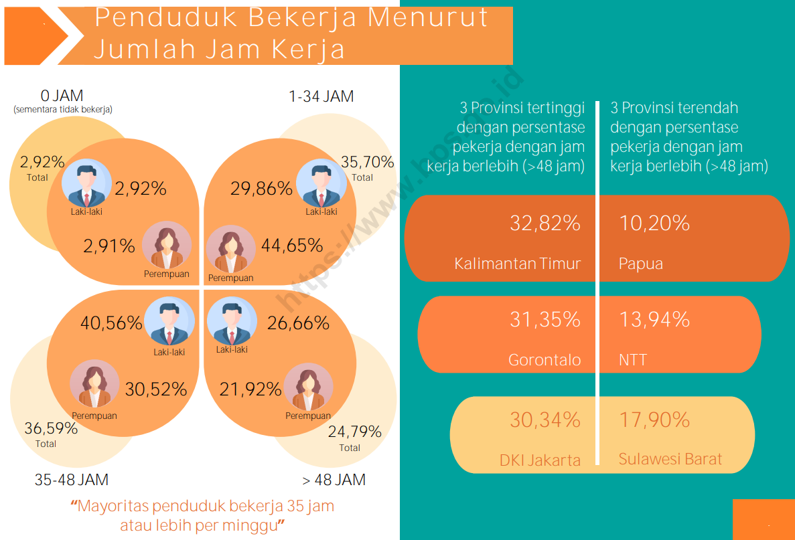

22

Agustus 2021

---

## Slide 23

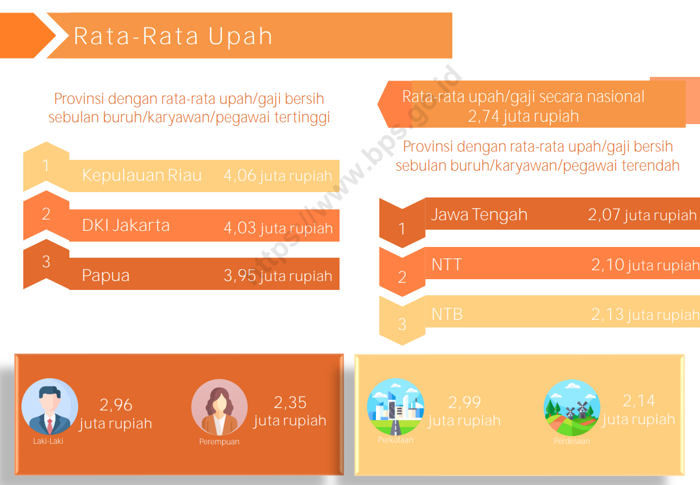

23

Agustus 2021

---

## Slide 24

24

Sektor Informal…(1)

---

## Slide 25

25

Sektor Informal…(2)

---

## Slide 26

26

| Jenis pekerjaan umum | Status Pekerjaan |  |  |  |  |  |  |
| --- | --- | --- | --- | --- | --- | --- | --- |
|  | Berusa-ha sendiri | Berusaha dibantu pekerja tidak tetap/ Tak dibayar | Berusaha Dibantu pekerja tetap /dibayar | Buruh/ Karyawan/ Pegawai | Pekerja Bebas  Pertanian | Pekerja Bebas Non Pertanian | Pekerja Keluarga/Tak dibayar |
| Pekerja profesional, teknik, dan pekerja terkait lainnya | F | F | F | F | F | F | INF |
| Pekerja administrasi dan manajerial | F | F | F | F | F | F | INF |
| Pekerja juru tulis dan terkait | F | F | F | F | F | F | INF |
| Pekerja bidang penjualan | INF | F | F | F | INF | INF | INF |
| Pekerja bdg jasa | INF | F | F | F | INF | INF | INF |
| Pertanian, peternakan, kehutanan, nelayan dan pemburu | INF | INF | F | F | INF | INF | INF |
| Pekerja produksi dan terkait | INF | F | F | F | INF | INF | INF |
| Operator peralatan pengangkutan | INF | F | F | F | INF | INF | INF |
| Buruh | INF | F | F | F | INF | INF | INF |
| Lain-lain | INF | F | F | F | INF | INF | INF |

Tabel Penentuan Tenaga Kerja Formal Informal menurut Proxy 2

---

## Slide 27

Proporsi Lapangan Kerja Informal

27

dimana:
Pr PB INF 	: Proporsi pekerja informal (%)
PB INF 	: Jumlah penduduk yang bekerja dengan status informal (orang)
PB 		: Jumlah penduduk yang bekerja (orang)

---

## Slide 28

Proporsi Lapangan Kerja Informal

28

| Kondef | : | Pekerja informal adalah penduduk yang bekerja dengan status pekerjaan berusaha sendiri, berusaha dibantu buruh tidak tetap/buruh tak dibayar, pekerja bebas, dan pekerja keluarga/tak dibayar. |
| --- | --- | --- |
| Kegunaan | : | Menggambarkan kondisi pasar kerja secara lebih komprehensif, sebagai pelengkap indikator tingkat pengangguran terbuka, sehingga dapat memberikan tinjauan (assessment) atas kualitas lapangan kerja yang tersedia di suatu negara. Kondisi lapangan kerja informal memberikan gambaran untuk menetapkan kebijakan perlindungan pekerja, yaitu peningkatan kondisi kerja, upah, dan perlindungan sosial. Selain itu, kondisi ini dapat menjadi dasar pengambilan kebijakan untuk meningkatkan produktivitas kegiatan ekonomi informal, merencanakan pengembangan keahlian dan pelatihan, serta menetapkan kerangka regulasi, reformasi kelembagaan, dan kebijakan pengembangan wilayah. |
| Interpretasi | : | Penurunan proporsi ini menunjukkan bahwa ekonomi yang didukung oleh tumbuh dan berkembangnya usaha mikro, kecil dan menengah telah mampu menciptakan lapangan kerja yang layak dan produktif dengan perlindungan yang memadai. |
| Sumber data | : | SAKERNAS |

---

## Slide 29

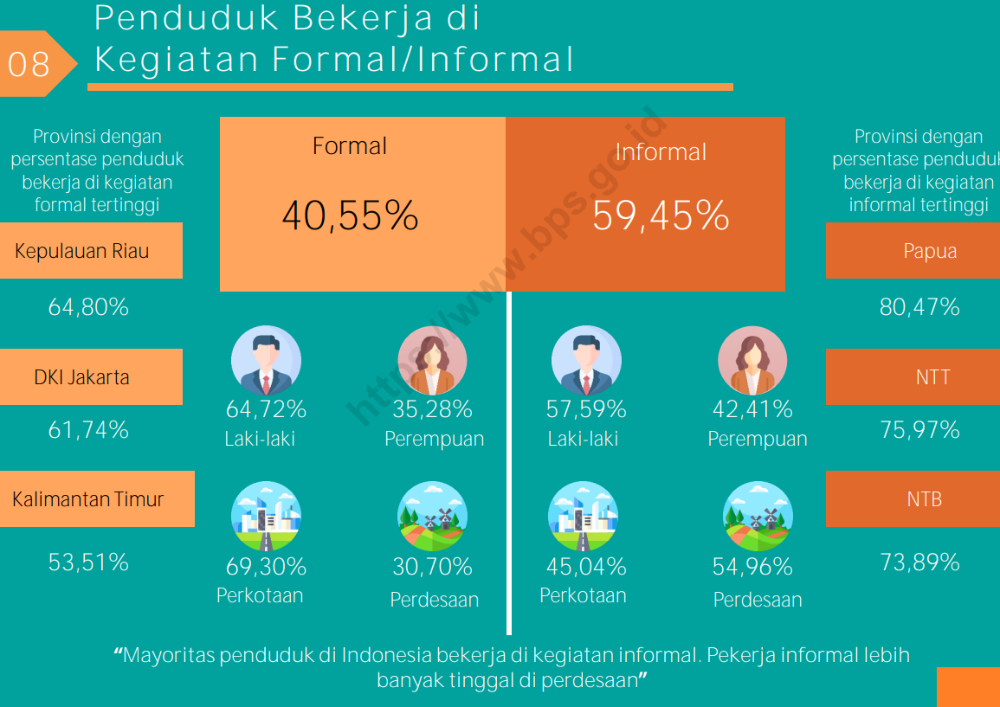

29

Agustus 2021

---

## Slide 30

30

Klasifikasi lapangan pekerjaan disajikan dalam 17 kategori yang mengacu pada Klasifikasi Baku Lapangan Usaha Indonesia (KBLI) 2020 yang berdasarkan International Standard Industrial Classsification (ISIC) revisi 4.

Lapangan Usaha/Pekerjaan

A. Pertanian, kehutanan, dan perikanan; 
B. Pertambangan dan penggalian; 
C. Industri pengolahan; 
D. Pengadaan listrik dan gas; 
E. Treatment air, treatment air limbah, treatment dan pemulihan material sampah, dan aktivitas remediasi; 
F. Konstruksi; 
G. Perdagangan besar dan eceran; Reparasi mobil dan sepeda motor; 
H. Pengangkutan dan pergudangan;

I. Penyediaan akomodasi dan makan minum; 
J. Informasi dan komunikasi; 
K. Aktivitas keuangan dan asuransi; 
L. Real estat; 
M,N. Jasa perusahaan; 
O. Administrasi pemerintahan, pertahanan, dan jaminan sosial wajib; 
P. Pendidikan; 
Q. Aktivitas kesehatan manusia dan aktivitas sosial; 
R,S,T,U.Jasa lainnya.

---

## Slide 31

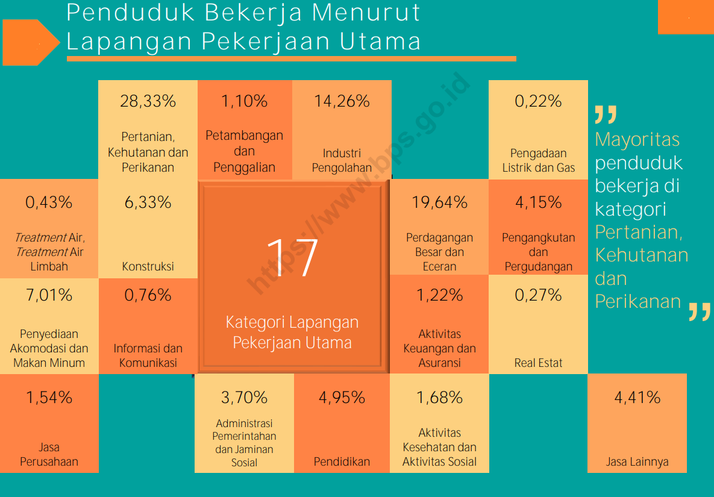

31

Agustus 2021

---

## Slide 32

32

Jenis/jabatan pekerjaan adalah macam pekerjaan dari mereka yang sedang atau pernah bekerja (Klasifikasi Jabatan Indonesia (KJI), 1982):
Tenaga profesional, teknisi dan yang sejenis
Tenaga kepemimpinan dan ketatalaksanaan
Tenaga tata usaha dan tenaga yang sejenis
Tenaga usaha penjualan
Tenaga usaha jasa
Tenaga usaha pertanian, kehutanan, perburuan & perikanan
Tenaga produksi, operator alat angkutan, dan pekerja kasar
Tenaga lainnya

Jenis Pekerjaan: dibedakan atas  8 golongan besar

---

## Slide 33

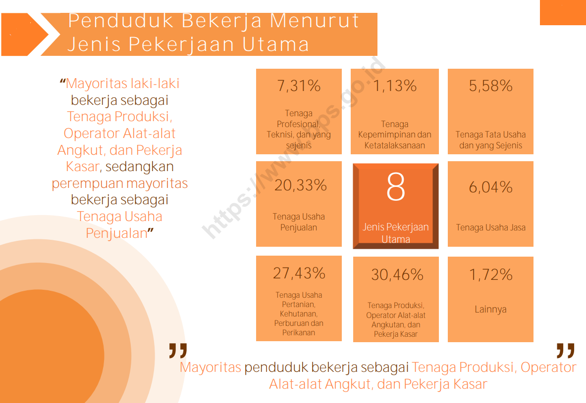

33

Agustus 2021

---

## Slide 34

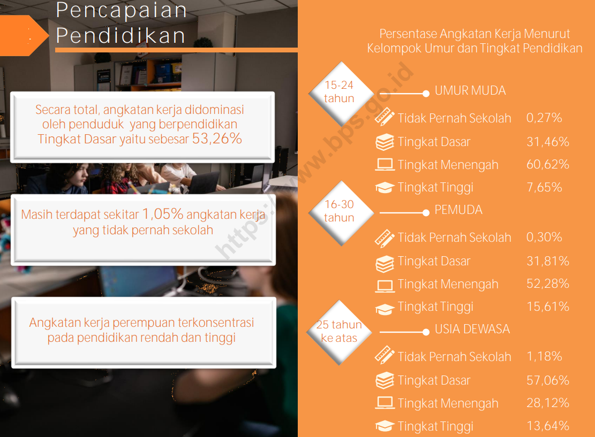

34

Agustus 2021

---

## Slide 35

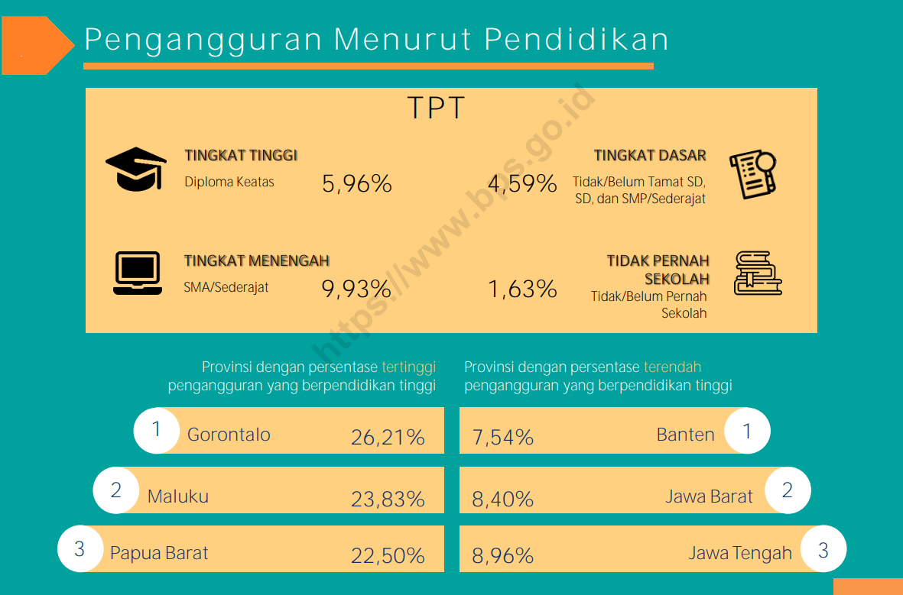

35

Agustus 2021

---

## Slide 36

36

Indikator Pendidikan

---

## Slide 37

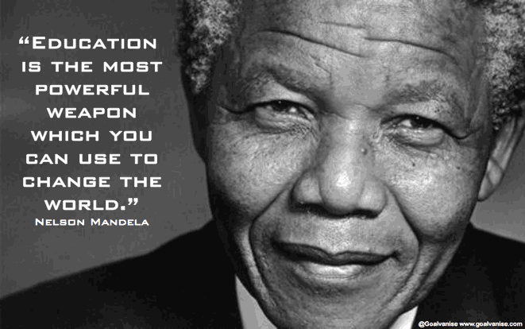

> *[Hasil OCR]:*
“EDUCATION
IS THE MOST
POWERFUL
WEAPON
WHICH YOU
CAN USE TO
CHANGE THE
WORLD.”

NELSON MANDELA

---

## Slide 38

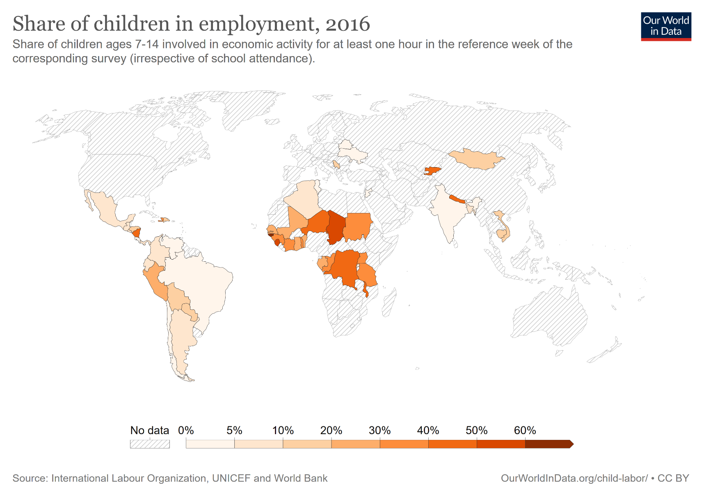

> *[Hasil OCR]:*
Share of children in employment, 2016

Share of children ages 7-14 involved in economic activity for at least one hour in the reference week of the
corresponding survey (irrespective of school attendance).

No data 0% 5% 10% 20% 30% 40Yo 50% 60%
va | |

Source: International Labour Organization, UNICEF and World Bank OurWorldInData.org/child-labor/ * CC BY

---

## Slide 39

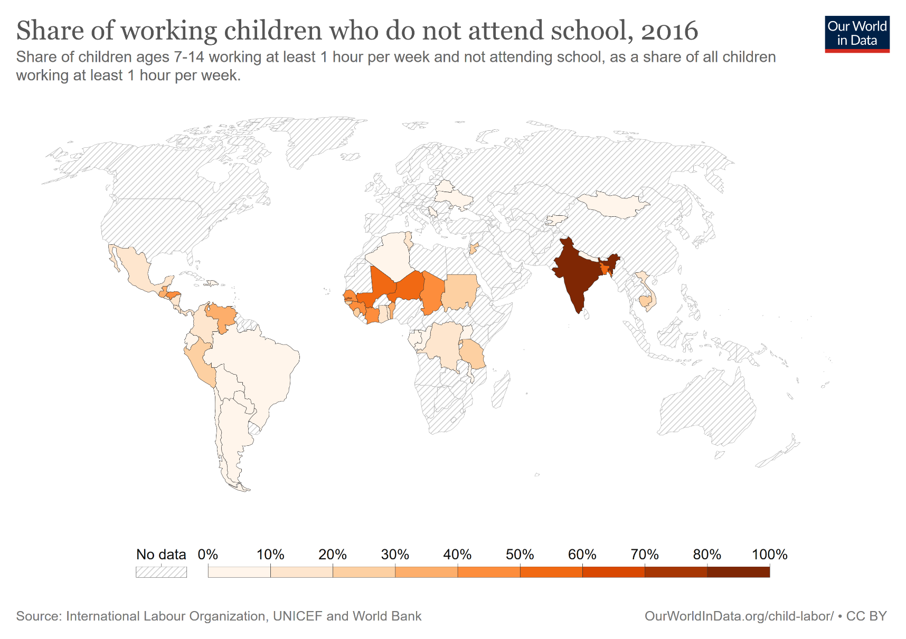

> *[Hasil OCR]:*
Share of children ages 7-14 working at least 1 hour per week and not attending school, as a share of all children
working at least 1 hour per week.

Share of working children who do not attend school, 2016

Our World
in Data

No data 0% 10% 20%
0222272 | |

30%

40%

50% 60% 70% 80%

100%
Source: International Labour Organization, UNICEF and World Bank

OurWorldInData.org/child-labor/ * CC BY

---

## Slide 40

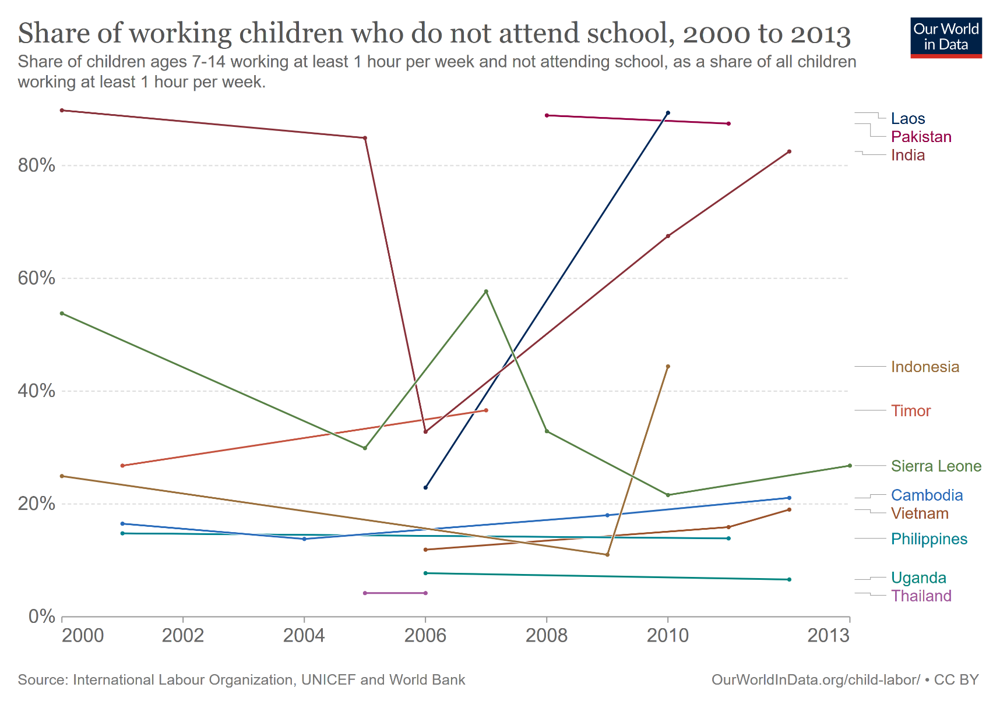

> *[Hasil OCR]:*
Share of working children who do not attend school, 2000 to 2013

Share of children ages 7-14 working at least 1 hour per week and not attending school, as a share of all children
working at least 1 hour per week.

— Laos
Pakistan
80% — India
60%
4 —— Indonesia
40%
YA —— Timor
/
—— Sierra Leone
—— Cambodia
20% ““— Vietnam
3 —— —— Philippines
——vc— —— Uganda
—— Thailand
0% « T T | 1 1 1
2000 2002 2004 2006 2008 2010 2013

Source: International Labour Organization, UNICEF and World Bank OurWorldInData.org/child-labor/ * CC BY

---

## Slide 41

Kenapa perlu informasi pendidikan?

41

Pendidikan kunci kemajuan suatu bangsa
Peningkatan pendidikan =>peningkatan kualitas SDM
Peningkatan kualitas SDM mendorong percepatan pembangunan suatu bangsa
Education is one of the most powerful instruments for reducing poverty and inequality and lays a foundation for sustained economic growth (worldbank.org)
Untuk perencanaan dan evaluasi pembangunan pendidikan perlu adanya indikator pendidikan

---

## Slide 42

42

Sistem Pendidikan di Indonesia

UU Nomor 20 Tahun 2003 tentang Sistem Pendidikan Nasional
Pasal 1
8. Jenjang pendidikan adalah tahapan pendidikan yang ditetapkan berdasarkan tingkat perkembangan peserta didik, tujuan yang akan dicapai, dan kemampuan yang dikembangkan.
10. Satuan pendidikan adalah kelompok layanan pendidikan yang menyeleng-garakan pendidikan pada jalur formal, nonformal, dan informal pada setiap jenjang dan jenis pendidikan.

---

## Slide 43

43

Sistem Pendidikan di Indonesia

UU Nomor 20 Tahun 2003 tentang Sistem Pendidikan Nasional
Pasal 3
Pendidikan nasional berfungsi mengembangkan kemampuan dan membentuk watak serta peradaban bangsa yang bermartabat dalam rangka mencerdaskan kehidupan bangsa, bertujuan untuk berkembangnya potensi peserta didik agar menjadi manusia yang beriman dan bertakwa kepada Tuhan Yang Maha Esa, berakhlak mulia, sehat, berilmu, cakap, kreatif, mandiri, dan menjadi warga negara yang demokratis serta bertanggung jawab.

---

## Slide 44

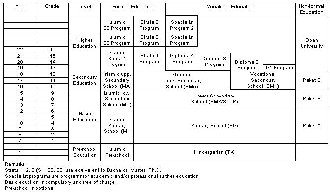

44

Educational system: Indonesia

---

## Slide 45

45

Issu utama bidang pendidikan [1]

Perluasan akses ==> peningkatan kualitas
Ujian akhir untuk pemetaan kualitas lulusan
Sertifikasi guru untuk peningkatan kualitas proses belajar-mengajar
Pergeseran prioritas
Pendidikan Dasar ==> Pendidikan Menengah [wajar 9 thn => wajar 12 thn]
Pendidikan Menengah ==> Pendidikan Tinggi [kualitas SDM]
Pendidikan ketrampilan ==> pendidikan ketrampilan hidup (lifeskill training)
Perluasan kesempatan kerja:  pekerja ==> pengusaha [penciptaan kesempatan kerja yang lebih luas]

---

## Slide 46

46

Issu utama bidang pendidikan [2]

Akses pada pendidikan dasar dan menengah
Program kesetaraan, Paket A, Paket B, Paket C
Pendirian sekolah umum dan kejuruan
Pendirian sekolah umum berbasis agama islam, madrasah
Program khusus untuk daerah terluar, perbatasan
Peningkatan kualitas SDM melalui perluasan akses pada pendidikan tinggi
Pendirian baru universitas negeri
Pendirian fakultas/jurusan/prodi baru
Pendirian politeknik untuk umum maupun oleh K/L
Perluasan program pada Universitas Terbuka 
Peningkatan mutu tenaga kependidikan dan lembaga pendidikan
Sertifikasi tenaga kependidikan
Akreditasi lembaga pendidikan

---

## Slide 47

47

Hubungan antar Indikator Pendidikan

---

## Slide 48

48

pendidikan dan kualitas manusia:identifikasi determinan (contoh)

---

## Slide 49

49

Indikator dalam Neraca Pendidikan(contoh)

| JENIS | DEFINISI | CONTOH |
| --- | --- | --- |
| Rujukan | Kelompok sasaran pendidikan PAUD, dasar, menengah, …. | Penduduk usia sesuai jenjang pendidikan: 3-6, 7-12, 13-15, 16-18 |
| Input | Sumberdaya digunakan dalam penyelenggaraan pendidikan | Rasio murid/sekolah, rasio murid/guru, dll |
| Proses | Partisipasi kelompok sasaran dalam program dan kegiatan | Angka partisipasi: APM, APK, APS |
| Output | Hasil penyelenggaraan pendidikan | % lulus, % melanjutkan, |
| Outcome | Dampak pada masyarakat dan kelompok sasaran | Angka putus sekolah, % melek huruf, rata-rata lama sekolah |

---

## Slide 50

50

Indikator pokok pendidikan

| Jenis Indikator | Indikator | Relevansi |
| --- | --- | --- |
| Rujukan | Jumlah penduduk usia sekolah (PAUD, SD, SMP, SMA/K, Perti) | Kelompok sasaran program |
| Input | Rasio murid/guru, Rasio murid/kelas, Rasio murid/sekolah, Rasio rombel/kelas semua menurut jenjang pendidikan | Ketersediaan/ kecukupan sarana dan prasarana |
| Proses | Angka partisipasi Murni/Kasar/Sekolah menurut jenjang pendidikan | Partisipasi program pendidikan |
| Output | % penduduk yang lulus menurut jenjang pendidikan, % penduduk 13/16/19/24 tahun+ menurut tingkat pendidikan, % murid mengulang menurut jenjang | Hasil program pendidikan |
| Outcome | % penduduk 10 tahun + melek huruf, Angka putus sekolah, Rata2 lama sekolah | Kualitas penduduk, sdm secara umum |

---

## Slide 51

51

INDIKATOR PENDIDIKAN UNTUK SDGS DALAM SUSENAS

| No | Kode Indikator | Nama Indikator |
| --- | --- | --- |
| 1 | 1.4.1.(g) | Rasio Angka Partisipasi Murni (APM) perempuan/laki-laki di SD/MI/sederajat |
| 2 | 1.4.1.(h) | APMperempuan/laki-laki di SMP/MTs/sederajat |
| 3 | 1.4.1.(i) | APM perempuan/laki-laki di SMA/MA/sederajat |

TARGET 1.4
By 2030, ensure that all men and women, in particular the poor and the vulnerable, have equal rights to economic resources, as well as access to basic services, ownership and control over land and other forms of property, inheritance, natural resources, appropriate new technology and financial services, including microfinance

---

## Slide 52

52

INDIKATOR PENDIDIKAN UNTUK SDGS DALAM SUSENAS

TARGET 4.1
By 2030, ensure that all girls and boys complete free, equitable and quality primary and secondary education leading to relevant and effective learning outcomes

| No | Kode Indikator | Nama Indikator |
| --- | --- | --- |
| 1 | 4.1.1(d) | Angka Partisipasi Kasar (APK) SD/MI/sederajat. |
| 2 | 4.1.1(e) | Angka Partisipasi Kasar (APK) SMP/MTs/sederajat. |
| 3 | 4.1.1(f) | Angka Partisipasi Kasar (APK) SMA/SMK/MA/sederajat. |
| 4 | 4.1.1(g) | Rata-rata lama sekolah penduduk umur ≥15 tahun. |

---

## Slide 53

53

INDIKATOR PENDIDIKAN UNTUK SDGS DALAM SUSENAS

TARGET 4.2
By 2030, ensure that all girls and boys have access to quality early childhood development, care and pre-primary education so that they are ready for primary education

| No | Kode Indikator | Nama Indikator |
| --- | --- | --- |
| 1 | 4.2.2(a) | Angka Partisipasi Kasar (APK) Pendidikan Anak Usia Dini (PAUD). |

---

## Slide 54

54

INDIKATOR PENDIDIKAN UNTUK SDGS DALAM SUSENAS

TARGET 4.3
By 2030, ensure equal access for all women and men to affordable and quality technical, vocational and tertiary education, including university

| No | Kode Indikator | Nama Indikator |
| --- | --- | --- |
| 1 | 4.3.1(a) | Angka Partisipasi Kasar (APK) SMA/SMK/MA/sederajat. |
| 2 | 4.3.1(b) | Angka Partisipasi Kasar (APK) Perguruan Tinggi (PT). |

---

## Slide 55

55

INDIKATOR PENDIDIKAN UNTUK SDGS DALAM SUSENAS

TARGET 4.5
By 2030, eliminate gender disparities in education and ensure equal access to all levels of education and vocational training for the vulnerable, including persons with disabilities, indigenous peoples and children in vulnerable situations

| No | Kode Indikator | Nama Indikator |
| --- | --- | --- |
| 1 | 4.5.1* | APM perempuan/laki-laki di (1) SD/MI/sederajat;  (2) SMP/MTs/sederajat; (3)  SMA/SMK/MA/sederajat; dan (4) Rasio APK  perempuan/laki-laki di PT. |

---

## Slide 56

56

INDIKATOR PENDIDIKAN UNTUK SDGS DALAM SUSENAS

TARGET 4.6
By 2030, ensure that all youth and a substantial proportion of adults, both men and women, achieve literacy and numeracy

| No | Kode Indikator | Nama Indikator |
| --- | --- | --- |
| 1 | 4.6.1(a) | Persentase angka melek aksara penduduk umur ≥15 tahun. |
| 2 | 4.6.1(b) | Persentase angka melek aksara penduduk umur 15-24 tahun dan umur 15-59 tahun. |

---

## Slide 57

57

Angka Melek Huruf

Melek huruf: dapat membaca dan menulis kata-kata/kalimat sederhana dalam aksara tertentu.
Beberapa catatan mengenai konsep melek huruf (BPS):
Orang buta yang dapat membaca dan menulis huruf braille digolongkan dapat membaca dan menulis huruf latin.
Orang cacat yang sebelumnya dapat membaca dan menulis, kemudian karena cacatnya tidak dapat membaca dan menulis digolongkan dapat membaca dan menulis.
Orang yang hanya dapat membaca saja tetapi tidak dapat menulis atau sebaliknya, dianggap tidak dapat membaca dan menulis.

---

## Slide 58

Angka Melek Huruf

58

dimana:
AMH15+ 	= Angka Melek Huruf usia 15 tahun keatas
MH15+ 		= Jumlah penduduk usia 15 tahun ke atas yang melek huruf
P15+ 		= Jumlah penduduk usia 15 tahun ke atas

---

## Slide 59

Angka Melek Huruf

59

| Kondef | : | Proporsi penduduk berusia 15 tahun ke atas yang memiliki kemampuan membaca dan menulis kalimat sederhana dalam huruf latin, huruf arab, dan huruf lainnya (seperti huruf jawa, kanji, dll) terhadap penduduk usia 15 tahun ke atas. |
| --- | --- | --- |
| Kegunaan | : | Melihat pencapaian indikator dasar yang telah dicapai oleh suatu daerah, karena membaca merupakan dasar utama dalam memperluas ilmu pengetahuan. AMH merupakan indikator penting untuk melihat sejauh mana penduduk suatu daerah terbuka terhadap pengetahuan. |
| Interpretasi | : | Angka melek huruf berkisar antara 0-100. Tingkat melek huruf yang tinggi menunjukkan adanya sebuah sistem pendidikan dasar yang efektif dan atau program keaksaraan yang memungkinkan sebagian besar penduduk untuk memperoleh kemampuan menggunakan kata-kata tertulis dalam kehidupan sehari-hari dan melanjutkan pembelajaran. Contoh: AMH Kabupaten Jepara Tahun 2013 sebesar 92,93 persen, artinya sekitar 93 persen penduduk di Kabupaten Jepara yang berumur 15 tahun ke atas dapat membaca dan menulis huruf latin atau huruf lainnya. |
| Sumber data | : | SUSENAS |

---

## Slide 60

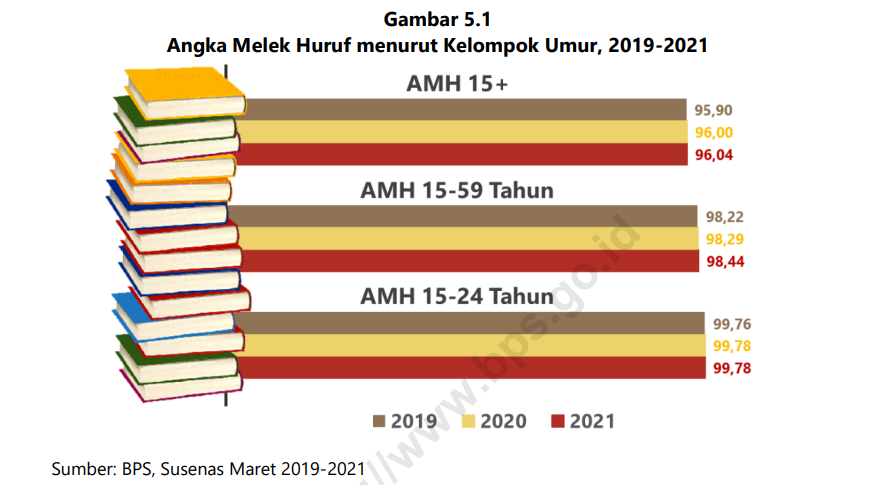

> *[Hasil OCR]:*
Gambar 5.1
Angka Melek Huruf menurut Kelompok Umur, 2019-2021

Th AMH 15+

95,90

96,04

AMH 15-59 Tahun

98,22

98,44

AMH 15-24 Tahun

99,76

99,78

™ 2019 2020 ™2021

Sumber: BPS, Susenas Maret 2019-2021

---

## Slide 61

61

Partisipasi Pendidikan

Ditinjau dari kegiatan pendidikan formal, penduduk dapat dibedakan ke dalam: (1) Tidak/belum pernah sekolah, (2) Sedang bersekolah, (3) Tidak bersekolah lagi
Tidak/belum pernah bersekolah adalah tidak pernah atau belum pernah terdaftar dan tidak/belum pernah aktif mengikuti pendidikan baik di suatu jenjang pendidikan formal maupun non formal (Paket A/B/C), termasuk juga yang tamat/belum tamat taman kanak-kanak tetapi tidak melanjutkan ke sekolah dasar.
Masih bersekolah adalah mereka yang terdaftar dan aktif mengikuti pendidikan baik di suatujenjang pendidikan formal maupun non formal (Paket A/B/C), yang berada di bawah pengawasan Kemdikbud, Kementrian Agama (Kemenag), Instansi Negeri lain maupun Instansi Swasta.
Tidak bersekolah lagi adalah pernah terdaftar dan aktif mengikuti pendidikan baik di suatu jenjang pendidikan formal maupun non formal (Paket A/B/C), tetapi pada saat pencacahan tidak lagi terdaftar dan tidak lagi aktif.

---

## Slide 62

62

Angka Partisipasi dalam Pendidikan

3 jenjang pendidikan pendidikan formal
Pendidikan dasar: SD dan SMP (7-12 tahun) dan (13-15 tahun)
Pendidikan menengah: SMA/K (16-18) 
Pendidikan tinggi (19-24 tahun) 
Angka Partisipasi Murni [APM] 
kesesuaian umur dan jenjang pendidikan
Angka Partisipasi Kasar [APK] 
Jumlah anak sekolah pada setiap jenjang dibagi jumlah anak pada jenjang usia pendidikan yang sama
Angka Partisipasi Sekolah (APS) 
kesesuaian jenjang pendidikan tidak diperhatikan => tujuan untuk melihat partisipasi sekolah
adalah proporsi anak pada kelompok usia tertentu yang masih sekolah dibandingkan dengan anak pada kelompok usia yang sama

---

## Slide 63

63

APS 7-12 =   -------------------------------------------------------  x 100

ANGKA PARTISIPASI SEKOLAH (APS)

Jumlah penduduk 7-12 tahun bersekolah

Jumlah penduduk usia 7-12 tahun

APS 13-15 =  ---------------------------------------------------------  x 100

Jumlah penduduk 13-15 tahun bersekolah

Jumlah penduduk usia 13-15 tahun

APS 16-18 =  ---------------------------------------------------------  x 100

Jumlah penduduk 16-18 tahun bersekolah

Jumlah penduduk usia 16-18 tahun

APS 19-24 =  ---------------------------------------------------------  x 100

Jumlah penduduk 19-24 tahun bersekolah

Jumlah penduduk usia 19-24 tahun

---

## Slide 64

ANGKA PARTISIPASI SEKOLAH (APS)

64

| Kondef | : | Proporsi dari semua anak yang masih sekolah pada suatu kelompok umur tertentu terhadap penduduk dengan kelompok umur yang sesuai. Sejak Tahun 2009, Pendidikan Non Formal (Paket A, Paket B, dan Paket C) turut diperhitungkan. |
| --- | --- | --- |
| Kegunaan | : | Untuk mengetahui seberapa banyak penduduk usia sekolah yang sudah memanfaatkan fasilitas pendidikan. |
| Interpretasi | : | Menggambarkan seberapa banyak penduduk usia sekolah yang sudah memanfaatkan fasilitas pendidikan. |
| Sumber data | : | SUSENAS |

---

## Slide 65

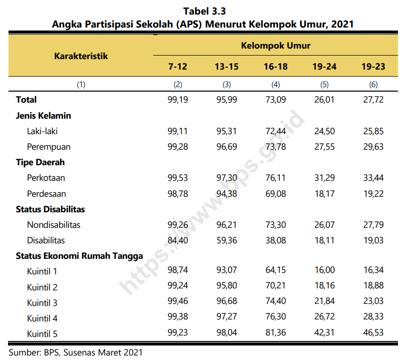

> *[Hasil OCR]:*
Tabel 3.3
Angka Partisipasi Sekolah (APS) Menurut Kelompok Umur, 2021

(0) 2 8 @ ©

Total 99,19 95,99 73,09 26,01 27,72
Jenis Kelamin
Laki-laki 99,11 95,31 72,44 24,50 25,85
Perempuan 99,28 96,69 73,78 27,55 29,63
Tipe Daerah
Perkotaan 99,53 97,30 76,11 31,29 33,44
Perdesaan 98,78 94,38 69,08 18,17 19,22
Status Disabilitas
Nondisabilitas 99,26 96,21 73,30 26,07 27,79
Disabilitas 84,40 59,36 38,08 18,11 19,03
Status Ekonomi Rumah Tangga
Kuintil 1 93,07 64,15 16,34
Kuintil 2 95,80 70,21 18,88
Kuintil 3 96,68 74,40 23,03
Kuintil 4 97,27 76,30 28,33
Kuintil 5 98,04 46,53

Sumber: BPS, Susenas Maret 2021

---

## Slide 66

66

APK SD =  -----------------------------------------------  x 100

ANGKA PARTISIPASI KASAR (APK)

Jumlah murid SD

Jumlah penduduk usia 7-12 tahun

APK SMP  =   ------------------------------------------------  x 100

Jumlah murid SMP

Jumlah penduduk usia 13-15 tahun

APK SM  =  ------------------------------------------------- x 100

Jumlah murid SMA

Jumlah penduduk usia 16-18 tahun

APK Perti  =  ------------------------------------------------  x 100

Jumlah mahasiswa

Jumlah penduduk usia 19-24 tahun

---

## Slide 67

ANGKA PARTISIPASI KASAR (APK)

67

| Kondef | : | Perbandingan antara jumlah penduduk yang masih bersekolah di jenjang pendidikan tertentu (tanpa memandang usia penduduk tersebut) dengan jumlah penduduk yang memenuhi syarat resmi penduduk usia sekolah di jenjang pendidikan yang sama. Sejak tahun2007, Pendidikan Non Formal (Paket A, Paket B, dan Paket C) turut diperhitungkan. |
| --- | --- | --- |
| Kegunaan | : | Untuk menunjukkan berapa besar umumnya tingkat partisipasi penduduk pada suatu tingkat pendidikan. Untuk menunjukkan berapa besar kapasitas sistem pendidikan dapat menampung siswa dari kelompok usia sekolah tertentu. - Sebagai indikator pelengkap dari indikator Angka Partisipasi Murni (APM), sehingga dapat ditunjukkan besarnya penduduk yang bersekolah pada suatu jenjang namun usianya belum mencukupi atau bahkan melebihi dari usia sekolah yang seharusnya. |
| Interpretasi | : | Nilai APK bisa lebih dari 100 persen karena populasi murid yang bersekolah pada suatu jenjang pendidikan tertentu mencakup anak di luar batas usia sekolah pada jenjang pendidikan tersebut. Penyebabnya adalah adanya pendaftaran siswa usia dini, pendaftaran siswa yang telat bersekolah, atau pengulangan kelas. Hal ini juga dapat menunjukkan bahwa wilayah tersebut mampu menampung penduduk usia sekolah lebih dari target yang sesungguhnya. APK yang tinggi menunjukkan tingginya tingkat partisipasi sekolah, tanpa memperhatikan ketepatan usia sekolah pada jenjang pendidikannya. Contoh: APK SM Kota Banda Aceh Tahun 2013 sebesar 61,32 persen, artinya persentase penduduk berusia 16-18 tahun di Kota Banda Aceh yang bersekolah di tingkat SM sekitar 61 persen. |
| Sumber data | : | SUSENAS |

---

## Slide 68

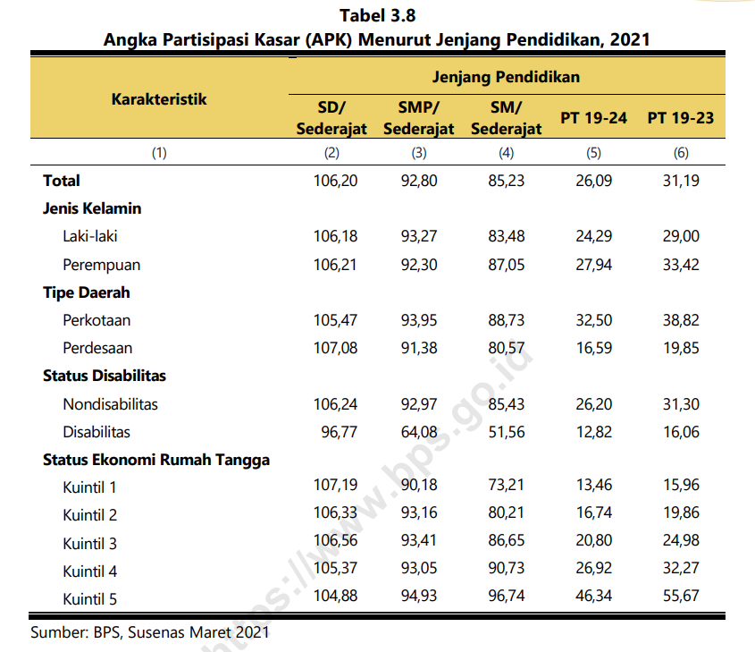

> *[Hasil OCR]:*
Tabel 3.8
Angka Parti pasi Kasar (APK) Menurut Jenjang Pendidikan, 2021

@) @ (al @ &
Total 10620 9280 85,23 26,09 3119
Jenis Kelamin
Laki-laki 10618 93,27 83,48 24,29 29,00
Perempuan 106,21 92,30 87,05 27,94 33,42
Tipe Daerah
Perkotaan 10547 93,95 88,73 32,50 38,82
Perdesaan 107,08 91,38 80,57 1659 19,85
Status Disabilitas
Nondisabilitas 10624 9297 85,43 26,20 31,30
Disabilitas 9677 6408 51,56 12,82 16,06
Status Ekonomi Rumah Tangga
Kuintil 1 10719 90,18 73,21 13,46 15,96
Kuintil 2 10633 9316 80,21 16,74 19,86
Kuintil 3 10656 © 93,41 86,65 20,80 24,98
Kuintil 4 10537 93,05 90,73 26,92 32,27
Kuintil 5 10488 = 9493 96,74 4634 55,67

Sumber: BPS, Susenas Maret 2021

---

## Slide 69

69

APM SD =  -----------------------------------------------  x 100

ANGKA PARTISIPASI MURNI (APM)

Jumlah murid SD umur  7-12 tahun

Jumlah penduduk usia 7-12 tahun

APM SMP  =  --------------------------------------------------  x 100

Jumlah murid SMP umur 13-15 tahun

Jumlah penduduk usia 13-15 tahun

APM SM  =  ---------------------------------------------------  x 100

Jumlah murid SMA umur 16-18 tahun

Jumlah penduduk usia 16-18 tahun

APM Perti  =  ---------------------------------------------------  x 100

Jumlah mahasiswa umur 19-24 tahun

Jumlah penduduk usia 19-24 tahun

---

## Slide 70

ANGKA PARTISIPASI MURNI (APM)

70

| Kondef | : | Proporsi dari penduduk kelompok usia sekolah tertentu yang sedang bersekolah tepat di jenjang pendidikan yang seharusnya (sesuai antara umur penduduk dengan ketentuan usia bersekolah di jenjang tersebut) terhadap penduduk kelompok usia sekolah yang bersesuain. Sejak tahun 2007, Pendidikan Non Formal (Paket A, Paket B, Paket C) turut diperhitungkan. |
| --- | --- | --- |
| Kegunaan | : | Untuk menunjukkan seberapa besar penduduk yang bersekolah tepat waktu, atau menunjukkan seberapa besar penduduk yang bersekolah dengan umur yang sesuai dengan ketentuan kelompok usia sekolah di jenjang pendidikan yang sedang ditempuh. |
| Interpretasi | : | Nilai APM berkisar antara 0-100. APM menunjukkan seberapa banyak penduduk usia sekolah yang sudah dapat memanfaatkan fasilitas pendidikan sesuai pada jenjang pendidikannya. Bila seluruh anak usia sekolah dapat bersekolah tepat waktu, maka APM akan mencapai 100 persen. Secara umum, APM akan selalu lebih rendah dari APK karena APK memperhitungkan jumlah penduduk di luar usia sekolah pada jenjang pendidikan yang bersangkutan Contoh: APM SMP Kabupaten Deli Serdang Tahun 2013 sebesar 64,71 persen, artinya sekitar 65 persen penduduk di Kabupaten Deli Serdang yang berusia 13-15 tahun bersekolah tepat waktu dijenjang SMP/sederajad. |
| Sumber data | : | SUSENAS |

---

## Slide 71

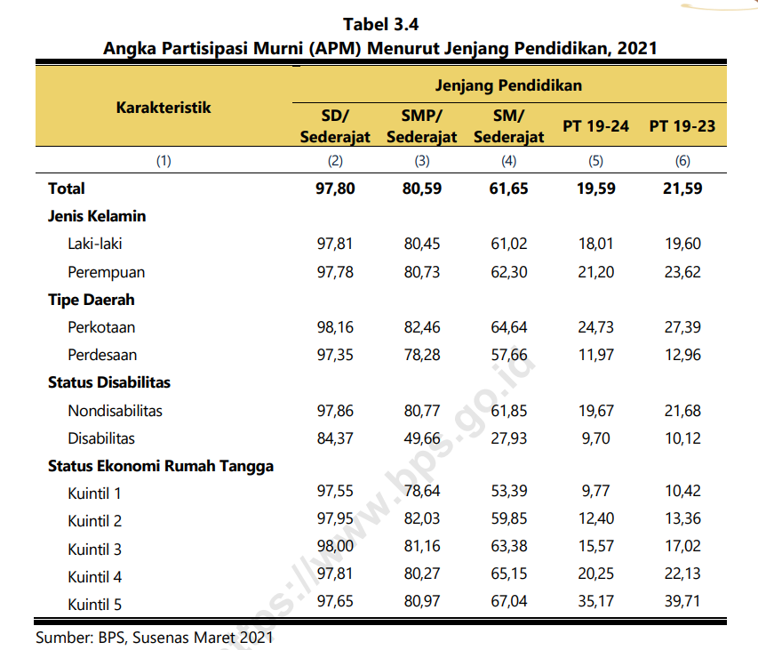

> *[Hasil OCR]:*
Tabel 3.4
(APM) Menurut Jenjang Pen

Kol 2 8 @

Total 97,80 80,59 61,65 19,59 21,59
Jenis Kelamin
Laki-laki 97,81 80,45 61,02 18,01 19,60
Perempuan 97,78 80,73 62,30 21,20 23,62
Tipe Daerah
Perkotaan 98,16 82,46 64,64 24,73 27,39
Perdesaan 97,35 78,28 57,66 11,97 12,96
Status Disabilitas
Nondisabilitas 97,86 80,77 61,85 19,67 21,68
Disabilitas 84,37 49,66 27,93 9,70 10,12
Status Ekonomi Rumah Tangga
Kuintil 1 97,55 9,77 10,42
Kuintil 2 97,95 12,40 13,36
Kuintil 3 98,00 15,57 17,02
Kuintil 4 97,81 20,25 22,13
Kuintil 5

Sumber: BPS, Susenas Maret 2021

---

## Slide 72

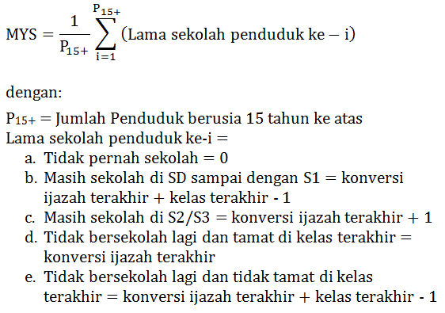

72

Rata-rata Lama Sekolah (MYS)

---

## Slide 73

Rata-rata Lama Sekolah (MYS)

73

| Kondef | : | Jumlah tahun belajar penduduk usia 15 tahun ke atas yang telah diselesaikan dalam pendidikan formal (tidak termasuk tahun yang mengulang). Untuk menghitung Rata-rata Lama Sekolah dibutuhkan informasi: a. Partsipasi sekolah b. Jenjang dan jenis pendidikan yang pernah/sedang diduduki c. Ijasah tertinggi yang dimiliki d. Tingkat/kelas tertinggi yang pernah/sedang diduduki. |
| --- | --- | --- |
| Kegunaan | : | Untuk melihat kualitas penduduk dalam hal mengenyam pendidikan formal. |
| Interpretasi | : | Tingginya angka Rata-rata Lama Sekolah (MYS) menunjukkan jenjang pendidikan yang pernah/sedang diduduki oleh seseorang. Semakin tinggi angka MYS maka semakin lama/tinggi jenjang pendidikan yang ditamatkannya. |
| Sumber data | : | SUSENAS |

---

## Slide 74

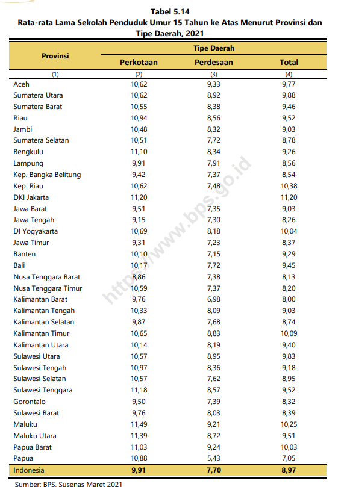

> *[Hasil OCR]:*
Tabel 5.14
Rata-rata Lama Sekolah Penduduk Umur 15 Tahun ke Atas Menurut Provinsi dan

Tipe Daerah, 2021

ro @ & &
‘Aceh 1062 933 877
Sumatera Utara 1062 892 988
Sumatera Barat 1055 838 946
Riau 1094 856 952
Jambi 1048 832 903
Sumatera Selatan 1051 112 878
Bengkulu 11,10 834 926
Lampung 991 791 856
Kep. Bangka Belitung 942 737 854
Kep. Riau 1062 748 1038
DKI Jakarta 1120 1120
Jawa Barat 951 735 903
Jawa Tengah 915 730 826
DI Yogyakarta 1069 88 1004
Jawa Timur 931 723 837
Banten 1010 715 929
Bali 1017 112 gas
Nusa Tenggara Barat 386 738 813
Nusa Tenggara Timur 1059 737 820
Kalimantan Barat 976 698 800

1033 809 903

987 768 ara

1065 883, 1009
Kalimantan Utara 1014 819 940
Sulawesi Utara 1057 895 983
Sulawesi Tengah 1097 836 918

1057 162 895
Sulawesi Tenggara 1118 857 952
Gorontalo 950 739 832
Sulawesi Barat 976 803, 839
Maluku 1149 921 1025
Maluku Utara 11,39 372 951
Papua Barat 11,03 924 1003
Papua 1088 543 705

TC mbar BPS Gucenac Maret 2027

---

## Slide 75

> *[Catatan: Teks digital kosong (<15 karakter). Berisi gambar/visual yang perlu inspeksi visual manual]*

---