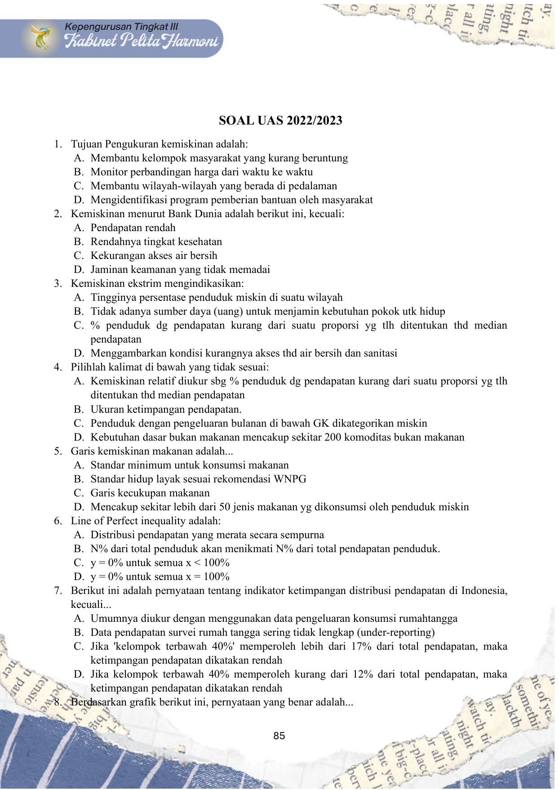
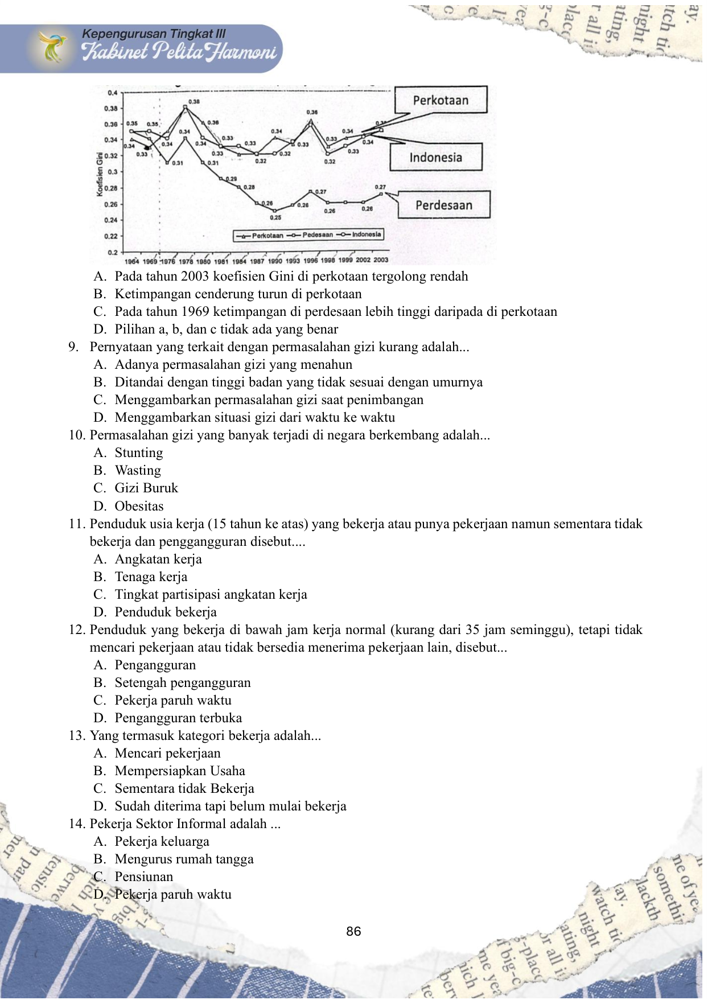
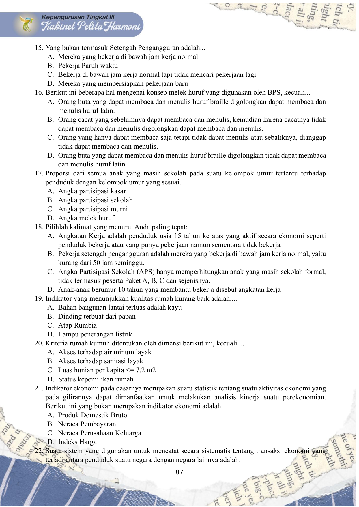
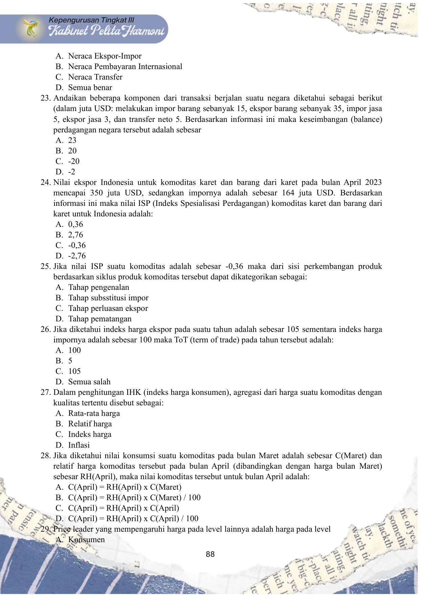
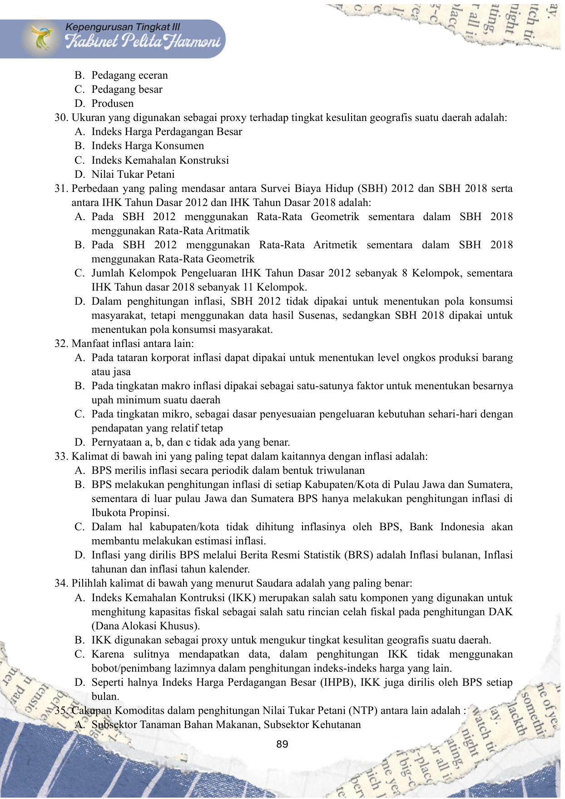
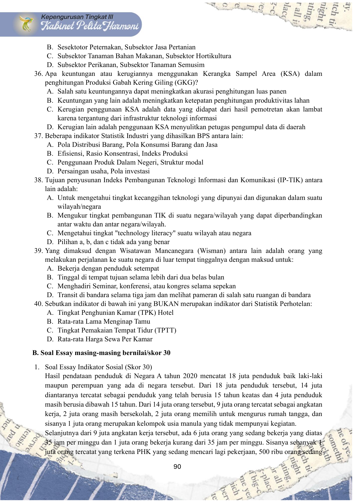
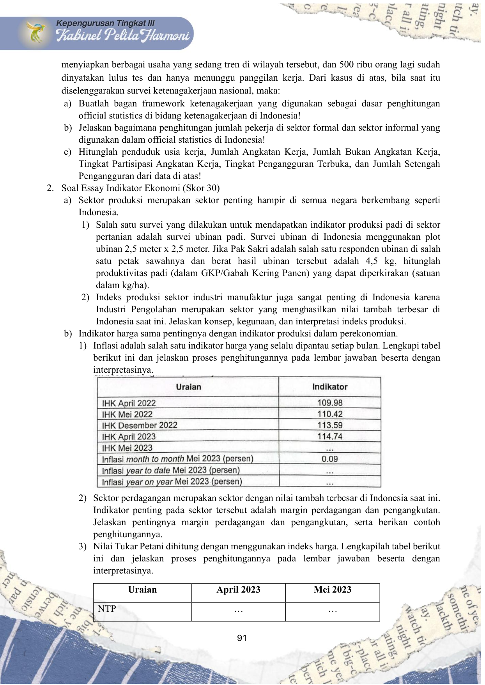
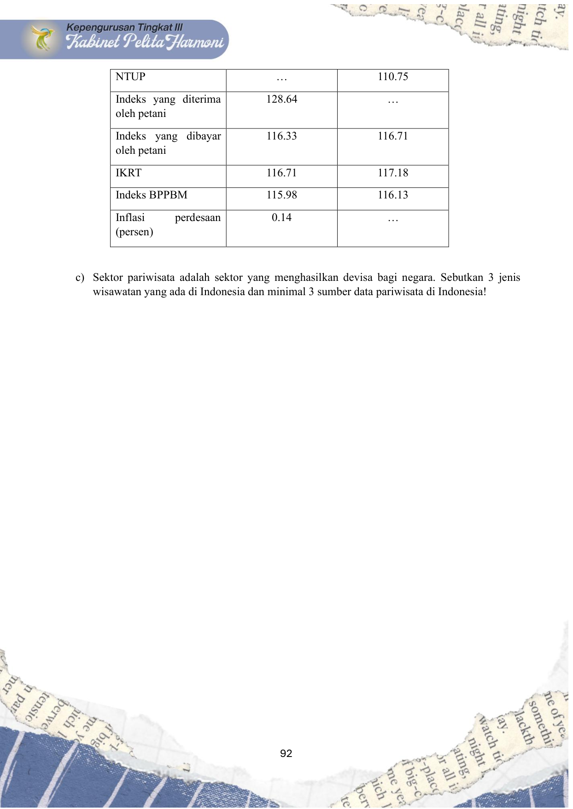

# Soal UAS 2022-2023.pdf

Sumber Asli: `/home/alfzki/Documents/OSL/materials/past-exams/Soal UAS 2022-2023.pdf`

---

## Halaman 1

85
SOAL UAS 2022/2023
1. Tujuan Pengukuran kemiskinan adalah:
A. Membantu kelompok masyarakat yang kurang beruntung
B. Monitor perbandingan harga dari waktu ke waktu
C. Membantu wilayah-wilayah yang berada di pedalaman
D. Mengidentifikasi program pemberian bantuan oleh masyarakat
2. Kemiskinan menurut Bank Dunia adalah berikut ini, kecuali:
A. Pendapatan rendah
B. Rendahnya tingkat kesehatan
C. Kekurangan akses air bersih
D. Jaminan keamanan yang tidak memadai
3. Kemiskinan ekstrim mengindikasikan:
A. Tingginya persentase penduduk miskin di suatu wilayah
B. Tidak adanya sumber daya (uang) untuk menjamin kebutuhan pokok utk hidup
C. % penduduk dg pendapatan kurang dari suatu proporsi yg tlh ditentukan thd median
pendapatan
D. Menggambarkan kondisi kurangnya akses thd air bersih dan sanitasi
4. Pilihlah kalimat di bawah yang tidak sesuai:
A. Kemiskinan relatif diukur sbg % penduduk dg pendapatan kurang dari suatu proporsi yg tlh
ditentukan thd median pendapatan
B. Ukuran ketimpangan pendapatan.
C. Penduduk dengan pengeluaran bulanan di bawah GK dikategorikan miskin
D. Kebutuhan dasar bukan makanan mencakup sekitar 200 komoditas bukan makanan
5. Garis kemiskinan makanan adalah...
A. Standar minimum untuk konsumsi makanan
B. Standar hidup layak sesuai rekomendasi WNPG
C. Garis kecukupan makanan
D. Mencakup sekitar lebih dari 50 jenis makanan yg dikonsumsi oleh penduduk miskin
6. Line of Perfect inequality adalah:
A. Distribusi pendapatan yang merata secara sempurna
B. N% dari total penduduk akan menikmati N% dari total pendapatan penduduk.
C. y = 0% untuk semua x < 100%
D. y = 0% untuk semua x = 100%
7. Berikut ini adalah pernyataan tentang indikator ketimpangan distribusi pendapatan di Indonesia,
kecuali...
A. Umumnya diukur dengan menggunakan data pengeluaran konsumsi rumahtangga
B. Data pendapatan survei rumah tangga sering tidak lengkap (under-reporting)
C. Jika 'kelompok terbawah 40%' memperoleh lebih dari 17% dari total pendapatan, maka
ketimpangan pendapatan dikatakan rendah
D. Jika kelompok terbawah 40% memperoleh kurang dari 12% dari total pendapatan, maka
ketimpangan pendapatan dikatakan rendah
8. Berdasarkan grafik berikut ini, pernyataan yang benar adalah...

---

## Halaman 2

86
A. Pada tahun 2003 koefisien Gini di perkotaan tergolong rendah
B. Ketimpangan cenderung turun di perkotaan
C. Pada tahun 1969 ketimpangan di perdesaan lebih tinggi daripada di perkotaan
D. Pilihan a, b, dan c tidak ada yang benar
9. Pernyataan yang terkait dengan permasalahan gizi kurang adalah...
A. Adanya permasalahan gizi yang menahun
B. Ditandai dengan tinggi badan yang tidak sesuai dengan umurnya
C. Menggambarkan permasalahan gizi saat penimbangan
D. Menggambarkan situasi gizi dari waktu ke waktu
10. Permasalahan gizi yang banyak terjadi di negara berkembang adalah...
A. Stunting
B. Wasting
C. Gizi Buruk
D. Obesitas
11. Penduduk usia kerja (15 tahun ke atas) yang bekerja atau punya pekerjaan namun sementara tidak
bekerja dan penggangguran disebut....
A. Angkatan kerja
B. Tenaga kerja
C. Tingkat partisipasi angkatan kerja
D. Penduduk bekerja
12. Penduduk yang bekerja di bawah jam kerja normal (kurang dari 35 jam seminggu), tetapi tidak
mencari pekerjaan atau tidak bersedia menerima pekerjaan lain, disebut...
A. Pengangguran
B. Setengah pengangguran
C. Pekerja paruh waktu
D. Pengangguran terbuka
13. Yang termasuk kategori bekerja adalah...
A. Mencari pekerjaan
B. Mempersiapkan Usaha
C. Sementara tidak Bekerja
D. Sudah diterima tapi belum mulai bekerja
14. Pekerja Sektor Informal adalah ...
A. Pekerja keluarga
B. Mengurus rumah tangga
C. Pensiunan
D. Pekerja paruh waktu

---

## Halaman 3

87
15. Yang bukan termasuk Setengah Pengangguran adalah...
A. Mereka yang bekerja di bawah jam kerja normal
B. Pekerja Paruh waktu
C. Bekerja di bawah jam kerja normal tapi tidak mencari pekerjaan lagi
D. Mereka yang mempersiapkan pekerjaan baru
16. Berikut ini beberapa hal mengenai konsep melek huruf yang digunakan oleh BPS, kecuali...
A. Orang buta yang dapat membaca dan menulis huruf braille digolongkan dapat membaca dan
menulis huruf latin.
B. Orang cacat yang sebelumnya dapat membaca dan menulis, kemudian karena cacatnya tidak
dapat membaca dan menulis digolongkan dapat membaca dan menulis.
C. Orang yang hanya dapat membaca saja tetapi tidak dapat menulis atau sebaliknya, dianggap
tidak dapat membaca dan menulis.
D. Orang buta yang dapat membaca dan menulis huruf braille digolongkan tidak dapat membaca
dan menulis huruf latin.
17. Proporsi dari semua anak yang masih sekolah pada suatu kelompok umur tertentu terhadap
penduduk dengan kelompok umur yang sesuai.
A. Angka partisipasi kasar
B. Angka partisipasi sekolah
C. Angka partisipasi murni
D. Angka melek huruf
18. Pilihlah kalimat yang menurut Anda paling tepat:
A. Angkatan Kerja adalah penduduk usia 15 tahun ke atas yang aktif secara ekonomi seperti
penduduk bekerja atau yang punya pekerjaan namun sementara tidak bekerja
B. Pekerja setengah pengangguran adalah mereka yang bekerja di bawah jam kerja normal, yaitu
kurang dari 50 jam seminggu.
C. Angka Partisipasi Sekolah (APS) hanya memperhitungkan anak yang masih sekolah formal,
tidak termasuk peserta Paket A, B, C dan sejenisnya.
D. Anak-anak berumur 10 tahun yang membantu bekerja disebut angkatan kerja
19. Indikator yang menunjukkan kualitas rumah kurang baik adalah....
A. Bahan bangunan lantai terluas adalah kayu
B. Dinding terbuat dari papan
C. Atap Rumbia
D. Lampu penerangan listrik
20. Kriteria rumah kumuh ditentukan oleh dimensi berikut ini, kecuali....
A. Akses terhadap air minum layak
B. Akses terhadap sanitasi layak
C. Luas hunian per kapita <= 7,2 m2
D. Status kepemilikan rumah
21. Indikator ekonomi pada dasarnya merupakan suatu statistik tentang suatu aktivitas ekonomi yang
pada gilirannya dapat dimanfaatkan untuk melakukan analisis kinerja suatu perekonomian.
Berikut ini yang bukan merupakan indikator ekonomi adalah:
A. Produk Domestik Bruto
B. Neraca Pembayaran
C. Neraca Perusahaan Keluarga
D. Indeks Harga
22. Suatu sistem yang digunakan untuk mencatat secara sistematis tentang transaksi ekonomi yang
terjadi antara penduduk suatu negara dengan negara lainnya adalah:

---

## Halaman 4

88
A. Neraca Ekspor-Impor
B. Neraca Pembayaran Internasional
C. Neraca Transfer
D. Semua benar
23. Andaikan beberapa komponen dari transaksi berjalan suatu negara diketahui sebagai berikut
(dalam juta USD: melakukan impor barang sebanyak 15, ekspor barang sebanyak 35, impor jasa
5, ekspor jasa 3, dan transfer neto 5. Berdasarkan informasi ini maka keseimbangan (balance)
perdagangan negara tersebut adalah sebesar
A. 23
B. 20
C. -20
D. -2
24. Nilai ekspor Indonesia untuk komoditas karet dan barang dari karet pada bulan April 2023
mencapai 350 juta USD, sedangkan impornya adalah sebesar 164 juta USD. Berdasarkan
informasi ini maka nilai ISP (Indeks Spesialisasi Perdagangan) komoditas karet dan barang dari
karet untuk Indonesia adalah:
A. 0,36
B. 2,76
C. -0,36
D. -2,76
25. Jika nilai ISP suatu komoditas adalah sebesar -0,36 maka dari sisi perkembangan produk
berdasarkan siklus produk komoditas tersebut dapat dikategorikan sebagai:
A. Tahap pengenalan
B. Tahap subsstitusi impor
C. Tahap perluasan ekspor
D. Tahap pematangan
26. Jika diketahui indeks harga ekspor pada suatu tahun adalah sebesar 105 sementara indeks harga
impornya adalah sebesar 100 maka ToT (term of trade) pada tahun tersebut adalah:
A. 100
B. 5
C. 105
D. Semua salah
27. Dalam penghitungan IHK (indeks harga konsumen), agregasi dari harga suatu komoditas dengan
kualitas tertentu disebut sebagai:
A. Rata-rata harga
B. Relatif harga
C. Indeks harga
D. Inflasi
28. Jika diketahui nilai konsumsi suatu komoditas pada bulan Maret adalah sebesar C(Maret) dan
relatif harga komoditas tersebut pada bulan April (dibandingkan dengan harga bulan Maret)
sebesar RH(April), maka nilai komoditas tersebut untuk bulan April adalah:
A. C(April) = RH(April) x C(Maret)
B. C(April) = RH(April) x C(Maret) / 100
C. C(April) = RH(April) x C(April)
D. C(April) = RH(April) x C(April) / 100
29. Price leader yang mempengaruhi harga pada level lainnya adalah harga pada level
A. Konsumen

---

## Halaman 5

89
B. Pedagang eceran
C. Pedagang besar
D. Produsen
30. Ukuran yang digunakan sebagai proxy terhadap tingkat kesulitan geografis suatu daerah adalah:
A. Indeks Harga Perdagangan Besar
B. Indeks Harga Konsumen
C. Indeks Kemahalan Konstruksi
D. Nilai Tukar Petani
31. Perbedaan yang paling mendasar antara Survei Biaya Hidup (SBH) 2012 dan SBH 2018 serta
antara IHK Tahun Dasar 2012 dan IHK Tahun Dasar 2018 adalah:
A. Pada SBH 2012 menggunakan Rata-Rata Geometrik sementara dalam SBH 2018
menggunakan Rata-Rata Aritmatik
B. Pada
SBH
2012
menggunakan
Rata-Rata Aritmetik
sementara
dalam
SBH
2018
menggunakan Rata-Rata Geometrik
C. Jumlah Kelompok Pengeluaran IHK Tahun Dasar 2012 sebanyak 8 Kelompok, sementara
IHK Tahun dasar 2018 sebanyak 11 Kelompok.
D. Dalam penghitungan inflasi, SBH 2012 tidak dipakai untuk menentukan pola konsumsi
masyarakat, tetapi menggunakan data hasil Susenas, sedangkan SBH 2018 dipakai untuk
menentukan pola konsumsi masyarakat.
32. Manfaat inflasi antara lain:
A. Pada tataran korporat inflasi dapat dipakai untuk menentukan level ongkos produksi barang
atau jasa
B. Pada tingkatan makro inflasi dipakai sebagai satu-satunya faktor untuk menentukan besarnya
upah minimum suatu daerah
C. Pada tingkatan mikro, sebagai dasar penyesuaian pengeluaran kebutuhan sehari-hari dengan
pendapatan yang relatif tetap
D. Pernyataan a, b, dan c tidak ada yang benar.
33. Kalimat di bawah ini yang paling tepat dalam kaitannya dengan inflasi adalah:
A. BPS merilis inflasi secara periodik dalam bentuk triwulanan
B. BPS melakukan penghitungan inflasi di setiap Kabupaten/Kota di Pulau Jawa dan Sumatera,
sementara di luar pulau Jawa dan Sumatera BPS hanya melakukan penghitungan inflasi di
Ibukota Propinsi.
C. Dalam hal kabupaten/kota tidak dihitung inflasinya oleh BPS, Bank Indonesia akan
membantu melakukan estimasi inflasi.
D. Inflasi yang dirilis BPS melalui Berita Resmi Statistik (BRS) adalah Inflasi bulanan, Inflasi
tahunan dan inflasi tahun kalender.
34. Pilihlah kalimat di bawah yang menurut Saudara adalah yang paling benar:
A. Indeks Kemahalan Kontruksi (IKK) merupakan salah satu komponen yang digunakan untuk
menghitung kapasitas fiskal sebagai salah satu rincian celah fiskal pada penghitungan DAK
(Dana Alokasi Khusus).
B. IKK digunakan sebagai proxy untuk mengukur tingkat kesulitan geografis suatu daerah.
C. Karena
sulitnya
mendapatkan
data,
dalam
penghitungan
IKK
tidak
menggunakan
bobot/penimbang lazimnya dalam penghitungan indeks-indeks harga yang lain.
D. Seperti halnya Indeks Harga Perdagangan Besar (IHPB), IKK juga dirilis oleh BPS setiap
bulan.
35. Cakupan Komoditas dalam penghitungan Nilai Tukar Petani (NTP) antara lain adalah :
A. Subsektor Tanaman Bahan Makanan, Subsektor Kehutanan

---

## Halaman 6

90
B. Sesektotor Peternakan, Subsektor Jasa Pertanian
C. Subsektor Tanaman Bahan Makanan, Subsektor Hortikultura
D. Subsektor Perikanan, Subsektor Tanaman Semusim
36. Apa keuntungan atau kerugiannya menggunakan Kerangka Sampel Area (KSA) dalam
penghitungan Produksi Gabah Kering Giling (GKG)?
A. Salah satu keuntungannya dapat meningkatkan akurasi penghitungan luas panen
B. Keuntungan yang lain adalah meningkatkan ketepatan penghitungan produktivitas lahan
C. Kerugian penggunaan KSA adalah data yang didapat dari hasil pemotretan akan lambat
karena tergantung dari infrastruktur teknologi informasi
D. Kerugian lain adalah penggunaan KSA menyulitkan petugas pengumpul data di daerah
37. Beberapa indikator Statistik Industri yang dihasilkan BPS antara lain:
A. Pola Distribusi Barang, Pola Konsumsi Barang dan Jasa
B. Efisiensi, Rasio Konsentrasi, Indeks Produksi
C. Penggunaan Produk Dalam Negeri, Struktur modal
D. Persaingan usaha, Pola investasi
38. Tujuan penyusunan Indeks Pembangunan Teknologi Informasi dan Komunikasi (IP-TIK) antara
lain adalah:
A. Untuk mengetahui tingkat kecanggihan teknologi yang dipunyai dan digunakan dalam suatu
wilayah/negara
B. Mengukur tingkat pembangunan TIK di suatu negara/wilayah yang dapat diperbandingkan
antar waktu dan antar negara/wilayah.
C. Mengetahui tingkat "technology literacy" suatu wilayah atau negara
D. Pilihan a, b, dan c tidak ada yang benar
39. Yang dimaksud dengan Wisatawan Mancanegara (Wisman) antara lain adalah orang yang
melakukan perjalanan ke suatu negara di luar tempat tinggalnya dengan maksud untuk:
A. Bekerja dengan penduduk setempat
B. Tinggal di tempat tujuan selama lebih dari dua belas bulan
C. Menghadiri Seminar, konferensi, atau kongres selama sepekan
D. Transit di bandara selama tiga jam dan melihat pameran di salah satu ruangan di bandara
40. Sebutkan indikator di bawah ini yang BUKAN merupakan indikator dari Statistik Perhotelan:
A. Tingkat Penghunian Kamar (TPK) Hotel
B. Rata-rata Lama Menginap Tamu
C. Tingkat Pemakaian Tempat Tidur (TPTT)
D. Rata-rata Harga Sewa Per Kamar
B. Soal Essay masing-masing bernilai/skor 30
1. Soal Essay Indikator Sosial (Skor 30)
Hasil pendataan penduduk di Negara A tahun 2020 mencatat 18 juta penduduk baik laki-laki
maupun perempuan yang ada di negara tersebut. Dari 18 juta penduduk tersebut, 14 juta
diantaranya tercatat sebagai penduduk yang telah berusia 15 tahun keatas dan 4 juta penduduk
masih berusia dibawah 15 tahun. Dari 14 juta orang tersebut, 9 juta orang tercatat sebagai angkatan
kerja, 2 juta orang masih bersekolah, 2 juta orang memilih untuk mengurus rumah tangga, dan
sisanya 1 juta orang merupakan kelompok usia manula yang tidak mempunyai kegiatan.
Selanjutnya dari 9 juta angkatan kerja tersebut, ada 6 juta orang yang sedang bekerja yang diatas
35 jam per minggu dan 1 juta orang bekerja kurang dari 35 jam per minggu. Sisanya sebanyak 1
juta orang tercatat yang terkena PHK yang sedang mencari lagi pekerjaan, 500 ribu orang sedang

---

## Halaman 7

91
menyiapkan berbagai usaha yang sedang tren di wilayah tersebut, dan 500 ribu orang lagi sudah
dinyatakan lulus tes dan hanya menunggu panggilan kerja. Dari kasus di atas, bila saat itu
diselenggarakan survei ketenagakerjaan nasional, maka:
a) Buatlah bagan framework ketenagakerjaan yang digunakan sebagai dasar penghitungan
official statistics di bidang ketenagakerjaan di Indonesia!
b) Jelaskan bagaimana penghitungan jumlah pekerja di sektor formal dan sektor informal yang
digunakan dalam official statistics di Indonesia!
c) Hitunglah penduduk usia kerja, Jumlah Angkatan Kerja, Jumlah Bukan Angkatan Kerja,
Tingkat Partisipasi Angkatan Kerja, Tingkat Pengangguran Terbuka, dan Jumlah Setengah
Pengangguran dari data di atas!
2. Soal Essay Indikator Ekonomi (Skor 30)
a) Sektor produksi merupakan sektor penting hampir di semua negara berkembang seperti
Indonesia.
1) Salah satu survei yang dilakukan untuk mendapatkan indikator produksi padi di sektor
pertanian adalah survei ubinan padi. Survei ubinan di Indonesia menggunakan plot
ubinan 2,5 meter x 2,5 meter. Jika Pak Sakri adalah salah satu responden ubinan di salah
satu petak sawahnya dan berat hasil ubinan tersebut adalah 4,5 kg, hitunglah
produktivitas padi (dalam GKP/Gabah Kering Panen) yang dapat diperkirakan (satuan
dalam kg/ha).
2) Indeks produksi sektor industri manufaktur juga sangat penting di Indonesia karena
Industri Pengolahan merupakan sektor yang menghasilkan nilai tambah terbesar di
Indonesia saat ini. Jelaskan konsep, kegunaan, dan interpretasi indeks produksi.
b) Indikator harga sama pentingnya dengan indikator produksi dalam perekonomian.
1) Inflasi adalah salah satu indikator harga yang selalu dipantau setiap bulan. Lengkapi tabel
berikut ini dan jelaskan proses penghitungannya pada lembar jawaban beserta dengan
interpretasinya.
2) Sektor perdagangan merupakan sektor dengan nilai tambah terbesar di Indonesia saat ini.
Indikator penting pada sektor tersebut adalah margin perdagangan dan pengangkutan.
Jelaskan pentingnya margin perdagangan dan pengangkutan, serta berikan contoh
penghitungannya.
3) Nilai Tukar Petani dihitung dengan menggunakan indeks harga. Lengkapilah tabel berikut
ini dan jelaskan proses penghitungannya pada lembar jawaban beserta dengan
interpretasinya.
Uraian
April 2023
Mei 2023
NTP
…
…

---

## Halaman 8

92
NTUP
…
110.75
Indeks yang diterima
oleh petani
128.64
…
Indeks yang dibayar
oleh petani
116.33
116.71
IKRT
116.71
117.18
Indeks BPPBM
115.98
116.13
Inflasi
perdesaan
(persen)
0.14
…
c) Sektor pariwisata adalah sektor yang menghasilkan devisa bagi negara. Sebutkan 3 jenis
wisawatan yang ada di Indonesia dan minimal 3 sumber data pariwisata di Indonesia!

---