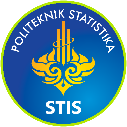
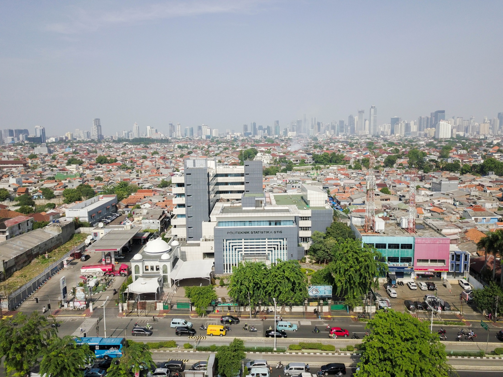
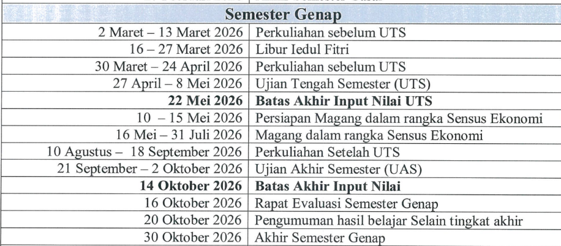
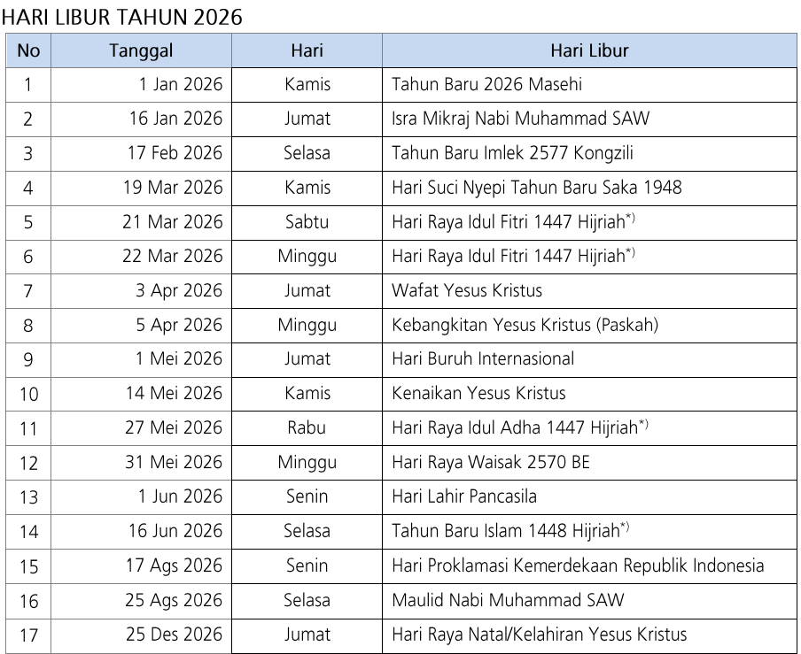
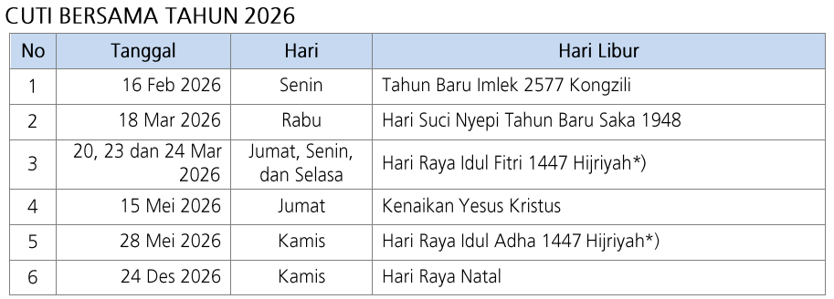
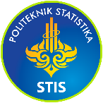
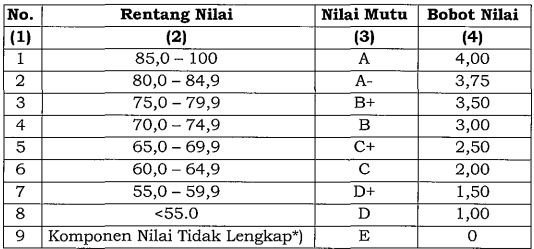

# Tiodora_3SI1_Kontrak Perkuliahan OSL Genap TA 2025 2026 Politeknik Statistika STIS.pptx

Sumber Asli: `/home/alfzki/Documents/OSL/materials/syllabus/Tiodora_3SI1_Kontrak Perkuliahan OSL Genap TA 2025 2026 Politeknik Statistika STIS.pptx`

---

## Slide 1

Kontrak Perkuliahan 
Semester Genap TA. 2025/2026
Official Statistics Lanjutan
Tiodora Hadumaon Siagian
Kelas 3SI1

POLITEKNIK STATISTIKA STIS

Program Studi DIV STATISTIKA
Politeknik Statistika STIS

For Better Official Statistics

---

## Slide 2

2

For Better Official Statistics

VISI MISI POLITEKNIK STATISTIKA STIS

Visi Politeknik Statistika STIS adalah:
“Menjadi Perguruan Tinggi Vokasi di Bidang Statistika Resmi Negara yang Unggul dan Berkelas Dunia”.

Misi Politeknik Statistika STIS adalah:
Menyelenggarakan Tri Dharma Perguruan Tinggi (pendidikan, penelitian, dan pengabdian masyarakat) yang berkualitas untuk menunjang penyelenggaraan kegiatan  statistik resmi negara.
Menyelenggarakan sistem tata kelola pendidikan tinggi vokasi berbasis teknologi informasi yang efektif dan efisien.

---

## Slide 3

3

For Better Official Statistics

VISI KEILMUAN PRODI DIV KOMPUTASI STATISTIK

Menjadi program studi yang berkualitas dan unggul di bidang komputasi statistik, khususnya untuk menghasilkan statistik resmi negara (official statistics), sesuai dengan perkembangan sains dan teknologi yang memberikan kontribusi nyata terhadap Sistem Statistik Nasional maupun Internasional

---

## Slide 4

4

For Better Official Statistics

INFORMASI UMUM

| Nama Mata Kuliah | Official Statistics Lanjutan |
| --- | --- |
| Kode Mata Kuliah | K200207 |
| Jumlah SKS | 3 |
| Status Mata Kuliah | MKU / MKWI / MKWP / MKP * |
| Semester Ke- | Genap |
| MK Prasyarat | Pengantar Official Statistics dan Official Statistics |
| Bahasa Pengantar | Indonesia |

* Pilih salah satu

---

## Slide 5

5

For Better Official Statistics

METODE PEMBELAJARAN

Problem-based Learning/Project-based Learning/Collaborative Learning*

Luring / Daring *

Menggunakan SIPADU-NG, Google Classroom

Media sinkronus: Microsoft Teams/Google meet/Zoom*

* Pilih salah satu

---

## Slide 6

6

For Better Official Statistics

DESKRIPSI MATA KULIAH

Mata Kuliah Official Statistics dengan kode K200207 adalah salah satu Mata Kuliah Wajib Institusi yang bertujuan memberikan penguasaan pengetahuan dan keterampilan tentang Official Statistics kepada mahasiswa. Kompetensi yang akan dicapai dan dikuasai oleh mahasiswa yaitu Mampu melakukan analisis, penyajian, dan interpretasi data official statistics dan Mampu mengkaji kasus penerapan official statistics dan menyusun hasil kajiannya dalam bentuk kertas kerja. Pada mata kuliah ini proses pembelajaran dilakukan dengan blended learning dengan metode pembelajaran kelompok berbasis kasus (team-based cases learning). Kemudian, blended learning dilaksanakan luring di kelas dan/atau LMS Politeknik Statistika STIS, sedangkan secara daring menggunakan Zoom Cloud Meeting. Penilaian Mata Kuliah ini bersumber dari penyelesaian tugas, keaktifan di kelas, pelaksanaan tugas, ujian tengah semester, dan ujian akhir semester yang mencerminkan CPL sikap, pengetahuan, keterampilan umum, dan keterampilan khusus yang dibebankan pada mata kuliah.

---

## Slide 7

7

For Better Official Statistics

CAPAIAN PEMBELAJARAN MATA KULIAH

| S1 | Memiliki sikap profesional dalam penerapan statistika |
| --- | --- |
| S2 | Memiliki integritas yang tinggi dalam pelaksanaan kegiatan statistik |
| S3 | Memiliki sikap amanah dalam menyajikan hasil kegiatan statistik |
| KU1 | Bekerjasama dan berkomunikasi dalam tim serta bertanggungjawab terhadap tugas yang diberikan |
| KK1 | Terampil dalam merancang kegiatan survei, menerapkan teknik sampling yang sesuai dan menerapkan metode estimasi yang tepat |
| KK2 | Terampil dalam mengelola kegiatan survei, mengkoordinasikan sumber daya dan mengantisipasi jenis kesalahan (non-sampling error) dalam pelaksanaan survei, serta metode pengukurannya |
| PP2 | Memahami tahapan kegiatan survei, pengelolaan petugas lapangan, mengidentifikasi jenis kesalahan dan cara mengantisipasinya |
| PP4 | Menguasai teknik mengkomunikasikan konsep, definisi dan klasifikasi dari variabel yang dikumpulkan dalam kegiatan survei kepada peserta didik |

| CPMK1 | Mahasiswa mampu memahami dan menjelaskan tata kelola data pemerintah |
| --- | --- |
| CPMK2 | Mahasiswa mampu memahami dan menjelaskan tujuan pembangunan berkelanjutan. |

---

## Slide 8

8

For Better Official Statistics

SUB CAPAIAN PEMBELAJARAN MATA KULIAH

| Sub-CPMK1 | Mahasiswa mampu memahami dan menjelaskan mengenai tata Kelola Satu Data Indonesia (SDI) |
| --- | --- |
| Sub-CPMK2 | Mahasiswa mampu memahami dan menjelaskan mengenai penyelenggaraan statistik sektoral |
| Sub-CPMK3 | Mahasiswa mampu memahami dan menjelaskan mengenai konsep teoritis dan Indikator pembangunan menurut domain Sosial, Ekonomi dan Lingkungan yang mendukung Tujuan Pembangunan Berkelanjutan (TPB/SDGs) . |

---

## Slide 9

9

For Better Official Statistics

KALENDER AKADEMIK TA. 2025/2026

---

## Slide 10

10

For Better Official Statistics

SATUAN ACARA PERKULIAHAN (SAP)

| Pekan |  | Topik Pembahasan |
| --- | --- | --- |
| 1 | 2 - 6 Maret | Satu Data Indonesia |
| 2 | 9 - 13 Maret | Standar data, Metadata, dan Interoperabilitas |
| 3-7 | 30 Mar – 24 April** | Norma, Standar, Prosedur dan Kriteria Kegiatan Statistik Sektoral; Kode referensi/Data Induk, Penyajian data Pembangunan, dan kolaborasi data; Konsep Indikator dan TPB/SDGs; Indikator Lingkungan; Diskusi dan Review |
| 8 | 27 April-8 Mei | UTS |

**Ada pemampatan waktu (time compression) 5 pertemuan dalam waktu 4 minggu

---

## Slide 11

11

For Better Official Statistics

SATUAN ACARA PERKULIAHAN (SAP)

| Pekan |  | Topik Pembahasan |
| --- | --- | --- |
| 9 | 3 - 7 Agust | Indikator Sosial |
| 10 | 10 - 14 Agust | Indikator Sosial |
| 11 | 18 - 21 Agust | Indikator Sosial |
| 12 | 24 - 28 Agust | Indikator Ekonomi |
| 13 | 31 Agust - 4 Sept | Indikator Ekonomi |
| 14 | 7 - 11 Sept | Indikator Ekonomi |
| 15 | 14 -18 Sept | Diskusi dan Review |
| 16 | 21 Sept - 2 Okt | UAS |

---

## Slide 12

12

For Better Official Statistics

HARI LIBUR DAN CUTI BERSAMA

---

## Slide 13

13

For Better Official Statistics

KOMPONEN PENILAIAN

Untuk setiap mata kuliah teori, penilaian dilakukan terhadap 3 (tiga) komponen yaitu: 
Tugas terstruktur, kuis, responsi, dan/atau evaluasi aktivitas mahasiswa dalam kegiatan belajar mengajar 
Ujian Tengah Semester
Ujian Akhir Semester

Untuk setiap mata kuliah yang terdiri atas teori dan praktikum penilaian dilakukan terhadap 4 (empat) komponen yaitu: 
Tugas terstruktur, kuis, responsi, dan/atau evaluasi aktivitas mahasiswa dalam kegiatan belajar mengajar
Ujian Tengah Semester
Ujian Akhir Semester
Praktikum

---

## Slide 14

14

For Better Official Statistics

KOMPONEN PENILAIAN

| Komponen | Bobot (%) |
| --- | --- |
| UTS | 35 |
| UAS | 35 |
| Tugas | 30 |
| Total | 100 |

---

## Slide 15

Duncan French, Louis J. Kotzé, Sustainable Development Goals: Law, Theory and Implementation, 2018
Metadata Indikator “Pilar Pembangunan Ekonomi”, Kementerian Perencanaan Pembangunan Nasional/ Badan Perencanaan Pembangunan Nasional (Bappenas) 2020
Metadata Indikator “Pilar Pembangunan Sosial”, Kementerian Perencanaan Pembangunan Nasional/ Badan Perencanaan Pembangunan Nasional (Bappenas) 2020
Metadata Indikator “Pilar Pembangunan Lingkungan”, Kementerian Perencanaan Pembangunan Nasional/ Badan Perencanaan Pembangunan Nasional (Bappenas) 2020
Satu Data Indonesia, Booklet Cetakan 1, Bappenas, 2021
Peraturan Presiden Republik Indonesia Nomor 39 Tahun 2019 Tentang Satu Data Indonesia
Peraturan Badan Pusat Statistik Nomor 4 Tahun 2019 Tentang Norma, Standar, Prosedur, Dan Kriteria (Nspk) Penyelenggaraan Statistik Sektoral
Peraturan Badan Pusat Statistik Nomor 4 Tahun 2020 Tentang Petunjuk Teknis Standar Data Statistik
Peraturan Badan Pusat Statistik Nomor 5 Tahun 2020 Tentang Petunjuk Teknis Metadata Statistik
Peraturan Badan Pusat Statistik Nomor 126 Tahun 2020 Tentang Master File Standar Data Statistik Tahun 2020
Peraturan Badan Pusat Statistik Nomor 1 Tahun 2021 Tentang Kode Dan Nama Wilayah Kerja Statistik
Data Interoperability: A Practitioner’s Guide To Joining Up Data In The Development Sector, Luis González Morales & Tom Orrell, UNSD&GPSDD, 2019
Asia-Pacific Guidelines to Data Integration for Official Statistics, UNESCAP, 202014. Statistical Data and Metadata Exchange (SDMX) tools, UNSTAT, 2020

15

For Better Official Statistics

BAHAN BACAAN DAN REFERENSI

---

## Slide 16

UU Nomor 16 Tahun 1997 tentang Statistik
Peraturan Pemerintah Nomor 51 Tahun 1999 tentang Penyelenggaraan Statistik
Peraturan Presiden Republik Indonesia Nomor 86 Tahun 2007 tentang Badan Pusat Statistik
Keputusan Kepala BPS No 5 Tahun 2000 Tentang Sistem Statistik Nasional
Fundamental Principles of Official Statistics (United Nations General Assembly resolution 68/261
United Nations National Quality Assurance Frameworks Manual for Official Statistics, Including recommendations, the framework and implementation guidance – UN 2019
DAMA International (2017). Data Management Body of Knowledge, 2nd ed. New Jersey:Technics Publications.
Joined-Up Data Standards project (2016). The frontiers of data interoperability for sustainable development.
Palfrey, J. & Gasser, U. (2012). Interop: The promise and perils of highly interconnected systems. New York: Basic Books.
Steiner, R. (2014). Non-invasive data governance: The path of least resistance and greatest success. New Jersey: Technics Publications.
https://sdgs.un.org/goals
https://www.sdg2030indonesia.org/
http://sdgs.bappenas.go.id/sekilas-sdgs/
http://sdgsindonesia.or.id/
https://sig.bps.go.id
https://www.data4sdgs.org/resources/interoperability-practitioners-guide-joining-data-development-sector 
https://unstats.un.org/wiki/plugins/servlet/mobile?contentId=36143964#content/view/36143964
https://data.go.id/
https://bps.go.id/

16

For Better Official Statistics

BAHAN BACAAN DAN REFERENSI

---

## Slide 17

17

For Better Official Statistics

TATA TERTIB PERKULIAHAN

Mahasiswa hadir di ruang perkuliahan sebelum kuliah dimulai.
Mahasiswa wajib mengisi daftar hadir perkuliahan.
Mahasiswa terikat pada aturan dan tata tertib yang berlaku.
Mahasiswa tidak tidur di kelas.
Mahasiswa tidak melakukan kegiatan makan selama dosen. menyampaikan materi kecuali telah dipersilakan oleh dosen.
Mahasiswa tidak berbuat gaduh sehingga mengganggu mahasiswa lain.
Mahasiswa tidak membuka gadget atau laptop kecuali diizinkan dosen dan terkait materi pembelajaran yang disampaikan dosen.
Mahasiswa wajib meminta izin kepada dosen pengampu apabila meninggalkan tempat perkuliahan karena adanya suatu keperluan.

---

## Slide 18

18

For Better Official Statistics

TATA TERTIB PERKULIAHAN

Dosen dapat memberi peringatan kepada mahasiswa yang dianggap mengganggu jalannya perkuliahan dan berhak mengeluarkan mahasiswa yang bersangkutan dari ruang kuliah apabila mahasiswa tetap mengganggu jalannya perkuliahan setelah diberikan peringatan.
Mahasiswa yang berhalangan mengikuti perkuliahan karena sakit atau alasan yang sangat penting wajib menyampaikan surat ijin tidak mengikuti kuliah secara tertulis kepada dosen pengampu mata kuliah.
Surat beserta bukti pendukung disampaikan melalui Bagian Administrasi Akademik & Kemahasiswaan (BAAK) selambat-lambatnya 1 (satu) minggu setelah masuk kuliah.

---

## Slide 19

19

For Better Official Statistics

TATA TERTIB PERKULIAHAN

12.Mahasiswa dapat diberikan ijin tidak mengikuti kuliah (dispensasi) jika ditugaskan untuk mengikuti kegiatan kemahasiswaan di luar kampus yang membawa nama/mewakili Polstat STIS. Surat dispensasi ditandatangani oleh Wakil Direktur Bidang Kemahasiswaan.
13. Mahasiswa wajib memperhatikan etika jika akan menghubungi dosen/tim dosen (pada hari dan jam kerja)

---

## Slide 20

20

For Better Official Statistics

TATA TERTIB UJIAN SEMESTER

Mahasiswa dapat mengikuti ujian pada suatu mata kuliah apabila persentase kehadiran pada setiap mid/semester sekurang-kurangnya 8O%.
Ujian semester dilaksanakan di ruangan yang sudah ditentukan
Peserta ujian hadir minimal 10 menit sebelum ujian semester berlangsung
Peserta ujian yang datang terlambat tidak diberikan perpanjangan waktu
Peserta wajib mengisi dan menandatangani daftar hadir ujian
Peserta wajib mematikan HP dan alat komunikasi lainnya
Selama ujian semester berlangsung, peserta ujian dilarang makan, minum, merokok di dalam ruang ujian.

---

## Slide 21

21

For Better Official Statistics

TATA TERTIB UJIAN SEMESTER

8. Segala sesuatu yang tidak jelas selama ujian hanya dapat ditanyakan kepada pengawas ujian.
9.  Apabila mahasiswa terbukti melakukan pelanggaran tata tertib maka akan dikenakan sanksi akademik sesuai peraturan yang berlaku.
10. Ujian susulan dapat diberikan pada mahasiswa yang tidak dapat mengikuti ujian pada waktu yang telah ditetapkan karena alasan: 
 Sakit rawat inap atau rawat jalan; dan 
Mengalami musibah yang melibatkan yang bersangkutan dan/atau keluarga dekat (orang tua dan saudara kandung).
11. Surat ijin untuk mengikuti ujian susulan diberikan oleh pejabat yang berwenang di BAAK setelah mempertimbangkan bukti-bukti pendukung pada poin 10.

---

## Slide 22

22

For Better Official Statistics

EVALUASI HASIL BELAJAR

1. Rentang Nilai, Nilai Mutu serta Bobot dalam Penilaian Hasil Belajar Mahasiswa

---

## Slide 23

23

For Better Official Statistics

EVALUASI HASIL BELAJAR

2. Ketentuan untuk dapat melanjutkan ke semester berikutnya: 
memiliki nilai IPK sekurang-kurangnya 2,50 
tidak memiliki nilai E pada mata kuliah/kegiatan akademik terstruktur yang diikuti
memiliki nilai sekurang-kurangnya C untuk mata kuliah Wajib Umum
memiliki skor pelanggaran non akademik tidak melebihi batas yang ditetapkan

---

## Slide 24

24

For Better Official Statistics

EVALUASI HASIL BELAJAR

3. Jika seorang mahasiswa telah memenuhi syarat sebagaimana ketentuan pada poin 2 akan tetapi terdapat mata kuliah wajib prodi yang bernilai D/D+, maka mahasiswa yang bersangkutan dapat melanjutkan studi pada semester berikutnya dengan syarat: 
Wajib mengikuti program tutorial dan ujian perbaikan (untuk mata kuliah yang belum memenuhi syarat) pada semester berikutnya; 
Ketentuan lebih lanjut mengenai teknis penyelenggaraan tutorial dan ujian perbaikan akan diberikan pada ketentuan (SOP) yang dibuat Prodi; dan 
Nilai ujian perbaikan yang dapat diperoleh setinggi-tingginya adalah C.

---

## Slide 25

25

For Better Official Statistics

EDOM (Evaluasi Dosen oleh Mahasiswa)

Evaluasi Dosen Oleh Mahasiswa (EDOM) adalah instrumen untuk menilai kinerja dosen dalam proses pembelajaran.
EDOM wajib diisi oleh mahasiswa melalui SIPADU dua kali selama satu semester (setelah pelaksanaan UTS dan UAS)

---

## Slide 26

26

For Better Official Statistics

REFERENSI

Perdir No. 002 Tahun 2020 tentang Pedoman Penyelenggaraan Pendidikan di Politeknik Statistika STIS
Perdir No. 003 Tahun 2020 tentang Kode Etik dan Tata Tertib Mahasiswa Politeknik Statistika STIS
SK Direktur No. 50 tahun 2024 tentang Kalender Akademik Politeknik Statistika STIS Tahun Akademik 2024/2025

---

## Slide 27

27

For Better Official Statistics

Terima kasih

---