# indeks-harga-konsumen-38-provinsi-di-indonesia-2025--2022-100-.pdf

Sumber Asli: `/home/alfzki/Documents/OSL/materials/notes/indeks-harga-konsumen-38-provinsi-di-indonesia-2025--2022-100-.pdf`

---

## Halaman 1

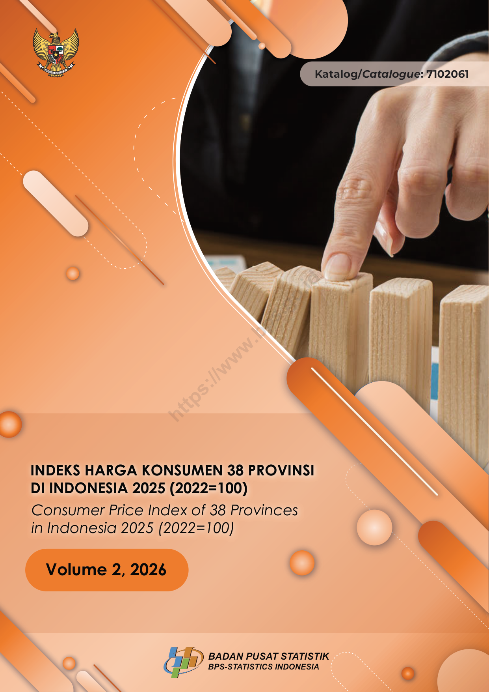

BADAN PUSAT STATISTIK
BPS-STATISTICS INDONESIA
Volume 2, 2026
INDEKS HARGA KONSUMEN 38 PROVINSI
DI INDONESIA 2025 (2022=100)
Consumer Price Index of 38 Provinces
in Indonesia 2025 (2022=100)
Katalog/Catalogue: 7102061
https://www.bps.go.id

---

## Halaman 2

https://www.bps.go.id

---

## Halaman 3

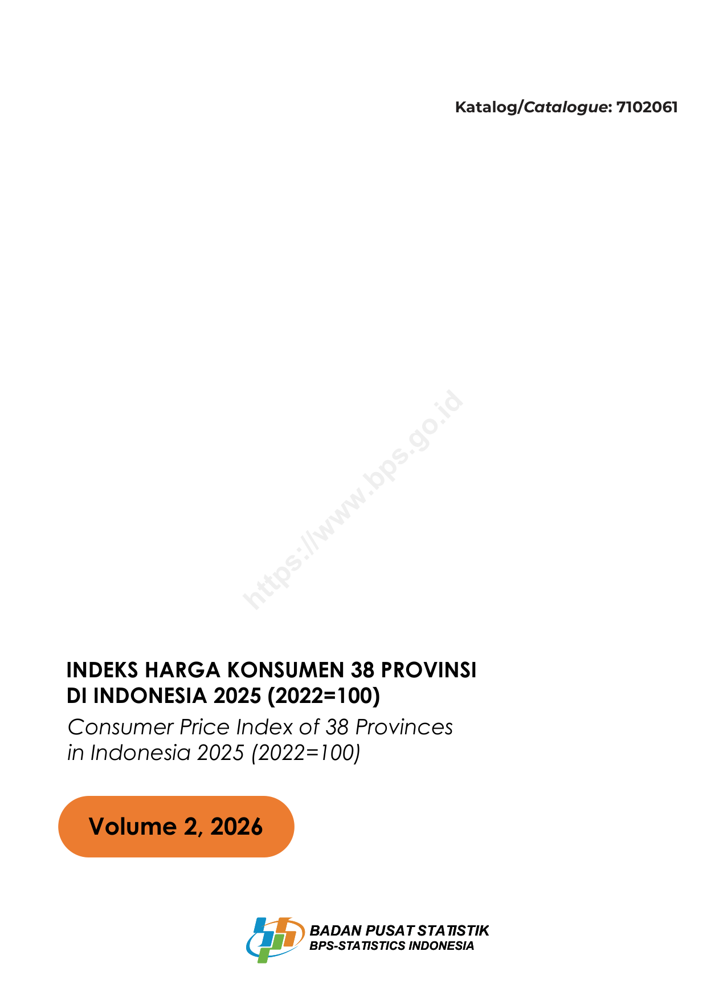

BADAN PUSAT STATISTIK
BPS-STATISTICS INDONESIA
BADAN PUSAT STATISTIK
BPS-STATISTICS INDONESIA
Katalog/Catalogue: 7102061
INDEKS HARGA KONSUMEN 38 PROVINSI
DI INDONESIA 2025 (2022=100)
Consumer Price Index of 38 Provinces
in Indonesia 2025 (2022=100)
Volume 2, 2026
https://www.bps.go.id

---

## Halaman 4

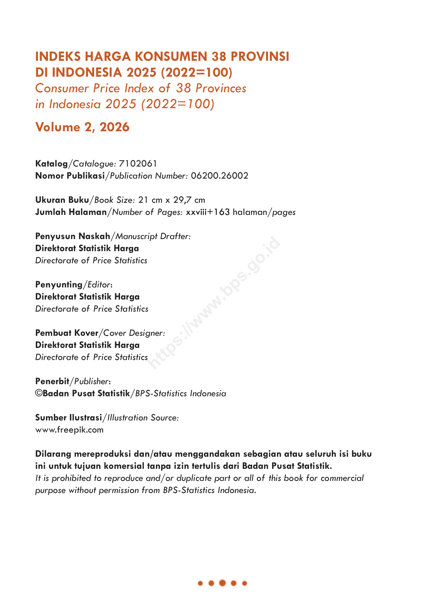

INDEKS HARGA KONSUMEN 38 PROVINSI
DI INDONESIA 2025 (2022=100)
Consumer Price Index of 38 Provinces
in Indonesia 2025 (2022=100)
Volume 2, 2026
Katalog/Catalogue: 7102061
Nomor Publikasi/Publication Number: 06200.26002
Ukuran Buku/Book Size: 21 cm x 29,7 cm
Jumlah Halaman/Number of Pages: xxviii+163 halaman/pages
Penyusun Naskah/Manuscript Drafter:
Direktorat Statistik Harga
Directorate of Price Statistics
Penyunting/Editor:
Direktorat Statistik Harga
Directorate of Price Statistics
Pembuat Kover/Cover Designer:
Direktorat Statistik Harga
Directorate of Price Statistics
Penerbit/Publisher:
©Badan Pusat Statistik/BPS-Statistics Indonesia
Sumber Ilustrasi/Illustration Source:
www.freepik.com 
Dilarang mereproduksi dan/atau menggandakan sebagian atau seluruh isi buku 
ini untuk tujuan komersial tanpa izin tertulis dari Badan Pusat Statistik.
It is prohibited to reproduce and/or duplicate part or all of this book for commercial 
purpose without permission from BPS-Statistics Indonesia.
https://www.bps.go.id

---

## Halaman 5

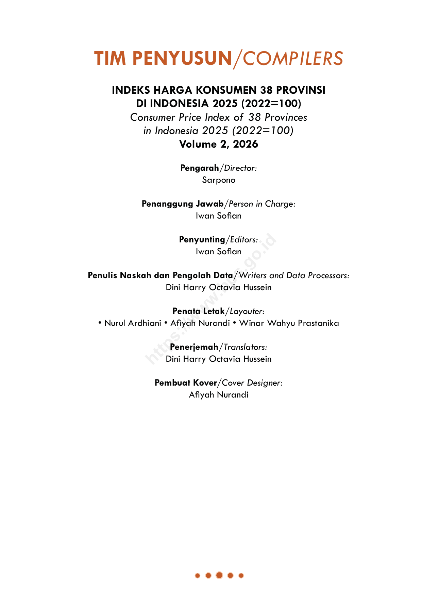

TIM PENYUSUN/COMPILERS
INDEKS HARGA KONSUMEN 38 PROVINSI
DI INDONESIA 2025 (2022=100)
Consumer Price Index of 38 Provinces
in Indonesia 2025 (2022=100)
Volume 2, 2026
Pengarah/Director:
Sarpono
Penanggung Jawab/Person in Charge:
Iwan Sofian
Penyunting/Editors:
Iwan Sofian
Penulis Naskah dan Pengolah Data/Writers and Data Processors:
Dini Harry Octavia Hussein
Penata Letak/Layouter:
• Nurul Ardhiani • Afiyah Nurandi • Winar Wahyu Prastanika
Penerjemah/Translators:
Dini Harry Octavia Hussein
Pembuat Kover/Cover Designer:
Afiyah Nurandi
https://www.bps.go.id

---

## Halaman 6

https://www.bps.go.id

---

## Halaman 7

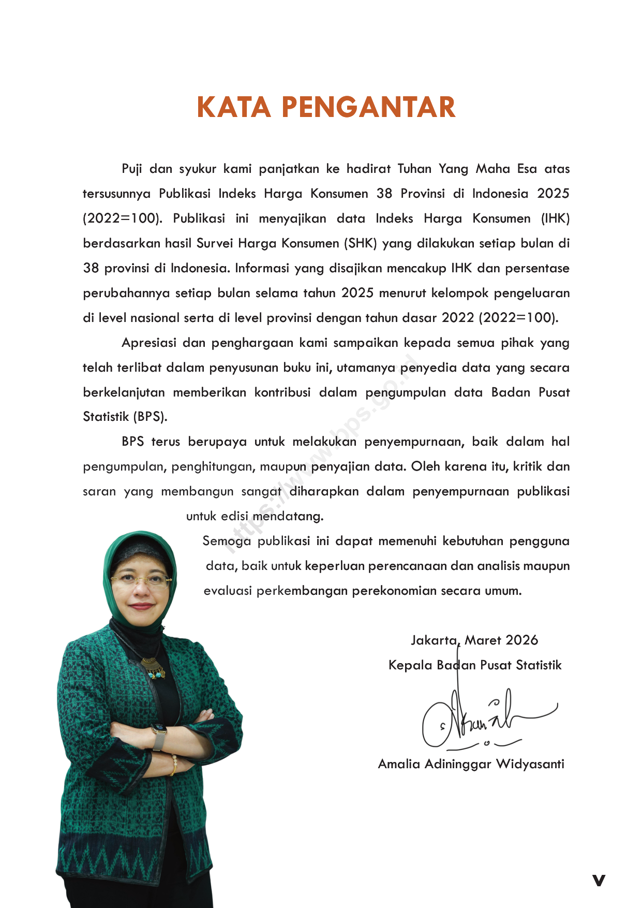

v
KATA PENGANTAR
	
Puji dan syukur kami panjatkan ke hadirat Tuhan Yang Maha Esa atas 
tersusunnya Publikasi Indeks Harga Konsumen 38 Provinsi di Indonesia 2025 
(2022=100). Publikasi ini menyajikan data Indeks Harga Konsumen (IHK) 
berdasarkan hasil Survei Harga Konsumen (SHK) yang dilakukan setiap bulan di 
38 provinsi di Indonesia. Informasi yang disajikan mencakup IHK dan persentase 
perubahannya setiap bulan selama tahun 2025 menurut kelompok pengeluaran 
di level nasional serta di level provinsi dengan tahun dasar 2022 (2022=100).
	
Apresiasi dan penghargaan kami sampaikan kepada semua pihak yang 
telah terlibat dalam penyusunan buku ini, utamanya penyedia data yang secara 
berkelanjutan memberikan kontribusi dalam pengumpulan data Badan Pusat 
Statistik (BPS).
	
BPS terus berupaya untuk melakukan penyempurnaan, baik dalam hal 
pengumpulan, penghitungan, maupun penyajian data. Oleh karena itu, kritik dan 
saran yang membangun sangat diharapkan dalam penyempurnaan publikasi 
untuk edisi mendatang.
Semoga publikasi ini dapat memenuhi kebutuhan pengguna 
data, baik untuk keperluan perencanaan dan analisis maupun 
evaluasi perkembangan perekonomian secara umum.
        Jakarta, Maret 2026
     Kepala Badan Pusat Statistik
Amalia Adininggar Widyasanti
v
KATA PENGANTAR
 
Puji dan syukur kami panjatkan ke hadirat Tuhan Yang Maha Esa atas 
tersusunnya Publikasi Indeks Harga Konsumen 38 Provinsi di Indonesia 2025 
(2022=100). Publikasi ini menyajikan data Indeks Harga Konsumen (IHK) 
berdasarkan hasil Survei Harga Konsumen (SHK) yang dilakukan setiap bulan di 
38 provinsi di Indonesia. Informasi yang disajikan mencakup IHK dan persentase 
perubahannya setiap bulan selama tahun 2025 menurut kelompok pengeluaran 
di level nasional serta di level provinsi dengan tahun dasar 2022 (2022=100).
 
Apresiasi dan penghargaan kami sampaikan kepada semua pihak yang 
telah terlibat dalam penyusunan buku ini, utamanya penyedia data yang secara 
berkelanjutan memberikan kontribusi dalam pengumpulan data Badan Pusat 
Statistik (BPS).
 
BPS terus berupaya untuk melakukan penyempurnaan, baik dalam hal 
pengumpulan, penghitungan, maupun penyajian data. Oleh karena itu, kritik dan 
saran yang membangun sangat diharapkan dalam penyempurnaan publikasi 
untuk edisi mendatang.
Semoga publikasi ini dapat memenuhi kebutuhan pengguna 
data, baik untuk keperluan perencanaan dan analisis maupun 
evaluasi perkembangan perekonomian secara umum.
        Jakarta, Maret 2026
     Kepala Badan Pusat Statistik
Amalia Adininggar Widyasanti
https://www.bps.go.id

---

## Halaman 8

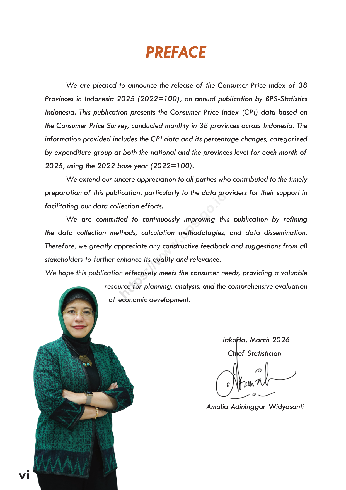

vi
PREFACE
	
We are pleased to announce the release of the Consumer Price Index of 38 
Provinces in Indonesia 2025 (2022=100), an annual publication by BPS-Statistics 
Indonesia. This publication presents the Consumer Price Index (CPI) data based on 
the Consumer Price Survey, conducted monthly in 38 provinces across Indonesia. The 
information provided includes the CPI data and its percentage changes, categorized 
by expenditure group at both the national and the provinces level for each month of 
2025, using the 2022 base year (2022=100).
	
We extend our sincere appreciation to all parties who contributed to the timely 
preparation of this publication, particularly to the data providers for their support in 
facilitating our data collection efforts.
 
We are committed to continuously improving this publication by refining 
the data collection methods, calculation methodologies, and data dissemination. 
Therefore, we greatly appreciate any constructive feedback and suggestions from all 
stakeholders to further enhance its quality and relevance.
We hope this publication effectively meets the consumer needs, providing a valuable 
resource for planning, analysis, and the comprehensive evaluation 
of economic development.
           Jakarta, March 2026
      Chief Statistician
Amalia Adininggar Widyasanti
vi
PREFACE
 
We are pleased to announce the release of the Consumer Price Index of 38 
Provinces in Indonesia 2025 (2022=100), an annual publication by BPS-Statistics 
Indonesia. This publication presents the Consumer Price Index (CPI) data based on 
the Consumer Price Survey, conducted monthly in 38 provinces across Indonesia. The 
information provided includes the CPI data and its percentage changes, categorized 
by expenditure group at both the national and the provinces level for each month of 
2025, using the 2022 base year (2022=100).
 
We extend our sincere appreciation to all parties who contributed to the timely 
preparation of this publication, particularly to the data providers for their support in 
facilitating our data collection efforts.
 
We are committed to continuously improving this publication by refining 
the data collection methods, calculation methodologies, and data dissemination. 
Therefore, we greatly appreciate any constructive feedback and suggestions from all 
stakeholders to further enhance its quality and relevance.
We hope this publication effectively meets the consumer needs, providing a valuable 
resource for planning, analysis, and the comprehensive evaluation 
of economic development.
           Jakarta, March 2026
      Chief Statistician
Amalia Adininggar Widyasanti
https://www.bps.go.id

---

## Halaman 9

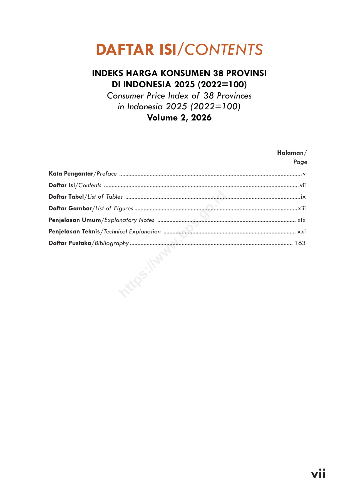

vii
DAFTAR ISI/CONTENTS
INDEKS HARGA KONSUMEN 38 PROVINSI
DI INDONESIA 2025 (2022=100)
Consumer Price Index of 38 Provinces
in Indonesia 2025 (2022=100)
Volume 2, 2026
Halaman/
Page
Kata Pengantar/Preface ........................................................................................................................v
Daftar Isi/Contents .................................................................................................................................vii
Daftar Tabel/List of Tables ....................................................................................................................ix
Daftar Gambar/List of Figures............................................................................................................xiii
Penjelasan Umum/Explanatory Notes ............................................................................................ xix
Penjelasan Teknis/Technical Explanation ........................................................................................ xxi
Daftar Pustaka/Bibliography............................................................................................................ 163
https://www.bps.go.id

---

## Halaman 10

https://www.bps.go.id

---

## Halaman 11

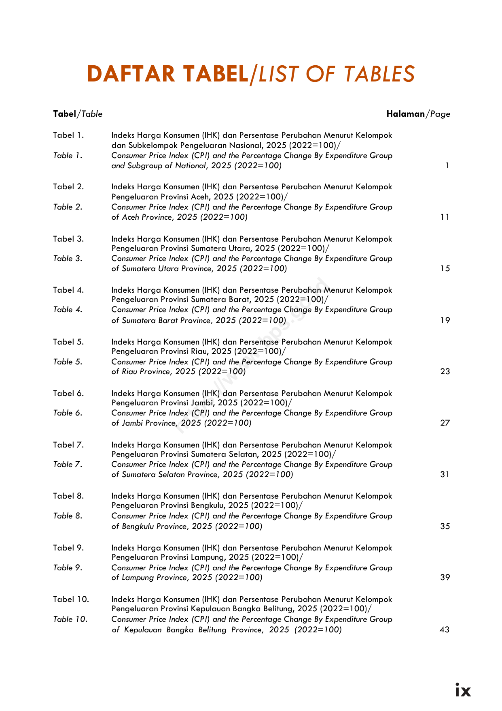

ix
濼瀋澳
澳
澳
Tabel/Table 
 
Halaman/Page 
 
 
 
Tabel 2. 
Indeks Harga Konsumen (IHK) dan Persentase Perubahan Menurut Kelompok 
Tabel 1. 
Indeks Harga Konsumen (IHK) dan Persentase Perubahan Menurut Kelompok 
dan Subkelompok Pengeluaran Nasional, 2025 (2022=100)/ 
 
Table 1. 
Consumer Price Index (CPI) and the Percentage Change By Expenditure Group 
and Subgroup of National, 2025 (2022=100) 
1 
Pengeluaran Provinsi Aceh, 2025 (2022=100)/ 
 
Table 2. 
Consumer Price Index (CPI) and the Percentage Change By Expenditure Group 
of Aceh Province, 2025 (2022=100) 
11 
 
 
 
Tabel 3. 
Indeks Harga Konsumen (IHK) dan Persentase Perubahan Menurut Kelompok 
Pengeluaran Provinsi Sumatera Utara, 2025 (2022=100)/ 
 
Table 3. 
Consumer Price Index (CPI) and the Percentage Change By Expenditure Group 
of Sumatera Utara Province, 2025 (2022=100) 
15 
 
 
 
Tabel 4. 
Indeks Harga Konsumen (IHK) dan Persentase Perubahan Menurut Kelompok 
Pengeluaran Provinsi Sumatera Barat, 2025 (2022=100)/ 
 
Table 4. 
Consumer Price Index (CPI) and the Percentage Change By Expenditure Group 
of Sumatera Barat Province, 2025 (2022=100) 
19 
 
 
 
Tabel 5. 
Indeks Harga Konsumen (IHK) dan Persentase Perubahan Menurut Kelompok 
Pengeluaran Provinsi Riau, 2025 (2022=100)/ 
 
Table 5. 
Consumer Price Index (CPI) and the Percentage Change By Expenditure Group 
of Riau Province, 2025 (2022=100) 
23 
 
 
 
Tabel 6. 
Indeks Harga Konsumen (IHK) dan Persentase Perubahan Menurut Kelompok 
Pengeluaran Provinsi Jambi, 2025 (2022=100)/ 
 
Table 6. 
Consumer Price Index (CPI) and the Percentage Change By Expenditure Group 
of Jambi Province, 2025 (2022=100) 
27 
 
 
 
Tabel 7. 
Indeks Harga Konsumen (IHK) dan Persentase Perubahan Menurut Kelompok 
Pengeluaran Provinsi Sumatera Selatan, 2025 (2022=100)/ 
 
Table 7. 
Consumer Price Index (CPI) and the Percentage Change By Expenditure Group 
of Sumatera Selatan Province, 2025 (2022=100) 
31 
 
 
 
Tabel 8. 
Indeks Harga Konsumen (IHK) dan Persentase Perubahan Menurut Kelompok 
Pengeluaran Provinsi Bengkulu, 2025 (2022=100)/ 
 
Table 8. 
Consumer Price Index (CPI) and the Percentage Change By Expenditure Group 
of Bengkulu Province, 2025 (2022=100) 
35 
 
 
 
Tabel 9. 
Indeks Harga Konsumen (IHK) dan Persentase Perubahan Menurut Kelompok 
Pengeluaran Provinsi Lampung, 2025 (2022=100)/ 
 
Table 9. 
Consumer Price Index (CPI) and the Percentage Change By Expenditure Group 
of Lampung Province, 2025 (2022=100) 
39 
 
 
 
Tabel 10. 
Indeks Harga Konsumen (IHK) dan Persentase Perubahan Menurut Kelompok 
Pengeluaran Provinsi Kepulauan Bangka Belitung, 2025 (2022=100)/ 
 
Table 10. 
Consumer Price Index (CPI) and the Percentage Change By Expenditure Group 
     
 of Kepulauan Bangka Belitung Province, 2025 (2022=100) 
        43    
DAFTAR TABEL/LIST OF TABLES 
https://www.bps.go.id

---

## Halaman 12

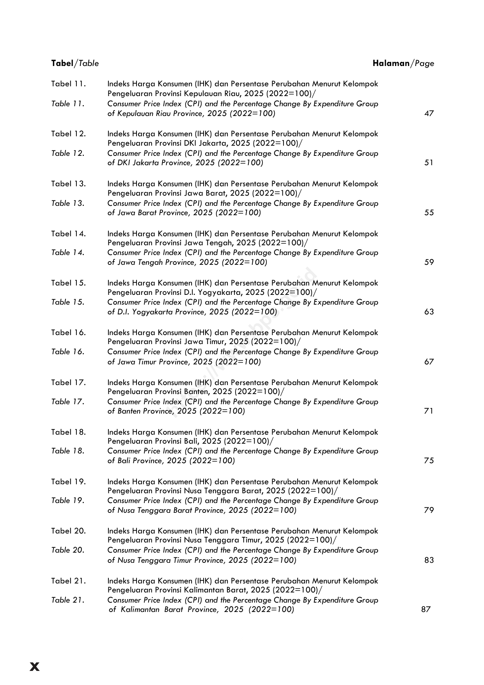

x
瀋澳
澳
Tabel/Table 
 
Halaman/Page 
 
 
 
Tabel 12. 
Indeks Harga Konsumen (IHK) dan Persentase Perubahan Menurut Kelompok 
Tabel 11. 
Indeks Harga Konsumen (IHK) dan Persentase Perubahan Menurut Kelompok 
Pengeluaran Provinsi Kepulauan Riau, 2025 (2022=100)/ 
 
Table 11. 
Consumer Price Index (CPI) and the Percentage Change By Expenditure Group 
of Kepulauan Riau Province, 2025 (2022=100) 
47 
Pengeluaran Provinsi DKI Jakarta, 2025 (2022=100)/ 
 
Table 12. 
Consumer Price Index (CPI) and the Percentage Change By Expenditure Group 
of DKI Jakarta Province, 2025 (2022=100) 
51 
 
 
 
Tabel 13. 
Indeks Harga Konsumen (IHK) dan Persentase Perubahan Menurut Kelompok 
Pengeluaran Provinsi Jawa Barat, 2025 (2022=100)/ 
 
Table 13. 
Consumer Price Index (CPI) and the Percentage Change By Expenditure Group 
of Jawa Barat Province, 2025 (2022=100) 
55 
 
 
 
Tabel 14. 
Indeks Harga Konsumen (IHK) dan Persentase Perubahan Menurut Kelompok 
Pengeluaran Provinsi Jawa Tengah, 2025 (2022=100)/ 
 
Table 14. 
Consumer Price Index (CPI) and the Percentage Change By Expenditure Group 
of Jawa Tengah Province, 2025 (2022=100) 
59 
 
 
 
Tabel 15. 
Indeks Harga Konsumen (IHK) dan Persentase Perubahan Menurut Kelompok 
Pengeluaran Provinsi D.I. Yogyakarta, 2025 (2022=100)/ 
 
Table 15. 
Consumer Price Index (CPI) and the Percentage Change By Expenditure Group 
of D.I. Yogyakarta Province, 2025 (2022=100) 
63 
 
 
 
Tabel 16. 
Indeks Harga Konsumen (IHK) dan Persentase Perubahan Menurut Kelompok 
Pengeluaran Provinsi Jawa Timur, 2025 (2022=100)/ 
 
Table 16. 
Consumer Price Index (CPI) and the Percentage Change By Expenditure Group 
of Jawa Timur Province, 2025 (2022=100) 
67 
 
 
 
Tabel 17. 
Indeks Harga Konsumen (IHK) dan Persentase Perubahan Menurut Kelompok 
Pengeluaran Provinsi Banten, 2025 (2022=100)/ 
 
Table 17. 
Consumer Price Index (CPI) and the Percentage Change By Expenditure Group 
of Banten Province, 2025 (2022=100) 
71 
 
 
 
Tabel 18. 
Indeks Harga Konsumen (IHK) dan Persentase Perubahan Menurut Kelompok 
Pengeluaran Provinsi Bali, 2025 (2022=100)/ 
 
Table 18. 
Consumer Price Index (CPI) and the Percentage Change By Expenditure Group 
of Bali Province, 2025 (2022=100) 
75 
 
 
 
Tabel 19. 
Indeks Harga Konsumen (IHK) dan Persentase Perubahan Menurut Kelompok 
Pengeluaran Provinsi Nusa Tenggara Barat, 2025 (2022=100)/ 
 
Table 19. 
Consumer Price Index (CPI) and the Percentage Change By Expenditure Group 
of Nusa Tenggara Barat Province, 2025 (2022=100) 
79 
 
 
 
Tabel 20. 
Indeks Harga Konsumen (IHK) dan Persentase Perubahan Menurut Kelompok 
Pengeluaran Provinsi Nusa Tenggara Timur, 2025 (2022=100)/ 
 
Table 20. 
Consumer Price Index (CPI) and the Percentage Change By Expenditure Group 
of Nusa Tenggara Timur Province, 2025 (2022=100) 
83 
 
 
 
Tabel 21. 
Indeks Harga Konsumen (IHK) dan Persentase Perubahan Menurut Kelompok 
Pengeluaran Provinsi Kalimantan Barat, 2025 (2022=100)/ 
 
Table 21. 
Consumer Price Index (CPI) and the Percentage Change By Expenditure Group 
     
 of Kalimantan Barat Province, 2025 (2022=100) 
       87    
https://www.bps.go.id

---

## Halaman 13

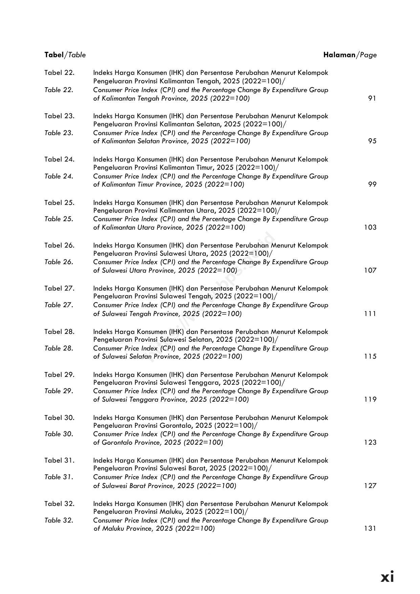

xi
瀋濼澳
澳
Tabel/Table 
 
Halaman/Page 
 
 
 
Tabel 23. 
Indeks Harga Konsumen (IHK) dan Persentase Perubahan Menurut Kelompok 
Tabel 22. 
Indeks Harga Konsumen (IHK) dan Persentase Perubahan Menurut Kelompok 
Pengeluaran Provinsi Kalimantan Tengah, 2025 (2022=100)/ 
 
Table 22. 
Consumer Price Index (CPI) and the Percentage Change By Expenditure Group 
of Kalimantan Tengah Province, 2025 (2022=100) 
91 
Pengeluaran Provinsi Kalimantan Selatan, 2025 (2022=100)/ 
 
Table 23. 
Consumer Price Index (CPI) and the Percentage Change By Expenditure Group 
of Kalimantan Selatan Province, 2025 (2022=100) 
95 
 
 
 
Tabel 24. 
Indeks Harga Konsumen (IHK) dan Persentase Perubahan Menurut Kelompok 
Pengeluaran Provinsi Kalimantan Timur, 2025 (2022=100)/ 
 
Table 24. 
Consumer Price Index (CPI) and the Percentage Change By Expenditure Group 
of Kalimantan Timur Province, 2025 (2022=100) 
99 
 
 
 
Tabel 25. 
Indeks Harga Konsumen (IHK) dan Persentase Perubahan Menurut Kelompok 
Pengeluaran Provinsi Kalimantan Utara, 2025 (2022=100)/ 
 
Table 25. 
Consumer Price Index (CPI) and the Percentage Change By Expenditure Group 
of Kalimantan Utara Province, 2025 (2022=100) 
103 
 
 
 
Tabel 26. 
Indeks Harga Konsumen (IHK) dan Persentase Perubahan Menurut Kelompok 
Pengeluaran Provinsi Sulawesi Utara, 2025 (2022=100)/ 
 
Table 26. 
Consumer Price Index (CPI) and the Percentage Change By Expenditure Group 
of Sulawesi Utara Province, 2025 (2022=100) 
107 
 
 
 
Tabel 27. 
Indeks Harga Konsumen (IHK) dan Persentase Perubahan Menurut Kelompok 
Pengeluaran Provinsi Sulawesi Tengah, 2025 (2022=100)/ 
 
Table 27. 
Consumer Price Index (CPI) and the Percentage Change By Expenditure Group 
of Sulawesi Tengah Province, 2025 (2022=100) 
111 
 
 
 
Tabel 28. 
Indeks Harga Konsumen (IHK) dan Persentase Perubahan Menurut Kelompok 
Pengeluaran Provinsi Sulawesi Selatan, 2025 (2022=100)/ 
 
Table 28. 
Consumer Price Index (CPI) and the Percentage Change By Expenditure Group 
of Sulawesi Selatan Province, 2025 (2022=100) 
115 
 
 
 
Tabel 29. 
Indeks Harga Konsumen (IHK) dan Persentase Perubahan Menurut Kelompok 
Pengeluaran Provinsi Sulawesi Tenggara, 2025 (2022=100)/ 
 
Table 29. 
Consumer Price Index (CPI) and the Percentage Change By Expenditure Group 
of Sulawesi Tenggara Province, 2025 (2022=100) 
119 
 
 
 
Tabel 30. 
Indeks Harga Konsumen (IHK) dan Persentase Perubahan Menurut Kelompok 
Pengeluaran Provinsi Gorontalo, 2025 (2022=100)/ 
 
Table 30. 
Consumer Price Index (CPI) and the Percentage Change By Expenditure Group 
of Gorontalo Province, 2025 (2022=100) 
123 
 
 
 
Tabel 31. 
Indeks Harga Konsumen (IHK) dan Persentase Perubahan Menurut Kelompok 
Pengeluaran Provinsi Sulawesi Barat, 2025 (2022=100)/ 
 
Table 31. 
Consumer Price Index (CPI) and the Percentage Change By Expenditure Group 
of Sulawesi Barat Province, 2025 (2022=100) 
127 
 
 
 
Tabel 32. 
Indeks Harga Konsumen (IHK) dan Persentase Perubahan Menurut Kelompok 
Pengeluaran Provinsi Maluku, 2025 (2022=100)/ 
 
Table 32. 
Consumer Price Index (CPI) and the Percentage Change By Expenditure Group 
                       of Maluku Province, 2025 (2022=100) 
131 
 
 
 
https://www.bps.go.id

---

## Halaman 14

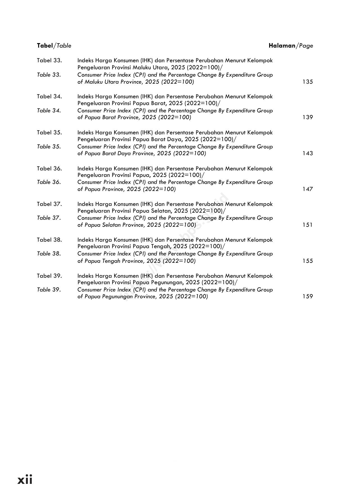

xii
瀋濼濼澳
澳
Tabel/Table 
 
Halaman/Page 
 
 
 
Tabel 34. 
Indeks Harga Konsumen (IHK) dan Persentase Perubahan Menurut Kelompok 
Tabel 33. 
Indeks Harga Konsumen (IHK) dan Persentase Perubahan Menurut Kelompok 
Pengeluaran Provinsi Maluku Utara, 2025 (2022=100)/ 
 
Table 33. 
Consumer Price Index (CPI) and the Percentage Change By Expenditure Group 
of Maluku Utara Province, 2025 (2022=100) 
135 
Pengeluaran Provinsi Papua Barat, 2025 (2022=100)/ 
 
Table 34. 
Consumer Price Index (CPI) and the Percentage Change By Expenditure Group 
of Papua Barat Province, 2025 (2022=100) 
139 
 
 
 
Tabel 35. 
Indeks Harga Konsumen (IHK) dan Persentase Perubahan Menurut Kelompok 
Pengeluaran Provinsi Papua Barat Daya, 2025 (2022=100)/ 
 
Table 35. 
Consumer Price Index (CPI) and the Percentage Change By Expenditure Group 
of Papua Barat Daya Province, 2025 (2022=100) 
143 
 
 
 
Tabel 36. 
Indeks Harga Konsumen (IHK) dan Persentase Perubahan Menurut Kelompok 
Pengeluaran Provinsi Papua, 2025 (2022=100)/ 
 
Table 36. 
Consumer Price Index (CPI) and the Percentage Change By Expenditure Group 
of Papua Province, 2025 (2022=100) 
147 
 
 
 
Tabel 37. 
Indeks Harga Konsumen (IHK) dan Persentase Perubahan Menurut Kelompok 
Pengeluaran Provinsi Papua Selatan, 2025 (2022=100)/ 
 
Table 37. 
Consumer Price Index (CPI) and the Percentage Change By Expenditure Group 
of Papua Selatan Province, 2025 (2022=100) 
151 
 
 
 
Tabel 38. 
Indeks Harga Konsumen (IHK) dan Persentase Perubahan Menurut Kelompok 
Pengeluaran Provinsi Papua Tengah, 2025 (2022=100)/ 
 
Table 38. 
Consumer Price Index (CPI) and the Percentage Change By Expenditure Group 
of Papua Tengah Province, 2025 (2022=100) 
155 
 
 
 
Tabel 39. 
Indeks Harga Konsumen (IHK) dan Persentase Perubahan Menurut Kelompok 
Pengeluaran Provinsi Papua Pegunungan, 2025 (2022=100)/ 
 
Table 39. 
Consumer Price Index (CPI) and the Percentage Change By Expenditure Group 
of Papua Pegunungan Province, 2025 (2022=100) 
159 
澳
https://www.bps.go.id

---

## Halaman 15

xiii
瀋濼濼濼澳
澳
澳
Gambar/Figure 
澳
Halaman/Page 
澳
澳
Gambar 1.1.澳
Perkembangan Inflasi/Deflasi Nasional (%), 2025/澳
澳
Figure 1.1.澳
Series of Inflation/Deflation of National (%), 2025澳
9
澳Gambar 1.2.澳
Indeks Harga Konsumen Menurut Kelompok Pengeluaran Nasional, 2025/澳
澳
Figure 1.2.澳
Consumer Price Index by Expenditure Group of National, 2025澳
10
澳澳
澳
澳Gambar 2.1.澳
Perkembangan Inflasi/Deflasi Provinsi Aceh (%), 2025/澳
澳
Figure 2.1.澳
Series of Inflation/Deflation of Aceh Province (%), 2025澳
13
澳Gambar 2.2.澳
Indeks Harga Konsumen Menurut Kelompok Pengeluaran Provinsi Aceh, 2025/澳
澳
Figure 2.2.澳
Consumer Price Index by Expenditure Group of Aceh Province, 2025澳
14
澳澳
澳
澳Gambar 3.1.澳
Perkembangan Inflasi/Deflasi Provinsi Sumatera Utara (%), 2025/澳
澳
Figure 3.1.澳
Series of Inflation/Deflation of Sumatera Utara Province (%), 2025澳
17
澳Gambar 3.2.澳
Indeks Harga Konsumen Menurut Kelompok Pengeluaran Provinsi Sumatera 
Utara, 2025/澳
澳
Figure 3.2.澳
Consumer Price Index by Expenditure Group of Sumatera Utara Province, 2025澳
18澳
澳
澳
澳
Gambar 4.1.澳
Perkembangan Inflasi/Deflasi Provinsi Sumatera Barat (%), 2025/澳
Figure 4.1.澳
Series of Inflation/Deflation of Sumatera Barat Province (%), 2025澳
21澳
Gambar 4.2.澳
Indeks Harga Konsumen Menurut Kelompok Pengeluaran Provinsi Sumatera 
Barat, 2025/澳
澳
Figure 4.2.澳
Consumer Price Index by Expenditure Group of Sumatera Barat Province, 2025澳
22澳
澳
澳
澳
Gambar 5.1.澳
Perkembangan Inflasi/Deflasi Provinsi Riau (%), 2025/澳
澳
Figure 5.1.澳
Series of Inflation/Deflation of Riau Province (%), 2025澳
25澳
Gambar 5.2.澳
Indeks Harga Konsumen Menurut Kelompok Pengeluaran Provinsi Riau, 2025/澳
澳
Figure 5.2.澳
Consumer Price Index by Expenditure Group of Riau Province, 2025澳
26澳
澳
澳
澳
Gambar 6.1.澳
Perkembangan Inflasi/Deflasi Provinsi Jambi (%), 2025/澳
澳
Figure 6.1.澳
Series of Inflation/Deflation of Jambi Province (%), 2025澳
29澳
Gambar 6.2.澳
Indeks Harga Konsumen Menurut Kelompok Pengeluaran Provinsi Jambi, 2025/澳
澳
Figure 6.2.澳
Consumer Price Index by Expenditure Group of Jambi Province, 2025澳
30澳
澳
澳
Gambar 7.1.澳
Perkembangan Inflasi/Deflasi Provinsi Sumatera Selatan (%), 2025/澳
澳
Figure 7.1.澳
Series of Inflation/Deflation of Sumatera Selatan Province (%), 2025澳
33澳
Gambar 7.2.澳
Indeks Harga Konsumen Menurut Kelompok Pengeluaran Provinsi Sumatera 
Selatan, 2025/澳
澳
Figure 7.2.澳
Consumer Price Index by Expenditure Group of Sumatera Selatan Province, 2025澳
34澳
澳
澳
澳
Gambar 8.1.澳
Perkembangan Inflasi/Deflasi Provinsi Bengkulu (%), 2025/澳
澳
Figure 8.1.澳
Series of Inflation/Deflation of Bengkulu Province (%), 2025澳
37澳
Gambar 8.2.澳
Indeks Harga Konsumen Menurut Kelompok Pengeluaran Provinsi Bengkulu, 
2025/澳
澳
Figure 8.2.澳
Consumer Price Index by Expenditure Group of Bengkulu Province, 2025澳
38澳
澳
澳
澳
Gambar 9.1.澳
Perkembangan Inflasi/Deflasi Provinsi Lampung (%), 2025/澳
澳
Figure 9.1.澳
Series of Inflation/Deflation of Lampung Province (%), 2025澳
41澳
DAFTAR GAMBAR/LIST OF FIGURES澳
https://www.bps.go.id

---

## Halaman 16

xiv
瀋濼瀉澳
澳
Gambar/Figure 
澳
Halaman/Page 
澳
澳
澳
澳
Gambar 9.2.澳
Indeks Harga Konsumen Menurut Kelompok Pengeluaran Provinsi Lampung, 
2025/澳
澳
Figure 9.2.澳
Consumer Price Index by Expenditure Group of Lampung Province, 2025澳
42澳
澳
澳
澳
Gambar 10.1.澳
Perkembangan Inflasi/Deflasi Provinsi Kepulauan Bangka Belitung (%), 2025/澳
澳
Figure 10.1.澳
Series of Inflation/Deflation of Kepulauan Bangka Belitung Province (%), 2025澳
45澳
Gambar 10.2.澳
Indeks Harga Konsumen Menurut Kelompok Pengeluaran Provinsi Kepulauan 
Bangka Belitung, 2025/澳
Figure 10.2.澳
Consumer Price Index by Expenditure Group of Kepulauan Bangka Belitung 
Province, 2025澳
46澳
2025/澳
澳
Figure 12.2.澳
Consumer Price Index by Expenditure Group of DKI Jakarta Province, 2025澳
54澳
澳
澳
澳
Gambar 13.1.澳
Perkembangan Inflasi/Deflasi Provinsi Jawa Barat (%), 2025/澳
澳
Figure 13.1.澳
Series of Inflation/Deflation of Jawa Barat Province (%), 2025
57澳
Gambar 13.2.澳
Indeks Harga Konsumen Menurut Kelompok Pengeluaran Provinsi Jawa Barat, 
2025/澳
澳
Figure 13.2.澳
Consumer Price Index by Expenditure Group of Jawa Barat Province, 2025澳
58澳
澳
澳
澳
Gambar 14.1.澳
Perkembangan Inflasi/Deflasi Provinsi Jawa Tengah (%), 2025/澳
Figure 14.1.澳
Series of Inflation/Deflation of Jawa Tengah Province (%), 2025澳
61澳
Gambar 14.2.澳
Indeks Harga Konsumen Menurut Kelompok Pengeluaran Provinsi Jawa Tengah, 
2025/澳
澳
Figure 14.2.澳
Consumer Price Index by Expenditure Group of Jawa Tengah Province, 2025澳
62澳
澳
澳
澳
Gambar 15.1.澳
Perkembangan Inflasi/Deflasi Provinsi D.I. Yogyakarta (%), 2025/澳
澳
Figure 15.1.澳
Series of Inflation/Deflation of D.I. Yogyakarta Province (%), 2025澳
65澳
Gambar 15.2.澳
Indeks Harga Konsumen Menurut Kelompok Pengeluaran Provinsi D.I. 
Yogyakarta, 2025/澳
澳
Figure 15.2.澳
Consumer Price Index by Expenditure Group of D.I. Yogyakarta Province, 2025澳
66澳
澳
澳
澳
Gambar 16.1.澳
Perkembangan Inflasi/Deflasi Provinsi Jawa Timur (%), 2025/澳
Figure 16.1.澳
Series of Inflation/Deflation of Jawa Timur Province (%), 2025澳
69澳
Gambar 16.2.澳
Indeks Harga Konsumen Menurut Kelompok Pengeluaran Provinsi Jawa Timur, 
2025/澳
澳
Figure 16.2.澳
Consumer Price Index by Expenditure Group of Jawa Timur Province, 2025澳
70澳
澳
澳
澳
Gambar 17.1.澳
Perkembangan Inflasi/Deflasi Provinsi Banten (%), 2025/澳
澳
Figure 17.1.澳
Series of Inflation/Deflation of Banten Province (%), 2025澳
73澳
Gambar 17.2.澳
Indeks Harga Konsumen Menurut Kelompok Pengeluaran Provinsi Banten, 
2025/澳
澳
Figure 17.2.澳
Consumer Price Index by Expenditure Group of Banten Province, 2025澳
74澳
澳
澳
澳
Gambar 11.1.澳
Perkembangan Inflasi/Deflasi Provinsi Kepulauan Riau (%), 2025/澳
澳
Figure 11.1.澳
Series of Inflation/Deflation of Kepulauan Riau Province (%), 2025澳
49澳
Gambar 11.2.澳
Indeks Harga Konsumen Menurut Kelompok Pengeluaran Provinsi Kepulauan 
Riau, 2025/澳
澳
Figure 11.2.澳
Consumer Price Index by Expenditure Group of Kepulauan Riau Province, 2025澳
50澳
澳
澳
澳
Gambar 12.1.澳
Perkembangan Inflasi/Deflasi Provinsi DKI Jakarta (%), 2025/澳
澳
Figure 12.1.澳
Series of Inflation/Deflation of DKI Jakarta Province (%), 2025澳
53澳
Gambar 12.2.澳
Indeks Harga Konsumen Menurut Kelompok Pengeluaran Provinsi DKI Jakarta, 
https://www.bps.go.id

---

## Halaman 17

xv
瀋瀉澳
澳
Gambar/Figure 
澳
Halaman/Page 
澳
澳
澳
澳
澳
澳
澳
Gambar 18.1.澳
Perkembangan Inflasi/Deflasi Provinsi Bali (%), 2025/澳
澳
Figure 18.1.澳
Series of Inflation/Deflation of Bali Province (%), 2025澳
77澳
Gambar 18.2.澳
Indeks Harga Konsumen Menurut Kelompok Pengeluaran Provinsi Bali, 2025/澳
澳
Figure 18.2. 
Consumer Price Index by Expenditure Group of Bali Province, 2025 
78澳
澳
澳
澳
Gambar 19.1.澳
Perkembangan Inflasi/Deflasi Provinsi Nusa Tenggara Barat (%), 2025/澳
澳
Figure 19.1.澳
Series of Inflation/Deflation of Nusa Tenggara Barat Province (%), 2025澳
81澳
Gambar 19.2.澳
Indeks Harga Konsumen Menurut Kelompok Pengeluaran Provinsi Nusa 
Tenggara Barat, 2025/澳
Figure 19.2.澳
Consumer Price Index by Expenditure Group of Nusa Tenggara Barat Province, 
2025澳
82澳
澳
澳
澳
Gambar 20.1.澳
Perkembangan Inflasi/Deflasi Provinsi Nusa Tenggara Timur (%), 2025/澳
澳
Figure 20.1.澳
Series of Inflation/Deflation of Nusa Tenggara Timur Province (%), 2025澳
85澳
Gambar 20.2.澳
Indeks Harga Konsumen Menurut Kelompok Pengeluaran Provinsi Nusa 
Tenggara Timur, 2025/澳
Figure 20.2.澳
Consumer Price Index by Expenditure Group of Nusa Tenggara Timur Province, 
2025
86澳
澳
澳
澳
Gambar 21.1.澳
Perkembangan Inflasi/Deflasi Provinsi Kalimantan Barat (%), 2025/澳
澳
Figure 21.1.澳
Series of Inflation/Deflation of Kalimantan Barat Province (%), 2025澳
89澳
Gambar 21.2.澳
Indeks Harga Konsumen Menurut Kelompok Pengeluaran Provinsi Kalimantan 
Barat, 2025/澳
澳
Figure 21.2.澳
Consumer Price Index by Expenditure Group of Kalimantan Barat Province, 2025澳
90澳
澳
澳
澳
Gambar 22.1.澳
Perkembangan Inflasi/Deflasi Provinsi Kalimantan Tengah (%), 2025/澳
澳
Figure 22.1.澳
Series of Inflation/Deflation of Kalimantan Tengah Province (%), 2025澳
93澳
Gambar 22.2.澳
Indeks Harga Konsumen Menurut Kelompok Pengeluaran Provinsi Kalimantan 
Tengah, 2025/澳
Figure 22.2.澳
Consumer Price Index by Expenditure Group of Kalimantan Tengah Province, 
2025澳
94澳
澳
澳
澳
Gambar 23.1.澳
Perkembangan Inflasi/Deflasi Provinsi Kalimantan Selatan (%), 2025/澳
Figure 23.1.澳
Series of Inflation/Deflation of Kalimantan Selatan Province (%), 2025澳
97澳
Gambar 23.2.澳
Indeks Harga Konsumen Menurut Kelompok Pengeluaran Provinsi Kalimantan 
Selatan, 2025/澳
Figure 23.2.澳
Consumer Price Index by Expenditure Group of Kalimantan Selatan Province, 
2025澳
98澳
澳
澳
澳
Gambar 24.1.澳
Perkembangan Inflasi/Deflasi Provinsi Kalimantan Timur (%), 2025/澳
澳
Figure 24.1.澳
Series of Inflation/Deflation of Kalimantan Timur Province (%), 2025澳
101澳
Gambar 24.2.澳
Indeks Harga Konsumen Menurut Kelompok Pengeluaran Provinsi Kalimantan 
Timur, 2025/澳
澳
Figure 24.2.澳
Consumer Price Index by Expenditure Group of Kalimantan Timur Province, 2025澳
102澳
澳
澳
澳
Gambar 25.1.澳
Perkembangan Inflasi/Deflasi Provinsi Kalimantan Utara (%), 2025/澳
Figure 25.1.澳
Series of Inflation/Deflation of Kalimantan Utara Province (%), 2025澳
105澳
Gambar 25.2.澳
Indeks Harga Konsumen Menurut Kelompok Pengeluaran Provinsi Kalimantan 
Utara, 2025/澳
澳
Figure 25.2.澳
Consumer Price Index by Expenditure Group of Kalimantan Utara Province, 2025澳
106澳
澳
澳
澳 
 
澳
https://www.bps.go.id

---

## Halaman 18

xvi
瀋瀉濼澳
澳
Gambar/Figure 
澳
Halaman/Page 
澳
澳
澳
澳
Gambar 26.1.澳
Perkembangan Inflasi/Deflasi Provinsi Sulawesi Utara (%), 2025/澳
Figure 26.1.澳
Series of Inflation/Deflation of Sulawesi Utara Province (%), 2025澳
109澳
Gambar 26.2.澳
Indeks Harga Konsumen Menurut Kelompok Pengeluaran Provinsi Sulawesi 
Utara, 2025/澳
澳
Figure 26.2.澳
Consumer Price Index by Expenditure Group of Sulawesi Utara Province, 2025澳
110澳
澳
澳
澳
Gambar 27.1.澳
Perkembangan Inflasi/Deflasi Provinsi Sulawesi Tengah (%), 2025/澳
澳
Figure 27.1.澳
Series of Inflation/Deflation of Sulawesi Tengah Province (%), 2025澳
113澳
Gambar 27.2.澳
Indeks Harga Konsumen Menurut Kelompok Pengeluaran Provinsi Sulawesi 
Tengah, 2025/澳
澳
Figure 27.2.澳
Consumer Price Index by Expenditure Group of Sulawesi Tengah Province, 2025澳
114澳
澳
澳
澳
Gambar 28.1.澳
Perkembangan Inflasi/Deflasi Provinsi Sulawesi Selatan (%), 2025/澳
Figure 28.1.澳
Series of Inflation/Deflation of Sulawesi Selatan Province (%), 2025澳
117澳
Gambar 28.2.澳
Indeks Harga Konsumen Menurut Kelompok Pengeluaran Provinsi Sulawesi 
Selatan, 2025/澳
澳
Figure 28.2.澳
Consumer Price Index by Expenditure Group of Sulawesi Selatan Province, 2025澳
118澳
澳
澳
澳
Gambar 29.1.澳
Perkembangan Inflasi/Deflasi Provinsi Sulawesi Tenggara (%), 2025/澳
澳
Figure 29.1.澳
Series of Inflation/Deflation of Sulawesi Tenggara Province (%), 2025澳
121澳
Gambar 29.2.澳
Indeks Harga Konsumen Menurut Kelompok Pengeluaran Provinsi Sulawesi 
Tenggara, 2025/澳
Figure 29.2.澳
Consumer Price Index by Expenditure Group of Sulawesi Tenggara Province, 
2025澳
122澳
澳
澳
澳
Gambar 30.1.澳
Perkembangan Inflasi/Deflasi Provinsi Gorontalo (%), 2025/澳
Figure 30.1.澳
Series of Inflation/Deflation of Gorontalo Province (%), 2025澳
125澳
Gambar 30.2.澳
Indeks Harga Konsumen Menurut Kelompok Pengeluaran Provinsi Gorontalo, 
2025/澳
澳
Figure 30.2.澳
Consumer Price Index by Expenditure Group of Gorontalo Province, 2025澳
126澳
澳
澳
澳
Gambar 31.1.澳
Perkembangan Inflasi/Deflasi Provinsi Sulawesi Barat (%), 2025/澳
澳
Figure 31.1.澳
Series of Inflation/Deflation of Sulawesi Barat Province (%), 2025澳
129澳
Gambar 31.2.澳
Indeks Harga Konsumen Menurut Kelompok Pengeluaran Provinsi Sulawesi 
Barat, 2025/澳
澳
Figure 31.2.澳
Consumer Price Index by Expenditure Group of Sulawesi Barat Province, 2025澳
130澳
澳
澳
澳
Gambar 32.1.澳
Perkembangan Inflasi/Deflasi Provinsi Maluku (%), 2025/澳
澳
Figure 32.1.澳
Series of Inflation/Deflation of Maluku Province (%), 2025
133澳
Gambar 32.2.澳
Indeks Harga Konsumen Menurut Kelompok Pengeluaran Provinsi Maluku, 
2025/澳
澳
Figure 32.2.澳
Consumer Price Index by Expenditure Group of Maluku Province, 2025澳
134澳
澳
澳
澳
Gambar 33.1.澳
Perkembangan Inflasi/Deflasi Provinsi Maluku Utara (%), 2025/澳
澳
Figure 33.1.澳
Series of Inflation/Deflation of Maluku Utara Province (%), 2025澳
137澳
Gambar 33.2.澳
Indeks Harga Konsumen Menurut Kelompok Pengeluaran Provinsi Maluku Utara, 
2025/澳
澳
Figure 33.2.澳
Consumer Price Index by Expenditure Group of Maluku Utara Province, 2025澳
138澳
澳
澳
澳
Gambar 34.1.澳
Perkembangan Inflasi/Deflasi Provinsi Papua Barat (%), 2025/澳
澳
Figure 34.1.澳
Series of Inflation/Deflation of Papua Barat Province (%), 2025澳
141澳
https://www.bps.go.id

---

## Halaman 19

xvii
瀋瀉濼濼澳
澳
Gambar/Figure 
澳
Halaman/Page 
澳
澳
澳
澳
澳
澳
澳
澳
澳
澳
澳
澳
澳
澳
澳
Gambar 34.2.澳
Indeks Harga Konsumen Menurut Kelompok Pengeluaran Provinsi Papua Barat, 
2025/澳
澳
Figure 34.2.澳
Consumer Price Index by Expenditure Group of Papua Barat Province, 2025澳
142澳
澳
澳
澳
Gambar 35.1.澳
Perkembangan Inflasi/Deflasi Provinsi Papua Barat Daya (%), 2025/澳
澳
Figure 35.1.澳
Series of Inflation/Deflation of Papua Barat Daya Province (%), 2025澳
145澳
Gambar 35.2.澳
Indeks Harga Konsumen Menurut Kelompok Pengeluaran Provinsi Papua Barat 
Daya, 2025/澳
澳
Figure 35.2.澳
Consumer Price Index by Expenditure Group of Papua Barat Daya Province, 2025澳
146澳
澳
澳
澳
Gambar 36.1.澳
Perkembangan Inflasi/Deflasi Provinsi Papua (%), 2025/澳
澳
Figure 36.1.澳
Series of Inflation/Deflation of Papua Province (%), 2025澳
149澳
Gambar 36.2.澳
Indeks Harga Konsumen Menurut Kelompok Pengeluaran Provinsi Papua, 2025/澳
澳
Figure 36.2.澳
Consumer Price Index by Expenditure Group of Papua Province, 2025澳
150澳
澳
澳
澳
Gambar 37.1.澳
Perkembangan Inflasi/Deflasi Provinsi Papua Selatan (%), 2025/澳
澳
Figure 37.1. 
Series of Inflation/Deflation of Papua Selatan Province (%), 2025 
153澳
Gambar 37.2.澳
Indeks Harga Konsumen Menurut Kelompok Pengeluaran Provinsi Papua 
Selatan, 2025/澳
澳
Figure 37.2.澳
Consumer Price Index by Expenditure Group of Papua Selatan Province, 2025澳
154澳
澳
澳
澳
Gambar 38.1.澳
Perkembangan Inflasi/Deflasi Provinsi Papua Tengah (%), 2025/澳
Figure 38.1.澳
Series of Inflation/Deflation of Papua Tengah Province (%), 2025澳
157澳
Gambar 38.2.澳
Indeks Harga Konsumen Menurut Kelompok Pengeluaran Provinsi Papua 
Tengah, 2025/澳
澳
Figure 38.2.澳
Consumer Price Index by Expenditure Group of Papua Tengah Province, 2025澳
158澳
澳
澳
澳
Gambar 39.1.澳
Perkembangan Inflasi/Deflasi Provinsi Papua Pegunungan (%), 2025/澳
澳
Figure 39.1.澳
Series of Inflation/Deflation of Papua Pegunungan Province (%), 2025澳
161澳
Gambar 39.2.澳
Indeks Harga Konsumen Menurut Kelompok Pengeluaran Provinsi Papua 
Pegunungan, 2025/澳
Figure 39.2.澳
Consumer Price Index by Expenditure Group of Papua Pegunungan Province, 
2025澳
162澳
https://www.bps.go.id

---

## Halaman 20

https://www.bps.go.id

---

## Halaman 21

xix
PENJELASAN UMUM
Explanatory Notes
Tanda-tanda yang digunakan dalam publikasi ini adalah sebagai berikut:
Symbols which are used in this publication are as follows:
Data sangat kecil atau mendekati nol/Data is very small or close to zero ......................  : ~0
Tanda decimal/Decimal point ....................................................................................................  : ,
https://www.bps.go.id

---

## Halaman 22

https://www.bps.go.id

---

## Halaman 23

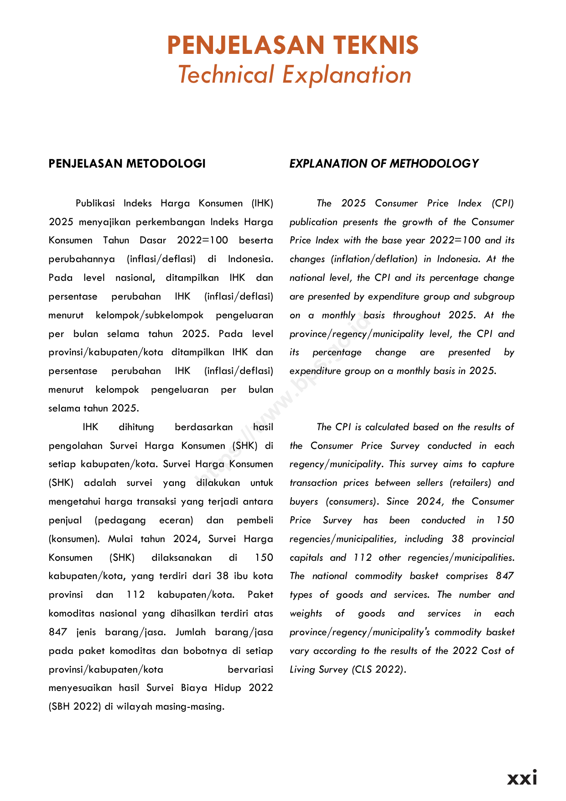

xxi
PENJELASAN METODOLOGI 
Publikasi Indeks Harga Konsumen (IHK) 
2025 menyajikan perkembangan Indeks Harga 
Konsumen Tahun Dasar 2022=100 beserta 
perubahannya (inflasi/deflasi) di Indonesia. 
Pada level nasional, ditampilkan IHK dan 
persentase 
perubahan 
IHK 
(inflasi/deflasi) 
menurut kelompok/subkelompok pengeluaran 
per bulan selama tahun 2025. Pada level 
provinsi/kabupaten/kota ditampilkan IHK dan 
persentase 
perubahan 
IHK 
(inflasi/deflasi) 
menurut kelompok pengeluaran per bulan 
selama tahun 2025.  
 IHK 
dihitung 
berdasarkan 
hasil 
pengolahan Survei Harga Konsumen (SHK) di 
setiap kabupaten/kota. Survei Harga Konsumen 
(SHK) adalah survei yang dilakukan untuk 
mengetahui harga transaksi yang terjadi antara 
penjual 
(pedagang 
eceran) 
dan 
pembeli 
(konsumen). Mulai tahun 2024, Survei Harga 
Konsumen 
(SHK) 
dilaksanakan 
di 
150 
kabupaten/kota, yang terdiri dari 38 ibu kota 
provinsi 
dan 
112 
kabupaten/kota. 
Paket 
komoditas nasional yang dihasilkan terdiri atas 
847 jenis barang/jasa. Jumlah barang/jasa 
pada paket komoditas dan bobotnya di setiap 
provinsi/kabupaten/kota 
bervariasi 
menyesuaikan hasil Survei Biaya Hidup 2022 
(SBH 2022) di wilayah masing-masing. 
EXPLANATION OF METHODOLOGY 
The 2025 Consumer Price Index (CPI) 
publication presents the growth of the Consumer 
Price Index with the base year 2022=100 and its 
changes (inflation/deflation) in Indonesia. At the 
national level, the CPI and its percentage change 
are presented by expenditure group and subgroup 
on a monthly basis throughout 2025. At the 
province/regency/municipality level, the CPI and 
its 
percentage 
change 
are 
presented 
by 
expenditure group on a monthly basis in 2025. 
The CPI is calculated based on the results of 
the Consumer Price Survey conducted in each 
regency/municipality. This survey aims to capture 
transaction prices between sellers (retailers) and 
buyers (consumers). Since 2024, the Consumer 
Price Survey has been conducted in 150 
regencies/municipalities, including 38 provincial 
capitals and 112 other regencies/municipalities. 
The national commodity basket comprises 847 
types of goods and services. The number and 
weights 
of 
goods 
and 
services 
in 
each 
province/regency/municipality's commodity basket 
vary according to the results of the 2022 Cost of 
Living Survey (CLS 2022). 
PENJELASAN TEKNIS
Technical Explanation
https://www.bps.go.id

---

## Halaman 24

xxii
Dalam Survei Harga Konsumen, secara 
umum rancangan sampling yang digunakan untuk 
pemilihan 
kabupaten/kota, 
pasar, 
dan 
responden/pedagang 
eceran 
adalah 
non 
probability sampling. Khusus pencacahan tarif 
sewa/kontrak rumah dan upah pembantu rumah 
tangga/babysitter, 
digunakan 
systematic 
random sampling. 
Sebagai pelengkap SHK, juga dilakukan 
Survei Volume Penjualan Eceran Beras (SVPEB) 
dan Survei Volume Penjualan Eceran Komoditas 
Spesifik 
(SVK) 
yang 
bertujuan 
untuk 
memperbarui 
bobot 
kualitas/merk 
setiap 
semester untuk komoditas beras dan setiap tahun 
untuk beberapa komoditas spesifik. 
Survei 
Harga 
Konsumen 
menangkap 
perkembangan 
harga 
di 
masing-masing 
kabupaten/kota 
meliputi 
177-479 
jenis 
barang/jasa. Jumlah jenis barang/jasa untuk 
setiap kabupaten/kota berbeda dan dipilih 
berdasarkan kriteria tertentu, sesuai dengan 
jenis barang dan jasa yang banyak dikonsumsi 
masyarakat 
wilayah 
yang 
bersangkutan. 
Barang/jasa tersebut dikelompokkan dalam 11 
kelompok pengeluaran dan 43 subkelompok 
pengeluaran 
berdasarkan 
adaptasi 
dari 
Classification of Individual Consumption According 
to Puspose (COICOP) 2018. Dalam pelaksaan 
SHK terdapat beberapa daftar isian (kuesioner) 
dengan periode pencacahan yang berbeda 
yaitu mingguan, dwimingguan, dan bulanan. 
 Secara umum penghitungan IHK dapat 
diuraikan sebagai berikut. Data harga suatu 
komoditas yang diperoleh dari hasil observasi 
bulan berjalan (𝑃𝑃𝑛𝑛𝑛𝑛) dibandingkan dengan data 
harga komoditas yang sama pada bulan 
sebelumnya (𝑃𝑃(𝑛𝑛−1)𝑖𝑖) untuk memperoleh relatif 
harga bulan berjalan. 
The Consumer Price Survey generally uses 
non-probability 
sampling 
to 
select 
regencies/municipalities, 
markets, 
and 
respondents/retailers. Systematic random sampling 
is applied in the data collection of rental/leasing 
house tariff and housemaid/babysitter wages. 
 
 
To complement the Consumer Price Survey, 
the Survey of Retail Rice Sales Volume and the 
Survey of Retail Sales Volume for Specific 
Commodities are conducted to update quality and 
brand weights semiannually for rice commodities 
and annually for several specific commodities. 
 
The Consumer Price Survey captures price 
growth in each regency/municipality, covering 
177 to 479 types of goods and services. The 
number of goods and services varies across 
provinces/regencies/ municipalities, selected based 
on specific criteria according to the types widely 
consumed by its population. The goods and 
services are grouped into 11 expenditure groups 
and 43 expenditure subgroups, following the 
adapted Classification of Individual Consumption 
According to Purpose (COICOP) 2018. The 
survey uses several entry lists (questionnaires) with 
different enumeration periods: weekly, biweekly, 
and monthly. 
 
 
In general, the CPI calculation can be 
described as follows: the price data of a 
commodity obtained from the current month's 
observation (𝑃𝑃𝑛𝑛𝑛𝑛) is compared with the price data 
of the same commodity in the previous month 
(𝑃𝑃(𝑛𝑛−1)𝑖𝑖) to obtain the current month's relative 
price. 
https://www.bps.go.id

---

## Halaman 25

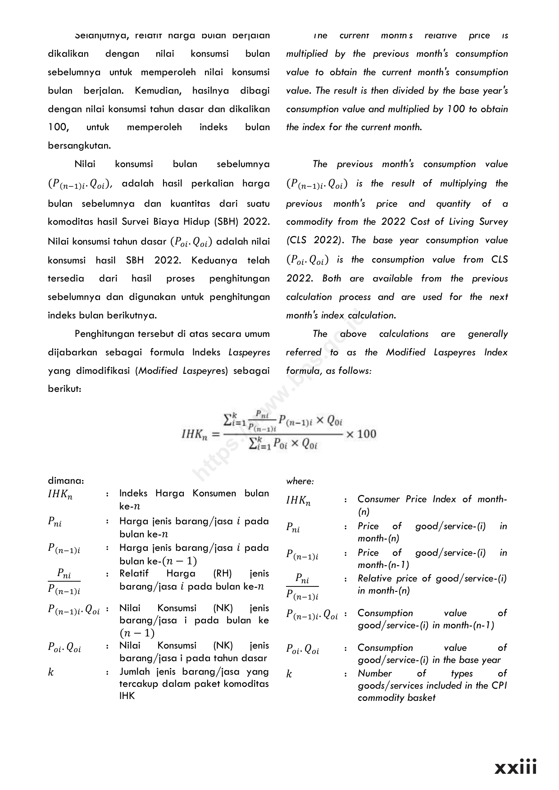

xxiii
Selanjutnya, relatif harga bulan berjalan 
dikalikan 
dengan 
nilai 
konsumsi 
bulan 
sebelumnya untuk memperoleh nilai konsumsi 
bulan berjalan. Kemudian, hasilnya dibagi 
dengan nilai konsumsi tahun dasar dan dikalikan 
100, 
untuk 
memperoleh 
indeks 
bulan 
bersangkutan. 
Nilai 
konsumsi 
bulan 
sebelumnya 
(𝑃𝑃(𝑛𝑛−1)𝑖𝑖. 𝑄𝑄𝑜𝑜𝑜𝑜), adalah hasil perkalian harga 
bulan sebelumnya dan kuantitas dari suatu 
komoditas hasil Survei Biaya Hidup (SBH) 2022. 
Nilai konsumsi tahun dasar (𝑃𝑃𝑜𝑜𝑜𝑜. 𝑄𝑄𝑜𝑜𝑜𝑜) adalah nilai 
konsumsi hasil SBH 2022. Keduanya telah 
tersedia 
dari 
hasil 
proses 
penghitungan 
sebelumnya dan digunakan untuk penghitungan 
indeks bulan berikutnya. 
Penghitungan tersebut di atas secara umum 
dijabarkan sebagai formula Indeks Laspeyres 
yang dimodifikasi (Modified Laspeyres) sebagai 
berikut: 
 
 
 
 
dimana: 
 
𝐼𝐼𝐼𝐼𝐼𝐼𝑛𝑛 
: Indeks Harga Konsumen bulan 
ke-𝑛𝑛 
𝑃𝑃𝑛𝑛𝑛𝑛 
: Harga jenis barang/jasa 𝑖𝑖 pada 
bulan ke-𝑛𝑛 
𝑃𝑃(𝑛𝑛−1)𝑖𝑖 
: Harga jenis barang/jasa 𝑖𝑖 pada 
bulan ke-(𝑛𝑛−1) 
𝑃𝑃𝑛𝑛𝑛𝑛
𝑃𝑃(𝑛𝑛−1)𝑖𝑖
 
: Relatif 
Harga 
(RH) 
jenis 
barang/jasa 𝑖𝑖 pada bulan ke-𝑛𝑛 
𝑃𝑃(𝑛𝑛−1)𝑖𝑖. 𝑄𝑄𝑜𝑜𝑜𝑜 : Nilai 
Konsumsi 
(NK) 
jenis 
barang/jasa i pada bulan ke 
(𝑛𝑛−1) 
𝑃𝑃𝑜𝑜𝑜𝑜. 𝑄𝑄𝑜𝑜𝑜𝑜 
: Nilai 
Konsumsi 
(NK) 
jenis 
barang/jasa i pada tahun dasar 
𝑘𝑘 
: Jumlah jenis barang/jasa yang 
tercakup dalam paket komoditas 
IHK 
 
 
The current month s relative price is 
multiplied by the previous month's consumption 
value to obtain the current month's consumption 
value. The result is then divided by the base year's 
consumption value and multiplied by 100 to obtain 
the index for the current month. 
 
The previous month's consumption value 
(𝑃𝑃(𝑛𝑛−1)𝑖𝑖. 𝑄𝑄𝑜𝑜𝑜𝑜) is the result of multiplying the 
previous month's price and quantity of a 
commodity from the 2022 Cost of Living Survey 
(CLS 2022). The base year consumption value 
(𝑃𝑃𝑜𝑜𝑜𝑜. 𝑄𝑄𝑜𝑜𝑜𝑜) is the consumption value from CLS 
2022. Both are available from the previous 
calculation process and are used for the next 
month's index calculation.  
The 
above 
calculations 
are 
generally 
referred to as the Modified Laspeyres Index 
formula, as follows: 
 
 
 
 
 
where: 
𝐼𝐼𝐼𝐼𝐼𝐼𝑛𝑛 
: Consumer Price Index of month-
(n) 
𝑃𝑃𝑛𝑛𝑛𝑛 
: Price 
of 
good/service-(i) 
in 
month-(n) 
𝑃𝑃(𝑛𝑛−1)𝑖𝑖 
: Price 
of 
good/service-(i) 
in 
month-(n-1) 
𝑃𝑃𝑛𝑛𝑛𝑛
𝑃𝑃(𝑛𝑛−1)𝑖𝑖
 
: Relative price of good/service-(i) 
in month-(n) 
𝑃𝑃(𝑛𝑛−1)𝑖𝑖. 𝑄𝑄𝑜𝑜𝑜𝑜 : Consumption 
value 
of 
good/service-(i) in month-(n-1) 
𝑃𝑃𝑜𝑜𝑜𝑜. 𝑄𝑄𝑜𝑜𝑜𝑜 
: Consumption 
value 
of 
good/service-(i) in the base year 
𝑘𝑘 
: Number 
of 
types 
of 
goods/services included in the CPI 
commodity basket 
https://www.bps.go.id

---

## Halaman 26

xxiv
Indeks subkelompok diperoleh dengan 
cara membagi nilai konsumsi subkelompok 
yang bersangkutan pada bulan berjalan 
dengan nilai konsumsi subkelompok yang sama 
pada tahun dasar dikalikan 100. Nilai 
konsumsi subkelompok merupakan penjumlahan 
nilai konsumsi dari seluruh jenis barang dan 
jasa yang tercakup dalam subkelompok yang 
bersangkutan. 
Indeks kelompok diperoleh dengan cara 
membagi 
nilai 
konsumsi 
kelompok 
yang 
bersangkutan pada bulan berjalan dengan 
nilai konsumsi kelompok yang sama pada 
tahun dasar dikalikan 100. Nilai konsumsi 
kelompok 
merupakan 
penjumlahan 
nilai 
konsumsi dari seluruh jenis barang dan jasa 
yang 
tercakup 
dalam 
kelompok 
yang 
bersangkutan. 
Indeks umum diperoleh dengan cara 
membagi nilai konsumsi umum pada bulan 
berjalan dengan nilai konsumsi umum pada 
tahun dasar dikalikan 100. Nilai konsumsi 
umum merupakan penjumlahan nilai konsumsi 
dari seluruh jenis barang dan jasa yang 
terpilih. 
Persentase perubahan Indeks Harga 
Konsumen (IHK) disebut dengan inflasi/deflasi. 
Disebut inflasi apabila persentase perubahan 
indeks bernilai positif, sedangkan deflasi 
terjadi ketika persentase perubahan indeks 
bernilai negatif.  
Inflasi/deflasi Bulan ke Bulan (month to 
month) adalah persentase perubahan IHK 
bulan berjalan dibandingkan dengan bulan 
sebelumnya. Inflasi/deflasi Tahun Kalender 
(year to date) adalah persentase perubahan 
IHK bulan berjalan dibandingkan dengan 
bulan Desember tahun sebelumnya.  
The subgroup index is calculated by 
dividing the current month's consumption value of 
the subgroup by its base year consumption value, 
then multiplying by 100. The consumption value 
of the subgroup is the sum of the consumption 
values of all types of goods and services 
included in the subgroup. 
 
 
The group index is calculated by dividing 
the current month's consumption value of the 
group by its base year consumption value, then 
multiplying by 100. The group consumption 
value is the sum of the consumption values of all 
types of goods and services included in the 
group. 
 
 
The headline index is calculated by 
dividing the current month's general consumption 
value by its base year general consumption 
value, then multiplying by 100. The general 
consumption value represents the sum of the 
consumption values of all types of goods and 
services selected. 
The percentage change in the Consumer 
Price Index (CPI) is referred to as inflation or 
deflation. Inflation occurs when the percentage 
change in the index is positive, while deflation 
occurs when the percentage change is negative.  
 
Month-to-Month 
(m-to-m) 
inflation/ 
deflation indicates the percentage change in the 
current month's CPI compared to the previous 
month. Year-to-Date (y-to-d) inflation/deflation 
represents the percentage change in the current 
month's CPI relative to December of the previous 
year.  
https://www.bps.go.id

---

## Halaman 27

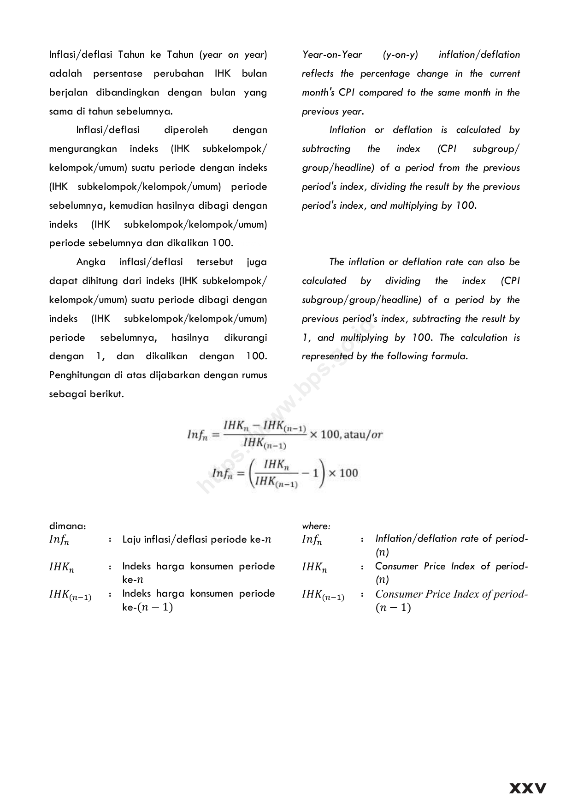

xxv
Inflasi/deflasi Tahun ke Tahun (year on year) 
adalah persentase perubahan IHK bulan 
berjalan dibandingkan dengan bulan yang 
sama di tahun sebelumnya.  
Inflasi/deflasi 
diperoleh 
dengan 
mengurangkan 
indeks 
(IHK 
subkelompok/ 
kelompok/umum) suatu periode dengan indeks 
(IHK subkelompok/kelompok/umum) periode 
sebelumnya, kemudian hasilnya dibagi dengan 
indeks 
(IHK 
subkelompok/kelompok/umum) 
periode sebelumnya dan dikalikan 100. mpok 
Angka 
inflasi/deflasi 
tersebut 
juga 
dapat dihitung dari indeks (IHK subkelompok/ 
kelompok/umum) suatu periode dibagi dengan 
indeks 
(IHK 
subkelompok/kelompok/umum) 
periode 
sebelumnya, 
hasilnya 
dikurangi 
dengan 1, dan dikalikan dengan 100. 
Penghitungan di atas dijabarkan dengan rumus 
sebagai berikut.  
 
 
 
 
 
 
dimana:  
𝐼𝐼𝐼𝐼𝐼𝐼𝑛𝑛 
: Laju inflasi/deflasi periode ke-𝑛𝑛 
𝐼𝐼𝐼𝐼𝐼𝐼𝑛𝑛 
: Indeks harga konsumen periode 
ke-𝑛𝑛 
𝐼𝐼𝐼𝐼𝐼𝐼(𝑛𝑛−1) 
: Indeks harga konsumen periode 
ke-(𝑛𝑛−1) 
 
 
 
 
 
 
 
 
Year-on-Year 
(y-on-y) 
inflation/deflation 
reflects the percentage change in the current 
month's CPI compared to the same month in the 
previous year. 
Inflation or deflation is calculated by 
subtracting 
the 
index 
(CPI 
subgroup/ 
group/headline) of a period from the previous 
period's index, dividing the result by the previous 
period's index, and multiplying by 100. 
 
 
The inflation or deflation rate can also be 
calculated 
by 
dividing 
the 
index 
(CPI 
subgroup/group/headline) of a period by the 
previous period's index, subtracting the result by 
1, and multiplying by 100. The calculation is 
represented by the following formula. 
 
 
 
 
 
 
 
 
where: 
𝐼𝐼𝐼𝐼𝐼𝐼𝑛𝑛 
: Inflation/deflation rate of period-
(𝑛𝑛) 
𝐼𝐼𝐼𝐼𝐼𝐼𝑛𝑛 
: Consumer Price Index of period-
(𝑛𝑛) 
𝐼𝐼𝐼𝐼𝐼𝐼(𝑛𝑛−1) 
: Consumer Price Index of period-
(𝑛𝑛−1) 
 
https://www.bps.go.id

---

## Halaman 28

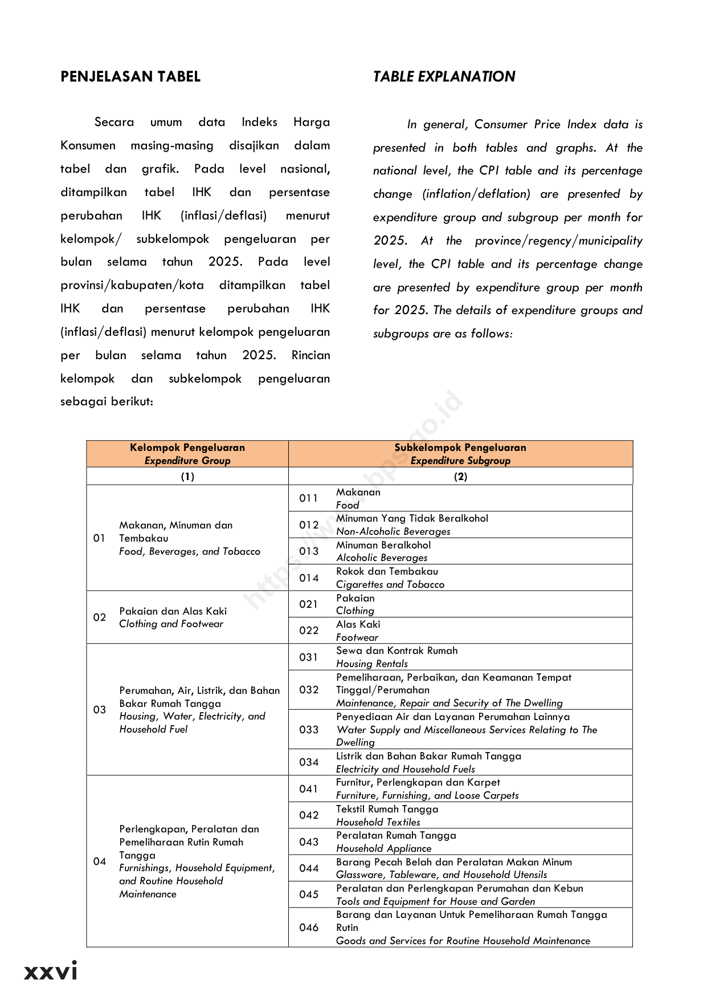

xxvi
PENJELASAN TABEL 
 
Secara 
umum 
data 
Indeks 
Harga 
Konsumen masing-masing disajikan dalam 
tabel dan grafik. Pada level nasional, 
ditampilkan 
tabel 
IHK 
dan 
persentase 
perubahan 
IHK 
(inflasi/deflasi) 
menurut 
kelompok/ subkelompok pengeluaran per 
bulan selama tahun 2025. Pada level 
provinsi/kabupaten/kota ditampilkan tabel 
IHK 
dan 
persentase 
perubahan 
IHK 
(inflasi/deflasi) menurut kelompok pengeluaran 
per bulan selama tahun 2025. Rincian 
kelompok 
dan 
subkelompok 
pengeluaran 
sebagai berikut: 
 
TABLE EXPLANATION 
 
In general, Consumer Price Index data is 
presented in both tables and graphs. At the 
national level, the CPI table and its percentage 
change (inflation/deflation) are presented by 
expenditure group and subgroup per month for 
2025. At the province/regency/municipality 
level, the CPI table and its percentage change 
are presented by expenditure group per month 
for 2025. The details of expenditure groups and 
subgroups are as follows: 
Kelompok Pengeluaran 
Expenditure Group 
Subkelompok Pengeluaran 
Expenditure Subgroup 
(1) 
(2) 
01 
Makanan, Minuman dan 
Tembakau 
Food, Beverages, and Tobacco 
011 
Makanan 
Food 
012 
Minuman Yang Tidak Beralkohol 
Non-Alcoholic Beverages 
013 
Minuman Beralkohol 
Alcoholic Beverages 
014 
Rokok dan Tembakau 
Cigarettes and Tobacco 
02 
Pakaian dan Alas Kaki 
Clothing and Footwear 
021 
Pakaian 
Clothing 
022 
Alas Kaki 
Footwear 
03 
Perumahan, Air, Listrik, dan Bahan 
Bakar Rumah Tangga 
Housing, Water, Electricity, and 
Household Fuel 
031 
Sewa dan Kontrak Rumah 
Housing Rentals 
032 
Pemeliharaan, Perbaikan, dan Keamanan Tempat 
Tinggal/Perumahan 
Maintenance, Repair and Security of The Dwelling 
033 
Penyediaan Air dan Layanan Perumahan Lainnya 
Water Supply and Miscellaneous Services Relating to The 
Dwelling 
034 
Listrik dan Bahan Bakar Rumah Tangga 
Electricity and Household Fuels 
04 
Perlengkapan, Peralatan dan 
Pemeliharaan Rutin Rumah 
Tangga 
Furnishings, Household Equipment, 
and Routine Household 
Maintenance 
041 
Furnitur, Perlengkapan dan Karpet 
Furniture, Furnishing, and Loose Carpets 
042 
Tekstil Rumah Tangga 
Household Textiles 
043 
Peralatan Rumah Tangga 
Household Appliance 
044 
Barang Pecah Belah dan Peralatan Makan Minum 
Glassware, Tableware, and Household Utensils 
045 
Peralatan dan Perlengkapan Perumahan dan Kebun 
Tools and Equipment for House and Garden 
046 
Barang dan Layanan Untuk Pemeliharaan Rumah Tangga 
Rutin 
Goods and Services for Routine Household Maintenance 
https://www.bps.go.id

---

## Halaman 29

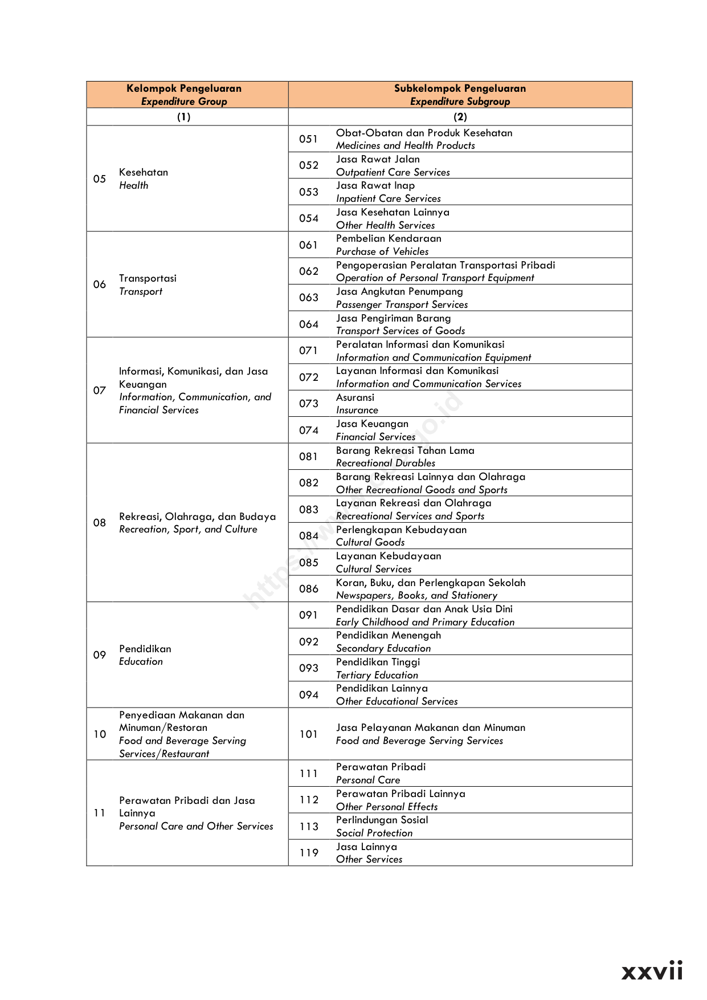

xxvii
 
Kelompok Pengeluaran 
Expenditure Group 
Subkelompok Pengeluaran 
Expenditure Subgroup 
 
(1) 
(2) 
05 
Kesehatan 
Health 
051 
Obat-Obatan dan Produk Kesehatan 
Medicines and Health Products 
052 
Jasa Rawat Jalan 
Outpatient Care Services 
053 
Jasa Rawat Inap 
Inpatient Care Services 
054 
Jasa Kesehatan Lainnya 
Other Health Services 
06 
Transportasi 
Transport 
061 
Pembelian Kendaraan 
Purchase of Vehicles 
062 
Pengoperasian Peralatan Transportasi Pribadi 
Operation of Personal Transport Equipment 
063 
Jasa Angkutan Penumpang 
Passenger Transport Services 
064 
Jasa Pengiriman Barang 
Transport Services of Goods 
07 
Informasi, Komunikasi, dan Jasa 
Keuangan 
Information, Communication, and 
Financial Services 
071 
Peralatan Informasi dan Komunikasi 
Information and Communication Equipment 
072 
Layanan Informasi dan Komunikasi 
Information and Communication Services 
073 
Asuransi 
Insurance 
074 
Jasa Keuangan 
Financial Services 
08 
Rekreasi, Olahraga, dan Budaya 
Recreation, Sport, and Culture 
081 
Barang Rekreasi Tahan Lama 
Recreational Durables 
082 
Barang Rekreasi Lainnya dan Olahraga 
Other Recreational Goods and Sports 
083 
Layanan Rekreasi dan Olahraga 
Recreational Services and Sports 
084 
Perlengkapan Kebudayaan 
Cultural Goods 
085 
Layanan Kebudayaan 
Cultural Services 
086 
Koran, Buku, dan Perlengkapan Sekolah 
Newspapers, Books, and Stationery 
09 
Pendidikan 
Education 
091 
Pendidikan Dasar dan Anak Usia Dini 
Early Childhood and Primary Education 
092 
Pendidikan Menengah 
Secondary Education 
093 
Pendidikan Tinggi 
Tertiary Education 
094 
Pendidikan Lainnya 
Other Educational Services 
10 
Penyediaan Makanan dan 
Minuman/Restoran 
Food and Beverage Serving 
Services/Restaurant 
101 
Jasa Pelayanan Makanan dan Minuman 
Food and Beverage Serving Services 
11 
Perawatan Pribadi dan Jasa 
Lainnya 
Personal Care and Other Services 
111 
Perawatan Pribadi 
Personal Care 
112 
Perawatan Pribadi Lainnya 
Other Personal Effects 
113 
Perlindungan Sosial 
Social Protection 
119 
Jasa Lainnya 
Other Services 
https://www.bps.go.id

---

## Halaman 30

xxviii
2. Simbol ~0 pada tabel berarti bahwa 
angka bernilai sangat kecil mendekati nol. 
 
 
PENJELASAN GRAFIK 
 
Data dalam publikasi ini disajikan dalam dua 
jenis grafik sebagai berikut: 
1. Perkembangan Inflasi/Deflasi umum secara 
bulan ke bulan yang divisualisasikan dalam 
bentuk 
grafik 
waterfall 
yang 
memperlihatkan 
perkembangan 
inflasi/ 
deflasi selama setahun dengan periode 
awal Januari 2025. Disajikan pada grafik 
1.1 sampai grafik 39.1. 
2. Indeks Harga Konsumen Menurut Kelompok 
Pengeluaran divisualisasikan dalam bentuk 
grafik 
garis 
yang 
memperlihatkan 
perkembangan indeks selama setahun dari 
Januari–Desember 2025. Disajikan pada 
grafik 1.2 sampai grafik 39.2. 
 
 
 
 
 
 
 
 
 
 
 
 
 
 
 
2. The symbol ~0 in the table indicates a very 
small value that is close to zero. 
 
 
GRAPH EXPLANATION  
 
The data in this publication is presented in two 
types of graphs as follows: 
1. The growth of headline inflation or deflation 
on a month-to-month basis is visualized with a 
waterfall chart, showing the inflation or 
deflation trend over the year starting from 
January 2025. Presented in graphs 1.1 to 
39.1. 
2. The Consumer Price Index by expenditure 
group is visualized with a line graph, 
illustrating the index growth from January to 
December 2025. Presented in graphs 1.2 to 
39.2. 
 
https://www.bps.go.id

---

## Halaman 31

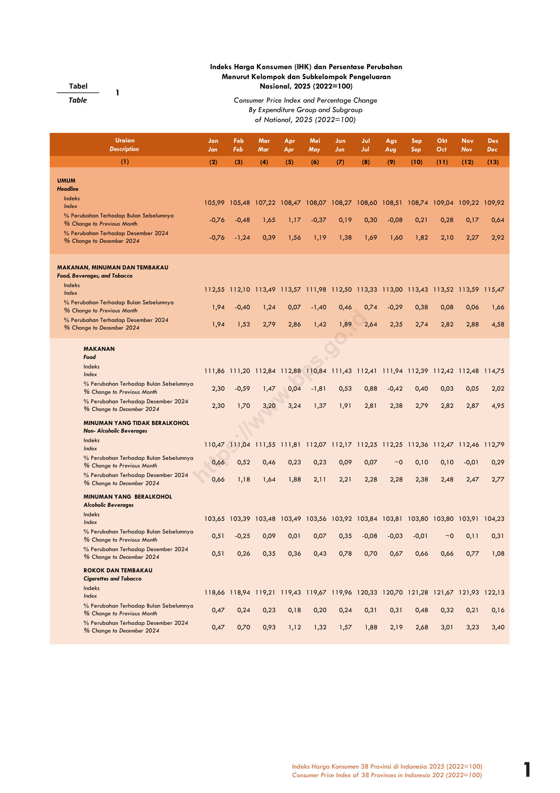

1
Indeks Harga Konsumen 38 Provinsi di Indonesia 2025 (2022=100)
Consumer Price Index of 38 Provinces in Indonesia 202 (2022=100)
Tabel
Table
Jan
Jan
Feb
Feb
Mar
Mar
Apr
Apr
Mei
May
Jun
Jun
Jul
Jul
Ags
Aug
Sep
Sep
Okt
Oct
Nov
Nov
Des
Dec
(2)
(3)
(4)
(5)
(6)
(7)
(8)
(9)
(10)
(11)
(12)
(13)
105,99 105,48 107,22 108,47 108,07 108,27 108,60 108,51 108,74 109,04 109,22 109,92
-0,76
-0,48
1,65
1,17
-0,37
0,19
0,30
-0,08
0,21
0,28
0,17
0,64
-0,76
-1,24
0,39
1,56
1,19
1,38
1,69
1,60
1,82
2,10
2,27
2,92
112,55 112,10 113,49 113,57 111,98 112,50 113,33 113,00 113,43 113,52 113,59 115,47
1,94
-0,40
1,24
0,07
-1,40
0,46
0,74
-0,29
0,38
0,08
0,06
1,66
1,94
1,53
2,79
2,86
1,42
1,89
2,64
2,35
2,74
2,82
2,88
4,58
111,86 111,20 112,84 112,88 110,84 111,43 112,41 111,94 112,39 112,42 112,48 114,75
2,30
-0,59
1,47
0,04
-1,81
0,53
0,88
-0,42
0,40
0,03
0,05
2,02
2,30
1,70
3,20
3,24
1,37
1,91
2,81
2,38
2,79
2,82
2,87
4,95
110,47 111,04 111,55 111,81 112,07 112,17 112,25 112,25 112,36 112,47 112,46 112,79
0,66
0,52
0,46
0,23
0,23
0,09
0,07
~0
0,10
0,10
-0,01
0,29
0,66
1,18
1,64
1,88
2,11
2,21
2,28
2,28
2,38
2,48
2,47
2,77
103,65 103,39 103,48 103,49 103,56 103,92 103,84 103,81 103,80 103,80 103,91 104,23
0,51
-0,25
0,09
0,01
0,07
0,35
-0,08
-0,03
-0,01
~0
0,11
0,31
0,51
0,26
0,35
0,36
0,43
0,78
0,70
0,67
0,66
0,66
0,77
1,08
118,66 118,94 119,21 119,43 119,67 119,96 120,33 120,70 121,28 121,67 121,93 122,13
0,47
0,24
0,23
0,18
0,20
0,24
0,31
0,31
0,48
0,32
0,21
0,16
0,47
0,70
0,93
1,12
1,32
1,57
1,88
2,19
2,68
3,01
3,23
3,40
% Perubahan Terhadap Desember 2024
% Change to December 2024
MINUMAN YANG TIDAK BERALKOHOL
Non- Alcoholic Beverages
Indeks
Index
By Expenditure Group and Subgroup
of National, 2025 (2022=100)
Indeks Harga Konsumen (IHK) dan Persentase Perubahan
Menurut Kelompok dan Subkelompok Pengeluaran
Nasional, 2025 (2022=100)
Consumer Price Index and Percentage Change
MAKANAN
Food
Indeks
Index
% Perubahan Terhadap Bulan Sebelumnya
% Change to Previous Month
% Perubahan Terhadap Desember 2024
% Change to December 2024
Uraian
Description
(1)
UMUM
Headline
Indeks
Index
% Perubahan Terhadap Bulan Sebelumnya
% Change to Previous Month
% Perubahan Terhadap Desember 2024
% Change to December 2024
MAKANAN, MINUMAN DAN TEMBAKAU
Food, Beverages, and Tobacco
Indeks
Index
% Perubahan Terhadap Bulan Sebelumnya
% Change to Previous Month
% Perubahan Terhadap Bulan Sebelumnya
% Change to Previous Month
% Perubahan Terhadap Desember 2024
% Change to December 2024
MINUMAN YANG  BERALKOHOL
Alcoholic Beverages
Indeks
Index
% Perubahan Terhadap Bulan Sebelumnya
% Change to Previous Month
% Perubahan Terhadap Desember 2024
% Change to December 2024
ROKOK DAN TEMBAKAU
Cigarettes and Tobacco
Indeks
Index
% Perubahan Terhadap Bulan Sebelumnya
% Change to Previous Month
% Perubahan Terhadap Desember 2024
% Change to December 2024
1
https://www.bps.go.id

---

## Halaman 32

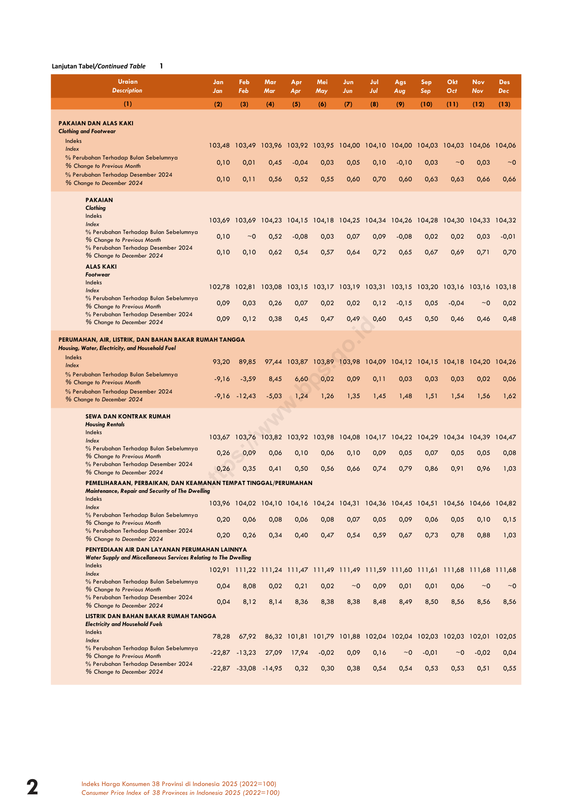

2
Indeks Harga Konsumen 38 Provinsi di Indonesia 2025 (2022=100)
Consumer Price Index of 38 Provinces in Indonesia 2025 (2022=100)
Lanjutan Tabel/Continued Table 
Jan
Jan
Feb
Feb
Mar
Mar
Apr
Apr
Mei
May
Jun
Jun
Jul
Jul
Ags
Aug
Sep
Sep
Okt
Oct
Nov
Nov
Des
Dec
(2)
(3)
(4)
(5)
(6)
(7)
(8)
(9)
(10)
(11)
(12)
(13)
103,48 103,49 103,96 103,92 103,95 104,00 104,10 104,00 104,03 104,03 104,06 104,06
0,10
0,01
0,45
-0,04
0,03
0,05
0,10
-0,10
0,03
~0
0,03
~0
0,10
0,11
0,56
0,52
0,55
0,60
0,70
0,60
0,63
0,63
0,66
0,66
103,69 103,69 104,23 104,15 104,18 104,25 104,34 104,26 104,28 104,30 104,33 104,32
0,10
~0
0,52
-0,08
0,03
0,07
0,09
-0,08
0,02
0,02
0,03
-0,01
0,10
0,10
0,62
0,54
0,57
0,64
0,72
0,65
0,67
0,69
0,71
0,70
102,78 102,81 103,08 103,15 103,17 103,19 103,31 103,15 103,20 103,16 103,16 103,18
0,09
0,03
0,26
0,07
0,02
0,02
0,12
-0,15
0,05
-0,04
~0
0,02
0,09
0,12
0,38
0,45
0,47
0,49
0,60
0,45
0,50
0,46
0,46
0,48
93,20
89,85
97,44 103,87 103,89 103,98 104,09 104,12 104,15 104,18 104,20 104,26
-9,16
-3,59
8,45
6,60
0,02
0,09
0,11
0,03
0,03
0,03
0,02
0,06
-9,16
-12,43
-5,03
1,24
1,26
1,35
1,45
1,48
1,51
1,54
1,56
1,62
103,67 103,76 103,82 103,92 103,98 104,08 104,17 104,22 104,29 104,34 104,39 104,47
0,26
0,09
0,06
0,10
0,06
0,10
0,09
0,05
0,07
0,05
0,05
0,08
0,26
0,35
0,41
0,50
0,56
0,66
0,74
0,79
0,86
0,91
0,96
1,03
103,96 104,02 104,10 104,16 104,24 104,31 104,36 104,45 104,51 104,56 104,66 104,82
0,20
0,06
0,08
0,06
0,08
0,07
0,05
0,09
0,06
0,05
0,10
0,15
0,20
0,26
0,34
0,40
0,47
0,54
0,59
0,67
0,73
0,78
0,88
1,03
102,91 111,22 111,24 111,47 111,49 111,49 111,59 111,60 111,61 111,68 111,68 111,68
0,04
8,08
0,02
0,21
0,02
~0
0,09
0,01
0,01
0,06
~0
~0
0,04
8,12
8,14
8,36
8,38
8,38
8,48
8,49
8,50
8,56
8,56
8,56
78,28
67,92
86,32 101,81 101,79 101,88 102,04 102,04 102,03 102,03 102,01 102,05
-22,87
-13,23
27,09
17,94
-0,02
0,09
0,16
~0
-0,01
~0
-0,02
0,04
-22,87
-33,08
-14,95
0,32
0,30
0,38
0,54
0,54
0,53
0,53
0,51
0,55
PERUMAHAN, AIR, LISTRIK, DAN BAHAN BAKAR RUMAH TANGGA
Housing, Water, Electricity, and Household Fuel
ALAS KAKI
Footwear
Indeks
Index
% Perubahan Terhadap Bulan Sebelumnya
% Change to Previous Month
% Perubahan Terhadap Desember 2024
% Change to December 2024
Indeks
Index
% Perubahan Terhadap Bulan Sebelumnya
% Change to Previous Month
% Perubahan Terhadap Desember 2024
% Change to December 2024
SEWA DAN KONTRAK RUMAH
Housing Rentals
Indeks
Index
% Perubahan Terhadap Bulan Sebelumnya
% Change to Previous Month
% Perubahan Terhadap Desember 2024
% Change to December 2024
PEMELIHARAAN, PERBAIKAN, DAN KEAMANAN TEMPAT TINGGAL/PERUMAHAN
Maintenance, Repair and Security of The Dwelling
Indeks
Index
% Perubahan Terhadap Bulan Sebelumnya
% Change to Previous Month
% Perubahan Terhadap Desember 2024
% Change to December 2024
PENYEDIAAN AIR DAN LAYANAN PERUMAHAN LAINNYA
Water Supply and Miscellaneous Services Relating to The Dwelling
PAKAIAN
Clothing
Indeks
Index
% Perubahan Terhadap Bulan Sebelumnya
% Change to Previous Month
% Perubahan Terhadap Desember 2024
% Change to December 2024
PAKAIAN DAN ALAS KAKI
Clothing and Footwear
Indeks
Index
% Perubahan Terhadap Bulan Sebelumnya
% Change to Previous Month
% Perubahan Terhadap Desember 2024
% Change to December 2024
Uraian
Description
(1)
Indeks
Index
% Perubahan Terhadap Bulan Sebelumnya
% Change to Previous Month
% Perubahan Terhadap Desember 2024
% Change to December 2024
LISTRIK DAN BAHAN BAKAR RUMAH TANGGA
Electricity and Household Fuels
Indeks
Index
% Perubahan Terhadap Bulan Sebelumnya
% Change to Previous Month
% Perubahan Terhadap Desember 2024
% Change to December 2024
1
https://www.bps.go.id

---

## Halaman 33

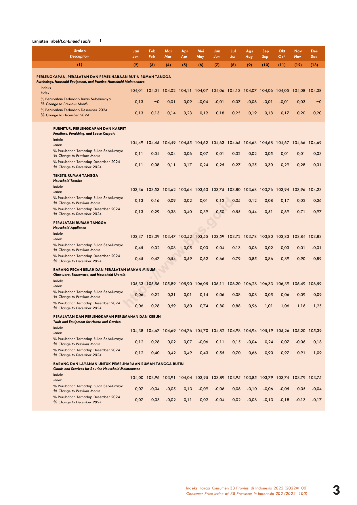

3
Indeks Harga Konsumen 38 Provinsi di Indonesia 2025 (2022=100)
Consumer Price Index of 38 Provinces in Indonesia 202 (2022=100)
Lanjutan Tabel/Continued Table 
Jan
Jan
Feb
Feb
Mar
Mar
Apr
Apr
Mei
May
Jun
Jun
Jul
Jul
Ags
Aug
Sep
Sep
Okt
Oct
Nov
Nov
Des
Dec
(2)
(3)
(4)
(5)
(6)
(7)
(8)
(9)
(10)
(11)
(12)
(13)
104,01 104,01 104,02 104,11 104,07 104,06 104,13 104,07 104,06 104,05 104,08 104,08
0,13
~0
0,01
0,09
-0,04
-0,01
0,07
-0,06
-0,01
-0,01
0,03
~0
0,13
0,13
0,14
0,23
0,19
0,18
0,25
0,19
0,18
0,17
0,20
0,20
104,49 104,45 104,49 104,55 104,62 104,63 104,65 104,63 104,68 104,67 104,66 104,69
0,11
-0,04
0,04
0,06
0,07
0,01
0,02
-0,02
0,05
-0,01
-0,01
0,03
0,11
0,08
0,11
0,17
0,24
0,25
0,27
0,25
0,30
0,29
0,28
0,31
103,36 103,53 103,62 103,64 103,63 103,75 103,80 103,68 103,76 103,94 103,96 104,23
0,13
0,16
0,09
0,02
-0,01
0,12
0,05
-0,12
0,08
0,17
0,02
0,26
0,13
0,29
0,38
0,40
0,39
0,50
0,55
0,44
0,51
0,69
0,71
0,97
103,37 103,39 103,47 103,52 103,55 103,59 103,72 103,78 103,80 103,83 103,84 103,83
0,45
0,02
0,08
0,05
0,03
0,04
0,13
0,06
0,02
0,03
0,01
-0,01
0,45
0,47
0,54
0,59
0,62
0,66
0,79
0,85
0,86
0,89
0,90
0,89
105,33 105,56 105,89 105,90 106,05 106,11 106,20 106,28 106,33 106,39 106,49 106,59
0,06
0,22
0,31
0,01
0,14
0,06
0,08
0,08
0,05
0,06
0,09
0,09
0,06
0,28
0,59
0,60
0,74
0,80
0,88
0,96
1,01
1,06
1,16
1,25
104,38 104,67 104,69 104,76 104,70 104,82 104,98 104,94 105,19 105,26 105,20 105,39
0,12
0,28
0,02
0,07
-0,06
0,11
0,15
-0,04
0,24
0,07
-0,06
0,18
0,12
0,40
0,42
0,49
0,43
0,55
0,70
0,66
0,90
0,97
0,91
1,09
104,00 103,96 103,91 104,04 103,95 103,89 103,95 103,85 103,79 103,74 103,79 103,75
0,07
-0,04
-0,05
0,13
-0,09
-0,06
0,06
-0,10
-0,06
-0,05
0,05
-0,04
0,07
0,03
-0,02
0,11
0,02
-0,04
0,02
-0,08
-0,13
-0,18
-0,13
-0,17
% Perubahan Terhadap Desember 2024
% Change to December 2024
PERALATAN RUMAH TANGGA
Household Appliance
Indeks
Index
% Perubahan Terhadap Bulan Sebelumnya
% Change to Previous Month
% Perubahan Terhadap Desember 2024
% Change to December 2024
Indeks
Index
% Perubahan Terhadap Bulan Sebelumnya
% Change to Previous Month
% Perubahan Terhadap Desember 2024
% Change to December 2024
BARANG DAN LAYANAN UNTUK PEMELIHARAAN RUMAH TANGGA RUTIN
Goods and Services for Routine Household Maintenance
Indeks
Index
% Perubahan Terhadap Bulan Sebelumnya
% Change to Previous Month
% Perubahan Terhadap Desember 2024
% Change to December 2024
% Perubahan Terhadap Desember 2024
% Change to December 2024
PERALATAN DAN PERLENGKAPAN PERUMAHAN DAN KEBUN
Tools and Equipment for House and Garden
% Perubahan Terhadap Bulan Sebelumnya
% Change to Previous Month
PERLENGKAPAN, PERALATAN DAN PEMELIHARAAN RUTIN RUMAH TANGGA
Furnishings, Houshold Equipment, and Routine Household Maintenance
Indeks
Index
% Perubahan Terhadap Desember 2024
% Change to December 2024
FURNITUR, PERLENGKAPAN DAN KARPET
Furniture, Furnishing, and Loose Carpets
Indeks
Index
Uraian
Description
(1)
% Perubahan Terhadap Bulan Sebelumnya
% Change to Previous Month
% Perubahan Terhadap Desember 2024
% Change to December 2024
TEKSTIL RUMAH TANGGA
Household Textiles
Indeks
Index
% Perubahan Terhadap Bulan Sebelumnya
% Change to Previous Month
BARANG PECAH BELAH DAN PERALATAN MAKAN MINUM
Glassware, Tableware, and Household Utensils
Indeks
Index
% Perubahan Terhadap Bulan Sebelumnya
% Change to Previous Month
1
https://www.bps.go.id

---

## Halaman 34

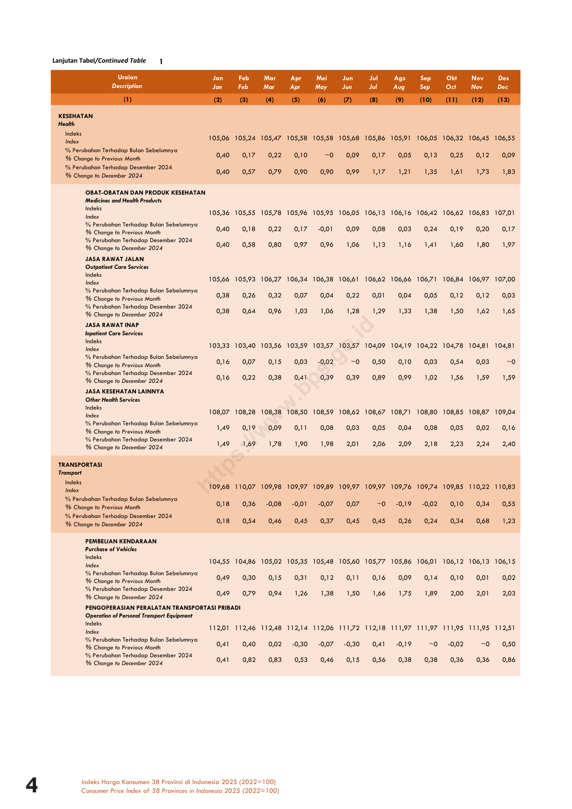

4
Indeks Harga Konsumen 38 Provinsi di Indonesia 2025 (2022=100)
Consumer Price Index of 38 Provinces in Indonesia 2025 (2022=100)
Jan
Jan
Feb
Feb
Mar
Mar
Apr
Apr
Mei
May
Jun
Jun
Jul
Jul
Ags
Aug
Sep
Sep
Okt
Oct
Nov
Nov
Des
Dec
(2)
(3)
(4)
(5)
(6)
(7)
(8)
(9)
(10)
(11)
(12)
(13)
105,06 105,24 105,47 105,58 105,58 105,68 105,86 105,91 106,05 106,32 106,45 106,55
0,40
0,17
0,22
0,10
~0
0,09
0,17
0,05
0,13
0,25
0,12
0,09
0,40
0,57
0,79
0,90
0,90
0,99
1,17
1,21
1,35
1,61
1,73
1,83
105,36 105,55 105,78 105,96 105,95 106,05 106,13 106,16 106,42 106,62 106,83 107,01
0,40
0,18
0,22
0,17
-0,01
0,09
0,08
0,03
0,24
0,19
0,20
0,17
0,40
0,58
0,80
0,97
0,96
1,06
1,13
1,16
1,41
1,60
1,80
1,97
105,66 105,93 106,27 106,34 106,38 106,61 106,62 106,66 106,71 106,84 106,97 107,00
0,38
0,26
0,32
0,07
0,04
0,22
0,01
0,04
0,05
0,12
0,12
0,03
0,38
0,64
0,96
1,03
1,06
1,28
1,29
1,33
1,38
1,50
1,62
1,65
103,33 103,40 103,56 103,59 103,57 103,57 104,09 104,19 104,22 104,78 104,81 104,81
0,16
0,07
0,15
0,03
-0,02
~0
0,50
0,10
0,03
0,54
0,03
~0
0,16
0,22
0,38
0,41
0,39
0,39
0,89
0,99
1,02
1,56
1,59
1,59
108,07 108,28 108,38 108,50 108,59 108,62 108,67 108,71 108,80 108,85 108,87 109,04
1,49
0,19
0,09
0,11
0,08
0,03
0,05
0,04
0,08
0,05
0,02
0,16
1,49
1,69
1,78
1,90
1,98
2,01
2,06
2,09
2,18
2,23
2,24
2,40
109,68 110,07 109,98 109,97 109,89 109,97 109,97 109,76 109,74 109,85 110,22 110,83
0,18
0,36
-0,08
-0,01
-0,07
0,07
~0
-0,19
-0,02
0,10
0,34
0,55
0,18
0,54
0,46
0,45
0,37
0,45
0,45
0,26
0,24
0,34
0,68
1,23
104,55 104,86 105,02 105,35 105,48 105,60 105,77 105,86 106,01 106,12 106,13 106,15
0,49
0,30
0,15
0,31
0,12
0,11
0,16
0,09
0,14
0,10
0,01
0,02
0,49
0,79
0,94
1,26
1,38
1,50
1,66
1,75
1,89
2,00
2,01
2,03
112,01 112,46 112,48 112,14 112,06 111,72 112,18 111,97 111,97 111,95 111,95 112,51
0,41
0,40
0,02
-0,30
-0,07
-0,30
0,41
-0,19
~0
-0,02
~0
0,50
0,41
0,82
0,83
0,53
0,46
0,15
0,56
0,38
0,38
0,36
0,36
0,86
% Perubahan Terhadap Bulan Sebelumnya
% Change to Previous Month
% Perubahan Terhadap Desember 2024
% Change to December 2024
JASA KESEHATAN LAINNYA
Other Health Services
% Perubahan Terhadap Desember 2024
% Change to December 2024
JASA RAWAT JALAN
Outpatient Care Services
Indeks
Index
% Perubahan Terhadap Bulan Sebelumnya
% Change to Previous Month
% Perubahan Terhadap Desember 2024
% Change to December 2024
Indeks
Index
% Perubahan Terhadap Bulan Sebelumnya
% Change to Previous Month
% Perubahan Terhadap Desember 2024
% Change to December 2024
TRANSPORTASI
Transport
Indeks
Index
% Perubahan Terhadap Bulan Sebelumnya
% Change to Previous Month
% Perubahan Terhadap Desember 2024
% Change to December 2024
PEMBELIAN KENDARAAN
Purchase of Vehicles
Indeks
Index
% Perubahan Terhadap Bulan Sebelumnya
% Change to Previous Month
% Perubahan Terhadap Desember 2024
% Change to December 2024
PENGOPERASIAN PERALATAN TRANSPORTASI PRIBADI
Operation of Personal Transport Equipment
Indeks
Index
OBAT-OBATAN DAN PRODUK KESEHATAN
Medicines and Health Products
Indeks
Index
% Perubahan Terhadap Bulan Sebelumnya
% Change to Previous Month
Uraian
Description
(1)
JASA RAWAT INAP
Inpatient Care Services
Indeks
Index
% Perubahan Terhadap Bulan Sebelumnya
% Change to Previous Month
% Perubahan Terhadap Desember 2024
% Change to December 2024
KESEHATAN
Health
Indeks
Index
% Perubahan Terhadap Bulan Sebelumnya
% Change to Previous Month
% Perubahan Terhadap Desember 2024
% Change to December 2024
1
Lanjutan Tabel/Continued Table 
https://www.bps.go.id

---

## Halaman 35

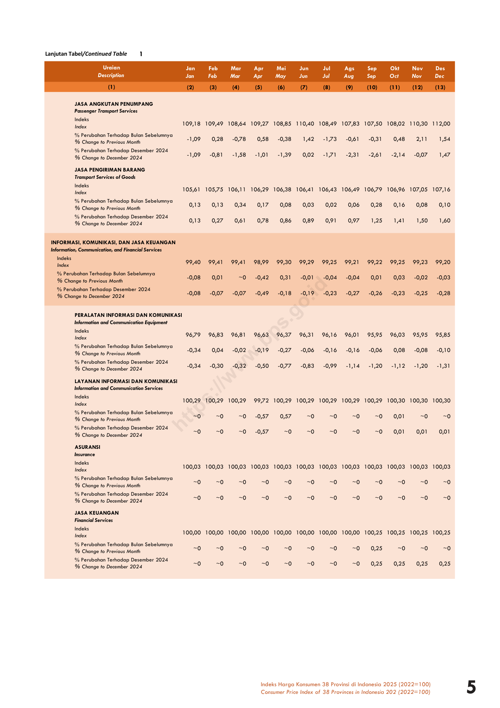

5
Indeks Harga Konsumen 38 Provinsi di Indonesia 2025 (2022=100)
Consumer Price Index of 38 Provinces in Indonesia 202 (2022=100)
Jan
Jan
Feb
Feb
Mar
Mar
Apr
Apr
Mei
May
Jun
Jun
Jul
Jul
Ags
Aug
Sep
Sep
Okt
Oct
Nov
Nov
Des
Dec
(2)
(3)
(4)
(5)
(6)
(7)
(8)
(9)
(10)
(11)
(12)
(13)
109,18 109,49 108,64 109,27 108,85 110,40 108,49 107,83 107,50 108,02 110,30 112,00
-1,09
0,28
-0,78
0,58
-0,38
1,42
-1,73
-0,61
-0,31
0,48
2,11
1,54
-1,09
-0,81
-1,58
-1,01
-1,39
0,02
-1,71
-2,31
-2,61
-2,14
-0,07
1,47
105,61 105,75 106,11 106,29 106,38 106,41 106,43 106,49 106,79 106,96 107,05 107,16
0,13
0,13
0,34
0,17
0,08
0,03
0,02
0,06
0,28
0,16
0,08
0,10
0,13
0,27
0,61
0,78
0,86
0,89
0,91
0,97
1,25
1,41
1,50
1,60
99,40
99,41
99,41
98,99
99,30
99,29
99,25
99,21
99,22
99,25
99,23
99,20
-0,08
0,01
~0
-0,42
0,31
-0,01
-0,04
-0,04
0,01
0,03
-0,02
-0,03
-0,08
-0,07
-0,07
-0,49
-0,18
-0,19
-0,23
-0,27
-0,26
-0,23
-0,25
-0,28
96,79
96,83
96,81
96,63
96,37
96,31
96,16
96,01
95,95
96,03
95,95
95,85
-0,34
0,04
-0,02
-0,19
-0,27
-0,06
-0,16
-0,16
-0,06
0,08
-0,08
-0,10
-0,34
-0,30
-0,32
-0,50
-0,77
-0,83
-0,99
-1,14
-1,20
-1,12
-1,20
-1,31
100,29 100,29 100,29
99,72 100,29 100,29 100,29 100,29 100,29 100,30 100,30 100,30
~0
~0
~0
-0,57
0,57
~0
~0
~0
~0
0,01
~0
~0
~0
~0
~0
-0,57
~0
~0
~0
~0
~0
0,01
0,01
0,01
100,03 100,03 100,03 100,03 100,03 100,03 100,03 100,03 100,03 100,03 100,03 100,03
~0
~0
~0
~0
~0
~0
~0
~0
~0
~0
~0
~0
~0
~0
~0
~0
~0
~0
~0
~0
~0
~0
~0
~0
100,00 100,00 100,00 100,00 100,00 100,00 100,00 100,00 100,25 100,25 100,25 100,25
~0
~0
~0
~0
~0
~0
~0
~0
0,25
~0
~0
~0
~0
~0
~0
~0
~0
~0
~0
~0
0,25
0,25
0,25
0,25
% Perubahan Terhadap Desember 2024
% Change to December 2024
PERALATAN INFORMASI DAN KOMUNIKASI
Information and Communication Equipment
Indeks
Index
% Perubahan Terhadap Bulan Sebelumnya
% Change to Previous Month
% Perubahan Terhadap Desember 2024
% Change to December 2024
LAYANAN INFORMASI DAN KOMUNIKASI
Information and Communication Services
% Perubahan Terhadap Desember 2024
% Change to December 2024
JASA PENGIRIMAN BARANG
Transport Services of Goods
Indeks
Index
% Perubahan Terhadap Bulan Sebelumnya
% Change to Previous Month
% Perubahan Terhadap Desember 2024
% Change to December 2024
JASA ANGKUTAN PENUMPANG
Passenger Transport Services
Indeks
Index
% Perubahan Terhadap Bulan Sebelumnya
% Change to Previous Month
Uraian
Description
(1)
INFORMASI, KOMUNIKASI, DAN JASA KEUANGAN
Information, Communication, and Financial Services
Indeks
Index
% Perubahan Terhadap Bulan Sebelumnya
% Change to Previous Month
% Perubahan Terhadap Desember 2024
% Change to December 2024
% Perubahan Terhadap Bulan Sebelumnya
% Change to Previous Month
% Perubahan Terhadap Desember 2024
% Change to December 2024
JASA KEUANGAN
Financial Services
Indeks
Index
% Perubahan Terhadap Bulan Sebelumnya
% Change to Previous Month
Indeks
Index
% Perubahan Terhadap Bulan Sebelumnya
% Change to Previous Month
% Perubahan Terhadap Desember 2024
% Change to December 2024
ASURANSI
Insurance
Indeks
Index
1
Lanjutan Tabel/Continued Table 
https://www.bps.go.id

---

## Halaman 36

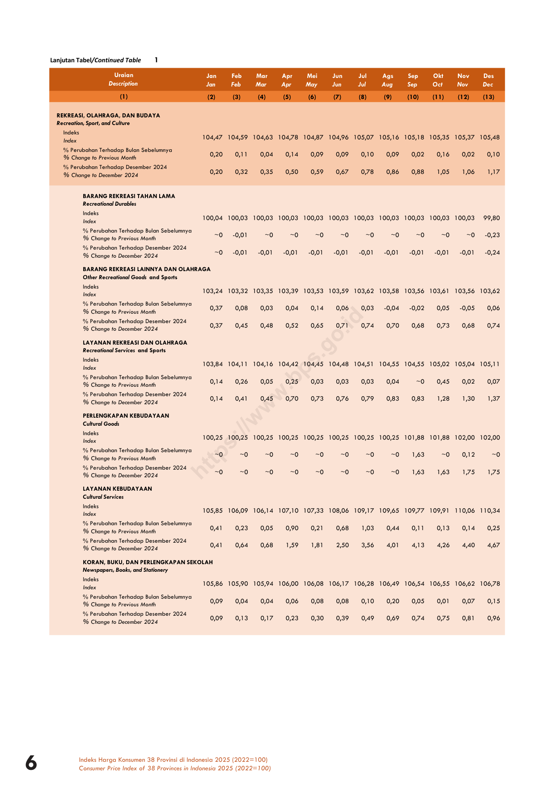

6
Indeks Harga Konsumen 38 Provinsi di Indonesia 2025 (2022=100)
Consumer Price Index of 38 Provinces in Indonesia 2025 (2022=100)
Lanjutan Tabel/Continued Table 
Jan
Jan
Feb
Feb
Mar
Mar
Apr
Apr
Mei
May
Jun
Jun
Jul
Jul
Ags
Aug
Sep
Sep
Okt
Oct
Nov
Nov
Des
Dec
(2)
(3)
(4)
(5)
(6)
(7)
(8)
(9)
(10)
(11)
(12)
(13)
104,47 104,59 104,63 104,78 104,87 104,96 105,07 105,16 105,18 105,35 105,37 105,48
0,20
0,11
0,04
0,14
0,09
0,09
0,10
0,09
0,02
0,16
0,02
0,10
0,20
0,32
0,35
0,50
0,59
0,67
0,78
0,86
0,88
1,05
1,06
1,17
100,04 100,03 100,03 100,03 100,03 100,03 100,03 100,03 100,03 100,03 100,03
99,80
~0
-0,01
~0
~0
~0
~0
~0
~0
~0
~0
~0
-0,23
~0
-0,01
-0,01
-0,01
-0,01
-0,01
-0,01
-0,01
-0,01
-0,01
-0,01
-0,24
103,24 103,32 103,35 103,39 103,53 103,59 103,62 103,58 103,56 103,61 103,56 103,62
0,37
0,08
0,03
0,04
0,14
0,06
0,03
-0,04
-0,02
0,05
-0,05
0,06
0,37
0,45
0,48
0,52
0,65
0,71
0,74
0,70
0,68
0,73
0,68
0,74
103,84 104,11 104,16 104,42 104,45 104,48 104,51 104,55 104,55 105,02 105,04 105,11
0,14
0,26
0,05
0,25
0,03
0,03
0,03
0,04
~0
0,45
0,02
0,07
0,14
0,41
0,45
0,70
0,73
0,76
0,79
0,83
0,83
1,28
1,30
1,37
100,25 100,25 100,25 100,25 100,25 100,25 100,25 100,25 101,88 101,88 102,00 102,00
~0
~0
~0
~0
~0
~0
~0
~0
1,63
~0
0,12
~0
~0
~0
~0
~0
~0
~0
~0
~0
1,63
1,63
1,75
1,75
105,85 106,09 106,14 107,10 107,33 108,06 109,17 109,65 109,77 109,91 110,06 110,34
0,41
0,23
0,05
0,90
0,21
0,68
1,03
0,44
0,11
0,13
0,14
0,25
0,41
0,64
0,68
1,59
1,81
2,50
3,56
4,01
4,13
4,26
4,40
4,67
105,86 105,90 105,94 106,00 106,08 106,17 106,28 106,49 106,54 106,55 106,62 106,78
0,09
0,04
0,04
0,06
0,08
0,08
0,10
0,20
0,05
0,01
0,07
0,15
0,09
0,13
0,17
0,23
0,30
0,39
0,49
0,69
0,74
0,75
0,81
0,96
% Perubahan Terhadap Bulan Sebelumnya
% Change to Previous Month
% Perubahan Terhadap Desember 2024
% Change to December 2024
Indeks
Index
% Perubahan Terhadap Bulan Sebelumnya
% Change to Previous Month
% Perubahan Terhadap Desember 2024
% Change to December 2024
KORAN, BUKU, DAN PERLENGKAPAN SEKOLAH
Newspapers, Books, and Stationery
Indeks
Index
PERLENGKAPAN KEBUDAYAAN
Cultural Goods
Indeks
Index
% Perubahan Terhadap Bulan Sebelumnya
% Change to Previous Month
% Perubahan Terhadap Desember 2024
% Change to December 2024
LAYANAN KEBUDAYAAN
Cultural Services
BARANG REKREASI TAHAN LAMA
Recreational Durables
Indeks
Index
% Perubahan Terhadap Bulan Sebelumnya
% Change to Previous Month
% Perubahan Terhadap Desember 2024
% Change to December 2024
BARANG REKREASI LAINNYA DAN OLAHRAGA
Other Recreational Goods and Sports
Indeks
Index
% Perubahan Terhadap Bulan Sebelumnya
% Change to Previous Month
% Perubahan Terhadap Desember 2024
% Change to December 2024
LAYANAN REKREASI DAN OLAHRAGA
Recreational Services and Sports
Indeks
Index
% Perubahan Terhadap Bulan Sebelumnya
% Change to Previous Month
% Perubahan Terhadap Desember 2024
% Change to December 2024
Uraian
Description
(1)
REKREASI, OLAHRAGA, DAN BUDAYA
Recreation, Sport, and Culture
Indeks
Index
% Perubahan Terhadap Bulan Sebelumnya
% Change to Previous Month
% Perubahan Terhadap Desember 2024
% Change to December 2024
1
https://www.bps.go.id

---

## Halaman 37

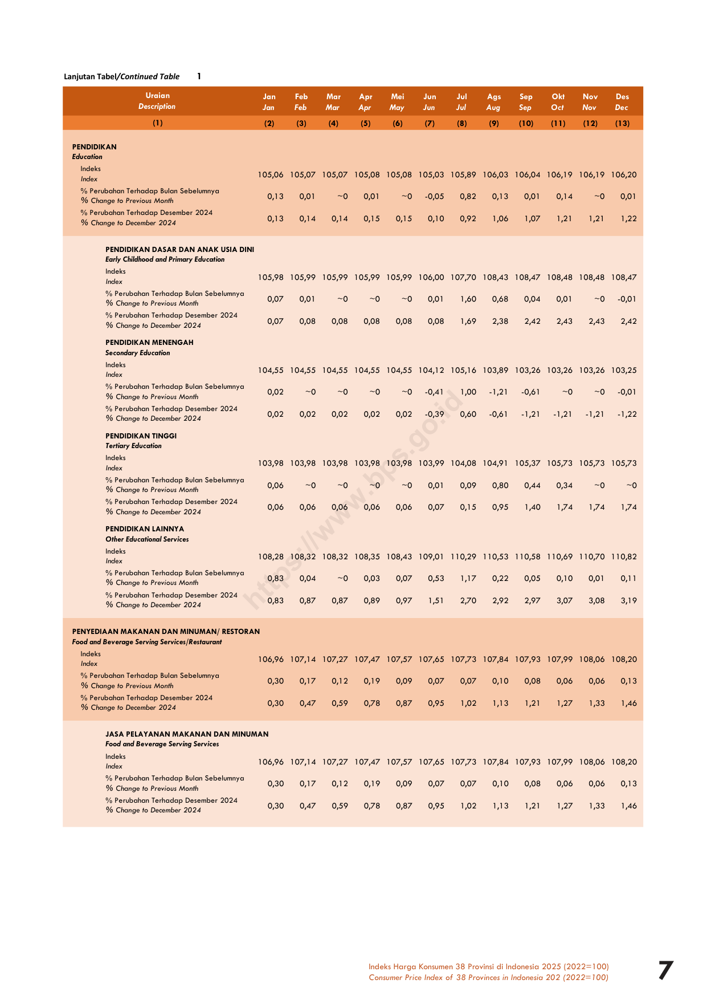

7
Indeks Harga Konsumen 38 Provinsi di Indonesia 2025 (2022=100)
Consumer Price Index of 38 Provinces in Indonesia 202 (2022=100)
Lanjutan Tabel/Continued Table 
Jan
Jan
Feb
Feb
Mar
Mar
Apr
Apr
Mei
May
Jun
Jun
Jul
Jul
Ags
Aug
Sep
Sep
Okt
Oct
Nov
Nov
Des
Dec
(2)
(3)
(4)
(5)
(6)
(7)
(8)
(9)
(10)
(11)
(12)
(13)
105,06 105,07 105,07 105,08 105,08 105,03 105,89 106,03 106,04 106,19 106,19 106,20
0,13
0,01
~0
0,01
~0
-0,05
0,82
0,13
0,01
0,14
~0
0,01
0,13
0,14
0,14
0,15
0,15
0,10
0,92
1,06
1,07
1,21
1,21
1,22
105,98 105,99 105,99 105,99 105,99 106,00 107,70 108,43 108,47 108,48 108,48 108,47
0,07
0,01
~0
~0
~0
0,01
1,60
0,68
0,04
0,01
~0
-0,01
0,07
0,08
0,08
0,08
0,08
0,08
1,69
2,38
2,42
2,43
2,43
2,42
104,55 104,55 104,55 104,55 104,55 104,12 105,16 103,89 103,26 103,26 103,26 103,25
0,02
~0
~0
~0
~0
-0,41
1,00
-1,21
-0,61
~0
~0
-0,01
0,02
0,02
0,02
0,02
0,02
-0,39
0,60
-0,61
-1,21
-1,21
-1,21
-1,22
103,98 103,98 103,98 103,98 103,98 103,99 104,08 104,91 105,37 105,73 105,73 105,73
0,06
~0
~0
~0
~0
0,01
0,09
0,80
0,44
0,34
~0
~0
0,06
0,06
0,06
0,06
0,06
0,07
0,15
0,95
1,40
1,74
1,74
1,74
108,28 108,32 108,32 108,35 108,43 109,01 110,29 110,53 110,58 110,69 110,70 110,82
0,83
0,04
~0
0,03
0,07
0,53
1,17
0,22
0,05
0,10
0,01
0,11
0,83
0,87
0,87
0,89
0,97
1,51
2,70
2,92
2,97
3,07
3,08
3,19
106,96 107,14 107,27 107,47 107,57 107,65 107,73 107,84 107,93 107,99 108,06 108,20
0,30
0,17
0,12
0,19
0,09
0,07
0,07
0,10
0,08
0,06
0,06
0,13
0,30
0,47
0,59
0,78
0,87
0,95
1,02
1,13
1,21
1,27
1,33
1,46
106,96 107,14 107,27 107,47 107,57 107,65 107,73 107,84 107,93 107,99 108,06 108,20
0,30
0,17
0,12
0,19
0,09
0,07
0,07
0,10
0,08
0,06
0,06
0,13
0,30
0,47
0,59
0,78
0,87
0,95
1,02
1,13
1,21
1,27
1,33
1,46
JASA PELAYANAN MAKANAN DAN MINUMAN
Food and Beverage Serving Services
Indeks
Index
% Perubahan Terhadap Bulan Sebelumnya
% Change to Previous Month
% Perubahan Terhadap Desember 2024
% Change to December 2024
PENDIDIKAN DASAR DAN ANAK USIA DINI
Early Childhood and Primary Education
Indeks
Index
% Perubahan Terhadap Bulan Sebelumnya
% Change to Previous Month
Uraian
Description
(1)
% Perubahan Terhadap Bulan Sebelumnya
% Change to Previous Month
% Perubahan Terhadap Desember 2024
% Change to December 2024
% Perubahan Terhadap Desember 2024
% Change to December 2024
PENDIDIKAN MENENGAH
Secondary Education
Indeks
Index
% Perubahan Terhadap Bulan Sebelumnya
% Change to Previous Month
% Perubahan Terhadap Desember 2024
% Change to December 2024
PENDIDIKAN TINGGI
Tertiary Education
% Perubahan Terhadap Bulan Sebelumnya
% Change to Previous Month
% Perubahan Terhadap Desember 2024
% Change to December 2024
Indeks
Index
% Perubahan Terhadap Bulan Sebelumnya
% Change to Previous Month
% Perubahan Terhadap Desember 2024
% Change to December 2024
PENDIDIKAN LAINNYA
Other Educational Services
Indeks
Index
% Perubahan Terhadap Bulan Sebelumnya
% Change to Previous Month
% Perubahan Terhadap Desember 2024
% Change to December 2024
PENYEDIAAN MAKANAN DAN MINUMAN/ RESTORAN
Food and Beverage Serving Services/Restaurant
Indeks
Index
Indeks
Index
PENDIDIKAN
Education
1
https://www.bps.go.id

---

## Halaman 38

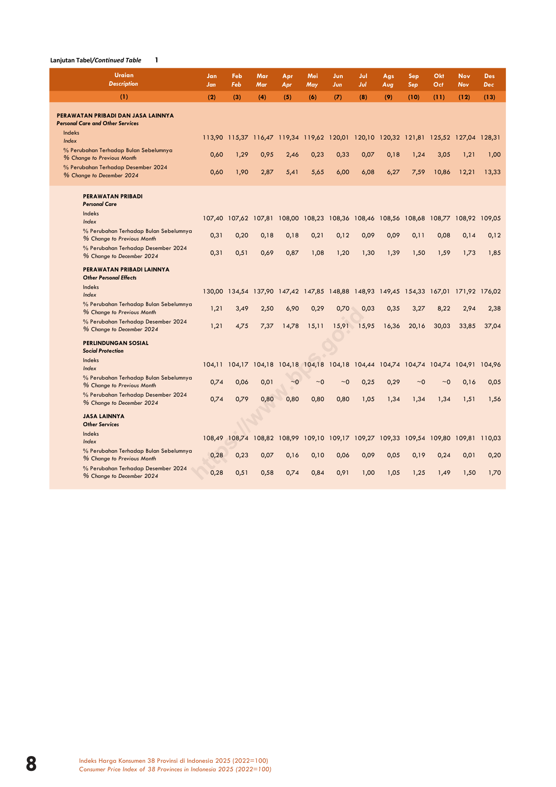

8
Indeks Harga Konsumen 38 Provinsi di Indonesia 2025 (2022=100)
Consumer Price Index of 38 Provinces in Indonesia 2025 (2022=100)
Lanjutan Tabel/Continued Table 
Jan
Jan
Feb
Feb
Mar
Mar
Apr
Apr
Mei
May
Jun
Jun
Jul
Jul
Ags
Aug
Sep
Sep
Okt
Oct
Nov
Nov
Des
Dec
(2)
(3)
(4)
(5)
(6)
(7)
(8)
(9)
(10)
(11)
(12)
(13)
113,90 115,37 116,47 119,34 119,62 120,01 120,10 120,32 121,81 125,52 127,04 128,31
0,60
1,29
0,95
2,46
0,23
0,33
0,07
0,18
1,24
3,05
1,21
1,00
0,60
1,90
2,87
5,41
5,65
6,00
6,08
6,27
7,59
10,86
12,21
13,33
107,40 107,62 107,81 108,00 108,23 108,36 108,46 108,56 108,68 108,77 108,92 109,05
0,31
0,20
0,18
0,18
0,21
0,12
0,09
0,09
0,11
0,08
0,14
0,12
0,31
0,51
0,69
0,87
1,08
1,20
1,30
1,39
1,50
1,59
1,73
1,85
130,00 134,54 137,90 147,42 147,85 148,88 148,93 149,45 154,33 167,01 171,92 176,02
1,21
3,49
2,50
6,90
0,29
0,70
0,03
0,35
3,27
8,22
2,94
2,38
1,21
4,75
7,37
14,78
15,11
15,91
15,95
16,36
20,16
30,03
33,85
37,04
104,11 104,17 104,18 104,18 104,18 104,18 104,44 104,74 104,74 104,74 104,91 104,96
0,74
0,06
0,01
~0
~0
~0
0,25
0,29
~0
~0
0,16
0,05
0,74
0,79
0,80
0,80
0,80
0,80
1,05
1,34
1,34
1,34
1,51
1,56
108,49 108,74 108,82 108,99 109,10 109,17 109,27 109,33 109,54 109,80 109,81 110,03
0,28
0,23
0,07
0,16
0,10
0,06
0,09
0,05
0,19
0,24
0,01
0,20
0,28
0,51
0,58
0,74
0,84
0,91
1,00
1,05
1,25
1,49
1,50
1,70
% Perubahan Terhadap Desember 2024
% Change to December 2024
% Perubahan Terhadap Bulan Sebelumnya
% Change to Previous Month
% Perubahan Terhadap Desember 2024
% Change to December 2024
JASA LAINNYA
Other Services
Indeks
Index
% Perubahan Terhadap Bulan Sebelumnya
% Change to Previous Month
Indeks
Index
% Perubahan Terhadap Bulan Sebelumnya
% Change to Previous Month
% Perubahan Terhadap Desember 2024
% Change to December 2024
PERLINDUNGAN SOSIAL
Social Protection
Indeks
Index
PERAWATAN PRIBADI
Personal Care
Indeks
Index
% Perubahan Terhadap Bulan Sebelumnya
% Change to Previous Month
% Perubahan Terhadap Desember 2024
% Change to December 2024
PERAWATAN PRIBADI LAINNYA
Other Personal Effects
Indeks
Index
% Perubahan Terhadap Bulan Sebelumnya
% Change to Previous Month
% Perubahan Terhadap Desember 2024
% Change to December 2024
PERAWATAN PRIBADI DAN JASA LAINNYA
Personal Care and Other Services
Uraian
Description
(1)
1
https://www.bps.go.id

---

## Halaman 39

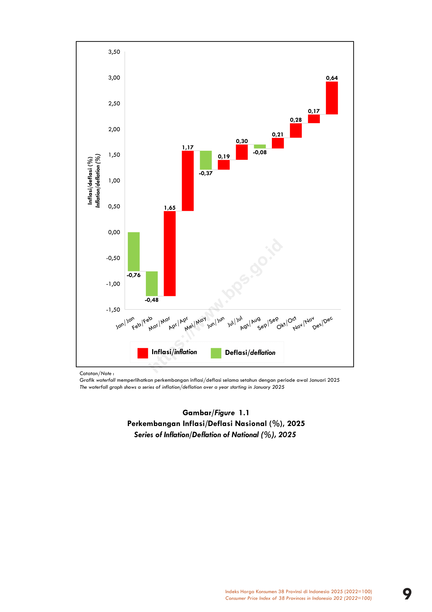

9
Indeks Harga Konsumen 38 Provinsi di Indonesia 2025 (2022=100)
Consumer Price Index of 38 Provinces in Indonesia 202 (2022=100)
Gambar/Figure 1.1
Perkembangan Inflasi/Deflasi Nasional (%), 2025
Series of Inflation/Deflation of National (%), 2025
-0,76
-0,48
1,65
1,17
-0,37
0,19
0,30
-0,08
0,21
0,28
0,17
0,64
Inflasi/deflasi (%)
Inflation/deflation (%)
-1,50
-1,00
-0,50
0,00
0,50
1,00
1,50
2,00
2,50
3,00
3,50
Catatan/Note :
Grafik waterfall memperlihatkan perkembangan inflasi/deflasi selama setahun dengan periode awal Januari 2025
The waterfall graph shows a series of inflation/deflation over a year starting in January 2025
Inflasi/inflation
Deflasi/deflation
https://www.bps.go.id

---

## Halaman 40

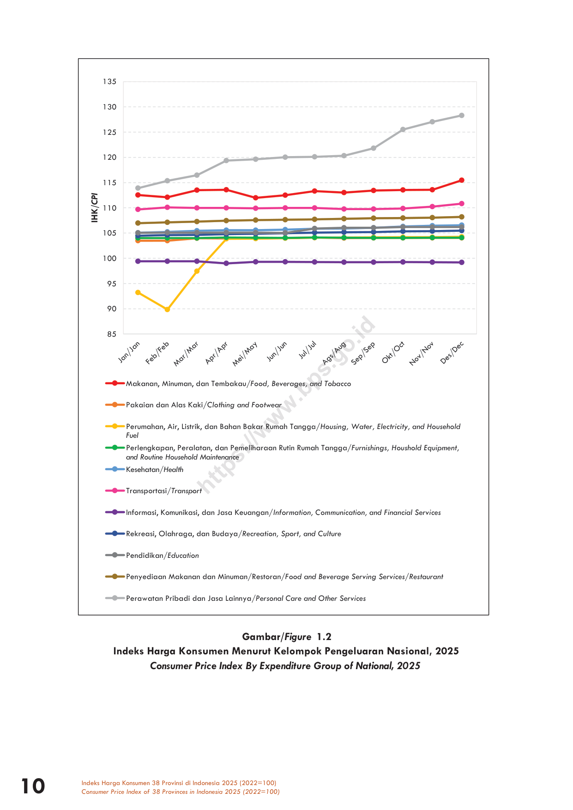

10
Indeks Harga Konsumen 38 Provinsi di Indonesia 2025 (2022=100)
Consumer Price Index of 38 Provinces in Indonesia 2025 (2022=100)
Indeks Harga Konsumen Menurut Kelompok Pengeluaran Nasional, 2025
Consumer Price Index By Expenditure Group of National, 2025
Gambar/Figure 1.2
85
90
95
100
105
110
115
120
125
130
135
IHK/CPI
Makanan, Minuman, dan Tembakau/Food, Beverages, and Tobacco
Pakaian dan Alas Kaki/Clothing and Footwear
Perumahan, Air, Listrik, dan Bahan Bakar Rumah Tangga/Housing, Water, Electricity, and Household 
Fuel
Perlengkapan, Peralatan, dan Pemeliharaan Rutin Rumah Tangga/Furnishings, Houshold Equipment, 
and Routine Household Maintenance
Kesehatan/Health
Transportasi/Transport
Informasi, Komunikasi, dan Jasa Keuangan/Information, Communication, and Financial Services
Rekreasi, Olahraga, dan Budaya/Recreation, Sport, and Culture
Pendidikan/Education
Penyediaan Makanan dan Minuman/Restoran/Food and Beverage Serving Services/Restaurant
Perawatan Pribadi dan Jasa Lainnya/Personal Care and Other Services
https://www.bps.go.id

---

## Halaman 41

11
Indeks Harga Konsumen 38 Provinsi di Indonesia 2025 (2022=100)
Consumer Price Index of 38 Provinces in Indonesia 202 (2022=100)
Tabel
Table
Jan
Jan
Feb
Feb
Mar
Mar
Apr
Apr
Mei
May
Jun
Jun
Jul
Jul
Ags
Aug
Sep
Sep
Okt
Oct
Nov
Nov
Des
Dec
(2)
(3)
(4)
(5)
(6)
(7)
(8)
(9)
(10)
(11)
(12)
(13)
107,07 106,56 108,26 110,00 109,35 109,21 109,95 110,81 111,03 111,16 110,42 114,40
-0,13
-0,48
1,60
1,61
-0,59
-0,13
0,68
0,78
0,20
0,12
-0,67
3,60
-0,13
-0,61
0,98
2,60
2,00
1,87
2,56
3,36
3,56
3,68
2,99
6,71
113,99 113,54 113,89 115,40 113,59 113,12 114,81 117,24 117,58 117,09 115,01 123,80
3,56
-0,39
0,31
1,33
-1,57
-0,41
1,49
2,12
0,29
-0,42
-1,78
7,64
3,56
3,15
3,47
4,84
3,20
2,77
4,31
6,51
6,82
6,38
4,49
12,47
105,30 104,96 106,04 106,55 106,59 106,63 108,04 107,86 107,50 107,53 106,65 106,62
0,33
-0,32
1,03
0,48
0,04
0,04
1,32
-0,17
-0,33
0,03
-0,82
-0,03
0,33
0,01
1,04
1,52
1,56
1,60
2,94
2,77
2,43
2,46
1,62
1,59
93,56
90,07
98,40 104,17 104,27 104,18 104,22 104,23 104,23 104,26 104,28 106,04
-9,97
-3,73
9,25
5,86
0,10
-0,09
0,04
0,01
~0
0,03
0,02
1,69
-9,97
-13,33
-5,31
0,24
0,34
0,25
0,29
0,30
0,30
0,33
0,35
2,04
103,35 103,44 103,06 103,01 102,74 103,00 103,13 103,02 103,09 103,20 102,92 103,71
0,11
0,09
-0,37
-0,05
-0,26
0,25
0,13
-0,11
0,07
0,11
-0,27
0,77
0,11
0,19
-0,17
-0,22
-0,48
-0,23
-0,11
-0,21
-0,15
-0,04
-0,31
0,46
105,76 106,04 106,31 106,77 106,95 107,09 107,35 107,84 108,50 108,75 109,14 109,62
0,27
0,26
0,25
0,43
0,17
0,13
0,24
0,46
0,61
0,23
0,36
0,44
0,27
0,53
0,79
1,22
1,39
1,53
1,77
2,24
2,86
3,10
3,47
3,92
% Perubahan Terhadap Desember 2024
% Change to December 2024
KESEHATAN
Health
Indeks
Index
% Perubahan Terhadap Bulan Sebelumnya
% Change to Previous Month
% Perubahan Terhadap Desember 2024
% Change to December 2024
PAKAIAN DAN ALAS KAKI
Clothing and Footwear
Indeks
Index
% Perubahan Terhadap Bulan Sebelumnya
% Change to Previous Month
% Perubahan Terhadap Desember 2024
% Change to December 2024
PERUMAHAN, AIR, LISTRIK, DAN BAHAN BAKAR RUMAH TANGGA
Housing, Water, Electricity, and Household Fuel
% Perubahan Terhadap Bulan Sebelumnya
% Change to Previous Month
% Perubahan Terhadap Desember 2024
% Change to December 2024
Uraian
Description
(1)
UMUM
Headline
Indeks
Index
% Perubahan Terhadap Bulan Sebelumnya
% Change to Previous Month
% Perubahan Terhadap Desember 2024
% Change to December 2024
MAKANAN, MINUMAN DAN TEMBAKAU
Food, Beverages, and Tobacco
Indeks
Index
% Perubahan Terhadap Bulan Sebelumnya
% Change to Previous Month
Indeks
Index
% Perubahan Terhadap Bulan Sebelumnya
% Change to Previous Month
% Perubahan Terhadap Desember 2024
% Change to December 2024
PERLENGKAPAN, PERALATAN DAN PEMELIHARAAN RUTIN RUMAH TANGGA
Furnishings, Houshold Equipment, and Routine Household Maintenance
Indeks
Index
of Aceh Province, 2025
(2022=100)
Indeks Harga Konsumen (IHK) dan Persentase Perubahan Menurut Kelompok Pengeluaran
Provinsi Aceh, 2025
(2022=100)
Consumer Price Index and Percentage Change By Expenditure Group
2
https://www.bps.go.id

---

## Halaman 42

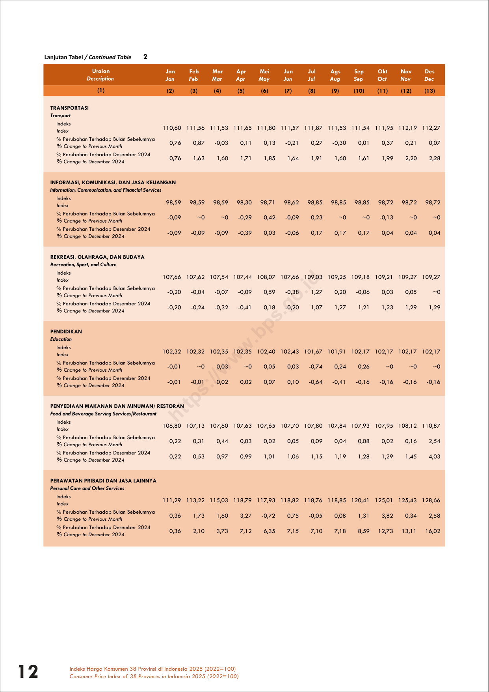

12
Indeks Harga Konsumen 38 Provinsi di Indonesia 2025 (2022=100)
Consumer Price Index of 38 Provinces in Indonesia 2025 (2022=100)
Lanjutan Tabel / Continued Table 
Jan
Jan
Feb
Feb
Mar
Mar
Apr
Apr
Mei
May
Jun
Jun
Jul
Jul
Ags
Aug
Sep
Sep
Okt
Oct
Nov
Nov
Des
Dec
(2)
(3)
(4)
(5)
(6)
(7)
(8)
(9)
(10)
(11)
(12)
(13)
110,60 111,56 111,53 111,65 111,80 111,57 111,87 111,53 111,54 111,95 112,19 112,27
0,76
0,87
-0,03
0,11
0,13
-0,21
0,27
-0,30
0,01
0,37
0,21
0,07
0,76
1,63
1,60
1,71
1,85
1,64
1,91
1,60
1,61
1,99
2,20
2,28
98,59
98,59
98,59
98,30
98,71
98,62
98,85
98,85
98,85
98,72
98,72
98,72
-0,09
~0
~0
-0,29
0,42
-0,09
0,23
~0
~0
-0,13
~0
~0
-0,09
-0,09
-0,09
-0,39
0,03
-0,06
0,17
0,17
0,17
0,04
0,04
0,04
107,66 107,62 107,54 107,44 108,07 107,66 109,03 109,25 109,18 109,21 109,27 109,27
-0,20
-0,04
-0,07
-0,09
0,59
-0,38
1,27
0,20
-0,06
0,03
0,05
~0
-0,20
-0,24
-0,32
-0,41
0,18
-0,20
1,07
1,27
1,21
1,23
1,29
1,29
102,32 102,32 102,35 102,35 102,40 102,43 101,67 101,91 102,17 102,17 102,17 102,17
-0,01
~0
0,03
~0
0,05
0,03
-0,74
0,24
0,26
~0
~0
~0
-0,01
-0,01
0,02
0,02
0,07
0,10
-0,64
-0,41
-0,16
-0,16
-0,16
-0,16
106,80 107,13 107,60 107,63 107,65 107,70 107,80 107,84 107,93 107,95 108,12 110,87
0,22
0,31
0,44
0,03
0,02
0,05
0,09
0,04
0,08
0,02
0,16
2,54
0,22
0,53
0,97
0,99
1,01
1,06
1,15
1,19
1,28
1,29
1,45
4,03
111,29 113,22 115,03 118,79 117,93 118,82 118,76 118,85 120,41 125,01 125,43 128,66
0,36
1,73
1,60
3,27
-0,72
0,75
-0,05
0,08
1,31
3,82
0,34
2,58
0,36
2,10
3,73
7,12
6,35
7,15
7,10
7,18
8,59
12,73
13,11
16,02
Indeks
Index
% Perubahan Terhadap Bulan Sebelumnya
% Change to Previous Month
% Perubahan Terhadap Desember 2024
% Change to December 2024
INFORMASI, KOMUNIKASI, DAN JASA KEUANGAN
Information, Communication, and Financial Services
Indeks
Index
% Perubahan Terhadap Bulan Sebelumnya
% Change to Previous Month
% Perubahan Terhadap Desember 2024
% Change to December 2024
REKREASI, OLAHRAGA, DAN BUDAYA
Recreation, Sport, and Culture
Indeks
Index
% Perubahan Terhadap Bulan Sebelumnya
% Change to Previous Month
% Perubahan Terhadap Desember 2024
% Change to December 2024
PENDIDIKAN
Education
Indeks
Index
% Perubahan Terhadap Bulan Sebelumnya
% Change to Previous Month
% Perubahan Terhadap Desember 2024
% Change to December 2024
% Perubahan Terhadap Bulan Sebelumnya
% Change to Previous Month
% Perubahan Terhadap Desember 2024
% Change to December 2024
PENYEDIAAN MAKANAN DAN MINUMAN/ RESTORAN
Food and Beverage Serving Services/Restaurant
Indeks
Index
% Perubahan Terhadap Bulan Sebelumnya
% Change to Previous Month
% Perubahan Terhadap Desember 2024
% Change to December 2024
PERAWATAN PRIBADI DAN JASA LAINNYA
Personal Care and Other Services
TRANSPORTASI
Transport
Indeks
Index
Uraian
Description
(1)
2
https://www.bps.go.id

---

## Halaman 43

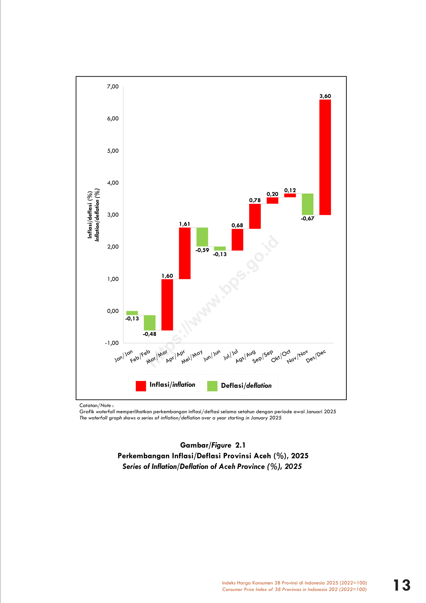

13
Indeks Harga Konsumen 38 Provinsi di Indonesia 2025 (2022=100)
Consumer Price Index of 38 Provinces in Indonesia 202 (2022=100)
Gambar/Figure 2.1
Perkembangan Inflasi/Deflasi Provinsi Aceh (%), 2025
Series of Inflation/Deflation of Aceh Province (%), 2025
-0,13
-0,48
1,60
1,61
-0,59 -0,13
0,68
0,78
0,20
0,12
-0,67
3,60
Inflasi/deflasi (%)
Inflation/deflation (%)
-1,00
0,00
1,00
2,00
3,00
4,00
5,00
6,00
7,00
Catatan/Note :
Grafik waterfall memperlihatkan perkembangan inflasi/deflasi selama setahun dengan periode awal Januari 2025
The waterfall graph shows a series of inflation/deflation over a year starting in January 2025
Inflasi/inflation
Deflasi/deflation
https://www.bps.go.id

---

## Halaman 44

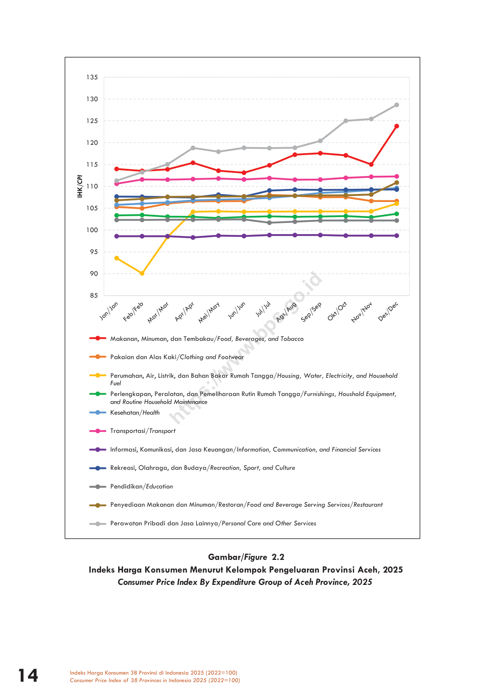

14
Indeks Harga Konsumen 38 Provinsi di Indonesia 2025 (2022=100)
Consumer Price Index of 38 Provinces in Indonesia 2025 (2022=100)
Indeks Harga Konsumen Menurut Kelompok Pengeluaran Provinsi Aceh, 2025
Consumer Price Index By Expenditure Group of Aceh Province, 2025
Gambar/Figure 2.2
85
90
95
100
105
110
115
120
125
130
135
IHK/CPI
Makanan, Minuman, dan Tembakau/Food, Beverages, and Tobacco
Pakaian dan Alas Kaki/Clothing and Footwear
Perumahan, Air, Listrik, dan Bahan Bakar Rumah Tangga/Housing, Water, Electricity, and Household 
Fuel
Perlengkapan, Peralatan, dan Pemeliharaan Rutin Rumah Tangga/Furnishings, Houshold Equipment, 
and Routine Household Maintenance
Kesehatan/Health
Transportasi/Transport
Informasi, Komunikasi, dan Jasa Keuangan/Information, Communication, and Financial Services
Rekreasi, Olahraga, dan Budaya/Recreation, Sport, and Culture
Pendidikan/Education
Penyediaan Makanan dan Minuman/Restoran/Food and Beverage Serving Services/Restaurant
Perawatan Pribadi dan Jasa Lainnya/Personal Care and Other Services
https://www.bps.go.id

---

## Halaman 45

15
Indeks Harga Konsumen 38 Provinsi di Indonesia 2025 (2022=100)
Consumer Price Index of 38 Provinces in Indonesia 202 (2022=100)
Tabel
Table
Jan
Jan
Feb
Feb
Mar
Mar
Apr
Apr
Mei
May
Jun
Jun
Jul
Jul
Ags
Aug
Sep
Sep
Okt
Oct
Nov
Nov
Des
Dec
(2)
(3)
(4)
(5)
(6)
(7)
(8)
(9)
(10)
(11)
(12)
(13)
107,32 106,64 107,37 108,82 108,29 108,08 108,90 110,39 111,11 110,89 110,42 112,25
0,07
-0,63
0,68
1,35
-0,49
-0,19
0,76
1,37
0,65
-0,20
-0,42
1,66
0,07
-0,57
0,11
1,46
0,97
0,77
1,54
2,93
3,60
3,39
2,96
4,66
114,45 113,90 113,37 114,06 112,40 111,50 113,56 117,73 119,27 117,78 116,03 120,71
2,82
-0,48
-0,47
0,61
-1,46
-0,80
1,85
3,67
1,31
-1,25
-1,49
4,03
2,82
2,33
1,85
2,47
0,98
0,17
2,02
5,77
7,15
5,81
4,24
8,44
106,07 106,19 106,45 106,51 106,54 106,72 106,95 106,30 106,65 106,90 106,81 107,44
0,27
0,11
0,24
0,06
0,03
0,17
0,22
-0,61
0,33
0,23
-0,08
0,59
0,27
0,39
0,63
0,69
0,72
0,89
1,11
0,49
0,82
1,06
0,97
1,57
94,75
90,71
96,30 102,16 102,25 102,40 102,46 102,49 102,49 102,71 102,63 102,72
-7,11
-4,26
6,16
6,09
0,09
0,15
0,06
0,03
~0
0,21
-0,08
0,09
-7,11
-11,07
-5,59
0,16
0,25
0,39
0,45
0,48
0,48
0,70
0,62
0,71
102,41 102,36 102,38 102,46 102,34 102,28 102,40 102,20 102,33 101,86 101,92 102,16
-0,04
-0,05
0,02
0,08
-0,12
-0,06
0,12
-0,20
0,13
-0,46
0,06
0,24
-0,04
-0,09
-0,07
0,01
-0,11
-0,17
-0,05
-0,24
-0,12
-0,58
-0,52
-0,28
105,19 105,59 105,96 106,13 106,24 106,21 106,28 106,83 106,98 107,95 107,91 108,09
0,38
0,38
0,35
0,16
0,10
-0,03
0,07
0,52
0,14
0,91
-0,04
0,17
0,38
0,76
1,12
1,28
1,38
1,36
1,42
1,95
2,09
3,02
2,98
3,15
of Sumatera Utara Province, 2025
(2022=100)
Indeks Harga Konsumen (IHK) dan Persentase Perubahan Menurut Kelompok Pengeluaran
Provinsi Sumatera Utara, 2025
(2022=100)
Consumer Price Index and Percentage Change By Expenditure Group
% Perubahan Terhadap Bulan Sebelumnya
% Change to Previous Month
% Perubahan Terhadap Desember 2024
% Change to December 2024
Uraian
Description
(1)
UMUM
Headline
Indeks
Index
% Perubahan Terhadap Bulan Sebelumnya
% Change to Previous Month
% Perubahan Terhadap Desember 2024
% Change to December 2024
MAKANAN, MINUMAN DAN TEMBAKAU
Food, Beverages, and Tobacco
Indeks
Index
% Perubahan Terhadap Bulan Sebelumnya
% Change to Previous Month
Indeks
Index
% Perubahan Terhadap Bulan Sebelumnya
% Change to Previous Month
% Perubahan Terhadap Desember 2024
% Change to December 2024
PERLENGKAPAN, PERALATAN DAN PEMELIHARAAN RUTIN RUMAH TANGGA
Furnishings, Houshold Equipment, and Routine Household Maintenance
Indeks
Index
PAKAIAN DAN ALAS KAKI
Clothing and Footwear
Indeks
Index
% Perubahan Terhadap Bulan Sebelumnya
% Change to Previous Month
% Perubahan Terhadap Desember 2024
% Change to December 2024
PERUMAHAN, AIR, LISTRIK, DAN BAHAN BAKAR RUMAH TANGGA
Housing, Water, Electricity, and Household Fuel
% Perubahan Terhadap Desember 2024
% Change to December 2024
KESEHATAN
Health
Indeks
Index
% Perubahan Terhadap Bulan Sebelumnya
% Change to Previous Month
% Perubahan Terhadap Desember 2024
% Change to December 2024
3
https://www.bps.go.id

---

## Halaman 46

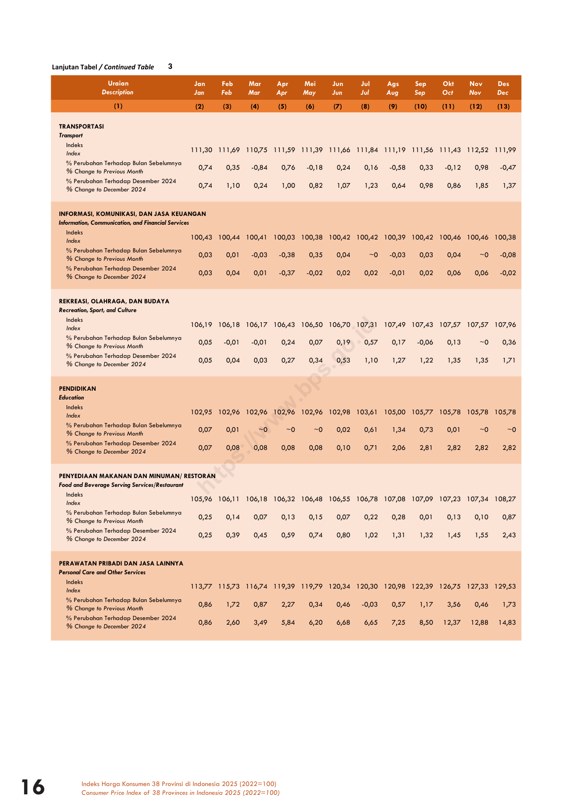

16
Indeks Harga Konsumen 38 Provinsi di Indonesia 2025 (2022=100)
Consumer Price Index of 38 Provinces in Indonesia 2025 (2022=100)
Lanjutan Tabel / Continued Table 
Jan
Jan
Feb
Feb
Mar
Mar
Apr
Apr
Mei
May
Jun
Jun
Jul
Jul
Ags
Aug
Sep
Sep
Okt
Oct
Nov
Nov
Des
Dec
(2)
(3)
(4)
(5)
(6)
(7)
(8)
(9)
(10)
(11)
(12)
(13)
111,30 111,69 110,75 111,59 111,39 111,66 111,84 111,19 111,56 111,43 112,52 111,99
0,74
0,35
-0,84
0,76
-0,18
0,24
0,16
-0,58
0,33
-0,12
0,98
-0,47
0,74
1,10
0,24
1,00
0,82
1,07
1,23
0,64
0,98
0,86
1,85
1,37
100,43 100,44 100,41 100,03 100,38 100,42 100,42 100,39 100,42 100,46 100,46 100,38
0,03
0,01
-0,03
-0,38
0,35
0,04
~0
-0,03
0,03
0,04
~0
-0,08
0,03
0,04
0,01
-0,37
-0,02
0,02
0,02
-0,01
0,02
0,06
0,06
-0,02
106,19 106,18 106,17 106,43 106,50 106,70 107,31 107,49 107,43 107,57 107,57 107,96
0,05
-0,01
-0,01
0,24
0,07
0,19
0,57
0,17
-0,06
0,13
~0
0,36
0,05
0,04
0,03
0,27
0,34
0,53
1,10
1,27
1,22
1,35
1,35
1,71
102,95 102,96 102,96 102,96 102,96 102,98 103,61 105,00 105,77 105,78 105,78 105,78
0,07
0,01
~0
~0
~0
0,02
0,61
1,34
0,73
0,01
~0
~0
0,07
0,08
0,08
0,08
0,08
0,10
0,71
2,06
2,81
2,82
2,82
2,82
105,96 106,11 106,18 106,32 106,48 106,55 106,78 107,08 107,09 107,23 107,34 108,27
0,25
0,14
0,07
0,13
0,15
0,07
0,22
0,28
0,01
0,13
0,10
0,87
0,25
0,39
0,45
0,59
0,74
0,80
1,02
1,31
1,32
1,45
1,55
2,43
113,77 115,73 116,74 119,39 119,79 120,34 120,30 120,98 122,39 126,75 127,33 129,53
0,86
1,72
0,87
2,27
0,34
0,46
-0,03
0,57
1,17
3,56
0,46
1,73
0,86
2,60
3,49
5,84
6,20
6,68
6,65
7,25
8,50
12,37
12,88
14,83
TRANSPORTASI
Transport
Indeks
Index
Uraian
Description
(1)
Indeks
Index
% Perubahan Terhadap Bulan Sebelumnya
% Change to Previous Month
% Perubahan Terhadap Desember 2024
% Change to December 2024
% Perubahan Terhadap Bulan Sebelumnya
% Change to Previous Month
% Perubahan Terhadap Desember 2024
% Change to December 2024
PENYEDIAAN MAKANAN DAN MINUMAN/ RESTORAN
Food and Beverage Serving Services/Restaurant
Indeks
Index
% Perubahan Terhadap Bulan Sebelumnya
% Change to Previous Month
% Perubahan Terhadap Desember 2024
% Change to December 2024
PERAWATAN PRIBADI DAN JASA LAINNYA
Personal Care and Other Services
Indeks
Index
% Perubahan Terhadap Bulan Sebelumnya
% Change to Previous Month
% Perubahan Terhadap Desember 2024
% Change to December 2024
INFORMASI, KOMUNIKASI, DAN JASA KEUANGAN
Information, Communication, and Financial Services
Indeks
Index
% Perubahan Terhadap Bulan Sebelumnya
% Change to Previous Month
% Perubahan Terhadap Desember 2024
% Change to December 2024
REKREASI, OLAHRAGA, DAN BUDAYA
Recreation, Sport, and Culture
Indeks
Index
% Perubahan Terhadap Bulan Sebelumnya
% Change to Previous Month
% Perubahan Terhadap Desember 2024
% Change to December 2024
PENDIDIKAN
Education
3
https://www.bps.go.id

---

## Halaman 47

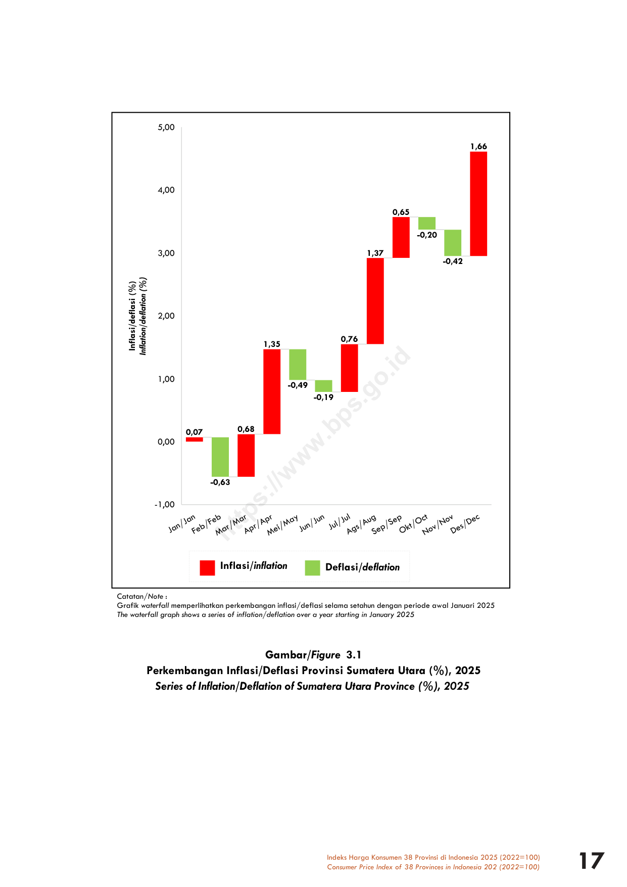

17
Indeks Harga Konsumen 38 Provinsi di Indonesia 2025 (2022=100)
Consumer Price Index of 38 Provinces in Indonesia 202 (2022=100)
Gambar/Figure 3.1
Perkembangan Inflasi/Deflasi Provinsi Sumatera Utara (%), 2025
Series of Inflation/Deflation of Sumatera Utara Province (%), 2025
0,07
-0,63
0,68
1,35
-0,49
-0,19
0,76
1,37
0,65
-0,20
-0,42
1,66
Inflasi/deflasi (%)
Inflation/deflation (%)
-1,00
0,00
1,00
2,00
3,00
4,00
5,00
Catatan/Note :
Grafik waterfall memperlihatkan perkembangan inflasi/deflasi selama setahun dengan periode awal Januari 2025
The waterfall graph shows a series of inflation/deflation over a year starting in January 2025
Inflasi/inflation
Deflasi/deflation
https://www.bps.go.id

---

## Halaman 48

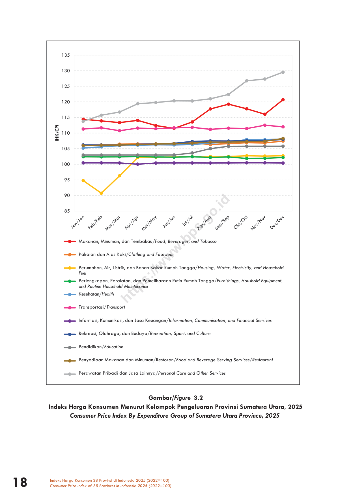

18
Indeks Harga Konsumen 38 Provinsi di Indonesia 2025 (2022=100)
Consumer Price Index of 38 Provinces in Indonesia 2025 (2022=100)
Indeks Harga Konsumen Menurut Kelompok Pengeluaran Provinsi Sumatera Utara, 2025
Consumer Price Index By Expenditure Group of Sumatera Utara Province, 2025
Gambar/Figure 3.2
85
90
95
100
105
110
115
120
125
130
135
IHK/CPI
Makanan, Minuman, dan Tembakau/Food, Beverages, and Tobacco
Pakaian dan Alas Kaki/Clothing and Footwear
Perumahan, Air, Listrik, dan Bahan Bakar Rumah Tangga/Housing, Water, Electricity, and Household 
Fuel
Perlengkapan, Peralatan, dan Pemeliharaan Rutin Rumah Tangga/Furnishings, Houshold Equipment, 
and Routine Household Maintenance
Kesehatan/Health
Transportasi/Transport
Informasi, Komunikasi, dan Jasa Keuangan/Information, Communication, and Financial Services
Rekreasi, Olahraga, dan Budaya/Recreation, Sport, and Culture
Pendidikan/Education
Penyediaan Makanan dan Minuman/Restoran/Food and Beverage Serving Services/Restaurant
Perawatan Pribadi dan Jasa Lainnya/Personal Care and Other Services
https://www.bps.go.id

---

## Halaman 49

19
Indeks Harga Konsumen 38 Provinsi di Indonesia 2025 (2022=100)
Consumer Price Index of 38 Provinces in Indonesia 202 (2022=100)
Tabel
Table
Jan
Jan
Feb
Feb
Mar
Mar
Apr
Apr
Mei
May
Jun
Jun
Jul
Jul
Ags
Aug
Sep
Sep
Okt
Oct
Nov
Nov
Des
Dec
(2)
(3)
(4)
(5)
(6)
(7)
(8)
(9)
(10)
(11)
(12)
(13)
106,93 106,76 107,86 109,77 108,69 108,41 109,10 109,67 110,60 111,04 110,77 112,41
0,03
-0,16
1,03
1,77
-0,98
-0,26
0,64
0,52
0,85
0,40
-0,24
1,48
0,03
-0,13
0,90
2,68
1,67
1,41
2,06
2,59
3,46
3,87
3,62
5,15
114,05 113,93 113,28 115,49 112,15 111,02 112,94 114,70 117,02 117,57 116,51 120,80
3,65
-0,11
-0,57
1,95
-2,89
-1,01
1,73
1,56
2,02
0,47
-0,90
3,68
3,65
3,54
2,95
4,96
1,93
0,90
2,64
4,24
6,35
6,85
5,89
9,79
103,60 103,61 103,81 103,85 103,90 103,92 103,97 103,98 103,98 103,98 103,98 103,98
0,03
0,01
0,19
0,04
0,05
0,02
0,05
0,01
~0
~0
~0
~0
0,03
0,04
0,23
0,27
0,32
0,34
0,39
0,40
0,40
0,40
0,40
0,40
95,40
93,74 100,47 104,21 104,22 104,36 104,38 104,41 104,47 104,66 104,75 104,76
-7,56
-1,74
7,18
3,72
0,01
0,13
0,02
0,03
0,06
0,18
0,09
0,01
-7,56
-9,17
-2,65
0,98
0,99
1,12
1,14
1,17
1,23
1,41
1,50
1,51
104,12 104,20 104,31 104,25 104,30 104,26 104,31 104,22 104,15 104,04 104,14 104,13
0,11
0,08
0,11
-0,06
0,05
-0,04
0,05
-0,09
-0,07
-0,11
0,10
-0,01
0,11
0,18
0,29
0,23
0,28
0,24
0,29
0,20
0,13
0,03
0,12
0,12
105,35 105,49 105,53 105,58 105,59 105,63 105,65 105,72 105,73 105,82 105,87 105,87
0,15
0,13
0,04
0,05
0,01
0,04
0,02
0,07
0,01
0,09
0,05
~0
0,15
0,29
0,32
0,37
0,38
0,42
0,44
0,50
0,51
0,60
0,65
0,65
% Perubahan Terhadap Desember 2024
% Change to December 2024
KESEHATAN
Health
Indeks
Index
% Perubahan Terhadap Bulan Sebelumnya
% Change to Previous Month
% Perubahan Terhadap Desember 2024
% Change to December 2024
PAKAIAN DAN ALAS KAKI
Clothing and Footwear
Indeks
Index
% Perubahan Terhadap Bulan Sebelumnya
% Change to Previous Month
% Perubahan Terhadap Desember 2024
% Change to December 2024
PERUMAHAN, AIR, LISTRIK, DAN BAHAN BAKAR RUMAH TANGGA
Housing, Water, Electricity, and Household Fuel
% Perubahan Terhadap Bulan Sebelumnya
% Change to Previous Month
% Perubahan Terhadap Desember 2024
% Change to December 2024
Uraian
Description
(1)
UMUM
Headline
Indeks
Index
% Perubahan Terhadap Bulan Sebelumnya
% Change to Previous Month
% Perubahan Terhadap Desember 2024
% Change to December 2024
MAKANAN, MINUMAN DAN TEMBAKAU
Food, Beverages, and Tobacco
Indeks
Index
% Perubahan Terhadap Bulan Sebelumnya
% Change to Previous Month
Indeks
Index
% Perubahan Terhadap Bulan Sebelumnya
% Change to Previous Month
% Perubahan Terhadap Desember 2024
% Change to December 2024
PERLENGKAPAN, PERALATAN DAN PEMELIHARAAN RUTIN RUMAH TANGGA
Furnishings, Houshold Equipment, and Routine Household Maintenance
Indeks
Index
of Sumatera Barat Province, 2025
(2022=100)
Indeks Harga Konsumen (IHK) dan Persentase Perubahan Menurut Kelompok Pengeluaran
Provinsi Sumatera Barat, 2025
(2022=100)
Consumer Price Index and Percentage Change By Expenditure Group
4
https://www.bps.go.id

---

## Halaman 50

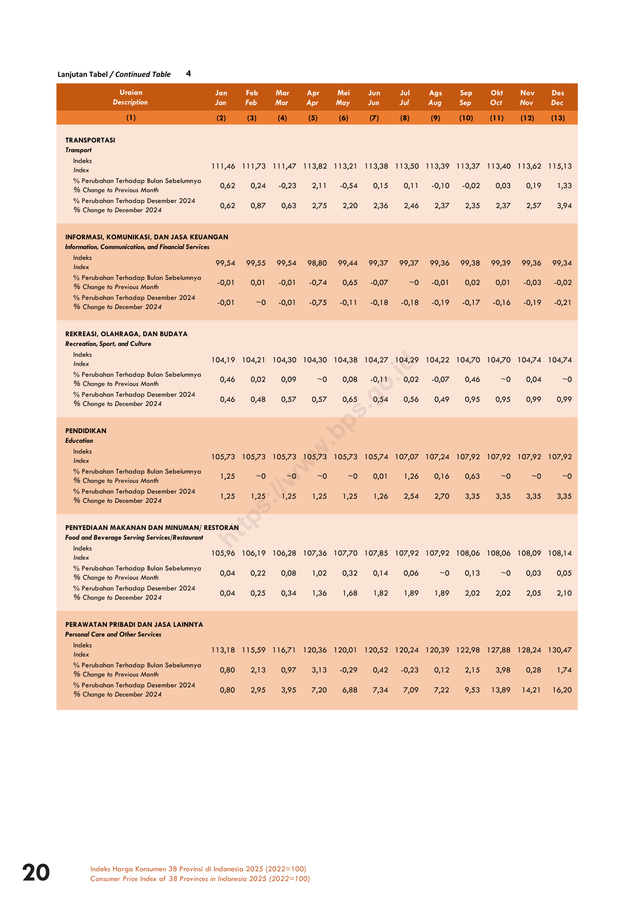

20
Indeks Harga Konsumen 38 Provinsi di Indonesia 2025 (2022=100)
Consumer Price Index of 38 Provinces in Indonesia 2025 (2022=100)
Lanjutan Tabel / Continued Table 
Jan
Jan
Feb
Feb
Mar
Mar
Apr
Apr
Mei
May
Jun
Jun
Jul
Jul
Ags
Aug
Sep
Sep
Okt
Oct
Nov
Nov
Des
Dec
(2)
(3)
(4)
(5)
(6)
(7)
(8)
(9)
(10)
(11)
(12)
(13)
111,46 111,73 111,47 113,82 113,21 113,38 113,50 113,39 113,37 113,40 113,62 115,13
0,62
0,24
-0,23
2,11
-0,54
0,15
0,11
-0,10
-0,02
0,03
0,19
1,33
0,62
0,87
0,63
2,75
2,20
2,36
2,46
2,37
2,35
2,37
2,57
3,94
99,54
99,55
99,54
98,80
99,44
99,37
99,37
99,36
99,38
99,39
99,36
99,34
-0,01
0,01
-0,01
-0,74
0,65
-0,07
~0
-0,01
0,02
0,01
-0,03
-0,02
-0,01
~0
-0,01
-0,75
-0,11
-0,18
-0,18
-0,19
-0,17
-0,16
-0,19
-0,21
104,19 104,21 104,30 104,30 104,38 104,27 104,29 104,22 104,70 104,70 104,74 104,74
0,46
0,02
0,09
~0
0,08
-0,11
0,02
-0,07
0,46
~0
0,04
~0
0,46
0,48
0,57
0,57
0,65
0,54
0,56
0,49
0,95
0,95
0,99
0,99
105,73 105,73 105,73 105,73 105,73 105,74 107,07 107,24 107,92 107,92 107,92 107,92
1,25
~0
~0
~0
~0
0,01
1,26
0,16
0,63
~0
~0
~0
1,25
1,25
1,25
1,25
1,25
1,26
2,54
2,70
3,35
3,35
3,35
3,35
105,96 106,19 106,28 107,36 107,70 107,85 107,92 107,92 108,06 108,06 108,09 108,14
0,04
0,22
0,08
1,02
0,32
0,14
0,06
~0
0,13
~0
0,03
0,05
0,04
0,25
0,34
1,36
1,68
1,82
1,89
1,89
2,02
2,02
2,05
2,10
113,18 115,59 116,71 120,36 120,01 120,52 120,24 120,39 122,98 127,88 128,24 130,47
0,80
2,13
0,97
3,13
-0,29
0,42
-0,23
0,12
2,15
3,98
0,28
1,74
0,80
2,95
3,95
7,20
6,88
7,34
7,09
7,22
9,53
13,89
14,21
16,20
Indeks
Index
% Perubahan Terhadap Bulan Sebelumnya
% Change to Previous Month
% Perubahan Terhadap Desember 2024
% Change to December 2024
INFORMASI, KOMUNIKASI, DAN JASA KEUANGAN
Information, Communication, and Financial Services
Indeks
Index
% Perubahan Terhadap Bulan Sebelumnya
% Change to Previous Month
% Perubahan Terhadap Desember 2024
% Change to December 2024
REKREASI, OLAHRAGA, DAN BUDAYA
Recreation, Sport, and Culture
Indeks
Index
% Perubahan Terhadap Bulan Sebelumnya
% Change to Previous Month
% Perubahan Terhadap Desember 2024
% Change to December 2024
PENDIDIKAN
Education
Indeks
Index
% Perubahan Terhadap Bulan Sebelumnya
% Change to Previous Month
% Perubahan Terhadap Desember 2024
% Change to December 2024
% Perubahan Terhadap Bulan Sebelumnya
% Change to Previous Month
% Perubahan Terhadap Desember 2024
% Change to December 2024
PENYEDIAAN MAKANAN DAN MINUMAN/ RESTORAN
Food and Beverage Serving Services/Restaurant
Indeks
Index
% Perubahan Terhadap Bulan Sebelumnya
% Change to Previous Month
% Perubahan Terhadap Desember 2024
% Change to December 2024
PERAWATAN PRIBADI DAN JASA LAINNYA
Personal Care and Other Services
TRANSPORTASI
Transport
Indeks
Index
Uraian
Description
(1)
4
https://www.bps.go.id

---

## Halaman 51

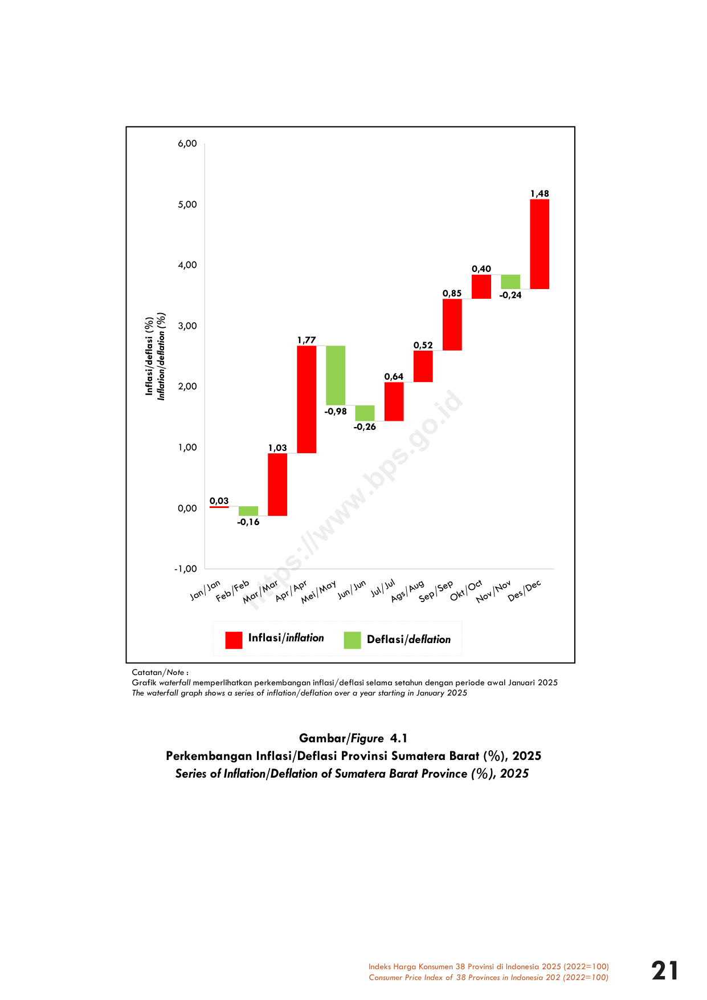

21
Indeks Harga Konsumen 38 Provinsi di Indonesia 2025 (2022=100)
Consumer Price Index of 38 Provinces in Indonesia 202 (2022=100)
Gambar/Figure 4.1
Perkembangan Inflasi/Deflasi Provinsi Sumatera Barat (%), 2025
Series of Inflation/Deflation of Sumatera Barat Province (%), 2025
0,03
-0,16
1,03
1,77
-0,98
-0,26
0,64
0,52
0,85
0,40
-0,24
1,48
Inflasi/deflasi (%)
Inflation/deflation (%)
-1,00
0,00
1,00
2,00
3,00
4,00
5,00
6,00
Catatan/Note :
Grafik waterfall memperlihatkan perkembangan inflasi/deflasi selama setahun dengan periode awal Januari 2025
The waterfall graph shows a series of inflation/deflation over a year starting in January 2025
Inflasi/inflation
Deflasi/deflation
https://www.bps.go.id

---

## Halaman 52

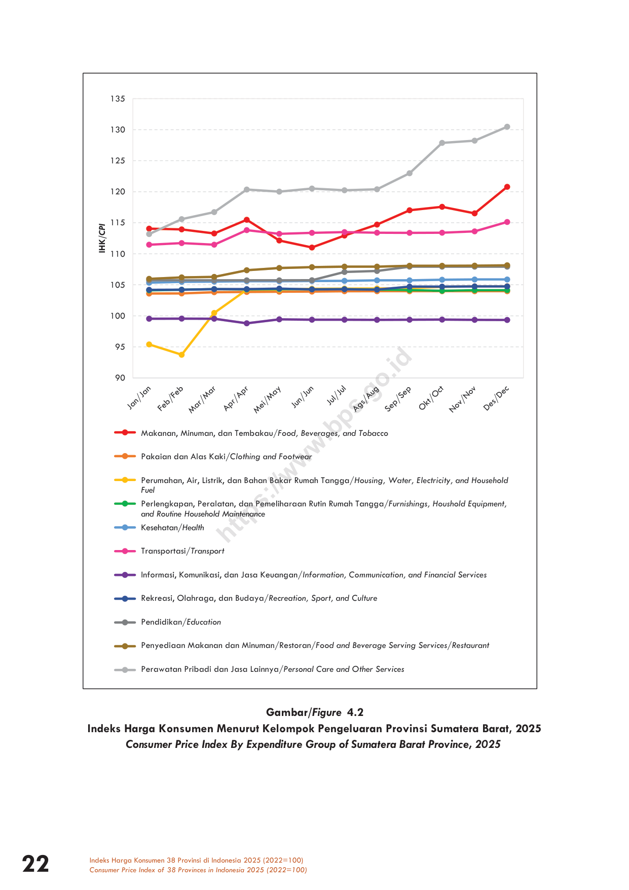

22
Indeks Harga Konsumen 38 Provinsi di Indonesia 2025 (2022=100)
Consumer Price Index of 38 Provinces in Indonesia 2025 (2022=100)
Indeks Harga Konsumen Menurut Kelompok Pengeluaran Provinsi Sumatera Barat, 2025
Consumer Price Index By Expenditure Group of Sumatera Barat Province, 2025
Gambar/Figure 4.2
90
95
100
105
110
115
120
125
130
135
IHK/CPI
Makanan, Minuman, dan Tembakau/Food, Beverages, and Tobacco
Pakaian dan Alas Kaki/Clothing and Footwear
Perumahan, Air, Listrik, dan Bahan Bakar Rumah Tangga/Housing, Water, Electricity, and Household 
Fuel
Perlengkapan, Peralatan, dan Pemeliharaan Rutin Rumah Tangga/Furnishings, Houshold Equipment, 
and Routine Household Maintenance
Kesehatan/Health
Transportasi/Transport
Informasi, Komunikasi, dan Jasa Keuangan/Information, Communication, and Financial Services
Rekreasi, Olahraga, dan Budaya/Recreation, Sport, and Culture
Pendidikan/Education
Penyediaan Makanan dan Minuman/Restoran/Food and Beverage Serving Services/Restaurant
Perawatan Pribadi dan Jasa Lainnya/Personal Care and Other Services
https://www.bps.go.id

---

## Halaman 53

23
Indeks Harga Konsumen 38 Provinsi di Indonesia 2025 (2022=100)
Consumer Price Index of 38 Provinces in Indonesia 202 (2022=100)
Tabel
Table
Jan
Jan
Feb
Feb
Mar
Mar
Apr
Apr
Mei
May
Jun
Jun
Jul
Jul
Ags
Aug
Sep
Sep
Okt
Oct
Nov
Nov
Des
Dec
(2)
(3)
(4)
(5)
(6)
(7)
(8)
(9)
(10)
(11)
(12)
(13)
106,96 106,42 107,90 109,44 108,59 108,35 109,02 109,95 111,17 111,10 110,86 112,20
-0,02
-0,50
1,39
1,43
-0,78
-0,22
0,62
0,85
1,11
-0,06
-0,22
1,21
-0,02
-0,52
0,86
2,30
1,50
1,28
1,91
2,78
3,92
3,85
3,63
4,88
111,46 110,49 110,85 112,71 109,59 108,64 110,56 112,83 116,23 114,92 113,77 117,16
3,53
-0,87
0,33
1,68
-2,77
-0,87
1,77
2,05
3,01
-1,13
-1,00
2,98
3,53
2,63
2,96
4,69
1,79
0,91
2,69
4,80
7,96
6,74
5,68
8,82
103,23 103,26 105,45 105,32 105,19 105,09 105,09 105,04 104,88 104,89 104,96 105,05
0,24
0,03
2,12
-0,12
-0,12
-0,10
~0
-0,05
-0,15
0,01
0,07
0,09
0,24
0,27
2,40
2,27
2,15
2,05
2,05
2,00
1,85
1,85
1,92
2,01
91,92
88,89
97,61 102,64 102,91 102,92 102,98 102,97 102,97 102,97 103,06 103,09
-10,11
-3,30
9,81
5,15
0,26
0,01
0,06
-0,01
~0
~0
0,09
0,03
-10,11
-13,07
-4,55
0,37
0,64
0,65
0,70
0,69
0,69
0,69
0,78
0,81
103,13 102,95 102,82 102,84 102,81 102,81 102,73 102,54 102,54 102,45 102,09 102,16
-0,02
-0,17
-0,13
0,02
-0,03
~0
-0,08
-0,18
~0
-0,09
-0,35
0,07
-0,02
-0,19
-0,32
-0,30
-0,33
-0,33
-0,41
-0,59
-0,59
-0,68
-1,03
-0,96
104,70 104,93 105,17 105,22 105,24 105,26 105,32 105,85 105,90 105,94 105,75 105,77
0,20
0,22
0,23
0,05
0,02
0,02
0,06
0,50
0,05
0,04
-0,18
0,02
0,20
0,42
0,65
0,70
0,72
0,74
0,79
1,30
1,35
1,39
1,21
1,22
of Riau Province, 2025
(2022=100)
Indeks Harga Konsumen (IHK) dan Persentase Perubahan Menurut Kelompok Pengeluaran
Provinsi Riau, 2025
(2022=100)
Consumer Price Index and Percentage Change By Expenditure Group
% Perubahan Terhadap Bulan Sebelumnya
% Change to Previous Month
% Perubahan Terhadap Desember 2024
% Change to December 2024
Uraian
Description
(1)
UMUM
Headline
Indeks
Index
% Perubahan Terhadap Bulan Sebelumnya
% Change to Previous Month
% Perubahan Terhadap Desember 2024
% Change to December 2024
MAKANAN, MINUMAN DAN TEMBAKAU
Food, Beverages, and Tobacco
Indeks
Index
% Perubahan Terhadap Bulan Sebelumnya
% Change to Previous Month
Indeks
Index
% Perubahan Terhadap Bulan Sebelumnya
% Change to Previous Month
% Perubahan Terhadap Desember 2024
% Change to December 2024
PERLENGKAPAN, PERALATAN DAN PEMELIHARAAN RUTIN RUMAH TANGGA
Furnishings, Houshold Equipment, and Routine Household Maintenance
Indeks
Index
PAKAIAN DAN ALAS KAKI
Clothing and Footwear
Indeks
Index
% Perubahan Terhadap Bulan Sebelumnya
% Change to Previous Month
% Perubahan Terhadap Desember 2024
% Change to December 2024
PERUMAHAN, AIR, LISTRIK, DAN BAHAN BAKAR RUMAH TANGGA
Housing, Water, Electricity, and Household Fuel
% Perubahan Terhadap Desember 2024
% Change to December 2024
KESEHATAN
Health
Indeks
Index
% Perubahan Terhadap Bulan Sebelumnya
% Change to Previous Month
% Perubahan Terhadap Desember 2024
% Change to December 2024
5
https://www.bps.go.id

---

## Halaman 54

24
Indeks Harga Konsumen 38 Provinsi di Indonesia 2025 (2022=100)
Consumer Price Index of 38 Provinces in Indonesia 2025 (2022=100)
Lanjutan Tabel / Continued Table 
Jan
Jan
Feb
Feb
Mar
Mar
Apr
Apr
Mei
May
Jun
Jun
Jul
Jul
Ags
Aug
Sep
Sep
Okt
Oct
Nov
Nov
Des
Dec
(2)
(3)
(4)
(5)
(6)
(7)
(8)
(9)
(10)
(11)
(12)
(13)
112,70 112,64 112,15 112,45 112,46 112,72 112,59 112,63 112,81 112,75 113,31 113,62
0,71
-0,05
-0,44
0,27
0,01
0,23
-0,12
0,04
0,16
-0,05
0,50
0,27
0,71
0,65
0,21
0,48
0,49
0,72
0,61
0,64
0,80
0,75
1,25
1,53
100,08 100,09 100,01
99,48
99,99 100,01
99,99
99,98
99,93
99,94
99,98
99,97
-0,02
0,01
-0,08
-0,53
0,51
0,02
-0,02
-0,01
-0,05
0,01
0,04
-0,01
-0,02
-0,01
-0,09
-0,62
-0,11
-0,09
-0,11
-0,12
-0,17
-0,16
-0,12
-0,13
104,65 104,35 104,30 104,30 104,30 104,26 104,26 104,26 104,14 104,16 104,30 104,20
-0,08
-0,29
-0,05
~0
~0
-0,04
~0
~0
-0,12
0,02
0,13
-0,10
-0,08
-0,36
-0,41
-0,41
-0,41
-0,45
-0,45
-0,45
-0,56
-0,54
-0,41
-0,51
103,25 103,25 103,25 103,25 103,25 103,25 104,31 107,83 107,88 107,95 107,95 108,35
0,04
~0
~0
~0
~0
~0
1,03
3,37
0,05
0,06
~0
0,37
0,04
0,04
0,04
0,04
0,04
0,04
1,07
4,48
4,52
4,59
4,59
4,98
111,17 111,92 111,99 112,22 112,71 112,75 112,93 112,99 113,09 113,51 113,56 113,89
0,42
0,67
0,06
0,21
0,44
0,04
0,16
0,05
0,09
0,37
0,04
0,29
0,42
1,09
1,16
1,36
1,81
1,84
2,01
2,06
2,15
2,53
2,57
2,87
115,34 117,17 118,36 121,71 122,27 122,79 122,81 123,13 124,77 129,38 130,16 132,52
0,53
1,59
1,02
2,83
0,46
0,43
0,02
0,26
1,33
3,69
0,60
1,81
0,53
2,13
3,16
6,08
6,57
7,03
7,04
7,32
8,75
12,77
13,45
15,51
TRANSPORTASI
Transport
Indeks
Index
Uraian
Description
(1)
Indeks
Index
% Perubahan Terhadap Bulan Sebelumnya
% Change to Previous Month
% Perubahan Terhadap Desember 2024
% Change to December 2024
% Perubahan Terhadap Bulan Sebelumnya
% Change to Previous Month
% Perubahan Terhadap Desember 2024
% Change to December 2024
PENYEDIAAN MAKANAN DAN MINUMAN/ RESTORAN
Food and Beverage Serving Services/Restaurant
Indeks
Index
% Perubahan Terhadap Bulan Sebelumnya
% Change to Previous Month
% Perubahan Terhadap Desember 2024
% Change to December 2024
PERAWATAN PRIBADI DAN JASA LAINNYA
Personal Care and Other Services
Indeks
Index
% Perubahan Terhadap Bulan Sebelumnya
% Change to Previous Month
% Perubahan Terhadap Desember 2024
% Change to December 2024
INFORMASI, KOMUNIKASI, DAN JASA KEUANGAN
Information, Communication, and Financial Services
Indeks
Index
% Perubahan Terhadap Bulan Sebelumnya
% Change to Previous Month
% Perubahan Terhadap Desember 2024
% Change to December 2024
REKREASI, OLAHRAGA, DAN BUDAYA
Recreation, Sport, and Culture
Indeks
Index
% Perubahan Terhadap Bulan Sebelumnya
% Change to Previous Month
% Perubahan Terhadap Desember 2024
% Change to December 2024
PENDIDIKAN
Education
5
https://www.bps.go.id

---

## Halaman 55

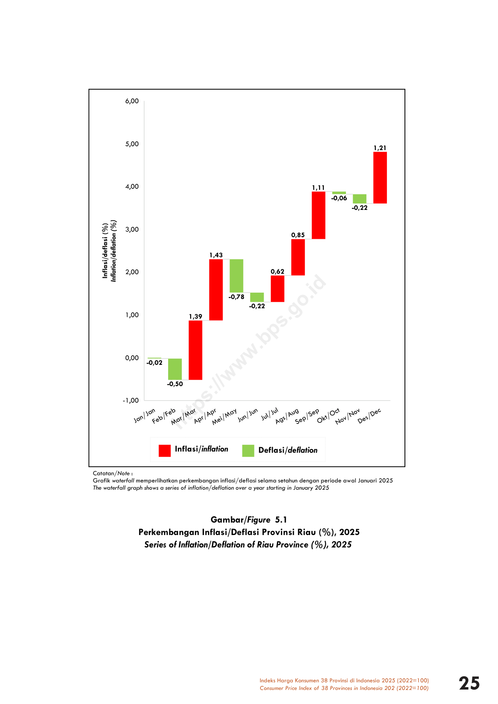

25
Indeks Harga Konsumen 38 Provinsi di Indonesia 2025 (2022=100)
Consumer Price Index of 38 Provinces in Indonesia 202 (2022=100)
Gambar/Figure 5.1
Perkembangan Inflasi/Deflasi Provinsi Riau (%), 2025
Series of Inflation/Deflation of Riau Province (%), 2025
-0,02
-0,50
1,39
1,43
-0,78
-0,22
0,62
0,85
1,11
-0,06
-0,22
1,21
Inflasi/deflasi (%)
Inflation/deflation (%)
-1,00
0,00
1,00
2,00
3,00
4,00
5,00
6,00
Catatan/Note :
Grafik waterfall memperlihatkan perkembangan inflasi/deflasi selama setahun dengan periode awal Januari 2025
The waterfall graph shows a series of inflation/deflation over a year starting in January 2025
Inflasi/inflation
Deflasi/deflation
https://www.bps.go.id

---

## Halaman 56

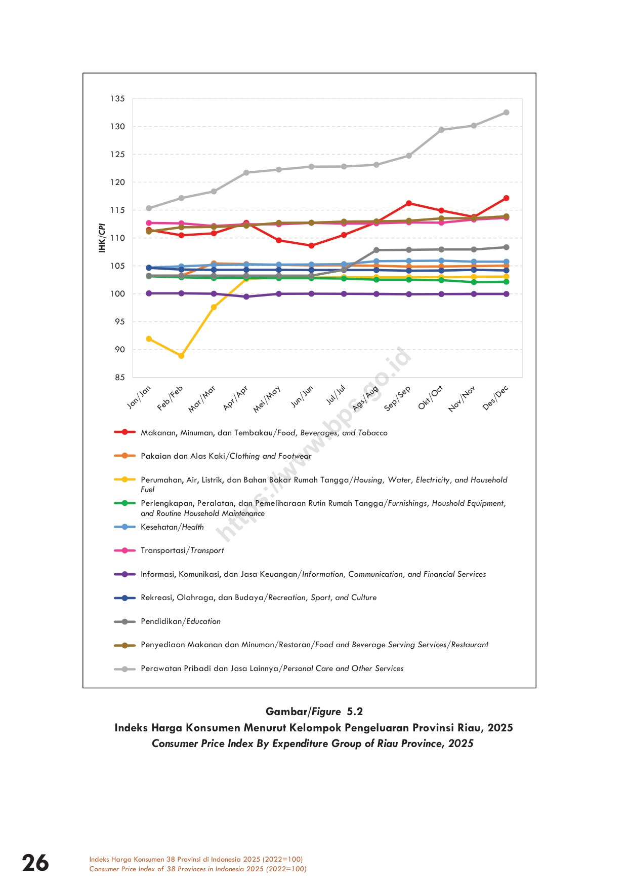

26
Indeks Harga Konsumen 38 Provinsi di Indonesia 2025 (2022=100)
Consumer Price Index of 38 Provinces in Indonesia 2025 (2022=100)
Indeks Harga Konsumen Menurut Kelompok Pengeluaran Provinsi Riau, 2025
Consumer Price Index By Expenditure Group of Riau Province, 2025
Gambar/Figure 5.2
85
90
95
100
105
110
115
120
125
130
135
IHK/CPI
Makanan, Minuman, dan Tembakau/Food, Beverages, and Tobacco
Pakaian dan Alas Kaki/Clothing and Footwear
Perumahan, Air, Listrik, dan Bahan Bakar Rumah Tangga/Housing, Water, Electricity, and Household 
Fuel
Perlengkapan, Peralatan, dan Pemeliharaan Rutin Rumah Tangga/Furnishings, Houshold Equipment, 
and Routine Household Maintenance
Kesehatan/Health
Transportasi/Transport
Informasi, Komunikasi, dan Jasa Keuangan/Information, Communication, and Financial Services
Rekreasi, Olahraga, dan Budaya/Recreation, Sport, and Culture
Pendidikan/Education
Penyediaan Makanan dan Minuman/Restoran/Food and Beverage Serving Services/Restaurant
Perawatan Pribadi dan Jasa Lainnya/Personal Care and Other Services
https://www.bps.go.id

---

## Halaman 57

27
Indeks Harga Konsumen 38 Provinsi di Indonesia 2025 (2022=100)
Consumer Price Index of 38 Provinces in Indonesia 202 (2022=100)
Tabel
Table
Jan
Jan
Feb
Feb
Mar
Mar
Apr
Apr
Mei
May
Jun
Jun
Jul
Jul
Ags
Aug
Sep
Sep
Okt
Oct
Nov
Nov
Des
Dec
(2)
(3)
(4)
(5)
(6)
(7)
(8)
(9)
(10)
(11)
(12)
(13)
106,41 105,77 106,97 108,79 108,05 108,31 108,87 108,92 109,80 109,77 109,82 110,50
-0,13
-0,60
1,13
1,70
-0,68
0,24
0,52
0,05
0,81
-0,03
0,05
0,62
-0,13
-0,73
0,39
2,10
1,41
1,65
2,18
2,22
3,05
3,02
3,07
3,71
112,70 112,37 112,76 114,15 111,67 111,87 113,90 114,36 116,26 115,20 114,92 116,67
2,87
-0,29
0,35
1,23
-2,17
0,18
1,81
0,40
1,66
-0,91
-0,24
1,52
2,87
2,56
2,92
4,19
1,93
2,11
3,96
4,38
6,12
5,15
4,89
6,49
105,67 105,79 105,86 106,04 106,11 106,03 106,14 106,06 106,07 106,16 106,15 106,16
0,39
0,11
0,07
0,17
0,07
-0,08
0,10
-0,08
0,01
0,08
-0,01
0,01
0,39
0,50
0,57
0,74
0,81
0,73
0,84
0,76
0,77
0,86
0,85
0,86
93,29
88,17
95,36 102,82 102,86 102,90 102,90 102,90 102,94 103,54 103,54 103,58
-8,81
-5,49
8,15
7,82
0,04
0,04
~0
~0
0,04
0,58
~0
0,04
-8,81
-13,81
-6,78
0,51
0,55
0,59
0,59
0,59
0,63
1,21
1,21
1,25
105,27 105,21 105,28 105,22 104,89 105,06 104,91 104,73 104,58 104,55 104,71 104,65
0,25
-0,06
0,07
-0,06
-0,31
0,16
-0,14
-0,17
-0,14
-0,03
0,15
-0,06
0,25
0,19
0,26
0,20
-0,11
0,05
-0,10
-0,27
-0,41
-0,44
-0,29
-0,34
100,49 100,62 100,50 100,68 100,76 101,02 101,06 101,28 100,83 100,72 100,72 100,74
0,34
0,13
-0,12
0,18
0,08
0,26
0,04
0,22
-0,44
-0,11
~0
0,02
0,34
0,47
0,35
0,53
0,61
0,87
0,91
1,13
0,68
0,57
0,57
0,59
% Perubahan Terhadap Desember 2024
% Change to December 2024
KESEHATAN
Health
Indeks
Index
% Perubahan Terhadap Bulan Sebelumnya
% Change to Previous Month
% Perubahan Terhadap Desember 2024
% Change to December 2024
PAKAIAN DAN ALAS KAKI
Clothing and Footwear
Indeks
Index
% Perubahan Terhadap Bulan Sebelumnya
% Change to Previous Month
% Perubahan Terhadap Desember 2024
% Change to December 2024
PERUMAHAN, AIR, LISTRIK, DAN BAHAN BAKAR RUMAH TANGGA
Housing, Water, Electricity, and Household Fuel
% Perubahan Terhadap Bulan Sebelumnya
% Change to Previous Month
% Perubahan Terhadap Desember 2024
% Change to December 2024
Uraian
Description
(1)
UMUM
Headline
Indeks
Index
% Perubahan Terhadap Bulan Sebelumnya
% Change to Previous Month
% Perubahan Terhadap Desember 2024
% Change to December 2024
MAKANAN, MINUMAN DAN TEMBAKAU
Food, Beverages, and Tobacco
Indeks
Index
% Perubahan Terhadap Bulan Sebelumnya
% Change to Previous Month
Indeks
Index
% Perubahan Terhadap Bulan Sebelumnya
% Change to Previous Month
% Perubahan Terhadap Desember 2024
% Change to December 2024
PERLENGKAPAN, PERALATAN DAN PEMELIHARAAN RUTIN RUMAH TANGGA
Furnishings, Houshold Equipment, and Routine Household Maintenance
Indeks
Index
of Jambi Province, 2025
(2022=100)
Indeks Harga Konsumen (IHK) dan Persentase Perubahan Menurut Kelompok Pengeluaran
Provinsi Jambi, 2025
(2022=100)
Consumer Price Index and Percentage Change By Expenditure Group
6
https://www.bps.go.id

---

## Halaman 58

28
Indeks Harga Konsumen 38 Provinsi di Indonesia 2025 (2022=100)
Consumer Price Index of 38 Provinces in Indonesia 2025 (2022=100)
Lanjutan Tabel / Continued Table 
Jan
Jan
Feb
Feb
Mar
Mar
Apr
Apr
Mei
May
Jun
Jun
Jul
Jul
Ags
Aug
Sep
Sep
Okt
Oct
Nov
Nov
Des
Dec
(2)
(3)
(4)
(5)
(6)
(7)
(8)
(9)
(10)
(11)
(12)
(13)
110,07 110,41 110,56 110,49 110,65 111,77 110,93 110,19 111,67 111,60 111,55 111,77
0,37
0,31
0,14
-0,06
0,14
1,01
-0,75
-0,67
1,34
-0,06
-0,04
0,20
0,37
0,68
0,82
0,76
0,90
1,92
1,16
0,48
1,83
1,77
1,72
1,92
98,78
98,71
98,67
98,33
98,70
98,62
98,50
98,55
98,54
98,58
98,56
98,52
0,04
-0,07
-0,04
-0,34
0,38
-0,08
-0,12
0,05
-0,01
0,04
-0,02
-0,04
0,04
-0,03
-0,07
-0,42
-0,04
-0,12
-0,24
-0,19
-0,20
-0,16
-0,18
-0,22
105,83 105,53 105,75 107,76 107,88 108,31 108,34 108,36 108,51 108,57 108,59 108,56
0,09
-0,28
0,21
1,90
0,11
0,40
0,03
0,02
0,14
0,06
0,02
-0,03
0,09
-0,19
0,02
1,92
2,03
2,44
2,47
2,49
2,63
2,69
2,71
2,68
103,09 103,09 103,09 103,09 103,09 103,09 104,54 104,88 105,27 105,27 105,27 105,27
0,09
~0
~0
~0
~0
~0
1,41
0,33
0,37
~0
~0
~0
0,09
0,09
0,09
0,09
0,09
0,09
1,50
1,83
2,20
2,20
2,20
2,20
105,43 106,16 106,26 107,68 107,68 107,73 107,73 107,73 107,99 107,99 108,85 108,95
0,33
0,69
0,09
1,34
~0
0,05
~0
~0
0,24
~0
0,80
0,09
0,33
1,03
1,12
2,47
2,47
2,52
2,52
2,52
2,77
2,77
3,59
3,68
113,37 114,36 114,99 117,64 117,44 118,02 117,69 117,44 118,96 121,99 122,79 124,38
0,39
0,87
0,55
2,30
-0,17
0,49
-0,28
-0,21
1,29
2,55
0,66
1,29
0,39
1,27
1,82
4,17
3,99
4,51
4,22
3,99
5,34
8,02
8,73
10,14
Indeks
Index
% Perubahan Terhadap Bulan Sebelumnya
% Change to Previous Month
% Perubahan Terhadap Desember 2024
% Change to December 2024
INFORMASI, KOMUNIKASI, DAN JASA KEUANGAN
Information, Communication, and Financial Services
Indeks
Index
% Perubahan Terhadap Bulan Sebelumnya
% Change to Previous Month
% Perubahan Terhadap Desember 2024
% Change to December 2024
REKREASI, OLAHRAGA, DAN BUDAYA
Recreation, Sport, and Culture
Indeks
Index
% Perubahan Terhadap Bulan Sebelumnya
% Change to Previous Month
% Perubahan Terhadap Desember 2024
% Change to December 2024
PENDIDIKAN
Education
Indeks
Index
% Perubahan Terhadap Bulan Sebelumnya
% Change to Previous Month
% Perubahan Terhadap Desember 2024
% Change to December 2024
% Perubahan Terhadap Bulan Sebelumnya
% Change to Previous Month
% Perubahan Terhadap Desember 2024
% Change to December 2024
PENYEDIAAN MAKANAN DAN MINUMAN/ RESTORAN
Food and Beverage Serving Services/Restaurant
Indeks
Index
% Perubahan Terhadap Bulan Sebelumnya
% Change to Previous Month
% Perubahan Terhadap Desember 2024
% Change to December 2024
PERAWATAN PRIBADI DAN JASA LAINNYA
Personal Care and Other Services
TRANSPORTASI
Transport
Indeks
Index
Uraian
Description
(1)
6
https://www.bps.go.id

---

## Halaman 59

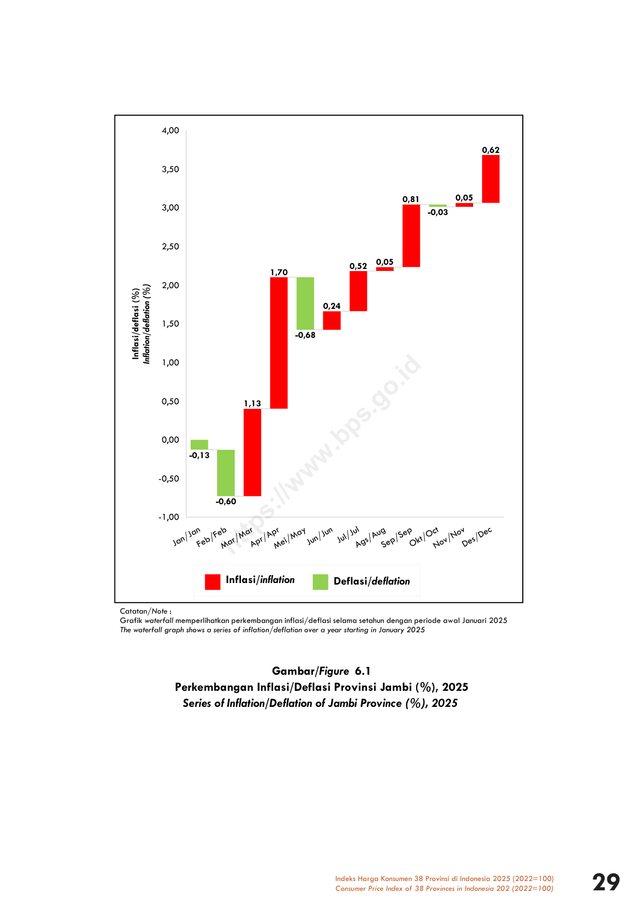

29
Indeks Harga Konsumen 38 Provinsi di Indonesia 2025 (2022=100)
Consumer Price Index of 38 Provinces in Indonesia 202 (2022=100)
Gambar/Figure 6.1
Perkembangan Inflasi/Deflasi Provinsi Jambi (%), 2025
Series of Inflation/Deflation of Jambi Province (%), 2025
-0,13
-0,60
1,13
1,70
-0,68
0,24
0,52
0,05
0,81
-0,03
0,05
0,62
Inflasi/deflasi (%)
Inflation/deflation (%)
-1,00
-0,50
0,00
0,50
1,00
1,50
2,00
2,50
3,00
3,50
4,00
Catatan/Note :
Grafik waterfall memperlihatkan perkembangan inflasi/deflasi selama setahun dengan periode awal Januari 2025
The waterfall graph shows a series of inflation/deflation over a year starting in January 2025
Inflasi/inflation
Deflasi/deflation
https://www.bps.go.id

---

## Halaman 60

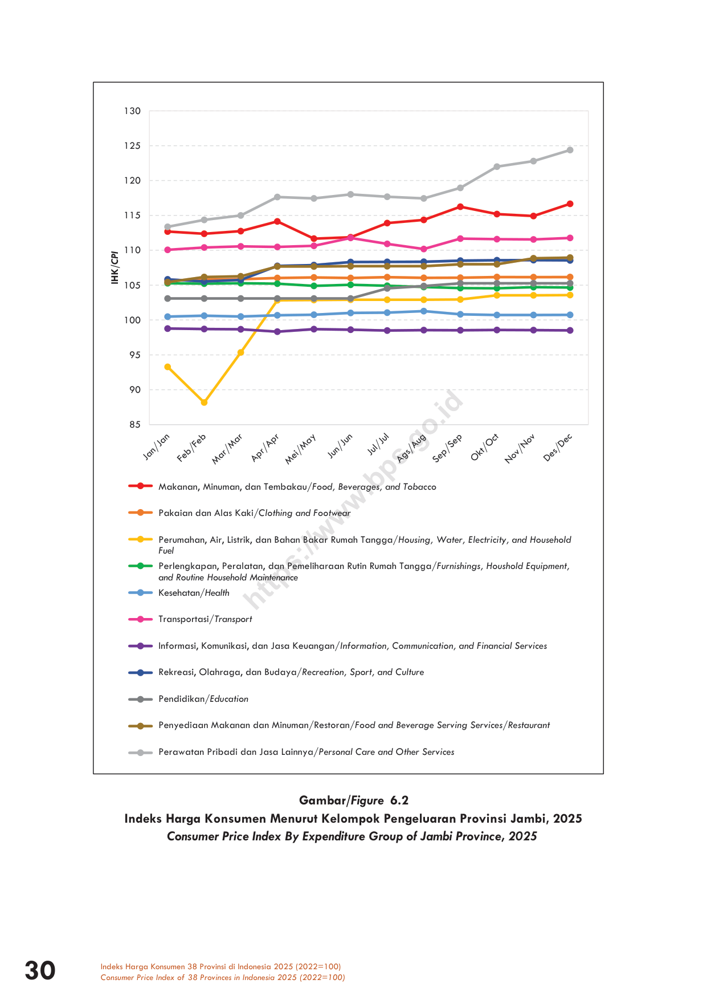

30
Indeks Harga Konsumen 38 Provinsi di Indonesia 2025 (2022=100)
Consumer Price Index of 38 Provinces in Indonesia 2025 (2022=100)
Indeks Harga Konsumen Menurut Kelompok Pengeluaran Provinsi Jambi, 2025
Consumer Price Index By Expenditure Group of Jambi Province, 2025
Gambar/Figure 6.2
85
90
95
100
105
110
115
120
125
130
IHK/CPI
Makanan, Minuman, dan Tembakau/Food, Beverages, and Tobacco
Pakaian dan Alas Kaki/Clothing and Footwear
Perumahan, Air, Listrik, dan Bahan Bakar Rumah Tangga/Housing, Water, Electricity, and Household 
Fuel
Perlengkapan, Peralatan, dan Pemeliharaan Rutin Rumah Tangga/Furnishings, Houshold Equipment, 
and Routine Household Maintenance
Kesehatan/Health
Transportasi/Transport
Informasi, Komunikasi, dan Jasa Keuangan/Information, Communication, and Financial Services
Rekreasi, Olahraga, dan Budaya/Recreation, Sport, and Culture
Pendidikan/Education
Penyediaan Makanan dan Minuman/Restoran/Food and Beverage Serving Services/Restaurant
Perawatan Pribadi dan Jasa Lainnya/Personal Care and Other Services
https://www.bps.go.id

---

## Halaman 61

31
Indeks Harga Konsumen 38 Provinsi di Indonesia 2025 (2022=100)
Consumer Price Index of 38 Provinces in Indonesia 202 (2022=100)
Tabel
Table
Jan
Jan
Feb
Feb
Mar
Mar
Apr
Apr
Mei
May
Jun
Jun
Jul
Jul
Ags
Aug
Sep
Sep
Okt
Oct
Nov
Nov
Des
Dec
(2)
(3)
(4)
(5)
(6)
(7)
(8)
(9)
(10)
(11)
(12)
(13)
106,63 106,19 107,81 109,31 108,93 109,02 109,17 109,13 109,42 109,56 109,58 110,12
-0,36
-0,41
1,53
1,39
-0,35
0,08
0,14
-0,04
0,27
0,13
0,02
0,49
-0,36
-0,77
0,75
2,15
1,79
1,88
2,02
1,98
2,25
2,38
2,40
2,91
113,01 112,12 113,44 113,99 113,07 112,96 113,30 113,03 113,49 113,15 113,17 114,37
2,27
-0,79
1,18
0,48
-0,81
-0,10
0,30
-0,24
0,41
-0,30
0,02
1,06
2,27
1,47
2,66
3,16
2,33
2,23
2,53
2,29
2,71
2,40
2,42
3,50
102,40 102,46 103,64 103,61 102,79 102,90 102,75 102,76 102,56 102,45 102,45 102,37
-0,21
0,06
1,15
-0,03
-0,79
0,11
-0,15
0,01
-0,19
-0,11
~0
-0,08
-0,21
-0,16
0,99
0,96
0,17
0,27
0,13
0,14
-0,06
-0,17
-0,17
-0,24
94,01
90,64
97,63 103,58 103,57 103,54 103,57 103,68 103,67 103,65 103,66 103,72
-8,35
-3,58
7,71
6,09
-0,01
-0,03
0,03
0,11
-0,01
-0,02
0,01
0,06
-8,35
-11,64
-4,83
0,97
0,97
0,94
0,97
1,07
1,06
1,04
1,05
1,11
100,88 101,11 101,07 101,16 101,05 101,13 101,18 101,34 101,25 101,07 101,00 101,03
0,02
0,23
-0,04
0,09
-0,11
0,08
0,05
0,16
-0,09
-0,18
-0,07
0,03
0,02
0,25
0,21
0,30
0,19
0,27
0,32
0,48
0,39
0,21
0,14
0,17
103,46 103,53 103,72 103,72 103,72 104,04 104,09 104,10 104,20 104,14 104,19 104,18
0,06
0,07
0,18
~0
~0
0,31
0,05
0,01
0,10
-0,06
0,05
-0,01
0,06
0,13
0,31
0,31
0,31
0,62
0,67
0,68
0,77
0,72
0,76
0,75
of Sumatera Selatan Province, 2025
(2022=100)
Indeks Harga Konsumen (IHK) dan Persentase Perubahan Menurut Kelompok Pengeluaran
Provinsi Sumatera Selatan, 2025
(2022=100)
Consumer Price Index and Percentage Change By Expenditure Group
% Perubahan Terhadap Bulan Sebelumnya
% Change to Previous Month
% Perubahan Terhadap Desember 2024
% Change to December 2024
Uraian
Description
(1)
UMUM
Headline
Indeks
Index
% Perubahan Terhadap Bulan Sebelumnya
% Change to Previous Month
% Perubahan Terhadap Desember 2024
% Change to December 2024
MAKANAN, MINUMAN DAN TEMBAKAU
Food, Beverages, and Tobacco
Indeks
Index
% Perubahan Terhadap Bulan Sebelumnya
% Change to Previous Month
Indeks
Index
% Perubahan Terhadap Bulan Sebelumnya
% Change to Previous Month
% Perubahan Terhadap Desember 2024
% Change to December 2024
PERLENGKAPAN, PERALATAN DAN PEMELIHARAAN RUTIN RUMAH TANGGA
Furnishings, Houshold Equipment, and Routine Household Maintenance
Indeks
Index
PAKAIAN DAN ALAS KAKI
Clothing and Footwear
Indeks
Index
% Perubahan Terhadap Bulan Sebelumnya
% Change to Previous Month
% Perubahan Terhadap Desember 2024
% Change to December 2024
PERUMAHAN, AIR, LISTRIK, DAN BAHAN BAKAR RUMAH TANGGA
Housing, Water, Electricity, and Household Fuel
% Perubahan Terhadap Desember 2024
% Change to December 2024
KESEHATAN
Health
Indeks
Index
% Perubahan Terhadap Bulan Sebelumnya
% Change to Previous Month
% Perubahan Terhadap Desember 2024
% Change to December 2024
7
https://www.bps.go.id

---

## Halaman 62

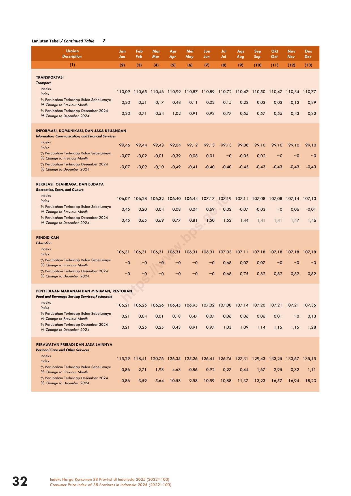

32
Indeks Harga Konsumen 38 Provinsi di Indonesia 2025 (2022=100)
Consumer Price Index of 38 Provinces in Indonesia 2025 (2022=100)
Lanjutan Tabel / Continued Table 
Jan
Jan
Feb
Feb
Mar
Mar
Apr
Apr
Mei
May
Jun
Jun
Jul
Jul
Ags
Aug
Sep
Sep
Okt
Oct
Nov
Nov
Des
Dec
(2)
(3)
(4)
(5)
(6)
(7)
(8)
(9)
(10)
(11)
(12)
(13)
110,09 110,65 110,46 110,99 110,87 110,89 110,72 110,47 110,50 110,47 110,34 110,77
0,20
0,51
-0,17
0,48
-0,11
0,02
-0,15
-0,23
0,03
-0,03
-0,12
0,39
0,20
0,71
0,54
1,02
0,91
0,93
0,77
0,55
0,57
0,55
0,43
0,82
99,46
99,44
99,43
99,04
99,12
99,13
99,13
99,08
99,10
99,10
99,10
99,10
-0,07
-0,02
-0,01
-0,39
0,08
0,01
~0
-0,05
0,02
~0
~0
~0
-0,07
-0,09
-0,10
-0,49
-0,41
-0,40
-0,40
-0,45
-0,43
-0,43
-0,43
-0,43
106,07 106,28 106,32 106,40 106,44 107,17 107,19 107,11 107,08 107,08 107,14 107,13
0,45
0,20
0,04
0,08
0,04
0,69
0,02
-0,07
-0,03
~0
0,06
-0,01
0,45
0,65
0,69
0,77
0,81
1,50
1,52
1,44
1,41
1,41
1,47
1,46
106,31 106,31 106,31 106,31 106,31 106,31 107,03 107,11 107,18 107,18 107,18 107,18
~0
~0
~0
~0
~0
~0
0,68
0,07
0,07
~0
~0
~0
~0
~0
~0
~0
~0
~0
0,68
0,75
0,82
0,82
0,82
0,82
106,21 106,25 106,26 106,45 106,95 107,02 107,08 107,14 107,20 107,21 107,21 107,35
0,21
0,04
0,01
0,18
0,47
0,07
0,06
0,06
0,06
0,01
~0
0,13
0,21
0,25
0,25
0,43
0,91
0,97
1,03
1,09
1,14
1,15
1,15
1,28
115,29 118,41 120,76 126,35 125,26 126,41 126,75 127,31 129,43 133,25 133,67 135,15
0,86
2,71
1,98
4,63
-0,86
0,92
0,27
0,44
1,67
2,95
0,32
1,11
0,86
3,59
5,64
10,53
9,58
10,59
10,88
11,37
13,23
16,57
16,94
18,23
TRANSPORTASI
Transport
Indeks
Index
Uraian
Description
(1)
Indeks
Index
% Perubahan Terhadap Bulan Sebelumnya
% Change to Previous Month
% Perubahan Terhadap Desember 2024
% Change to December 2024
% Perubahan Terhadap Bulan Sebelumnya
% Change to Previous Month
% Perubahan Terhadap Desember 2024
% Change to December 2024
PENYEDIAAN MAKANAN DAN MINUMAN/ RESTORAN
Food and Beverage Serving Services/Restaurant
Indeks
Index
% Perubahan Terhadap Bulan Sebelumnya
% Change to Previous Month
% Perubahan Terhadap Desember 2024
% Change to December 2024
PERAWATAN PRIBADI DAN JASA LAINNYA
Personal Care and Other Services
Indeks
Index
% Perubahan Terhadap Bulan Sebelumnya
% Change to Previous Month
% Perubahan Terhadap Desember 2024
% Change to December 2024
INFORMASI, KOMUNIKASI, DAN JASA KEUANGAN
Information, Communication, and Financial Services
Indeks
Index
% Perubahan Terhadap Bulan Sebelumnya
% Change to Previous Month
% Perubahan Terhadap Desember 2024
% Change to December 2024
REKREASI, OLAHRAGA, DAN BUDAYA
Recreation, Sport, and Culture
Indeks
Index
% Perubahan Terhadap Bulan Sebelumnya
% Change to Previous Month
% Perubahan Terhadap Desember 2024
% Change to December 2024
PENDIDIKAN
Education
7
https://www.bps.go.id

---

## Halaman 63

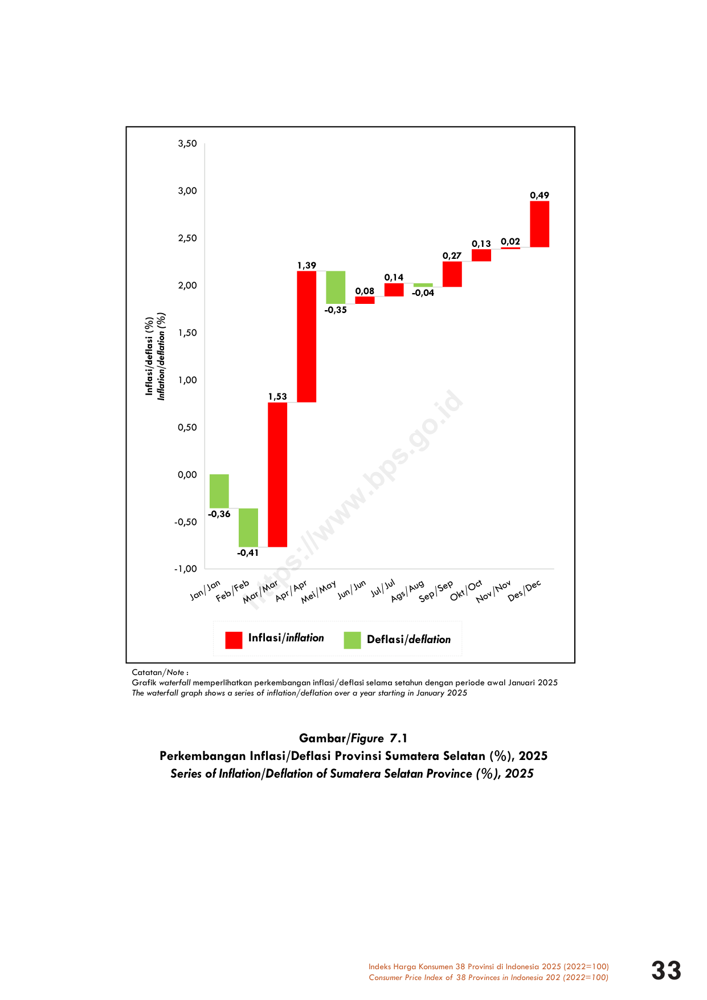

33
Indeks Harga Konsumen 38 Provinsi di Indonesia 2025 (2022=100)
Consumer Price Index of 38 Provinces in Indonesia 202 (2022=100)
Gambar/Figure 7.1
Perkembangan Inflasi/Deflasi Provinsi Sumatera Selatan (%), 2025
Series of Inflation/Deflation of Sumatera Selatan Province (%), 2025
-0,36
-0,41
1,53
1,39
-0,35
0,08
0,14
-0,04
0,27
0,13
0,02
0,49
Inflasi/deflasi (%)
Inflation/deflation (%)
-1,00
-0,50
0,00
0,50
1,00
1,50
2,00
2,50
3,00
3,50
Catatan/Note :
Grafik waterfall memperlihatkan perkembangan inflasi/deflasi selama setahun dengan periode awal Januari 2025
The waterfall graph shows a series of inflation/deflation over a year starting in January 2025
Inflasi/inflation
Deflasi/deflation
https://www.bps.go.id

---

## Halaman 64

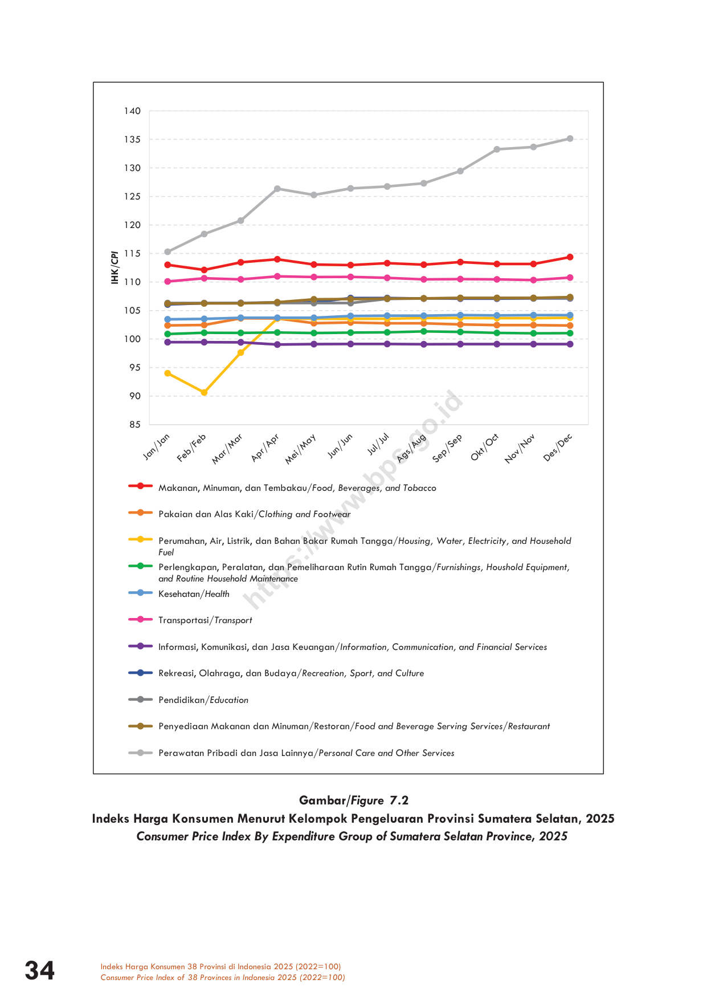

34
Indeks Harga Konsumen 38 Provinsi di Indonesia 2025 (2022=100)
Consumer Price Index of 38 Provinces in Indonesia 2025 (2022=100)
Indeks Harga Konsumen Menurut Kelompok Pengeluaran Provinsi Sumatera Selatan, 2025
Consumer Price Index By Expenditure Group of Sumatera Selatan Province, 2025
Gambar/Figure 7.2
85
90
95
100
105
110
115
120
125
130
135
140
IHK/CPI
Makanan, Minuman, dan Tembakau/Food, Beverages, and Tobacco
Pakaian dan Alas Kaki/Clothing and Footwear
Perumahan, Air, Listrik, dan Bahan Bakar Rumah Tangga/Housing, Water, Electricity, and Household 
Fuel
Perlengkapan, Peralatan, dan Pemeliharaan Rutin Rumah Tangga/Furnishings, Houshold Equipment, 
and Routine Household Maintenance
Kesehatan/Health
Transportasi/Transport
Informasi, Komunikasi, dan Jasa Keuangan/Information, Communication, and Financial Services
Rekreasi, Olahraga, dan Budaya/Recreation, Sport, and Culture
Pendidikan/Education
Penyediaan Makanan dan Minuman/Restoran/Food and Beverage Serving Services/Restaurant
Perawatan Pribadi dan Jasa Lainnya/Personal Care and Other Services
https://www.bps.go.id

---

## Halaman 65

35
Indeks Harga Konsumen 38 Provinsi di Indonesia 2025 (2022=100)
Consumer Price Index of 38 Provinces in Indonesia 202 (2022=100)
Tabel
Table
Jan
Jan
Feb
Feb
Mar
Mar
Apr
Apr
Mei
May
Jun
Jun
Jul
Jul
Ags
Aug
Sep
Sep
Okt
Oct
Nov
Nov
Des
Dec
(2)
(3)
(4)
(5)
(6)
(7)
(8)
(9)
(10)
(11)
(12)
(13)
105,33 104,73 106,07 107,46 107,18 106,61 107,04 107,15 108,19 108,39 108,43 108,90
-0,59
-0,57
1,28
1,31
-0,26
-0,53
0,40
0,10
0,97
0,18
0,04
0,43
-0,59
-1,16
0,10
1,42
1,15
0,61
1,02
1,12
2,10
2,29
2,33
2,77
109,36 108,79 108,78 109,77 108,85 108,44 109,66 110,32 112,85 112,98 112,77 114,10
2,60
-0,52
-0,01
0,91
-0,84
-0,38
1,13
0,60
2,29
0,12
-0,19
1,18
2,60
2,06
2,05
2,98
2,12
1,74
2,88
3,50
5,87
5,99
5,80
7,05
104,88 105,07 105,22 105,29 105,22 105,29 106,01 106,05 106,05 106,12 106,15 105,80
-0,17
0,18
0,14
0,07
-0,07
0,07
0,68
0,04
~0
0,07
0,03
-0,33
-0,17
0,01
0,15
0,22
0,15
0,22
0,90
0,94
0,94
1,01
1,04
0,70
91,81
88,23
96,63 102,41 102,29 102,33 102,35 102,40 102,77 102,70 102,81 102,81
-10,13
-3,90
9,52
5,98
-0,12
0,04
0,02
0,05
0,36
-0,07
0,11
~0
-10,13
-13,64
-5,41
0,24
0,13
0,17
0,19
0,23
0,60
0,53
0,64
0,64
103,25 103,13 103,56 103,54 103,53 103,39 103,10 103,43 103,44 103,42 103,29 103,10
0,08
-0,12
0,42
-0,02
-0,01
-0,14
-0,28
0,32
0,01
-0,02
-0,13
-0,18
0,08
-0,04
0,38
0,36
0,35
0,21
-0,07
0,25
0,26
0,24
0,12
-0,07
106,20 106,24 107,12 106,74 106,83 106,89 106,87 106,87 107,00 107,03 107,42 107,24
0,06
0,04
0,83
-0,35
0,08
0,06
-0,02
~0
0,12
0,03
0,36
-0,17
0,06
0,09
0,92
0,57
0,65
0,71
0,69
0,69
0,81
0,84
1,21
1,04
% Perubahan Terhadap Desember 2024
% Change to December 2024
KESEHATAN
Health
Indeks
Index
% Perubahan Terhadap Bulan Sebelumnya
% Change to Previous Month
% Perubahan Terhadap Desember 2024
% Change to December 2024
PAKAIAN DAN ALAS KAKI
Clothing and Footwear
Indeks
Index
% Perubahan Terhadap Bulan Sebelumnya
% Change to Previous Month
% Perubahan Terhadap Desember 2024
% Change to December 2024
PERUMAHAN, AIR, LISTRIK, DAN BAHAN BAKAR RUMAH TANGGA
Housing, Water, Electricity, and Household Fuel
% Perubahan Terhadap Bulan Sebelumnya
% Change to Previous Month
% Perubahan Terhadap Desember 2024
% Change to December 2024
Uraian
Description
(1)
UMUM
Headline
Indeks
Index
% Perubahan Terhadap Bulan Sebelumnya
% Change to Previous Month
% Perubahan Terhadap Desember 2024
% Change to December 2024
MAKANAN, MINUMAN DAN TEMBAKAU
Food, Beverages, and Tobacco
Indeks
Index
% Perubahan Terhadap Bulan Sebelumnya
% Change to Previous Month
Indeks
Index
% Perubahan Terhadap Bulan Sebelumnya
% Change to Previous Month
% Perubahan Terhadap Desember 2024
% Change to December 2024
PERLENGKAPAN, PERALATAN DAN PEMELIHARAAN RUTIN RUMAH TANGGA
Furnishings, Houshold Equipment, and Routine Household Maintenance
Indeks
Index
of Bengkulu Province, 2025
(2022=100)
Indeks Harga Konsumen (IHK) dan Persentase Perubahan Menurut Kelompok Pengeluaran
Provinsi Bengkulu, 2025
(2022=100)
Consumer Price Index and Percentage Change By Expenditure Group
8
https://www.bps.go.id

---

## Halaman 66

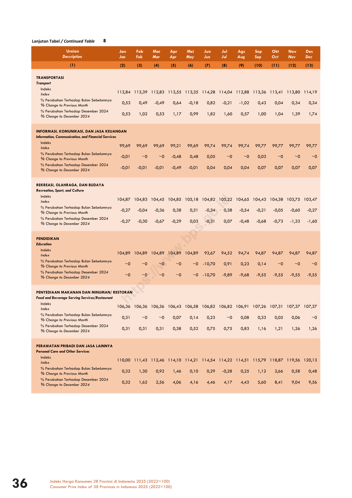

36
Indeks Harga Konsumen 38 Provinsi di Indonesia 2025 (2022=100)
Consumer Price Index of 38 Provinces in Indonesia 2025 (2022=100)
Lanjutan Tabel / Continued Table 
Jan
Jan
Feb
Feb
Mar
Mar
Apr
Apr
Mei
May
Jun
Jun
Jul
Jul
Ags
Aug
Sep
Sep
Okt
Oct
Nov
Nov
Des
Dec
(2)
(3)
(4)
(5)
(6)
(7)
(8)
(9)
(10)
(11)
(12)
(13)
112,84 113,39 112,83 113,55 113,35 114,28 114,04 112,88 113,36 113,41 113,80 114,19
0,53
0,49
-0,49
0,64
-0,18
0,82
-0,21
-1,02
0,43
0,04
0,34
0,34
0,53
1,02
0,53
1,17
0,99
1,82
1,60
0,57
1,00
1,04
1,39
1,74
99,69
99,69
99,69
99,21
99,69
99,74
99,74
99,74
99,77
99,77
99,77
99,77
-0,01
~0
~0
-0,48
0,48
0,05
~0
~0
0,03
~0
~0
~0
-0,01
-0,01
-0,01
-0,49
-0,01
0,04
0,04
0,04
0,07
0,07
0,07
0,07
104,87 104,83 104,45 104,85 105,18 104,82 105,22 104,65 104,43 104,38 103,75 103,47
-0,27
-0,04
-0,36
0,38
0,31
-0,34
0,38
-0,54
-0,21
-0,05
-0,60
-0,27
-0,27
-0,30
-0,67
-0,29
0,03
-0,31
0,07
-0,48
-0,68
-0,73
-1,33
-1,60
104,89 104,89 104,89 104,89 104,89
93,67
94,52
94,74
94,87
94,87
94,87
94,87
~0
~0
~0
~0
~0
-10,70
0,91
0,23
0,14
~0
~0
~0
~0
~0
~0
~0
~0
-10,70
-9,89
-9,68
-9,55
-9,55
-9,55
-9,55
106,36 106,36 106,36 106,43 106,58 106,82 106,82 106,91 107,26 107,31 107,37 107,37
0,31
~0
~0
0,07
0,14
0,23
~0
0,08
0,33
0,05
0,06
~0
0,31
0,31
0,31
0,38
0,52
0,75
0,75
0,83
1,16
1,21
1,26
1,26
110,00 111,43 112,46 114,10 114,21 114,54 114,22 114,51 115,79 118,87 119,56 120,13
0,32
1,30
0,92
1,46
0,10
0,29
-0,28
0,25
1,12
2,66
0,58
0,48
0,32
1,62
2,56
4,06
4,16
4,46
4,17
4,43
5,60
8,41
9,04
9,56
Indeks
Index
% Perubahan Terhadap Bulan Sebelumnya
% Change to Previous Month
% Perubahan Terhadap Desember 2024
% Change to December 2024
INFORMASI, KOMUNIKASI, DAN JASA KEUANGAN
Information, Communication, and Financial Services
Indeks
Index
% Perubahan Terhadap Bulan Sebelumnya
% Change to Previous Month
% Perubahan Terhadap Desember 2024
% Change to December 2024
REKREASI, OLAHRAGA, DAN BUDAYA
Recreation, Sport, and Culture
Indeks
Index
% Perubahan Terhadap Bulan Sebelumnya
% Change to Previous Month
% Perubahan Terhadap Desember 2024
% Change to December 2024
PENDIDIKAN
Education
Indeks
Index
% Perubahan Terhadap Bulan Sebelumnya
% Change to Previous Month
% Perubahan Terhadap Desember 2024
% Change to December 2024
% Perubahan Terhadap Bulan Sebelumnya
% Change to Previous Month
% Perubahan Terhadap Desember 2024
% Change to December 2024
PENYEDIAAN MAKANAN DAN MINUMAN/ RESTORAN
Food and Beverage Serving Services/Restaurant
Indeks
Index
% Perubahan Terhadap Bulan Sebelumnya
% Change to Previous Month
% Perubahan Terhadap Desember 2024
% Change to December 2024
PERAWATAN PRIBADI DAN JASA LAINNYA
Personal Care and Other Services
TRANSPORTASI
Transport
Indeks
Index
Uraian
Description
(1)
8
https://www.bps.go.id

---

## Halaman 67

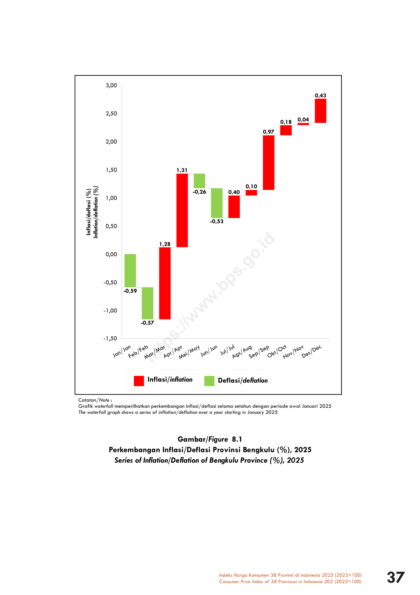

37
Indeks Harga Konsumen 38 Provinsi di Indonesia 2025 (2022=100)
Consumer Price Index of 38 Provinces in Indonesia 202 (2022=100)
Gambar/Figure 8.1
Perkembangan Inflasi/Deflasi Provinsi Bengkulu (%), 2025
Series of Inflation/Deflation of Bengkulu Province (%), 2025
-0,59
-0,57
1,28
1,31
-0,26
-0,53
0,40
0,10
0,97
0,18
0,04
0,43
Inflasi/deflasi (%)
Inflation/deflation (%)
-1,50
-1,00
-0,50
0,00
0,50
1,00
1,50
2,00
2,50
3,00
Catatan/Note :
Grafik waterfall memperlihatkan perkembangan inflasi/deflasi selama setahun dengan periode awal Januari 2025
The waterfall graph shows a series of inflation/deflation over a year starting in January 2025
Inflasi/inflation
Deflasi/deflation
https://www.bps.go.id

---

## Halaman 68

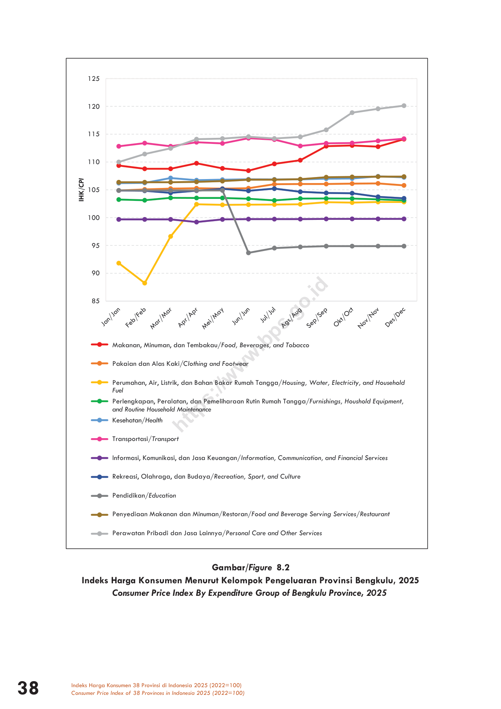

38
Indeks Harga Konsumen 38 Provinsi di Indonesia 2025 (2022=100)
Consumer Price Index of 38 Provinces in Indonesia 2025 (2022=100)
Indeks Harga Konsumen Menurut Kelompok Pengeluaran Provinsi Bengkulu, 2025
Consumer Price Index By Expenditure Group of Bengkulu Province, 2025
Gambar/Figure 8.2
85
90
95
100
105
110
115
120
125
IHK/CPI
Makanan, Minuman, dan Tembakau/Food, Beverages, and Tobacco
Pakaian dan Alas Kaki/Clothing and Footwear
Perumahan, Air, Listrik, dan Bahan Bakar Rumah Tangga/Housing, Water, Electricity, and Household 
Fuel
Perlengkapan, Peralatan, dan Pemeliharaan Rutin Rumah Tangga/Furnishings, Houshold Equipment, 
and Routine Household Maintenance
Kesehatan/Health
Transportasi/Transport
Informasi, Komunikasi, dan Jasa Keuangan/Information, Communication, and Financial Services
Rekreasi, Olahraga, dan Budaya/Recreation, Sport, and Culture
Pendidikan/Education
Penyediaan Makanan dan Minuman/Restoran/Food and Beverage Serving Services/Restaurant
Perawatan Pribadi dan Jasa Lainnya/Personal Care and Other Services
https://www.bps.go.id

---

## Halaman 69

39
Indeks Harga Konsumen 38 Provinsi di Indonesia 2025 (2022=100)
Consumer Price Index of 38 Provinces in Indonesia 202 (2022=100)
Tabel
Table
Jan
Jan
Feb
Feb
Mar
Mar
Apr
Apr
Mei
May
Jun
Jun
Jul
Jul
Ags
Aug
Sep
Sep
Okt
Oct
Nov
Nov
Des
Dec
(2)
(3)
(4)
(5)
(6)
(7)
(8)
(9)
(10)
(11)
(12)
(13)
107,66 106,95 109,05 110,35 109,71 109,75 109,96 108,34 108,51 108,76 109,15 109,79
-0,71
-0,66
1,96
1,19
-0,58
0,04
0,19
-1,47
0,16
0,23
0,36
0,59
-0,71
-1,36
0,57
1,77
1,18
1,22
1,41
-0,08
0,07
0,30
0,66
1,25
115,42 114,78 117,41 117,92 116,07 116,19 116,63 115,92 115,94 115,95 116,60 118,26
1,57
-0,55
2,29
0,43
-1,57
0,10
0,38
-0,61
0,02
0,01
0,56
1,42
1,57
1,00
3,32
3,77
2,14
2,24
2,63
2,01
2,02
2,03
2,60
4,07
111,22 111,10 110,57 110,87 110,27 110,06 110,00 109,86 109,97 110,72 111,33 111,29
0,17
-0,11
-0,48
0,27
-0,54
-0,19
-0,05
-0,13
0,10
0,68
0,55
-0,04
0,17
0,06
-0,41
-0,14
-0,68
-0,87
-0,93
-1,05
-0,95
-0,28
0,27
0,23
90,68
86,28
96,41 103,80 103,93 104,05 104,14 104,11 104,38 104,42 104,44 104,59
-11,70
-4,85
11,74
7,67
0,13
0,12
0,09
-0,03
0,26
0,04
0,02
0,14
-11,70
-15,99
-6,12
1,07
1,20
1,31
1,40
1,37
1,64
1,67
1,69
1,84
103,54 103,79 103,24 103,61 103,06 103,36 103,54 102,83 103,37 103,24 103,11 103,43
0,26
0,24
-0,53
0,36
-0,53
0,29
0,17
-0,69
0,53
-0,13
-0,13
0,31
0,26
0,50
-0,03
0,33
-0,20
0,09
0,26
-0,43
0,10
-0,03
-0,15
0,15
105,58 105,80 104,18 105,71 104,20 104,28 104,21 104,08 103,67 104,63 105,24 105,10
1,52
0,21
-1,53
1,47
-1,43
0,08
-0,07
-0,12
-0,39
0,93
0,58
-0,13
1,52
1,73
0,17
1,64
0,19
0,27
0,20
0,08
-0,32
0,61
1,19
1,06
of Lampung Province, 2025
(2022=100)
Indeks Harga Konsumen (IHK) dan Persentase Perubahan Menurut Kelompok Pengeluaran
Provinsi Lampung, 2025
(2022=100)
Consumer Price Index and Percentage Change By Expenditure Group
% Perubahan Terhadap Bulan Sebelumnya
% Change to Previous Month
% Perubahan Terhadap Desember 2024
% Change to December 2024
Uraian
Description
(1)
UMUM
Headline
Indeks
Index
% Perubahan Terhadap Bulan Sebelumnya
% Change to Previous Month
% Perubahan Terhadap Desember 2024
% Change to December 2024
MAKANAN, MINUMAN DAN TEMBAKAU
Food, Beverages, and Tobacco
Indeks
Index
% Perubahan Terhadap Bulan Sebelumnya
% Change to Previous Month
Indeks
Index
% Perubahan Terhadap Bulan Sebelumnya
% Change to Previous Month
% Perubahan Terhadap Desember 2024
% Change to December 2024
PERLENGKAPAN, PERALATAN DAN PEMELIHARAAN RUTIN RUMAH TANGGA
Furnishings, Houshold Equipment, and Routine Household Maintenance
Indeks
Index
PAKAIAN DAN ALAS KAKI
Clothing and Footwear
Indeks
Index
% Perubahan Terhadap Bulan Sebelumnya
% Change to Previous Month
% Perubahan Terhadap Desember 2024
% Change to December 2024
PERUMAHAN, AIR, LISTRIK, DAN BAHAN BAKAR RUMAH TANGGA
Housing, Water, Electricity, and Household Fuel
% Perubahan Terhadap Desember 2024
% Change to December 2024
KESEHATAN
Health
Indeks
Index
% Perubahan Terhadap Bulan Sebelumnya
% Change to Previous Month
% Perubahan Terhadap Desember 2024
% Change to December 2024
9
https://www.bps.go.id

---

## Halaman 70

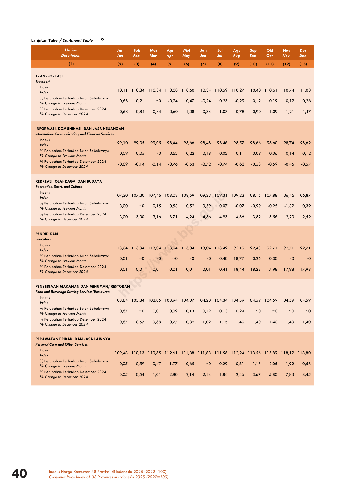

40
Indeks Harga Konsumen 38 Provinsi di Indonesia 2025 (2022=100)
Consumer Price Index of 38 Provinces in Indonesia 2025 (2022=100)
Lanjutan Tabel / Continued Table 
Jan
Jan
Feb
Feb
Mar
Mar
Apr
Apr
Mei
May
Jun
Jun
Jul
Jul
Ags
Aug
Sep
Sep
Okt
Oct
Nov
Nov
Des
Dec
(2)
(3)
(4)
(5)
(6)
(7)
(8)
(9)
(10)
(11)
(12)
(13)
110,11 110,34 110,34 110,08 110,60 110,34 110,59 110,27 110,40 110,61 110,74 111,03
0,63
0,21
~0
-0,24
0,47
-0,24
0,23
-0,29
0,12
0,19
0,12
0,26
0,63
0,84
0,84
0,60
1,08
0,84
1,07
0,78
0,90
1,09
1,21
1,47
99,10
99,05
99,05
98,44
98,66
98,48
98,46
98,57
98,66
98,60
98,74
98,62
-0,09
-0,05
~0
-0,62
0,22
-0,18
-0,02
0,11
0,09
-0,06
0,14
-0,12
-0,09
-0,14
-0,14
-0,76
-0,53
-0,72
-0,74
-0,63
-0,53
-0,59
-0,45
-0,57
107,30 107,30 107,46 108,03 108,59 109,23 109,31 109,23 108,15 107,88 106,46 106,87
3,00
~0
0,15
0,53
0,52
0,59
0,07
-0,07
-0,99
-0,25
-1,32
0,39
3,00
3,00
3,16
3,71
4,24
4,86
4,93
4,86
3,82
3,56
2,20
2,59
113,04 113,04 113,04 113,04 113,04 113,04 113,49
92,19
92,43
92,71
92,71
92,71
0,01
~0
~0
~0
~0
~0
0,40
-18,77
0,26
0,30
~0
~0
0,01
0,01
0,01
0,01
0,01
0,01
0,41
-18,44
-18,23
-17,98
-17,98
-17,98
103,84 103,84 103,85 103,94 104,07 104,20 104,34 104,59 104,59 104,59 104,59 104,59
0,67
~0
0,01
0,09
0,13
0,12
0,13
0,24
~0
~0
~0
~0
0,67
0,67
0,68
0,77
0,89
1,02
1,15
1,40
1,40
1,40
1,40
1,40
109,48 110,13 110,65 112,61 111,88 111,88 111,56 112,24 113,56 115,89 118,12 118,80
-0,05
0,59
0,47
1,77
-0,65
~0
-0,29
0,61
1,18
2,05
1,92
0,58
-0,05
0,54
1,01
2,80
2,14
2,14
1,84
2,46
3,67
5,80
7,83
8,45
TRANSPORTASI
Transport
Indeks
Index
Uraian
Description
(1)
Indeks
Index
% Perubahan Terhadap Bulan Sebelumnya
% Change to Previous Month
% Perubahan Terhadap Desember 2024
% Change to December 2024
% Perubahan Terhadap Bulan Sebelumnya
% Change to Previous Month
% Perubahan Terhadap Desember 2024
% Change to December 2024
PENYEDIAAN MAKANAN DAN MINUMAN/ RESTORAN
Food and Beverage Serving Services/Restaurant
Indeks
Index
% Perubahan Terhadap Bulan Sebelumnya
% Change to Previous Month
% Perubahan Terhadap Desember 2024
% Change to December 2024
PERAWATAN PRIBADI DAN JASA LAINNYA
Personal Care and Other Services
Indeks
Index
% Perubahan Terhadap Bulan Sebelumnya
% Change to Previous Month
% Perubahan Terhadap Desember 2024
% Change to December 2024
INFORMASI, KOMUNIKASI, DAN JASA KEUANGAN
Information, Communication, and Financial Services
Indeks
Index
% Perubahan Terhadap Bulan Sebelumnya
% Change to Previous Month
% Perubahan Terhadap Desember 2024
% Change to December 2024
REKREASI, OLAHRAGA, DAN BUDAYA
Recreation, Sport, and Culture
Indeks
Index
% Perubahan Terhadap Bulan Sebelumnya
% Change to Previous Month
% Perubahan Terhadap Desember 2024
% Change to December 2024
PENDIDIKAN
Education
9
https://www.bps.go.id

---

## Halaman 71

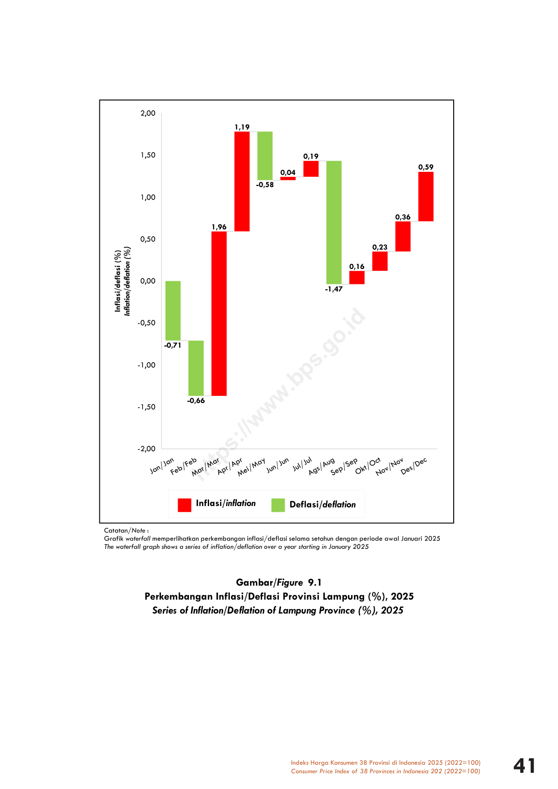

41
Indeks Harga Konsumen 38 Provinsi di Indonesia 2025 (2022=100)
Consumer Price Index of 38 Provinces in Indonesia 202 (2022=100)
Gambar/Figure 9.1
Perkembangan Inflasi/Deflasi Provinsi Lampung (%), 2025
Series of Inflation/Deflation of Lampung Province (%), 2025
-0,71
-0,66
1,96
1,19
-0,58
0,04
0,19
-1,47
0,16
0,23
0,36
0,59
Inflasi/deflasi (%)
Inflation/deflation (%)
-2,00
-1,50
-1,00
-0,50
0,00
0,50
1,00
1,50
2,00
Catatan/Note :
Grafik waterfall memperlihatkan perkembangan inflasi/deflasi selama setahun dengan periode awal Januari 2025
The waterfall graph shows a series of inflation/deflation over a year starting in January 2025
Inflasi/inflation
Deflasi/deflation
https://www.bps.go.id

---

## Halaman 72

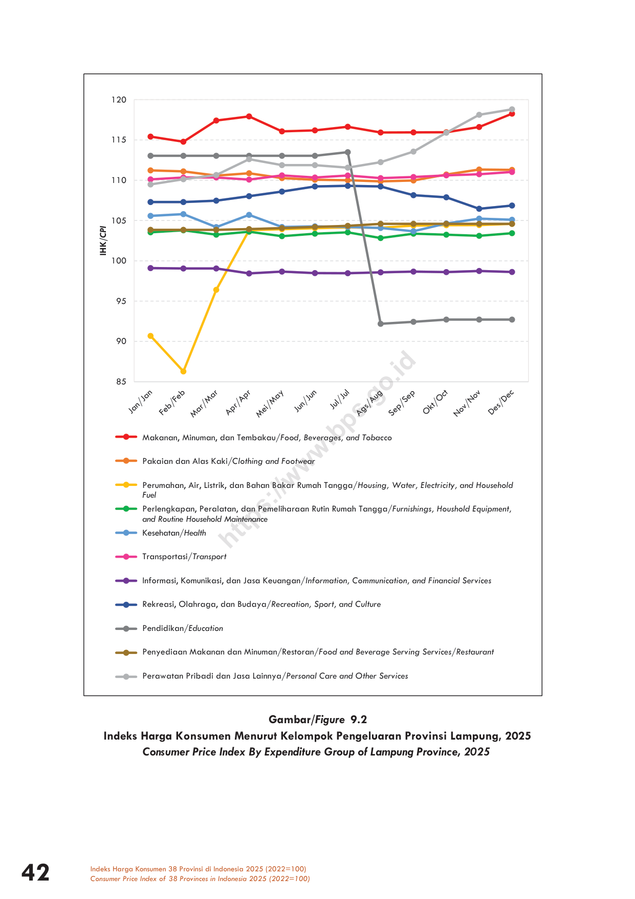

42
Indeks Harga Konsumen 38 Provinsi di Indonesia 2025 (2022=100)
Consumer Price Index of 38 Provinces in Indonesia 2025 (2022=100)
Indeks Harga Konsumen Menurut Kelompok Pengeluaran Provinsi Lampung, 2025
Consumer Price Index By Expenditure Group of Lampung Province, 2025
Gambar/Figure 9.2
85
90
95
100
105
110
115
120
IHK/CPI
Makanan, Minuman, dan Tembakau/Food, Beverages, and Tobacco
Pakaian dan Alas Kaki/Clothing and Footwear
Perumahan, Air, Listrik, dan Bahan Bakar Rumah Tangga/Housing, Water, Electricity, and Household 
Fuel
Perlengkapan, Peralatan, dan Pemeliharaan Rutin Rumah Tangga/Furnishings, Houshold Equipment, 
and Routine Household Maintenance
Kesehatan/Health
Transportasi/Transport
Informasi, Komunikasi, dan Jasa Keuangan/Information, Communication, and Financial Services
Rekreasi, Olahraga, dan Budaya/Recreation, Sport, and Culture
Pendidikan/Education
Penyediaan Makanan dan Minuman/Restoran/Food and Beverage Serving Services/Restaurant
Perawatan Pribadi dan Jasa Lainnya/Personal Care and Other Services
https://www.bps.go.id

---

## Halaman 73

43
Indeks Harga Konsumen 38 Provinsi di Indonesia 2025 (2022=100)
Consumer Price Index of 38 Provinces in Indonesia 202 (2022=100)
Tabel
Table
Jan
Jan
Feb
Feb
Mar
Mar
Apr
Apr
Mei
May
Jun
Jun
Jul
Jul
Ags
Aug
Sep
Sep
Okt
Oct
Nov
Nov
Des
Dec
(2)
(3)
(4)
(5)
(6)
(7)
(8)
(9)
(10)
(11)
(12)
(13)
103,36 103,33 105,22 106,03 105,09 104,98 105,66 105,17 105,65 106,17 106,55 107,14
-0,85
-0,03
1,83
0,77
-0,89
-0,10
0,65
-0,46
0,46
0,49
0,36
0,55
-0,85
-0,88
0,93
1,71
0,81
0,70
1,35
0,88
1,34
1,84
2,21
2,77
106,75 106,22 105,59 107,56 104,73 105,50 107,18 106,20 107,41 108,47 109,27 110,49
2,94
-0,50
-0,59
1,87
-2,63
0,74
1,59
-0,91
1,14
0,99
0,74
1,12
2,94
2,43
1,82
3,72
0,99
1,74
3,36
2,41
3,58
4,60
5,37
6,55
104,34 104,40 104,18 104,28 104,29 104,33 104,36 104,37 104,29 104,34 104,36 104,38
0,28
0,06
-0,21
0,10
0,01
0,04
0,03
0,01
-0,08
0,05
0,02
0,02
0,28
0,34
0,12
0,22
0,23
0,27
0,30
0,31
0,23
0,28
0,30
0,32
85,30
85,13 101,33 101,39 101,40 101,39 101,42 101,55 101,55 101,56 101,59 101,66
-15,79
-0,20
19,03
0,06
0,01
-0,01
0,03
0,13
~0
0,01
0,03
0,07
-15,79
-15,96
0,03
0,09
0,10
0,09
0,12
0,25
0,25
0,26
0,29
0,36
101,23 101,36 101,18 101,31 101,47 101,33 101,17 100,93 100,98 101,00 101,01 100,98
0,27
0,13
-0,18
0,13
0,16
-0,14
-0,16
-0,24
0,05
0,02
0,01
-0,03
0,27
0,40
0,22
0,35
0,51
0,37
0,21
-0,03
0,02
0,04
0,05
0,02
107,07 107,05 107,08 107,02 107,36 107,30 107,51 107,64 107,62 107,68 107,96 108,06
0,74
-0,02
0,03
-0,06
0,32
-0,06
0,20
0,12
-0,02
0,06
0,26
0,09
0,74
0,72
0,75
0,70
1,02
0,96
1,16
1,28
1,26
1,32
1,58
1,67
% Perubahan Terhadap Desember 2024
% Change to December 2024
KESEHATAN
Health
Indeks
Index
% Perubahan Terhadap Bulan Sebelumnya
% Change to Previous Month
% Perubahan Terhadap Desember 2024
% Change to December 2024
PAKAIAN DAN ALAS KAKI
Clothing and Footwear
Indeks
Index
% Perubahan Terhadap Bulan Sebelumnya
% Change to Previous Month
% Perubahan Terhadap Desember 2024
% Change to December 2024
PERUMAHAN, AIR, LISTRIK, DAN BAHAN BAKAR RUMAH TANGGA
Housing, Water, Electricity, and Household Fuel
% Perubahan Terhadap Bulan Sebelumnya
% Change to Previous Month
% Perubahan Terhadap Desember 2024
% Change to December 2024
Uraian
Description
(1)
UMUM
Headline
Indeks
Index
% Perubahan Terhadap Bulan Sebelumnya
% Change to Previous Month
% Perubahan Terhadap Desember 2024
% Change to December 2024
MAKANAN, MINUMAN DAN TEMBAKAU
Food, Beverages, and Tobacco
Indeks
Index
% Perubahan Terhadap Bulan Sebelumnya
% Change to Previous Month
Indeks
Index
% Perubahan Terhadap Bulan Sebelumnya
% Change to Previous Month
% Perubahan Terhadap Desember 2024
% Change to December 2024
PERLENGKAPAN, PERALATAN DAN PEMELIHARAAN RUTIN RUMAH TANGGA
Furnishings, Houshold Equipment, and Routine Household Maintenance
Indeks
Index
of Kepulauan Bangka Belitung Province, 2025
(2022=100)
Indeks Harga Konsumen (IHK) dan Persentase Perubahan Menurut Kelompok Pengeluaran
Provinsi Kepulauan Bangka Belitung, 2025
(2022=100)
Consumer Price Index and Percentage Change By Expenditure Group
10
https://www.bps.go.id

---

## Halaman 74

44
Indeks Harga Konsumen 38 Provinsi di Indonesia 2025 (2022=100)
Consumer Price Index of 38 Provinces in Indonesia 2025 (2022=100)
Lanjutan Tabel / Continued Table 
Jan
Jan
Feb
Feb
Mar
Mar
Apr
Apr
Mei
May
Jun
Jun
Jul
Jul
Ags
Aug
Sep
Sep
Okt
Oct
Nov
Nov
Des
Dec
(2)
(3)
(4)
(5)
(6)
(7)
(8)
(9)
(10)
(11)
(12)
(13)
111,89 112,97 112,11 112,46 112,73 112,97 113,20 111,98 111,80 111,97 112,27 113,11
0,47
0,97
-0,76
0,31
0,24
0,21
0,20
-1,08
-0,16
0,15
0,27
0,75
0,47
1,44
0,66
0,98
1,22
1,44
1,64
0,55
0,39
0,54
0,81
1,56
99,70
99,63
99,52
99,03
99,33
99,32
99,32
99,31
99,35
99,34
99,34
99,31
0,09
-0,07
-0,11
-0,49
0,30
-0,01
~0
-0,01
0,04
-0,01
~0
-0,03
0,09
0,02
-0,09
-0,58
-0,28
-0,29
-0,29
-0,30
-0,26
-0,27
-0,27
-0,30
104,37 104,34 104,33 104,33 104,33 104,79 104,80 104,80 104,80 104,86 104,92 104,92
0,01
-0,03
-0,01
~0
~0
0,44
0,01
~0
~0
0,06
0,06
~0
0,01
-0,02
-0,03
-0,03
-0,03
0,41
0,42
0,42
0,42
0,48
0,54
0,54
105,72 105,72 105,72 105,72 105,72
92,42
92,62
91,76
91,72
91,72
91,72
91,72
0,45
~0
~0
~0
~0
-12,58
0,22
-0,93
-0,04
~0
~0
~0
0,45
0,45
0,45
0,45
0,45
-12,19
-12,00
-12,82
-12,86
-12,86
-12,86
-12,86
104,52 104,59 104,59 104,69 104,77 104,85 105,06 105,17 105,34 105,34 105,34 105,34
~0
0,07
~0
0,10
0,08
0,08
0,20
0,10
0,16
~0
~0
~0
~0
0,07
0,07
0,16
0,24
0,32
0,52
0,62
0,78
0,78
0,78
0,78
107,66 108,54 108,82 109,65 110,07 110,11 110,32 110,53 111,21 113,00 113,73 114,39
1,14
0,82
0,26
0,76
0,38
0,04
0,19
0,19
0,62
1,61
0,65
0,58
1,14
1,96
2,23
3,01
3,40
3,44
3,64
3,83
4,47
6,15
6,84
7,46
Indeks
Index
% Perubahan Terhadap Bulan Sebelumnya
% Change to Previous Month
% Perubahan Terhadap Desember 2024
% Change to December 2024
INFORMASI, KOMUNIKASI, DAN JASA KEUANGAN
Information, Communication, and Financial Services
Indeks
Index
% Perubahan Terhadap Bulan Sebelumnya
% Change to Previous Month
% Perubahan Terhadap Desember 2024
% Change to December 2024
REKREASI, OLAHRAGA, DAN BUDAYA
Recreation, Sport, and Culture
Indeks
Index
% Perubahan Terhadap Bulan Sebelumnya
% Change to Previous Month
% Perubahan Terhadap Desember 2024
% Change to December 2024
PENDIDIKAN
Education
Indeks
Index
% Perubahan Terhadap Bulan Sebelumnya
% Change to Previous Month
% Perubahan Terhadap Desember 2024
% Change to December 2024
% Perubahan Terhadap Bulan Sebelumnya
% Change to Previous Month
% Perubahan Terhadap Desember 2024
% Change to December 2024
PENYEDIAAN MAKANAN DAN MINUMAN/ RESTORAN
Food and Beverage Serving Services/Restaurant
Indeks
Index
% Perubahan Terhadap Bulan Sebelumnya
% Change to Previous Month
% Perubahan Terhadap Desember 2024
% Change to December 2024
PERAWATAN PRIBADI DAN JASA LAINNYA
Personal Care and Other Services
TRANSPORTASI
Transport
Indeks
Index
Uraian
Description
(1)
10
https://www.bps.go.id

---

## Halaman 75

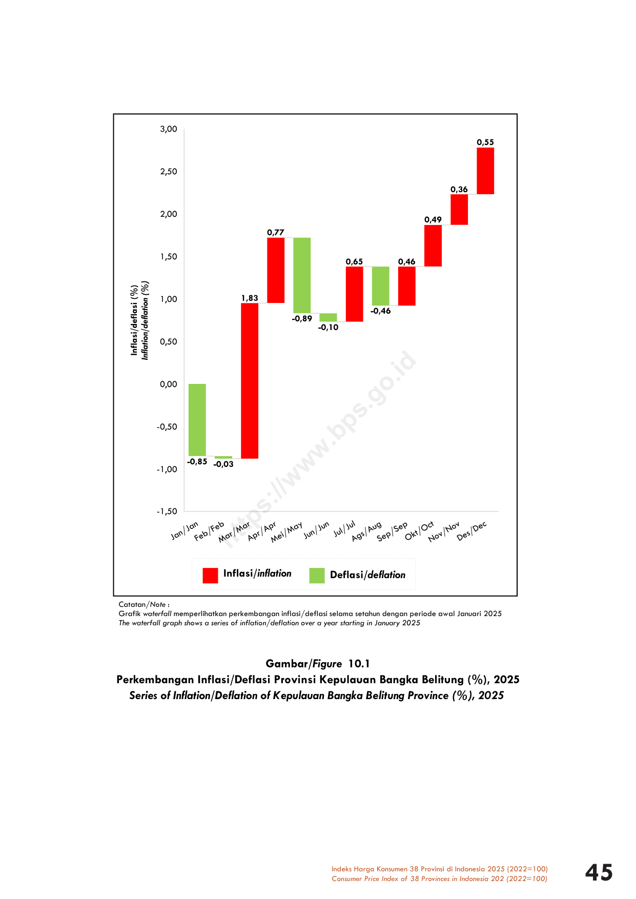

45
Indeks Harga Konsumen 38 Provinsi di Indonesia 2025 (2022=100)
Consumer Price Index of 38 Provinces in Indonesia 202 (2022=100)
Gambar/Figure 10.1
Perkembangan Inflasi/Deflasi Provinsi Kepulauan Bangka Belitung (%), 2025
Series of Inflation/Deflation of Kepulauan Bangka Belitung Province (%), 2025
-0,85 -0,03
1,83
0,77
-0,89
-0,10
0,65
-0,46
0,46
0,49
0,36
0,55
Inflasi/deflasi (%)
Inflation/deflation (%)
-1,50
-1,00
-0,50
0,00
0,50
1,00
1,50
2,00
2,50
3,00
Catatan/Note :
Grafik waterfall memperlihatkan perkembangan inflasi/deflasi selama setahun dengan periode awal Januari 2025
The waterfall graph shows a series of inflation/deflation over a year starting in January 2025
Inflasi/inflation
Deflasi/deflation
https://www.bps.go.id

---

## Halaman 76

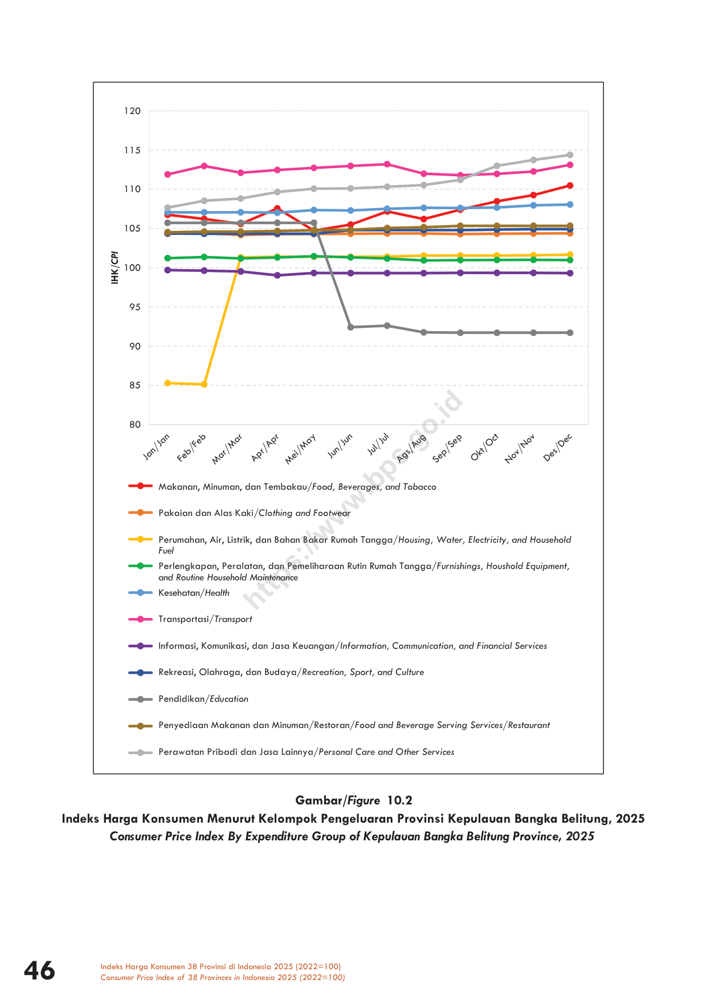

46
Indeks Harga Konsumen 38 Provinsi di Indonesia 2025 (2022=100)
Consumer Price Index of 38 Provinces in Indonesia 2025 (2022=100)
Indeks Harga Konsumen Menurut Kelompok Pengeluaran Provinsi Kepulauan Bangka Belitung, 2025
Consumer Price Index By Expenditure Group of Kepulauan Bangka Belitung Province, 2025
Gambar/Figure 10.2
80
85
90
95
100
105
110
115
120
IHK/CPI
Makanan, Minuman, dan Tembakau/Food, Beverages, and Tobacco
Pakaian dan Alas Kaki/Clothing and Footwear
Perumahan, Air, Listrik, dan Bahan Bakar Rumah Tangga/Housing, Water, Electricity, and Household 
Fuel
Perlengkapan, Peralatan, dan Pemeliharaan Rutin Rumah Tangga/Furnishings, Houshold Equipment, 
and Routine Household Maintenance
Kesehatan/Health
Transportasi/Transport
Informasi, Komunikasi, dan Jasa Keuangan/Information, Communication, and Financial Services
Rekreasi, Olahraga, dan Budaya/Recreation, Sport, and Culture
Pendidikan/Education
Penyediaan Makanan dan Minuman/Restoran/Food and Beverage Serving Services/Restaurant
Perawatan Pribadi dan Jasa Lainnya/Personal Care and Other Services
https://www.bps.go.id

---

## Halaman 77

47
Indeks Harga Konsumen 38 Provinsi di Indonesia 2025 (2022=100)
Consumer Price Index of 38 Provinces in Indonesia 202 (2022=100)
Tabel
Table
Jan
Jan
Feb
Feb
Mar
Mar
Apr
Apr
Mei
May
Jun
Jun
Jul
Jul
Ags
Aug
Sep
Sep
Okt
Oct
Nov
Nov
Des
Dec
(2)
(3)
(4)
(5)
(6)
(7)
(8)
(9)
(10)
(11)
(12)
(13)
107,81 107,66 108,07 108,71 108,23 108,10 108,30 108,50 109,19 109,58 109,83 111,08
0,43
-0,14
0,38
0,59
-0,44
-0,12
0,19
0,18
0,64
0,36
0,23
1,14
0,43
0,29
0,67
1,27
0,82
0,70
0,88
1,07
1,71
2,08
2,31
3,47
112,97 111,92 111,68 112,41 110,44 109,83 110,33 111,25 113,19 112,99 112,62 115,90
2,41
-0,93
-0,21
0,65
-1,75
-0,55
0,46
0,83
1,74
-0,18
-0,33
2,91
2,41
1,46
1,24
1,90
0,12
-0,44
0,02
0,85
2,61
2,43
2,09
5,07
106,14 105,99 106,59 106,22 106,16 106,59 106,91 107,09 107,42 107,43 107,42 107,61
-0,17
-0,14
0,57
-0,35
-0,06
0,41
0,30
0,17
0,31
0,01
-0,01
0,18
-0,17
-0,31
0,25
-0,09
-0,15
0,25
0,55
0,72
1,03
1,04
1,03
1,21
102,88 102,17 104,55 105,83 105,84 105,93 105,99 106,02 106,02 106,12 106,26 106,27
-2,23
-0,69
2,33
1,22
0,01
0,09
0,06
0,03
~0
0,09
0,13
0,01
-2,23
-2,91
-0,65
0,57
0,58
0,67
0,72
0,75
0,75
0,85
0,98
0,99
101,67 101,83 101,85 101,89 101,88 101,76 101,77 101,77 101,61 101,66 101,83 101,81
0,07
0,16
0,02
0,04
-0,01
-0,12
0,01
~0
-0,16
0,05
0,17
-0,02
0,07
0,23
0,25
0,29
0,28
0,16
0,17
0,17
0,01
0,06
0,23
0,21
104,25 104,26 104,26 104,22 104,85 104,93 104,93 104,98 105,64 106,04 106,04 105,97
0,13
0,01
~0
-0,04
0,60
0,08
~0
0,05
0,63
0,38
~0
-0,07
0,13
0,14
0,14
0,11
0,71
0,79
0,79
0,84
1,47
1,85
1,85
1,79
% Perubahan Terhadap Desember 2024
% Change to December 2024
KESEHATAN
Health
Indeks
Index
% Perubahan Terhadap Bulan Sebelumnya
% Change to Previous Month
% Perubahan Terhadap Desember 2024
% Change to December 2024
PAKAIAN DAN ALAS KAKI
Clothing and Footwear
Indeks
Index
% Perubahan Terhadap Bulan Sebelumnya
% Change to Previous Month
% Perubahan Terhadap Desember 2024
% Change to December 2024
PERUMAHAN, AIR, LISTRIK, DAN BAHAN BAKAR RUMAH TANGGA
Housing, Water, Electricity, and Household Fuel
% Perubahan Terhadap Bulan Sebelumnya
% Change to Previous Month
% Perubahan Terhadap Desember 2024
% Change to December 2024
Uraian
Description
(1)
UMUM
Headline
Indeks
Index
% Perubahan Terhadap Bulan Sebelumnya
% Change to Previous Month
% Perubahan Terhadap Desember 2024
% Change to December 2024
MAKANAN, MINUMAN DAN TEMBAKAU
Food, Beverages, and Tobacco
Indeks
Index
% Perubahan Terhadap Bulan Sebelumnya
% Change to Previous Month
Indeks
Index
% Perubahan Terhadap Bulan Sebelumnya
% Change to Previous Month
% Perubahan Terhadap Desember 2024
% Change to December 2024
PERLENGKAPAN, PERALATAN DAN PEMELIHARAAN RUTIN RUMAH TANGGA
Furnishings, Houshold Equipment, and Routine Household Maintenance
Indeks
Index
of Kepulauan Riau Province, 2025
(2022=100)
Indeks Harga Konsumen (IHK) dan Persentase Perubahan Menurut Kelompok Pengeluaran
Provinsi Kepulauan Riau, 2025
(2022=100)
Consumer Price Index and Percentage Change By Expenditure Group
11
https://www.bps.go.id

---

## Halaman 78

48
Indeks Harga Konsumen 38 Provinsi di Indonesia 2025 (2022=100)
Consumer Price Index of 38 Provinces in Indonesia 2025 (2022=100)
Lanjutan Tabel / Continued Table 
Jan
Jan
Feb
Feb
Mar
Mar
Apr
Apr
Mei
May
Jun
Jun
Jul
Jul
Ags
Aug
Sep
Sep
Okt
Oct
Nov
Nov
Des
Dec
(2)
(3)
(4)
(5)
(6)
(7)
(8)
(9)
(10)
(11)
(12)
(13)
112,39 112,85 112,69 112,77 113,23 112,95 113,04 112,20 111,12 111,73 113,95 115,24
-0,42
0,41
-0,14
0,07
0,41
-0,25
0,08
-0,74
-0,96
0,55
1,99
1,13
-0,42
-0,01
-0,15
-0,08
0,33
0,08
0,16
-0,58
-1,54
-1,00
0,97
2,11
99,97
99,99
99,96
99,68
99,91
99,91
99,91
99,92
99,94
99,94
99,96
99,96
~0
0,02
-0,03
-0,28
0,23
~0
~0
0,01
0,02
~0
0,02
~0
~0
0,02
-0,01
-0,29
-0,06
-0,06
-0,06
-0,05
-0,03
-0,03
-0,01
-0,01
102,05 101,99 101,99 102,04 101,83 101,83 101,93 101,96 101,99 102,49 102,44 102,42
-0,03
-0,06
~0
0,05
-0,21
~0
0,10
0,03
0,03
0,49
-0,05
-0,02
-0,03
-0,09
-0,09
-0,04
-0,24
-0,24
-0,15
-0,12
-0,09
0,40
0,35
0,33
102,24 102,24 102,24 102,24 102,24 102,27 102,27 102,40 103,58 103,58 103,63 103,63
0,01
~0
~0
~0
~0
0,03
~0
0,13
1,15
~0
0,05
~0
0,01
0,01
0,01
0,01
0,01
0,04
0,04
0,17
1,32
1,32
1,37
1,37
104,03 104,78 104,80 104,83 105,21 105,22 105,28 105,29 105,51 105,83 105,87 105,89
0,98
0,72
0,02
0,03
0,36
0,01
0,06
0,01
0,21
0,30
0,04
0,02
0,98
1,71
1,73
1,76
2,13
2,14
2,19
2,20
2,42
2,73
2,77
2,79
115,65 117,79 119,16 123,27 122,72 123,34 123,59 123,97 126,48 131,39 131,88 134,03
0,68
1,85
1,16
3,45
-0,45
0,51
0,20
0,31
2,02
3,88
0,37
1,63
0,68
2,54
3,73
7,31
6,83
7,37
7,59
7,92
10,11
14,38
14,81
16,68
Indeks
Index
% Perubahan Terhadap Bulan Sebelumnya
% Change to Previous Month
% Perubahan Terhadap Desember 2024
% Change to December 2024
INFORMASI, KOMUNIKASI, DAN JASA KEUANGAN
Information, Communication, and Financial Services
Indeks
Index
% Perubahan Terhadap Bulan Sebelumnya
% Change to Previous Month
% Perubahan Terhadap Desember 2024
% Change to December 2024
REKREASI, OLAHRAGA, DAN BUDAYA
Recreation, Sport, and Culture
Indeks
Index
% Perubahan Terhadap Bulan Sebelumnya
% Change to Previous Month
% Perubahan Terhadap Desember 2024
% Change to December 2024
PENDIDIKAN
Education
Indeks
Index
% Perubahan Terhadap Bulan Sebelumnya
% Change to Previous Month
% Perubahan Terhadap Desember 2024
% Change to December 2024
% Perubahan Terhadap Bulan Sebelumnya
% Change to Previous Month
% Perubahan Terhadap Desember 2024
% Change to December 2024
PENYEDIAAN MAKANAN DAN MINUMAN/ RESTORAN
Food and Beverage Serving Services/Restaurant
Indeks
Index
% Perubahan Terhadap Bulan Sebelumnya
% Change to Previous Month
% Perubahan Terhadap Desember 2024
% Change to December 2024
PERAWATAN PRIBADI DAN JASA LAINNYA
Personal Care and Other Services
TRANSPORTASI
Transport
Indeks
Index
Uraian
Description
(1)
11
https://www.bps.go.id

---

## Halaman 79

49
Indeks Harga Konsumen 38 Provinsi di Indonesia 2025 (2022=100)
Consumer Price Index of 38 Provinces in Indonesia 202 (2022=100)
Gambar/Figure 11.1
Perkembangan Inflasi/Deflasi Provinsi Kepulauan Riau (%), 2025
Series of Inflation/Deflation of Kepulauan Riau Province (%), 2025
0,43
-0,14
0,38
0,59
-0,44
-0,12
0,19
0,18
0,64
0,36
0,23
1,14
Inflasi/deflasi (%)
Inflation/deflation (%)
0,00
0,50
1,00
1,50
2,00
2,50
3,00
3,50
4,00
Catatan/Note :
Grafik waterfall memperlihatkan perkembangan inflasi/deflasi selama setahun dengan periode awal Januari 2025
The waterfall graph shows a series of inflation/deflation over a year starting in January 2025
Inflasi/inflation
Deflasi/deflation
https://www.bps.go.id

---

## Halaman 80

50
Indeks Harga Konsumen 38 Provinsi di Indonesia 2025 (2022=100)
Consumer Price Index of 38 Provinces in Indonesia 2025 (2022=100)
Indeks Harga Konsumen Menurut Kelompok Pengeluaran Provinsi Kepulauan Riau, 2025
Consumer Price Index By Expenditure Group of Kepulauan Riau Province, 2025
Gambar/Figure 11.2
95
100
105
110
115
120
125
130
135
140
IHK/CPI
Makanan, Minuman, dan Tembakau/Food, Beverages, and Tobacco
Pakaian dan Alas Kaki/Clothing and Footwear
Perumahan, Air, Listrik, dan Bahan Bakar Rumah Tangga/Housing, Water, Electricity, and Household 
Fuel
Perlengkapan, Peralatan, dan Pemeliharaan Rutin Rumah Tangga/Furnishings, Houshold Equipment, 
and Routine Household Maintenance
Kesehatan/Health
Transportasi/Transport
Informasi, Komunikasi, dan Jasa Keuangan/Information, Communication, and Financial Services
Rekreasi, Olahraga, dan Budaya/Recreation, Sport, and Culture
Pendidikan/Education
Penyediaan Makanan dan Minuman/Restoran/Food and Beverage Serving Services/Restaurant
Perawatan Pribadi dan Jasa Lainnya/Personal Care and Other Services
https://www.bps.go.id

---

## Halaman 81

51
Indeks Harga Konsumen 38 Provinsi di Indonesia 2025 (2022=100)
Consumer Price Index of 38 Provinces in Indonesia 202 (2022=100)
Tabel
Table
Jan
Jan
Feb
Feb
Mar
Mar
Apr
Apr
Mei
May
Jun
Jun
Jul
Jul
Ags
Aug
Sep
Sep
Okt
Oct
Nov
Nov
Des
Dec
(2)
(3)
(4)
(5)
(6)
(7)
(8)
(9)
(10)
(11)
(12)
(13)
104,10 103,80 105,88 107,40 107,14 107,28 107,40 107,35 107,49 107,82 108,11 108,47
-1,50
-0,29
2,00
1,44
-0,24
0,13
0,11
-0,05
0,13
0,31
0,27
0,33
-1,50
-1,79
0,18
1,62
1,37
1,50
1,62
1,57
1,70
2,02
2,29
2,63
111,63 110,90 112,78 112,96 111,38 111,87 112,27 111,50 111,86 112,23 112,46 113,66
1,82
-0,65
1,70
0,16
-1,40
0,44
0,36
-0,69
0,32
0,33
0,20
1,07
1,82
1,15
2,86
3,03
1,59
2,03
2,40
1,70
2,02
2,36
2,57
3,67
98,49
98,49
98,74
98,78
98,97
99,04
99,15
98,95
98,99
98,85
98,86
98,89
0,15
~0
0,25
0,04
0,19
0,07
0,11
-0,20
0,04
-0,14
0,01
0,03
0,15
0,15
0,41
0,45
0,64
0,71
0,82
0,62
0,66
0,52
0,53
0,56
93,41
92,11
99,68 106,11 106,11 106,12 106,17 106,19 106,19 106,19 106,19 106,19
-9,20
-1,39
8,22
6,45
~0
0,01
0,05
0,02
~0
~0
~0
~0
-9,20
-10,47
-3,11
3,14
3,14
3,15
3,20
3,22
3,22
3,22
3,22
3,22
106,16 106,13 106,15 106,33 106,36 106,28 106,37 106,41 106,24 106,28 106,47 106,43
0,22
-0,03
0,02
0,17
0,03
-0,08
0,08
0,04
-0,16
0,04
0,18
-0,04
0,22
0,19
0,21
0,38
0,41
0,33
0,42
0,45
0,29
0,33
0,51
0,47
104,40 104,47 104,78 104,77 104,92 105,09 105,38 105,38 105,58 105,77 105,97 106,26
0,30
0,07
0,30
-0,01
0,14
0,16
0,28
~0
0,19
0,18
0,19
0,27
0,30
0,37
0,66
0,65
0,80
0,96
1,24
1,24
1,43
1,61
1,81
2,08
of DKI Jakarta Province, 2025
(2022=100)
Indeks Harga Konsumen (IHK) dan Persentase Perubahan Menurut Kelompok Pengeluaran
Provinsi DKI Jakarta, 2025
(2022=100)
Consumer Price Index and Percentage Change By Expenditure Group
% Perubahan Terhadap Bulan Sebelumnya
% Change to Previous Month
% Perubahan Terhadap Desember 2024
% Change to December 2024
Uraian
Description
(1)
UMUM
Headline
Indeks
Index
% Perubahan Terhadap Bulan Sebelumnya
% Change to Previous Month
% Perubahan Terhadap Desember 2024
% Change to December 2024
MAKANAN, MINUMAN DAN TEMBAKAU
Food, Beverages, and Tobacco
Indeks
Index
% Perubahan Terhadap Bulan Sebelumnya
% Change to Previous Month
Indeks
Index
% Perubahan Terhadap Bulan Sebelumnya
% Change to Previous Month
% Perubahan Terhadap Desember 2024
% Change to December 2024
PERLENGKAPAN, PERALATAN DAN PEMELIHARAAN RUTIN RUMAH TANGGA
Furnishings, Houshold Equipment, and Routine Household Maintenance
Indeks
Index
PAKAIAN DAN ALAS KAKI
Clothing and Footwear
Indeks
Index
% Perubahan Terhadap Bulan Sebelumnya
% Change to Previous Month
% Perubahan Terhadap Desember 2024
% Change to December 2024
PERUMAHAN, AIR, LISTRIK, DAN BAHAN BAKAR RUMAH TANGGA
Housing, Water, Electricity, and Household Fuel
% Perubahan Terhadap Desember 2024
% Change to December 2024
KESEHATAN
Health
Indeks
Index
% Perubahan Terhadap Bulan Sebelumnya
% Change to Previous Month
% Perubahan Terhadap Desember 2024
% Change to December 2024
12
https://www.bps.go.id

---

## Halaman 82

52
Indeks Harga Konsumen 38 Provinsi di Indonesia 2025 (2022=100)
Consumer Price Index of 38 Provinces in Indonesia 2025 (2022=100)
Lanjutan Tabel / Continued Table 
Jan
Jan
Feb
Feb
Mar
Mar
Apr
Apr
Mei
May
Jun
Jun
Jul
Jul
Ags
Aug
Sep
Sep
Okt
Oct
Nov
Nov
Des
Dec
(2)
(3)
(4)
(5)
(6)
(7)
(8)
(9)
(10)
(11)
(12)
(13)
107,67 108,07 108,10 107,84 107,43 107,56 107,31 107,31 107,39 107,68 107,99 108,69
-0,23
0,37
0,03
-0,24
-0,38
0,12
-0,23
~0
0,07
0,27
0,29
0,65
-0,23
0,14
0,17
-0,07
-0,45
-0,33
-0,57
-0,57
-0,49
-0,22
0,06
0,71
99,93
99,85
99,90
99,48
99,92
99,92
99,81
99,75
99,77
99,75
99,68
99,62
-0,17
-0,08
0,05
-0,42
0,44
~0
-0,11
-0,06
0,02
-0,02
-0,07
-0,06
-0,17
-0,25
-0,20
-0,62
-0,18
-0,18
-0,29
-0,35
-0,33
-0,35
-0,42
-0,48
102,55 102,55 102,37 102,44 102,44 102,58 102,81 103,09 103,05 103,12 103,24 103,35
0,10
~0
-0,18
0,07
~0
0,14
0,22
0,27
-0,04
0,07
0,12
0,11
0,10
0,10
-0,08
-0,01
-0,01
0,13
0,35
0,62
0,59
0,65
0,77
0,88
104,97 104,97 104,97 104,97 104,97 105,12 105,45 106,46 106,67 107,06 107,06 107,06
0,16
~0
~0
~0
~0
0,14
0,31
0,96
0,20
0,37
~0
~0
0,16
0,16
0,16
0,16
0,16
0,31
0,62
1,58
1,78
2,16
2,16
2,16
106,06 106,08 106,19 106,19 106,20 106,20 106,30 106,51 106,55 106,55 106,67 106,69
0,24
0,02
0,10
~0
0,01
~0
0,09
0,20
0,04
~0
0,11
0,02
0,24
0,26
0,36
0,36
0,37
0,37
0,46
0,66
0,70
0,70
0,81
0,83
113,88 114,82 115,82 118,13 118,82 118,97 119,31 119,42 120,24 123,26 125,94 126,54
0,70
0,83
0,87
1,99
0,58
0,13
0,29
0,09
0,69
2,51
2,17
0,48
0,70
1,53
2,41
4,46
5,07
5,20
5,50
5,60
6,32
8,99
11,36
11,89
TRANSPORTASI
Transport
Indeks
Index
Uraian
Description
(1)
Indeks
Index
% Perubahan Terhadap Bulan Sebelumnya
% Change to Previous Month
% Perubahan Terhadap Desember 2024
% Change to December 2024
% Perubahan Terhadap Bulan Sebelumnya
% Change to Previous Month
% Perubahan Terhadap Desember 2024
% Change to December 2024
PENYEDIAAN MAKANAN DAN MINUMAN/ RESTORAN
Food and Beverage Serving Services/Restaurant
Indeks
Index
% Perubahan Terhadap Bulan Sebelumnya
% Change to Previous Month
% Perubahan Terhadap Desember 2024
% Change to December 2024
PERAWATAN PRIBADI DAN JASA LAINNYA
Personal Care and Other Services
Indeks
Index
% Perubahan Terhadap Bulan Sebelumnya
% Change to Previous Month
% Perubahan Terhadap Desember 2024
% Change to December 2024
INFORMASI, KOMUNIKASI, DAN JASA KEUANGAN
Information, Communication, and Financial Services
Indeks
Index
% Perubahan Terhadap Bulan Sebelumnya
% Change to Previous Month
% Perubahan Terhadap Desember 2024
% Change to December 2024
REKREASI, OLAHRAGA, DAN BUDAYA
Recreation, Sport, and Culture
Indeks
Index
% Perubahan Terhadap Bulan Sebelumnya
% Change to Previous Month
% Perubahan Terhadap Desember 2024
% Change to December 2024
PENDIDIKAN
Education
12
https://www.bps.go.id

---

## Halaman 83

53
Indeks Harga Konsumen 38 Provinsi di Indonesia 2025 (2022=100)
Consumer Price Index of 38 Provinces in Indonesia 202 (2022=100)
Gambar/Figure 12.1
Perkembangan Inflasi/Deflasi Provinsi DKI Jakarta (%), 2025
Series of Inflation/Deflation of DKI Jakarta Province (%), 2025
-1,50
-0,29
2,00
1,44
-0,24
0,13
0,11
-0,05
0,13
0,31
0,27
0,33
Inflasi/deflasi (%)
Inflation/deflation (%)
-2,50
-2,00
-1,50
-1,00
-0,50
0,00
0,50
1,00
1,50
2,00
2,50
3,00
Catatan/Note :
Grafik waterfall memperlihatkan perkembangan inflasi/deflasi selama setahun dengan periode awal Januari 2025
The waterfall graph shows a series of inflation/deflation over a year starting in January 2025
Inflasi/inflation
Deflasi/deflation
https://www.bps.go.id

---

## Halaman 84

54
Indeks Harga Konsumen 38 Provinsi di Indonesia 2025 (2022=100)
Consumer Price Index of 38 Provinces in Indonesia 2025 (2022=100)
Indeks Harga Konsumen Menurut Kelompok Pengeluaran Provinsi DKI Jakarta, 2025
Consumer Price Index By Expenditure Group of DKI Jakarta Province, 2025
Gambar/Figure 12.2
90
95
100
105
110
115
120
125
130
IHK/CPI
Makanan, Minuman, dan Tembakau/Food, Beverages, and Tobacco
Pakaian dan Alas Kaki/Clothing and Footwear
Perumahan, Air, Listrik, dan Bahan Bakar Rumah Tangga/Housing, Water, Electricity, and Household 
Fuel
Perlengkapan, Peralatan, dan Pemeliharaan Rutin Rumah Tangga/Furnishings, Houshold Equipment, 
and Routine Household Maintenance
Kesehatan/Health
Transportasi/Transport
Informasi, Komunikasi, dan Jasa Keuangan/Information, Communication, and Financial Services
Rekreasi, Olahraga, dan Budaya/Recreation, Sport, and Culture
Pendidikan/Education
Penyediaan Makanan dan Minuman/Restoran/Food and Beverage Serving Services/Restaurant
Perawatan Pribadi dan Jasa Lainnya/Personal Care and Other Services
https://www.bps.go.id

---

## Halaman 85

55
Indeks Harga Konsumen 38 Provinsi di Indonesia 2025 (2022=100)
Consumer Price Index of 38 Provinces in Indonesia 202 (2022=100)
Tabel
Table
Jan
Jan
Feb
Feb
Mar
Mar
Apr
Apr
Mei
May
Jun
Jun
Jul
Jul
Ags
Aug
Sep
Sep
Okt
Oct
Nov
Nov
Des
Dec
(2)
(3)
(4)
(5)
(6)
(7)
(8)
(9)
(10)
(11)
(12)
(13)
106,60 105,95 107,64 108,73 108,38 108,67 109,00 108,79 109,02 109,51 109,68 110,15
-0,68
-0,61
1,60
1,01
-0,32
0,27
0,30
-0,19
0,21
0,45
0,16
0,43
-0,68
-1,29
0,29
1,30
0,98
1,25
1,56
1,36
1,57
2,03
2,19
2,63
112,49 112,07 113,50 113,09 111,80 112,62 113,13 112,43 112,74 113,53 113,70 114,80
1,65
-0,37
1,28
-0,36
-1,14
0,73
0,45
-0,62
0,28
0,70
0,15
0,97
1,65
1,27
2,57
2,20
1,03
1,77
2,23
1,60
1,88
2,59
2,75
3,74
105,04 105,09 106,01 105,63 105,63 105,74 105,84 105,87 105,92 105,94 105,97 106,00
0,05
0,05
0,88
-0,36
~0
0,10
0,09
0,03
0,05
0,02
0,03
0,03
0,05
0,10
0,97
0,61
0,61
0,71
0,81
0,84
0,89
0,90
0,93
0,96
94,50
90,61
96,96 103,08 103,09 103,27 103,62 103,63 103,67 103,67 103,73 103,79
-7,89
-4,12
7,01
6,31
0,01
0,17
0,34
0,01
0,04
~0
0,06
0,06
-7,89
-11,69
-5,50
0,47
0,48
0,65
0,99
1,00
1,04
1,04
1,10
1,16
103,27 103,22 103,18 103,30 103,29 103,34 103,65 103,49 103,59 103,61 103,70 103,54
0,10
-0,05
-0,04
0,12
-0,01
0,05
0,30
-0,15
0,10
0,02
0,09
-0,15
0,10
0,05
0,01
0,13
0,12
0,16
0,47
0,31
0,41
0,43
0,51
0,36
105,75 106,07 106,10 106,29 106,36 106,42 106,55 106,43 106,46 106,45 106,46 106,42
0,42
0,30
0,03
0,18
0,07
0,06
0,12
-0,11
0,03
-0,01
0,01
-0,04
0,42
0,72
0,75
0,93
1,00
1,05
1,18
1,06
1,09
1,08
1,09
1,05
of Jawa Barat Province, 2025
(2022=100)
Indeks Harga Konsumen (IHK) dan Persentase Perubahan Menurut Kelompok Pengeluaran
Provinsi Jawa Barat, 2025
(2022=100)
Consumer Price Index and Percentage Change By Expenditure Group
% Perubahan Terhadap Bulan Sebelumnya
% Change to Previous Month
% Perubahan Terhadap Desember 2024
% Change to December 2024
Uraian
Description
(1)
UMUM
Headline
Indeks
Index
% Perubahan Terhadap Bulan Sebelumnya
% Change to Previous Month
% Perubahan Terhadap Desember 2024
% Change to December 2024
MAKANAN, MINUMAN DAN TEMBAKAU
Food, Beverages, and Tobacco
Indeks
Index
% Perubahan Terhadap Bulan Sebelumnya
% Change to Previous Month
Indeks
Index
% Perubahan Terhadap Bulan Sebelumnya
% Change to Previous Month
% Perubahan Terhadap Desember 2024
% Change to December 2024
PERLENGKAPAN, PERALATAN DAN PEMELIHARAAN RUTIN RUMAH TANGGA
Furnishings, Houshold Equipment, and Routine Household Maintenance
Indeks
Index
PAKAIAN DAN ALAS KAKI
Clothing and Footwear
Indeks
Index
% Perubahan Terhadap Bulan Sebelumnya
% Change to Previous Month
% Perubahan Terhadap Desember 2024
% Change to December 2024
PERUMAHAN, AIR, LISTRIK, DAN BAHAN BAKAR RUMAH TANGGA
Housing, Water, Electricity, and Household Fuel
% Perubahan Terhadap Desember 2024
% Change to December 2024
KESEHATAN
Health
Indeks
Index
% Perubahan Terhadap Bulan Sebelumnya
% Change to Previous Month
% Perubahan Terhadap Desember 2024
% Change to December 2024
13
https://www.bps.go.id

---

## Halaman 86

56
Indeks Harga Konsumen 38 Provinsi di Indonesia 2025 (2022=100)
Consumer Price Index of 38 Provinces in Indonesia 2025 (2022=100)
Lanjutan Tabel / Continued Table 
Jan
Jan
Feb
Feb
Mar
Mar
Apr
Apr
Mei
May
Jun
Jun
Jul
Jul
Ags
Aug
Sep
Sep
Okt
Oct
Nov
Nov
Des
Dec
(2)
(3)
(4)
(5)
(6)
(7)
(8)
(9)
(10)
(11)
(12)
(13)
109,71 110,07 110,32 110,04 109,77 109,50 109,81 109,73 109,79 109,78 109,74 110,14
0,56
0,33
0,23
-0,25
-0,25
-0,25
0,28
-0,07
0,05
-0,01
-0,04
0,36
0,56
0,89
1,12
0,86
0,61
0,37
0,65
0,58
0,63
0,62
0,59
0,95
98,98
98,97
98,97
98,67
98,96
98,94
98,96
98,94
98,95
98,95
98,93
98,90
-0,11
-0,01
~0
-0,30
0,29
-0,02
0,02
-0,02
0,01
~0
-0,02
-0,03
-0,11
-0,12
-0,12
-0,42
-0,13
-0,15
-0,13
-0,15
-0,14
-0,14
-0,16
-0,19
106,54 106,73 106,59 106,74 106,85 106,86 106,90 106,89 107,02 107,03 107,12 107,21
0,16
0,18
-0,13
0,14
0,10
0,01
0,04
-0,01
0,12
0,01
0,08
0,08
0,16
0,34
0,21
0,35
0,45
0,46
0,50
0,49
0,61
0,62
0,71
0,79
106,04 106,04 106,05 106,05 106,05 106,05 106,91 107,08 107,19 107,30 107,30 107,30
0,23
~0
0,01
~0
~0
~0
0,81
0,16
0,10
0,10
~0
~0
0,23
0,23
0,24
0,24
0,24
0,24
1,05
1,21
1,31
1,42
1,42
1,42
107,93 108,15 108,23 108,42 108,46 108,51 108,55 108,62 108,66 108,72 108,75 108,86
0,21
0,20
0,07
0,18
0,04
0,05
0,04
0,06
0,04
0,06
0,03
0,10
0,21
0,42
0,49
0,67
0,71
0,75
0,79
0,85
0,89
0,95
0,97
1,08
118,27 119,92 121,11 124,36 125,05 125,61 125,81 125,89 127,71 132,60 134,63 136,20
0,66
1,40
0,99
2,68
0,55
0,45
0,16
0,06
1,45
3,83
1,53
1,17
0,66
2,06
3,07
5,84
6,43
6,90
7,07
7,14
8,69
12,85
14,58
15,91
TRANSPORTASI
Transport
Indeks
Index
Uraian
Description
(1)
Indeks
Index
% Perubahan Terhadap Bulan Sebelumnya
% Change to Previous Month
% Perubahan Terhadap Desember 2024
% Change to December 2024
% Perubahan Terhadap Bulan Sebelumnya
% Change to Previous Month
% Perubahan Terhadap Desember 2024
% Change to December 2024
PENYEDIAAN MAKANAN DAN MINUMAN/ RESTORAN
Food and Beverage Serving Services/Restaurant
Indeks
Index
% Perubahan Terhadap Bulan Sebelumnya
% Change to Previous Month
% Perubahan Terhadap Desember 2024
% Change to December 2024
PERAWATAN PRIBADI DAN JASA LAINNYA
Personal Care and Other Services
Indeks
Index
% Perubahan Terhadap Bulan Sebelumnya
% Change to Previous Month
% Perubahan Terhadap Desember 2024
% Change to December 2024
INFORMASI, KOMUNIKASI, DAN JASA KEUANGAN
Information, Communication, and Financial Services
Indeks
Index
% Perubahan Terhadap Bulan Sebelumnya
% Change to Previous Month
% Perubahan Terhadap Desember 2024
% Change to December 2024
REKREASI, OLAHRAGA, DAN BUDAYA
Recreation, Sport, and Culture
Indeks
Index
% Perubahan Terhadap Bulan Sebelumnya
% Change to Previous Month
% Perubahan Terhadap Desember 2024
% Change to December 2024
PENDIDIKAN
Education
13
https://www.bps.go.id

---

## Halaman 87

57
Indeks Harga Konsumen 38 Provinsi di Indonesia 2025 (2022=100)
Consumer Price Index of 38 Provinces in Indonesia 202 (2022=100)
Gambar/Figure 13.1
Perkembangan Inflasi/Deflasi Provinsi Jawa Barat (%), 2025
Series of Inflation/Deflation of Jawa Barat Province (%), 2025
-0,68
-0,61
1,60
1,01
-0,32
0,27
0,30
-0,19
0,21
0,45
0,16
0,43
Inflasi/deflasi (%)
Inflation/deflation (%)
-1,50
-1,00
-0,50
0,00
0,50
1,00
1,50
2,00
2,50
3,00
Catatan/Note :
Grafik waterfall memperlihatkan perkembangan inflasi/deflasi selama setahun dengan periode awal Januari 2025
The waterfall graph shows a series of inflation/deflation over a year starting in January 2025
Inflasi/inflation
Deflasi/deflation
https://www.bps.go.id

---

## Halaman 88

58
Indeks Harga Konsumen 38 Provinsi di Indonesia 2025 (2022=100)
Consumer Price Index of 38 Provinces in Indonesia 2025 (2022=100)
Indeks Harga Konsumen Menurut Kelompok Pengeluaran Provinsi Jawa Barat, 2025
Consumer Price Index By Expenditure Group of Jawa Barat Province, 2025
Gambar/Figure 13.2
85
90
95
100
105
110
115
120
125
130
135
140
IHK/CPI
Makanan, Minuman, dan Tembakau/Food, Beverages, and Tobacco
Pakaian dan Alas Kaki/Clothing and Footwear
Perumahan, Air, Listrik, dan Bahan Bakar Rumah Tangga/Housing, Water, Electricity, and Household 
Fuel
Perlengkapan, Peralatan, dan Pemeliharaan Rutin Rumah Tangga/Furnishings, Houshold Equipment, 
and Routine Household Maintenance
Kesehatan/Health
Transportasi/Transport
Informasi, Komunikasi, dan Jasa Keuangan/Information, Communication, and Financial Services
Rekreasi, Olahraga, dan Budaya/Recreation, Sport, and Culture
Pendidikan/Education
Penyediaan Makanan dan Minuman/Restoran/Food and Beverage Serving Services/Restaurant
Perawatan Pribadi dan Jasa Lainnya/Personal Care and Other Services
https://www.bps.go.id

---

## Halaman 89

59
Indeks Harga Konsumen 38 Provinsi di Indonesia 2025 (2022=100)
Consumer Price Index of 38 Provinces in Indonesia 202 (2022=100)
Tabel
Table
Jan
Jan
Feb
Feb
Mar
Mar
Apr
Apr
Mei
May
Jun
Jun
Jul
Jul
Ags
Aug
Sep
Sep
Okt
Oct
Nov
Nov
Des
Dec
(2)
(3)
(4)
(5)
(6)
(7)
(8)
(9)
(10)
(11)
(12)
(13)
106,58 105,75 107,26 108,74 108,21 108,47 108,67 108,56 108,79 109,22 109,43 109,98
-0,46
-0,78
1,43
1,38
-0,49
0,24
0,18
-0,10
0,21
0,40
0,19
0,50
-0,46
-1,23
0,18
1,56
1,06
1,31
1,49
1,39
1,61
2,01
2,20
2,72
114,51 113,79 115,57 115,27 113,31 114,26 114,43 113,71 114,16 114,81 115,31 116,82
1,90
-0,63
1,56
-0,26
-1,70
0,84
0,15
-0,63
0,40
0,57
0,44
1,31
1,90
1,25
2,84
2,57
0,83
1,67
1,82
1,18
1,58
2,16
2,61
3,95
104,74 104,83 105,25 105,29 105,35 105,39 105,52 105,55 105,58 105,60 105,61 105,63
0,24
0,09
0,40
0,04
0,06
0,04
0,12
0,03
0,03
0,02
0,01
0,02
0,24
0,33
0,73
0,77
0,82
0,86
0,99
1,01
1,04
1,06
1,07
1,09
92,43
85,82
93,27 103,16 103,17 103,16 103,19 103,26 103,34 103,38 103,44 103,52
-9,86
-7,15
8,68
10,60
0,01
-0,01
0,03
0,07
0,08
0,04
0,06
0,08
-9,86
-16,31
-9,04
0,60
0,61
0,60
0,63
0,70
0,78
0,82
0,88
0,96
103,50 103,64 103,75 103,88 103,90 103,92 103,93 103,78 103,74 103,81 103,66 103,69
0,06
0,14
0,11
0,13
0,02
0,02
0,01
-0,14
-0,04
0,07
-0,14
0,03
0,06
0,19
0,30
0,43
0,44
0,46
0,47
0,33
0,29
0,36
0,21
0,24
104,76 104,83 105,04 105,06 105,13 105,20 105,20 105,36 105,56 105,67 105,79 105,83
0,73
0,07
0,20
0,02
0,07
0,07
~0
0,15
0,19
0,10
0,11
0,04
0,73
0,80
1,00
1,02
1,09
1,15
1,15
1,31
1,50
1,61
1,72
1,76
of Jawa Tengah Province, 2025
(2022=100)
Indeks Harga Konsumen (IHK) dan Persentase Perubahan Menurut Kelompok Pengeluaran
Provinsi Jawa Tengah, 2025
(2022=100)
Consumer Price Index and Percentage Change By Expenditure Group
% Perubahan Terhadap Bulan Sebelumnya
% Change to Previous Month
% Perubahan Terhadap Desember 2024
% Change to December 2024
Uraian
Description
(1)
UMUM
Headline
Indeks
Index
% Perubahan Terhadap Bulan Sebelumnya
% Change to Previous Month
% Perubahan Terhadap Desember 2024
% Change to December 2024
MAKANAN, MINUMAN DAN TEMBAKAU
Food, Beverages, and Tobacco
Indeks
Index
% Perubahan Terhadap Bulan Sebelumnya
% Change to Previous Month
Indeks
Index
% Perubahan Terhadap Bulan Sebelumnya
% Change to Previous Month
% Perubahan Terhadap Desember 2024
% Change to December 2024
PERLENGKAPAN, PERALATAN DAN PEMELIHARAAN RUTIN RUMAH TANGGA
Furnishings, Houshold Equipment, and Routine Household Maintenance
Indeks
Index
PAKAIAN DAN ALAS KAKI
Clothing and Footwear
Indeks
Index
% Perubahan Terhadap Bulan Sebelumnya
% Change to Previous Month
% Perubahan Terhadap Desember 2024
% Change to December 2024
PERUMAHAN, AIR, LISTRIK, DAN BAHAN BAKAR RUMAH TANGGA
Housing, Water, Electricity, and Household Fuel
% Perubahan Terhadap Desember 2024
% Change to December 2024
KESEHATAN
Health
Indeks
Index
% Perubahan Terhadap Bulan Sebelumnya
% Change to Previous Month
% Perubahan Terhadap Desember 2024
% Change to December 2024
14
https://www.bps.go.id

---

## Halaman 90

60
Indeks Harga Konsumen 38 Provinsi di Indonesia 2025 (2022=100)
Consumer Price Index of 38 Provinces in Indonesia 2025 (2022=100)
Lanjutan Tabel / Continued Table 
Jan
Jan
Feb
Feb
Mar
Mar
Apr
Apr
Mei
May
Jun
Jun
Jul
Jul
Ags
Aug
Sep
Sep
Okt
Oct
Nov
Nov
Des
Dec
(2)
(3)
(4)
(5)
(6)
(7)
(8)
(9)
(10)
(11)
(12)
(13)
109,84 110,26 110,18 111,33 110,98 110,69 110,96 111,03 110,84 110,96 111,13 111,32
0,05
0,38
-0,07
1,04
-0,31
-0,26
0,24
0,06
-0,17
0,11
0,15
0,17
0,05
0,44
0,36
1,41
1,09
0,83
1,07
1,14
0,97
1,07
1,23
1,40
98,12
98,10
98,06
97,67
97,75
97,71
97,68
97,56
97,58
97,56
97,54
97,52
-0,06
-0,02
-0,04
-0,40
0,08
-0,04
-0,03
-0,12
0,02
-0,02
-0,02
-0,02
-0,06
-0,08
-0,12
-0,52
-0,44
-0,48
-0,51
-0,63
-0,61
-0,63
-0,65
-0,67
103,84 103,93 104,01 104,26 104,36 104,35 104,41 104,45 104,51 104,55 104,49 104,63
0,26
0,09
0,08
0,24
0,10
-0,01
0,06
0,04
0,06
0,04
-0,06
0,13
0,26
0,35
0,42
0,67
0,76
0,75
0,81
0,85
0,91
0,95
0,89
1,02
103,99 103,99 104,00 104,01 104,02 104,03 105,54 106,46 106,70 106,70 106,70 106,71
0,05
~0
0,01
0,01
0,01
0,01
1,45
0,87
0,23
~0
~0
0,01
0,05
0,05
0,06
0,07
0,08
0,09
1,54
2,42
2,66
2,66
2,66
2,66
106,19 106,47 106,73 107,44 107,60 107,78 107,84 107,91 107,94 107,98 108,05 108,16
0,38
0,26
0,24
0,67
0,15
0,17
0,06
0,06
0,03
0,04
0,06
0,10
0,38
0,64
0,89
1,56
1,71
1,88
1,94
2,00
2,03
2,07
2,14
2,24
112,17 113,27 114,46 117,19 117,33 117,64 117,77 117,98 119,38 122,91 123,68 125,05
0,50
0,98
1,05
2,39
0,12
0,26
0,11
0,18
1,19
2,96
0,63
1,11
0,50
1,49
2,55
5,00
5,12
5,40
5,52
5,71
6,96
10,12
10,81
12,04
TRANSPORTASI
Transport
Indeks
Index
Uraian
Description
(1)
Indeks
Index
% Perubahan Terhadap Bulan Sebelumnya
% Change to Previous Month
% Perubahan Terhadap Desember 2024
% Change to December 2024
% Perubahan Terhadap Bulan Sebelumnya
% Change to Previous Month
% Perubahan Terhadap Desember 2024
% Change to December 2024
PENYEDIAAN MAKANAN DAN MINUMAN/ RESTORAN
Food and Beverage Serving Services/Restaurant
Indeks
Index
% Perubahan Terhadap Bulan Sebelumnya
% Change to Previous Month
% Perubahan Terhadap Desember 2024
% Change to December 2024
PERAWATAN PRIBADI DAN JASA LAINNYA
Personal Care and Other Services
Indeks
Index
% Perubahan Terhadap Bulan Sebelumnya
% Change to Previous Month
% Perubahan Terhadap Desember 2024
% Change to December 2024
INFORMASI, KOMUNIKASI, DAN JASA KEUANGAN
Information, Communication, and Financial Services
Indeks
Index
% Perubahan Terhadap Bulan Sebelumnya
% Change to Previous Month
% Perubahan Terhadap Desember 2024
% Change to December 2024
REKREASI, OLAHRAGA, DAN BUDAYA
Recreation, Sport, and Culture
Indeks
Index
% Perubahan Terhadap Bulan Sebelumnya
% Change to Previous Month
% Perubahan Terhadap Desember 2024
% Change to December 2024
PENDIDIKAN
Education
14
https://www.bps.go.id

---

## Halaman 91

61
Indeks Harga Konsumen 38 Provinsi di Indonesia 2025 (2022=100)
Consumer Price Index of 38 Provinces in Indonesia 202 (2022=100)
Gambar/Figure 14.1
Perkembangan Inflasi/Deflasi Provinsi Jawa Tengah (%), 2025
Series of Inflation/Deflation of Jawa Tengah Province (%), 2025
-0,46
-0,78
1,43
1,38
-0,49
0,24
0,18
-0,10
0,21
0,40
0,19
0,50
Inflasi/deflasi (%)
Inflation/deflation (%)
-1,50
-1,00
-0,50
0,00
0,50
1,00
1,50
2,00
2,50
3,00
Catatan/Note :
Grafik waterfall memperlihatkan perkembangan inflasi/deflasi selama setahun dengan periode awal Januari 2025
The waterfall graph shows a series of inflation/deflation over a year starting in January 2025
Inflasi/inflation
Deflasi/deflation
https://www.bps.go.id

---

## Halaman 92

62
Indeks Harga Konsumen 38 Provinsi di Indonesia 2025 (2022=100)
Consumer Price Index of 38 Provinces in Indonesia 2025 (2022=100)
Indeks Harga Konsumen Menurut Kelompok Pengeluaran Provinsi Jawa Tengah, 2025
Consumer Price Index By Expenditure Group of Jawa Tengah Province, 2025
Gambar/Figure 14.2
80
85
90
95
100
105
110
115
120
125
130
IHK/CPI
Makanan, Minuman, dan Tembakau/Food, Beverages, and Tobacco
Pakaian dan Alas Kaki/Clothing and Footwear
Perumahan, Air, Listrik, dan Bahan Bakar Rumah Tangga/Housing, Water, Electricity, and Household 
Fuel
Perlengkapan, Peralatan, dan Pemeliharaan Rutin Rumah Tangga/Furnishings, Houshold Equipment, 
and Routine Household Maintenance
Kesehatan/Health
Transportasi/Transport
Informasi, Komunikasi, dan Jasa Keuangan/Information, Communication, and Financial Services
Rekreasi, Olahraga, dan Budaya/Recreation, Sport, and Culture
Pendidikan/Education
Penyediaan Makanan dan Minuman/Restoran/Food and Beverage Serving Services/Restaurant
Perawatan Pribadi dan Jasa Lainnya/Personal Care and Other Services
https://www.bps.go.id

---

## Halaman 93

63
Indeks Harga Konsumen 38 Provinsi di Indonesia 2025 (2022=100)
Consumer Price Index of 38 Provinces in Indonesia 202 (2022=100)
Tabel
Table
Jan
Jan
Feb
Feb
Mar
Mar
Apr
Apr
Mei
May
Jun
Jun
Jul
Jul
Ags
Aug
Sep
Sep
Okt
Oct
Nov
Nov
Des
Dec
(2)
(3)
(4)
(5)
(6)
(7)
(8)
(9)
(10)
(11)
(12)
(13)
106,24 105,33 106,65 108,43 108,27 108,52 108,57 108,31 108,47 108,93 109,22 109,93
-0,35
-0,86
1,25
1,67
-0,15
0,23
0,05
-0,24
0,15
0,42
0,27
0,65
-0,35
-1,20
0,04
1,71
1,56
1,79
1,84
1,59
1,74
2,18
2,45
3,11
112,69 112,69 113,57 113,55 112,66 113,36 113,15 112,13 112,37 112,97 113,84 115,73
2,24
~0
0,78
-0,02
-0,78
0,62
-0,19
-0,90
0,21
0,53
0,77
1,66
2,24
2,24
3,04
3,02
2,21
2,85
2,66
1,73
1,95
2,50
3,28
5,00
104,87 105,02 105,30 105,64 105,77 105,91 106,12 106,32 106,37 106,39 106,55 106,59
0,66
0,14
0,27
0,32
0,12
0,13
0,20
0,19
0,05
0,02
0,15
0,04
0,66
0,81
1,08
1,40
1,53
1,66
1,86
2,05
2,10
2,12
2,27
2,31
95,08
88,91
94,20 102,71 102,82 102,84 102,82 102,83 102,90 103,00 103,03 103,05
-6,73
-6,49
5,95
9,03
0,11
0,02
-0,02
0,01
0,07
0,10
0,03
0,02
-6,73
-12,78
-7,59
0,76
0,86
0,88
0,86
0,87
0,94
1,04
1,07
1,09
103,52 103,57 103,56 103,69 103,77 103,89 103,89 103,89 103,91 103,94 103,95 103,96
0,50
0,05
-0,01
0,13
0,08
0,12
~0
~0
0,02
0,03
0,01
0,01
0,50
0,55
0,54
0,67
0,75
0,86
0,86
0,86
0,88
0,91
0,92
0,93
106,17 106,49 106,74 106,86 106,92 106,90 106,91 106,96 106,97 106,67 106,63 106,64
~0
0,30
0,23
0,11
0,06
-0,02
0,01
0,05
0,01
-0,28
-0,04
0,01
~0
0,30
0,54
0,65
0,71
0,69
0,70
0,74
0,75
0,47
0,43
0,44
of D.I. Yogyakarta Province, 2025
(2022=100)
Indeks Harga Konsumen (IHK) dan Persentase Perubahan Menurut Kelompok Pengeluaran
Provinsi D.I. Yogyakarta, 2025
(2022=100)
Consumer Price Index and Percentage Change By Expenditure Group
% Perubahan Terhadap Bulan Sebelumnya
% Change to Previous Month
% Perubahan Terhadap Desember 2024
% Change to December 2024
Uraian
Description
(1)
UMUM
Headline
Indeks
Index
% Perubahan Terhadap Bulan Sebelumnya
% Change to Previous Month
% Perubahan Terhadap Desember 2024
% Change to December 2024
MAKANAN, MINUMAN DAN TEMBAKAU
Food, Beverages, and Tobacco
Indeks
Index
% Perubahan Terhadap Bulan Sebelumnya
% Change to Previous Month
Indeks
Index
% Perubahan Terhadap Bulan Sebelumnya
% Change to Previous Month
% Perubahan Terhadap Desember 2024
% Change to December 2024
PERLENGKAPAN, PERALATAN DAN PEMELIHARAAN RUTIN RUMAH TANGGA
Furnishings, Houshold Equipment, and Routine Household Maintenance
Indeks
Index
PAKAIAN DAN ALAS KAKI
Clothing and Footwear
Indeks
Index
% Perubahan Terhadap Bulan Sebelumnya
% Change to Previous Month
% Perubahan Terhadap Desember 2024
% Change to December 2024
PERUMAHAN, AIR, LISTRIK, DAN BAHAN BAKAR RUMAH TANGGA
Housing, Water, Electricity, and Household Fuel
% Perubahan Terhadap Desember 2024
% Change to December 2024
KESEHATAN
Health
Indeks
Index
% Perubahan Terhadap Bulan Sebelumnya
% Change to Previous Month
% Perubahan Terhadap Desember 2024
% Change to December 2024
15
https://www.bps.go.id

---

## Halaman 94

64
Indeks Harga Konsumen 38 Provinsi di Indonesia 2025 (2022=100)
Consumer Price Index of 38 Provinces in Indonesia 2025 (2022=100)
Lanjutan Tabel / Continued Table 
Jan
Jan
Feb
Feb
Mar
Mar
Apr
Apr
Mei
May
Jun
Jun
Jul
Jul
Ags
Aug
Sep
Sep
Okt
Oct
Nov
Nov
Des
Dec
(2)
(3)
(4)
(5)
(6)
(7)
(8)
(9)
(10)
(11)
(12)
(13)
110,44 110,81 110,98 111,13 110,90 110,99 111,20 110,94 110,93 110,97 111,02 111,44
0,31
0,34
0,15
0,14
-0,21
0,08
0,19
-0,23
-0,01
0,04
0,05
0,38
0,31
0,64
0,80
0,94
0,73
0,81
1,00
0,76
0,75
0,79
0,84
1,22
99,63
99,65
99,64
99,30
99,67
99,67
99,64
99,61
99,64
99,65
99,67
99,66
-0,03
0,02
-0,01
-0,34
0,37
~0
-0,03
-0,03
0,03
0,01
0,02
-0,01
-0,03
-0,01
-0,02
-0,36
0,01
0,01
-0,02
-0,05
-0,02
-0,01
0,01
~0
104,43 104,50 104,51 104,50 104,65 104,59 104,63 104,63 104,58 105,15 105,17 105,18
0,43
0,07
0,01
-0,01
0,14
-0,06
0,04
~0
-0,05
0,55
0,02
0,01
0,43
0,50
0,51
0,50
0,64
0,59
0,63
0,63
0,58
1,13
1,14
1,15
104,63 104,68 104,68 104,68 104,69 104,69 105,50 105,96 105,98 106,81 106,81 106,81
0,19
0,05
~0
~0
0,01
~0
0,77
0,44
0,02
0,78
~0
~0
0,19
0,24
0,24
0,24
0,25
0,25
1,02
1,47
1,48
2,28
2,28
2,28
106,01 106,32 106,57 106,68 106,73 106,89 107,01 107,08 107,14 107,26 107,26 107,28
0,31
0,29
0,24
0,10
0,05
0,15
0,11
0,07
0,06
0,11
~0
0,02
0,31
0,61
0,84
0,95
0,99
1,14
1,26
1,32
1,38
1,50
1,50
1,51
115,36 116,98 118,28 122,19 122,85 123,15 123,42 123,43 124,64 128,13 128,82 131,18
0,68
1,40
1,11
3,31
0,54
0,24
0,22
0,01
0,98
2,80
0,54
1,83
0,68
2,09
3,23
6,64
7,22
7,48
7,72
7,72
8,78
11,83
12,43
14,49
TRANSPORTASI
Transport
Indeks
Index
Uraian
Description
(1)
Indeks
Index
% Perubahan Terhadap Bulan Sebelumnya
% Change to Previous Month
% Perubahan Terhadap Desember 2024
% Change to December 2024
% Perubahan Terhadap Bulan Sebelumnya
% Change to Previous Month
% Perubahan Terhadap Desember 2024
% Change to December 2024
PENYEDIAAN MAKANAN DAN MINUMAN/ RESTORAN
Food and Beverage Serving Services/Restaurant
Indeks
Index
% Perubahan Terhadap Bulan Sebelumnya
% Change to Previous Month
% Perubahan Terhadap Desember 2024
% Change to December 2024
PERAWATAN PRIBADI DAN JASA LAINNYA
Personal Care and Other Services
Indeks
Index
% Perubahan Terhadap Bulan Sebelumnya
% Change to Previous Month
% Perubahan Terhadap Desember 2024
% Change to December 2024
INFORMASI, KOMUNIKASI, DAN JASA KEUANGAN
Information, Communication, and Financial Services
Indeks
Index
% Perubahan Terhadap Bulan Sebelumnya
% Change to Previous Month
% Perubahan Terhadap Desember 2024
% Change to December 2024
REKREASI, OLAHRAGA, DAN BUDAYA
Recreation, Sport, and Culture
Indeks
Index
% Perubahan Terhadap Bulan Sebelumnya
% Change to Previous Month
% Perubahan Terhadap Desember 2024
% Change to December 2024
PENDIDIKAN
Education
15
https://www.bps.go.id

---

## Halaman 95

65
Indeks Harga Konsumen 38 Provinsi di Indonesia 2025 (2022=100)
Consumer Price Index of 38 Provinces in Indonesia 202 (2022=100)
Gambar/Figure 15.1
Perkembangan Inflasi/Deflasi Provinsi D.I. Yogyakarta (%), 2025
Series of Inflation/Deflation of D.I. Yogyakarta Province (%), 2025
-0,35
-0,86
1,25
1,67
-0,15
0,23
0,05
-0,24
0,15
0,42
0,27
0,65
Inflasi/deflasi (%)
Inflation/deflation (%)
-1,50
-1,00
-0,50
0,00
0,50
1,00
1,50
2,00
2,50
3,00
3,50
Catatan/Note :
Grafik waterfall memperlihatkan perkembangan inflasi/deflasi selama setahun dengan periode awal Januari 2025
The waterfall graph shows a series of inflation/deflation over a year starting in January 2025
Inflasi/inflation
Deflasi/deflation
https://www.bps.go.id

---

## Halaman 96

66
Indeks Harga Konsumen 38 Provinsi di Indonesia 2025 (2022=100)
Consumer Price Index of 38 Provinces in Indonesia 2025 (2022=100)
Indeks Harga Konsumen Menurut Kelompok Pengeluaran Provinsi D.I. Yogyakarta, 2025
Consumer Price Index By Expenditure Group of D.I. Yogyakarta Province, 2025
Gambar/Figure 15.2
85
90
95
100
105
110
115
120
125
130
135
IHK/CPI
Makanan, Minuman, dan Tembakau/Food, Beverages, and Tobacco
Pakaian dan Alas Kaki/Clothing and Footwear
Perumahan, Air, Listrik, dan Bahan Bakar Rumah Tangga/Housing, Water, Electricity, and Household 
Fuel
Perlengkapan, Peralatan, dan Pemeliharaan Rutin Rumah Tangga/Furnishings, Houshold Equipment, 
and Routine Household Maintenance
Kesehatan/Health
Transportasi/Transport
Informasi, Komunikasi, dan Jasa Keuangan/Information, Communication, and Financial Services
Rekreasi, Olahraga, dan Budaya/Recreation, Sport, and Culture
Pendidikan/Education
Penyediaan Makanan dan Minuman/Restoran/Food and Beverage Serving Services/Restaurant
Perawatan Pribadi dan Jasa Lainnya/Personal Care and Other Services
https://www.bps.go.id

---

## Halaman 97

67
Indeks Harga Konsumen 38 Provinsi di Indonesia 2025 (2022=100)
Consumer Price Index of 38 Provinces in Indonesia 202 (2022=100)
Tabel
Table
Jan
Jan
Feb
Feb
Mar
Mar
Apr
Apr
Mei
May
Jun
Jun
Jul
Jul
Ags
Aug
Sep
Sep
Okt
Oct
Nov
Nov
Des
Dec
(2)
(3)
(4)
(5)
(6)
(7)
(8)
(9)
(10)
(11)
(12)
(13)
106,53 105,90 107,43 108,43 108,06 108,52 108,76 108,65 108,90 109,23 109,42 110,25
-0,54
-0,59
1,44
0,93
-0,34
0,43
0,22
-0,10
0,23
0,30
0,17
0,76
-0,54
-1,13
0,30
1,23
0,89
1,32
1,54
1,44
1,67
1,98
2,16
2,93
112,96 112,43 114,32 113,01 111,49 112,87 113,33 112,66 113,10 113,32 113,66 115,71
1,71
-0,47
1,68
-1,15
-1,35
1,24
0,41
-0,59
0,39
0,19
0,30
1,80
1,71
1,23
2,94
1,76
0,39
1,63
2,04
1,44
1,84
2,03
2,34
4,19
105,25 105,32 105,51 105,55 105,61 105,67 105,81 105,83 105,91 105,97 105,92 105,89
0,02
0,07
0,18
0,04
0,06
0,06
0,13
0,02
0,08
0,06
-0,05
-0,03
0,02
0,09
0,27
0,30
0,36
0,42
0,55
0,57
0,65
0,70
0,66
0,63
92,36
86,57
94,72 103,85 103,85 103,95 103,96 104,02 104,03 104,07 104,11 104,27
-10,10
-6,27
9,41
9,64
~0
0,10
0,01
0,06
0,01
0,04
0,04
0,15
-10,10
-15,74
-7,81
1,08
1,08
1,18
1,19
1,25
1,26
1,29
1,33
1,49
103,86 103,89 103,98 104,02 104,03 104,11 104,12 104,09 104,14 104,14 104,14 104,12
0,05
0,03
0,09
0,04
0,01
0,08
0,01
-0,03
0,05
~0
~0
-0,02
0,05
0,08
0,16
0,20
0,21
0,29
0,30
0,27
0,32
0,32
0,32
0,30
106,15 106,10 106,77 106,87 106,91 107,29 107,27 107,32 107,41 107,47 107,66 107,88
0,44
-0,05
0,63
0,09
0,04
0,36
-0,02
0,05
0,08
0,06
0,18
0,20
0,44
0,40
1,03
1,13
1,16
1,52
1,50
1,55
1,64
1,69
1,87
2,08
% Perubahan Terhadap Desember 2024
% Change to December 2024
KESEHATAN
Health
Indeks
Index
% Perubahan Terhadap Bulan Sebelumnya
% Change to Previous Month
% Perubahan Terhadap Desember 2024
% Change to December 2024
PAKAIAN DAN ALAS KAKI
Clothing and Footwear
Indeks
Index
% Perubahan Terhadap Bulan Sebelumnya
% Change to Previous Month
% Perubahan Terhadap Desember 2024
% Change to December 2024
PERUMAHAN, AIR, LISTRIK, DAN BAHAN BAKAR RUMAH TANGGA
Housing, Water, Electricity, and Household Fuel
% Perubahan Terhadap Bulan Sebelumnya
% Change to Previous Month
% Perubahan Terhadap Desember 2024
% Change to December 2024
Uraian
Description
(1)
UMUM
Headline
Indeks
Index
% Perubahan Terhadap Bulan Sebelumnya
% Change to Previous Month
% Perubahan Terhadap Desember 2024
% Change to December 2024
MAKANAN, MINUMAN DAN TEMBAKAU
Food, Beverages, and Tobacco
Indeks
Index
% Perubahan Terhadap Bulan Sebelumnya
% Change to Previous Month
Indeks
Index
% Perubahan Terhadap Bulan Sebelumnya
% Change to Previous Month
% Perubahan Terhadap Desember 2024
% Change to December 2024
PERLENGKAPAN, PERALATAN DAN PEMELIHARAAN RUTIN RUMAH TANGGA
Furnishings, Houshold Equipment, and Routine Household Maintenance
Indeks
Index
of Jawa Timur Province, 2025
(2022=100)
Indeks Harga Konsumen (IHK) dan Persentase Perubahan Menurut Kelompok Pengeluaran
Provinsi Jawa Timur, 2025
(2022=100)
Consumer Price Index and Percentage Change By Expenditure Group
16
https://www.bps.go.id

---

## Halaman 98

68
Indeks Harga Konsumen 38 Provinsi di Indonesia 2025 (2022=100)
Consumer Price Index of 38 Provinces in Indonesia 2025 (2022=100)
Lanjutan Tabel / Continued Table 
Jan
Jan
Feb
Feb
Mar
Mar
Apr
Apr
Mei
May
Jun
Jun
Jul
Jul
Ags
Aug
Sep
Sep
Okt
Oct
Nov
Nov
Des
Dec
(2)
(3)
(4)
(5)
(6)
(7)
(8)
(9)
(10)
(11)
(12)
(13)
108,27 108,77 108,24 108,73 108,98 108,94 109,05 109,03 108,69 108,73 109,03 109,98
0,24
0,46
-0,49
0,45
0,23
-0,04
0,10
-0,02
-0,31
0,04
0,28
0,87
0,24
0,70
0,21
0,67
0,90
0,86
0,96
0,94
0,63
0,67
0,94
1,82
99,23
99,18
99,16
98,65
98,77
98,81
98,76
98,77
98,78
98,78
98,76
98,77
-0,07
-0,05
-0,02
-0,51
0,12
0,04
-0,05
0,01
0,01
~0
-0,02
0,01
-0,07
-0,12
-0,14
-0,65
-0,53
-0,49
-0,54
-0,53
-0,52
-0,52
-0,54
-0,53
103,35 103,45 103,50 103,66 103,81 103,85 104,09 104,19 104,21 104,22 104,33 104,29
0,05
0,10
0,05
0,15
0,14
0,04
0,23
0,10
0,02
0,01
0,11
-0,04
0,05
0,15
0,19
0,35
0,49
0,53
0,76
0,86
0,88
0,89
1,00
0,96
105,43 105,43 105,43 105,43 105,43 105,45 106,70 107,22 107,23 107,23 107,23 107,26
~0
~0
~0
~0
~0
0,02
1,19
0,49
0,01
~0
~0
0,03
~0
~0
~0
~0
~0
0,02
1,20
1,70
1,71
1,71
1,71
1,74
108,14 108,17 108,38 108,55 108,65 108,77 108,81 108,83 108,88 108,95 108,97 109,12
0,27
0,03
0,19
0,16
0,09
0,11
0,04
0,02
0,05
0,06
0,02
0,14
0,27
0,30
0,49
0,65
0,74
0,85
0,89
0,91
0,96
1,02
1,04
1,18
114,13 115,98 117,20 120,77 120,51 121,19 121,10 121,52 123,86 127,88 128,69 130,60
0,72
1,62
1,05
3,05
-0,22
0,56
-0,07
0,35
1,93
3,25
0,63
1,48
0,72
2,36
3,43
6,58
6,35
6,95
6,87
7,25
9,31
12,86
13,57
15,26
Indeks
Index
% Perubahan Terhadap Bulan Sebelumnya
% Change to Previous Month
% Perubahan Terhadap Desember 2024
% Change to December 2024
INFORMASI, KOMUNIKASI, DAN JASA KEUANGAN
Information, Communication, and Financial Services
Indeks
Index
% Perubahan Terhadap Bulan Sebelumnya
% Change to Previous Month
% Perubahan Terhadap Desember 2024
% Change to December 2024
REKREASI, OLAHRAGA, DAN BUDAYA
Recreation, Sport, and Culture
Indeks
Index
% Perubahan Terhadap Bulan Sebelumnya
% Change to Previous Month
% Perubahan Terhadap Desember 2024
% Change to December 2024
PENDIDIKAN
Education
Indeks
Index
% Perubahan Terhadap Bulan Sebelumnya
% Change to Previous Month
% Perubahan Terhadap Desember 2024
% Change to December 2024
% Perubahan Terhadap Bulan Sebelumnya
% Change to Previous Month
% Perubahan Terhadap Desember 2024
% Change to December 2024
PENYEDIAAN MAKANAN DAN MINUMAN/ RESTORAN
Food and Beverage Serving Services/Restaurant
Indeks
Index
% Perubahan Terhadap Bulan Sebelumnya
% Change to Previous Month
% Perubahan Terhadap Desember 2024
% Change to December 2024
PERAWATAN PRIBADI DAN JASA LAINNYA
Personal Care and Other Services
TRANSPORTASI
Transport
Indeks
Index
Uraian
Description
(1)
16
https://www.bps.go.id

---

## Halaman 99

69
Indeks Harga Konsumen 38 Provinsi di Indonesia 2025 (2022=100)
Consumer Price Index of 38 Provinces in Indonesia 202 (2022=100)
Gambar/Figure 16.1
Perkembangan Inflasi/Deflasi Provinsi Jawa Timur (%), 2025
Series of Inflation/Deflation of Jawa Timur Province (%), 2025
-0,54
-0,59
1,44
0,93
-0,34
0,43
0,22
-0,10
0,23
0,30
0,17
0,76
Inflasi/deflasi (%)
Inflation/deflation (%)
-1,50
-1,00
-0,50
0,00
0,50
1,00
1,50
2,00
2,50
3,00
3,50
Catatan/Note :
Grafik waterfall memperlihatkan perkembangan inflasi/deflasi selama setahun dengan periode awal Januari 2025
The waterfall graph shows a series of inflation/deflation over a year starting in January 2025
Inflasi/inflation
Deflasi/deflation
https://www.bps.go.id

---

## Halaman 100

70
Indeks Harga Konsumen 38 Provinsi di Indonesia 2025 (2022=100)
Consumer Price Index of 38 Provinces in Indonesia 2025 (2022=100)
Indeks Harga Konsumen Menurut Kelompok Pengeluaran Provinsi Jawa Timur, 2025
Consumer Price Index By Expenditure Group of Jawa Timur Province, 2025
Gambar/Figure 16.2
80
85
90
95
100
105
110
115
120
125
130
135
IHK/CPI
Makanan, Minuman, dan Tembakau/Food, Beverages, and Tobacco
Pakaian dan Alas Kaki/Clothing and Footwear
Perumahan, Air, Listrik, dan Bahan Bakar Rumah Tangga/Housing, Water, Electricity, and Household 
Fuel
Perlengkapan, Peralatan, dan Pemeliharaan Rutin Rumah Tangga/Furnishings, Houshold Equipment, 
and Routine Household Maintenance
Kesehatan/Health
Transportasi/Transport
Informasi, Komunikasi, dan Jasa Keuangan/Information, Communication, and Financial Services
Rekreasi, Olahraga, dan Budaya/Recreation, Sport, and Culture
Pendidikan/Education
Penyediaan Makanan dan Minuman/Restoran/Food and Beverage Serving Services/Restaurant
Perawatan Pribadi dan Jasa Lainnya/Personal Care and Other Services
https://www.bps.go.id

---

## Halaman 101

71
Indeks Harga Konsumen 38 Provinsi di Indonesia 2025 (2022=100)
Consumer Price Index of 38 Provinces in Indonesia 202 (2022=100)
Tabel
Table
Jan
Jan
Feb
Feb
Mar
Mar
Apr
Apr
Mei
May
Jun
Jun
Jul
Jul
Ags
Aug
Sep
Sep
Okt
Oct
Nov
Nov
Des
Dec
(2)
(3)
(4)
(5)
(6)
(7)
(8)
(9)
(10)
(11)
(12)
(13)
105,49 104,79 106,91 108,29 107,71 107,91 108,14 107,79 107,90 108,51 108,80 109,53
-1,05
-0,66
2,02
1,29
-0,54
0,19
0,21
-0,32
0,10
0,57
0,27
0,67
-1,05
-1,71
0,28
1,58
1,03
1,22
1,44
1,11
1,21
1,78
2,05
2,74
110,32 109,76 111,36 111,81 110,08 110,71 111,22 110,06 110,53 111,19 111,83 113,62
1,50
-0,51
1,46
0,40
-1,55
0,57
0,46
-1,04
0,43
0,60
0,58
1,60
1,50
0,98
2,46
2,87
1,28
1,86
2,33
1,26
1,69
2,30
2,89
4,54
104,03 104,02 105,03 104,78 104,97 105,12 105,10 105,07 105,26 105,10 105,20 105,12
-0,18
-0,01
0,97
-0,24
0,18
0,14
-0,02
-0,03
0,18
-0,15
0,10
-0,08
-0,18
-0,19
0,78
0,54
0,72
0,86
0,84
0,82
1,00
0,84
0,94
0,86
89,19
83,61
93,63 102,21 102,22 102,43 102,45 102,45 102,47 102,46 102,48 102,49
-12,36
-6,26
11,98
9,16
0,01
0,21
0,02
~0
0,02
-0,01
0,02
0,01
-12,36
-17,84
-8,00
0,43
0,44
0,65
0,67
0,67
0,69
0,68
0,70
0,71
105,91 105,74 105,83 106,10 105,64 105,64 105,61 105,67 105,65 105,71 105,74 106,09
0,09
-0,16
0,09
0,26
-0,43
~0
-0,03
0,06
-0,02
0,06
0,03
0,33
0,09
-0,08
0,01
0,26
-0,17
-0,17
-0,20
-0,14
-0,16
-0,10
-0,08
0,26
105,00 105,27 105,51 105,35 104,50 103,94 104,31 104,34 104,72 107,03 107,28 107,16
0,48
0,26
0,23
-0,15
-0,81
-0,54
0,36
0,03
0,36
2,21
0,23
-0,11
0,48
0,74
0,97
0,81
~0
-0,54
-0,18
-0,15
0,21
2,42
2,66
2,55
% Perubahan Terhadap Desember 2024
% Change to December 2024
KESEHATAN
Health
Indeks
Index
% Perubahan Terhadap Bulan Sebelumnya
% Change to Previous Month
% Perubahan Terhadap Desember 2024
% Change to December 2024
PAKAIAN DAN ALAS KAKI
Clothing and Footwear
Indeks
Index
% Perubahan Terhadap Bulan Sebelumnya
% Change to Previous Month
% Perubahan Terhadap Desember 2024
% Change to December 2024
PERUMAHAN, AIR, LISTRIK, DAN BAHAN BAKAR RUMAH TANGGA
Housing, Water, Electricity, and Household Fuel
% Perubahan Terhadap Bulan Sebelumnya
% Change to Previous Month
% Perubahan Terhadap Desember 2024
% Change to December 2024
Uraian
Description
(1)
UMUM
Headline
Indeks
Index
% Perubahan Terhadap Bulan Sebelumnya
% Change to Previous Month
% Perubahan Terhadap Desember 2024
% Change to December 2024
MAKANAN, MINUMAN DAN TEMBAKAU
Food, Beverages, and Tobacco
Indeks
Index
% Perubahan Terhadap Bulan Sebelumnya
% Change to Previous Month
Indeks
Index
% Perubahan Terhadap Bulan Sebelumnya
% Change to Previous Month
% Perubahan Terhadap Desember 2024
% Change to December 2024
PERLENGKAPAN, PERALATAN DAN PEMELIHARAAN RUTIN RUMAH TANGGA
Furnishings, Houshold Equipment, and Routine Household Maintenance
Indeks
Index
of Banten Province, 2025
(2022=100)
Indeks Harga Konsumen (IHK) dan Persentase Perubahan Menurut Kelompok Pengeluaran
Provinsi Banten, 2025
(2022=100)
Consumer Price Index and Percentage Change By Expenditure Group
17
https://www.bps.go.id

---

## Halaman 102

72
Indeks Harga Konsumen 38 Provinsi di Indonesia 2025 (2022=100)
Consumer Price Index of 38 Provinces in Indonesia 2025 (2022=100)
Lanjutan Tabel / Continued Table 
Jan
Jan
Feb
Feb
Mar
Mar
Apr
Apr
Mei
May
Jun
Jun
Jul
Jul
Ags
Aug
Sep
Sep
Okt
Oct
Nov
Nov
Des
Dec
(2)
(3)
(4)
(5)
(6)
(7)
(8)
(9)
(10)
(11)
(12)
(13)
110,72 111,05 111,91 111,19 111,18 111,22 111,41 111,17 111,05 111,44 111,54 112,26
0,18
0,30
0,77
-0,64
-0,01
0,04
0,17
-0,22
-0,11
0,35
0,09
0,65
0,18
0,48
1,26
0,61
0,60
0,63
0,81
0,59
0,48
0,83
0,92
1,57
100,19 101,01 101,02 100,59 101,00 100,92 100,91 100,90 100,92 101,41 101,40 101,42
-0,02
0,82
0,01
-0,43
0,41
-0,08
-0,01
-0,01
0,02
0,49
-0,01
0,02
-0,02
0,80
0,81
0,38
0,79
0,71
0,70
0,69
0,71
1,20
1,19
1,21
103,27 104,79 106,10 106,18 106,23 106,31 105,93 105,98 106,32 108,61 108,61 108,67
0,14
1,47
1,25
0,08
0,05
0,08
-0,36
0,05
0,32
2,15
~0
0,06
0,14
1,61
2,88
2,96
3,01
3,08
2,72
2,76
3,09
5,31
5,31
5,37
102,59 102,63 102,63 102,63 102,63 102,63 103,73 104,03 100,06 100,16 100,16 100,18
0,10
0,04
~0
~0
~0
~0
1,07
0,29
-3,82
0,10
~0
0,02
0,10
0,14
0,14
0,14
0,14
0,14
1,21
1,50
-2,37
-2,27
-2,27
-2,25
107,63 107,79 107,97 108,09 108,15 108,30 108,32 108,39 108,95 109,08 109,14 109,19
0,11
0,15
0,17
0,11
0,06
0,14
0,02
0,06
0,52
0,12
0,06
0,05
0,11
0,26
0,43
0,54
0,60
0,73
0,75
0,82
1,34
1,46
1,52
1,56
114,00 115,94 116,89 119,60 119,22 118,75 118,31 118,57 120,42 123,99 124,92 126,21
0,43
1,70
0,82
2,32
-0,32
-0,39
-0,37
0,22
1,56
2,96
0,75
1,03
0,43
2,14
2,98
5,37
5,03
4,62
4,23
4,46
6,09
9,23
10,05
11,19
Indeks
Index
% Perubahan Terhadap Bulan Sebelumnya
% Change to Previous Month
% Perubahan Terhadap Desember 2024
% Change to December 2024
INFORMASI, KOMUNIKASI, DAN JASA KEUANGAN
Information, Communication, and Financial Services
Indeks
Index
% Perubahan Terhadap Bulan Sebelumnya
% Change to Previous Month
% Perubahan Terhadap Desember 2024
% Change to December 2024
REKREASI, OLAHRAGA, DAN BUDAYA
Recreation, Sport, and Culture
Indeks
Index
% Perubahan Terhadap Bulan Sebelumnya
% Change to Previous Month
% Perubahan Terhadap Desember 2024
% Change to December 2024
PENDIDIKAN
Education
Indeks
Index
% Perubahan Terhadap Bulan Sebelumnya
% Change to Previous Month
% Perubahan Terhadap Desember 2024
% Change to December 2024
% Perubahan Terhadap Bulan Sebelumnya
% Change to Previous Month
% Perubahan Terhadap Desember 2024
% Change to December 2024
PENYEDIAAN MAKANAN DAN MINUMAN/ RESTORAN
Food and Beverage Serving Services/Restaurant
Indeks
Index
% Perubahan Terhadap Bulan Sebelumnya
% Change to Previous Month
% Perubahan Terhadap Desember 2024
% Change to December 2024
PERAWATAN PRIBADI DAN JASA LAINNYA
Personal Care and Other Services
TRANSPORTASI
Transport
Indeks
Index
Uraian
Description
(1)
17
https://www.bps.go.id

---

## Halaman 103

73
Indeks Harga Konsumen 38 Provinsi di Indonesia 2025 (2022=100)
Consumer Price Index of 38 Provinces in Indonesia 202 (2022=100)
Gambar/Figure 17.1
Perkembangan Inflasi/Deflasi Provinsi Banten (%), 2025
Series of Inflation/Deflation of Banten Province (%), 2025
-1,05
-0,66
2,02
1,29
-0,54
0,19
0,21
-0,32
0,10
0,57
0,27
0,67
Inflasi/deflasi (%)
Inflation/deflation (%)
-2,00
-1,50
-1,00
-0,50
0,00
0,50
1,00
1,50
2,00
2,50
3,00
Catatan/Note :
Grafik waterfall memperlihatkan perkembangan inflasi/deflasi selama setahun dengan periode awal Januari 2025
The waterfall graph shows a series of inflation/deflation over a year starting in January 2025
Inflasi/inflation
Deflasi/deflation
https://www.bps.go.id

---

## Halaman 104

74
Indeks Harga Konsumen 38 Provinsi di Indonesia 2025 (2022=100)
Consumer Price Index of 38 Provinces in Indonesia 2025 (2022=100)
Indeks Harga Konsumen Menurut Kelompok Pengeluaran Provinsi Banten, 2025
Consumer Price Index By Expenditure Group of Banten Province, 2025
Gambar/Figure 17.2
80
85
90
95
100
105
110
115
120
125
130
IHK/CPI
Makanan, Minuman, dan Tembakau/Food, Beverages, and Tobacco
Pakaian dan Alas Kaki/Clothing and Footwear
Perumahan, Air, Listrik, dan Bahan Bakar Rumah Tangga/Housing, Water, Electricity, and Household 
Fuel
Perlengkapan, Peralatan, dan Pemeliharaan Rutin Rumah Tangga/Furnishings, Houshold Equipment, 
and Routine Household Maintenance
Kesehatan/Health
Transportasi/Transport
Informasi, Komunikasi, dan Jasa Keuangan/Information, Communication, and Financial Services
Rekreasi, Olahraga, dan Budaya/Recreation, Sport, and Culture
Pendidikan/Education
Penyediaan Makanan dan Minuman/Restoran/Food and Beverage Serving Services/Restaurant
Perawatan Pribadi dan Jasa Lainnya/Personal Care and Other Services
https://www.bps.go.id

---

## Halaman 105

75
Indeks Harga Konsumen 38 Provinsi di Indonesia 2025 (2022=100)
Consumer Price Index of 38 Provinces in Indonesia 202 (2022=100)
Tabel
Table
Jan
Jan
Feb
Feb
Mar
Mar
Apr
Apr
Mei
May
Jun
Jun
Jul
Jul
Ags
Aug
Sep
Sep
Okt
Oct
Nov
Nov
Des
Dec
(2)
(3)
(4)
(5)
(6)
(7)
(8)
(9)
(10)
(11)
(12)
(13)
107,85 107,23 108,96 109,75 109,23 109,71 110,06 109,63 109,62 109,80 110,24 111,01
-0,02
-0,57
1,61
0,73
-0,47
0,44
0,32
-0,39
-0,01
0,16
0,40
0,70
-0,02
-0,59
1,01
1,74
1,26
1,71
2,03
1,63
1,62
1,79
2,20
2,91
117,09 116,03 117,38 116,94 114,70 116,08 116,73 115,02 114,65 115,01 115,87 118,31
3,82
-0,91
1,16
-0,37
-1,92
1,20
0,56
-1,46
-0,32
0,31
0,75
2,11
3,82
2,88
4,08
3,69
1,70
2,93
3,50
1,99
1,66
1,98
2,74
4,90
104,78 104,81 105,10 105,31 105,27 105,26 105,14 105,10 105,33 105,29 105,48 105,64
0,34
0,03
0,28
0,20
-0,04
-0,01
-0,11
-0,04
0,22
-0,04
0,18
0,15
0,34
0,36
0,64
0,84
0,80
0,79
0,68
0,64
0,86
0,82
1,01
1,16
92,40
89,02
97,85 103,57 104,06 104,12 104,17 104,43 104,46 104,44 104,40 104,58
-10,23
-3,66
9,92
5,85
0,47
0,06
0,05
0,25
0,03
-0,02
-0,04
0,17
-10,23
-13,51
-4,94
0,62
1,10
1,16
1,20
1,46
1,49
1,47
1,43
1,60
103,20 103,64 103,68 103,62 104,34 104,45 104,34 104,40 104,43 104,98 104,84 104,65
0,23
0,43
0,04
-0,06
0,69
0,11
-0,11
0,06
0,03
0,53
-0,13
-0,18
0,23
0,66
0,70
0,64
1,34
1,45
1,34
1,40
1,43
1,96
1,83
1,64
103,29 104,24 104,30 104,49 104,80 104,87 104,95 105,14 105,16 105,31 105,63 105,67
0,93
0,92
0,06
0,18
0,30
0,07
0,08
0,18
0,02
0,14
0,30
0,04
0,93
1,86
1,92
2,10
2,40
2,47
2,55
2,74
2,76
2,90
3,21
3,25
% Perubahan Terhadap Desember 2024
% Change to December 2024
KESEHATAN
Health
Indeks
Index
% Perubahan Terhadap Bulan Sebelumnya
% Change to Previous Month
% Perubahan Terhadap Desember 2024
% Change to December 2024
PAKAIAN DAN ALAS KAKI
Clothing and Footwear
Indeks
Index
% Perubahan Terhadap Bulan Sebelumnya
% Change to Previous Month
% Perubahan Terhadap Desember 2024
% Change to December 2024
PERUMAHAN, AIR, LISTRIK, DAN BAHAN BAKAR RUMAH TANGGA
Housing, Water, Electricity, and Household Fuel
% Perubahan Terhadap Bulan Sebelumnya
% Change to Previous Month
% Perubahan Terhadap Desember 2024
% Change to December 2024
Uraian
Description
(1)
UMUM
Headline
Indeks
Index
% Perubahan Terhadap Bulan Sebelumnya
% Change to Previous Month
% Perubahan Terhadap Desember 2024
% Change to December 2024
MAKANAN, MINUMAN DAN TEMBAKAU
Food, Beverages, and Tobacco
Indeks
Index
% Perubahan Terhadap Bulan Sebelumnya
% Change to Previous Month
Indeks
Index
% Perubahan Terhadap Bulan Sebelumnya
% Change to Previous Month
% Perubahan Terhadap Desember 2024
% Change to December 2024
PERLENGKAPAN, PERALATAN DAN PEMELIHARAAN RUTIN RUMAH TANGGA
Furnishings, Houshold Equipment, and Routine Household Maintenance
Indeks
Index
of Bali Province, 2025
(2022=100)
Indeks Harga Konsumen (IHK) dan Persentase Perubahan Menurut Kelompok Pengeluaran
Provinsi Bali, 2025
(2022=100)
Consumer Price Index and Percentage Change By Expenditure Group
18
https://www.bps.go.id

---

## Halaman 106

76
Indeks Harga Konsumen 38 Provinsi di Indonesia 2025 (2022=100)
Consumer Price Index of 38 Provinces in Indonesia 2025 (2022=100)
Lanjutan Tabel / Continued Table 
Jan
Jan
Feb
Feb
Mar
Mar
Apr
Apr
Mei
May
Jun
Jun
Jul
Jul
Ags
Aug
Sep
Sep
Okt
Oct
Nov
Nov
Des
Dec
(2)
(3)
(4)
(5)
(6)
(7)
(8)
(9)
(10)
(11)
(12)
(13)
110,95 111,40 111,27 111,25 111,52 111,58 112,62 112,22 111,77 111,97 111,89 112,77
0,19
0,41
-0,12
-0,02
0,24
0,05
0,93
-0,36
-0,40
0,18
-0,07
0,79
0,19
0,60
0,48
0,46
0,70
0,76
1,70
1,34
0,93
1,11
1,04
1,83
99,24
99,21
99,20
98,76
99,16
99,16
99,16
99,09
99,02
99,02
99,01
99,01
-0,02
-0,03
-0,01
-0,44
0,41
~0
~0
-0,07
-0,07
~0
-0,01
~0
-0,02
-0,05
-0,06
-0,50
-0,10
-0,10
-0,10
-0,17
-0,24
-0,24
-0,25
-0,25
109,82 109,96 110,16 109,55 109,59 109,73 109,94 109,79 109,88 109,97 109,87 109,66
0,48
0,13
0,18
-0,55
0,04
0,13
0,19
-0,14
0,08
0,08
-0,09
-0,19
0,48
0,61
0,80
0,24
0,27
0,40
0,59
0,46
0,54
0,62
0,53
0,34
107,23 107,23 107,23 107,23 107,23 107,23 108,50 110,02 110,51 110,51 110,52 110,53
0,06
~0
~0
~0
~0
~0
1,18
1,40
0,45
~0
0,01
0,01
0,06
0,06
0,06
0,06
0,06
0,06
1,24
2,66
3,12
3,12
3,13
3,14
107,91 108,25 108,28 108,31 108,39 108,45 108,51 108,67 108,68 108,71 109,04 109,06
0,88
0,32
0,03
0,03
0,07
0,06
0,06
0,15
0,01
0,03
0,30
0,02
0,88
1,20
1,22
1,25
1,33
1,38
1,44
1,59
1,60
1,63
1,94
1,95
108,38 108,98 109,48 110,85 110,80 111,17 110,63 110,28 111,30 111,56 113,14 112,36
0,10
0,55
0,46
1,25
-0,05
0,33
-0,49
-0,32
0,92
0,23
1,42
-0,69
0,10
0,66
1,12
2,38
2,34
2,68
2,18
1,86
2,80
3,04
4,50
3,78
Indeks
Index
% Perubahan Terhadap Bulan Sebelumnya
% Change to Previous Month
% Perubahan Terhadap Desember 2024
% Change to December 2024
INFORMASI, KOMUNIKASI, DAN JASA KEUANGAN
Information, Communication, and Financial Services
Indeks
Index
% Perubahan Terhadap Bulan Sebelumnya
% Change to Previous Month
% Perubahan Terhadap Desember 2024
% Change to December 2024
REKREASI, OLAHRAGA, DAN BUDAYA
Recreation, Sport, and Culture
Indeks
Index
% Perubahan Terhadap Bulan Sebelumnya
% Change to Previous Month
% Perubahan Terhadap Desember 2024
% Change to December 2024
PENDIDIKAN
Education
Indeks
Index
% Perubahan Terhadap Bulan Sebelumnya
% Change to Previous Month
% Perubahan Terhadap Desember 2024
% Change to December 2024
% Perubahan Terhadap Bulan Sebelumnya
% Change to Previous Month
% Perubahan Terhadap Desember 2024
% Change to December 2024
PENYEDIAAN MAKANAN DAN MINUMAN/ RESTORAN
Food and Beverage Serving Services/Restaurant
Indeks
Index
% Perubahan Terhadap Bulan Sebelumnya
% Change to Previous Month
% Perubahan Terhadap Desember 2024
% Change to December 2024
PERAWATAN PRIBADI DAN JASA LAINNYA
Personal Care and Other Services
TRANSPORTASI
Transport
Indeks
Index
Uraian
Description
(1)
18
https://www.bps.go.id

---

## Halaman 107

77
Indeks Harga Konsumen 38 Provinsi di Indonesia 2025 (2022=100)
Consumer Price Index of 38 Provinces in Indonesia 202 (2022=100)
Gambar/Figure 18.1
Perkembangan Inflasi/Deflasi Provinsi Bali (%), 2025
Series of Inflation/Deflation of Bali Province (%), 2025
-0,02
-0,57
1,61
0,73
-0,47
0,44
0,32
-0,39 -0,01
0,16
0,40
0,70
Inflasi/deflasi (%)
Inflation/deflation (%)
-1,00
-0,50
0,00
0,50
1,00
1,50
2,00
2,50
3,00
3,50
Catatan/Note :
Grafik waterfall memperlihatkan perkembangan inflasi/deflasi selama setahun dengan periode awal Januari 2025
The waterfall graph shows a series of inflation/deflation over a year starting in January 2025
Inflasi/inflation
Deflasi/deflation
https://www.bps.go.id

---

## Halaman 108

78
Indeks Harga Konsumen 38 Provinsi di Indonesia 2025 (2022=100)
Consumer Price Index of 38 Provinces in Indonesia 2025 (2022=100)
Indeks Harga Konsumen Menurut Kelompok Pengeluaran Provinsi Bali, 2025
Consumer Price Index By Expenditure Group of Bali Province, 2025
Gambar/Figure 18.2
85
90
95
100
105
110
115
120
IHK/CPI
Makanan, Minuman, dan Tembakau/Food, Beverages, and Tobacco
Pakaian dan Alas Kaki/Clothing and Footwear
Perumahan, Air, Listrik, dan Bahan Bakar Rumah Tangga/Housing, Water, Electricity, and Household 
Fuel
Perlengkapan, Peralatan, dan Pemeliharaan Rutin Rumah Tangga/Furnishings, Houshold Equipment, 
and Routine Household Maintenance
Kesehatan/Health
Transportasi/Transport
Informasi, Komunikasi, dan Jasa Keuangan/Information, Communication, and Financial Services
Rekreasi, Olahraga, dan Budaya/Recreation, Sport, and Culture
Pendidikan/Education
Penyediaan Makanan dan Minuman/Restoran/Food and Beverage Serving Services/Restaurant
Perawatan Pribadi dan Jasa Lainnya/Personal Care and Other Services
https://www.bps.go.id

---

## Halaman 109

79
Indeks Harga Konsumen 38 Provinsi di Indonesia 2025 (2022=100)
Consumer Price Index of 38 Provinces in Indonesia 202 (2022=100)
Tabel
Table
Jan
Jan
Feb
Feb
Mar
Mar
Apr
Apr
Mei
May
Jun
Jun
Jul
Jul
Ags
Aug
Sep
Sep
Okt
Oct
Nov
Nov
Des
Dec
(2)
(3)
(4)
(5)
(6)
(7)
(8)
(9)
(10)
(11)
(12)
(13)
106,45 105,81 107,97 108,72 108,09 108,74 108,93 108,48 108,72 109,10 109,47 110,26
-0,55
-0,60
2,04
0,69
-0,58
0,60
0,17
-0,41
0,22
0,35
0,34
0,72
-0,55
-1,15
0,87
1,57
0,98
1,59
1,77
1,35
1,57
1,92
2,27
3,01
111,84 110,84 112,73 112,01 110,03 111,50 111,86 110,36 110,78 110,95 111,50 113,29
2,50
-0,89
1,71
-0,64
-1,77
1,34
0,32
-1,34
0,38
0,15
0,50
1,61
2,50
1,59
3,32
2,66
0,84
2,19
2,52
1,15
1,53
1,69
2,19
3,83
105,49 105,56 106,04 106,09 106,01 106,18 106,11 106,03 106,08 106,09 106,12 106,09
0,27
0,07
0,45
0,05
-0,08
0,16
-0,07
-0,08
0,05
0,01
0,03
-0,03
0,27
0,33
0,79
0,84
0,76
0,92
0,86
0,78
0,83
0,84
0,86
0,84
91,89
89,23
98,89 103,57 103,57 103,82 103,82 103,87 103,87 104,03 104,06 104,14
-10,98
-2,89
10,83
4,73
~0
0,24
~0
0,05
~0
0,15
0,03
0,08
-10,98
-13,55
-4,19
0,34
0,34
0,58
0,58
0,63
0,63
0,78
0,81
0,89
103,72 103,58 103,70 103,55 103,36 103,03 103,18 103,11 102,98 102,95 102,96 103,20
-0,08
-0,13
0,12
-0,14
-0,18
-0,32
0,15
-0,07
-0,13
-0,03
0,01
0,23
-0,08
-0,21
-0,10
-0,24
-0,42
-0,74
-0,60
-0,66
-0,79
-0,82
-0,81
-0,58
103,70 104,03 104,37 104,53 104,70 104,71 104,65 104,41 104,68 105,12 105,14 105,29
0,21
0,32
0,33
0,15
0,16
0,01
-0,06
-0,23
0,26
0,42
0,02
0,14
0,21
0,53
0,86
1,01
1,18
1,19
1,13
0,90
1,16
1,58
1,60
1,75
of Nusa Tenggara Barat Province, 2025
(2022=100)
Indeks Harga Konsumen (IHK) dan Persentase Perubahan Menurut Kelompok Pengeluaran
Provinsi Nusa Tenggara Barat, 2025
(2022=100)
Consumer Price Index and Percentage Change By Expenditure Group
% Perubahan Terhadap Bulan Sebelumnya
% Change to Previous Month
% Perubahan Terhadap Desember 2024
% Change to December 2024
Uraian
Description
(1)
UMUM
Headline
Indeks
Index
% Perubahan Terhadap Bulan Sebelumnya
% Change to Previous Month
% Perubahan Terhadap Desember 2024
% Change to December 2024
MAKANAN, MINUMAN DAN TEMBAKAU
Food, Beverages, and Tobacco
Indeks
Index
% Perubahan Terhadap Bulan Sebelumnya
% Change to Previous Month
Indeks
Index
% Perubahan Terhadap Bulan Sebelumnya
% Change to Previous Month
% Perubahan Terhadap Desember 2024
% Change to December 2024
PERLENGKAPAN, PERALATAN DAN PEMELIHARAAN RUTIN RUMAH TANGGA
Furnishings, Houshold Equipment, and Routine Household Maintenance
Indeks
Index
PAKAIAN DAN ALAS KAKI
Clothing and Footwear
Indeks
Index
% Perubahan Terhadap Bulan Sebelumnya
% Change to Previous Month
% Perubahan Terhadap Desember 2024
% Change to December 2024
PERUMAHAN, AIR, LISTRIK, DAN BAHAN BAKAR RUMAH TANGGA
Housing, Water, Electricity, and Household Fuel
% Perubahan Terhadap Desember 2024
% Change to December 2024
KESEHATAN
Health
Indeks
Index
% Perubahan Terhadap Bulan Sebelumnya
% Change to Previous Month
% Perubahan Terhadap Desember 2024
% Change to December 2024
19
https://www.bps.go.id

---

## Halaman 110

80
Indeks Harga Konsumen 38 Provinsi di Indonesia 2025 (2022=100)
Consumer Price Index of 38 Provinces in Indonesia 2025 (2022=100)
Lanjutan Tabel / Continued Table 
Jan
Jan
Feb
Feb
Mar
Mar
Apr
Apr
Mei
May
Jun
Jun
Jul
Jul
Ags
Aug
Sep
Sep
Okt
Oct
Nov
Nov
Des
Dec
(2)
(3)
(4)
(5)
(6)
(7)
(8)
(9)
(10)
(11)
(12)
(13)
110,89 111,33 110,49 111,11 111,21 111,38 111,62 111,68 111,36 111,19 111,71 111,56
0,07
0,40
-0,75
0,56
0,09
0,15
0,22
0,05
-0,29
-0,15
0,47
-0,13
0,07
0,47
-0,29
0,27
0,36
0,51
0,73
0,79
0,50
0,34
0,81
0,68
98,24
98,06
97,95
97,56
97,91
97,90
97,90
97,92
97,92
97,92
97,97
97,96
-0,05
-0,18
-0,11
-0,40
0,36
-0,01
~0
0,02
~0
~0
0,05
-0,01
-0,05
-0,23
-0,35
-0,74
-0,39
-0,40
-0,40
-0,38
-0,38
-0,38
-0,33
-0,34
105,54 105,51 105,62 105,62 105,10 105,24 106,41 106,52 106,56 106,71 106,88 107,11
0,50
-0,03
0,10
~0
-0,49
0,13
1,11
0,10
0,04
0,14
0,16
0,22
0,50
0,47
0,57
0,57
0,08
0,21
1,32
1,43
1,47
1,61
1,77
1,99
106,17 106,17 106,17 106,17 106,76 106,77 106,96 108,42 108,97 109,13 109,13 109,13
~0
~0
~0
~0
0,56
0,01
0,18
1,36
0,51
0,15
~0
~0
~0
~0
~0
~0
0,56
0,57
0,74
2,12
2,64
2,79
2,79
2,79
106,92 107,08 107,14 107,30 107,30 107,68 107,74 107,80 107,98 108,00 108,16 108,22
0,41
0,15
0,06
0,15
~0
0,35
0,06
0,06
0,17
0,02
0,15
0,06
0,41
0,56
0,62
0,77
0,77
1,13
1,18
1,24
1,41
1,43
1,58
1,63
113,66 114,61 116,40 120,85 121,56 122,19 122,27 122,69 124,10 129,17 130,76 132,97
0,66
0,84
1,56
3,82
0,59
0,52
0,07
0,34
1,15
4,09
1,23
1,69
0,66
1,50
3,08
7,02
7,65
8,21
8,28
8,65
9,90
14,39
15,80
17,76
TRANSPORTASI
Transport
Indeks
Index
Uraian
Description
(1)
Indeks
Index
% Perubahan Terhadap Bulan Sebelumnya
% Change to Previous Month
% Perubahan Terhadap Desember 2024
% Change to December 2024
% Perubahan Terhadap Bulan Sebelumnya
% Change to Previous Month
% Perubahan Terhadap Desember 2024
% Change to December 2024
PENYEDIAAN MAKANAN DAN MINUMAN/ RESTORAN
Food and Beverage Serving Services/Restaurant
Indeks
Index
% Perubahan Terhadap Bulan Sebelumnya
% Change to Previous Month
% Perubahan Terhadap Desember 2024
% Change to December 2024
PERAWATAN PRIBADI DAN JASA LAINNYA
Personal Care and Other Services
Indeks
Index
% Perubahan Terhadap Bulan Sebelumnya
% Change to Previous Month
% Perubahan Terhadap Desember 2024
% Change to December 2024
INFORMASI, KOMUNIKASI, DAN JASA KEUANGAN
Information, Communication, and Financial Services
Indeks
Index
% Perubahan Terhadap Bulan Sebelumnya
% Change to Previous Month
% Perubahan Terhadap Desember 2024
% Change to December 2024
REKREASI, OLAHRAGA, DAN BUDAYA
Recreation, Sport, and Culture
Indeks
Index
% Perubahan Terhadap Bulan Sebelumnya
% Change to Previous Month
% Perubahan Terhadap Desember 2024
% Change to December 2024
PENDIDIKAN
Education
19
https://www.bps.go.id

---

## Halaman 111

81
Indeks Harga Konsumen 38 Provinsi di Indonesia 2025 (2022=100)
Consumer Price Index of 38 Provinces in Indonesia 202 (2022=100)
Gambar/Figure 19.1
Perkembangan Inflasi/Deflasi Provinsi Nusa Tenggara Barat (%), 2025
Series of Inflation/Deflation of Nusa Tenggara Barat Province (%), 2025
-0,55
-0,60
2,04
0,69
-0,58
0,60
0,17
-0,41
0,22
0,35
0,34
0,72
Inflasi/deflasi (%)
Inflation/deflation (%)
-1,50
-1,00
-0,50
0,00
0,50
1,00
1,50
2,00
2,50
3,00
3,50
Catatan/Note :
Grafik waterfall memperlihatkan perkembangan inflasi/deflasi selama setahun dengan periode awal Januari 2025
The waterfall graph shows a series of inflation/deflation over a year starting in January 2025
Inflasi/inflation
Deflasi/deflation
https://www.bps.go.id

---

## Halaman 112

82
Indeks Harga Konsumen 38 Provinsi di Indonesia 2025 (2022=100)
Consumer Price Index of 38 Provinces in Indonesia 2025 (2022=100)
Indeks Harga Konsumen Menurut Kelompok Pengeluaran Provinsi Nusa Tenggara Barat, 2025
Consumer Price Index By Expenditure Group of Nusa Tenggara Barat Province, 2025
Gambar/Figure 19.2
85
90
95
100
105
110
115
120
125
130
135
IHK/CPI
Makanan, Minuman, dan Tembakau/Food, Beverages, and Tobacco
Pakaian dan Alas Kaki/Clothing and Footwear
Perumahan, Air, Listrik, dan Bahan Bakar Rumah Tangga/Housing, Water, Electricity, and Household 
Fuel
Perlengkapan, Peralatan, dan Pemeliharaan Rutin Rumah Tangga/Furnishings, Houshold Equipment, 
and Routine Household Maintenance
Kesehatan/Health
Transportasi/Transport
Informasi, Komunikasi, dan Jasa Keuangan/Information, Communication, and Financial Services
Rekreasi, Olahraga, dan Budaya/Recreation, Sport, and Culture
Pendidikan/Education
Penyediaan Makanan dan Minuman/Restoran/Food and Beverage Serving Services/Restaurant
Perawatan Pribadi dan Jasa Lainnya/Personal Care and Other Services
https://www.bps.go.id

---

## Halaman 113

83
Indeks Harga Konsumen 38 Provinsi di Indonesia 2025 (2022=100)
Consumer Price Index of 38 Provinces in Indonesia 202 (2022=100)
Tabel
Table
Jan
Jan
Feb
Feb
Mar
Mar
Apr
Apr
Mei
May
Jun
Jun
Jul
Jul
Ags
Aug
Sep
Sep
Okt
Oct
Nov
Nov
Des
Dec
(2)
(3)
(4)
(5)
(6)
(7)
(8)
(9)
(10)
(11)
(12)
(13)
106,11 106,50 107,82 108,06 107,63 107,51 108,54 107,94 107,48 107,44 108,06 108,94
-0,27
0,37
1,24
0,22
-0,40
-0,11
0,96
-0,55
-0,43
-0,04
0,58
0,81
-0,27
0,09
1,33
1,56
1,16
1,04
2,01
1,45
1,02
0,98
1,56
2,39
112,68 113,87 112,63 113,02 111,49 110,76 112,94 111,63 110,15 109,39 110,17 112,09
3,34
1,06
-1,09
0,35
-1,35
-0,65
1,97
-1,16
-1,33
-0,69
0,71
1,74
3,34
4,43
3,29
3,65
2,25
1,58
3,58
2,38
1,02
0,32
1,04
2,80
102,62 102,73 102,74 102,84 102,86 102,77 102,78 102,79 101,05 101,05 103,16 102,78
0,05
0,11
0,01
0,10
0,02
-0,09
0,01
0,01
-1,69
~0
2,09
-0,37
0,05
0,16
0,17
0,26
0,28
0,19
0,20
0,21
-1,48
-1,48
0,58
0,20
92,58
92,56 101,99 101,97 101,95 101,94 101,89 101,94 102,02 102,12 102,09 102,10
-9,26
-0,02
10,19
-0,02
-0,02
-0,01
-0,05
0,05
0,08
0,10
-0,03
0,01
-9,26
-9,28
-0,04
-0,06
-0,08
-0,09
-0,14
-0,09
-0,01
0,09
0,06
0,07
101,71 101,56 101,65 101,40 101,66 101,70 101,71 101,88 101,80 101,86 101,86 101,99
-0,02
-0,15
0,09
-0,25
0,26
0,04
0,01
0,17
-0,08
0,06
~0
0,13
-0,02
-0,17
-0,08
-0,32
-0,07
-0,03
-0,02
0,15
0,07
0,13
0,13
0,26
102,66 102,92 103,12 103,17 103,26 103,36 103,26 104,22 104,28 104,30 104,28 104,29
0,07
0,25
0,19
0,05
0,09
0,10
-0,10
0,93
0,06
0,02
-0,02
0,01
0,07
0,32
0,52
0,57
0,65
0,75
0,65
1,59
1,65
1,67
1,65
1,66
% Perubahan Terhadap Desember 2024
% Change to December 2024
KESEHATAN
Health
Indeks
Index
% Perubahan Terhadap Bulan Sebelumnya
% Change to Previous Month
% Perubahan Terhadap Desember 2024
% Change to December 2024
PAKAIAN DAN ALAS KAKI
Clothing and Footwear
Indeks
Index
% Perubahan Terhadap Bulan Sebelumnya
% Change to Previous Month
% Perubahan Terhadap Desember 2024
% Change to December 2024
PERUMAHAN, AIR, LISTRIK, DAN BAHAN BAKAR RUMAH TANGGA
Housing, Water, Electricity, and Household Fuel
% Perubahan Terhadap Bulan Sebelumnya
% Change to Previous Month
% Perubahan Terhadap Desember 2024
% Change to December 2024
Uraian
Description
(1)
UMUM
Headline
Indeks
Index
% Perubahan Terhadap Bulan Sebelumnya
% Change to Previous Month
% Perubahan Terhadap Desember 2024
% Change to December 2024
MAKANAN, MINUMAN DAN TEMBAKAU
Food, Beverages, and Tobacco
Indeks
Index
% Perubahan Terhadap Bulan Sebelumnya
% Change to Previous Month
Indeks
Index
% Perubahan Terhadap Bulan Sebelumnya
% Change to Previous Month
% Perubahan Terhadap Desember 2024
% Change to December 2024
PERLENGKAPAN, PERALATAN DAN PEMELIHARAAN RUTIN RUMAH TANGGA
Furnishings, Houshold Equipment, and Routine Household Maintenance
Indeks
Index
of Nusa Tenggara Timur Province, 2025
(2022=100)
Indeks Harga Konsumen (IHK) dan Persentase Perubahan Menurut Kelompok Pengeluaran
Provinsi Nusa Tenggara Timur, 2025
(2022=100)
Consumer Price Index and Percentage Change By Expenditure Group
20
https://www.bps.go.id

---

## Halaman 114

84
Indeks Harga Konsumen 38 Provinsi di Indonesia 2025 (2022=100)
Consumer Price Index of 38 Provinces in Indonesia 2025 (2022=100)
Lanjutan Tabel / Continued Table 
Jan
Jan
Feb
Feb
Mar
Mar
Apr
Apr
Mei
May
Jun
Jun
Jul
Jul
Ags
Aug
Sep
Sep
Okt
Oct
Nov
Nov
Des
Dec
(2)
(3)
(4)
(5)
(6)
(7)
(8)
(9)
(10)
(11)
(12)
(13)
111,99 110,74 109,99 109,76 110,36 111,15 112,81 111,83 111,82 110,54 112,01 112,48
0,81
-1,12
-0,68
-0,21
0,55
0,72
1,49
-0,87
-0,01
-1,14
1,33
0,42
0,81
-0,32
-0,99
-1,20
-0,66
0,05
1,55
0,67
0,66
-0,50
0,83
1,25
99,18
99,19
99,19
98,67
99,06
99,05
99,04
98,53
98,56
98,55
98,55
98,54
0,02
0,01
~0
-0,52
0,40
-0,01
-0,01
-0,51
0,03
-0,01
~0
-0,01
0,02
0,03
0,03
-0,49
-0,10
-0,11
-0,12
-0,64
-0,61
-0,62
-0,62
-0,63
98,73
98,76
98,72
98,84
98,84
98,84
99,16
98,55
98,55
98,55
98,55
99,16
-0,12
0,03
-0,04
0,12
~0
~0
0,32
-0,62
~0
~0
~0
0,62
-0,12
-0,09
-0,13
-0,01
-0,01
-0,01
0,31
-0,30
-0,30
-0,30
-0,30
0,31
101,70 101,70 101,70 101,70 101,70 101,70 101,91 102,01 102,63 102,63 102,63 102,64
0,38
~0
~0
~0
~0
~0
0,21
0,10
0,61
~0
~0
0,01
0,38
0,38
0,38
0,38
0,38
0,38
0,59
0,69
1,30
1,30
1,30
1,31
109,64 110,04 110,04 110,14 110,14 110,15 110,15 110,29 110,32 110,78 110,80 110,85
1,24
0,36
~0
0,09
~0
0,01
~0
0,13
0,03
0,42
0,02
0,05
1,24
1,61
1,61
1,70
1,70
1,71
1,71
1,84
1,87
2,29
2,31
2,35
112,30 114,08 115,10 117,91 118,18 118,92 119,38 119,38 121,31 127,51 128,71 130,80
0,16
1,59
0,89
2,44
0,23
0,63
0,39
~0
1,62
5,11
0,94
1,62
0,16
1,75
2,66
5,16
5,40
6,06
6,48
6,48
8,20
13,73
14,80
16,66
Indeks
Index
% Perubahan Terhadap Bulan Sebelumnya
% Change to Previous Month
% Perubahan Terhadap Desember 2024
% Change to December 2024
INFORMASI, KOMUNIKASI, DAN JASA KEUANGAN
Information, Communication, and Financial Services
Indeks
Index
% Perubahan Terhadap Bulan Sebelumnya
% Change to Previous Month
% Perubahan Terhadap Desember 2024
% Change to December 2024
REKREASI, OLAHRAGA, DAN BUDAYA
Recreation, Sport, and Culture
Indeks
Index
% Perubahan Terhadap Bulan Sebelumnya
% Change to Previous Month
% Perubahan Terhadap Desember 2024
% Change to December 2024
PENDIDIKAN
Education
Indeks
Index
% Perubahan Terhadap Bulan Sebelumnya
% Change to Previous Month
% Perubahan Terhadap Desember 2024
% Change to December 2024
% Perubahan Terhadap Bulan Sebelumnya
% Change to Previous Month
% Perubahan Terhadap Desember 2024
% Change to December 2024
PENYEDIAAN MAKANAN DAN MINUMAN/ RESTORAN
Food and Beverage Serving Services/Restaurant
Indeks
Index
% Perubahan Terhadap Bulan Sebelumnya
% Change to Previous Month
% Perubahan Terhadap Desember 2024
% Change to December 2024
PERAWATAN PRIBADI DAN JASA LAINNYA
Personal Care and Other Services
TRANSPORTASI
Transport
Indeks
Index
Uraian
Description
(1)
20
https://www.bps.go.id

---

## Halaman 115

85
Indeks Harga Konsumen 38 Provinsi di Indonesia 2025 (2022=100)
Consumer Price Index of 38 Provinces in Indonesia 202 (2022=100)
Gambar/Figure 20.1
Perkembangan Inflasi/Deflasi Provinsi Nusa Tenggara Timur (%), 2025
Series of Inflation/Deflation of Nusa Tenggara Timur Province (%), 2025
-0,27
0,37
1,24
0,22
-0,40
-0,11
0,96
-0,55
-0,43 -0,04
0,58
0,81
Inflasi/deflasi (%)
Inflation/deflation (%)
-0,50
0,00
0,50
1,00
1,50
2,00
2,50
3,00
Catatan/Note :
Grafik waterfall memperlihatkan perkembangan inflasi/deflasi selama setahun dengan periode awal Januari 2025
The waterfall graph shows a series of inflation/deflation over a year starting in January 2025
Inflasi/inflation
Deflasi/deflation
https://www.bps.go.id

---

## Halaman 116

86
Indeks Harga Konsumen 38 Provinsi di Indonesia 2025 (2022=100)
Consumer Price Index of 38 Provinces in Indonesia 2025 (2022=100)
Indeks Harga Konsumen Menurut Kelompok Pengeluaran Provinsi Nusa Tenggara Timur, 2025
Consumer Price Index By Expenditure Group of Nusa Tenggara Timur Province, 2025
Gambar/Figure 20.2
90
95
100
105
110
115
120
125
130
135
IHK/CPI
Makanan, Minuman, dan Tembakau/Food, Beverages, and Tobacco
Pakaian dan Alas Kaki/Clothing and Footwear
Perumahan, Air, Listrik, dan Bahan Bakar Rumah Tangga/Housing, Water, Electricity, and Household 
Fuel
Perlengkapan, Peralatan, dan Pemeliharaan Rutin Rumah Tangga/Furnishings, Houshold Equipment, 
and Routine Household Maintenance
Kesehatan/Health
Transportasi/Transport
Informasi, Komunikasi, dan Jasa Keuangan/Information, Communication, and Financial Services
Rekreasi, Olahraga, dan Budaya/Recreation, Sport, and Culture
Pendidikan/Education
Penyediaan Makanan dan Minuman/Restoran/Food and Beverage Serving Services/Restaurant
Perawatan Pribadi dan Jasa Lainnya/Personal Care and Other Services
https://www.bps.go.id

---

## Halaman 117

87
Indeks Harga Konsumen 38 Provinsi di Indonesia 2025 (2022=100)
Consumer Price Index of 38 Provinces in Indonesia 202 (2022=100)
Tabel
Table
Jan
Jan
Feb
Feb
Mar
Mar
Apr
Apr
Mei
May
Jun
Jun
Jul
Jul
Ags
Aug
Sep
Sep
Okt
Oct
Nov
Nov
Des
Dec
(2)
(3)
(4)
(5)
(6)
(7)
(8)
(9)
(10)
(11)
(12)
(13)
105,57 105,53 106,83 107,85 107,37 107,71 108,22 107,94 108,06 108,24 108,50 108,80
-1,17
-0,04
1,23
0,95
-0,45
0,32
0,47
-0,26
0,11
0,17
0,24
0,28
-1,17
-1,21
0,01
0,96
0,51
0,83
1,31
1,05
1,16
1,33
1,57
1,85
111,22 111,75 111,92 112,01 110,77 111,17 112,47 111,95 111,86 112,28 112,62 113,03
1,22
0,48
0,15
0,08
-1,11
0,36
1,17
-0,46
-0,08
0,38
0,30
0,36
1,22
1,70
1,86
1,94
0,81
1,17
2,36
1,88
1,80
2,18
2,49
2,87
104,08 104,08 104,27 104,28 104,34 104,38 104,45 104,44 104,44 104,51 104,56 104,56
0,18
~0
0,18
0,01
0,06
0,04
0,07
-0,01
~0
0,07
0,05
~0
0,18
0,18
0,37
0,38
0,43
0,47
0,54
0,53
0,53
0,60
0,64
0,64
90,15
86,18
96,18 102,21 102,19 102,26 102,37 102,41 102,43 102,45 102,47 102,54
-11,78
-4,40
11,60
6,27
-0,02
0,07
0,11
0,04
0,02
0,02
0,02
0,07
-11,78
-15,67
-5,88
0,02
~0
0,07
0,18
0,22
0,23
0,25
0,27
0,34
103,13 103,18 103,26 103,02 103,07 103,01 102,57 102,51 102,52 102,49 102,39 102,36
0,01
0,05
0,08
-0,23
0,05
-0,06
-0,43
-0,06
0,01
-0,03
-0,10
-0,03
0,01
0,06
0,14
-0,10
-0,05
-0,11
-0,53
-0,59
-0,58
-0,61
-0,71
-0,74
103,34 103,49 103,62 103,71 103,53 103,60 103,49 103,58 103,67 103,69 103,75 103,64
0,32
0,15
0,13
0,09
-0,17
0,07
-0,11
0,09
0,09
0,02
0,06
-0,11
0,32
0,47
0,59
0,68
0,50
0,57
0,47
0,55
0,64
0,66
0,72
0,61
of Kalimantan Barat Province, 2025
(2022=100)
Indeks Harga Konsumen (IHK) dan Persentase Perubahan Menurut Kelompok Pengeluaran
Provinsi Kalimantan Barat, 2025
(2022=100)
Consumer Price Index and Percentage Change By Expenditure Group
% Perubahan Terhadap Bulan Sebelumnya
% Change to Previous Month
% Perubahan Terhadap Desember 2024
% Change to December 2024
Uraian
Description
(1)
UMUM
Headline
Indeks
Index
% Perubahan Terhadap Bulan Sebelumnya
% Change to Previous Month
% Perubahan Terhadap Desember 2024
% Change to December 2024
MAKANAN, MINUMAN DAN TEMBAKAU
Food, Beverages, and Tobacco
Indeks
Index
% Perubahan Terhadap Bulan Sebelumnya
% Change to Previous Month
Indeks
Index
% Perubahan Terhadap Bulan Sebelumnya
% Change to Previous Month
% Perubahan Terhadap Desember 2024
% Change to December 2024
PERLENGKAPAN, PERALATAN DAN PEMELIHARAAN RUTIN RUMAH TANGGA
Furnishings, Houshold Equipment, and Routine Household Maintenance
Indeks
Index
PAKAIAN DAN ALAS KAKI
Clothing and Footwear
Indeks
Index
% Perubahan Terhadap Bulan Sebelumnya
% Change to Previous Month
% Perubahan Terhadap Desember 2024
% Change to December 2024
PERUMAHAN, AIR, LISTRIK, DAN BAHAN BAKAR RUMAH TANGGA
Housing, Water, Electricity, and Household Fuel
% Perubahan Terhadap Desember 2024
% Change to December 2024
KESEHATAN
Health
Indeks
Index
% Perubahan Terhadap Bulan Sebelumnya
% Change to Previous Month
% Perubahan Terhadap Desember 2024
% Change to December 2024
21
https://www.bps.go.id

---

## Halaman 118

88
Indeks Harga Konsumen 38 Provinsi di Indonesia 2025 (2022=100)
Consumer Price Index of 38 Provinces in Indonesia 2025 (2022=100)
Lanjutan Tabel / Continued Table 
Jan
Jan
Feb
Feb
Mar
Mar
Apr
Apr
Mei
May
Jun
Jun
Jul
Jul
Ags
Aug
Sep
Sep
Okt
Oct
Nov
Nov
Des
Dec
(2)
(3)
(4)
(5)
(6)
(7)
(8)
(9)
(10)
(11)
(12)
(13)
111,70 114,44 112,15 112,89 112,19 113,34 113,01 111,99 112,86 112,04 112,84 113,66
-0,13
2,45
-2,00
0,66
-0,62
1,03
-0,29
-0,90
0,78
-0,73
0,71
0,73
-0,13
2,32
0,28
0,94
0,31
1,34
1,05
0,13
0,91
0,18
0,89
1,63
100,13 100,11 100,06
99,36
99,81
99,81
99,77
99,76
99,75
99,75
99,78
99,75
~0
-0,02
-0,05
-0,70
0,45
~0
-0,04
-0,01
-0,01
~0
0,03
-0,03
~0
-0,02
-0,07
-0,77
-0,32
-0,32
-0,36
-0,37
-0,38
-0,38
-0,35
-0,38
104,51 104,51 104,54 104,54 104,64 104,79 104,63 104,63 104,66 104,64 104,81 104,82
-0,05
~0
0,03
~0
0,10
0,14
-0,15
~0
0,03
-0,02
0,16
0,01
-0,05
-0,05
-0,02
-0,02
0,08
0,22
0,07
0,07
0,10
0,08
0,24
0,25
104,35 104,35 104,35 104,38 104,43 104,56 106,79 106,87 106,87 106,87 106,87 106,91
~0
~0
~0
0,03
0,05
0,12
2,13
0,07
~0
~0
~0
0,04
~0
~0
~0
0,03
0,08
0,20
2,34
2,41
2,41
2,41
2,41
2,45
104,64 104,65 104,66 105,03 105,03 105,37 105,51 105,52 105,52 105,54 105,54 105,65
0,08
0,01
0,01
0,35
~0
0,32
0,13
0,01
~0
0,02
~0
0,10
0,08
0,09
0,10
0,45
0,45
0,77
0,91
0,92
0,92
0,94
0,94
1,04
109,96 110,57 111,04 111,96 112,15 112,47 112,51 112,62 113,34 115,28 115,88 116,69
0,03
0,55
0,43
0,83
0,17
0,29
0,04
0,10
0,64
1,71
0,52
0,70
0,03
0,58
1,01
1,85
2,02
2,31
2,35
2,45
3,10
4,87
5,41
6,15
TRANSPORTASI
Transport
Indeks
Index
Uraian
Description
(1)
Indeks
Index
% Perubahan Terhadap Bulan Sebelumnya
% Change to Previous Month
% Perubahan Terhadap Desember 2024
% Change to December 2024
% Perubahan Terhadap Bulan Sebelumnya
% Change to Previous Month
% Perubahan Terhadap Desember 2024
% Change to December 2024
PENYEDIAAN MAKANAN DAN MINUMAN/ RESTORAN
Food and Beverage Serving Services/Restaurant
Indeks
Index
% Perubahan Terhadap Bulan Sebelumnya
% Change to Previous Month
% Perubahan Terhadap Desember 2024
% Change to December 2024
PERAWATAN PRIBADI DAN JASA LAINNYA
Personal Care and Other Services
Indeks
Index
% Perubahan Terhadap Bulan Sebelumnya
% Change to Previous Month
% Perubahan Terhadap Desember 2024
% Change to December 2024
INFORMASI, KOMUNIKASI, DAN JASA KEUANGAN
Information, Communication, and Financial Services
Indeks
Index
% Perubahan Terhadap Bulan Sebelumnya
% Change to Previous Month
% Perubahan Terhadap Desember 2024
% Change to December 2024
REKREASI, OLAHRAGA, DAN BUDAYA
Recreation, Sport, and Culture
Indeks
Index
% Perubahan Terhadap Bulan Sebelumnya
% Change to Previous Month
% Perubahan Terhadap Desember 2024
% Change to December 2024
PENDIDIKAN
Education
21
https://www.bps.go.id

---

## Halaman 119

89
Indeks Harga Konsumen 38 Provinsi di Indonesia 2025 (2022=100)
Consumer Price Index of 38 Provinces in Indonesia 202 (2022=100)
Gambar/Figure 21.1
Perkembangan Inflasi/Deflasi Provinsi Kalimantan Barat (%), 2025
Series of Inflation/Deflation of Kalimantan Barat Province (%), 2025
-1,17 -0,04
1,23
0,95
-0,45
0,32
0,47
-0,26
0,11
0,17
0,24
0,28
Inflasi/deflasi (%)
Inflation/deflation (%)
-1,50
-1,00
-0,50
0,00
0,50
1,00
1,50
2,00
2,50
Catatan/Note :
Grafik waterfall memperlihatkan perkembangan inflasi/deflasi selama setahun dengan periode awal Januari 2025
The waterfall graph shows a series of inflation/deflation over a year starting in January 2025
Inflasi/inflation
Deflasi/deflation
https://www.bps.go.id

---

## Halaman 120

90
Indeks Harga Konsumen 38 Provinsi di Indonesia 2025 (2022=100)
Consumer Price Index of 38 Provinces in Indonesia 2025 (2022=100)
Indeks Harga Konsumen Menurut Kelompok Pengeluaran Provinsi Kalimantan Barat, 2025
Consumer Price Index By Expenditure Group of Kalimantan Barat Province, 2025
Gambar/Figure 21.2
85
90
95
100
105
110
115
120
IHK/CPI
Makanan, Minuman, dan Tembakau/Food, Beverages, and Tobacco
Pakaian dan Alas Kaki/Clothing and Footwear
Perumahan, Air, Listrik, dan Bahan Bakar Rumah Tangga/Housing, Water, Electricity, and Household 
Fuel
Perlengkapan, Peralatan, dan Pemeliharaan Rutin Rumah Tangga/Furnishings, Houshold Equipment, 
and Routine Household Maintenance
Kesehatan/Health
Transportasi/Transport
Informasi, Komunikasi, dan Jasa Keuangan/Information, Communication, and Financial Services
Rekreasi, Olahraga, dan Budaya/Recreation, Sport, and Culture
Pendidikan/Education
Penyediaan Makanan dan Minuman/Restoran/Food and Beverage Serving Services/Restaurant
Perawatan Pribadi dan Jasa Lainnya/Personal Care and Other Services
https://www.bps.go.id

---

## Halaman 121

91
Indeks Harga Konsumen 38 Provinsi di Indonesia 2025 (2022=100)
Consumer Price Index of 38 Provinces in Indonesia 202 (2022=100)
Tabel
Table
Jan
Jan
Feb
Feb
Mar
Mar
Apr
Apr
Mei
May
Jun
Jun
Jul
Jul
Ags
Aug
Sep
Sep
Okt
Oct
Nov
Nov
Des
Dec
(2)
(3)
(4)
(5)
(6)
(7)
(8)
(9)
(10)
(11)
(12)
(13)
106,06 105,57 107,37 108,02 107,45 107,79 108,20 107,72 108,08 108,64 108,85 109,98
-0,54
-0,46
1,71
0,61
-0,53
0,32
0,38
-0,44
0,33
0,52
0,19
1,04
-0,54
-1,00
0,68
1,29
0,76
1,08
1,46
1,01
1,35
1,88
2,07
3,13
112,58 112,02 112,65 112,48 110,84 111,41 112,19 110,70 111,21 112,05 112,22 114,85
2,03
-0,50
0,56
-0,15
-1,46
0,51
0,70
-1,33
0,46
0,76
0,15
2,34
2,03
1,52
2,09
1,94
0,45
0,97
1,68
0,33
0,79
1,55
1,70
4,09
103,04 103,25 104,40 104,50 104,45 104,57 104,64 104,64 104,56 104,66 104,67 104,63
0,29
0,20
1,11
0,10
-0,05
0,11
0,07
~0
-0,08
0,10
0,01
-0,04
0,29
0,50
1,62
1,71
1,66
1,78
1,85
1,85
1,77
1,87
1,88
1,84
89,83
87,06
96,79 100,96 100,99 101,08 101,27 101,44 101,48 101,56 101,73 101,83
-11,11
-3,08
11,18
4,31
0,03
0,09
0,19
0,17
0,04
0,08
0,17
0,10
-11,11
-13,85
-4,23
-0,10
-0,07
0,02
0,21
0,38
0,42
0,49
0,66
0,76
103,21 103,31 103,34 103,32 103,32 103,32 103,25 103,20 103,03 103,05 103,02 103,03
0,09
0,10
0,03
-0,02
~0
~0
-0,07
-0,05
-0,16
0,02
-0,03
0,01
0,09
0,18
0,21
0,19
0,19
0,19
0,13
0,08
-0,09
-0,07
-0,10
-0,09
104,19 104,30 104,33 104,46 104,60 104,58 104,64 104,75 104,78 104,86 104,95 105,00
0,46
0,11
0,03
0,12
0,13
-0,02
0,06
0,11
0,03
0,08
0,09
0,05
0,46
0,57
0,60
0,72
0,86
0,84
0,90
1,00
1,03
1,11
1,20
1,24
% Perubahan Terhadap Desember 2024
% Change to December 2024
KESEHATAN
Health
Indeks
Index
% Perubahan Terhadap Bulan Sebelumnya
% Change to Previous Month
% Perubahan Terhadap Desember 2024
% Change to December 2024
PAKAIAN DAN ALAS KAKI
Clothing and Footwear
Indeks
Index
% Perubahan Terhadap Bulan Sebelumnya
% Change to Previous Month
% Perubahan Terhadap Desember 2024
% Change to December 2024
PERUMAHAN, AIR, LISTRIK, DAN BAHAN BAKAR RUMAH TANGGA
Housing, Water, Electricity, and Household Fuel
% Perubahan Terhadap Bulan Sebelumnya
% Change to Previous Month
% Perubahan Terhadap Desember 2024
% Change to December 2024
Uraian
Description
(1)
UMUM
Headline
Indeks
Index
% Perubahan Terhadap Bulan Sebelumnya
% Change to Previous Month
% Perubahan Terhadap Desember 2024
% Change to December 2024
MAKANAN, MINUMAN DAN TEMBAKAU
Food, Beverages, and Tobacco
Indeks
Index
% Perubahan Terhadap Bulan Sebelumnya
% Change to Previous Month
Indeks
Index
% Perubahan Terhadap Bulan Sebelumnya
% Change to Previous Month
% Perubahan Terhadap Desember 2024
% Change to December 2024
PERLENGKAPAN, PERALATAN DAN PEMELIHARAAN RUTIN RUMAH TANGGA
Furnishings, Houshold Equipment, and Routine Household Maintenance
Indeks
Index
of Kalimantan Tengah Province, 2025
(2022=100)
Indeks Harga Konsumen (IHK) dan Persentase Perubahan Menurut Kelompok Pengeluaran
Provinsi Kalimantan Tengah, 2025
(2022=100)
Consumer Price Index and Percentage Change By Expenditure Group
22
https://www.bps.go.id

---

## Halaman 122

92
Indeks Harga Konsumen 38 Provinsi di Indonesia 2025 (2022=100)
Consumer Price Index of 38 Provinces in Indonesia 2025 (2022=100)
Lanjutan Tabel / Continued Table 
Jan
Jan
Feb
Feb
Mar
Mar
Apr
Apr
Mei
May
Jun
Jun
Jul
Jul
Ags
Aug
Sep
Sep
Okt
Oct
Nov
Nov
Des
Dec
(2)
(3)
(4)
(5)
(6)
(7)
(8)
(9)
(10)
(11)
(12)
(13)
110,04 110,28 110,49 109,94 109,75 110,08 109,68 109,98 110,38 110,34 110,88 111,23
0,69
0,22
0,19
-0,50
-0,17
0,30
-0,36
0,27
0,36
-0,04
0,49
0,32
0,69
0,91
1,10
0,59
0,42
0,72
0,36
0,63
1,00
0,96
1,45
1,78
99,68
99,66
99,66
99,35
99,64
99,62
99,59
99,59
99,60
99,64
99,60
99,60
-0,02
-0,02
~0
-0,31
0,29
-0,02
-0,03
~0
0,01
0,04
-0,04
~0
-0,02
-0,04
-0,04
-0,35
-0,06
-0,08
-0,11
-0,11
-0,10
-0,06
-0,10
-0,10
105,08 105,28 105,35 105,65 105,62 105,51 105,48 105,44 105,43 105,54 105,70 105,75
0,36
0,19
0,07
0,28
-0,03
-0,10
-0,03
-0,04
-0,01
0,10
0,15
0,05
0,36
0,55
0,62
0,91
0,88
0,77
0,74
0,71
0,70
0,80
0,96
1,00
106,44 106,44 106,44 106,44 106,44 106,44 108,22 108,13 108,56 108,90 108,90 108,90
0,04
~0
~0
~0
~0
~0
1,67
-0,08
0,40
0,31
~0
~0
0,04
0,04
0,04
0,04
0,04
0,04
1,71
1,63
2,03
2,35
2,35
2,35
106,22 106,34 106,64 106,93 107,10 107,68 108,22 108,28 108,65 108,75 108,82 109,10
0,57
0,11
0,28
0,27
0,16
0,54
0,50
0,06
0,34
0,09
0,06
0,26
0,57
0,68
0,97
1,24
1,40
1,95
2,46
2,52
2,87
2,96
3,03
3,29
109,31 110,58 111,53 113,91 114,54 114,71 114,77 115,25 116,75 120,30 121,38 122,49
0,49
1,16
0,86
2,13
0,55
0,15
0,05
0,42
1,30
3,04
0,90
0,91
0,49
1,65
2,53
4,72
5,30
5,45
5,51
5,95
7,33
10,59
11,58
12,60
Indeks
Index
% Perubahan Terhadap Bulan Sebelumnya
% Change to Previous Month
% Perubahan Terhadap Desember 2024
% Change to December 2024
INFORMASI, KOMUNIKASI, DAN JASA KEUANGAN
Information, Communication, and Financial Services
Indeks
Index
% Perubahan Terhadap Bulan Sebelumnya
% Change to Previous Month
% Perubahan Terhadap Desember 2024
% Change to December 2024
REKREASI, OLAHRAGA, DAN BUDAYA
Recreation, Sport, and Culture
Indeks
Index
% Perubahan Terhadap Bulan Sebelumnya
% Change to Previous Month
% Perubahan Terhadap Desember 2024
% Change to December 2024
PENDIDIKAN
Education
Indeks
Index
% Perubahan Terhadap Bulan Sebelumnya
% Change to Previous Month
% Perubahan Terhadap Desember 2024
% Change to December 2024
% Perubahan Terhadap Bulan Sebelumnya
% Change to Previous Month
% Perubahan Terhadap Desember 2024
% Change to December 2024
PENYEDIAAN MAKANAN DAN MINUMAN/ RESTORAN
Food and Beverage Serving Services/Restaurant
Indeks
Index
% Perubahan Terhadap Bulan Sebelumnya
% Change to Previous Month
% Perubahan Terhadap Desember 2024
% Change to December 2024
PERAWATAN PRIBADI DAN JASA LAINNYA
Personal Care and Other Services
TRANSPORTASI
Transport
Indeks
Index
Uraian
Description
(1)
22
https://www.bps.go.id

---

## Halaman 123

93
Indeks Harga Konsumen 38 Provinsi di Indonesia 2025 (2022=100)
Consumer Price Index of 38 Provinces in Indonesia 202 (2022=100)
Gambar/Figure 22.1
Perkembangan Inflasi/Deflasi Provinsi Kalimantan Tengah (%), 2025
Series of Inflation/Deflation of Kalimantan Tengah Province (%), 2025
-0,54
-0,46
1,71
0,61
-0,53
0,32
0,38
-0,44
0,33
0,52
0,19
1,04
Inflasi/deflasi (%)
Inflation/deflation (%)
-1,50
-1,00
-0,50
0,00
0,50
1,00
1,50
2,00
2,50
3,00
3,50
Catatan/Note :
Grafik waterfall memperlihatkan perkembangan inflasi/deflasi selama setahun dengan periode awal Januari 2025
The waterfall graph shows a series of inflation/deflation over a year starting in January 2025
Inflasi/inflation
Deflasi/deflation
https://www.bps.go.id

---

## Halaman 124

94
Indeks Harga Konsumen 38 Provinsi di Indonesia 2025 (2022=100)
Consumer Price Index of 38 Provinces in Indonesia 2025 (2022=100)
Indeks Harga Konsumen Menurut Kelompok Pengeluaran Provinsi Kalimantan Tengah, 2025
Consumer Price Index By Expenditure Group of Kalimantan Tengah Province, 2025
Gambar/Figure 22.2
85
90
95
100
105
110
115
120
125
IHK/CPI
Makanan, Minuman, dan Tembakau/Food, Beverages, and Tobacco
Pakaian dan Alas Kaki/Clothing and Footwear
Perumahan, Air, Listrik, dan Bahan Bakar Rumah Tangga/Housing, Water, Electricity, and Household 
Fuel
Perlengkapan, Peralatan, dan Pemeliharaan Rutin Rumah Tangga/Furnishings, Houshold Equipment, 
and Routine Household Maintenance
Kesehatan/Health
Transportasi/Transport
Informasi, Komunikasi, dan Jasa Keuangan/Information, Communication, and Financial Services
Rekreasi, Olahraga, dan Budaya/Recreation, Sport, and Culture
Pendidikan/Education
Penyediaan Makanan dan Minuman/Restoran/Food and Beverage Serving Services/Restaurant
Perawatan Pribadi dan Jasa Lainnya/Personal Care and Other Services
https://www.bps.go.id

---

## Halaman 125

95
Indeks Harga Konsumen 38 Provinsi di Indonesia 2025 (2022=100)
Consumer Price Index of 38 Provinces in Indonesia 202 (2022=100)
Tabel
Table
Jan
Jan
Feb
Feb
Mar
Mar
Apr
Apr
Mei
May
Jun
Jun
Jul
Jul
Ags
Aug
Sep
Sep
Okt
Oct
Nov
Nov
Des
Dec
(2)
(3)
(4)
(5)
(6)
(7)
(8)
(9)
(10)
(11)
(12)
(13)
106,33 105,92 107,60 108,76 108,41 108,66 108,89 108,72 109,03 109,42 110,22 111,06
-0,76
-0,39
1,59
1,08
-0,32
0,23
0,21
-0,16
0,29
0,36
0,73
0,76
-0,76
-1,14
0,43
1,51
1,19
1,42
1,63
1,47
1,76
2,13
2,87
3,66
110,67 110,82 112,06 111,22 109,63 110,21 110,01 109,58 110,05 109,97 111,65 113,67
1,23
0,14
1,12
-0,75
-1,43
0,53
-0,18
-0,39
0,43
-0,07
1,53
1,81
1,23
1,37
2,51
1,74
0,28
0,81
0,63
0,24
0,67
0,59
2,13
3,98
104,98 104,99 106,88 107,34 107,53 107,68 107,24 107,20 106,82 106,99 106,85 106,95
0,01
0,01
1,80
0,43
0,18
0,14
-0,41
-0,04
-0,35
0,16
-0,13
0,09
0,01
0,02
1,82
2,26
2,44
2,58
2,16
2,12
1,76
1,92
1,79
1,89
93,64
88,42
95,37 103,14 103,15 103,21 103,79 103,89 103,85 103,65 103,64 103,60
-9,10
-5,57
7,86
8,15
0,01
0,06
0,56
0,10
-0,04
-0,19
-0,01
-0,04
-9,10
-14,16
-7,42
0,13
0,14
0,19
0,76
0,85
0,82
0,62
0,61
0,57
103,92 104,00 104,16 104,15 104,21 104,15 104,54 104,45 104,53 104,36 104,26 104,26
0,04
0,08
0,15
-0,01
0,06
-0,06
0,37
-0,09
0,08
-0,16
-0,10
~0
0,04
0,12
0,27
0,26
0,32
0,26
0,64
0,55
0,63
0,46
0,37
0,37
105,11 105,30 105,52 105,52 105,51 105,56 107,73 107,74 108,16 108,19 108,27 108,56
0,03
0,18
0,21
~0
-0,01
0,05
2,06
0,01
0,39
0,03
0,07
0,27
0,03
0,21
0,42
0,42
0,41
0,46
2,52
2,53
2,93
2,96
3,04
3,31
of Kalimantan Selatan Province, 2025
(2022=100)
Indeks Harga Konsumen (IHK) dan Persentase Perubahan Menurut Kelompok Pengeluaran
Provinsi Kalimantan Selatan, 2025
(2022=100)
Consumer Price Index and Percentage Change By Expenditure Group
% Perubahan Terhadap Bulan Sebelumnya
% Change to Previous Month
% Perubahan Terhadap Desember 2024
% Change to December 2024
Uraian
Description
(1)
UMUM
Headline
Indeks
Index
% Perubahan Terhadap Bulan Sebelumnya
% Change to Previous Month
% Perubahan Terhadap Desember 2024
% Change to December 2024
MAKANAN, MINUMAN DAN TEMBAKAU
Food, Beverages, and Tobacco
Indeks
Index
% Perubahan Terhadap Bulan Sebelumnya
% Change to Previous Month
Indeks
Index
% Perubahan Terhadap Bulan Sebelumnya
% Change to Previous Month
% Perubahan Terhadap Desember 2024
% Change to December 2024
PERLENGKAPAN, PERALATAN DAN PEMELIHARAAN RUTIN RUMAH TANGGA
Furnishings, Houshold Equipment, and Routine Household Maintenance
Indeks
Index
PAKAIAN DAN ALAS KAKI
Clothing and Footwear
Indeks
Index
% Perubahan Terhadap Bulan Sebelumnya
% Change to Previous Month
% Perubahan Terhadap Desember 2024
% Change to December 2024
PERUMAHAN, AIR, LISTRIK, DAN BAHAN BAKAR RUMAH TANGGA
Housing, Water, Electricity, and Household Fuel
% Perubahan Terhadap Desember 2024
% Change to December 2024
KESEHATAN
Health
Indeks
Index
% Perubahan Terhadap Bulan Sebelumnya
% Change to Previous Month
% Perubahan Terhadap Desember 2024
% Change to December 2024
23
https://www.bps.go.id

---

## Halaman 126

96
Indeks Harga Konsumen 38 Provinsi di Indonesia 2025 (2022=100)
Consumer Price Index of 38 Provinces in Indonesia 2025 (2022=100)
Lanjutan Tabel / Continued Table 
Jan
Jan
Feb
Feb
Mar
Mar
Apr
Apr
Mei
May
Jun
Jun
Jul
Jul
Ags
Aug
Sep
Sep
Okt
Oct
Nov
Nov
Des
Dec
(2)
(3)
(4)
(5)
(6)
(7)
(8)
(9)
(10)
(11)
(12)
(13)
112,17 112,32 112,00 111,38 111,73 111,10 111,41 111,01 111,01 111,04 111,48 112,17
0,98
0,13
-0,28
-0,55
0,31
-0,56
0,28
-0,36
~0
0,03
0,40
0,62
0,98
1,12
0,83
0,27
0,59
0,02
0,30
-0,06
-0,06
-0,04
0,36
0,98
98,37
98,60
98,51
98,27
98,47
98,44
98,33
98,15
98,07
98,07
98,08
98,08
0,01
0,23
-0,09
-0,24
0,20
-0,03
-0,11
-0,18
-0,08
~0
0,01
~0
0,01
0,24
0,15
-0,09
0,11
0,08
-0,03
-0,21
-0,29
-0,29
-0,28
-0,28
106,51 106,52 106,53 106,61 106,47 106,39 106,24 106,42 106,45 106,44 106,36 106,46
0,01
0,01
0,01
0,08
-0,13
-0,08
-0,14
0,17
0,03
-0,01
-0,08
0,09
0,01
0,02
0,03
0,10
-0,03
-0,10
-0,24
-0,08
-0,05
-0,06
-0,13
-0,04
105,14 105,14 105,14 105,14 105,14 105,30 107,54 107,65 108,80 108,80 108,80 108,81
0,07
~0
~0
~0
~0
0,15
2,13
0,10
1,07
~0
~0
0,01
0,07
0,07
0,07
0,07
0,07
0,22
2,35
2,46
3,55
3,55
3,55
3,56
104,80 105,98 106,20 106,34 106,46 106,56 106,56 106,64 106,64 106,69 106,76 106,88
0,17
1,13
0,21
0,13
0,11
0,09
~0
0,08
~0
0,05
0,07
0,11
0,17
1,30
1,51
1,64
1,76
1,85
1,85
1,93
1,93
1,98
2,05
2,16
120,20 122,30 124,51 128,52 129,31 130,96 131,34 131,08 133,04 139,53 143,07 145,10
0,76
1,75
1,81
3,22
0,61
1,28
0,29
-0,20
1,50
4,88
2,54
1,42
0,76
2,52
4,38
7,74
8,40
9,78
10,10
9,88
11,53
16,97
19,93
21,64
TRANSPORTASI
Transport
Indeks
Index
Uraian
Description
(1)
Indeks
Index
% Perubahan Terhadap Bulan Sebelumnya
% Change to Previous Month
% Perubahan Terhadap Desember 2024
% Change to December 2024
% Perubahan Terhadap Bulan Sebelumnya
% Change to Previous Month
% Perubahan Terhadap Desember 2024
% Change to December 2024
PENYEDIAAN MAKANAN DAN MINUMAN/ RESTORAN
Food and Beverage Serving Services/Restaurant
Indeks
Index
% Perubahan Terhadap Bulan Sebelumnya
% Change to Previous Month
% Perubahan Terhadap Desember 2024
% Change to December 2024
PERAWATAN PRIBADI DAN JASA LAINNYA
Personal Care and Other Services
Indeks
Index
% Perubahan Terhadap Bulan Sebelumnya
% Change to Previous Month
% Perubahan Terhadap Desember 2024
% Change to December 2024
INFORMASI, KOMUNIKASI, DAN JASA KEUANGAN
Information, Communication, and Financial Services
Indeks
Index
% Perubahan Terhadap Bulan Sebelumnya
% Change to Previous Month
% Perubahan Terhadap Desember 2024
% Change to December 2024
REKREASI, OLAHRAGA, DAN BUDAYA
Recreation, Sport, and Culture
Indeks
Index
% Perubahan Terhadap Bulan Sebelumnya
% Change to Previous Month
% Perubahan Terhadap Desember 2024
% Change to December 2024
PENDIDIKAN
Education
23
https://www.bps.go.id

---

## Halaman 127

97
Indeks Harga Konsumen 38 Provinsi di Indonesia 2025 (2022=100)
Consumer Price Index of 38 Provinces in Indonesia 202 (2022=100)
Gambar/Figure 23.1
Perkembangan Inflasi/Deflasi Provinsi Kalimantan Selatan (%), 2025
Series of Inflation/Deflation of Kalimantan Selatan Province (%), 2025
-0,76
-0,39
1,59
1,08
-0,32
0,23
0,21
-0,16
0,29
0,36
0,73
0,76
Inflasi/deflasi (%)
Inflation/deflation (%)
-2,00
-1,00
0,00
1,00
2,00
3,00
4,00
Catatan/Note :
Grafik waterfall memperlihatkan perkembangan inflasi/deflasi selama setahun dengan periode awal Januari 2025
The waterfall graph shows a series of inflation/deflation over a year starting in January 2025
Inflasi/inflation
Deflasi/deflation
https://www.bps.go.id

---

## Halaman 128

98
Indeks Harga Konsumen 38 Provinsi di Indonesia 2025 (2022=100)
Consumer Price Index of 38 Provinces in Indonesia 2025 (2022=100)
Indeks Harga Konsumen Menurut Kelompok Pengeluaran Provinsi Kalimantan Selatan, 2025
Consumer Price Index By Expenditure Group of Kalimantan Selatan Province, 2025
Gambar/Figure 23.2
85
90
95
100
105
110
115
120
125
130
135
140
145
150
IHK/CPI
Makanan, Minuman, dan Tembakau/Food, Beverages, and Tobacco
Pakaian dan Alas Kaki/Clothing and Footwear
Perumahan, Air, Listrik, dan Bahan Bakar Rumah Tangga/Housing, Water, Electricity, and Household 
Fuel
Perlengkapan, Peralatan, dan Pemeliharaan Rutin Rumah Tangga/Furnishings, Houshold Equipment, 
and Routine Household Maintenance
Kesehatan/Health
Transportasi/Transport
Informasi, Komunikasi, dan Jasa Keuangan/Information, Communication, and Financial Services
Rekreasi, Olahraga, dan Budaya/Recreation, Sport, and Culture
Pendidikan/Education
Penyediaan Makanan dan Minuman/Restoran/Food and Beverage Serving Services/Restaurant
Perawatan Pribadi dan Jasa Lainnya/Personal Care and Other Services
https://www.bps.go.id

---

## Halaman 129

99
Indeks Harga Konsumen 38 Provinsi di Indonesia 2025 (2022=100)
Consumer Price Index of 38 Provinces in Indonesia 202 (2022=100)
Tabel
Table
Jan
Jan
Feb
Feb
Mar
Mar
Apr
Apr
Mei
May
Jun
Jun
Jul
Jul
Ags
Aug
Sep
Sep
Okt
Oct
Nov
Nov
Des
Dec
(2)
(3)
(4)
(5)
(6)
(7)
(8)
(9)
(10)
(11)
(12)
(13)
105,86 105,60 107,73 108,70 108,32 108,91 108,98 108,54 108,58 108,59 109,03 109,80
-1,00
-0,25
2,02
0,90
-0,35
0,54
0,06
-0,40
0,04
0,01
0,41
0,71
-1,00
-1,24
0,75
1,66
1,30
1,85
1,92
1,51
1,54
1,55
1,96
2,68
112,76 112,74 115,15 115,92 113,76 114,60 115,15 114,57 114,32 113,52 114,27 116,04
1,76
-0,02
2,14
0,67
-1,86
0,74
0,48
-0,50
-0,22
-0,70
0,66
1,55
1,76
1,74
3,92
4,61
2,66
3,42
3,92
3,39
3,17
2,45
3,12
4,72
104,37 104,01 103,63 103,31 103,76 103,51 103,58 103,06 103,20 103,08 103,08 102,87
0,01
-0,34
-0,37
-0,31
0,44
-0,24
0,07
-0,50
0,14
-0,12
~0
-0,20
0,01
-0,34
-0,70
-1,01
-0,57
-0,81
-0,75
-1,25
-1,11
-1,23
-1,23
-1,43
93,23
90,22
98,08 102,87 102,84 103,09 103,12 102,83 102,46 102,46 102,47 102,47
-9,05
-3,23
8,71
4,88
-0,03
0,24
0,03
-0,28
-0,36
~0
0,01
~0
-9,05
-11,99
-4,32
0,35
0,32
0,57
0,60
0,31
-0,05
-0,05
-0,04
-0,04
100,65 100,34 100,12 100,17 100,19
99,72
99,63
99,85
99,75
99,31
99,27
99,27
0,15
-0,31
-0,22
0,05
0,02
-0,47
-0,09
0,22
-0,10
-0,44
-0,04
~0
0,15
-0,16
-0,38
-0,33
-0,31
-0,78
-0,87
-0,65
-0,75
-1,18
-1,22
-1,22
108,46 108,64 108,66 108,89 108,91 108,90 108,99 109,39 109,59 109,60 109,70 109,81
0,17
0,17
0,02
0,21
0,02
-0,01
0,08
0,37
0,18
0,01
0,09
0,10
0,17
0,33
0,35
0,56
0,58
0,57
0,66
1,03
1,21
1,22
1,31
1,41
of Kalimantan Timur Province, 2025
(2022=100)
Indeks Harga Konsumen (IHK) dan Persentase Perubahan Menurut Kelompok Pengeluaran
Provinsi Kalimantan Timur, 2025
(2022=100)
Consumer Price Index and Percentage Change By Expenditure Group
% Perubahan Terhadap Bulan Sebelumnya
% Change to Previous Month
% Perubahan Terhadap Desember 2024
% Change to December 2024
Uraian
Description
(1)
UMUM
Headline
Indeks
Index
% Perubahan Terhadap Bulan Sebelumnya
% Change to Previous Month
% Perubahan Terhadap Desember 2024
% Change to December 2024
MAKANAN, MINUMAN DAN TEMBAKAU
Food, Beverages, and Tobacco
Indeks
Index
% Perubahan Terhadap Bulan Sebelumnya
% Change to Previous Month
Indeks
Index
% Perubahan Terhadap Bulan Sebelumnya
% Change to Previous Month
% Perubahan Terhadap Desember 2024
% Change to December 2024
PERLENGKAPAN, PERALATAN DAN PEMELIHARAAN RUTIN RUMAH TANGGA
Furnishings, Houshold Equipment, and Routine Household Maintenance
Indeks
Index
PAKAIAN DAN ALAS KAKI
Clothing and Footwear
Indeks
Index
% Perubahan Terhadap Bulan Sebelumnya
% Change to Previous Month
% Perubahan Terhadap Desember 2024
% Change to December 2024
PERUMAHAN, AIR, LISTRIK, DAN BAHAN BAKAR RUMAH TANGGA
Housing, Water, Electricity, and Household Fuel
% Perubahan Terhadap Desember 2024
% Change to December 2024
KESEHATAN
Health
Indeks
Index
% Perubahan Terhadap Bulan Sebelumnya
% Change to Previous Month
% Perubahan Terhadap Desember 2024
% Change to December 2024
24
https://www.bps.go.id

---

## Halaman 130

100
Indeks Harga Konsumen 38 Provinsi di Indonesia 2025 (2022=100)
Consumer Price Index of 38 Provinces in Indonesia 2025 (2022=100)
Lanjutan Tabel / Continued Table 
Jan
Jan
Feb
Feb
Mar
Mar
Apr
Apr
Mei
May
Jun
Jun
Jul
Jul
Ags
Aug
Sep
Sep
Okt
Oct
Nov
Nov
Des
Dec
(2)
(3)
(4)
(5)
(6)
(7)
(8)
(9)
(10)
(11)
(12)
(13)
110,64 111,96 112,25 109,68 110,83 112,65 111,59 109,12 109,94 109,97 111,16 112,98
-0,32
1,19
0,26
-2,29
1,05
1,64
-0,94
-2,21
0,75
0,03
1,08
1,64
-0,32
0,87
1,14
-1,18
-0,14
1,50
0,54
-1,68
-0,95
-0,92
0,15
1,79
99,42
99,41
99,34
99,04
99,39
99,39
99,28
99,27
99,04
99,04
99,07
99,07
0,03
-0,01
-0,07
-0,30
0,35
~0
-0,11
-0,01
-0,23
~0
0,03
~0
0,03
0,02
-0,05
-0,35
~0
~0
-0,11
-0,12
-0,35
-0,35
-0,32
-0,32
104,58 104,92 105,00 105,54 105,99 105,98 105,89 105,77 105,78 105,80 105,95 105,96
0,01
0,33
0,08
0,51
0,43
-0,01
-0,08
-0,11
0,01
0,02
0,14
0,01
0,01
0,33
0,41
0,93
1,36
1,35
1,26
1,15
1,16
1,18
1,32
1,33
104,08 104,11 104,11 104,11 104,20 105,11 106,23 106,60 106,80 106,93 106,93 106,93
0,06
0,03
~0
~0
0,09
0,87
1,07
0,35
0,19
0,12
~0
~0
0,06
0,09
0,09
0,09
0,17
1,05
2,12
2,48
2,67
2,80
2,80
2,80
106,76 106,81 106,86 107,37 107,45 107,70 107,85 108,04 108,05 108,11 108,16 108,21
0,32
0,05
0,05
0,48
0,07
0,23
0,14
0,18
0,01
0,06
0,05
0,05
0,32
0,37
0,41
0,89
0,97
1,20
1,34
1,52
1,53
1,59
1,64
1,68
110,01 111,90 112,55 115,46 115,86 116,60 116,31 117,13 118,27 122,00 123,05 123,59
0,18
1,72
0,58
2,59
0,35
0,64
-0,25
0,71
0,97
3,15
0,86
0,44
0,18
1,90
2,50
5,15
5,51
6,18
5,92
6,67
7,70
11,10
12,06
12,55
TRANSPORTASI
Transport
Indeks
Index
Uraian
Description
(1)
Indeks
Index
% Perubahan Terhadap Bulan Sebelumnya
% Change to Previous Month
% Perubahan Terhadap Desember 2024
% Change to December 2024
% Perubahan Terhadap Bulan Sebelumnya
% Change to Previous Month
% Perubahan Terhadap Desember 2024
% Change to December 2024
PENYEDIAAN MAKANAN DAN MINUMAN/ RESTORAN
Food and Beverage Serving Services/Restaurant
Indeks
Index
% Perubahan Terhadap Bulan Sebelumnya
% Change to Previous Month
% Perubahan Terhadap Desember 2024
% Change to December 2024
PERAWATAN PRIBADI DAN JASA LAINNYA
Personal Care and Other Services
Indeks
Index
% Perubahan Terhadap Bulan Sebelumnya
% Change to Previous Month
% Perubahan Terhadap Desember 2024
% Change to December 2024
INFORMASI, KOMUNIKASI, DAN JASA KEUANGAN
Information, Communication, and Financial Services
Indeks
Index
% Perubahan Terhadap Bulan Sebelumnya
% Change to Previous Month
% Perubahan Terhadap Desember 2024
% Change to December 2024
REKREASI, OLAHRAGA, DAN BUDAYA
Recreation, Sport, and Culture
Indeks
Index
% Perubahan Terhadap Bulan Sebelumnya
% Change to Previous Month
% Perubahan Terhadap Desember 2024
% Change to December 2024
PENDIDIKAN
Education
24
https://www.bps.go.id

---

## Halaman 131

101
Indeks Harga Konsumen 38 Provinsi di Indonesia 2025 (2022=100)
Consumer Price Index of 38 Provinces in Indonesia 202 (2022=100)
Gambar/Figure 24.1
Perkembangan Inflasi/Deflasi Provinsi Kalimantan Timur (%), 2025
Series of Inflation/Deflation of Kalimantan Timur Province (%), 2025
-1,00
-0,25
2,02
0,90
-0,35
0,54
0,06
-0,40
0,04
0,01
0,41
0,71
Inflasi/deflasi (%)
Inflation/deflation (%)
-1,50
-1,00
-0,50
0,00
0,50
1,00
1,50
2,00
2,50
3,00
Catatan/Note :
Grafik waterfall memperlihatkan perkembangan inflasi/deflasi selama setahun dengan periode awal Januari 2025
The waterfall graph shows a series of inflation/deflation over a year starting in January 2025
Inflasi/inflation
Deflasi/deflation
https://www.bps.go.id

---

## Halaman 132

102
Indeks Harga Konsumen 38 Provinsi di Indonesia 2025 (2022=100)
Consumer Price Index of 38 Provinces in Indonesia 2025 (2022=100)
Indeks Harga Konsumen Menurut Kelompok Pengeluaran Provinsi Kalimantan Timur, 2025
Consumer Price Index By Expenditure Group of Kalimantan Timur Province, 2025
Gambar/Figure 24.2
85
90
95
100
105
110
115
120
125
130
IHK/CPI
Makanan, Minuman, dan Tembakau/Food, Beverages, and Tobacco
Pakaian dan Alas Kaki/Clothing and Footwear
Perumahan, Air, Listrik, dan Bahan Bakar Rumah Tangga/Housing, Water, Electricity, and Household 
Fuel
Perlengkapan, Peralatan, dan Pemeliharaan Rutin Rumah Tangga/Furnishings, Houshold Equipment, 
and Routine Household Maintenance
Kesehatan/Health
Transportasi/Transport
Informasi, Komunikasi, dan Jasa Keuangan/Information, Communication, and Financial Services
Rekreasi, Olahraga, dan Budaya/Recreation, Sport, and Culture
Pendidikan/Education
Penyediaan Makanan dan Minuman/Restoran/Food and Beverage Serving Services/Restaurant
Perawatan Pribadi dan Jasa Lainnya/Personal Care and Other Services
https://www.bps.go.id

---

## Halaman 133

103
Indeks Harga Konsumen 38 Provinsi di Indonesia 2025 (2022=100)
Consumer Price Index of 38 Provinces in Indonesia 202 (2022=100)
Tabel
Table
Jan
Jan
Feb
Feb
Mar
Mar
Apr
Apr
Mei
May
Jun
Jun
Jul
Jul
Ags
Aug
Sep
Sep
Okt
Oct
Nov
Nov
Des
Dec
(2)
(3)
(4)
(5)
(6)
(7)
(8)
(9)
(10)
(11)
(12)
(13)
104,29 104,11 106,36 106,84 106,90 106,97 107,60 107,66 107,65 107,74 107,86 108,44
-1,35
-0,17
2,16
0,45
0,06
0,07
0,59
0,06
-0,01
0,08
0,11
0,54
-1,35
-1,52
0,61
1,06
1,12
1,18
1,78
1,84
1,83
1,91
2,02
2,57
109,88 110,19 111,48 110,72 110,23 109,86 111,21 110,69 110,39 109,93 109,73 110,72
1,54
0,28
1,17
-0,68
-0,44
-0,34
1,23
-0,47
-0,27
-0,42
-0,18
0,90
1,54
1,83
3,02
2,32
1,87
1,52
2,77
2,29
2,01
1,59
1,40
2,32
103,66 103,70 103,76 103,50 103,50 103,50 103,49 103,42 103,42 103,43 103,53 103,62
0,12
0,04
0,06
-0,25
~0
~0
-0,01
-0,07
~0
0,01
0,10
0,09
0,12
0,15
0,21
-0,04
-0,04
-0,04
-0,05
-0,12
-0,12
-0,11
-0,01
0,08
88,81
86,61
97,41 101,17 101,25 101,41 103,26 103,53 103,57 103,64 103,68 103,81
-11,78
-2,48
12,47
3,86
0,08
0,16
1,82
0,26
0,04
0,07
0,04
0,13
-11,78
-13,97
-3,24
0,50
0,58
0,74
2,57
2,84
2,88
2,95
2,99
3,12
102,06 102,05 101,90 102,04 101,83 101,72 101,49 101,41 101,41 101,42 101,35 101,33
0,08
-0,01
-0,15
0,14
-0,21
-0,11
-0,23
-0,08
~0
0,01
-0,07
-0,02
0,08
0,07
-0,08
0,06
-0,15
-0,25
-0,48
-0,56
-0,56
-0,55
-0,62
-0,64
103,24 103,37 103,38 103,93 103,93 103,60 110,74 110,79 110,81 110,88 110,95 111,03
0,79
0,13
0,01
0,53
~0
-0,32
6,89
0,05
0,02
0,06
0,06
0,07
0,79
0,92
0,93
1,46
1,46
1,14
8,11
8,16
8,18
8,25
8,32
8,40
of Kalimantan Utara Province, 2025
(2022=100)
Indeks Harga Konsumen (IHK) dan Persentase Perubahan Menurut Kelompok Pengeluaran
Provinsi Kalimantan Utara, 2025
(2022=100)
Consumer Price Index and Percentage Change By Expenditure Group
% Perubahan Terhadap Bulan Sebelumnya
% Change to Previous Month
% Perubahan Terhadap Desember 2024
% Change to December 2024
Uraian
Description
(1)
UMUM
Headline
Indeks
Index
% Perubahan Terhadap Bulan Sebelumnya
% Change to Previous Month
% Perubahan Terhadap Desember 2024
% Change to December 2024
MAKANAN, MINUMAN DAN TEMBAKAU
Food, Beverages, and Tobacco
Indeks
Index
% Perubahan Terhadap Bulan Sebelumnya
% Change to Previous Month
Indeks
Index
% Perubahan Terhadap Bulan Sebelumnya
% Change to Previous Month
% Perubahan Terhadap Desember 2024
% Change to December 2024
PERLENGKAPAN, PERALATAN DAN PEMELIHARAAN RUTIN RUMAH TANGGA
Furnishings, Houshold Equipment, and Routine Household Maintenance
Indeks
Index
PAKAIAN DAN ALAS KAKI
Clothing and Footwear
Indeks
Index
% Perubahan Terhadap Bulan Sebelumnya
% Change to Previous Month
% Perubahan Terhadap Desember 2024
% Change to December 2024
PERUMAHAN, AIR, LISTRIK, DAN BAHAN BAKAR RUMAH TANGGA
Housing, Water, Electricity, and Household Fuel
% Perubahan Terhadap Desember 2024
% Change to December 2024
KESEHATAN
Health
Indeks
Index
% Perubahan Terhadap Bulan Sebelumnya
% Change to Previous Month
% Perubahan Terhadap Desember 2024
% Change to December 2024
25
https://www.bps.go.id

---

## Halaman 134

104
Indeks Harga Konsumen 38 Provinsi di Indonesia 2025 (2022=100)
Consumer Price Index of 38 Provinces in Indonesia 2025 (2022=100)
Lanjutan Tabel / Continued Table 
Jan
Jan
Feb
Feb
Mar
Mar
Apr
Apr
Mei
May
Jun
Jun
Jul
Jul
Ags
Aug
Sep
Sep
Okt
Oct
Nov
Nov
Des
Dec
(2)
(3)
(4)
(5)
(6)
(7)
(8)
(9)
(10)
(11)
(12)
(13)
111,67 111,66 110,63 109,49 110,19 111,74 108,93 110,34 109,91 109,60 110,11 111,56
0,13
-0,01
-0,92
-1,03
0,64
1,41
-2,51
1,29
-0,39
-0,28
0,47
1,32
0,13
0,12
-0,81
-1,83
-1,20
0,19
-2,33
-1,07
-1,45
-1,73
-1,27
0,03
99,83
99,71
99,78
99,23
99,62
99,59
99,59
99,59
99,62
99,62
99,63
99,61
~0
-0,12
0,07
-0,55
0,39
-0,03
~0
~0
0,03
~0
0,01
-0,02
~0
-0,12
-0,05
-0,60
-0,21
-0,24
-0,24
-0,24
-0,21
-0,21
-0,20
-0,22
101,05 101,30 101,36 101,43 101,40 101,02 100,95 102,18 102,16 102,18 102,19 102,34
0,11
0,25
0,06
0,07
-0,03
-0,37
-0,07
1,22
-0,02
0,02
0,01
0,15
0,11
0,36
0,42
0,49
0,46
0,08
0,01
1,23
1,21
1,23
1,24
1,39
100,76 100,76 101,01 101,01 101,03 101,03 101,54 101,61 101,48 101,52 101,52 101,52
0,17
~0
0,25
~0
0,02
~0
0,50
0,07
-0,13
0,04
~0
~0
0,17
0,17
0,42
0,42
0,44
0,44
0,94
1,01
0,88
0,92
0,92
0,92
106,84 106,89 107,00 107,66 108,36 108,39 108,47 108,47 108,64 108,65 108,66 108,86
0,03
0,05
0,10
0,62
0,65
0,03
0,07
~0
0,16
0,01
0,01
0,18
0,03
0,07
0,18
0,80
1,45
1,48
1,55
1,55
1,71
1,72
1,73
1,92
110,97 112,41 113,39 116,03 116,64 116,64 116,92 116,97 118,65 122,28 123,98 124,77
0,46
1,30
0,87
2,33
0,53
~0
0,24
0,04
1,44
3,06
1,39
0,64
0,46
1,77
2,65
5,04
5,59
5,59
5,85
5,89
7,41
10,70
12,24
12,95
TRANSPORTASI
Transport
Indeks
Index
Uraian
Description
(1)
Indeks
Index
% Perubahan Terhadap Bulan Sebelumnya
% Change to Previous Month
% Perubahan Terhadap Desember 2024
% Change to December 2024
% Perubahan Terhadap Bulan Sebelumnya
% Change to Previous Month
% Perubahan Terhadap Desember 2024
% Change to December 2024
PENYEDIAAN MAKANAN DAN MINUMAN/ RESTORAN
Food and Beverage Serving Services/Restaurant
Indeks
Index
% Perubahan Terhadap Bulan Sebelumnya
% Change to Previous Month
% Perubahan Terhadap Desember 2024
% Change to December 2024
PERAWATAN PRIBADI DAN JASA LAINNYA
Personal Care and Other Services
Indeks
Index
% Perubahan Terhadap Bulan Sebelumnya
% Change to Previous Month
% Perubahan Terhadap Desember 2024
% Change to December 2024
INFORMASI, KOMUNIKASI, DAN JASA KEUANGAN
Information, Communication, and Financial Services
Indeks
Index
% Perubahan Terhadap Bulan Sebelumnya
% Change to Previous Month
% Perubahan Terhadap Desember 2024
% Change to December 2024
REKREASI, OLAHRAGA, DAN BUDAYA
Recreation, Sport, and Culture
Indeks
Index
% Perubahan Terhadap Bulan Sebelumnya
% Change to Previous Month
% Perubahan Terhadap Desember 2024
% Change to December 2024
PENDIDIKAN
Education
25
https://www.bps.go.id

---

## Halaman 135

105
Indeks Harga Konsumen 38 Provinsi di Indonesia 2025 (2022=100)
Consumer Price Index of 38 Provinces in Indonesia 202 (2022=100)
Gambar/Figure 25.1
Perkembangan Inflasi/Deflasi Provinsi Kalimantan Utara (%), 2025
Series of Inflation/Deflation of Kalimantan Utara Province (%), 2025
-1,35
-0,17
2,16
0,45
0,06
0,07
0,59
0,06
-0,01
0,08
0,11
0,54
Inflasi/deflasi (%)
Inflation/deflation (%)
-2,00
-1,50
-1,00
-0,50
0,00
0,50
1,00
1,50
2,00
2,50
3,00
Catatan/Note :
Grafik waterfall memperlihatkan perkembangan inflasi/deflasi selama setahun dengan periode awal Januari 2025
The waterfall graph shows a series of inflation/deflation over a year starting in January 2025
Inflasi/inflation
Deflasi/deflation
https://www.bps.go.id

---

## Halaman 136

106
Indeks Harga Konsumen 38 Provinsi di Indonesia 2025 (2022=100)
Consumer Price Index of 38 Provinces in Indonesia 2025 (2022=100)
Indeks Harga Konsumen Menurut Kelompok Pengeluaran Provinsi Kalimantan Utara, 2025
Consumer Price Index By Expenditure Group of Kalimantan Utara Province, 2025
Gambar/Figure 25.2
85
90
95
100
105
110
115
120
125
130
IHK/CPI
Makanan, Minuman, dan Tembakau/Food, Beverages, and Tobacco
Pakaian dan Alas Kaki/Clothing and Footwear
Perumahan, Air, Listrik, dan Bahan Bakar Rumah Tangga/Housing, Water, Electricity, and Household 
Fuel
Perlengkapan, Peralatan, dan Pemeliharaan Rutin Rumah Tangga/Furnishings, Houshold Equipment, 
and Routine Household Maintenance
Kesehatan/Health
Transportasi/Transport
Informasi, Komunikasi, dan Jasa Keuangan/Information, Communication, and Financial Services
Rekreasi, Olahraga, dan Budaya/Recreation, Sport, and Culture
Pendidikan/Education
Penyediaan Makanan dan Minuman/Restoran/Food and Beverage Serving Services/Restaurant
Perawatan Pribadi dan Jasa Lainnya/Personal Care and Other Services
https://www.bps.go.id

---

## Halaman 137

107
Indeks Harga Konsumen 38 Provinsi di Indonesia 2025 (2022=100)
Consumer Price Index of 38 Provinces in Indonesia 202 (2022=100)
Tabel
Table
Jan
Jan
Feb
Feb
Mar
Mar
Apr
Apr
Mei
May
Jun
Jun
Jul
Jul
Ags
Aug
Sep
Sep
Okt
Oct
Nov
Nov
Des
Dec
(2)
(3)
(4)
(5)
(6)
(7)
(8)
(9)
(10)
(11)
(12)
(13)
106,10 105,54 108,34 109,44 108,57 109,27 109,50 108,28 108,36 108,49 108,05 108,60
-1,10
-0,53
2,65
1,02
-0,79
0,64
0,21
-1,11
0,07
0,12
-0,41
0,51
-1,10
-1,62
0,99
2,01
1,20
1,85
2,07
0,93
1,01
1,13
0,72
1,23
115,48 115,85 120,19 120,57 118,01 119,95 120,66 115,90 115,83 115,58 113,46 115,38
1,01
0,32
3,75
0,32
-2,12
1,64
0,59
-3,94
-0,06
-0,22
-1,83
1,69
1,01
1,33
5,13
5,46
3,22
4,92
5,54
1,37
1,31
1,09
-0,76
0,92
100,84 100,02
98,93
98,41
96,95
96,75
97,40
97,97
97,97
98,09
98,29
96,64
0,35
-0,81
-1,09
-0,53
-1,48
-0,21
0,67
0,59
~0
0,12
0,20
-1,68
0,35
-0,47
-1,55
-2,07
-3,52
-3,72
-3,07
-2,51
-2,51
-2,39
-2,19
-3,83
90,65
87,19
96,07 101,50 101,49 101,52 101,53 101,52 101,58 101,58 101,62 101,61
-10,62
-3,82
10,18
5,65
-0,01
0,03
0,01
-0,01
0,06
~0
0,04
-0,01
-10,62
-14,03
-5,28
0,08
0,07
0,10
0,11
0,10
0,16
0,16
0,20
0,19
101,22 100,87 101,08 100,88 100,65 100,89 100,90 100,57 100,41 100,23 100,10 100,21
0,09
-0,35
0,21
-0,20
-0,23
0,24
0,01
-0,33
-0,16
-0,18
-0,13
0,11
0,09
-0,26
-0,05
-0,25
-0,47
-0,24
-0,23
-0,55
-0,71
-0,89
-1,02
-0,91
103,17 102,96 103,07 103,08 102,70 102,97 103,21 103,41 103,65 103,28 103,69 103,85
0,12
-0,20
0,11
0,01
-0,37
0,26
0,23
0,19
0,23
-0,36
0,40
0,15
0,12
-0,09
0,02
0,03
-0,34
-0,08
0,16
0,35
0,58
0,22
0,62
0,78
% Perubahan Terhadap Desember 2024
% Change to December 2024
KESEHATAN
Health
Indeks
Index
% Perubahan Terhadap Bulan Sebelumnya
% Change to Previous Month
% Perubahan Terhadap Desember 2024
% Change to December 2024
PAKAIAN DAN ALAS KAKI
Clothing and Footwear
Indeks
Index
% Perubahan Terhadap Bulan Sebelumnya
% Change to Previous Month
% Perubahan Terhadap Desember 2024
% Change to December 2024
PERUMAHAN, AIR, LISTRIK, DAN BAHAN BAKAR RUMAH TANGGA
Housing, Water, Electricity, and Household Fuel
% Perubahan Terhadap Bulan Sebelumnya
% Change to Previous Month
% Perubahan Terhadap Desember 2024
% Change to December 2024
Uraian
Description
(1)
UMUM
Headline
Indeks
Index
% Perubahan Terhadap Bulan Sebelumnya
% Change to Previous Month
% Perubahan Terhadap Desember 2024
% Change to December 2024
MAKANAN, MINUMAN DAN TEMBAKAU
Food, Beverages, and Tobacco
Indeks
Index
% Perubahan Terhadap Bulan Sebelumnya
% Change to Previous Month
Indeks
Index
% Perubahan Terhadap Bulan Sebelumnya
% Change to Previous Month
% Perubahan Terhadap Desember 2024
% Change to December 2024
PERLENGKAPAN, PERALATAN DAN PEMELIHARAAN RUTIN RUMAH TANGGA
Furnishings, Houshold Equipment, and Routine Household Maintenance
Indeks
Index
of Sulawesi Utara Province, 2025
(2022=100)
Indeks Harga Konsumen (IHK) dan Persentase Perubahan Menurut Kelompok Pengeluaran
Provinsi Sulawesi Utara, 2025
(2022=100)
Consumer Price Index and Percentage Change By Expenditure Group
26
https://www.bps.go.id

---

## Halaman 138

108
Indeks Harga Konsumen 38 Provinsi di Indonesia 2025 (2022=100)
Consumer Price Index of 38 Provinces in Indonesia 2025 (2022=100)
Lanjutan Tabel / Continued Table 
Jan
Jan
Feb
Feb
Mar
Mar
Apr
Apr
Mei
May
Jun
Jun
Jul
Jul
Ags
Aug
Sep
Sep
Okt
Oct
Nov
Nov
Des
Dec
(2)
(3)
(4)
(5)
(6)
(7)
(8)
(9)
(10)
(11)
(12)
(13)
111,83 111,22 110,93 110,69 110,31 111,33 110,53 110,09 109,96 110,09 111,37 111,64
0,29
-0,55
-0,26
-0,22
-0,34
0,92
-0,72
-0,40
-0,12
0,12
1,16
0,24
0,29
-0,26
-0,52
-0,74
-1,08
-0,16
-0,88
-1,27
-1,39
-1,27
-0,13
0,12
98,80
98,80
98,70
97,98
98,57
98,50
98,51
98,41
98,59
98,67
98,67
98,65
0,01
~0
-0,10
-0,73
0,60
-0,07
0,01
-0,10
0,18
0,08
~0
-0,02
0,01
0,01
-0,09
-0,82
-0,22
-0,29
-0,28
-0,38
-0,20
-0,12
-0,12
-0,14
104,88 102,12 103,99 104,04 103,97 103,56 100,05 100,81 100,81 100,76 100,72 100,78
0,21
-2,63
1,83
0,05
-0,07
-0,39
-3,39
0,76
~0
-0,05
-0,04
0,06
0,21
-2,43
-0,64
-0,59
-0,66
-1,05
-4,40
-3,68
-3,68
-3,73
-3,76
-3,71
101,33 101,33 101,33 101,33 101,33 101,33 104,39 111,34 111,34 111,34 111,34 111,34
2,13
~0
~0
~0
~0
~0
3,02
6,66
~0
~0
~0
~0
2,13
2,13
2,13
2,13
2,13
2,13
5,21
12,22
12,22
12,22
12,22
12,22
106,56 106,63 106,75 107,07 107,08 107,09 107,25 107,31 107,36 107,37 107,37 107,37
0,63
0,07
0,11
0,30
0,01
0,01
0,15
0,06
0,05
0,01
~0
~0
0,63
0,70
0,81
1,11
1,12
1,13
1,28
1,34
1,39
1,40
1,40
1,40
109,43 110,69 111,58 114,25 114,76 114,44 114,23 114,85 116,30 119,59 120,21 120,48
0,61
1,15
0,80
2,39
0,45
-0,28
-0,18
0,54
1,26
2,83
0,52
0,22
0,61
1,77
2,58
5,04
5,51
5,21
5,02
5,59
6,92
9,95
10,52
10,77
Indeks
Index
% Perubahan Terhadap Bulan Sebelumnya
% Change to Previous Month
% Perubahan Terhadap Desember 2024
% Change to December 2024
INFORMASI, KOMUNIKASI, DAN JASA KEUANGAN
Information, Communication, and Financial Services
Indeks
Index
% Perubahan Terhadap Bulan Sebelumnya
% Change to Previous Month
% Perubahan Terhadap Desember 2024
% Change to December 2024
REKREASI, OLAHRAGA, DAN BUDAYA
Recreation, Sport, and Culture
Indeks
Index
% Perubahan Terhadap Bulan Sebelumnya
% Change to Previous Month
% Perubahan Terhadap Desember 2024
% Change to December 2024
PENDIDIKAN
Education
Indeks
Index
% Perubahan Terhadap Bulan Sebelumnya
% Change to Previous Month
% Perubahan Terhadap Desember 2024
% Change to December 2024
% Perubahan Terhadap Bulan Sebelumnya
% Change to Previous Month
% Perubahan Terhadap Desember 2024
% Change to December 2024
PENYEDIAAN MAKANAN DAN MINUMAN/ RESTORAN
Food and Beverage Serving Services/Restaurant
Indeks
Index
% Perubahan Terhadap Bulan Sebelumnya
% Change to Previous Month
% Perubahan Terhadap Desember 2024
% Change to December 2024
PERAWATAN PRIBADI DAN JASA LAINNYA
Personal Care and Other Services
TRANSPORTASI
Transport
Indeks
Index
Uraian
Description
(1)
26
https://www.bps.go.id

---

## Halaman 139

109
Indeks Harga Konsumen 38 Provinsi di Indonesia 2025 (2022=100)
Consumer Price Index of 38 Provinces in Indonesia 202 (2022=100)
Gambar/Figure 26.1
Perkembangan Inflasi/Deflasi Provinsi Sulawesi Utara (%), 2025
Series of Inflation/Deflation of Sulawesi Utara Province (%), 2025
-1,10
-0,53
2,65
1,02
-0,79
0,64
0,21
-1,11
0,07
0,12
-0,41
0,51
Inflasi/deflasi (%)
Inflation/deflation (%)
-2,00
-1,50
-1,00
-0,50
0,00
0,50
1,00
1,50
2,00
2,50
Catatan/Note :
Grafik waterfall memperlihatkan perkembangan inflasi/deflasi selama setahun dengan periode awal Januari 2025
The waterfall graph shows a series of inflation/deflation over a year starting in January 2025
Inflasi/inflation
Deflasi/deflation
https://www.bps.go.id

---

## Halaman 140

110
Indeks Harga Konsumen 38 Provinsi di Indonesia 2025 (2022=100)
Consumer Price Index of 38 Provinces in Indonesia 2025 (2022=100)
Indeks Harga Konsumen Menurut Kelompok Pengeluaran Provinsi Sulawesi Utara, 2025
Consumer Price Index By Expenditure Group of Sulawesi Utara Province, 2025
Gambar/Figure 26.2
85
90
95
100
105
110
115
120
125
IHK/CPI
Makanan, Minuman, dan Tembakau/Food, Beverages, and Tobacco
Pakaian dan Alas Kaki/Clothing and Footwear
Perumahan, Air, Listrik, dan Bahan Bakar Rumah Tangga/Housing, Water, Electricity, and Household 
Fuel
Perlengkapan, Peralatan, dan Pemeliharaan Rutin Rumah Tangga/Furnishings, Houshold Equipment, 
and Routine Household Maintenance
Kesehatan/Health
Transportasi/Transport
Informasi, Komunikasi, dan Jasa Keuangan/Information, Communication, and Financial Services
Rekreasi, Olahraga, dan Budaya/Recreation, Sport, and Culture
Pendidikan/Education
Penyediaan Makanan dan Minuman/Restoran/Food and Beverage Serving Services/Restaurant
Perawatan Pribadi dan Jasa Lainnya/Personal Care and Other Services
https://www.bps.go.id

---

## Halaman 141

111
Indeks Harga Konsumen 38 Provinsi di Indonesia 2025 (2022=100)
Consumer Price Index of 38 Provinces in Indonesia 202 (2022=100)
Tabel
Table
Jan
Jan
Feb
Feb
Mar
Mar
Apr
Apr
Mei
May
Jun
Jun
Jul
Jul
Ags
Aug
Sep
Sep
Okt
Oct
Nov
Nov
Des
Dec
(2)
(3)
(4)
(5)
(6)
(7)
(8)
(9)
(10)
(11)
(12)
(13)
105,90 105,96 108,95 110,17 109,86 109,91 110,97 111,04 110,96 111,02 110,56 110,71
-1,18
0,06
2,82
1,12
-0,28
0,05
0,96
0,06
-0,07
0,05
-0,41
0,14
-1,18
-1,12
1,67
2,81
2,52
2,57
3,56
3,62
3,55
3,60
3,17
3,31
114,44 115,31 119,25 120,58 119,42 119,37 122,74 122,69 121,71 121,18 119,36 119,23
1,44
0,76
3,42
1,12
-0,96
-0,04
2,82
-0,04
-0,80
-0,44
-1,50
-0,11
1,44
2,21
5,70
6,88
5,85
5,81
8,79
8,75
7,88
7,41
5,80
5,68
100,98 100,94 101,61 101,71 101,53 101,03 101,07 101,13 101,17 101,14 100,76 100,83
0,02
-0,04
0,66
0,10
-0,18
-0,49
0,04
0,06
0,04
-0,03
-0,38
0,07
0,02
-0,02
0,64
0,74
0,56
0,07
0,11
0,17
0,21
0,18
-0,20
-0,13
91,95
89,87 100,02 103,66 103,73 103,75 103,73 103,73 104,16 104,27 104,05 104,13
-10,88
-2,26
11,29
3,64
0,07
0,02
-0,02
~0
0,41
0,11
-0,21
0,08
-10,88
-12,90
-3,06
0,47
0,53
0,55
0,53
0,53
0,95
1,06
0,84
0,92
101,61 101,64 101,65 101,51 101,53 101,52 101,57 101,48 101,56 101,52 101,31 101,21
0,34
0,03
0,01
-0,14
0,02
-0,01
0,05
-0,09
0,08
-0,04
-0,21
-0,10
0,34
0,37
0,38
0,24
0,26
0,25
0,30
0,21
0,29
0,25
0,04
-0,06
102,45 102,40 102,45 102,91 102,59 103,03 103,26 103,30 103,42 103,58 103,58 103,67
0,30
-0,05
0,05
0,45
-0,31
0,43
0,22
0,04
0,12
0,15
~0
0,09
0,30
0,25
0,30
0,75
0,44
0,87
1,10
1,14
1,25
1,41
1,41
1,50
of Sulawesi Tengah Province, 2025
(2022=100)
Indeks Harga Konsumen (IHK) dan Persentase Perubahan Menurut Kelompok Pengeluaran
Provinsi Sulawesi Tengah, 2025
(2022=100)
Consumer Price Index and Percentage Change By Expenditure Group
% Perubahan Terhadap Bulan Sebelumnya
% Change to Previous Month
% Perubahan Terhadap Desember 2024
% Change to December 2024
Uraian
Description
(1)
UMUM
Headline
Indeks
Index
% Perubahan Terhadap Bulan Sebelumnya
% Change to Previous Month
% Perubahan Terhadap Desember 2024
% Change to December 2024
MAKANAN, MINUMAN DAN TEMBAKAU
Food, Beverages, and Tobacco
Indeks
Index
% Perubahan Terhadap Bulan Sebelumnya
% Change to Previous Month
Indeks
Index
% Perubahan Terhadap Bulan Sebelumnya
% Change to Previous Month
% Perubahan Terhadap Desember 2024
% Change to December 2024
PERLENGKAPAN, PERALATAN DAN PEMELIHARAAN RUTIN RUMAH TANGGA
Furnishings, Houshold Equipment, and Routine Household Maintenance
Indeks
Index
PAKAIAN DAN ALAS KAKI
Clothing and Footwear
Indeks
Index
% Perubahan Terhadap Bulan Sebelumnya
% Change to Previous Month
% Perubahan Terhadap Desember 2024
% Change to December 2024
PERUMAHAN, AIR, LISTRIK, DAN BAHAN BAKAR RUMAH TANGGA
Housing, Water, Electricity, and Household Fuel
% Perubahan Terhadap Desember 2024
% Change to December 2024
KESEHATAN
Health
Indeks
Index
% Perubahan Terhadap Bulan Sebelumnya
% Change to Previous Month
% Perubahan Terhadap Desember 2024
% Change to December 2024
27
https://www.bps.go.id

---

## Halaman 142

112
Indeks Harga Konsumen 38 Provinsi di Indonesia 2025 (2022=100)
Consumer Price Index of 38 Provinces in Indonesia 2025 (2022=100)
Lanjutan Tabel / Continued Table 
Jan
Jan
Feb
Feb
Mar
Mar
Apr
Apr
Mei
May
Jun
Jun
Jul
Jul
Ags
Aug
Sep
Sep
Okt
Oct
Nov
Nov
Des
Dec
(2)
(3)
(4)
(5)
(6)
(7)
(8)
(9)
(10)
(11)
(12)
(13)
110,43 110,77 110,85 110,88 110,95 110,82 111,05 110,91 110,66 110,22 110,86 111,42
0,47
0,31
0,07
0,03
0,06
-0,12
0,21
-0,13
-0,23
-0,40
0,58
0,51
0,47
0,78
0,86
0,88
0,95
0,83
1,04
0,91
0,68
0,28
0,86
1,37
100,00 100,03 100,03
99,70 100,04
99,85
99,85
99,85
99,84
99,84
99,85
99,82
~0
0,03
~0
-0,33
0,34
-0,19
~0
~0
-0,01
~0
0,01
-0,03
~0
0,03
0,03
-0,30
0,04
-0,15
-0,15
-0,15
-0,16
-0,16
-0,15
-0,18
104,06 104,08 104,09 104,42 104,61 104,62 104,55 104,75 104,76 104,75 104,79 105,31
0,10
0,02
0,01
0,32
0,18
0,01
-0,07
0,19
0,01
-0,01
0,04
0,50
0,10
0,12
0,13
0,44
0,63
0,63
0,57
0,76
0,77
0,76
0,80
1,30
104,95 105,01 105,01 105,04 105,09 105,11 105,86 106,18 108,03 108,03 108,03 108,03
0,06
0,06
~0
0,03
0,05
0,02
0,71
0,30
1,74
~0
~0
~0
0,06
0,11
0,11
0,14
0,19
0,21
0,92
1,23
2,99
2,99
2,99
2,99
107,28 107,39 108,16 108,84 108,84 108,91 108,93 109,74 109,80 109,97 110,13 110,37
0,13
0,10
0,72
0,63
~0
0,06
0,02
0,74
0,05
0,15
0,15
0,22
0,13
0,23
0,95
1,59
1,59
1,65
1,67
2,43
2,48
2,64
2,79
3,01
110,38 111,68 112,47 114,95 114,83 116,37 116,70 116,90 118,15 121,53 122,22 123,37
0,25
1,18
0,71
2,21
-0,10
1,34
0,28
0,17
1,07
2,86
0,57
0,94
0,25
1,43
2,14
4,40
4,29
5,69
5,98
6,17
7,30
10,37
11,00
12,04
TRANSPORTASI
Transport
Indeks
Index
Uraian
Description
(1)
Indeks
Index
% Perubahan Terhadap Bulan Sebelumnya
% Change to Previous Month
% Perubahan Terhadap Desember 2024
% Change to December 2024
% Perubahan Terhadap Bulan Sebelumnya
% Change to Previous Month
% Perubahan Terhadap Desember 2024
% Change to December 2024
PENYEDIAAN MAKANAN DAN MINUMAN/ RESTORAN
Food and Beverage Serving Services/Restaurant
Indeks
Index
% Perubahan Terhadap Bulan Sebelumnya
% Change to Previous Month
% Perubahan Terhadap Desember 2024
% Change to December 2024
PERAWATAN PRIBADI DAN JASA LAINNYA
Personal Care and Other Services
Indeks
Index
% Perubahan Terhadap Bulan Sebelumnya
% Change to Previous Month
% Perubahan Terhadap Desember 2024
% Change to December 2024
INFORMASI, KOMUNIKASI, DAN JASA KEUANGAN
Information, Communication, and Financial Services
Indeks
Index
% Perubahan Terhadap Bulan Sebelumnya
% Change to Previous Month
% Perubahan Terhadap Desember 2024
% Change to December 2024
REKREASI, OLAHRAGA, DAN BUDAYA
Recreation, Sport, and Culture
Indeks
Index
% Perubahan Terhadap Bulan Sebelumnya
% Change to Previous Month
% Perubahan Terhadap Desember 2024
% Change to December 2024
PENDIDIKAN
Education
27
https://www.bps.go.id

---

## Halaman 143

113
Indeks Harga Konsumen 38 Provinsi di Indonesia 2025 (2022=100)
Consumer Price Index of 38 Provinces in Indonesia 202 (2022=100)
Gambar/Figure 27.1
Perkembangan Inflasi/Deflasi Provinsi Sulawesi Tengah (%), 2025
Series of Inflation/Deflation of Sulawesi Tengah Province (%), 2025
-1,18
0,06
2,82
1,12
-0,28
0,05
0,96
0,06
-0,07
0,05
-0,41
0,14
Inflasi/deflasi (%)
Inflation/deflation (%)
-2,00
-1,00
0,00
1,00
2,00
3,00
4,00
Catatan/Note :
Grafik waterfall memperlihatkan perkembangan inflasi/deflasi selama setahun dengan periode awal Januari 2025
The waterfall graph shows a series of inflation/deflation over a year starting in January 2025
Inflasi/inflation
Deflasi/deflation
https://www.bps.go.id

---

## Halaman 144

114
Indeks Harga Konsumen 38 Provinsi di Indonesia 2025 (2022=100)
Consumer Price Index of 38 Provinces in Indonesia 2025 (2022=100)
Indeks Harga Konsumen Menurut Kelompok Pengeluaran Provinsi Sulawesi Tengah, 2025
Consumer Price Index By Expenditure Group of Sulawesi Tengah Province, 2025
Gambar/Figure 27.2
85
90
95
100
105
110
115
120
125
IHK/CPI
Makanan, Minuman, dan Tembakau/Food, Beverages, and Tobacco
Pakaian dan Alas Kaki/Clothing and Footwear
Perumahan, Air, Listrik, dan Bahan Bakar Rumah Tangga/Housing, Water, Electricity, and Household 
Fuel
Perlengkapan, Peralatan, dan Pemeliharaan Rutin Rumah Tangga/Furnishings, Houshold Equipment, 
and Routine Household Maintenance
Kesehatan/Health
Transportasi/Transport
Informasi, Komunikasi, dan Jasa Keuangan/Information, Communication, and Financial Services
Rekreasi, Olahraga, dan Budaya/Recreation, Sport, and Culture
Pendidikan/Education
Penyediaan Makanan dan Minuman/Restoran/Food and Beverage Serving Services/Restaurant
Perawatan Pribadi dan Jasa Lainnya/Personal Care and Other Services
https://www.bps.go.id

---

## Halaman 145

115
Indeks Harga Konsumen 38 Provinsi di Indonesia 2025 (2022=100)
Consumer Price Index of 38 Provinces in Indonesia 202 (2022=100)
Tabel
Table
Jan
Jan
Feb
Feb
Mar
Mar
Apr
Apr
Mei
May
Jun
Jun
Jul
Jul
Ags
Aug
Sep
Sep
Okt
Oct
Nov
Nov
Des
Dec
(2)
(3)
(4)
(5)
(6)
(7)
(8)
(9)
(10)
(11)
(12)
(13)
105,46 104,52 106,78 108,65 108,28 108,21 108,87 108,91 108,72 108,83 108,75 109,28
-0,75
-0,89
2,16
1,75
-0,34
-0,06
0,61
0,04
-0,17
0,10
-0,07
0,49
-0,75
-1,64
0,49
2,25
1,90
1,84
2,46
2,49
2,32
2,42
2,34
2,84
109,86 109,12 112,12 113,39 111,79 111,67 113,77 113,75 112,90 112,04 111,54 113,04
1,52
-0,67
2,75
1,13
-1,41
-0,11
1,88
-0,02
-0,75
-0,76
-0,45
1,34
1,52
0,84
3,61
4,79
3,31
3,20
5,14
5,12
4,33
3,54
3,08
4,46
104,69 104,78 105,30 105,42 105,37 105,36 105,29 105,25 105,02 104,93 104,95 104,77
0,38
0,09
0,50
0,11
-0,05
-0,01
-0,07
-0,04
-0,22
-0,09
0,02
-0,17
0,38
0,47
0,97
1,08
1,04
1,03
0,96
0,92
0,70
0,61
0,63
0,46
91,89
86,63
94,32 102,19 102,15 102,17 102,17 102,15 102,31 102,43 102,40 102,40
-9,62
-5,72
8,88
8,34
-0,04
0,02
~0
-0,02
0,16
0,12
-0,03
~0
-9,62
-14,79
-7,23
0,51
0,47
0,49
0,49
0,47
0,63
0,75
0,72
0,72
103,98 104,04 104,00 104,06 103,88 103,74 103,72 103,68 103,70 103,67 103,71 103,61
0,58
0,06
-0,04
0,06
-0,17
-0,13
-0,02
-0,04
0,02
-0,03
0,04
-0,10
0,58
0,64
0,60
0,66
0,48
0,35
0,33
0,29
0,31
0,28
0,32
0,22
104,50 104,61 105,13 105,75 105,85 105,87 105,91 105,88 105,84 105,90 106,05 106,11
0,09
0,11
0,50
0,59
0,09
0,02
0,04
-0,03
-0,04
0,06
0,14
0,06
0,09
0,19
0,69
1,28
1,38
1,40
1,44
1,41
1,37
1,43
1,57
1,63
% Perubahan Terhadap Desember 2024
% Change to December 2024
KESEHATAN
Health
Indeks
Index
% Perubahan Terhadap Bulan Sebelumnya
% Change to Previous Month
% Perubahan Terhadap Desember 2024
% Change to December 2024
PAKAIAN DAN ALAS KAKI
Clothing and Footwear
Indeks
Index
% Perubahan Terhadap Bulan Sebelumnya
% Change to Previous Month
% Perubahan Terhadap Desember 2024
% Change to December 2024
PERUMAHAN, AIR, LISTRIK, DAN BAHAN BAKAR RUMAH TANGGA
Housing, Water, Electricity, and Household Fuel
% Perubahan Terhadap Bulan Sebelumnya
% Change to Previous Month
% Perubahan Terhadap Desember 2024
% Change to December 2024
Uraian
Description
(1)
UMUM
Headline
Indeks
Index
% Perubahan Terhadap Bulan Sebelumnya
% Change to Previous Month
% Perubahan Terhadap Desember 2024
% Change to December 2024
MAKANAN, MINUMAN DAN TEMBAKAU
Food, Beverages, and Tobacco
Indeks
Index
% Perubahan Terhadap Bulan Sebelumnya
% Change to Previous Month
Indeks
Index
% Perubahan Terhadap Bulan Sebelumnya
% Change to Previous Month
% Perubahan Terhadap Desember 2024
% Change to December 2024
PERLENGKAPAN, PERALATAN DAN PEMELIHARAAN RUTIN RUMAH TANGGA
Furnishings, Houshold Equipment, and Routine Household Maintenance
Indeks
Index
of Sulawesi Selatan Province, 2025
(2022=100)
Indeks Harga Konsumen (IHK) dan Persentase Perubahan Menurut Kelompok Pengeluaran
Provinsi Sulawesi Selatan, 2025
(2022=100)
Consumer Price Index and Percentage Change By Expenditure Group
28
https://www.bps.go.id

---

## Halaman 146

116
Indeks Harga Konsumen 38 Provinsi di Indonesia 2025 (2022=100)
Consumer Price Index of 38 Provinces in Indonesia 2025 (2022=100)
Lanjutan Tabel / Continued Table 
Jan
Jan
Feb
Feb
Mar
Mar
Apr
Apr
Mei
May
Jun
Jun
Jul
Jul
Ags
Aug
Sep
Sep
Okt
Oct
Nov
Nov
Des
Dec
(2)
(3)
(4)
(5)
(6)
(7)
(8)
(9)
(10)
(11)
(12)
(13)
111,51 111,29 111,60 112,08 112,31 111,85 111,87 112,10 111,77 111,97 111,89 112,04
-0,05
-0,20
0,28
0,43
0,21
-0,41
0,02
0,21
-0,29
0,18
-0,07
0,13
-0,05
-0,25
0,03
0,46
0,66
0,25
0,27
0,48
0,18
0,36
0,29
0,42
99,77
99,64
99,65
99,11
99,44
99,39
99,39
99,45
99,42
99,43
99,42
99,38
-0,07
-0,13
0,01
-0,54
0,33
-0,05
~0
0,06
-0,03
0,01
-0,01
-0,04
-0,07
-0,20
-0,19
-0,73
-0,40
-0,45
-0,45
-0,39
-0,42
-0,41
-0,42
-0,46
103,76 103,65 103,74 103,95 104,13 104,45 104,58 104,66 104,73 104,74 104,70 104,82
0,23
-0,11
0,09
0,20
0,17
0,31
0,12
0,08
0,07
0,01
-0,04
0,11
0,23
0,13
0,21
0,42
0,59
0,90
1,02
1,10
1,17
1,18
1,14
1,26
104,55 104,47 104,48 104,48 104,48 104,73 105,30 105,53 105,58 105,44 105,44 105,44
0,27
-0,08
0,01
~0
~0
0,24
0,54
0,22
0,05
-0,13
~0
~0
0,27
0,19
0,20
0,20
0,20
0,44
0,99
1,21
1,26
1,12
1,12
1,12
106,63 106,84 106,93 107,03 107,17 107,20 107,25 107,32 107,36 107,37 107,37 107,38
0,54
0,20
0,08
0,09
0,13
0,03
0,05
0,07
0,04
0,01
~0
0,01
0,54
0,74
0,82
0,91
1,05
1,07
1,12
1,19
1,23
1,24
1,24
1,24
112,92 114,22 115,45 118,45 119,40 119,51 119,57 119,72 121,01 125,64 126,63 127,75
1,18
1,15
1,08
2,60
0,80
0,09
0,05
0,13
1,08
3,83
0,79
0,88
1,18
2,35
3,45
6,14
6,99
7,09
7,14
7,28
8,43
12,58
13,47
14,47
Indeks
Index
% Perubahan Terhadap Bulan Sebelumnya
% Change to Previous Month
% Perubahan Terhadap Desember 2024
% Change to December 2024
INFORMASI, KOMUNIKASI, DAN JASA KEUANGAN
Information, Communication, and Financial Services
Indeks
Index
% Perubahan Terhadap Bulan Sebelumnya
% Change to Previous Month
% Perubahan Terhadap Desember 2024
% Change to December 2024
REKREASI, OLAHRAGA, DAN BUDAYA
Recreation, Sport, and Culture
Indeks
Index
% Perubahan Terhadap Bulan Sebelumnya
% Change to Previous Month
% Perubahan Terhadap Desember 2024
% Change to December 2024
PENDIDIKAN
Education
Indeks
Index
% Perubahan Terhadap Bulan Sebelumnya
% Change to Previous Month
% Perubahan Terhadap Desember 2024
% Change to December 2024
% Perubahan Terhadap Bulan Sebelumnya
% Change to Previous Month
% Perubahan Terhadap Desember 2024
% Change to December 2024
PENYEDIAAN MAKANAN DAN MINUMAN/ RESTORAN
Food and Beverage Serving Services/Restaurant
Indeks
Index
% Perubahan Terhadap Bulan Sebelumnya
% Change to Previous Month
% Perubahan Terhadap Desember 2024
% Change to December 2024
PERAWATAN PRIBADI DAN JASA LAINNYA
Personal Care and Other Services
TRANSPORTASI
Transport
Indeks
Index
Uraian
Description
(1)
28
https://www.bps.go.id

---

## Halaman 147

117
Indeks Harga Konsumen 38 Provinsi di Indonesia 2025 (2022=100)
Consumer Price Index of 38 Provinces in Indonesia 202 (2022=100)
Gambar/Figure 28.1
Perkembangan Inflasi/Deflasi Provinsi Sulawesi Selatan (%), 2025
Series of Inflation/Deflation of Sulawesi Selatan Province (%), 2025
-0,75
-0,89
2,16
1,75
-0,34 -0,06
0,61
0,04
-0,17
0,10
-0,07
0,49
Inflasi/deflasi (%)
Inflation/deflation (%)
-2,00
-1,50
-1,00
-0,50
0,00
0,50
1,00
1,50
2,00
2,50
3,00
3,50
Catatan/Note :
Grafik waterfall memperlihatkan perkembangan inflasi/deflasi selama setahun dengan periode awal Januari 2025
The waterfall graph shows a series of inflation/deflation over a year starting in January 2025
Inflasi/inflation
Deflasi/deflation
https://www.bps.go.id

---

## Halaman 148

118
Indeks Harga Konsumen 38 Provinsi di Indonesia 2025 (2022=100)
Consumer Price Index of 38 Provinces in Indonesia 2025 (2022=100)
Indeks Harga Konsumen Menurut Kelompok Pengeluaran Provinsi Sulawesi Selatan, 2025
Consumer Price Index By Expenditure Group of Sulawesi Selatan Province, 2025
Gambar/Figure 28.2
85
90
95
100
105
110
115
120
125
130
IHK/CPI
Makanan, Minuman, dan Tembakau/Food, Beverages, and Tobacco
Pakaian dan Alas Kaki/Clothing and Footwear
Perumahan, Air, Listrik, dan Bahan Bakar Rumah Tangga/Housing, Water, Electricity, and Household 
Fuel
Perlengkapan, Peralatan, dan Pemeliharaan Rutin Rumah Tangga/Furnishings, Houshold Equipment, 
and Routine Household Maintenance
Kesehatan/Health
Transportasi/Transport
Informasi, Komunikasi, dan Jasa Keuangan/Information, Communication, and Financial Services
Rekreasi, Olahraga, dan Budaya/Recreation, Sport, and Culture
Pendidikan/Education
Penyediaan Makanan dan Minuman/Restoran/Food and Beverage Serving Services/Restaurant
Perawatan Pribadi dan Jasa Lainnya/Personal Care and Other Services
https://www.bps.go.id

---

## Halaman 149

119
Indeks Harga Konsumen 38 Provinsi di Indonesia 2025 (2022=100)
Consumer Price Index of 38 Provinces in Indonesia 202 (2022=100)
Tabel
Table
Jan
Jan
Feb
Feb
Mar
Mar
Apr
Apr
Mei
May
Jun
Jun
Jul
Jul
Ags
Aug
Sep
Sep
Okt
Oct
Nov
Nov
Des
Dec
(2)
(3)
(4)
(5)
(6)
(7)
(8)
(9)
(10)
(11)
(12)
(13)
105,01 105,39 107,91 108,87 108,72 109,48 110,59 110,32 110,03 109,39 109,37 109,61
-1,45
0,36
2,39
0,89
-0,14
0,70
1,01
-0,24
-0,26
-0,58
-0,02
0,22
-1,45
-1,10
1,27
2,17
2,03
2,74
3,78
3,53
3,26
2,66
2,64
2,86
110,04 111,42 114,77 115,14 114,19 116,26 119,37 117,97 116,70 114,02 113,49 113,98
0,26
1,25
3,01
0,32
-0,83
1,81
2,68
-1,17
-1,08
-2,30
-0,46
0,43
0,26
1,51
4,56
4,90
4,04
5,92
8,76
7,48
6,32
3,88
3,40
3,84
99,21
98,96
98,92
98,93
98,99
99,21
99,41
99,39
99,21
99,16
99,13
99,08
-0,68
-0,25
-0,04
0,01
0,06
0,22
0,20
-0,02
-0,18
-0,05
-0,03
-0,05
-0,68
-0,93
-0,97
-0,96
-0,90
-0,68
-0,48
-0,50
-0,68
-0,73
-0,76
-0,81
88,05
85,06
97,66 103,49 103,19 103,21 103,31 103,32 103,33 103,49 103,52 103,43
-14,04
-3,40
14,81
5,97
-0,29
0,02
0,10
0,01
0,01
0,15
0,03
-0,09
-14,04
-16,96
-4,66
1,03
0,74
0,76
0,86
0,87
0,88
1,03
1,06
0,98
103,98 104,20 104,00 104,05 104,12 104,13 104,08 104,16 104,06 103,94 103,67 103,72
0,13
0,21
-0,19
0,05
0,07
0,01
-0,05
0,08
-0,10
-0,12
-0,26
0,05
0,13
0,35
0,15
0,20
0,27
0,28
0,23
0,31
0,21
0,10
-0,16
-0,12
101,50 103,45 103,51 103,62 103,76 103,77 103,86 103,87 104,02 103,71 103,64 103,73
0,15
1,92
0,06
0,11
0,14
0,01
0,09
0,01
0,14
-0,30
-0,07
0,09
0,15
2,07
2,13
2,24
2,38
2,39
2,48
2,49
2,63
2,33
2,26
2,35
of Sulawesi Tenggara Province, 2025
(2022=100)
Indeks Harga Konsumen (IHK) dan Persentase Perubahan Menurut Kelompok Pengeluaran
Provinsi Sulawesi Tenggara, 2025
(2022=100)
Consumer Price Index and Percentage Change By Expenditure Group
% Perubahan Terhadap Bulan Sebelumnya
% Change to Previous Month
% Perubahan Terhadap Desember 2024
% Change to December 2024
Uraian
Description
(1)
UMUM
Headline
Indeks
Index
% Perubahan Terhadap Bulan Sebelumnya
% Change to Previous Month
% Perubahan Terhadap Desember 2024
% Change to December 2024
MAKANAN, MINUMAN DAN TEMBAKAU
Food, Beverages, and Tobacco
Indeks
Index
% Perubahan Terhadap Bulan Sebelumnya
% Change to Previous Month
Indeks
Index
% Perubahan Terhadap Bulan Sebelumnya
% Change to Previous Month
% Perubahan Terhadap Desember 2024
% Change to December 2024
PERLENGKAPAN, PERALATAN DAN PEMELIHARAAN RUTIN RUMAH TANGGA
Furnishings, Houshold Equipment, and Routine Household Maintenance
Indeks
Index
PAKAIAN DAN ALAS KAKI
Clothing and Footwear
Indeks
Index
% Perubahan Terhadap Bulan Sebelumnya
% Change to Previous Month
% Perubahan Terhadap Desember 2024
% Change to December 2024
PERUMAHAN, AIR, LISTRIK, DAN BAHAN BAKAR RUMAH TANGGA
Housing, Water, Electricity, and Household Fuel
% Perubahan Terhadap Desember 2024
% Change to December 2024
KESEHATAN
Health
Indeks
Index
% Perubahan Terhadap Bulan Sebelumnya
% Change to Previous Month
% Perubahan Terhadap Desember 2024
% Change to December 2024
29
https://www.bps.go.id

---

## Halaman 150

120
Indeks Harga Konsumen 38 Provinsi di Indonesia 2025 (2022=100)
Consumer Price Index of 38 Provinces in Indonesia 2025 (2022=100)
Lanjutan Tabel / Continued Table 
Jan
Jan
Feb
Feb
Mar
Mar
Apr
Apr
Mei
May
Jun
Jun
Jul
Jul
Ags
Aug
Sep
Sep
Okt
Oct
Nov
Nov
Des
Dec
(2)
(3)
(4)
(5)
(6)
(7)
(8)
(9)
(10)
(11)
(12)
(13)
111,59 112,41 111,49 111,37 111,98 112,32 112,67 113,13 112,98 113,24 113,67 113,63
0,18
0,73
-0,82
-0,11
0,55
0,30
0,31
0,41
-0,13
0,23
0,38
-0,04
0,18
0,92
0,09
-0,02
0,53
0,83
1,15
1,56
1,43
1,66
2,05
2,01
98,43
98,72
98,71
98,26
98,60
98,59
98,59
98,46
98,43
98,42
98,45
98,47
-0,08
0,29
-0,01
-0,46
0,35
-0,01
~0
-0,13
-0,03
-0,01
0,03
0,02
-0,08
0,21
0,20
-0,25
0,09
0,08
0,08
-0,05
-0,08
-0,09
-0,06
-0,04
105,19 105,59 104,92 105,02 105,41 105,64 105,72 106,37 106,27 106,34 106,52 106,38
-0,41
0,38
-0,63
0,10
0,37
0,22
0,08
0,61
-0,09
0,07
0,17
-0,13
-0,41
-0,03
-0,66
-0,57
-0,20
0,02
0,09
0,71
0,62
0,68
0,85
0,72
107,82 107,92 107,92 108,16 108,24 108,47 109,47 110,84 112,19 113,04 113,04 113,02
0,21
0,09
~0
0,22
0,07
0,21
0,92
1,25
1,22
0,76
~0
-0,02
0,21
0,31
0,31
0,53
0,60
0,82
1,75
3,02
4,28
5,07
5,07
5,05
106,58 106,76 106,90 107,08 107,24 107,31 107,42 107,42 107,55 107,69 107,74 107,92
1,26
0,17
0,13
0,17
0,15
0,07
0,10
~0
0,12
0,13
0,05
0,17
1,26
1,43
1,57
1,74
1,89
1,96
2,06
2,06
2,19
2,32
2,37
2,54
108,62 109,69 110,59 112,59 113,15 113,45 113,43 113,88 115,02 116,45 117,54 118,75
0,42
0,99
0,82
1,81
0,50
0,27
-0,02
0,40
1,00
1,24
0,94
1,03
0,42
1,41
2,24
4,09
4,60
4,88
4,86
5,28
6,33
7,65
8,66
9,78
TRANSPORTASI
Transport
Indeks
Index
Uraian
Description
(1)
Indeks
Index
% Perubahan Terhadap Bulan Sebelumnya
% Change to Previous Month
% Perubahan Terhadap Desember 2024
% Change to December 2024
% Perubahan Terhadap Bulan Sebelumnya
% Change to Previous Month
% Perubahan Terhadap Desember 2024
% Change to December 2024
PENYEDIAAN MAKANAN DAN MINUMAN/ RESTORAN
Food and Beverage Serving Services/Restaurant
Indeks
Index
% Perubahan Terhadap Bulan Sebelumnya
% Change to Previous Month
% Perubahan Terhadap Desember 2024
% Change to December 2024
PERAWATAN PRIBADI DAN JASA LAINNYA
Personal Care and Other Services
Indeks
Index
% Perubahan Terhadap Bulan Sebelumnya
% Change to Previous Month
% Perubahan Terhadap Desember 2024
% Change to December 2024
INFORMASI, KOMUNIKASI, DAN JASA KEUANGAN
Information, Communication, and Financial Services
Indeks
Index
% Perubahan Terhadap Bulan Sebelumnya
% Change to Previous Month
% Perubahan Terhadap Desember 2024
% Change to December 2024
REKREASI, OLAHRAGA, DAN BUDAYA
Recreation, Sport, and Culture
Indeks
Index
% Perubahan Terhadap Bulan Sebelumnya
% Change to Previous Month
% Perubahan Terhadap Desember 2024
% Change to December 2024
PENDIDIKAN
Education
29
https://www.bps.go.id

---

## Halaman 151

121
Indeks Harga Konsumen 38 Provinsi di Indonesia 2025 (2022=100)
Consumer Price Index of 38 Provinces in Indonesia 202 (2022=100)
Gambar/Figure 29.1
Perkembangan Inflasi/Deflasi Provinsi Sulawesi Tenggara (%), 2025
Series of Inflation/Deflation of Sulawesi Tenggara Province (%), 2025
-1,45
0,36
2,39
0,89
-0,14
0,70
1,01
-0,24
-0,26
-0,58 -0,02
0,22
Inflasi/deflasi (%)
Inflation/deflation (%)
-2,00
-1,00
0,00
1,00
2,00
3,00
4,00
5,00
Catatan/Note :
Grafik waterfall memperlihatkan perkembangan inflasi/deflasi selama setahun dengan periode awal Januari 2025
The waterfall graph shows a series of inflation/deflation over a year starting in January 2025
Inflasi/inflation
Deflasi/deflation
https://www.bps.go.id

---

## Halaman 152

122
Indeks Harga Konsumen 38 Provinsi di Indonesia 2025 (2022=100)
Consumer Price Index of 38 Provinces in Indonesia 2025 (2022=100)
Indeks Harga Konsumen Menurut Kelompok Pengeluaran Provinsi Sulawesi Tenggara, 2025
Consumer Price Index By Expenditure Group of Sulawesi Tenggara Province, 2025
Gambar/Figure 29.2
80
85
90
95
100
105
110
115
120
125
IHK/CPI
Makanan, Minuman, dan Tembakau/Food, Beverages, and Tobacco
Pakaian dan Alas Kaki/Clothing and Footwear
Perumahan, Air, Listrik, dan Bahan Bakar Rumah Tangga/Housing, Water, Electricity, and Household 
Fuel
Perlengkapan, Peralatan, dan Pemeliharaan Rutin Rumah Tangga/Furnishings, Houshold Equipment, 
and Routine Household Maintenance
Kesehatan/Health
Transportasi/Transport
Informasi, Komunikasi, dan Jasa Keuangan/Information, Communication, and Financial Services
Rekreasi, Olahraga, dan Budaya/Recreation, Sport, and Culture
Pendidikan/Education
Penyediaan Makanan dan Minuman/Restoran/Food and Beverage Serving Services/Restaurant
Perawatan Pribadi dan Jasa Lainnya/Personal Care and Other Services
https://www.bps.go.id

---

## Halaman 153

123
Indeks Harga Konsumen 38 Provinsi di Indonesia 2025 (2022=100)
Consumer Price Index of 38 Provinces in Indonesia 202 (2022=100)
Tabel
Table
Jan
Jan
Feb
Feb
Mar
Mar
Apr
Apr
Mei
May
Jun
Jun
Jul
Jul
Ags
Aug
Sep
Sep
Okt
Oct
Nov
Nov
Des
Dec
(2)
(3)
(4)
(5)
(6)
(7)
(8)
(9)
(10)
(11)
(12)
(13)
104,85 104,95 107,97 109,15 107,32 107,72 109,16 108,36 108,23 108,08 108,34 109,29
-1,64
0,10
2,88
1,09
-1,68
0,37
1,34
-0,73
-0,12
-0,14
0,24
0,88
-1,64
-1,55
1,29
2,39
0,68
1,05
2,40
1,65
1,53
1,39
1,63
2,52
110,56 111,94 116,42 117,23 111,90 113,14 117,03 114,72 114,07 112,52 113,13 115,66
-0,23
1,25
4,00
0,70
-4,55
1,11
3,44
-1,97
-0,57
-1,36
0,54
2,24
-0,23
1,02
5,06
5,79
0,98
2,10
5,61
3,53
2,94
1,54
2,09
4,38
104,25 104,33 104,44 104,37 104,38 104,69 104,67 104,64 104,67 104,69 104,44 104,45
0,23
0,08
0,11
-0,07
0,01
0,30
-0,02
-0,03
0,03
0,02
-0,24
0,01
0,23
0,31
0,41
0,35
0,36
0,65
0,63
0,61
0,63
0,65
0,41
0,42
90,80
87,48
96,82 102,25 102,25 102,16 102,06 102,58 102,66 102,67 102,72 102,74
-11,08
-3,66
10,68
5,61
~0
-0,09
-0,10
0,51
0,08
0,01
0,05
0,02
-11,08
-14,34
-5,19
0,13
0,13
0,04
-0,06
0,45
0,53
0,54
0,59
0,61
98,70
98,33
98,10
96,86
95,52
94,97
95,58
95,41
95,49
95,99
95,65
95,36
0,43
-0,37
-0,23
-1,26
-1,38
-0,58
0,64
-0,18
0,08
0,52
-0,35
-0,30
0,43
0,05
-0,18
-1,44
-2,81
-3,37
-2,75
-2,92
-2,84
-2,33
-2,68
-2,97
103,89 104,47 104,47 104,53 104,47 104,62 104,06 103,96 104,09 103,67 103,65 103,65
0,12
0,56
~0
0,06
-0,06
0,14
-0,54
-0,10
0,13
-0,40
-0,02
~0
0,12
0,67
0,67
0,73
0,67
0,82
0,28
0,18
0,31
-0,10
-0,12
-0,12
of Gorontalo Province, 2025
(2022=100)
Indeks Harga Konsumen (IHK) dan Persentase Perubahan Menurut Kelompok Pengeluaran
Provinsi Gorontalo, 2025
(2022=100)
Consumer Price Index and Percentage Change By Expenditure Group
% Perubahan Terhadap Bulan Sebelumnya
% Change to Previous Month
% Perubahan Terhadap Desember 2024
% Change to December 2024
Uraian
Description
(1)
UMUM
Headline
Indeks
Index
% Perubahan Terhadap Bulan Sebelumnya
% Change to Previous Month
% Perubahan Terhadap Desember 2024
% Change to December 2024
MAKANAN, MINUMAN DAN TEMBAKAU
Food, Beverages, and Tobacco
Indeks
Index
% Perubahan Terhadap Bulan Sebelumnya
% Change to Previous Month
Indeks
Index
% Perubahan Terhadap Bulan Sebelumnya
% Change to Previous Month
% Perubahan Terhadap Desember 2024
% Change to December 2024
PERLENGKAPAN, PERALATAN DAN PEMELIHARAAN RUTIN RUMAH TANGGA
Furnishings, Houshold Equipment, and Routine Household Maintenance
Indeks
Index
PAKAIAN DAN ALAS KAKI
Clothing and Footwear
Indeks
Index
% Perubahan Terhadap Bulan Sebelumnya
% Change to Previous Month
% Perubahan Terhadap Desember 2024
% Change to December 2024
PERUMAHAN, AIR, LISTRIK, DAN BAHAN BAKAR RUMAH TANGGA
Housing, Water, Electricity, and Household Fuel
% Perubahan Terhadap Desember 2024
% Change to December 2024
KESEHATAN
Health
Indeks
Index
% Perubahan Terhadap Bulan Sebelumnya
% Change to Previous Month
% Perubahan Terhadap Desember 2024
% Change to December 2024
30
https://www.bps.go.id

---

## Halaman 154

124
Indeks Harga Konsumen 38 Provinsi di Indonesia 2025 (2022=100)
Consumer Price Index of 38 Provinces in Indonesia 2025 (2022=100)
Lanjutan Tabel / Continued Table 
Jan
Jan
Feb
Feb
Mar
Mar
Apr
Apr
Mei
May
Jun
Jun
Jul
Jul
Ags
Aug
Sep
Sep
Okt
Oct
Nov
Nov
Des
Dec
(2)
(3)
(4)
(5)
(6)
(7)
(8)
(9)
(10)
(11)
(12)
(13)
108,99 109,71 109,17 109,16 109,30 109,50 109,64 109,61 109,46 110,70 111,09 111,00
-0,28
0,66
-0,49
-0,01
0,13
0,18
0,13
-0,03
-0,14
1,13
0,35
-0,08
-0,28
0,38
-0,12
-0,13
~0
0,18
0,31
0,28
0,15
1,28
1,64
1,56
100,21 100,21 100,20
99,73 100,13 100,02
99,98
98,57
98,60
98,62
98,61
98,61
0,02
~0
-0,01
-0,47
0,40
-0,11
-0,04
-1,41
0,03
0,02
-0,01
~0
0,02
0,02
0,01
-0,46
-0,06
-0,17
-0,21
-1,62
-1,59
-1,57
-1,58
-1,58
102,42 101,90 102,01 101,86 102,19 100,64 101,18 101,57 101,64 101,57 101,21 102,03
-0,02
-0,51
0,11
-0,15
0,32
-1,52
0,54
0,39
0,07
-0,07
-0,35
0,81
-0,02
-0,53
-0,42
-0,57
-0,24
-1,76
-1,23
-0,85
-0,78
-0,85
-1,20
-0,40
102,00 102,00 102,00 102,00 102,01 102,01 104,00 104,02 104,02 104,02 104,03 104,03
0,04
~0
~0
~0
0,01
~0
1,95
0,02
~0
~0
0,01
~0
0,04
0,04
0,04
0,04
0,05
0,05
2,00
2,02
2,02
2,02
2,03
2,03
108,78 108,99 108,99 108,99 109,29 109,29 109,29 109,30 109,45 109,45 109,47 110,08
1,31
0,19
~0
~0
0,28
~0
~0
0,01
0,14
~0
0,02
0,56
1,31
1,51
1,51
1,51
1,79
1,79
1,79
1,80
1,94
1,94
1,96
2,52
109,56 110,51 111,23 113,05 113,45 113,53 113,54 113,40 114,50 117,72 118,29 118,91
0,41
0,87
0,65
1,64
0,35
0,07
0,01
-0,12
0,97
2,81
0,48
0,52
0,41
1,28
1,94
3,61
3,98
4,05
4,06
3,93
4,94
7,89
8,41
8,98
TRANSPORTASI
Transport
Indeks
Index
Uraian
Description
(1)
Indeks
Index
% Perubahan Terhadap Bulan Sebelumnya
% Change to Previous Month
% Perubahan Terhadap Desember 2024
% Change to December 2024
% Perubahan Terhadap Bulan Sebelumnya
% Change to Previous Month
% Perubahan Terhadap Desember 2024
% Change to December 2024
PENYEDIAAN MAKANAN DAN MINUMAN/ RESTORAN
Food and Beverage Serving Services/Restaurant
Indeks
Index
% Perubahan Terhadap Bulan Sebelumnya
% Change to Previous Month
% Perubahan Terhadap Desember 2024
% Change to December 2024
PERAWATAN PRIBADI DAN JASA LAINNYA
Personal Care and Other Services
Indeks
Index
% Perubahan Terhadap Bulan Sebelumnya
% Change to Previous Month
% Perubahan Terhadap Desember 2024
% Change to December 2024
INFORMASI, KOMUNIKASI, DAN JASA KEUANGAN
Information, Communication, and Financial Services
Indeks
Index
% Perubahan Terhadap Bulan Sebelumnya
% Change to Previous Month
% Perubahan Terhadap Desember 2024
% Change to December 2024
REKREASI, OLAHRAGA, DAN BUDAYA
Recreation, Sport, and Culture
Indeks
Index
% Perubahan Terhadap Bulan Sebelumnya
% Change to Previous Month
% Perubahan Terhadap Desember 2024
% Change to December 2024
PENDIDIKAN
Education
30
https://www.bps.go.id

---

## Halaman 155

125
Indeks Harga Konsumen 38 Provinsi di Indonesia 2025 (2022=100)
Consumer Price Index of 38 Provinces in Indonesia 202 (2022=100)
Gambar/Figure 30.1
Perkembangan Inflasi/Deflasi Provinsi Gorontalo (%), 2025
Series of Inflation/Deflation of Gorontalo Province (%), 2025
-1,64
0,10
2,88
1,09
-1,68
0,37
1,34
-0,73
-0,12
-0,14
0,24
0,88
Inflasi/deflasi (%)
Inflation/deflation (%)
-2,00
-1,50
-1,00
-0,50
0,00
0,50
1,00
1,50
2,00
2,50
3,00
Catatan/Note :
Grafik waterfall memperlihatkan perkembangan inflasi/deflasi selama setahun dengan periode awal Januari 2025
The waterfall graph shows a series of inflation/deflation over a year starting in January 2025
Inflasi/inflation
Deflasi/deflation
https://www.bps.go.id

---

## Halaman 156

126
Indeks Harga Konsumen 38 Provinsi di Indonesia 2025 (2022=100)
Consumer Price Index of 38 Provinces in Indonesia 2025 (2022=100)
Indeks Harga Konsumen Menurut Kelompok Pengeluaran Provinsi Gorontalo, 2025
Consumer Price Index By Expenditure Group of Gorontalo Province, 2025
Gambar/Figure 30.2
85
90
95
100
105
110
115
120
IHK/CPI
Makanan, Minuman, dan Tembakau/Food, Beverages, and Tobacco
Pakaian dan Alas Kaki/Clothing and Footwear
Perumahan, Air, Listrik, dan Bahan Bakar Rumah Tangga/Housing, Water, Electricity, and Household 
Fuel
Perlengkapan, Peralatan, dan Pemeliharaan Rutin Rumah Tangga/Furnishings, Houshold Equipment, 
and Routine Household Maintenance
Kesehatan/Health
Transportasi/Transport
Informasi, Komunikasi, dan Jasa Keuangan/Information, Communication, and Financial Services
Rekreasi, Olahraga, dan Budaya/Recreation, Sport, and Culture
Pendidikan/Education
Penyediaan Makanan dan Minuman/Restoran/Food and Beverage Serving Services/Restaurant
Perawatan Pribadi dan Jasa Lainnya/Personal Care and Other Services
https://www.bps.go.id

---

## Halaman 157

127
Indeks Harga Konsumen 38 Provinsi di Indonesia 2025 (2022=100)
Consumer Price Index of 38 Provinces in Indonesia 202 (2022=100)
Tabel
Table
Jan
Jan
Feb
Feb
Mar
Mar
Apr
Apr
Mei
May
Jun
Jun
Jul
Jul
Ags
Aug
Sep
Sep
Okt
Oct
Nov
Nov
Des
Dec
(2)
(3)
(4)
(5)
(6)
(7)
(8)
(9)
(10)
(11)
(12)
(13)
105,63 105,12 107,46 109,08 108,84 109,04 109,61 109,41 109,26 109,06 108,80 109,43
-1,08
-0,48
2,23
1,51
-0,22
0,18
0,52
-0,18
-0,14
-0,18
-0,24
0,58
-1,08
-1,55
0,64
2,15
1,93
2,12
2,65
2,46
2,32
2,14
1,89
2,48
108,86 108,77 110,75 112,65 111,82 112,30 113,58 112,84 112,35 111,64 110,86 112,43
1,49
-0,08
1,82
1,72
-0,74
0,43
1,14
-0,65
-0,43
-0,63
-0,70
1,42
1,49
1,41
3,25
5,03
4,25
4,70
5,89
5,20
4,75
4,08
3,36
4,82
103,54 103,67 103,89 103,50 103,46 103,46 103,59 103,66 103,70 103,21 103,19 103,11
0,02
0,13
0,21
-0,38
-0,04
~0
0,13
0,07
0,04
-0,47
-0,02
-0,08
0,02
0,14
0,36
-0,02
-0,06
-0,06
0,07
0,14
0,17
-0,30
-0,32
-0,40
92,00
88,95
98,43 103,58 103,54 103,54 103,55 103,52 103,55 103,53 103,54 103,58
-10,64
-3,32
10,66
5,23
-0,04
~0
0,01
-0,03
0,03
-0,02
0,01
0,04
-10,64
-13,60
-4,39
0,61
0,57
0,57
0,58
0,55
0,58
0,56
0,57
0,61
104,42 104,73 104,88 105,00 104,91 105,02 105,20 105,30 105,52 105,52 105,56 105,58
0,08
0,30
0,14
0,11
-0,09
0,10
0,17
0,10
0,21
~0
0,04
0,02
0,08
0,37
0,52
0,63
0,55
0,65
0,82
0,92
1,13
1,13
1,17
1,19
101,94 101,94 101,85 101,85 102,30 102,30 102,30 102,85 103,12 103,16 103,73 103,62
0,07
~0
-0,09
~0
0,44
~0
~0
0,54
0,26
0,04
0,55
-0,11
0,07
0,07
-0,02
-0,02
0,42
0,42
0,42
0,96
1,23
1,27
1,83
1,72
of Sulawesi Barat Province, 2025
(2022=100)
Indeks Harga Konsumen (IHK) dan Persentase Perubahan Menurut Kelompok Pengeluaran
Provinsi Sulawesi Barat, 2025
(2022=100)
Consumer Price Index and Percentage Change By Expenditure Group
% Perubahan Terhadap Bulan Sebelumnya
% Change to Previous Month
% Perubahan Terhadap Desember 2024
% Change to December 2024
Uraian
Description
(1)
UMUM
Headline
Indeks
Index
% Perubahan Terhadap Bulan Sebelumnya
% Change to Previous Month
% Perubahan Terhadap Desember 2024
% Change to December 2024
MAKANAN, MINUMAN DAN TEMBAKAU
Food, Beverages, and Tobacco
Indeks
Index
% Perubahan Terhadap Bulan Sebelumnya
% Change to Previous Month
Indeks
Index
% Perubahan Terhadap Bulan Sebelumnya
% Change to Previous Month
% Perubahan Terhadap Desember 2024
% Change to December 2024
PERLENGKAPAN, PERALATAN DAN PEMELIHARAAN RUTIN RUMAH TANGGA
Furnishings, Houshold Equipment, and Routine Household Maintenance
Indeks
Index
PAKAIAN DAN ALAS KAKI
Clothing and Footwear
Indeks
Index
% Perubahan Terhadap Bulan Sebelumnya
% Change to Previous Month
% Perubahan Terhadap Desember 2024
% Change to December 2024
PERUMAHAN, AIR, LISTRIK, DAN BAHAN BAKAR RUMAH TANGGA
Housing, Water, Electricity, and Household Fuel
% Perubahan Terhadap Desember 2024
% Change to December 2024
KESEHATAN
Health
Indeks
Index
% Perubahan Terhadap Bulan Sebelumnya
% Change to Previous Month
% Perubahan Terhadap Desember 2024
% Change to December 2024
31
https://www.bps.go.id

---

## Halaman 158

128
Indeks Harga Konsumen 38 Provinsi di Indonesia 2025 (2022=100)
Consumer Price Index of 38 Provinces in Indonesia 2025 (2022=100)
Lanjutan Tabel / Continued Table 
Jan
Jan
Feb
Feb
Mar
Mar
Apr
Apr
Mei
May
Jun
Jun
Jul
Jul
Ags
Aug
Sep
Sep
Okt
Oct
Nov
Nov
Des
Dec
(2)
(3)
(4)
(5)
(6)
(7)
(8)
(9)
(10)
(11)
(12)
(13)
113,04 112,95 112,91 112,89 113,22 113,15 113,52 113,86 113,76 113,74 113,76 113,64
0,08
-0,08
-0,04
-0,02
0,29
-0,06
0,33
0,30
-0,09
-0,02
0,02
-0,11
0,08
~0
-0,04
-0,05
0,24
0,18
0,50
0,81
0,72
0,70
0,72
0,61
99,32
99,32
99,33
98,79
99,15
99,08
99,08
99,08
99,09
98,99
98,99
98,98
0,01
~0
0,01
-0,54
0,36
-0,07
~0
~0
0,01
-0,10
~0
-0,01
0,01
0,01
0,02
-0,52
-0,16
-0,23
-0,23
-0,23
-0,22
-0,32
-0,32
-0,33
110,52 110,52 110,52 110,63 110,63 110,89 111,03 111,03 111,03 110,43 110,30 110,17
0,04
~0
~0
0,10
~0
0,24
0,13
~0
~0
-0,54
-0,12
-0,12
0,04
0,04
0,04
0,14
0,14
0,37
0,50
0,50
0,50
-0,05
-0,16
-0,28
104,11 104,11 104,11 104,11 104,11 104,11 104,67 105,26 105,26 105,26 105,26 105,26
~0
~0
~0
~0
~0
~0
0,54
0,56
~0
~0
~0
~0
~0
~0
~0
~0
~0
~0
0,54
1,10
1,10
1,10
1,10
1,10
112,70 112,70 112,70 113,08 113,33 113,33 113,33 113,39 113,39 113,39 113,40 113,66
0,04
~0
~0
0,34
0,22
~0
~0
0,05
~0
~0
0,01
0,23
0,04
0,04
0,04
0,37
0,59
0,59
0,59
0,65
0,65
0,65
0,66
0,89
110,60 110,83 111,46 113,02 113,21 113,45 113,73 114,08 114,70 117,11 117,55 118,13
0,07
0,21
0,57
1,40
0,17
0,21
0,25
0,31
0,54
2,10
0,38
0,49
0,07
0,28
0,85
2,26
2,43
2,65
2,90
3,22
3,78
5,96
6,36
6,89
TRANSPORTASI
Transport
Indeks
Index
Uraian
Description
(1)
Indeks
Index
% Perubahan Terhadap Bulan Sebelumnya
% Change to Previous Month
% Perubahan Terhadap Desember 2024
% Change to December 2024
% Perubahan Terhadap Bulan Sebelumnya
% Change to Previous Month
% Perubahan Terhadap Desember 2024
% Change to December 2024
PENYEDIAAN MAKANAN DAN MINUMAN/ RESTORAN
Food and Beverage Serving Services/Restaurant
Indeks
Index
% Perubahan Terhadap Bulan Sebelumnya
% Change to Previous Month
% Perubahan Terhadap Desember 2024
% Change to December 2024
PERAWATAN PRIBADI DAN JASA LAINNYA
Personal Care and Other Services
Indeks
Index
% Perubahan Terhadap Bulan Sebelumnya
% Change to Previous Month
% Perubahan Terhadap Desember 2024
% Change to December 2024
INFORMASI, KOMUNIKASI, DAN JASA KEUANGAN
Information, Communication, and Financial Services
Indeks
Index
% Perubahan Terhadap Bulan Sebelumnya
% Change to Previous Month
% Perubahan Terhadap Desember 2024
% Change to December 2024
REKREASI, OLAHRAGA, DAN BUDAYA
Recreation, Sport, and Culture
Indeks
Index
% Perubahan Terhadap Bulan Sebelumnya
% Change to Previous Month
% Perubahan Terhadap Desember 2024
% Change to December 2024
PENDIDIKAN
Education
31
https://www.bps.go.id

---

## Halaman 159

129
Indeks Harga Konsumen 38 Provinsi di Indonesia 2025 (2022=100)
Consumer Price Index of 38 Provinces in Indonesia 202 (2022=100)
Gambar/Figure 31.1
Perkembangan Inflasi/Deflasi Provinsi Sulawesi Barat (%), 2025
Series of Inflation/Deflation of Sulawesi Barat Province (%), 2025
-1,08
-0,48
2,23
1,51
-0,22
0,18
0,52
-0,18
-0,14
-0,18
-0,24
0,58
Inflasi/deflasi (%)
Inflation/deflation (%)
-2,00
-1,50
-1,00
-0,50
0,00
0,50
1,00
1,50
2,00
2,50
3,00
Catatan/Note :
Grafik waterfall memperlihatkan perkembangan inflasi/deflasi selama setahun dengan periode awal Januari 2025
The waterfall graph shows a series of inflation/deflation over a year starting in January 2025
Inflasi/inflation
Deflasi/deflation
https://www.bps.go.id

---

## Halaman 160

130
Indeks Harga Konsumen 38 Provinsi di Indonesia 2025 (2022=100)
Consumer Price Index of 38 Provinces in Indonesia 2025 (2022=100)
Indeks Harga Konsumen Menurut Kelompok Pengeluaran Provinsi Sulawesi Barat, 2025
Consumer Price Index By Expenditure Group of Sulawesi Barat Province, 2025
Gambar/Figure 31.2
85
90
95
100
105
110
115
120
IHK/CPI
Makanan, Minuman, dan Tembakau/Food, Beverages, and Tobacco
Pakaian dan Alas Kaki/Clothing and Footwear
Perumahan, Air, Listrik, dan Bahan Bakar Rumah Tangga/Housing, Water, Electricity, and Household 
Fuel
Perlengkapan, Peralatan, dan Pemeliharaan Rutin Rumah Tangga/Furnishings, Houshold Equipment, 
and Routine Household Maintenance
Kesehatan/Health
Transportasi/Transport
Informasi, Komunikasi, dan Jasa Keuangan/Information, Communication, and Financial Services
Rekreasi, Olahraga, dan Budaya/Recreation, Sport, and Culture
Pendidikan/Education
Penyediaan Makanan dan Minuman/Restoran/Food and Beverage Serving Services/Restaurant
Perawatan Pribadi dan Jasa Lainnya/Personal Care and Other Services
https://www.bps.go.id

---

## Halaman 161

131
Indeks Harga Konsumen 38 Provinsi di Indonesia 2025 (2022=100)
Consumer Price Index of 38 Provinces in Indonesia 202 (2022=100)
Tabel
Table
Jan
Jan
Feb
Feb
Mar
Mar
Apr
Apr
Mei
May
Jun
Jun
Jul
Jul
Ags
Aug
Sep
Sep
Okt
Oct
Nov
Nov
Des
Dec
(2)
(3)
(4)
(5)
(6)
(7)
(8)
(9)
(10)
(11)
(12)
(13)
106,64 105,97 107,79 107,89 108,75 109,81 110,10 110,00 109,68 109,62 109,93 110,82
-0,33
-0,63
1,72
0,09
0,80
0,97
0,26
-0,09
-0,29
-0,05
0,28
0,81
-0,33
-0,95
0,75
0,84
1,65
2,64
2,91
2,81
2,51
2,46
2,75
3,58
111,30 111,35 112,67 109,73 111,27 114,64 116,20 115,83 114,75 114,07 113,59 115,38
2,96
0,04
1,19
-2,61
1,40
3,03
1,36
-0,32
-0,93
-0,59
-0,42
1,58
2,96
3,01
4,23
1,51
2,93
6,05
7,49
7,15
6,15
5,52
5,08
6,73
103,08 102,97 103,41 102,96 103,01 102,91 103,01 102,48 102,18 101,97 101,81 101,61
0,04
-0,11
0,43
-0,44
0,05
-0,10
0,10
-0,51
-0,29
-0,21
-0,16
-0,20
0,04
-0,07
0,36
-0,08
-0,03
-0,13
-0,03
-0,54
-0,83
-1,04
-1,19
-1,39
90,29
84,41
93,61 101,70 102,12 102,14 102,13 102,13 102,12 102,13 102,14 102,14
-11,55
-6,51
10,90
8,64
0,41
0,02
-0,01
~0
-0,01
0,01
0,01
~0
-11,55
-17,31
-8,30
-0,37
0,04
0,06
0,05
0,05
0,04
0,05
0,06
0,06
103,03 103,12 103,42 103,56 104,79 104,49 103,66 103,47 103,63 103,95 104,05 103,99
0,10
0,09
0,29
0,14
1,19
-0,29
-0,79
-0,18
0,15
0,31
0,10
-0,06
0,10
0,18
0,48
0,61
1,81
1,52
0,71
0,52
0,68
0,99
1,09
1,03
112,05 113,27 113,17 113,48 113,99 113,99 114,61 115,20 116,13 116,36 116,39 115,59
0,21
1,09
-0,09
0,27
0,45
~0
0,54
0,51
0,81
0,20
0,03
-0,69
0,21
1,31
1,22
1,49
1,95
1,95
2,50
3,03
3,86
4,07
4,10
3,38
% Perubahan Terhadap Desember 2024
% Change to December 2024
KESEHATAN
Health
Indeks
Index
% Perubahan Terhadap Bulan Sebelumnya
% Change to Previous Month
% Perubahan Terhadap Desember 2024
% Change to December 2024
PAKAIAN DAN ALAS KAKI
Clothing and Footwear
Indeks
Index
% Perubahan Terhadap Bulan Sebelumnya
% Change to Previous Month
% Perubahan Terhadap Desember 2024
% Change to December 2024
PERUMAHAN, AIR, LISTRIK, DAN BAHAN BAKAR RUMAH TANGGA
Housing, Water, Electricity, and Household Fuel
% Perubahan Terhadap Bulan Sebelumnya
% Change to Previous Month
% Perubahan Terhadap Desember 2024
% Change to December 2024
Uraian
Description
(1)
UMUM
Headline
Indeks
Index
% Perubahan Terhadap Bulan Sebelumnya
% Change to Previous Month
% Perubahan Terhadap Desember 2024
% Change to December 2024
MAKANAN, MINUMAN DAN TEMBAKAU
Food, Beverages, and Tobacco
Indeks
Index
% Perubahan Terhadap Bulan Sebelumnya
% Change to Previous Month
Indeks
Index
% Perubahan Terhadap Bulan Sebelumnya
% Change to Previous Month
% Perubahan Terhadap Desember 2024
% Change to December 2024
PERLENGKAPAN, PERALATAN DAN PEMELIHARAAN RUTIN RUMAH TANGGA
Furnishings, Houshold Equipment, and Routine Household Maintenance
Indeks
Index
of Maluku Province, 2025
(2022=100)
Indeks Harga Konsumen (IHK) dan Persentase Perubahan Menurut Kelompok Pengeluaran
Provinsi Maluku, 2025
(2022=100)
Consumer Price Index and Percentage Change By Expenditure Group
32
https://www.bps.go.id

---

## Halaman 162

132
Indeks Harga Konsumen 38 Provinsi di Indonesia 2025 (2022=100)
Consumer Price Index of 38 Provinces in Indonesia 2025 (2022=100)
Lanjutan Tabel / Continued Table 
Jan
Jan
Feb
Feb
Mar
Mar
Apr
Apr
Mei
May
Jun
Jun
Jul
Jul
Ags
Aug
Sep
Sep
Okt
Oct
Nov
Nov
Des
Dec
(2)
(3)
(4)
(5)
(6)
(7)
(8)
(9)
(10)
(11)
(12)
(13)
111,28 111,53 111,43 110,87 111,23 110,73 109,13 109,63 110,03 109,71 112,90 114,62
0,87
0,22
-0,09
-0,50
0,32
-0,45
-1,44
0,46
0,36
-0,29
2,91
1,52
0,87
1,10
1,01
0,50
0,82
0,37
-1,08
-0,63
-0,26
-0,55
2,34
3,90
97,31
97,31
97,32
96,90
97,40
97,37
97,04
97,16
97,19
97,22
97,24
97,24
-0,02
~0
0,01
-0,43
0,52
-0,03
-0,34
0,12
0,03
0,03
0,02
~0
-0,02
-0,02
-0,01
-0,44
0,07
0,04
-0,30
-0,17
-0,14
-0,11
-0,09
-0,09
104,57 105,01 105,00 105,53 105,84 105,57 105,29 105,37 105,30 105,60 105,60 105,60
1,16
0,42
-0,01
0,50
0,29
-0,26
-0,27
0,08
-0,07
0,28
~0
~0
1,16
1,59
1,58
2,09
2,39
2,13
1,86
1,93
1,87
2,16
2,16
2,16
102,68 102,68 102,68 102,68 102,68 102,68 103,11 103,34 103,69 105,16 105,20 105,20
0,04
~0
~0
~0
~0
~0
0,42
0,22
0,34
1,42
0,04
~0
0,04
0,04
0,04
0,04
0,04
0,04
0,46
0,68
1,02
2,46
2,49
2,49
114,02 114,07 114,54 114,54 114,59 114,62 114,62 114,68 114,81 114,81 114,94 115,01
0,47
0,04
0,41
~0
0,04
0,03
~0
0,05
0,11
~0
0,11
0,06
0,47
0,51
0,93
0,93
0,97
1,00
1,00
1,05
1,16
1,16
1,28
1,34
114,20 114,85 115,50 117,02 118,44 118,43 118,30 117,84 117,47 119,32 119,92 120,92
-0,25
0,57
0,57
1,32
1,21
-0,01
-0,11
-0,39
-0,31
1,57
0,50
0,83
-0,25
0,31
0,88
2,21
3,45
3,44
3,33
2,93
2,60
4,22
4,74
5,62
Indeks
Index
% Perubahan Terhadap Bulan Sebelumnya
% Change to Previous Month
% Perubahan Terhadap Desember 2024
% Change to December 2024
INFORMASI, KOMUNIKASI, DAN JASA KEUANGAN
Information, Communication, and Financial Services
Indeks
Index
% Perubahan Terhadap Bulan Sebelumnya
% Change to Previous Month
% Perubahan Terhadap Desember 2024
% Change to December 2024
REKREASI, OLAHRAGA, DAN BUDAYA
Recreation, Sport, and Culture
Indeks
Index
% Perubahan Terhadap Bulan Sebelumnya
% Change to Previous Month
% Perubahan Terhadap Desember 2024
% Change to December 2024
PENDIDIKAN
Education
Indeks
Index
% Perubahan Terhadap Bulan Sebelumnya
% Change to Previous Month
% Perubahan Terhadap Desember 2024
% Change to December 2024
% Perubahan Terhadap Bulan Sebelumnya
% Change to Previous Month
% Perubahan Terhadap Desember 2024
% Change to December 2024
PENYEDIAAN MAKANAN DAN MINUMAN/ RESTORAN
Food and Beverage Serving Services/Restaurant
Indeks
Index
% Perubahan Terhadap Bulan Sebelumnya
% Change to Previous Month
% Perubahan Terhadap Desember 2024
% Change to December 2024
PERAWATAN PRIBADI DAN JASA LAINNYA
Personal Care and Other Services
TRANSPORTASI
Transport
Indeks
Index
Uraian
Description
(1)
32
https://www.bps.go.id

---

## Halaman 163

133
Indeks Harga Konsumen 38 Provinsi di Indonesia 2025 (2022=100)
Consumer Price Index of 38 Provinces in Indonesia 202 (2022=100)
Gambar/Figure 32.1
Perkembangan Inflasi/Deflasi Provinsi Maluku (%), 2025
Series of Inflation/Deflation of Maluku Province (%), 2025
-0,33
-0,63
1,72
0,09
0,80
0,97
0,26
-0,09
-0,29 -0,05
0,28
0,81
Inflasi/deflasi (%)
Inflation/deflation (%)
-1,50
-1,00
-0,50
0,00
0,50
1,00
1,50
2,00
2,50
3,00
3,50
4,00
Catatan/Note :
Grafik waterfall memperlihatkan perkembangan inflasi/deflasi selama setahun dengan periode awal Januari 2025
The waterfall graph shows a series of inflation/deflation over a year starting in January 2025
Inflasi/inflation
Deflasi/deflation
https://www.bps.go.id

---

## Halaman 164

134
Indeks Harga Konsumen 38 Provinsi di Indonesia 2025 (2022=100)
Consumer Price Index of 38 Provinces in Indonesia 2025 (2022=100)
Indeks Harga Konsumen Menurut Kelompok Pengeluaran Provinsi Maluku, 2025
Consumer Price Index By Expenditure Group of Maluku Province, 2025
Gambar/Figure 32.2
80
85
90
95
100
105
110
115
120
125
IHK/CPI
Makanan, Minuman, dan Tembakau/Food, Beverages, and Tobacco
Pakaian dan Alas Kaki/Clothing and Footwear
Perumahan, Air, Listrik, dan Bahan Bakar Rumah Tangga/Housing, Water, Electricity, and Household 
Fuel
Perlengkapan, Peralatan, dan Pemeliharaan Rutin Rumah Tangga/Furnishings, Houshold Equipment, 
and Routine Household Maintenance
Kesehatan/Health
Transportasi/Transport
Informasi, Komunikasi, dan Jasa Keuangan/Information, Communication, and Financial Services
Rekreasi, Olahraga, dan Budaya/Recreation, Sport, and Culture
Pendidikan/Education
Penyediaan Makanan dan Minuman/Restoran/Food and Beverage Serving Services/Restaurant
Perawatan Pribadi dan Jasa Lainnya/Personal Care and Other Services
https://www.bps.go.id

---

## Halaman 165

135
Indeks Harga Konsumen 38 Provinsi di Indonesia 2025 (2022=100)
Consumer Price Index of 38 Provinces in Indonesia 202 (2022=100)
Tabel
Table
Jan
Jan
Feb
Feb
Mar
Mar
Apr
Apr
Mei
May
Jun
Jun
Jul
Jul
Ags
Aug
Sep
Sep
Okt
Oct
Nov
Nov
Des
Dec
(2)
(3)
(4)
(5)
(6)
(7)
(8)
(9)
(10)
(11)
(12)
(13)
106,53 106,41 109,23 110,68 109,89 110,19 110,62 108,52 108,48 108,79 110,02 110,08
-1,64
-0,11
2,65
1,33
-0,71
0,27
0,39
-1,90
-0,04
0,29
1,13
0,05
-1,64
-1,75
0,85
2,19
1,46
1,74
2,13
0,19
0,16
0,44
1,58
1,63
113,30 113,67 117,73 119,53 116,90 119,24 120,17 114,50 114,43 114,30 116,37 116,09
-1,48
0,33
3,57
1,53
-2,20
2,00
0,78
-4,72
-0,06
-0,11
1,81
-0,24
-1,48
-1,16
2,37
3,94
1,65
3,69
4,50
-0,43
-0,50
-0,61
1,19
0,95
107,33 107,14 108,17 108,14 107,90 107,87 107,80 107,42 107,42 107,55 108,03 108,03
-0,07
-0,18
0,96
-0,03
-0,22
-0,03
-0,06
-0,35
~0
0,12
0,45
~0
-0,07
-0,25
0,71
0,68
0,46
0,43
0,36
0,01
0,01
0,13
0,58
0,58
96,12
94,05 101,96 106,92 106,77 106,98 107,08 107,37 107,67 107,69 107,69 107,71
-6,81
-2,15
8,41
4,86
-0,14
0,20
0,09
0,27
0,28
0,02
~0
0,02
-6,81
-8,81
-1,14
3,66
3,52
3,72
3,82
4,10
4,39
4,41
4,41
4,43
103,75 103,62 103,83 104,07 103,68 103,36 102,81 103,15 102,91 103,30 102,61 102,57
-0,03
-0,13
0,20
0,23
-0,37
-0,31
-0,53
0,33
-0,23
0,38
-0,67
-0,04
-0,03
-0,15
0,05
0,28
-0,10
-0,40
-0,93
-0,61
-0,84
-0,46
-1,13
-1,17
101,65 101,65 101,31 101,58 101,59 101,67 100,75 101,33 101,33 102,77 102,94 102,96
~0
~0
-0,33
0,27
0,01
0,08
-0,90
0,58
~0
1,42
0,17
0,02
~0
~0
-0,33
-0,07
-0,06
0,02
-0,89
-0,31
-0,31
1,10
1,27
1,29
% Perubahan Terhadap Desember 2024
% Change to December 2024
KESEHATAN
Health
Indeks
Index
% Perubahan Terhadap Bulan Sebelumnya
% Change to Previous Month
% Perubahan Terhadap Desember 2024
% Change to December 2024
PAKAIAN DAN ALAS KAKI
Clothing and Footwear
Indeks
Index
% Perubahan Terhadap Bulan Sebelumnya
% Change to Previous Month
% Perubahan Terhadap Desember 2024
% Change to December 2024
PERUMAHAN, AIR, LISTRIK, DAN BAHAN BAKAR RUMAH TANGGA
Housing, Water, Electricity, and Household Fuel
% Perubahan Terhadap Bulan Sebelumnya
% Change to Previous Month
% Perubahan Terhadap Desember 2024
% Change to December 2024
Uraian
Description
(1)
UMUM
Headline
Indeks
Index
% Perubahan Terhadap Bulan Sebelumnya
% Change to Previous Month
% Perubahan Terhadap Desember 2024
% Change to December 2024
MAKANAN, MINUMAN DAN TEMBAKAU
Food, Beverages, and Tobacco
Indeks
Index
% Perubahan Terhadap Bulan Sebelumnya
% Change to Previous Month
Indeks
Index
% Perubahan Terhadap Bulan Sebelumnya
% Change to Previous Month
% Perubahan Terhadap Desember 2024
% Change to December 2024
PERLENGKAPAN, PERALATAN DAN PEMELIHARAAN RUTIN RUMAH TANGGA
Furnishings, Houshold Equipment, and Routine Household Maintenance
Indeks
Index
of Maluku Utara Province, 2025
(2022=100)
Indeks Harga Konsumen (IHK) dan Persentase Perubahan Menurut Kelompok Pengeluaran
Provinsi Maluku Utara, 2025
(2022=100)
Consumer Price Index and Percentage Change By Expenditure Group
33
https://www.bps.go.id

---

## Halaman 166

136
Indeks Harga Konsumen 38 Provinsi di Indonesia 2025 (2022=100)
Consumer Price Index of 38 Provinces in Indonesia 2025 (2022=100)
Lanjutan Tabel / Continued Table 
Jan
Jan
Feb
Feb
Mar
Mar
Apr
Apr
Mei
May
Jun
Jun
Jul
Jul
Ags
Aug
Sep
Sep
Okt
Oct
Nov
Nov
Des
Dec
(2)
(3)
(4)
(5)
(6)
(7)
(8)
(9)
(10)
(11)
(12)
(13)
109,69 110,21 108,19 106,53 106,86 107,90 109,33 105,72 104,24 106,14 110,82 111,18
0,75
0,47
-1,83
-1,53
0,31
0,97
1,33
-3,30
-1,40
1,82
4,41
0,32
0,75
1,23
-0,62
-2,15
-1,85
-0,89
0,42
-2,89
-4,25
-2,51
1,79
2,12
99,67
99,67
99,64
99,23
99,55
99,50
99,50
99,50
99,50
99,50
99,50
99,50
0,07
~0
-0,03
-0,41
0,32
-0,05
~0
~0
~0
~0
~0
~0
0,07
0,07
0,04
-0,37
-0,05
-0,10
-0,10
-0,10
-0,10
-0,10
-0,10
-0,10
104,58 107,03 107,03 107,03 106,96 107,00 108,09 106,07 106,40 105,86 105,93 105,93
0,07
2,34
~0
~0
-0,07
0,04
1,02
-1,87
0,31
-0,51
0,07
~0
0,07
2,41
2,41
2,41
2,34
2,38
3,43
1,49
1,81
1,29
1,36
1,36
104,69 105,40 105,40 105,40 105,40
83,08
83,25
83,96
83,90
83,90
83,90
83,90
0,06
0,68
~0
~0
~0
-21,18
0,20
0,85
-0,07
~0
~0
~0
0,06
0,74
0,74
0,74
0,74
-20,60
-20,43
-19,76
-19,81
-19,81
-19,81
-19,81
108,71 109,14 109,15 109,15 109,15 109,15 109,15 109,59 109,59 109,79 110,00 110,24
0,84
0,40
0,01
~0
~0
~0
~0
0,40
~0
0,18
0,19
0,22
0,84
1,24
1,25
1,25
1,25
1,25
1,25
1,66
1,66
1,85
2,04
2,26
108,23 108,98 110,05 110,95 111,78 111,97 111,70 112,00 113,20 114,52 115,22 116,49
0,26
0,69
0,98
0,82
0,75
0,17
-0,24
0,27
1,07
1,17
0,61
1,10
0,26
0,95
1,95
2,78
3,55
3,72
3,47
3,75
4,86
6,09
6,73
7,91
Indeks
Index
% Perubahan Terhadap Bulan Sebelumnya
% Change to Previous Month
% Perubahan Terhadap Desember 2024
% Change to December 2024
INFORMASI, KOMUNIKASI, DAN JASA KEUANGAN
Information, Communication, and Financial Services
Indeks
Index
% Perubahan Terhadap Bulan Sebelumnya
% Change to Previous Month
% Perubahan Terhadap Desember 2024
% Change to December 2024
REKREASI, OLAHRAGA, DAN BUDAYA
Recreation, Sport, and Culture
Indeks
Index
% Perubahan Terhadap Bulan Sebelumnya
% Change to Previous Month
% Perubahan Terhadap Desember 2024
% Change to December 2024
PENDIDIKAN
Education
Indeks
Index
% Perubahan Terhadap Bulan Sebelumnya
% Change to Previous Month
% Perubahan Terhadap Desember 2024
% Change to December 2024
% Perubahan Terhadap Bulan Sebelumnya
% Change to Previous Month
% Perubahan Terhadap Desember 2024
% Change to December 2024
PENYEDIAAN MAKANAN DAN MINUMAN/ RESTORAN
Food and Beverage Serving Services/Restaurant
Indeks
Index
% Perubahan Terhadap Bulan Sebelumnya
% Change to Previous Month
% Perubahan Terhadap Desember 2024
% Change to December 2024
PERAWATAN PRIBADI DAN JASA LAINNYA
Personal Care and Other Services
TRANSPORTASI
Transport
Indeks
Index
Uraian
Description
(1)
33
https://www.bps.go.id

---

## Halaman 167

137
Indeks Harga Konsumen 38 Provinsi di Indonesia 2025 (2022=100)
Consumer Price Index of 38 Provinces in Indonesia 202 (2022=100)
Gambar/Figure 33.1
Perkembangan Inflasi/Deflasi Provinsi Maluku Utara (%), 2025
Series of Inflation/Deflation of Maluku Utara Province (%), 2025
-1,64
-0,11
2,65
1,33
-0,71
0,27
0,39
-1,90 -0,04
0,29
1,13
0,05
Inflasi/deflasi (%)
Inflation/deflation (%)
-2,00
-1,50
-1,00
-0,50
0,00
0,50
1,00
1,50
2,00
2,50
Catatan/Note :
Grafik waterfall memperlihatkan perkembangan inflasi/deflasi selama setahun dengan periode awal Januari 2025
The waterfall graph shows a series of inflation/deflation over a year starting in January 2025
Inflasi/inflation
Deflasi/deflation
https://www.bps.go.id

---

## Halaman 168

138
Indeks Harga Konsumen 38 Provinsi di Indonesia 2025 (2022=100)
Consumer Price Index of 38 Provinces in Indonesia 2025 (2022=100)
Indeks Harga Konsumen Menurut Kelompok Pengeluaran Provinsi Maluku Utara, 2025
Consumer Price Index By Expenditure Group of Maluku Utara Province, 2025
Gambar/Figure 33.2
80
85
90
95
100
105
110
115
120
125
IHK/CPI
Makanan, Minuman, dan Tembakau/Food, Beverages, and Tobacco
Pakaian dan Alas Kaki/Clothing and Footwear
Perumahan, Air, Listrik, dan Bahan Bakar Rumah Tangga/Housing, Water, Electricity, and Household 
Fuel
Perlengkapan, Peralatan, dan Pemeliharaan Rutin Rumah Tangga/Furnishings, Houshold Equipment, 
and Routine Household Maintenance
Kesehatan/Health
Transportasi/Transport
Informasi, Komunikasi, dan Jasa Keuangan/Information, Communication, and Financial Services
Rekreasi, Olahraga, dan Budaya/Recreation, Sport, and Culture
Pendidikan/Education
Penyediaan Makanan dan Minuman/Restoran/Food and Beverage Serving Services/Restaurant
Perawatan Pribadi dan Jasa Lainnya/Personal Care and Other Services
https://www.bps.go.id

---

## Halaman 169

139
Indeks Harga Konsumen 38 Provinsi di Indonesia 2025 (2022=100)
Consumer Price Index of 38 Provinces in Indonesia 202 (2022=100)
Tabel
Table
Jan
Jan
Feb
Feb
Mar
Mar
Apr
Apr
Mei
May
Jun
Jun
Jul
Jul
Ags
Aug
Sep
Sep
Okt
Oct
Nov
Nov
Des
Dec
(2)
(3)
(4)
(5)
(6)
(7)
(8)
(9)
(10)
(11)
(12)
(13)
105,47 103,98 106,37 106,95 106,60 107,22 108,55 107,47 108,51 108,30 109,00 110,74
-2,29
-1,41
2,30
0,55
-0,33
0,58
1,24
-0,99
0,97
-0,19
0,65
1,60
-2,29
-3,67
-1,45
-0,92
-1,24
-0,67
0,57
-0,44
0,53
0,33
0,98
2,59
113,61 109,14 109,19 110,05 108,50 109,20 113,50 111,19 112,92 111,90 112,07 116,41
-0,18
-3,93
0,05
0,79
-1,41
0,65
3,94
-2,04
1,56
-0,90
0,15
3,87
-0,18
-4,10
-4,06
-3,30
-4,67
-4,05
-0,27
-2,30
-0,78
-1,68
-1,53
2,28
100,52 100,52 100,52 100,52 100,52 100,65 100,48 100,48 100,60 100,44 101,89 101,24
~0
~0
~0
~0
~0
0,13
-0,17
~0
0,12
-0,16
1,44
-0,64
~0
~0
~0
~0
~0
0,13
-0,04
-0,04
0,08
-0,08
1,36
0,72
86,92
85,63
99,23 101,53 101,52 101,56 101,57 101,59 102,82 103,39 103,43 103,41
-14,36
-1,48
15,88
2,32
-0,01
0,04
0,01
0,02
1,21
0,55
0,04
-0,02
-14,36
-15,63
-2,23
0,04
0,03
0,07
0,08
0,10
1,31
1,87
1,91
1,89
104,34 104,42 104,40 104,34 103,75 103,77 103,15 103,19 103,19 102,75 102,66 102,80
-0,04
0,08
-0,02
-0,06
-0,57
0,02
-0,60
0,04
~0
-0,43
-0,09
0,14
-0,04
0,04
0,02
-0,04
-0,60
-0,58
-1,18
-1,14
-1,14
-1,56
-1,65
-1,51
103,54 103,54 103,54 103,54 103,62 103,77 103,77 103,77 105,15 105,32 105,32 105,10
~0
~0
~0
~0
0,08
0,14
~0
~0
1,33
0,16
~0
-0,21
~0
~0
~0
~0
0,08
0,22
0,22
0,22
1,55
1,72
1,72
1,51
% Perubahan Terhadap Desember 2024
% Change to December 2024
KESEHATAN
Health
Indeks
Index
% Perubahan Terhadap Bulan Sebelumnya
% Change to Previous Month
% Perubahan Terhadap Desember 2024
% Change to December 2024
PAKAIAN DAN ALAS KAKI
Clothing and Footwear
Indeks
Index
% Perubahan Terhadap Bulan Sebelumnya
% Change to Previous Month
% Perubahan Terhadap Desember 2024
% Change to December 2024
PERUMAHAN, AIR, LISTRIK, DAN BAHAN BAKAR RUMAH TANGGA
Housing, Water, Electricity, and Household Fuel
% Perubahan Terhadap Bulan Sebelumnya
% Change to Previous Month
% Perubahan Terhadap Desember 2024
% Change to December 2024
Uraian
Description
(1)
UMUM
Headline
Indeks
Index
% Perubahan Terhadap Bulan Sebelumnya
% Change to Previous Month
% Perubahan Terhadap Desember 2024
% Change to December 2024
MAKANAN, MINUMAN DAN TEMBAKAU
Food, Beverages, and Tobacco
Indeks
Index
% Perubahan Terhadap Bulan Sebelumnya
% Change to Previous Month
Indeks
Index
% Perubahan Terhadap Bulan Sebelumnya
% Change to Previous Month
% Perubahan Terhadap Desember 2024
% Change to December 2024
PERLENGKAPAN, PERALATAN DAN PEMELIHARAAN RUTIN RUMAH TANGGA
Furnishings, Houshold Equipment, and Routine Household Maintenance
Indeks
Index
of Papua Barat Province, 2025
(2022=100)
Indeks Harga Konsumen (IHK) dan Persentase Perubahan Menurut Kelompok Pengeluaran
Provinsi Papua Barat, 2025
(2022=100)
Consumer Price Index and Percentage Change By Expenditure Group
34
https://www.bps.go.id

---

## Halaman 170

140
Indeks Harga Konsumen 38 Provinsi di Indonesia 2025 (2022=100)
Consumer Price Index of 38 Provinces in Indonesia 2025 (2022=100)
Lanjutan Tabel / Continued Table 
Jan
Jan
Feb
Feb
Mar
Mar
Apr
Apr
Mei
May
Jun
Jun
Jul
Jul
Ags
Aug
Sep
Sep
Okt
Oct
Nov
Nov
Des
Dec
(2)
(3)
(4)
(5)
(6)
(7)
(8)
(9)
(10)
(11)
(12)
(13)
110,49 111,60 111,50 110,02 110,54 113,13 111,75 109,15 109,87 109,24 113,44 117,66
0,28
1,00
-0,09
-1,33
0,47
2,34
-1,22
-2,33
0,66
-0,57
3,84
3,72
0,28
1,29
1,20
-0,15
0,33
2,68
1,42
-0,93
-0,28
-0,85
2,96
6,79
100,27 100,27 100,27
99,78 100,34 100,35 100,42 100,42 100,48 100,79 100,79 100,79
~0
~0
~0
-0,49
0,56
0,01
0,07
~0
0,06
0,31
~0
~0
~0
~0
~0
-0,49
0,07
0,08
0,15
0,15
0,21
0,52
0,52
0,52
108,22 108,22 108,22 108,22 110,86 110,86 110,93 110,93 110,93 114,62 114,62 115,29
~0
~0
~0
~0
2,44
~0
0,06
~0
~0
3,33
~0
0,58
~0
~0
~0
~0
2,44
2,44
2,50
2,50
2,50
5,91
5,91
6,53
107,04 108,70 108,84 108,84 108,84 108,84 108,71 108,80 110,04 110,04 110,04 104,50
~0
1,55
0,13
~0
~0
~0
-0,12
0,08
1,14
~0
~0
-5,03
~0
1,55
1,68
1,68
1,68
1,68
1,56
1,64
2,80
2,80
2,80
-2,37
111,14 111,14 111,53 111,53 112,15 112,56 113,87 114,04 114,33 114,40 114,83 114,95
1,17
~0
0,35
~0
0,56
0,37
1,16
0,15
0,25
0,06
0,38
0,10
1,17
1,17
1,52
1,52
2,08
2,46
3,65
3,80
4,07
4,13
4,52
4,63
106,97 107,55 107,76 109,57 110,07 110,64 110,57 110,47 111,22 112,30 113,10 113,76
0,07
0,54
0,20
1,68
0,46
0,52
-0,06
-0,09
0,68
0,97
0,71
0,58
0,07
0,62
0,81
2,51
2,98
3,51
3,44
3,35
4,05
5,06
5,81
6,43
Indeks
Index
% Perubahan Terhadap Bulan Sebelumnya
% Change to Previous Month
% Perubahan Terhadap Desember 2024
% Change to December 2024
INFORMASI, KOMUNIKASI, DAN JASA KEUANGAN
Information, Communication, and Financial Services
Indeks
Index
% Perubahan Terhadap Bulan Sebelumnya
% Change to Previous Month
% Perubahan Terhadap Desember 2024
% Change to December 2024
REKREASI, OLAHRAGA, DAN BUDAYA
Recreation, Sport, and Culture
Indeks
Index
% Perubahan Terhadap Bulan Sebelumnya
% Change to Previous Month
% Perubahan Terhadap Desember 2024
% Change to December 2024
PENDIDIKAN
Education
Indeks
Index
% Perubahan Terhadap Bulan Sebelumnya
% Change to Previous Month
% Perubahan Terhadap Desember 2024
% Change to December 2024
% Perubahan Terhadap Bulan Sebelumnya
% Change to Previous Month
% Perubahan Terhadap Desember 2024
% Change to December 2024
PENYEDIAAN MAKANAN DAN MINUMAN/ RESTORAN
Food and Beverage Serving Services/Restaurant
Indeks
Index
% Perubahan Terhadap Bulan Sebelumnya
% Change to Previous Month
% Perubahan Terhadap Desember 2024
% Change to December 2024
PERAWATAN PRIBADI DAN JASA LAINNYA
Personal Care and Other Services
TRANSPORTASI
Transport
Indeks
Index
Uraian
Description
(1)
34
https://www.bps.go.id

---

## Halaman 171

141
Indeks Harga Konsumen 38 Provinsi di Indonesia 2025 (2022=100)
Consumer Price Index of 38 Provinces in Indonesia 202 (2022=100)
Gambar/Figure 34.1
Perkembangan Inflasi/Deflasi Provinsi Papua Barat (%), 2025
Series of Inflation/Deflation of Papua Barat Province (%), 2025
-2,29
-1,41
2,30
0,55
-0,33
0,58
1,24
-0,99
0,97
-0,19
0,65
1,60
Inflasi/deflasi (%)
Inflation/deflation (%)
-5,00
-4,00
-3,00
-2,00
-1,00
0,00
1,00
2,00
3,00
Catatan/Note :
Grafik waterfall memperlihatkan perkembangan inflasi/deflasi selama setahun dengan periode awal Januari 2025
The waterfall graph shows a series of inflation/deflation over a year starting in January 2025
Inflasi/inflation
Deflasi/deflation
https://www.bps.go.id

---

## Halaman 172

142
Indeks Harga Konsumen 38 Provinsi di Indonesia 2025 (2022=100)
Consumer Price Index of 38 Provinces in Indonesia 2025 (2022=100)
Indeks Harga Konsumen Menurut Kelompok Pengeluaran Provinsi Papua Barat, 2025
Consumer Price Index By Expenditure Group of Papua Barat Province, 2025
Gambar/Figure 34.2
80
85
90
95
100
105
110
115
120
IHK/CPI
Makanan, Minuman, dan Tembakau/Food, Beverages, and Tobacco
Pakaian dan Alas Kaki/Clothing and Footwear
Perumahan, Air, Listrik, dan Bahan Bakar Rumah Tangga/Housing, Water, Electricity, and Household 
Fuel
Perlengkapan, Peralatan, dan Pemeliharaan Rutin Rumah Tangga/Furnishings, Houshold Equipment, 
and Routine Household Maintenance
Kesehatan/Health
Transportasi/Transport
Informasi, Komunikasi, dan Jasa Keuangan/Information, Communication, and Financial Services
Rekreasi, Olahraga, dan Budaya/Recreation, Sport, and Culture
Pendidikan/Education
Penyediaan Makanan dan Minuman/Restoran/Food and Beverage Serving Services/Restaurant
Perawatan Pribadi dan Jasa Lainnya/Personal Care and Other Services
https://www.bps.go.id

---

## Halaman 173

143
Indeks Harga Konsumen 38 Provinsi di Indonesia 2025 (2022=100)
Consumer Price Index of 38 Provinces in Indonesia 202 (2022=100)
Tabel
Table
Jan
Jan
Feb
Feb
Mar
Mar
Apr
Apr
Mei
May
Jun
Jun
Jul
Jul
Ags
Aug
Sep
Sep
Okt
Oct
Nov
Nov
Des
Dec
(2)
(3)
(4)
(5)
(6)
(7)
(8)
(9)
(10)
(11)
(12)
(13)
103,92 102,93 104,07 105,01 105,05 105,49 106,24 107,16 107,04 106,95 106,93 107,62
-1,36
-0,95
1,11
0,90
0,04
0,42
0,71
0,87
-0,11
-0,08
-0,02
0,65
-1,36
-2,30
-1,21
-0,32
-0,28
0,13
0,84
1,72
1,60
1,52
1,50
2,15
106,36 104,38 103,89 105,34 104,48 105,56 107,81 109,67 109,43 108,67 107,94 109,24
0,46
-1,86
-0,47
1,40
-0,82
1,03
2,13
1,73
-0,22
-0,69
-0,67
1,20
0,46
-1,41
-1,87
-0,50
-1,31
-0,29
1,83
3,59
3,36
2,64
1,96
3,18
101,84 101,90 101,99 101,82 107,28 106,76 106,72 102,95 102,92 102,78 102,78 101,26
0,01
0,06
0,09
-0,17
5,36
-0,48
-0,04
-3,53
-0,03
-0,14
~0
-1,48
0,01
0,07
0,16
-0,01
5,35
4,84
4,80
1,10
1,07
0,93
0,93
-0,56
92,78
91,11
99,22 101,80 101,80 101,79 101,77 103,00 103,02 102,77 102,83 102,93
-9,19
-1,80
8,90
2,60
~0
-0,01
-0,02
1,21
0,02
-0,24
0,06
0,10
-9,19
-10,83
-2,89
-0,36
-0,36
-0,37
-0,39
0,81
0,83
0,59
0,65
0,74
102,64 102,70 102,43 102,36 102,24 101,81 101,72 102,14 101,72 101,58 101,31 101,24
1,00
0,06
-0,26
-0,07
-0,12
-0,42
-0,09
0,41
-0,41
-0,14
-0,27
-0,07
1,00
1,06
0,80
0,73
0,61
0,19
0,10
0,51
0,10
-0,04
-0,31
-0,37
104,42 104,42 106,92 107,09 107,22 106,99 106,40 105,82 106,00 106,24 106,21 106,15
0,18
~0
2,39
0,16
0,12
-0,21
-0,55
-0,55
0,17
0,23
-0,03
-0,06
0,18
0,18
2,58
2,74
2,87
2,65
2,08
1,53
1,70
1,93
1,90
1,84
% Perubahan Terhadap Desember 2024
% Change to December 2024
KESEHATAN
Health
Indeks
Index
% Perubahan Terhadap Bulan Sebelumnya
% Change to Previous Month
% Perubahan Terhadap Desember 2024
% Change to December 2024
PAKAIAN DAN ALAS KAKI
Clothing and Footwear
Indeks
Index
% Perubahan Terhadap Bulan Sebelumnya
% Change to Previous Month
% Perubahan Terhadap Desember 2024
% Change to December 2024
PERUMAHAN, AIR, LISTRIK, DAN BAHAN BAKAR RUMAH TANGGA
Housing, Water, Electricity, and Household Fuel
% Perubahan Terhadap Bulan Sebelumnya
% Change to Previous Month
% Perubahan Terhadap Desember 2024
% Change to December 2024
Uraian
Description
(1)
UMUM
Headline
Indeks
Index
% Perubahan Terhadap Bulan Sebelumnya
% Change to Previous Month
% Perubahan Terhadap Desember 2024
% Change to December 2024
MAKANAN, MINUMAN DAN TEMBAKAU
Food, Beverages, and Tobacco
Indeks
Index
% Perubahan Terhadap Bulan Sebelumnya
% Change to Previous Month
Indeks
Index
% Perubahan Terhadap Bulan Sebelumnya
% Change to Previous Month
% Perubahan Terhadap Desember 2024
% Change to December 2024
PERLENGKAPAN, PERALATAN DAN PEMELIHARAAN RUTIN RUMAH TANGGA
Furnishings, Houshold Equipment, and Routine Household Maintenance
Indeks
Index
of Papua Barat Daya Province, 2025
(2022=100)
Indeks Harga Konsumen (IHK) dan Persentase Perubahan Menurut Kelompok Pengeluaran
Provinsi Papua Barat Daya, 2025
(2022=100)
Consumer Price Index and Percentage Change By Expenditure Group
35
https://www.bps.go.id

---

## Halaman 174

144
Indeks Harga Konsumen 38 Provinsi di Indonesia 2025 (2022=100)
Consumer Price Index of 38 Provinces in Indonesia 2025 (2022=100)
Lanjutan Tabel / Continued Table 
Jan
Jan
Feb
Feb
Mar
Mar
Apr
Apr
Mei
May
Jun
Jun
Jul
Jul
Ags
Aug
Sep
Sep
Okt
Oct
Nov
Nov
Des
Dec
(2)
(3)
(4)
(5)
(6)
(7)
(8)
(9)
(10)
(11)
(12)
(13)
117,41 117,81 116,61 114,97 116,21 116,75 115,14 115,47 114,95 116,48 119,13 121,50
-0,74
0,34
-1,02
-1,41
1,08
0,46
-1,38
0,29
-0,45
1,33
2,28
1,99
-0,74
-0,41
-1,42
-2,81
-1,76
-1,30
-2,66
-2,38
-2,82
-1,53
0,71
2,71
99,46
99,46
99,46
98,84
99,41
99,19
99,08
98,97
98,93
99,72
99,94
99,94
-0,30
~0
~0
-0,62
0,58
-0,22
-0,11
-0,11
-0,04
0,80
0,22
~0
-0,30
-0,30
-0,30
-0,92
-0,35
-0,57
-0,68
-0,79
-0,83
-0,04
0,18
0,18
109,81 109,81 109,81 110,69 110,69 110,75 110,75 110,75 110,75 110,75 110,75 110,75
-0,12
~0
~0
0,80
~0
0,05
~0
~0
~0
~0
~0
~0
-0,12
-0,12
-0,12
0,68
0,68
0,74
0,74
0,74
0,74
0,74
0,74
0,74
97,87
98,05
98,05
98,05
98,05
98,05
98,10
98,88
98,88
99,15
99,15
99,18
0,18
0,18
~0
~0
~0
~0
0,05
0,80
~0
0,27
~0
0,03
0,18
0,37
0,37
0,37
0,37
0,37
0,42
1,22
1,22
1,49
1,49
1,53
107,02 107,24 107,61 107,87 107,95 108,13 108,43 109,05 109,34 109,35 109,35 109,35
0,40
0,21
0,35
0,24
0,07
0,17
0,28
0,57
0,27
0,01
~0
~0
0,40
0,61
0,96
1,20
1,28
1,44
1,73
2,31
2,58
2,59
2,59
2,59
107,18 107,61 107,77 109,32 109,96 109,88 109,82 109,92 110,31 111,68 112,28 112,20
-0,18
0,40
0,15
1,44
0,59
-0,07
-0,05
0,09
0,35
1,24
0,54
-0,07
-0,18
0,22
0,37
1,82
2,41
2,34
2,28
2,37
2,74
4,01
4,57
4,50
Indeks
Index
% Perubahan Terhadap Bulan Sebelumnya
% Change to Previous Month
% Perubahan Terhadap Desember 2024
% Change to December 2024
INFORMASI, KOMUNIKASI, DAN JASA KEUANGAN
Information, Communication, and Financial Services
Indeks
Index
% Perubahan Terhadap Bulan Sebelumnya
% Change to Previous Month
% Perubahan Terhadap Desember 2024
% Change to December 2024
REKREASI, OLAHRAGA, DAN BUDAYA
Recreation, Sport, and Culture
Indeks
Index
% Perubahan Terhadap Bulan Sebelumnya
% Change to Previous Month
% Perubahan Terhadap Desember 2024
% Change to December 2024
PENDIDIKAN
Education
Indeks
Index
% Perubahan Terhadap Bulan Sebelumnya
% Change to Previous Month
% Perubahan Terhadap Desember 2024
% Change to December 2024
% Perubahan Terhadap Bulan Sebelumnya
% Change to Previous Month
% Perubahan Terhadap Desember 2024
% Change to December 2024
PENYEDIAAN MAKANAN DAN MINUMAN/ RESTORAN
Food and Beverage Serving Services/Restaurant
Indeks
Index
% Perubahan Terhadap Bulan Sebelumnya
% Change to Previous Month
% Perubahan Terhadap Desember 2024
% Change to December 2024
PERAWATAN PRIBADI DAN JASA LAINNYA
Personal Care and Other Services
TRANSPORTASI
Transport
Indeks
Index
Uraian
Description
(1)
35
https://www.bps.go.id

---

## Halaman 175

145
Indeks Harga Konsumen 38 Provinsi di Indonesia 2025 (2022=100)
Consumer Price Index of 38 Provinces in Indonesia 202 (2022=100)
Gambar/Figure 35.1
Perkembangan Inflasi/Deflasi Provinsi Papua Barat Daya (%), 2025
Series of Inflation/Deflation of Papua Barat Daya Province (%), 2025
-1,36
-0,95
1,11
0,90
0,04
0,42
0,71
0,87
-0,11 -0,08 -0,02
0,65
Inflasi/deflasi (%)
Inflation/deflation (%)
-3,00
-2,50
-2,00
-1,50
-1,00
-0,50
0,00
0,50
1,00
1,50
2,00
2,50
Catatan/Note :
Grafik waterfall memperlihatkan perkembangan inflasi/deflasi selama setahun dengan periode awal Januari 2025
The waterfall graph shows a series of inflation/deflation over a year starting in January 2025
Inflasi/inflation
Deflasi/deflation
https://www.bps.go.id

---

## Halaman 176

146
Indeks Harga Konsumen 38 Provinsi di Indonesia 2025 (2022=100)
Consumer Price Index of 38 Provinces in Indonesia 2025 (2022=100)
Indeks Harga Konsumen Menurut Kelompok Pengeluaran Provinsi Papua Barat Daya, 2025
Consumer Price Index By Expenditure Group of Papua Barat Daya Province, 2025
Gambar/Figure 35.2
90
95
100
105
110
115
120
125
IHK/CPI
Makanan, Minuman, dan Tembakau/Food, Beverages, and Tobacco
Pakaian dan Alas Kaki/Clothing and Footwear
Perumahan, Air, Listrik, dan Bahan Bakar Rumah Tangga/Housing, Water, Electricity, and Household 
Fuel
Perlengkapan, Peralatan, dan Pemeliharaan Rutin Rumah Tangga/Furnishings, Houshold Equipment, 
and Routine Household Maintenance
Kesehatan/Health
Transportasi/Transport
Informasi, Komunikasi, dan Jasa Keuangan/Information, Communication, and Financial Services
Rekreasi, Olahraga, dan Budaya/Recreation, Sport, and Culture
Pendidikan/Education
Penyediaan Makanan dan Minuman/Restoran/Food and Beverage Serving Services/Restaurant
Perawatan Pribadi dan Jasa Lainnya/Personal Care and Other Services
https://www.bps.go.id

---

## Halaman 177

147
Indeks Harga Konsumen 38 Provinsi di Indonesia 2025 (2022=100)
Consumer Price Index of 38 Provinces in Indonesia 202 (2022=100)
Tabel
Table
Jan
Jan
Feb
Feb
Mar
Mar
Apr
Apr
Mei
May
Jun
Jun
Jul
Jul
Ags
Aug
Sep
Sep
Okt
Oct
Nov
Nov
Des
Dec
(2)
(3)
(4)
(5)
(6)
(7)
(8)
(9)
(10)
(11)
(12)
(13)
104,47 103,93 105,10 105,83 106,14 106,24 105,88 104,90 104,94 104,69 106,46 108,34
-1,13
-0,52
1,13
0,69
0,29
0,09
-0,34
-0,93
0,04
-0,24
1,69
1,77
-1,13
-1,64
-0,53
0,16
0,45
0,55
0,21
-0,72
-0,68
-0,92
0,76
2,54
110,27 111,03 108,30 108,43 109,03 107,77 107,99 106,39 105,66 104,64 107,52 111,53
2,82
0,69
-2,46
0,12
0,55
-1,16
0,20
-1,48
-0,69
-0,97
2,75
3,73
2,82
3,52
0,98
1,10
1,66
0,48
0,69
-0,80
-1,48
-2,43
0,25
3,99
99,06
97,28
99,54 100,26 100,22
99,12
99,44
98,76
98,59
98,56
98,11
97,69
-0,82
-1,80
2,32
0,72
-0,04
-1,10
0,32
-0,68
-0,17
-0,03
-0,46
-0,43
-0,82
-2,60
-0,34
0,38
0,34
-0,76
-0,44
-1,12
-1,29
-1,32
-1,77
-2,19
88,55
85,72
95,68 100,28 100,27 100,27 100,34 100,34 100,34 100,34 100,34 100,34
-11,34
-3,20
11,62
4,81
-0,01
~0
0,07
~0
~0
~0
~0
~0
-11,34
-14,18
-4,21
0,40
0,39
0,39
0,46
0,46
0,46
0,46
0,46
0,46
102,21 102,16 102,21 102,00 102,10 101,47 101,59 101,41 101,26 101,49 100,73 100,06
0,07
-0,05
0,05
-0,21
0,10
-0,62
0,12
-0,18
-0,15
0,23
-0,75
-0,67
0,07
0,02
0,07
-0,14
-0,04
-0,66
-0,54
-0,71
-0,86
-0,64
-1,38
-2,04
104,00 104,22 104,46 104,60 105,32 105,73 106,12 105,67 105,67 105,84 105,88 105,95
0,56
0,21
0,23
0,13
0,69
0,39
0,37
-0,42
~0
0,16
0,04
0,07
0,56
0,77
1,01
1,14
1,84
2,23
2,61
2,18
2,18
2,34
2,38
2,45
% Perubahan Terhadap Desember 2024
% Change to December 2024
KESEHATAN
Health
Indeks
Index
% Perubahan Terhadap Bulan Sebelumnya
% Change to Previous Month
% Perubahan Terhadap Desember 2024
% Change to December 2024
PAKAIAN DAN ALAS KAKI
Clothing and Footwear
Indeks
Index
% Perubahan Terhadap Bulan Sebelumnya
% Change to Previous Month
% Perubahan Terhadap Desember 2024
% Change to December 2024
PERUMAHAN, AIR, LISTRIK, DAN BAHAN BAKAR RUMAH TANGGA
Housing, Water, Electricity, and Household Fuel
% Perubahan Terhadap Bulan Sebelumnya
% Change to Previous Month
% Perubahan Terhadap Desember 2024
% Change to December 2024
Uraian
Description
(1)
UMUM
Headline
Indeks
Index
% Perubahan Terhadap Bulan Sebelumnya
% Change to Previous Month
% Perubahan Terhadap Desember 2024
% Change to December 2024
MAKANAN, MINUMAN DAN TEMBAKAU
Food, Beverages, and Tobacco
Indeks
Index
% Perubahan Terhadap Bulan Sebelumnya
% Change to Previous Month
Indeks
Index
% Perubahan Terhadap Bulan Sebelumnya
% Change to Previous Month
% Perubahan Terhadap Desember 2024
% Change to December 2024
PERLENGKAPAN, PERALATAN DAN PEMELIHARAAN RUTIN RUMAH TANGGA
Furnishings, Houshold Equipment, and Routine Household Maintenance
Indeks
Index
of Papua Province, 2025
(2022=100)
Indeks Harga Konsumen (IHK) dan Persentase Perubahan Menurut Kelompok Pengeluaran
Provinsi Papua, 2025
(2022=100)
Consumer Price Index and Percentage Change By Expenditure Group
36
https://www.bps.go.id

---

## Halaman 178

148
Indeks Harga Konsumen 38 Provinsi di Indonesia 2025 (2022=100)
Consumer Price Index of 38 Provinces in Indonesia 2025 (2022=100)
Lanjutan Tabel / Continued Table 
Jan
Jan
Feb
Feb
Mar
Mar
Apr
Apr
Mei
May
Jun
Jun
Jul
Jul
Ags
Aug
Sep
Sep
Okt
Oct
Nov
Nov
Des
Dec
(2)
(3)
(4)
(5)
(6)
(7)
(8)
(9)
(10)
(11)
(12)
(13)
109,83 107,29 109,34 108,02 108,31 112,78 106,94 104,15 105,97 104,48 107,74 111,31
-1,82
-2,31
1,91
-1,21
0,27
4,13
-5,18
-2,61
1,75
-1,41
3,12
3,31
-1,82
-4,09
-2,26
-3,44
-3,18
0,81
-4,41
-6,90
-5,27
-6,61
-3,69
-0,50
97,72
97,77
97,75
97,31
97,76
97,75
97,75
97,61
97,64
97,63
97,61
97,63
-0,17
0,05
-0,02
-0,45
0,46
-0,01
~0
-0,14
0,03
-0,01
-0,02
0,02
-0,17
-0,12
-0,14
-0,59
-0,13
-0,14
-0,14
-0,29
-0,26
-0,27
-0,29
-0,27
102,81 102,99 102,99 102,99 102,96 103,02 103,39 103,39 103,32 103,32 103,33 107,33
0,01
0,18
~0
~0
-0,03
0,06
0,36
~0
-0,07
~0
0,01
3,87
0,01
0,18
0,18
0,18
0,16
0,21
0,57
0,57
0,51
0,51
0,52
4,41
114,49 114,49 114,49 114,49 114,49 114,49 119,72 119,13 117,09 117,09 117,09 117,09
~0
~0
~0
~0
~0
~0
4,57
-0,49
-1,71
~0
~0
~0
~0
~0
~0
~0
~0
~0
4,57
4,05
2,27
2,27
2,27
2,27
103,16 103,16 103,16 103,16 103,16 103,26 103,26 103,48 103,48 103,48 103,48 103,72
~0
~0
~0
~0
~0
0,10
~0
0,21
~0
~0
~0
0,23
~0
~0
~0
~0
~0
0,10
0,10
0,31
0,31
0,31
0,31
0,54
113,11 114,38 114,56 115,77 116,06 115,78 117,43 117,09 118,90 122,66 128,86 129,49
0,41
1,12
0,16
1,06
0,25
-0,24
1,43
-0,29
1,55
3,16
5,05
0,49
0,41
1,54
1,70
2,77
3,03
2,78
4,24
3,94
5,55
8,89
14,39
14,95
Indeks
Index
% Perubahan Terhadap Bulan Sebelumnya
% Change to Previous Month
% Perubahan Terhadap Desember 2024
% Change to December 2024
INFORMASI, KOMUNIKASI, DAN JASA KEUANGAN
Information, Communication, and Financial Services
Indeks
Index
% Perubahan Terhadap Bulan Sebelumnya
% Change to Previous Month
% Perubahan Terhadap Desember 2024
% Change to December 2024
REKREASI, OLAHRAGA, DAN BUDAYA
Recreation, Sport, and Culture
Indeks
Index
% Perubahan Terhadap Bulan Sebelumnya
% Change to Previous Month
% Perubahan Terhadap Desember 2024
% Change to December 2024
PENDIDIKAN
Education
Indeks
Index
% Perubahan Terhadap Bulan Sebelumnya
% Change to Previous Month
% Perubahan Terhadap Desember 2024
% Change to December 2024
% Perubahan Terhadap Bulan Sebelumnya
% Change to Previous Month
% Perubahan Terhadap Desember 2024
% Change to December 2024
PENYEDIAAN MAKANAN DAN MINUMAN/ RESTORAN
Food and Beverage Serving Services/Restaurant
Indeks
Index
% Perubahan Terhadap Bulan Sebelumnya
% Change to Previous Month
% Perubahan Terhadap Desember 2024
% Change to December 2024
PERAWATAN PRIBADI DAN JASA LAINNYA
Personal Care and Other Services
TRANSPORTASI
Transport
Indeks
Index
Uraian
Description
(1)
36
https://www.bps.go.id

---

## Halaman 179

149
Indeks Harga Konsumen 38 Provinsi di Indonesia 2025 (2022=100)
Consumer Price Index of 38 Provinces in Indonesia 202 (2022=100)
Gambar/Figure 36.1
Perkembangan Inflasi/Deflasi Provinsi Papua (%), 2025
Series of Inflation/Deflation of Papua Province (%), 2025
-1,13
-0,52
1,13
0,69
0,29
0,09
-0,34
-0,93
0,04
-0,24
1,69
1,77
Inflasi/deflasi (%)
Inflation/deflation (%)
-2,00
-1,50
-1,00
-0,50
0,00
0,50
1,00
1,50
2,00
2,50
3,00
Catatan/Note :
Grafik waterfall memperlihatkan perkembangan inflasi/deflasi selama setahun dengan periode awal Januari 2025
The waterfall graph shows a series of inflation/deflation over a year starting in January 2025
Inflasi/inflation
Deflasi/deflation
https://www.bps.go.id

---

## Halaman 180

150
Indeks Harga Konsumen 38 Provinsi di Indonesia 2025 (2022=100)
Consumer Price Index of 38 Provinces in Indonesia 2025 (2022=100)
Indeks Harga Konsumen Menurut Kelompok Pengeluaran Provinsi Papua, 2025
Consumer Price Index By Expenditure Group of Papua Province, 2025
Gambar/Figure 36.2
80
85
90
95
100
105
110
115
120
125
130
135
IHK/CPI
Makanan, Minuman, dan Tembakau/Food, Beverages, and Tobacco
Pakaian dan Alas Kaki/Clothing and Footwear
Perumahan, Air, Listrik, dan Bahan Bakar Rumah Tangga/Housing, Water, Electricity, and Household 
Fuel
Perlengkapan, Peralatan, dan Pemeliharaan Rutin Rumah Tangga/Furnishings, Houshold Equipment, 
and Routine Household Maintenance
Kesehatan/Health
Transportasi/Transport
Informasi, Komunikasi, dan Jasa Keuangan/Information, Communication, and Financial Services
Rekreasi, Olahraga, dan Budaya/Recreation, Sport, and Culture
Pendidikan/Education
Penyediaan Makanan dan Minuman/Restoran/Food and Beverage Serving Services/Restaurant
Perawatan Pribadi dan Jasa Lainnya/Personal Care and Other Services
https://www.bps.go.id

---

## Halaman 181

151
Indeks Harga Konsumen 38 Provinsi di Indonesia 2025 (2022=100)
Consumer Price Index of 38 Provinces in Indonesia 202 (2022=100)
Tabel
Table
Jan
Jan
Feb
Feb
Mar
Mar
Apr
Apr
Mei
May
Jun
Jun
Jul
Jul
Ags
Aug
Sep
Sep
Okt
Oct
Nov
Nov
Des
Dec
(2)
(3)
(4)
(5)
(6)
(7)
(8)
(9)
(10)
(11)
(12)
(13)
107,09 107,03 109,38 110,69 111,40 111,03 112,63 111,13 109,93 109,95 110,19 111,08
-0,75
-0,06
2,20
1,20
0,64
-0,33
1,44
-1,33
-1,08
0,02
0,22
0,81
-0,75
-0,81
1,37
2,59
3,24
2,90
4,38
2,99
1,88
1,90
2,12
2,95
116,03 115,89 115,16 117,83 119,56 117,95 123,02 119,04 114,86 113,95 113,33 114,48
3,77
-0,12
-0,63
2,32
1,47
-1,35
4,30
-3,24
-3,51
-0,79
-0,54
1,01
3,77
3,65
3,00
5,38
6,93
5,49
10,03
6,47
2,73
1,91
1,36
2,39
103,22 103,30 103,35 103,44 103,44 103,44 103,44 103,47 103,58 103,58 103,59 103,66
0,01
0,08
0,05
0,09
~0
~0
~0
0,03
0,11
~0
0,01
0,07
0,01
0,09
0,14
0,22
0,22
0,22
0,22
0,25
0,36
0,36
0,37
0,44
87,94
87,21 100,55 101,88 102,04 102,06 102,74 102,75 103,00 103,02 103,03 103,04
-13,52
-0,83
15,30
1,32
0,16
0,02
0,67
0,01
0,24
0,02
0,01
0,01
-13,52
-14,24
-1,12
0,19
0,34
0,36
1,03
1,04
1,29
1,31
1,32
1,33
102,11 102,10 102,12 102,09 102,17 102,19 102,19 102,16 102,21 102,12 102,03 102,02
0,05
-0,01
0,02
-0,03
0,08
0,02
~0
-0,03
0,05
-0,09
-0,09
-0,01
0,05
0,04
0,06
0,03
0,11
0,13
0,13
0,10
0,15
0,06
-0,03
-0,04
111,09 111,46 111,48 112,39 112,39 112,98 112,98 112,93 113,28 113,46 113,40 113,35
0,33
0,33
0,02
0,82
~0
0,52
~0
-0,04
0,31
0,16
-0,05
-0,04
0,33
0,66
0,68
1,50
1,50
2,03
2,03
1,99
2,30
2,47
2,41
2,37
of Papua Selatan Province, 2025
(2022=100)
Indeks Harga Konsumen (IHK) dan Persentase Perubahan Menurut Kelompok Pengeluaran
Provinsi Papua Selatan, 2025
(2022=100)
Consumer Price Index and Percentage Change By Expenditure Group
% Perubahan Terhadap Bulan Sebelumnya
% Change to Previous Month
% Perubahan Terhadap Desember 2024
% Change to December 2024
Uraian
Description
(1)
UMUM
Headline
Indeks
Index
% Perubahan Terhadap Bulan Sebelumnya
% Change to Previous Month
% Perubahan Terhadap Desember 2024
% Change to December 2024
MAKANAN, MINUMAN DAN TEMBAKAU
Food, Beverages, and Tobacco
Indeks
Index
% Perubahan Terhadap Bulan Sebelumnya
% Change to Previous Month
Indeks
Index
% Perubahan Terhadap Bulan Sebelumnya
% Change to Previous Month
% Perubahan Terhadap Desember 2024
% Change to December 2024
PERLENGKAPAN, PERALATAN DAN PEMELIHARAAN RUTIN RUMAH TANGGA
Furnishings, Houshold Equipment, and Routine Household Maintenance
Indeks
Index
PAKAIAN DAN ALAS KAKI
Clothing and Footwear
Indeks
Index
% Perubahan Terhadap Bulan Sebelumnya
% Change to Previous Month
% Perubahan Terhadap Desember 2024
% Change to December 2024
PERUMAHAN, AIR, LISTRIK, DAN BAHAN BAKAR RUMAH TANGGA
Housing, Water, Electricity, and Household Fuel
% Perubahan Terhadap Desember 2024
% Change to December 2024
KESEHATAN
Health
Indeks
Index
% Perubahan Terhadap Bulan Sebelumnya
% Change to Previous Month
% Perubahan Terhadap Desember 2024
% Change to December 2024
37
https://www.bps.go.id

---

## Halaman 182

152
Indeks Harga Konsumen 38 Provinsi di Indonesia 2025 (2022=100)
Consumer Price Index of 38 Provinces in Indonesia 2025 (2022=100)
Lanjutan Tabel / Continued Table 
Jan
Jan
Feb
Feb
Mar
Mar
Apr
Apr
Mei
May
Jun
Jun
Jul
Jul
Ags
Aug
Sep
Sep
Okt
Oct
Nov
Nov
Des
Dec
(2)
(3)
(4)
(5)
(6)
(7)
(8)
(9)
(10)
(11)
(12)
(13)
110,27 110,04 111,21 109,85 109,45 111,13 107,83 106,73 108,80 108,74 112,21 115,57
0,05
-0,21
1,06
-1,22
-0,36
1,53
-2,97
-1,02
1,94
-0,06
3,19
2,99
0,05
-0,16
0,90
-0,34
-0,70
0,83
-2,17
-3,17
-1,29
-1,34
1,81
4,85
98,59
98,59
98,60
98,15
98,51
98,38
98,38
98,41
98,45
98,45
98,45
98,45
-0,13
~0
0,01
-0,46
0,37
-0,13
~0
0,03
0,04
~0
~0
~0
-0,13
-0,13
-0,12
-0,58
-0,21
-0,34
-0,34
-0,31
-0,27
-0,27
-0,27
-0,27
109,29 109,40 109,15 109,15 109,62 110,04 110,72 110,28 109,81 109,81 109,81 109,57
-0,03
0,10
-0,23
~0
0,43
0,38
0,62
-0,40
-0,43
~0
~0
-0,22
-0,03
0,07
-0,16
-0,16
0,27
0,66
1,28
0,88
0,45
0,45
0,45
0,23
101,51 101,51 101,51 101,51 101,51 101,51 102,32 103,13
99,67
99,67
99,67
99,67
0,20
~0
~0
~0
~0
~0
0,80
0,79
-3,35
~0
~0
~0
0,20
0,20
0,20
0,20
0,20
0,20
1,00
1,80
-1,62
-1,62
-1,62
-1,62
112,51 112,94 113,05 114,19 114,27 114,40 114,40 114,53 114,54 114,70 114,77 114,77
1,31
0,38
0,10
1,01
0,07
0,11
~0
0,11
0,01
0,14
0,06
~0
1,31
1,70
1,80
2,83
2,90
3,02
3,02
3,13
3,14
3,29
3,35
3,35
116,45 118,02 119,49 122,77 123,87 123,79 123,89 123,97 125,88 130,88 131,80 133,25
0,34
1,35
1,25
2,74
0,90
-0,06
0,08
0,06
1,54
3,97
0,70
1,10
0,34
1,69
2,96
5,78
6,73
6,66
6,75
6,82
8,46
12,77
13,56
14,81
TRANSPORTASI
Transport
Indeks
Index
Uraian
Description
(1)
Indeks
Index
% Perubahan Terhadap Bulan Sebelumnya
% Change to Previous Month
% Perubahan Terhadap Desember 2024
% Change to December 2024
% Perubahan Terhadap Bulan Sebelumnya
% Change to Previous Month
% Perubahan Terhadap Desember 2024
% Change to December 2024
PENYEDIAAN MAKANAN DAN MINUMAN/ RESTORAN
Food and Beverage Serving Services/Restaurant
Indeks
Index
% Perubahan Terhadap Bulan Sebelumnya
% Change to Previous Month
% Perubahan Terhadap Desember 2024
% Change to December 2024
PERAWATAN PRIBADI DAN JASA LAINNYA
Personal Care and Other Services
Indeks
Index
% Perubahan Terhadap Bulan Sebelumnya
% Change to Previous Month
% Perubahan Terhadap Desember 2024
% Change to December 2024
INFORMASI, KOMUNIKASI, DAN JASA KEUANGAN
Information, Communication, and Financial Services
Indeks
Index
% Perubahan Terhadap Bulan Sebelumnya
% Change to Previous Month
% Perubahan Terhadap Desember 2024
% Change to December 2024
REKREASI, OLAHRAGA, DAN BUDAYA
Recreation, Sport, and Culture
Indeks
Index
% Perubahan Terhadap Bulan Sebelumnya
% Change to Previous Month
% Perubahan Terhadap Desember 2024
% Change to December 2024
PENDIDIKAN
Education
37
https://www.bps.go.id

---

## Halaman 183

153
Indeks Harga Konsumen 38 Provinsi di Indonesia 2025 (2022=100)
Consumer Price Index of 38 Provinces in Indonesia 202 (2022=100)
Gambar/Figure 37.1
Perkembangan Inflasi/Deflasi Provinsi Papua Selatan (%), 2025
Series of Inflation/Deflation of Papua Selatan Province (%), 2025
-0,75 -0,06
2,20
1,20
0,64
-0,33
1,44
-1,33
-1,08
0,02
0,22
0,81
Inflasi/deflasi (%)
Inflation/deflation (%)
-2,00
-1,00
0,00
1,00
2,00
3,00
4,00
5,00
Catatan/Note :
Grafik waterfall memperlihatkan perkembangan inflasi/deflasi selama setahun dengan periode awal Januari 2025
The waterfall graph shows a series of inflation/deflation over a year starting in January 2025
Inflasi/inflation
Deflasi/deflation
https://www.bps.go.id

---

## Halaman 184

154
Indeks Harga Konsumen 38 Provinsi di Indonesia 2025 (2022=100)
Consumer Price Index of 38 Provinces in Indonesia 2025 (2022=100)
Indeks Harga Konsumen Menurut Kelompok Pengeluaran Provinsi Papua Selatan, 2025
Consumer Price Index By Expenditure Group of Papua Selatan Province, 2025
Gambar/Figure 37.2
85
90
95
100
105
110
115
120
125
130
135
IHK/CPI
Makanan, Minuman, dan Tembakau/Food, Beverages, and Tobacco
Pakaian dan Alas Kaki/Clothing and Footwear
Perumahan, Air, Listrik, dan Bahan Bakar Rumah Tangga/Housing, Water, Electricity, and Household 
Fuel
Perlengkapan, Peralatan, dan Pemeliharaan Rutin Rumah Tangga/Furnishings, Houshold Equipment, 
and Routine Household Maintenance
Kesehatan/Health
Transportasi/Transport
Informasi, Komunikasi, dan Jasa Keuangan/Information, Communication, and Financial Services
Rekreasi, Olahraga, dan Budaya/Recreation, Sport, and Culture
Pendidikan/Education
Penyediaan Makanan dan Minuman/Restoran/Food and Beverage Serving Services/Restaurant
Perawatan Pribadi dan Jasa Lainnya/Personal Care and Other Services
https://www.bps.go.id

---

## Halaman 185

155
Indeks Harga Konsumen 38 Provinsi di Indonesia 2025 (2022=100)
Consumer Price Index of 38 Provinces in Indonesia 202 (2022=100)
Tabel
Table
Jan
Jan
Feb
Feb
Mar
Mar
Apr
Apr
Mei
May
Jun
Jun
Jul
Jul
Ags
Aug
Sep
Sep
Okt
Oct
Nov
Nov
Des
Dec
(2)
(3)
(4)
(5)
(6)
(7)
(8)
(9)
(10)
(11)
(12)
(13)
108,67 108,56 111,38 112,73 112,74 112,62 113,37 111,97 111,94 112,30 113,18 114,27
-1,78
-0,10
2,60
1,21
0,01
-0,11
0,67
-1,23
-0,03
0,32
0,78
0,96
-1,78
-1,88
0,67
1,89
1,90
1,79
2,47
1,20
1,17
1,50
2,30
3,28
115,17 114,82 116,25 118,69 118,66 118,24 119,99 117,16 116,91 116,71 118,11 119,81
0,30
-0,30
1,25
2,10
-0,03
-0,35
1,48
-2,36
-0,21
-0,17
1,20
1,44
0,30
~0
1,25
3,37
3,34
2,98
4,50
2,04
1,82
1,65
2,87
4,35
101,13 101,06 101,24 101,25 101,24 101,24 101,18 100,78 100,78 100,78 101,02 100,76
0,18
-0,07
0,18
0,01
-0,01
~0
-0,06
-0,40
~0
~0
0,24
-0,26
0,18
0,11
0,29
0,30
0,29
0,29
0,23
-0,17
-0,17
-0,17
0,07
-0,19
91,12
90,47 103,90 105,27 105,27 105,27 105,27 105,27 105,27 105,28 105,28 105,78
-13,14
-0,71
14,84
1,32
~0
~0
~0
~0
~0
0,01
~0
0,47
-13,14
-13,76
-0,95
0,35
0,35
0,35
0,35
0,35
0,35
0,36
0,36
0,84
107,64 107,83 107,53 107,56 107,53 107,35 107,33 107,47 107,49 107,38 107,27 107,22
0,12
0,18
-0,28
0,03
-0,03
-0,17
-0,02
0,13
0,02
-0,10
-0,10
-0,05
0,12
0,30
0,02
0,05
0,02
-0,15
-0,17
-0,04
-0,02
-0,12
-0,22
-0,27
106,61 107,33 107,30 107,40 107,44 107,62 107,90 108,07 108,32 108,38 108,77 108,41
0,40
0,68
-0,03
0,09
0,04
0,17
0,26
0,16
0,23
0,06
0,36
-0,33
0,40
1,08
1,05
1,15
1,19
1,36
1,62
1,78
2,02
2,07
2,44
2,10
% Perubahan Terhadap Desember 2024
% Change to December 2024
KESEHATAN
Health
Indeks
Index
% Perubahan Terhadap Bulan Sebelumnya
% Change to Previous Month
% Perubahan Terhadap Desember 2024
% Change to December 2024
PAKAIAN DAN ALAS KAKI
Clothing and Footwear
Indeks
Index
% Perubahan Terhadap Bulan Sebelumnya
% Change to Previous Month
% Perubahan Terhadap Desember 2024
% Change to December 2024
PERUMAHAN, AIR, LISTRIK, DAN BAHAN BAKAR RUMAH TANGGA
Housing, Water, Electricity, and Household Fuel
% Perubahan Terhadap Bulan Sebelumnya
% Change to Previous Month
% Perubahan Terhadap Desember 2024
% Change to December 2024
Uraian
Description
(1)
UMUM
Headline
Indeks
Index
% Perubahan Terhadap Bulan Sebelumnya
% Change to Previous Month
% Perubahan Terhadap Desember 2024
% Change to December 2024
MAKANAN, MINUMAN DAN TEMBAKAU
Food, Beverages, and Tobacco
Indeks
Index
% Perubahan Terhadap Bulan Sebelumnya
% Change to Previous Month
Indeks
Index
% Perubahan Terhadap Bulan Sebelumnya
% Change to Previous Month
% Perubahan Terhadap Desember 2024
% Change to December 2024
PERLENGKAPAN, PERALATAN DAN PEMELIHARAAN RUTIN RUMAH TANGGA
Furnishings, Houshold Equipment, and Routine Household Maintenance
Indeks
Index
of Papua Tengah Province, 2025
(2022=100)
Indeks Harga Konsumen (IHK) dan Persentase Perubahan Menurut Kelompok Pengeluaran
Provinsi Papua Tengah, 2025
(2022=100)
Consumer Price Index and Percentage Change By Expenditure Group
38
https://www.bps.go.id

---

## Halaman 186

156
Indeks Harga Konsumen 38 Provinsi di Indonesia 2025 (2022=100)
Consumer Price Index of 38 Provinces in Indonesia 2025 (2022=100)
Lanjutan Tabel / Continued Table 
Jan
Jan
Feb
Feb
Mar
Mar
Apr
Apr
Mei
May
Jun
Jun
Jul
Jul
Ags
Aug
Sep
Sep
Okt
Oct
Nov
Nov
Des
Dec
(2)
(3)
(4)
(5)
(6)
(7)
(8)
(9)
(10)
(11)
(12)
(13)
110,56 110,42 111,01 110,54 110,49 110,78 110,74 109,54 109,07 109,81 111,64 113,18
-1,70
-0,13
0,53
-0,42
-0,05
0,26
-0,04
-1,08
-0,43
0,68
1,67
1,38
-1,70
-1,82
-1,30
-1,72
-1,76
-1,50
-1,54
-2,61
-3,02
-2,37
-0,74
0,63
100,98 100,98 100,98 100,54 100,98 100,98 100,97 100,97 100,98 100,98 100,98 100,98
~0
~0
~0
-0,44
0,44
~0
-0,01
~0
0,01
~0
~0
~0
~0
~0
~0
-0,44
~0
~0
-0,01
-0,01
~0
~0
~0
~0
105,91 105,87 105,89 105,73 105,73 106,20 106,24 107,41 107,55 107,55 107,68 108,12
0,08
-0,04
0,02
-0,15
~0
0,44
0,04
1,10
0,13
~0
0,12
0,41
0,08
0,04
0,06
-0,09
-0,09
0,35
0,39
1,49
1,63
1,63
1,75
2,16
102,46 102,46 102,46 102,46 102,46 102,46 102,61 100,29 100,12 100,12 100,12 100,12
~0
~0
~0
~0
~0
~0
0,15
-2,26
-0,17
~0
~0
~0
~0
~0
~0
~0
~0
~0
0,15
-2,12
-2,28
-2,28
-2,28
-2,28
115,91 115,91 116,66 116,76 117,04 117,07 117,07 117,07 117,07 117,07 117,15 117,20
1,51
~0
0,65
0,09
0,24
0,03
~0
~0
~0
~0
0,07
0,04
1,51
1,51
2,16
2,25
2,50
2,52
2,52
2,52
2,52
2,52
2,59
2,64
117,45 119,45 121,64 124,44 124,19 124,64 124,52 124,57 126,53 132,94 134,14 136,77
0,27
1,70
1,83
2,30
-0,20
0,36
-0,10
0,04
1,57
5,07
0,90
1,96
0,27
1,98
3,85
6,24
6,03
6,41
6,31
6,35
8,03
13,50
14,52
16,77
Indeks
Index
% Perubahan Terhadap Bulan Sebelumnya
% Change to Previous Month
% Perubahan Terhadap Desember 2024
% Change to December 2024
INFORMASI, KOMUNIKASI, DAN JASA KEUANGAN
Information, Communication, and Financial Services
Indeks
Index
% Perubahan Terhadap Bulan Sebelumnya
% Change to Previous Month
% Perubahan Terhadap Desember 2024
% Change to December 2024
REKREASI, OLAHRAGA, DAN BUDAYA
Recreation, Sport, and Culture
Indeks
Index
% Perubahan Terhadap Bulan Sebelumnya
% Change to Previous Month
% Perubahan Terhadap Desember 2024
% Change to December 2024
PENDIDIKAN
Education
Indeks
Index
% Perubahan Terhadap Bulan Sebelumnya
% Change to Previous Month
% Perubahan Terhadap Desember 2024
% Change to December 2024
% Perubahan Terhadap Bulan Sebelumnya
% Change to Previous Month
% Perubahan Terhadap Desember 2024
% Change to December 2024
PENYEDIAAN MAKANAN DAN MINUMAN/ RESTORAN
Food and Beverage Serving Services/Restaurant
Indeks
Index
% Perubahan Terhadap Bulan Sebelumnya
% Change to Previous Month
% Perubahan Terhadap Desember 2024
% Change to December 2024
PERAWATAN PRIBADI DAN JASA LAINNYA
Personal Care and Other Services
TRANSPORTASI
Transport
Indeks
Index
Uraian
Description
(1)
38
https://www.bps.go.id

---

## Halaman 187

157
Indeks Harga Konsumen 38 Provinsi di Indonesia 2025 (2022=100)
Consumer Price Index of 38 Provinces in Indonesia 202 (2022=100)
Gambar/Figure 38.1
Perkembangan Inflasi/Deflasi Provinsi Papua Tengah (%), 2025
Series of Inflation/Deflation of Papua Tengah Province (%), 2025
-1,78 -0,10
2,60
1,21
0,01
-0,11
0,67
-1,23 -0,03
0,32
0,78
0,96
Inflasi/deflasi (%)
Inflation/deflation (%)
-3,00
-2,00
-1,00
0,00
1,00
2,00
3,00
4,00
Catatan/Note :
Grafik waterfall memperlihatkan perkembangan inflasi/deflasi selama setahun dengan periode awal Januari 2025
The waterfall graph shows a series of inflation/deflation over a year starting in January 2025
Inflasi/inflation
Deflasi/deflation
https://www.bps.go.id

---

## Halaman 188

158
Indeks Harga Konsumen 38 Provinsi di Indonesia 2025 (2022=100)
Consumer Price Index of 38 Provinces in Indonesia 2025 (2022=100)
Indeks Harga Konsumen Menurut Kelompok Pengeluaran Provinsi Papua Tengah, 2025
Consumer Price Index By Expenditure Group of Papua Tengah Province, 2025
Gambar/Figure 38.2
85
90
95
100
105
110
115
120
125
130
135
140
IHK/CPI
Makanan, Minuman, dan Tembakau/Food, Beverages, and Tobacco
Pakaian dan Alas Kaki/Clothing and Footwear
Perumahan, Air, Listrik, dan Bahan Bakar Rumah Tangga/Housing, Water, Electricity, and Household 
Fuel
Perlengkapan, Peralatan, dan Pemeliharaan Rutin Rumah Tangga/Furnishings, Houshold Equipment, 
and Routine Household Maintenance
Kesehatan/Health
Transportasi/Transport
Informasi, Komunikasi, dan Jasa Keuangan/Information, Communication, and Financial Services
Rekreasi, Olahraga, dan Budaya/Recreation, Sport, and Culture
Pendidikan/Education
Penyediaan Makanan dan Minuman/Restoran/Food and Beverage Serving Services/Restaurant
Perawatan Pribadi dan Jasa Lainnya/Personal Care and Other Services
https://www.bps.go.id

---

## Halaman 189

159
Indeks Harga Konsumen 38 Provinsi di Indonesia 2025 (2022=100)
Consumer Price Index of 38 Provinces in Indonesia 202 (2022=100)
Tabel
Table
Jan
Jan
Feb
Feb
Mar
Mar
Apr
Apr
Mei
May
Jun
Jun
Jul
Jul
Ags
Aug
Sep
Sep
Okt
Oct
Nov
Nov
Des
Dec
(2)
(3)
(4)
(5)
(6)
(7)
(8)
(9)
(10)
(11)
(12)
(13)
112,06 115,17 115,26 114,22 115,26 113,53 115,40 114,89 114,03 112,98 113,61 115,40
0,23
2,78
0,08
-0,90
0,91
-1,50
1,65
-0,44
-0,75
-0,92
0,56
1,58
0,23
3,01
3,09
2,16
3,09
1,55
3,22
2,76
1,99
1,06
1,62
3,22
123,14 129,35 127,22 126,27 129,11 125,34 127,50 127,02 126,13 123,96 125,03 128,46
2,34
5,04
-1,65
-0,75
2,25
-2,92
1,72
-0,38
-0,70
-1,72
0,86
2,74
2,34
7,50
5,73
4,94
7,30
4,16
5,96
5,56
4,82
3,02
3,91
6,76
103,06 103,06 102,04 102,04 102,04 102,04 102,04 102,04 102,04 102,04 102,23 102,23
~0
~0
-0,99
~0
~0
~0
~0
~0
~0
~0
0,19
~0
~0
~0
-0,99
-0,99
-0,99
-0,99
-0,99
-0,99
-0,99
-0,99
-0,81
-0,81
87,52
87,53
98,62
98,63
98,61
98,61
98,57
98,50
98,50
98,50
98,55
98,69
-11,19
0,01
12,67
0,01
-0,02
~0
-0,04
-0,07
~0
~0
0,05
0,14
-11,19
-11,18
0,07
0,08
0,06
0,06
0,02
-0,05
-0,05
-0,05
~0
0,14
101,38 101,44 101,45 101,27 101,27 101,00 101,63 101,63 101,62 101,54 101,94 101,96
0,71
0,06
0,01
-0,18
~0
-0,27
0,62
~0
-0,01
-0,08
0,39
0,02
0,71
0,76
0,77
0,60
0,60
0,33
0,95
0,95
0,94
0,86
1,26
1,28
102,24 102,24 102,24 102,24 102,24 102,24 100,07 100,07 100,07 100,07 100,07 100,07
3,10
~0
~0
~0
~0
~0
-2,12
~0
~0
~0
~0
~0
3,10
3,10
3,10
3,10
3,10
3,10
0,91
0,91
0,91
0,91
0,91
0,91
of Papua Pegunungan Province, 2025
(2022=100)
Indeks Harga Konsumen (IHK) dan Persentase Perubahan Menurut Kelompok Pengeluaran
Provinsi Papua Pegunungan, 2025
(2022=100)
Consumer Price Index and Percentage Change By Expenditure Group
% Perubahan Terhadap Bulan Sebelumnya
% Change to Previous Month
% Perubahan Terhadap Desember 2024
% Change to December 2024
Uraian
Description
(1)
UMUM
Headline
Indeks
Index
% Perubahan Terhadap Bulan Sebelumnya
% Change to Previous Month
% Perubahan Terhadap Desember 2024
% Change to December 2024
MAKANAN, MINUMAN DAN TEMBAKAU
Food, Beverages, and Tobacco
Indeks
Index
% Perubahan Terhadap Bulan Sebelumnya
% Change to Previous Month
Indeks
Index
% Perubahan Terhadap Bulan Sebelumnya
% Change to Previous Month
% Perubahan Terhadap Desember 2024
% Change to December 2024
PERLENGKAPAN, PERALATAN DAN PEMELIHARAAN RUTIN RUMAH TANGGA
Furnishings, Houshold Equipment, and Routine Household Maintenance
Indeks
Index
PAKAIAN DAN ALAS KAKI
Clothing and Footwear
Indeks
Index
% Perubahan Terhadap Bulan Sebelumnya
% Change to Previous Month
% Perubahan Terhadap Desember 2024
% Change to December 2024
PERUMAHAN, AIR, LISTRIK, DAN BAHAN BAKAR RUMAH TANGGA
Housing, Water, Electricity, and Household Fuel
% Perubahan Terhadap Desember 2024
% Change to December 2024
KESEHATAN
Health
Indeks
Index
% Perubahan Terhadap Bulan Sebelumnya
% Change to Previous Month
% Perubahan Terhadap Desember 2024
% Change to December 2024
39
https://www.bps.go.id

---

## Halaman 190

160
Indeks Harga Konsumen 38 Provinsi di Indonesia 2025 (2022=100)
Consumer Price Index of 38 Provinces in Indonesia 2025 (2022=100)
Lanjutan Tabel / Continued Table 
Jan
Jan
Feb
Feb
Mar
Mar
Apr
Apr
Mei
May
Jun
Jun
Jul
Jul
Ags
Aug
Sep
Sep
Okt
Oct
Nov
Nov
Des
Dec
(2)
(3)
(4)
(5)
(6)
(7)
(8)
(9)
(10)
(11)
(12)
(13)
115,94 115,47 115,04 108,22 103,18 105,43 114,16 111,32 106,19 106,29 105,18 106,19
-0,02
-0,41
-0,37
-5,93
-4,66
2,18
8,28
-2,49
-4,61
0,09
-1,04
0,96
-0,02
-0,42
-0,79
-6,67
-11,02
-9,08
-1,55
-4,00
-8,43
-8,34
-9,30
-8,43
98,70
98,70
98,57
97,93
98,41
98,35
98,35
98,29
98,29
98,29
98,29
98,29
-0,16
~0
-0,13
-0,65
0,49
-0,06
~0
-0,06
~0
~0
~0
~0
-0,16
-0,16
-0,29
-0,94
-0,46
-0,52
-0,52
-0,58
-0,58
-0,58
-0,58
-0,58
108,19 108,43 109,57 109,57 109,57 109,57 110,00 110,00 110,00 110,00 110,00 110,00
1,28
0,22
1,05
~0
~0
~0
0,39
~0
~0
~0
~0
~0
1,28
1,51
2,57
2,57
2,57
2,57
2,98
2,98
2,98
2,98
2,98
2,98
101,82 103,15 103,15 103,15 103,15 103,15 103,63 101,26 101,26 101,26 101,26 101,26
~0
1,31
~0
~0
~0
~0
0,47
-2,29
~0
~0
~0
~0
~0
1,31
1,31
1,31
1,31
1,31
1,78
-0,55
-0,55
-0,55
-0,55
-0,55
104,53 104,53 104,53 104,53 104,53 104,53 104,53 104,53 104,53 104,53 104,53 104,53
~0
~0
~0
~0
~0
~0
~0
~0
~0
~0
~0
~0
~0
~0
~0
~0
~0
~0
~0
~0
~0
~0
~0
~0
100,83 100,91 101,30 101,62 101,51 101,52 102,35 102,39 102,41 102,80 104,73 104,42
-0,20
0,08
0,39
0,32
-0,11
0,01
0,82
0,04
0,02
0,38
1,88
-0,30
-0,20
-0,12
0,27
0,58
0,48
0,49
1,31
1,35
1,37
1,75
3,66
3,36
TRANSPORTASI
Transport
Indeks
Index
Uraian
Description
(1)
Indeks
Index
% Perubahan Terhadap Bulan Sebelumnya
% Change to Previous Month
% Perubahan Terhadap Desember 2024
% Change to December 2024
% Perubahan Terhadap Bulan Sebelumnya
% Change to Previous Month
% Perubahan Terhadap Desember 2024
% Change to December 2024
PENYEDIAAN MAKANAN DAN MINUMAN/ RESTORAN
Food and Beverage Serving Services/Restaurant
Indeks
Index
% Perubahan Terhadap Bulan Sebelumnya
% Change to Previous Month
% Perubahan Terhadap Desember 2024
% Change to December 2024
PERAWATAN PRIBADI DAN JASA LAINNYA
Personal Care and Other Services
Indeks
Index
% Perubahan Terhadap Bulan Sebelumnya
% Change to Previous Month
% Perubahan Terhadap Desember 2024
% Change to December 2024
INFORMASI, KOMUNIKASI, DAN JASA KEUANGAN
Information, Communication, and Financial Services
Indeks
Index
% Perubahan Terhadap Bulan Sebelumnya
% Change to Previous Month
% Perubahan Terhadap Desember 2024
% Change to December 2024
REKREASI, OLAHRAGA, DAN BUDAYA
Recreation, Sport, and Culture
Indeks
Index
% Perubahan Terhadap Bulan Sebelumnya
% Change to Previous Month
% Perubahan Terhadap Desember 2024
% Change to December 2024
PENDIDIKAN
Education
39
https://www.bps.go.id

---

## Halaman 191

161
Indeks Harga Konsumen 38 Provinsi di Indonesia 2025 (2022=100)
Consumer Price Index of 38 Provinces in Indonesia 202 (2022=100)
Gambar/Figure 39.1
Perkembangan Inflasi/Deflasi Provinsi Papua Pegunungan (%), 2025
Series of Inflation/Deflation of Papua Pegunungan Province (%), 2025
0,23
2,78
0,08
-0,90
0,91
-1,50
1,65
-0,44
-0,75
-0,92
0,56
1,58
Inflasi/deflasi (%)
Inflation/deflation (%)
0,00
0,50
1,00
1,50
2,00
2,50
3,00
3,50
Catatan/Note :
Grafik waterfall memperlihatkan perkembangan inflasi/deflasi selama setahun dengan periode awal Januari 2025
The waterfall graph shows a series of inflation/deflation over a year starting in January 2025
Inflasi/inflation
Deflasi/deflation
https://www.bps.go.id

---

## Halaman 192

162
Indeks Harga Konsumen 38 Provinsi di Indonesia 2025 (2022=100)
Consumer Price Index of 38 Provinces in Indonesia 2025 (2022=100)
Indeks Harga Konsumen Menurut Kelompok Pengeluaran Provinsi Papua Pegunungan, 2025
Consumer Price Index By Expenditure Group of Papua Pegunungan Province, 2025
Gambar/Figure 39.2
85
90
95
100
105
110
115
120
125
130
135
IHK/CPI
Makanan, Minuman, dan Tembakau/Food, Beverages, and Tobacco
Pakaian dan Alas Kaki/Clothing and Footwear
Perumahan, Air, Listrik, dan Bahan Bakar Rumah Tangga/Housing, Water, Electricity, and Household 
Fuel
Perlengkapan, Peralatan, dan Pemeliharaan Rutin Rumah Tangga/Furnishings, Houshold Equipment, 
and Routine Household Maintenance
Kesehatan/Health
Transportasi/Transport
Informasi, Komunikasi, dan Jasa Keuangan/Information, Communication, and Financial Services
Rekreasi, Olahraga, dan Budaya/Recreation, Sport, and Culture
Pendidikan/Education
Penyediaan Makanan dan Minuman/Restoran/Food and Beverage Serving Services/Restaurant
Perawatan Pribadi dan Jasa Lainnya/Personal Care and Other Services
https://www.bps.go.id

---

## Halaman 193

163
Indeks Harga Konsumen 38 Provinsi di Indonesia 2025 (2022=100)
Consumer Price Index of 38 Provinces in Indonesia 202 (2022=100)
DAFTAR PUSTAKA
BIBLIOGRAPHY
Badan Pusat Statistik. 2023. Buku 1: Buku Pedoman Pencacahan Survei Harga  
Konsumen Tahun Dasar 2022 = 100. Jakarta: Badan Pusat Statistik.
Badan Pusat Statistik. 2023. Buku 3: Buku Pedoman Pengolahan Indeks Harga  
Konsumen Tahun Dasar 2022 = 100. Jakarta: Badan Pusat Statistik.
https://www.bps.go.id

---

## Halaman 194

https://www.bps.go.id

---

## Halaman 195

https://www.bps.go.id

---

## Halaman 196

BADAN PUSAT STATISTIK
BPS-STATISTICS INDONESIA
Jl. dr. Sutomo No. 6-8 Jakarta 10710
Telp: (021) 3841195, 3842508, 3810291-4, Fax: (021) 3863816
Homepage: http://www.bps.go.id    E-mail: bpshq@bps.go.id
Enlighten The Nation
https://www.bps.go.id

---